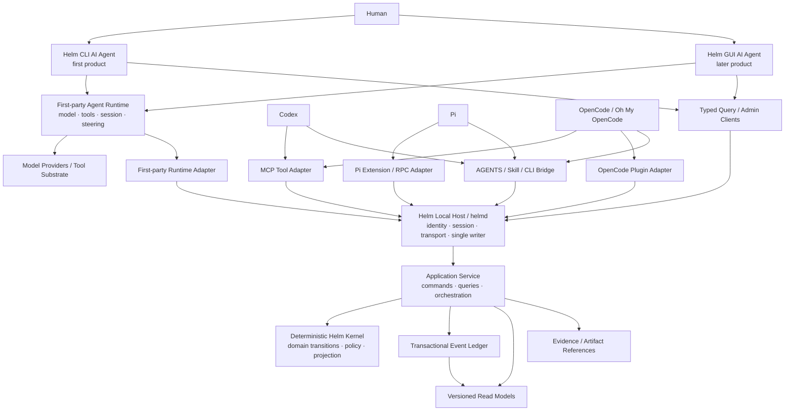

# Helm Agent & Kernel Architecture v0.2 후보

> Status: first executable semantic baseline passed — not a stable implementation contract
>
> Foundation: [`../foundations/10-refinement-candidate.md`](../foundations/10-refinement-candidate.md)
>
> Replaces: nothing yet; [`helm-system-v0.md`](helm-system-v0.md) remains the description of the current experimental implementation
>
> Product alignment: first-party Helm CLI AI Agent가 첫 목표이고 portable Kernel/adapters가 두 번째 목표다. N/E/M + A/P 위상과 Guided-default adaptive rigor를 사용한다.
>
> Validation evidence: [`CLI-G01 Codex Kernel Baseline`](../prototypes/agent-v0.2/runs/codex-kernel-baseline-001.md)
>
> Protocol evidence: [`Adapter Contract Baseline 001`](../prototypes/agent-v0.2/runs/adapter-contract-baseline-001.md)
>
> CLI evidence: [`Helm CLI Linear Experience 001`](../prototypes/agent-v0.2/runs/helm-cli-linear-001.md)
>
> Runtime evidence: [`First-party Agent Runtime Baseline 001`](../prototypes/agent-v0.2/runs/first-party-runtime-baseline-001.md)
>
> Authority evidence: [`Authority Carry-forward Baseline 001`](../prototypes/agent-v0.2/runs/authority-carry-forward-001.md)
>
> Runtime effects/context evidence: [`Runtime Effects and Context Baseline 001`](../prototypes/agent-v0.2/runs/runtime-effects-context-001.md)
>
> Provider evidence: [`OpenAI Responses Provider Contract 001`](../prototypes/agent-v0.2/runs/openai-provider-contract-001.md)
>
> Durable storage evidence: [`SQLite Transaction Baseline 001`](../prototypes/agent-v0.2/runs/sqlite-transaction-baseline-001.md)

## 1. 목적

이 문서는 첫 제품인 **Helm CLI AI Agent**와 그 내부의 runtime-independent Kernel을 함께 설계한다. 이어 Codex, Pi, OpenCode, Oh My OpenCode에 같은 의미 상태와 workflow를 이식하기 위한 adapter architecture를 정의한다.

핵심 결론은 다음과 같다.

> **Helm의 공통성은 모든 runtime이 같은 transport를 지원하는 데서 나오지 않는다. 하나의 versioned semantic contract를 runtime별 transport와 capability에 맞게 운반하는 데서 나온다.**

따라서 MCP, plugin hook, RPC, SDK, CLI는 Helm의 정본 protocol이 아니다. 이들은 동일한 Command, Observation, Query, Projection 계약을 전달하는 port 구현이다.

### 제품 구조의 우선순위

```text
First product:
  Helm CLI Experience
    + First-party Agent Runtime
    + Portable Helm Kernel

Second product capability:
  Portable Helm Kernel
    + Codex / Pi / OpenCode adapters

Later product:
  Helm GUI Experience
    + First-party Agent Runtime
    + Portable Helm Kernel
```

Kernel을 runtime-independent하게 만드는 이유는 Helm CLI를 “control panel”로 축소하기 위해서가 아니다. 자체 Agent Runtime 안에서도 의미 규칙과 model/tool loop를 분리하고, 검증된 규칙을 다른 agent에 재사용하기 위해서다.

## 2. 공식 runtime surface에서 확인된 사실

이 아키텍처는 2026-08-22에 확인한 공식 문서를 기준으로 한다. runtime별 기능은 바뀔 수 있으므로 adapter conformance test가 문서 기억보다 우선한다.

### Codex

OpenAI 공식 문서는 ChatGPT desktop, Codex CLI, IDE extension이 같은 host의 MCP 설정을 공유하고, local STDIO와 Streamable HTTP MCP server를 지원한다고 설명한다. 프로젝트 단위 `.codex/config.toml`도 지원한다.

- [OpenAI Codex MCP documentation](https://learn.chatgpt.com/docs/extend/mcp?surface=cli)

**아키텍처 해석:** MCP는 Helm tool/query surface의 강한 첫 integration이다. 그러나 MCP만으로 Codex가 호출한 다른 도구 전체의 lifecycle을 자동 관찰하거나 Helm 밖의 mutation을 강제 차단한다고 가정하지 않는다.

### Pi

Pi 공식 문서는 다음 세 경계를 제공한다.

- headless JSONL stdin/stdout RPC와 agent/tool lifecycle event
- TypeScript extension의 tool registration, lifecycle interception, context injection, UI
- SDK를 통한 `AgentSession` embedding

프로젝트 `AGENTS.md`, project-local extension과 Agent Skills도 지원한다.

- [Pi RPC mode](https://pi.dev/docs/latest/rpc)
- [Pi extensions](https://pi.dev/docs/latest/extensions)
- [Pi SDK](https://pi.dev/docs/latest/sdk)

**아키텍처 해석:** Pi는 MCP 존재 여부와 무관하게 native extension 또는 RPC host adapter로 높은 관측·제어 capability를 구현할 수 있다.

### OpenCode

OpenCode 공식 문서는 local STDIO와 remote Streamable HTTP MCP server를 지원한다. Plugin API는 session/tool hook, event subscription, tool registration과 server client 기능을 제공하지만 beta contract다.

- [OpenCode MCP servers](https://opencode.ai/v2/docs/mcp-servers)
- [OpenCode plugins](https://opencode.ai/v2/docs/build/plugins)

**아키텍처 해석:** MCP는 안정도가 높은 최소 도구 surface, plugin은 lifecycle capture와 enforcement를 위한 richer adapter다. beta plugin API 변경을 kernel contract로 전파하지 않는다.

### Oh My OpenCode

Oh My OpenCode는 OpenCode 위의 plugin·agent orchestration·hook layer다.

- [Oh My OpenCode repository](https://github.com/code-yeongyu/oh-my-opencode)

**아키텍처 해석:** 별도 kernel adapter를 먼저 만들지 않는다. OpenCode adapter를 기반으로 active plugin과 background agent metadata를 optional capability로 확장한다.

## 3. 아키텍처 원칙

### P1. Semantic contract가 transport보다 먼저다

MCP tool 이름, Pi event 이름, OpenCode hook type을 canonical domain vocabulary로 사용하지 않는다.

### P2. Kernel은 agent를 실행하지 않지만 Helm 제품은 실행한다

Kernel은 허용되는 상태 전이, 권한, 근거, projection을 소유한다. Helm의 first-party Agent Runtime은 모델 호출, reasoning loop, tool selection, steering을 소유한다. 둘을 분리하되 함께 Helm CLI 제품을 구성한다.

### P3. Adapter는 canonical Event를 직접 append하지 않는다

Adapter는 Command 또는 Observation candidate를 제출한다. Kernel이 schema, authority, expected cursor, policy를 검사한 뒤 Event를 만든다.

### P4. Capability는 협상하며 결손을 숨기지 않는다

어떤 adapter가 `pause`, `tool observation`, `permission enforcement`를 지원하지 않으면 emulation하지 말고 capability manifest에 `unsupported`로 표시한다.

### P5. Projection은 read model이다

Projection과 recommendation은 정본을 변경하지 않는다. Actor가 recommendation을 수락했을 때 별도 Command가 normative transition을 만든다.

### P6. Local-first는 single-user-only를 뜻하지 않는다

개인 로컬 사용에서도 여러 agent process가 동시에 쓸 수 있다. single-writer serialization, optimistic concurrency, idempotency는 첫 버전부터 필요하다.

### P7. 의미 품질을 LLM validator 하나에 맡기지 않는다

구조적 검증, provenance, authority, evidence relation, human/policy acceptance를 분리한다. LLM 평가는 설명 가능한 diagnostic candidate일 뿐이다.

## 4. 전체 구조



### 중요한 비대칭

- **Northbound:** user/agent/client가 Helm에 Command와 Query를 보낸다.
- **Southbound:** runtime adapter가 agent lifecycle, tool action, material change를 Observation candidate로 보낸다.
- **Control:** Kernel이 policy result, context invalidation, pause/escalation request를 adapter에 보낸다.

하나의 MCP server만으로 세 방향을 모두 완전히 구현하려 하지 않는다.

First-party Agent Runtime은 세 방향을 모두 가장 풍부하게 구현하는 기준 adapter다. 그러나 내부 package라는 이유로 raw Event append, authority bypass, projection write를 허용하지 않는다.

## 5. 배포와 프로세스 위상

### 기본: local host single writer

```text
agent/client processes
        ↓ local authenticated transport
helmd — one writer per workspace
        ↓ transaction
SQLite ledger + read models + evidence references
```

`helmd`는 제품 ontology를 소유하지 않는 host다. 다음 operational responsibility만 가진다.

- workspace discovery와 process lifecycle
- local actor/session identity 발급
- 요청 인증과 rate/body limit
- single-writer transaction serialization
- adapter connection과 capability registry
- subscription/change stream
- backup/export coordination

### Embedded mode

테스트, disposable simulation, one-shot import에서 MAY 제공한다. 실제 workspace에 쓰는 embedded client는 반드시 workspace lock을 획득해야 하며, daemon과 동시 writer가 되어서는 안 된다.

### Remote mode

다음 조건 전에는 NOT YET이다.

- authenticated human/team identity
- TLS와 secret management
- multi-tenant authorization
- organization policy boundary
- conflict resolution and sync protocol

loopback HTTP를 열었다는 사실은 remote collaboration readiness를 의미하지 않는다.

## 6. 논리 모듈

초기에는 monorepo package 수를 줄일 수 있지만 의존 방향은 보존한다.

```text
contracts
   ↑
kernel ← policy
   ↑
application
   ↑
host ← storage-sqlite
   ↑
client / adapter-sdk
   ↑
agent-runtime / mcp / external adapters
   ↑
agent-cli / agent-gui
```

### `@helm/contracts`

- JSON Schema와 generated TypeScript types
- Command, Result, Event, Query, Projection envelope
- adapter capability manifest
- schema compatibility fixtures
- domain 이름과 error code

Node filesystem, network, database에 의존하지 않는다.

### `@helm/kernel`

- pure domain transition function
- invariant evaluation
- policy decision input/output
- deterministic projector
- invalidation and conflict derivation

시계, random ID, filesystem, process environment를 직접 읽지 않는다. 필요한 값은 application layer가 input으로 제공한다.

### `@helm/application`

- actor와 workspace context 결합
- Command transaction orchestration
- idempotency와 expected cursor 검사
- kernel result append
- projection update와 subscription notification
- evidence blob/reference lifecycle

### `@helm/storage-sqlite`

- transactional ledger
- per-workspace monotonic sequence
- command inbox와 idempotency key
- projector checkpoint와 rebuild
- evidence metadata와 content-addressed reference
- backup, integrity check, migration

SQLite는 ontology가 아니라 기본 local storage adapter다. JSONL은 human-readable export와 legacy import로 유지한다.

현재 executable candidate는 pure in-memory Kernel을 SQLite application/storage harness로 감싸 이 경계를 검증한다. durable Command/Observation inbox, Event와 outbox의 원자적 append, expected-cursor 충돌, 재시작 replay, per-workspace checksum chain을 구현했다. 이는 storage contract의 첫 증거이며 아직 `helmd`, projection checkpoint, backup/restore 또는 durable Agent Runtime을 증명하지 않는다.

### `@helm/host`

- daemon/embedded lifecycle
- local transport
- identity and session
- adapter registry
- change stream

### `@helm/client`

- typed query/command client
- retry와 idempotency 보존
- cursor subscription
- transport-independent error mapping

### `@helm/adapter-sdk`

- capability negotiation
- runtime event normalization
- context delivery
- pause/cancel/escalation request handling
- adapter conformance harness

### `@helm/agent-runtime`

- model provider abstraction and invocation
- reasoning/tool execution loop
- session, queue, pause, resume, cancellation
- Kernel Context Projection consumption
- Work Agreement and Authority Envelope enforcement handoff
- tool/run Observation candidate emission
- Completion Claim composition

Agent Runtime은 domain state를 자체 session record로 대체하지 않는다. provider transcript와 tool trace는 source evidence이며 Kernel Command/Event가 정본이다.

### `@helm/agent-cli`

- first-party terminal interaction
- Guided-default conversation orchestration
- Brief, Explore, Choice, Work, Review surface
- progressive disclosure and keyboard interaction
- human Gate and correction capture
- Agent Runtime 및 typed Helm client 조합

`@helm/agent-cli`가 첫 제품 entrypoint다. 기존 semantic capture CLI는 migration/diagnostic command로 흡수하거나 분리한다.

### Integration packages

- `@helm/adapter-first-party`
- `@helm/mcp-server`
- `@helm/adapter-pi`
- `@helm/adapter-opencode`
- `@helm/bridge-files`
- 이후 `@helm/adapter-codex-lifecycle`가 공식 surface로 정당화될 때 추가

Codex의 첫 integration은 generic MCP server를 사용하며 vendor name을 server core에 넣지 않는다.

## 7. 정본 계약의 네 종류

### Command

Actor가 기준선을 바꾸려는 의도다. 아직 발생한 Event가 아니다.

```json
{
  "schema": "helm.command.v0.2",
  "commandId": "cmd_...",
  "workspaceId": "ws_...",
  "type": "choice.commit",
  "actor": {
    "actorId": "actor_...",
    "sessionId": "session_...",
    "runtime": "codex"
  },
  "authorityBasis": ["policy_...", "agreement_..."],
  "expectedCursor": 418,
  "idempotencyKey": "...",
  "payload": {},
  "provenance": {
    "adapterId": "adapter_...",
    "externalRunId": "...",
    "sourceRefs": []
  }
}
```

### Observation candidate

Tool/runtime이 외부에서 감지한 사실 후보다. Kernel은 이것을 accepted Finding이나 Choice로 자동 승격하지 않는다.

```json
{
  "schema": "helm.observation-candidate.v0.2",
  "observationId": "obs_external_...",
  "workspaceId": "ws_...",
  "kind": "artifact.changed",
  "observer": "tool:git",
  "observedAt": "...",
  "subjectRefs": ["artifact_..."],
  "payload": {},
  "source": {
    "externalId": "...",
    "contentHash": "sha256:..."
  }
}
```

### Ledger Event

Kernel이 Command/Observation을 평가하여 기록한 불변 transition record다. payload의 영구적 진실을 보장하지 않는다.

```json
{
  "schema": "helm.event.v0.2",
  "eventId": "evt_...",
  "workspaceId": "ws_...",
  "sequence": 419,
  "type": "normative.choice.committed",
  "recordedAt": "...",
  "effectiveAt": "...",
  "actorId": "actor_...",
  "authorityBasis": ["policy_..."],
  "subjectRefs": ["choice_...", "goal_..."],
  "payload": {},
  "provenance": {},
  "causationId": "cmd_...",
  "correlationId": "episode_..."
}
```

### Query / Projection

Projection은 cursor와 derivation policy version에 묶인 read model이다.

```json
{
  "schema": "helm.projection.brief.v0.2",
  "workspaceId": "ws_...",
  "sourceCursor": 419,
  "policyVersion": "brief-policy.v0.2.1",
  "generatedAt": "...",
  "freshness": "current",
  "includedRefs": [],
  "omitted": [{ "category": "routine-activity", "count": 42 }],
  "qualitySignals": [],
  "data": {}
}
```

## 8. Identity, ordering, idempotency

### Identity

- Entity와 Event ID는 globally unique하되 ordering 의미를 ID 문자열에 의존하지 않는다.
- external runtime/run/tool call ID는 별도 provenance field로 보존한다.
- `actor: human:local` 같은 자유 문자열은 display label일 뿐 authority identity가 될 수 없다.

### Ordering

- ledger는 workspace별 monotonic `sequence`를 부여한다.
- `sourceCursor`는 마지막 Event ID가 아니라 sequence 또는 opaque durable cursor다.
- `occurred/effective time`과 `recorded order`를 분리한다.
- 늦게 도착한 Observation은 과거에 삽입하지 않고 현재 sequence에 기록한 뒤 affected projection을 rebuild/invalidate한다.

### Idempotency

- 모든 Command는 `commandId`와 caller-scoped `idempotencyKey`를 가진다.
- Adapter Observation은 stable external ID 또는 source content hash를 가진다.
- retry는 동일 result를 돌려주며 중복 Event를 만들지 않는다.
- idempotency retention과 key scope를 schema에 명시한다.

### Optimistic concurrency

- 기준선 변경 Command는 `expectedCursor`를 사용한다.
- mismatch 시 last-write-wins 하지 않고 `conflict.expected_cursor_mismatch`를 반환한다.
- 충돌 응답은 달라진 relevant entity와 rebase 가능한 projection을 포함한다.

## 9. Candidate domain vocabulary

아래는 stable 선언이 아니라 cross-runtime fixture를 만들기 위한 후보다.

### Goal

```text
goal.open
goal.revise
goal.pause
goal.retire
goal.achievement_claim
goal.achievement_accept
```

### Concern

```text
concern.open
concern.reframe
concern.resolve
concern.reopen
```

### Epistemic state

```text
observation.capture
observation.qualify
interpretation.propose
possibility.propose
claim.propose
claim.accept
claim.contest
claim.mark_stale
claim.supersede
evidence.link
evidence.invalidate
```

### Choice

```text
choice.open
choice.qualify
choice.commit
choice.reopen
choice.supersede
```

### Work agreement and execution

```text
agreement.offer
agreement.accept
agreement.renegotiate
agreement.release
run.attach
run.status_observe
exception.raise
```

### Completion, acceptance, integration

```text
completion.submit
completion.correction_request
result.accept
result.reject
integration.start
integration.verify
integration.complete
integration.reopen
```

큰 state machine 하나를 모든 작업에 강제하지 않는다. policy profile이 필요한 transition subset과 evidence burden을 정한다.

## 10. Semantic quality model

각 Entity는 domain lifecycle과 별도로 quality state를 가진다.

```text
captureState: absent | captured | structural
qualification: unqualified | qualified | disputed
baselineStatus: proposed | accepted | contested | stale | superseded
```

### 구조적 검증

- schema/type/required fields
- referential integrity
- ID and cursor rules
- payload size and encoding

### 의미적 qualification

- source와 scope 존재
- evidence relation의 방향과 대상
- authority와 accountable acceptor
- counterevidence/review trigger
- policy profile에 따른 최소 burden

### content quality diagnostic

짧거나 무의미해 보이는 문자열, 순환 rationale, option 중복 등은 diagnostic을 만들 수 있다. 다만 language heuristic만으로 인간 입력을 삭제하거나 거부하지 않는다.

```text
Decision "ㅇ" with rationale "ㅁㄴㅇ"
→ structurally valid
→ unqualified
→ cannot become active baseline under standard policy
→ visible as attention item
```

`blind spot 없음`은 필드 존재가 아니라 relevant state가 qualified/current인지에 기반해야 한다.

## 11. Policy engine

Policy input은 pure data이며 decision 근거를 반환한다.

```json
{
  "decision": "allow | deny | require_gate | require_evidence | conflict",
  "policyIds": ["..."],
  "reasons": ["..."],
  "missing": ["..."],
  "requiredActions": ["..."]
}
```

### Effect class

```text
R0 read-only local
R1 reversible local mutation
R2 shared or externally visible reversible action
R3 costly, sensitive, or low-recoverability action
R4 irreversible or prohibited-by-default action
```

Authority Envelope은 command type만이 아니라 effect class, resource scope, budget, expiry, stop condition을 포함한다.

### Authority carry-forward

최초 사용자 지시가 후속 Work Agreement를 재질문 없이 활성화하는 것은 묵시적 권한 추정이 아니다. Human Authority Grant와 Agreement requested authority 사이의 포함 관계를 Kernel policy가 증명해야 한다.

```text
RequestedAuthority(Agreement) ⊆ CurrentAuthorityGrant(Actor, WorkUnit)
```

포함 검사는 최소한 grantee, action class, effect class, resource scope, expiry, stop condition을 다룬다. 어느 차원이든 확대되거나 증명할 수 없으면 `require_gate`다. Event는 original human grantor와 activating agent를 함께 보존한다.

### Gate rule

Gate는 다음 모두가 참일 때 생성한다.

1. policy가 자동 처리할 수 없다.
2. Actor의 판단이 결과를 실질적으로 바꾼다.
3. 지금 묻는 가치가 attention cost보다 높다.

Gate Event와 UI notification을 구분한다. 같은 unresolved decision에 알림을 반복 생성하지 않는다.

## 12. Projection과 Context Compilation

### Projection 불변조건

- source cursor와 projector version
- included source refs와 omission summary
- freshness와 invalidation reason
- quality/uncertainty/conflict signal
- source drill-down
- deterministic rebuild for the same inputs

### Recommendation의 지위

Recommendation은 projection 안의 derived candidate다.

```text
projection recommends X
  ≠ workspace decided X

actor accepts X through choice.commit
  → normative Event
```

### Context pack

Runtime별 token formatting은 Adapter가 담당하지만 Kernel projection은 같은 semantic content set을 제공한다.

```text
Goal + Concern
+ accepted Choices and Constraints
+ Work Agreement and Authority Envelope
+ relevant qualified Claims/Evidence
+ contested/stale items
+ Artifact neighborhood
+ stop/escalation conditions
+ source refs and omitted categories
```

Adapter는 context window에 맞게 추가 압축할 수 있으나 omitted category와 source cursor를 되돌려야 한다.

## 13. Adapter Protocol

### Capability manifest

```json
{
  "schema": "helm.adapter-capabilities.v0.2",
  "adapterId": "adapter_...",
  "runtime": { "family": "pi", "version": "..." },
  "transport": ["extension", "rpc"],
  "capabilities": {
    "contextDelivery": "push",
    "toolObservation": "full",
    "artifactObservation": "partial",
    "pause": "supported",
    "cancel": "supported",
    "authorityEnforcement": "pre_tool_hook",
    "interactiveGate": "native",
    "resume": "supported"
  },
  "limitations": []
}
```

### Capability levels

| Level | 의미 | 가능한 구현 |
|---|---|---|
| A — Bridge | context/query/semantic submit | AGENTS/Skill + CLI |
| B — Tool | structured model-callable Helm tools | MCP 또는 custom tool |
| C — Observe | session/tool/artifact lifecycle 수집 | runtime extension/plugin/RPC |
| D — Direct | pause/cancel/context refresh/permission enforcement | rich native adapter |

Level A adapter를 Level D처럼 표시해서는 안 된다.

### Delivery semantics

- Adapter → Host는 at-least-once 전송과 idempotent inbox를 기본으로 한다.
- Host → Adapter control request는 acknowledgement와 timeout을 가진다.
- 연결 단절은 authority 확대가 아니라 safe degradation을 유발한다.
- `authorityEnforcement`가 없는 adapter에서는 Helm이 실제 sandbox라고 주장하지 않는다.

### Adapter는 raw transcript를 정본으로 만들지 않는다

Transcript와 tool stream은 source evidence다. semantic candidate는 명시적 extraction provenance를 가지며 qualified/accepted transition을 별도로 거친다.

## 14. Runtime별 초기 mapping

### First-party Helm CLI profile

```text
Experience: native Guided-default terminal interaction
Runtime: owned model/tool/session loop
Tool: typed Kernel client plus first-party runtime tools
Observe: complete session/tool/artifact candidate stream
Direct: pause/cancel/context refresh/authority enforcement
Required capability: Level D reference implementation
```

First-party profile은 외부 runtime의 최소 공통 capability에 제한되지 않는다. 대신 이 profile에서 유효성이 입증된 semantic workflow 중 transport-independent한 부분을 외부 adapter가 재현한다.

### Codex profile

```text
Bridge: AGENTS.md + Helm skill/CLI
Tool: local STDIO or Streamable HTTP MCP
Observe/Direct: 공식 lifecycle surface를 검증한 뒤 별도 adapter
```

MCP server instruction에는 server-wide constraint를 넣되, workspace의 가변 Goal/Context 전체를 정적 instruction에 복제하지 않는다.

### Pi profile

```text
Bridge: AGENTS.md + Agent Skill + CLI
Tool: TypeScript extension custom tools
Observe: extension lifecycle/tool events or RPC event stream
Direct: tool_call interception, RPC abort/steering, extension UI
Host mode: Pi SDK AgentSession embedding is optional
```

Helm이 Pi를 직접 spawn/embedding하는 경우와 이미 실행 중인 Pi에 붙는 경우를 별도 deployment profile로 둔다.

### OpenCode profile

```text
Bridge: instruction files + CLI
Tool: MCP
Observe: plugin session/tool hooks and public event stream
Direct: plugin intercept hook and session interrupt
```

Plugin API가 beta이므로 adapter package는 supported OpenCode version range와 conformance result를 노출한다.

### Oh My OpenCode profile

OpenCode profile을 상속한다. 다음 metadata가 실제 공식 hook으로 관측될 때만 optional extension을 추가한다.

- background/subagent identity
- parent/child run relation
- agent category/model role
- orchestration completion and cancellation

Oh My OpenCode의 내부 agent 이름을 Helm Actor kind로 고정하지 않는다.

## 15. MCP surface 후보

MCP는 전체 Event ledger를 model context에 노출하지 않는다. 사용자·agent가 답할 수 있는 semantic tool을 제공한다.

### Read tools

```text
helm_get_orientation
helm_get_context
helm_get_open_gates
helm_get_work_agreement
helm_get_assurance_view
helm_get_sources
```

### Write tools

```text
helm_open_concern
helm_submit_observation
helm_propose_claim
helm_link_evidence
helm_propose_choice
helm_commit_choice
helm_accept_work_agreement
helm_raise_exception
helm_submit_completion
```

Tool description은 `propose`와 `commit`, `submit`과 `accept`를 구분한다. Agent에게 `commit_choice` tool이 보여도 authority policy가 허용하지 않으면 Gate를 반환한다.

### Tool result

모든 write result는 다음을 포함한다.

```text
accepted/rejected/needs_gate/conflict
new cursor or unchanged cursor
created/affected entity refs
policy reasons
missing evidence/authority
fresh context ref when rebase is needed
```

## 16. Storage와 migration

### SQLite baseline

권장 table responsibility:

```text
workspaces
commands            # idempotent inbox and results
events              # immutable sequence
projection_checkpoints
projection_documents
actors_sessions
adapter_connections
evidence_refs
schema_migrations
outbox               # adapter/client notifications
```

domain entity별 mutable table을 정본으로 만들지 않는다. 성능용 read table은 rebuild 가능해야 한다.

### Transaction boundary

한 Command 처리에서 다음은 하나의 transaction이다.

1. idempotency/expected cursor 검사
2. current state load
3. kernel transition and policy evaluation
4. Event append
5. synchronous critical projection update 또는 checkpoint invalidation
6. outbox append

외부 runtime notification은 transaction 후 outbox로 전달한다.

### Schema evolution

- Event envelope version과 payload type version을 분리한다.
- historical Event를 in-place rewrite하지 않는다.
- reader upcaster와 explicit migration Event를 구분한다.
- projection schema는 Event schema와 독립 version을 가진다.
- adapter는 supported contract range를 handshake한다.
- unknown Event type은 ledger integrity를 깨뜨리지 않고 unsupported projection diagnostic을 만든다.

### JSONL migration

현재 `.helm/events.jsonl`은 import source다.

- 원본 hash와 path를 provenance로 보존
- experimental Event를 stable meaning으로 자동 추정하지 않음
- `projection.next_action.proposed`는 normative candidate 또는 derived history로 명시적 선택
- 낮은 품질 Decision은 `captured/unqualified`로 import
- import report에 loss/ambiguity 목록 포함

## 17. 동시성과 의미 충돌

### 기술적 충돌

- same expected cursor에 대한 concurrent normative Command
- duplicate external event
- adapter reconnect/replay
- projector lag

### 의미 충돌

- 서로 다른 WorkUnit이 같은 accepted Choice/Constraint를 다르게 전제
- 같은 Assumption을 양립 불가능하게 갱신
- 다른 Artifact를 변경하지만 같은 interface obligation을 위반
- authority envelope이 겹치거나 요청자의 권한을 초과

기술적 lock이 의미 충돌을 해결하지 않는다. Kernel은 affected semantic refs를 기준으로 `Conflict` entity/candidate를 만든다.

### Semantic intent/lease

Work Agreement MAY declare:

```text
intendsToChange
dependsOn
preserves
interfaceObligations
expectedOutcome
leaseExpiry
```

Lease는 독점 파일 잠금이 아니라 조기 충돌 탐지 신호다.

## 18. 보안과 신뢰 경계

### Actor identity

- runtime이 전달한 display name을 인증 identity로 신뢰하지 않는다.
- local adapter registration 때 host가 session credential을 발급한다.
- human acceptance는 어느 UI/session/auth context에서 발생했는지 추적한다.

### Project resources

AGENTS, skill, Pi extension, OpenCode plugin은 실행·지시 공급망이다.

- project trust 전에는 자동 실행하지 않음
- generated files는 명확한 marker와 ownership을 가짐
- hash/version/source를 adapter metadata에 기록
- 사용자 파일을 silent overwrite하지 않음

### Evidence privacy

- source metadata와 secret content를 분리
- projection별 disclosure policy
- content-addressed blob도 민감도 label과 access policy 보유
- remote/SaaS sync는 opt-in allowlist

### Enforcement honesty

Adapter가 tool interception이나 sandbox를 지원하지 않으면 Helm은 `advisory authority`만 제공한다. UI와 audit에서 enforced와 advisory를 구분한다.

## 19. 실패와 복구

### 실패 종류

```text
command rejection
policy/gate requirement
expected cursor conflict
adapter disconnected
observation malformed
storage unavailable/corrupt
projection lag/failure
schema unsupported
external action uncertain
```

### 복구 원칙

- Event append 성공 여부가 불확실하면 같은 idempotency key로 재조회/재시도
- projection failure가 ledger commit을 되돌리지 않으며 degraded 상태를 표시
- corrupt tail을 자동 무시하지 않고 integrity diagnostic과 read-only recovery mode 제공
- external action timeout은 실패로 단정하지 않고 `outcome unknown`으로 기록
- compensation/rollback은 새 authorized WorkUnit이다
- backup은 SQLite consistent snapshot + evidence manifest + schema versions를 포함

## 20. Observability와 제품 Event의 분리

다음은 서로 다른 stream이다.

- **Domain ledger:** Goal, Claim, Choice, Agreement, Outcome의 의미 전이
- **Operational log:** latency, connection, retry, exception, projector health
- **Experiment measurement:** recovery time, correction, workload, agency rating
- **Raw runtime trace:** message/tool/session source evidence

서버 오류나 token usage를 자동으로 domain Event로 만들지 않는다. 반대로 중요한 material Outcome을 operational log에만 남기지 않는다.

## 21. Test architecture

### Kernel tests

- pure transition table
- invariant/property tests
- deterministic replay
- stale/contested/superseded propagation
- authority and evidence burden
- garbage-but-nonempty semantic input

### Storage tests

- atomic command/event/outbox transaction
- concurrent writer serialization
- crash and restart recovery
- idempotent retry
- migration/upcast/rebuild
- backup/restore integrity

### Adapter conformance suite

모든 adapter가 같은 fixture를 실행한다.

```text
identify and handshake
deliver cursor-bound context
submit duplicate observation
lose/reconnect connection
receive gate requirement
attempt unauthorized command
pause/cancel if advertised
submit completion with evidence
resume in another runtime
```

advertised capability와 실제 결과가 다르면 adapter는 fail한다.

### Cross-runtime semantic fixture

1. Codex에서 Goal/Concern/Choice 생성
2. Pi에서 같은 Context로 Inquiry 수행
3. OpenCode에서 bounded change 수행
4. 다른 runtime에서 resumption
5. 모든 runtime이 같은 accepted baseline, contested claim, unresolved integration을 재현

transport-specific session ID가 달라도 semantic identity와 cursor는 같아야 한다.

### UX/effectiveness tests

- Brief 전후 situation recovery 정확도와 시간
- raw transcript fallback 횟수
- user correction이 실제 downstream context를 바꾸는지
- Gate acceptance/rejection이 결과를 바꾸는지
- notification workload와 interruption cost
- completion/acceptance/integration 분리가 결함을 발견하는지

## 22. 현재 experimental.v0에서의 migration

### Phase 0 — Freeze and evidence preservation

- `experimental.v0`를 stable로 rename하지 않는다.
- 현재 JSONL, tests, dogfood defect를 fixture로 보존한다.
- 새 코드가 기존 unqualified Decision을 정상 baseline으로 기대하지 않게 한다.

### Phase 1 — Contract and deterministic Kernel

- `@helm/contracts` candidate schema
- pure Command → Event transition
- sequence cursor, expected cursor, idempotency
- Goal/Concern/Claim/Choice와 Guided profile의 vertical slice
- quality state와 Projection boundary correction

### Phase 2 — Helm CLI AI Agent vertical slice

- first-party Agent Runtime의 최소 model/tool/session loop
- Guided-default CLI experience
- SQLite single writer
- JSONL importer/exporter
- typed client
- first-party Level D adapter
- Brief → Explore → Choice → Work → Review end-to-end dogfood

### Phase 3 — Helm CLI UX simulation and refinement

- representative Guided/Quick/Assured scenarios
- correction, steering, completion/acceptance/integration interaction
- delayed resumption and raw transcript fallback measurement
- CLI interaction burden and reuse intent

### Phase 4 — Portable adapters and cross-runtime simulation

- MCP adapter와 file/skill bridge
- Pi extension/RPC adapter
- OpenCode plugin adapter
- Codex MCP conformance
- capability negotiation and degradation UX
- same semantic fixture and delayed resumption across runtimes

### Phase 5 — Helm GUI AI Agent

- visual Common Operating Picture and interaction surfaces
- first-party Agent Runtime reuse
- CLI/GUI state and policy parity
- richer native orchestration where UX evidence supports it

자체 agent가 kernel의 authority checks를 우회하는 private path를 만들지 않는다.

## 23. Architecture acceptance criteria

이 후보는 다음이 증명될 때만 구현 정본이 된다.

- 합의된 “CLI agent 우선, portable Kernel 두 번째, GUI agent 이후” 순서가 package와 delivery plan에 반영됨
- Guided가 기본 profile이고 Quick/Assured가 같은 의미 불변조건을 보존함
- 모든 package responsibility가 Foundation law와 user question에 trace됨
- first-party Agent Runtime이 Kernel validation과 authority를 우회하지 않음
- 같은 semantic fixture가 최소 두 runtime adapter에서 통과함
- MCP 없이도 Pi adapter가, Pi 없이도 MCP adapter가 kernel을 사용할 수 있음
- adapter가 canonical Event를 직접 위조/append할 수 없음
- concurrent client가 silent last-write-wins를 만들지 않음
- Projection output이 canonical input vocabulary에 침투하지 않음
- low-quality input이 qualified baseline이나 `blind spot 없음`으로 승격되지 않음
- schema migration과 replay가 historical provenance를 보존함
- enforced authority와 advisory authority가 사용자에게 구분됨
- failure/reconnect/retry가 duplicate normative transition을 만들지 않음

## 24. 검증 현황과 다음 산출물

Run 001에서 완료:

1. `CLI-G01`의 minimum Guided Command/Event/Projection vertical slice 추출;
2. deterministic sequence, expected cursor, idempotency, projection boundary 구현;
3. source Decision을 보존하는 loss-aware migration disposition;
4. 여섯 failure injection과 replay test;
5. `choice.qualify` transition과 Completion Claim의 Epistemic 분류 정제.

Adapter Contract Baseline 001에서 완료:

1. Draft 2020-12 candidate envelope schemas;
2. runtime-neutral handshake/submit/query protocol;
3. direct object와 JSONL RPC framing의 Event/Projection parity;
4. capability degradation과 semantic invariant의 분리;
5. 두 transport 모두에서 raw Event append 차단.
6. Observation Candidate의 effective time/recorded order 분리와 provenance-preserving parity.

Linear CLI Run 001에서 완료:

1. Agent/Human typed client surface와 Kernel authority의 이중 방어;
2. Orientation → Choice → Agreement → Completion → Review → Integration linear rendering;
3. 작업 전 consequential Gate 1개와 작업 후 Result Review 1개;
4. initial instruction에서 non-expanding Work Agreement로 authority를 carry-forward하는 UX hypothesis;
5. provider 연결 전 terminology와 information-density review point 추출.

First-party Runtime Baseline 001에서 완료:

1. bounded provider/tool loop와 step/tool-call ceiling;
2. model에 Human acceptance tool을 노출하지 않는 typed surface;
3. cursor-bound Gate eligibility와 stale Gate rejection;
4. steering/provider cancellation, terminal output sanitation;
5. provider가 semantic UI label을 위조하지 못하는 projection-owned rendering boundary.

Authority Carry-forward Baseline 001에서 완료:

1. Human-only Authority Grant와 Agent-only bounded activation surface;
2. action/effect/resource/expiry/stop-condition subset policy;
3. non-expanding Agreement의 approval-free activation;
4. expansion, omission, expiry의 `needs_gate` 전환;
5. accountable human과 activating agent provenance 분리.

Runtime Effects and Context Baseline 001에서 완료:

1. tool effect/cancellation/enforcement capability contract;
2. cooperative interruption과 atomic cancellation deferral;
3. uncertain external outcome의 no-retry recovery state;
4. raw transcript를 대체하는 cursor-bound Context Projection;
5. semantic priority, omission report, budget, redaction, fail-closed context policy.

OpenAI Provider Contract 001에서 완료:

1. OpenAI-specific request/response mapping을 generic Provider Turn 뒤로 격리;
2. strict function schema와 runtime-side 재검증;
3. stateless Context cursor 0→1→2 tool loop;
4. Human tool 미노출과 별도 cursor-bound Gate;
5. key-safe HTTP/incomplete/mixed-output failure handling.

SQLite Transaction Baseline 001에서 완료:

1. SQLite reopen 뒤 Event와 Projection의 deterministic replay;
2. durable Command/Observation inbox와 duplicate-free retry;
3. 두 connection의 stale expected-cursor conflict;
4. Event/outbox/inbox 단일 transaction과 fault-injected rollback;
5. outbox cursor resume 및 idempotent delivery marking;
6. checksum-chain 손상 시 fail-closed replay와 cross-workspace storage 격리;
7. durable service 위에서 동일한 runtime-neutral protocol 재사용.

다음 산출물:

1. product-owner CLI transcript review와 experience contract revision;
2. Authority revocation/budget/overlap과 natural-language Grant extraction;
3. durable tool intent/outcome journal과 canonical recovery evidence 연결;
4. live model provider 검증과 streaming decoder;
5. full JSONL importer와 outbox worker의 reconnect/subscription/cursor resume;
6. model-driven CLI의 interaction burden, steering, resumption 측정;
7. CLI 경험이 기준을 통과한 뒤 Codex MCP, Pi extension/RPC, OpenCode plugin adapter의 실제 Level A–D portability fixture.
