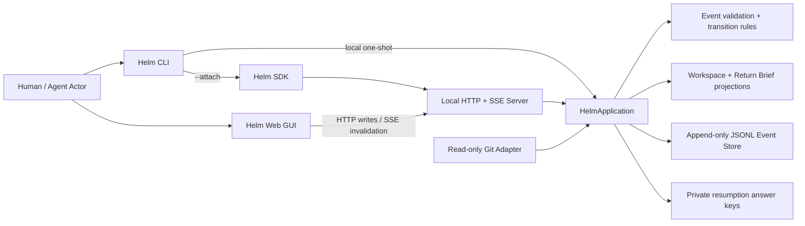

# Helm System Architecture v0

> Status: executable vertical slice, experimental contracts  
> Scope: local-first core + CLI + HTTP/SSE server + Web GUI  
> Non-goal: stable public schema, production desktop packaging, SaaS backend, autonomous agent runtime

## Product language boundary

이 문서는 experimental core의 정확한 Event와 projection 이름을 설명하므로 Purpose, Decision, Commitment 같은 원론 용어를 사용한다. 사용자 화면, onboarding, 알림, 새 application-layer domain은 [`쉬운 Helm Foundations`](../foundations-friendly/README.md)와 [`기술 대응표`](../foundations-friendly/06-technical-crosswalk.md)를 기준으로 한다.

- `Purpose`는 제품에서 **목표 / Goal**로 보인다.
- `Decision`은 **선택 / Choice**로 보인다.
- `Commitment`와 `DelegationContract`는 **약속 / 작업 합의**로 보인다.
- `AuthorityEnvelope`는 **맡긴 범위 / AllowedRange**로 보인다.
- `ClaimingComplete`, `Acceptance`, `Integration`은 **결과 제출 → 결과 확인 → 전체 반영**으로 분리한다.

현재 `experimental.v0` core Event를 즉시 일괄 rename하지 않는다. 대신 projection과 application command 경계에서 product domain으로 명시적으로 변환하고, public contract가 안정되기 전에 이해도 실험으로 용어를 검증한다.

## 1. Architecture decision

Helm Foundations를 문서 집합으로만 유지하지 않고, 하나의 headless application core를 여러 client가 공유하는 실행 시스템으로 만든다.

OpenCode에서 전이한 것은 agent/session domain이 아니라 **client–server 경계**다. OpenCode의 공식 문서는 TUI가 server client로 동작하고, headless server가 OpenAPI를 노출해 여러 client와 SDK를 지원한다고 설명한다. CLI는 독립 server에 attach할 수 있고 `web` 명령은 같은 backend 위에 Web UI를 제공한다.

- [OpenCode Server](https://opencode.ai/docs/server/)
- [OpenCode CLI](https://opencode.ai/docs/cli/)
- [OpenCode repository packages](https://github.com/anomalyco/opencode/tree/dev/packages)

Helm은 이 경계를 따르되 OpenCode의 model provider, prompt session, tool execution, TUI domain은 복제하지 않는다. Helm의 정본은 agent message가 아니라 Purpose·Decision·Commitment·Belief·Material Observation Event다.

## 2. 실행 구조



Local CLI가 server를 통하지 않는 경우에도 별도 domain logic을 갖지 않는다. CLI와 server는 동일한 `HelmApplication`을 호출한다. attached CLI와 Web GUI는 같은 HTTP contract와 Event cursor를 사용한다.

## 3. Repository boundaries

| Unit | Responsibility | Must not own |
|---|---|---|
| [`packages/helm-core`](../../packages/helm-core/) | Event validation, append-only store, semantic commands, Git adapter, projections, resumption protocol | HTTP, GUI layout, model/tool runtime |
| [`packages/helm-server`](../../packages/helm-server/) | local HTTP API, SSE invalidation stream, security headers, static Web delivery | alternate domain rules |
| [`packages/helm-sdk`](../../packages/helm-sdk/) | generated-SDK 후보가 될 transport client | workspace state or business decisions |
| [`packages/helm-cli`](../../packages/helm-cli/) | init, capture, record, brief, resumption, serve/web, remote attach | client-specific state schema |
| [`apps/helm-web`](../../apps/helm-web/) | Brief, timeline, low-friction semantic capture | canonical state, hidden resumption answer keys |
| [`experiments/helm-sidecar`](../../experiments/helm-sidecar/) | Founder Dogfood 001의 predecessor experiment | stable compatibility obligations |

## 4. Runtime state

Default local state:

```text
.helm/
├── workspace.json                 # workspace identity and Purpose
├── events.jsonl                   # append-only canonical Event ledger
└── private/
    └── resumption-keys.json       # participant에게 숨겨야 할 answer keys
```

`--state-dir`로 state를 프로젝트 밖에 둘 수 있다. 이는 read-only sidecar dogfood, 민감한 프로젝트, disposable experiment에서 사용한다.

### Experimental Event contract

```json
{
  "schema": "helm.event.experimental.v0",
  "id": "evt_...",
  "type": "normative.decision.committed",
  "occurredAt": "2026-08-16T00:00:00.000Z",
  "actor": "human:local",
  "authorityBasis": "direct-user-input",
  "concern": "workspace-direction",
  "subject": "decision:...",
  "payload": {},
  "provenance": {},
  "causationId": null,
  "correlationId": null
}
```

Event 수정·삭제 API는 없다. 동일 Git snapshot은 deterministic Event ID로 중복 append를 거부한다. Event type과 projection schema는 아직 public compatibility contract가 아니다.

## 5. Current semantic write path

현재 사용자 또는 agent가 명시적으로 기록할 수 있는 의미 변화는 네 가지다.

| Input | Event | Required evidence |
|---|---|---|
| Decision | `normative.decision.committed` | rationale, reopen trigger, status quo alternative |
| Commitment | `normative.commitment.created` | owner, acceptance evidence |
| Belief update | `epistemic.belief.updated` | confidence basis, optional counterevidence |
| Next action | `projection.next_action.proposed` | summary and authority |

Git adapter는 `material.snapshot.observed`와 `material.worktree_change.observed`만 생성한다. filename이나 diff에서 Decision·Belief·Acceptance를 추론하지 않는다.

## 6. Projection policy

`WorkspaceProjection`과 `ReturnBrief`는 Event ledger에서 재생성한다.

- Purpose, latest Decision, active Commitment, Belief change, Next action을 분리한다.
- 최신 Git snapshot만 material current-state로 투영한다.
- file Event는 Foundation, Research, Prototype, package/app 등 의미 단위로 묶는다.
- Brief는 최대 5개 material group만 표시하고 raw path는 state/timeline에서 drill down한다.
- 모든 projection은 `sourceCursor`를 갖는다.

Founder Dogfood 002의 최종 capture에서는 89개 raw file change가 5개 group으로 축약됐다.

## 7. CLI and GUI contract

### Local one-shot

```bash
node packages/helm-cli/bin/helm.mjs init \
  --purpose "Preserve human judgment across agent work"

node packages/helm-cli/bin/helm.mjs record decision \
  --summary "Build a shared headless core" \
  --rationale "CLI and GUI must use one state model" \
  --reopen "A client requires incompatible semantics"

node packages/helm-cli/bin/helm.mjs capture git
node packages/helm-cli/bin/helm.mjs brief
```

### Shared server

```bash
node packages/helm-cli/bin/helm.mjs web --port 4096
node packages/helm-cli/bin/helm.mjs --attach http://127.0.0.1:4096 status
```

Server surfaces:

- `GET /api/health`
- `GET /api/state`
- `GET/POST /api/events`
- `GET /api/event` — SSE projection invalidation
- `GET /api/brief`
- `POST /api/capture/git`
- `POST/GET /api/resumptions`
- `GET /api/openapi.json`

## 8. Resumption experiment

`helm resumption start`는 현재 cursor와 네 개의 상황 probe를 고정한다.

1. Purpose
2. latest committed Decision
3. important Belief change / uncertainty
4. next valid action

정답은 public Event payload나 API에 넣지 않는다. private state에 저장하고 Event에는 answer-key hash만 남긴다. 참여자 답변은 자동으로 옳다고 판정하지 않고 `awaiting-human-review` 상태로 기록한다.

## 9. Security boundary

현재 구현이 강제하는 것:

- 기본 server bind는 `127.0.0.1`
- 비-loopback bind는 명시적 `--allow-remote` 없이는 CLI가 거부
- request body 1 MB 제한
- static asset allowlist와 CSP/security headers
- input project와 state directory 분리 가능
- private answer keys는 public timeline/API에서 제외
- 의미 Event에 Actor와 authority basis 필수

아직 없는 것:

- remote server authentication과 TLS
- multi-user identity/authorization
- inter-process Event append lock
- secret encryption and key management
- signed Event integrity

따라서 현재 server는 local development에만 사용한다.

## 10. Foundation implementation coverage

| Foundation invariant | Current status |
|---|---|
| Append-only Event and provenance | enforced in local JSONL store |
| N/E/M semantic separation | represented by explicit Event types and projections |
| Committed Decision rationale/reopen trigger | enforced |
| External adapter idempotency | enforced for identical Git snapshot |
| Reproducible projection cursor | enforced |
| Context compression with drill-down | first implementation; grouping policy still heuristic |
| Hidden experimental answer keys | separated from public Event/API |
| WorkUnit/Delegation state machine | not implemented |
| Acceptance and Integration transitions | not implemented |
| Authority graph and policy engine | string evidence only; not enforced as graph |
| Semantic conflict detection | not implemented |
| Agent runtime adapters | not implemented |
| Stable migration protocol | not implemented |

## 11. OSS and SaaS boundary

### OSS kernel

- Event ledger and local projections
- CLI, local HTTP API, SDK, Web GUI
- Git and future agent adapters
- export/import and transparent grouping policy
- offline Purpose, Inquiry, Decision, Commitment, Brief flows

### Future SaaS

- multiple human identities and authority graph
- team synchronization and shared Decision Gates
- organization policy and audit
- cross-workspace evidence/decision graph
- long-term resumption analytics and experiments

SaaS가 로컬 개인 사용의 핵심 의미 기능을 잠그지 않는다. SaaS의 유료 가치는 협업·조직 거버넌스·동기화에서 만들어야 한다.

## 12. Promotion gates

다음 조건 전에는 `experimental.v0`를 stable schema로 승격하지 않는다.

- 세 번 이상의 실제 delayed resumption에서 critical state miss가 없음
- semantic correction이 run당 2개 이하
- raw log fallback이 current docs/chat baseline보다 감소
- material grouping이 중요한 change를 누락하지 않으면서 5개 이하를 유지
- CLI와 GUI가 같은 Event cursor와 projection을 재현
- 사용자가 semantic capture burden을 결과 품질·agency 대비 수용 가능하다고 평가
