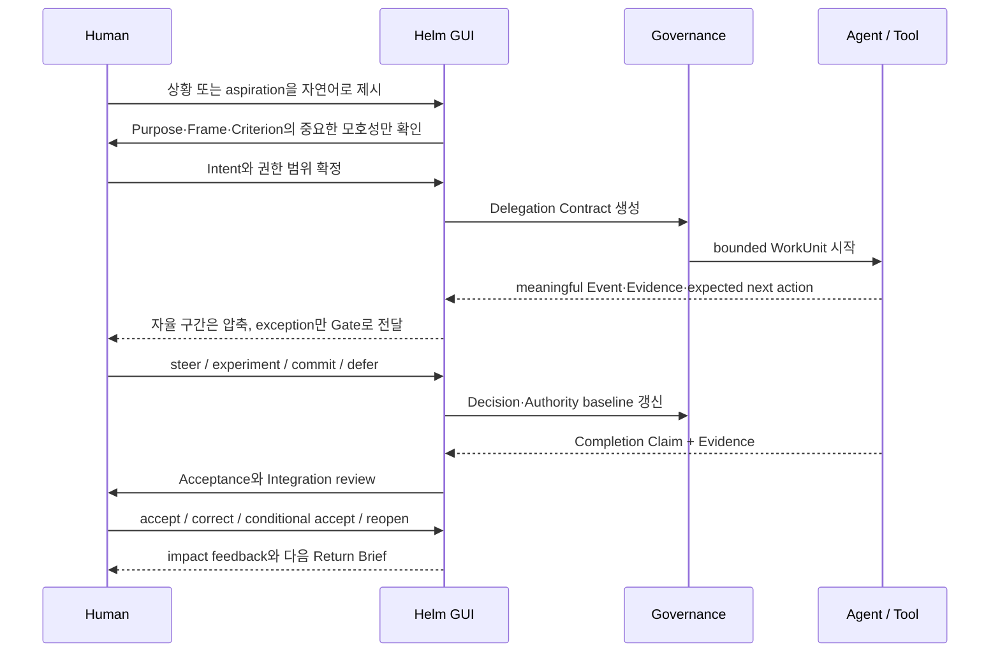

# Helm 원전 요약 3: 연구 자료, 방법 카드, Method Transfer 지도, 상용 데스크톱 UX 조사

- 작성: 2026-10-11, 0단계 에이전트 S1c
- 대상 원전: `docs/research/` 전체(26개 파일)
- 독자: 설계 에이전트 14개. 특히 P9 탐구 엔진(15), P2 UX(03·04·05), P13 데스크톱 앱(20), P14 UI 시스템(21), P8 오케스트레이션(14), P6 커널(10·11), P10 관찰(16)
- 이 문서는 원전을 대신해 읽도록 만든 것이다. 정의, 목록, 절차, 표는 줄이지 않고 옮겼다. 영어 용어는 원문 표기를 그대로 둔다.
- 원전 문서들은 v0.1·v0.2 시기(2026-08)의 어휘(Purpose, Decision, Gate, Commitment, Projection 등)를 쓴다. v0.3와 설계 브리프의 어휘와 다르므로 §1.3에 용어 대응표를 두었다. 각 절의 "대응 Helm 요소"와 §1.3의 대응은 이 문서 작성자가 붙인 것이며 `[제안]`이다.
- 표시: 원전 내용은 `[원문]`(이 문서 전체가 원전 직접 확인이므로 절마다 반복하지 않는다). 작성자의 해석·대응은 `[제안]`, 확인 안 된 것은 `[가정]`으로 표시한다.

## 1. 읽은 파일과 이 문서의 구조

### 1.1 읽은 파일 목록

| # | 파일 (저장소 기준) | 줄 수 | 읽은 범위 | 이 문서에서 다룬 곳 |
|---:|---|---:|---|---|
| 1 | `docs/design/process/00-design-brief.md` | 280 | 전체 | 전제, §8 체크리스트 |
| 2 | `docs/research/README.md` | 99 | 전체 | §2 |
| 3 | `docs/research/method-transfer-map.md` | 141 | 전체 | §3 |
| 4 | `docs/research/method-cards/README.md` | 51 | 전체 | §2.7, §4 머리 |
| 5 | `docs/research/method-cards/distributed-cognition.md` | 124 | 전체 | §4.1 |
| 6 | `docs/research/method-cards/situation-awareness.md` | 130 | 전체 | §4.2 |
| 7 | `docs/research/method-cards/incident-command-common-operating-picture.md` | 125 | 전체 | §4.3 |
| 8 | `docs/research/method-cards/structured-handoff-sbar.md` | 127 | 전체 | §4.4 |
| 9 | `docs/research/method-cards/requisite-variety.md` | 126 | 전체 | §4.5 |
| 10 | `docs/research/method-cards/pragmatist-inquiry.md` | 126 | 전체 | §4.6 |
| 11 | `docs/research/method-cards/abductive-reasoning.md` | 121 | 전체 | §4.7 |
| 12 | `docs/research/method-cards/competing-hypotheses.md` | 121 | 전체 | §4.8 |
| 13 | `docs/research/method-cards/nasa-decision-analysis.md` | 130 | 전체 | §4.9 |
| 14 | `docs/research/method-cards/assurance-cases.md` | 133 | 전체 | §4.10 |
| 15 | `docs/research/method-cards/speech-acts-and-conversations-for-action.md` | 122 | 전체 | §4.11 |
| 16 | `docs/research/method-cards/mission-command.md` | 119 | 전체 | §4.12 |
| 17 | `docs/research/method-cards/subsidiarity.md` | 119 | 전체 | §4.13 |
| 18 | `docs/research/method-cards/management-by-exception.md` | 117 | 전체 | §4.14 |
| 19 | `docs/research/method-cards/coactive-design.md` | 130 | 전체 | §4.15 |
| 20 | `docs/research/method-cards/systems-engineering-integration.md` | 128 | 전체 | §4.16 |
| 21 | `docs/research/method-cards/high-reliability-organizations.md` | 123 | 전체 | §4.17 |
| 22 | `docs/research/method-cards/critical-pauses-and-crew-coordination.md` | 127 | 전체 | §4.18 |
| 23 | `docs/research/method-cards/stpa-system-safety.md` | 126 | 전체 | §4.19 |
| 24 | `docs/research/method-cards/resilience-engineering.md` | 122 | 전체 | §4.20 |
| 25 | `docs/research/bundles/situation-recovery-and-deliberative-inquiry.md` | 332 | 전체 | §5.1 |
| 26 | `docs/research/bundles/delegated-action-and-integration.md` | 342 | 전체 | §5.2 |
| 27 | `docs/research/commercial-desktop-agent-ux.md` | 638 | 전체 | §6 |
| 28 | `docs/v0.3/04-inquiry-types.md` | 386 | 전체 (대조용) | §3.5, §7 |
| 29 | `docs/v0.3/06-asking-and-interruption.md` | 290 | 전체 (대조용) | §7 |
| 30 | `docs/v0.3/09-client-opdc.md` | 140 | 전체 (대조용) | §7 |

용어 대응을 확인하려고 다음 부분만 추가로 봤다(요약 대상은 아니다).

| 파일 | 본 부분 | 이유 |
|---|---|---|
| `docs/v0.3/00-README.md` | §2.2~§2.4 (불변조건 1~7, 범위에서 뺀 것) | 불변조건 번호 대응 |
| `docs/v0.3/02-core-concepts.md` | §10 이름 정리 | Projection·투영·예측·Method Transfer 이름 |
| `docs/v0.3/03-loops-and-transitions.md` | §2 루프 표, §2.1 루프 식별자, §4.5~§4.6, §5 의존 규칙 | 루프 대응 |
| `docs/v0.3/10-critique-and-open-questions.md` | §2 위험 표, §3 반증 조건, §4.1 | Method Transfer 관련 위험·가설 |
| `docs/foundations/00-manifesto.md` | A1~A15 제목만 (grep) | 공리 번호 대응 |

`docs/research/` 아래 파일은 26개이며 모두 끝까지 읽었다. 읽지 못한 파일은 없다. `.helm/private/`는 읽지 않았다.

### 1.2 원전 문서 사이의 관계

```text
docs/research/README.md          연구 질문, 전이 절차(7단계), Method Card 형식, 근거 등급, 전이 평가 질문
  ├─ method-transfer-map.md      35개 방법의 원리·Helm 전이·전이 위험, 우선 묶음 A~D
  ├─ method-cards/README.md      20개 카드를 묶음 A~D로 분류, Evidence status 해석
  │    └─ 20개 카드              카드마다 13절 형식(원 문제 ~ 열린 질문)
  ├─ bundles/situation-recovery-and-deliberative-inquiry.md   묶음 A×B 통합 결론 (M1~M8)
  ├─ bundles/delegated-action-and-integration.md              묶음 C×D 통합 결론 (M1~M10)
  └─ commercial-desktop-agent-ux.md                           Foundations를 상용 desktop GUI로 번역한 조사
```

- 묶음 A(Situation Recovery), B(Deliberative Inquiry), C(Delegated Joint Action), D(Acceptance & Integration)는 지도 §3에서 정의되고, 카드 README가 같은 분류로 20개 카드를 나눈다.
- 원전이 참조하지만 이 문서 범위 밖인 자료: `docs/foundations/*`(00 manifesto, 02 epistemology, 03 praxeology-and-governance, 04 co-agency, 05 formal-state-model, 06 interaction-constitution, 07 architecture-invariants, 08 falsifiable-hypotheses, 09 operating-theory), `docs/foundations-friendly/*`, `docs/prototypes/paper-v0/*`, `docs/architecture/helm-system-v0.md`. 이들은 `helm-canon.md`, `helm-canon-2.md`가 다룬다.

### 1.3 원전 어휘와 v0.3·브리프 어휘 대응 [제안]

원전의 어휘는 v0.2 이전 것이다. 설계 문서에서는 브리프 §3·§6의 어휘를 따라야 하므로, 원전 개념을 옮길 때 아래 대응을 기본값으로 쓴다. 대응이 1:1이 아닌 곳은 비고에 적었다.

| 원전 어휘 | v0.3·브리프 어휘 | 비고 |
|---|---|---|
| Purpose | Goal(프로젝트 목표), 작업 합의의 "목적" 필드 | 원전 Purpose는 두 수준을 함께 가리킨다. 프로젝트 수준이면 Goal, 위임 수준이면 작업 합의의 목적 |
| Concern | Concern | 같다. 원전 UX 문서의 친근한 이름은 "초점" |
| SituationModel | O 루프 결과(상황 판정 `sa` + Concern 현재 상태 투영) | 원전에서는 엔티티, v0.3에서는 투영과 상황 판정 레코드로 나뉜다 |
| ProblemFrame, Frame, reframe | O 루프의 Frame 단계, 사실 탐구 1단계 "관점", 상황 유형 재판정 | v0.3 04 §1.1: "관점 탐구"는 따로 두지 않고 O 루프에서 다룸 |
| Hypothesis, HypothesisSet | 추측(해석 `in` / 가능성 `ps`), 사실 탐구의 원인 후보, 원함 탐구의 기준 후보 | 레코드는 해석과 가능성으로 나뉜다 |
| Observation | 관찰(`ob`) | 브리프 §6: 실제 실행 기록을 출처로 갖는 E 레코드 |
| Evidence | 관찰 + Claim의 `evidence`/`counterEvidence` 관계 | 원전 M5: Evidence는 첨부물이 아니라 관계 |
| Claim | 판단(Finding `fd`) 후보, Claim 스키마(evidence, counterEvidence, counterChecked, 구분 확인) | 브리프 §3.5 |
| Counterevidence, Dissent | 반대 근거, 이의(contested) | 불변조건 6, A9, A14 |
| Decision | 선택(Choice `ch`) | 브리프 §6: 추천은 선택이 아니다. 원전도 Recommendation과 Decision을 나눈다 |
| Recommendation | 추천 | 선택이 아니다 |
| Commitment, DelegationContract, Contract | 작업 합의(Agreement `ag`): 목적, 완료 기준, 범위, 금지 행동, 제출할 근거, 멈출 조건 | 원전의 Request→Offer→Commitment 수명주기는 v0.3에 없다(§7.2 참고) |
| AcceptanceCriterion, Conditions of satisfaction | 작업 합의의 완료 기준, 선호 모델 기준 | |
| AuthorityEnvelope | 능력(A) 범위, 모드의 능력 부분집합, 권한 레이어 | 불변조건 4 "권한은 범위를 가진다" |
| EscalationTrigger | 작업 합의의 멈출 조건, 질문 레코드(정보 게이트) | |
| Gate, Decision Gate, Attention item | 선택 요청 = 권리 게이트 / 정보 게이트 + 질문 레코드(`qs`) + 전달 방식 | v0.2 Gate rule은 v0.3 06에서 바뀜 |
| Attention Queue | 질문함, 복귀 요약의 "선택 필요" | |
| last-cheap-point, last low-cost redirection point | 가정 만료점(`assumption_expires`) | "이 지점을 넘기면 되돌리는 비용이 커지는 지점" |
| ClaimingComplete / Accepted / Integrated | 결과 제출(`rs`) / 결과 확인(`ac`) / 전체 반영 | 불변조건 5, A10 |
| verification / validation | 결과 확인(명세대로 만들었는가) / 전체 반영(올바른 것을 만들었는가) | 브리프 §6 정의와 같다 |
| Return Brief | 복귀 요약 | |
| Changes–Assessment–Projection(–Recommendation) | 바뀐 것–평가–예측(–권고) | v0.3 02 §10: 상황 인식 3단계 Projection은 "예측(Prediction)" |
| ContextProjection, Projection(정본에서 뽑은 화면) | 투영 | 불변조건 3, A11. "투영"은 이 뜻으로만 쓴다 |
| Projection(SA Level 3) | 예측(Prediction `pr`) | 결과 탐구의 예측 레코드와 같은 이름 |
| CommonOperatingPicture | 홈 화면 | v0.3 09 §3 |
| Inquiry Map | 탐구 화면 | v0.3 09 §3, §4.5 |
| Assurance View | 결과 확인 화면 | v0.3 09 §3 |
| Workstream | Concern 트리, 하위 Concern (S 루프) | |
| Operational period, checkpoint cadence | 작업 경계(라운드 끝, 루프 전환, 복귀 요약), 예약 전달 | |
| Experiment, discriminating experiment | 구분 확인(사실 탐구 3단계), 탐침(`pb`, C.probe) | |
| Surprise, expected-state mismatch | 관찰 + 예측·기대와의 차이, 기대 레코드(`ex`) 기한 초과 | |
| Reflection, debrief, policy update | A.reflect, 관찰 에이전트의 정책 수정안, P(정책) 수정 제안 | |
| reopen trigger | `review_trigger`(선호 모델, 선택), 이의 후 Concern 재개 | A13 |
| Workspace | Helm 인스턴스 전체 또는 Goal 묶음 | 1인 앱이므로 팀 workspace 개념은 범위 밖 |
| HumanActor / AgentActor | `human` / `agent:<role>` | 브리프 §3.3 |
| Event ledger | 이벤트 로그(SQLite, WAL) | 브리프 §2.3-29 |
| reversibility, irreversibility, blast radius | Helm 범위 밖(권한 레이어) | 브리프 §2.1-2. §7.1 참고 |

공리 번호(`docs/foundations/00-manifesto.md`): A1 목적은 태스크보다 먼저 존재한다 / A2 진척은 활동량이 아니라 정당화된 상태 변화다 / A3 문제 정의는 작업 결과의 일부다 / A4 병렬성은 작업량보다 가설 다양성에 우선 사용한다 / A5 사실, 추론, 가설, 결정, 약속은 서로 다른 상태다 / A6 에이전트는 제안과 제한된 실행의 주체이며 인간은 가치와 최종 약속의 저자다 / A7 자율성은 위험 적응적 권한 범위다 / A8 결정은 가장 낮은 유능한 수준에서 이루어지고 예외만 상향된다 / A9 요약은 결정에 필요한 차이를 보존해야 한다 / A10 작업은 주장된 완료, 수락, 통합을 구분한다 / A11 컨텍스트는 행위자를 위한 시점별 투영이다 / A12 자동화가 인간의 이해와 주도성을 지속적으로 낮춘다면 실패다 / A13 결정과 증거는 시간에 따라 낡는다 / A14 실패와 이견은 학습 신호다 / A15 상호작용은 공동 저작이어야 한다.

불변조건 번호(`docs/v0.3/00-README.md` §2.4): 1 기록과 진실은 다르다 / 2 관찰, 추측(해석과 가능성), 판단, 선택은 다르다 / 3 투영은 정본을 쓰지 않는다 / 4 권한은 범위를 가진다 / 5 완료 주장, 결과 확인, 전체 반영은 다르다 / 6 모르는 것, 이견, 낡은 상태는 숨기지 않는다 / 7 에이전트가 혼자 정한 결정도 기록되며 사람은 언제든 이의를 걸 수 있다.

## 2. 연구 README: 구조와 원칙 (`docs/research/README.md`)

상태 표시: "working research map v0.1". 목적: 타 학문과 산업의 방법론을 Helm 기능으로 바로 복사하지 않고, 원래 해결한 문제와 환경 독립적인 원리를 분석한 뒤 반증 가능한 제품 가설로 번역하는 연구 체계를 정의한다.

### 2.1 연구 질문 8개

원전에는 "M1~M8"이라는 이름의 연구 방법 목록이 없다. 번호가 붙은 목록은 아래 연구 질문 1~8이다. "M1~M8"은 묶음 A×B 종합 문서의 "반복해서 나타난 여덟 메커니즘"(§5.1.3)에, "M1~M10"은 묶음 C×D 종합 문서(§5.2.3)에 있다. 이 문서에 셋 모두 전문을 옮겼다. 아래에서는 연구 질문에 RQ 번호를 붙였다(원문에는 숫자만 있다).

1. RQ1. 복수 행위자가 제한된 정보와 시간 안에서 공동 목적을 유지하는 방법은 무엇인가?
2. RQ2. 상위 목적을 보존하면서 세부 실행을 안전하게 위임하는 방법은 무엇인가?
3. RQ3. 판단자가 모든 세부 상태를 보지 않고도 상황 인식을 유지하는 방법은 무엇인가?
4. RQ4. 경쟁하는 설명과 불완전한 증거를 비교하는 방법은 무엇인가?
5. RQ5. 중요한 단계 전환과 책임 인수인계에서 오류를 줄이는 방법은 무엇인가?
6. RQ6. 자동화가 인간의 능력과 주도성을 약화시키지 않게 설계하는 방법은 무엇인가?
7. RQ7. 지역적 성과를 전체 시스템의 정합성과 안전으로 통합하는 방법은 무엇인가?
8. RQ8. 공동 작업이 통제와 승인만이 아니라 몰입·학습·저자성의 경험이 되게 하는 조건은 무엇인가?

### 2.2 연구 영역 10개 (원문 §2)

| 영역 | 포함 주제 |
|---|---|
| 철학 | 실용주의, 실천적 지혜, 행위, 약속, 공동 의도 |
| 인지과학 | 분산인지, 상황 인식, 공동 인지 시스템, 자연주의적 판단 |
| 조직·지휘 | 임무형 지휘, 사건지휘체계, 보충성, 예외 관리 |
| 과학·정보분석 | 가설 생성, 경쟁 가설, 반증, 불확실성 |
| 시스템 공학 | trade study, 요구사항 추적, 기준선, 통합 |
| 안전공학 | HRO, STPA, resilience engineering, assurance case |
| 의료·항공 | 체크리스트, CRM, handoff, closed-loop communication |
| 인간–자동화 | 자동화 수준, out-of-the-loop, coactive design |
| 설계·개선 | Double Diamond, PDSA, reflective practice |
| 동기·경험 | 자율성, 유능감, 관계성, sense of agency |

### 2.3 방법론 전이 절차 (7단계, 원문 §3)

각 방법은 다음 순서로 분석한다.

```text
Original domain and failure
  → Environmental assumptions
  → Domain-invariant mechanism
  → What must not be copied
  → Helm primitive
  → Falsifiable hypothesis
  → Prototype and metric
```

| 단계 | 원문 | v0.3 04 §4.3의 한국어 표기 |
|---:|---|---|
| 1 | Original domain and failure | 원래 분야와 그 분야의 실패 |
| 2 | Environmental assumptions | 환경 가정 |
| 3 | Domain-invariant mechanism | 분야와 무관한 메커니즘 |
| 4 | What must not be copied | 복사하면 안 되는 것 |
| 5 | Helm primitive | Helm 요소 |
| 6 | Falsifiable hypothesis | 반증 가능한 가설 |
| 7 | Prototype and metric | 프로토타입과 지표 |

원문 예: 군의 Mission Command에서 계급 구조와 군사 용어는 복사하지 않는다. 중앙의 의도·제약과 지역의 판단 자율성을 결합하는 원리를 뽑아 `Purpose`, `AuthorityEnvelope`, `EscalationTrigger`로 번역한다.

이 7단계는 Helm 자체를 설계하는 연구용 절차다. 사용자 문제에 적용하는 런타임용 7단계는 v0.3 04 §4.3에 따로 있다(§3.6).

### 2.4 Method Card 형식 (원문 §4)

```yaml
method:
  name: string
  domain: string
  primary_sources: []
  original_problem: string
  environment_assumptions: []
  invariant_mechanisms: []
  known_failure_modes: []
  transfer_risks: []
  helm_primitives: []
  product_hypotheses: []
  prototype: string
  metrics: []
  evidence_status: exploratory | supported | rejected | superseded
  owner: actor-id
  reviewed_at: date
```

실제 카드 20개는 이 YAML이 아니라 다음 13절 Markdown 형식으로 쓰여 있다: 머리(Domain, Evidence status, Primary Helm bundle, Candidate primitives) → 1 Original problem → 2 Environmental assumptions → 3 Domain-invariant mechanisms → 4 Helm problem explained → 5 Transfer to Helm(표) → 6 Transfer rules → 7 What must not be copied → 8 Failure modes → 9 Falsifiable Helm hypotheses → 10 Prototype → 11 Metrics → 12 Sources → 13 Open questions. YAML의 `owner`, `reviewed_at`은 카드에 없다.

v0.3 04 §4.3의 "렌즈 라이브러리"가 이 카드를 런타임 렌즈 초기값으로 쓰므로, 15 탐구 엔진은 렌즈 레코드 스키마를 정할 때 이 YAML 필드와 13절 형식을 출발점으로 삼을 수 있다(§8의 15 항목).

### 2.5 근거 등급 (원문 §5)

- **A**: 원전, 표준, 공식 핸드북, 재현된 연구
- **B**: 동료평가 종합, 권위 있는 2차 자료, 다수 현장 사례
- **C**: 단일 사례, 실무 에세이, 유추를 위한 자료
- **D**: 아직 출처가 충분하지 않은 제품 직관

높은 등급이 Helm 전이에 자동으로 적합하다는 뜻은 아니다. 원래 환경과 Helm 환경의 차이를 따로 평가한다.

### 2.6 전이 평가 질문 8개 (원문 §6)

1. 이 방법은 어떤 실패를 줄이기 위해 생겼는가?
2. 그 실패가 에이전틱 작업에서도 실제로 존재하는가?
3. 성공의 원인이 절차 자체인지, 전문가 문화와 훈련인지 구분했는가?
4. 안전 중요 환경의 무거운 절차를 저위험 소프트웨어 작업에 과잉 적용하지 않는가?
5. 인간 사이의 약속을 확률적 모델 출력에 그대로 투영하며 의인화하지 않는가?
6. 정보 압축이 중요한 반대 증거와 이견을 제거하지 않는가?
7. 사용자의 주의 비용을 포함해 전체 공동 시스템 성능을 측정하는가?
8. 어떤 관찰이 이 전이가 잘못되었음을 보여줄 것인가?

(5번의 "투영"은 원문 표현이며 v0.3의 "투영"과 다른 뜻이다.)

### 2.7 산출물 목록과 다음 연구 (원문 §7, 카드 README)

원문 §7의 산출물:

- `method-transfer-map.md` — 35개 방법론의 핵심 원리, Helm primitive, 전이 위험
- `method-cards/README.md` — 20개 우선 방법론의 원래 환경·전이 규칙·실패 모드·제품 가설
- `bundles/situation-recovery-and-deliberative-inquiry.md` — Situation Recovery와 Deliberative Inquiry의 통합 설계 결론
- `bundles/delegated-action-and-integration.md` — Delegated Joint Action과 Acceptance & Integration의 통합 설계 결론
- `commercial-desktop-agent-ux.md` — Helm Foundations를 상용 desktop workflow agent의 제품 관점·정보 구조·핵심 UX로 번역한 조사
- `../foundations/09-operating-theory.md` — 네 Bundle을 하나로 묶은 Helm 운영 이론
- `../foundations/08-falsifiable-hypotheses.md` — 제품 가설과 실험
- `../prototypes/paper-v0/experiment-protocol.md` — 핵심 상호작용의 비교 실험 절차

후속 연구 계획: 전이 지도의 고우선순위 항목을 개별 Method Card로 분리하고, 원전 독해·전문가 인터뷰·프로토타입 결과를 쌓는다.

카드 README의 추가 규칙:

- Method Card는 타 분야 방법을 기능 아이디어로 바로 복사하지 않고 원래 실패, 환경 가정, 전이 가능한 메커니즘, 전이 위험, 반증 가설까지 추적한다.
- **Evidence status 해석**: 각 카드의 `Evidence status`는 원래 방법론의 근거와 Helm 전이 근거를 구분한다.
  - 원래 분야에서 검증되거나 제도화된 방법도 Helm에서 효과가 있다는 직접 증거는 아직 없을 수 있다.
  - 여러 분야에서 유사 메커니즘이 반복되는 것은 전이 후보를 강화하지만 제품 인과 증거를 대신하지 않는다.
  - 실제 Helm pilot 결과가 기존 전이를 반박하면 카드 상태를 `rejected` 또는 `superseded`로 바꾼다.
- **다음 연구 깊이**: 20개 카드는 첫 운영 이론을 구성하기 위한 우선 원전 분석이다. 남은 지도 항목(원문은 "남은 35개 지도 항목"이라고 적었으나 실제로 카드가 없는 항목은 14개)은 실제 pilot에서 새로운 failure mechanism이나 설계 선택이 생길 때 개별 Card로 승격한다. 문헌 수를 늘리는 것 자체를 연구 진척으로 보지 않는다.
- 20개 카드의 Evidence status는 모두 "원 분야 근거는 확립 또는 기초 이론, Helm 전이는 exploratory"다. Helm pilot으로 확인된 카드는 없다.

## 3. Method Transfer 지도 (`docs/research/method-transfer-map.md`)

### 3.1 사용법 (원문 §1)

이 표는 기능 백로그로 쓰려고 만든 것이 아니다. 연구 가설의 지도다.

- **원리**: 원래 분야 밖에서도 유지될 가능성이 있는 메커니즘
- **Helm 전이**: 원리를 표현할 후보 Entity, Event, UX
- **전이 위험**: 그대로 복사했을 때 생길 수 있는 부작용

### 3.2 35개 방법 원표

"추출할 원리" 열이 핵심 메커니즘, "Helm 전이" 열이 Helm에 옮긴 형태다. 원문 그대로 옮겼다. 마지막 열은 개별 Method Card가 있는지다(§4 절 번호).

| # | 분야·방법 | 원래 문제 | 추출할 원리 (핵심 메커니즘) | Helm 전이 (옮긴 형태) | 전이 위험 | 카드 |
|---:|---|---|---|---|---|---|
| 1 | Dewey의 Inquiry | 불확정 상황에서 행동 가능한 이해 형성 | 문제와 해결은 탐구 중 함께 구성되며 지식은 행위 속에서 검증됨 | `SituationModel`, `ProblemFrame`, 탐구 순환 | 끝없는 탐구와 상대주의 | §4.6 |
| 2 | Peirce의 Abduction | 놀라운 관찰에 대한 설명 후보 생성 | 발견 단계에서는 잠정적 설명을 넓게 생성하고 이후 검증 | `HypothesisSet`, 반증 조건, 구분 실험 | 그럴듯한 서사를 증거로 착각 | §4.7 |
| 3 | Schön의 Reflective Practice | 복잡한 실천에서 계획만으로 해결 불가 | 실행 중 프레임을 다시 보고, 실행 후 실천 규칙을 갱신 | `Reflection`, live reframe, debrief | 회고가 문서 의식으로만 남음 | 없음 |
| 4 | Double Diamond | 문제를 성급히 정의하고 해법에 수렴 | 발산과 수렴을 문제·해법 공간에서 반복 | Explore/Decide 모드, hypothesis divergence | 모든 작업에 워크숍 절차 강요 | 없음 |
| 5 | PDSA | 개선 아이디어를 대규모로 바로 적용 | 작은 변화, 측정, 학습의 반복 | 실험 WorkUnit, outcome measure, policy update | 국소 개선이 전체 목적을 왜곡 | 없음 |
| 6 | Aristotle의 Phronesis | 일반 규칙이 구체적 행동을 결정하지 못함 | 상황에 맞는 좋은 판단은 경험·가치·숙의를 필요로 함 | 인간 중심 Normative Gate | 인간 판단을 무오류로 취급 | 없음 |
| 7 | Arendt의 Labor–Work–Action | 인간 활동의 서로 다른 가치와 기준 | 반복 노동, 제작, 공동적 행위는 다른 방식으로 설계·평가 | 노동 자동화, 공동 제작, 인간 약속/수락 | 철학적 구분을 경직된 역할 분담으로 사용 | 없음 |
| 8 | Speech Act Theory | 언어가 현실의 약속과 권한을 바꿈 | 요청·제안·약속·수락은 서로 다른 상태 전이 | `Commitment`, `Decision`, conversation-for-action | 자연어를 과도하게 정형화 | §4.11 |
| 9 | Collective Intentionality | 개인 계획의 합만으로 공동행위를 설명 못함 | 공유 목적, 상호 반응, 맞물린 하위 계획, 공통 지식 | `SharedPurpose`, plan compatibility, common ground | 모델을 실제 상호 이해로 착각 | 없음 |
| 10 | Distributed Cognition | 성과가 개인의 머릿속 능력만으로 설명되지 않음 | 인지 기능은 사람·표식·도구·절차에 분산됨 | Workspace 전체를 인지 단위로 평가, ContextProjection | 모든 관계를 그래프로 만들려는 과잉 모델링 | §4.1 |
| 11 | Activity Theory / Expansive Learning | 조직의 모순과 변화가 개인 학습으로 환원되지 않음 | 다성성, 역사성, 시스템 내부 모순이 학습과 전환을 촉발 | `Contradiction` Concern, reframe cycle, policy reflection | 갈등을 무조건 혁신 기회로 미화 | 없음 |
| 12 | Joint Activity / Common Ground | 팀원이 각자 유능해도 조정 실패 | 상호 예측 가능성, 공통 기반, 조정 붕괴를 복구하려는 기본 약속 | common-ground health, repair Event, handoff | 완전한 공유 이해를 요구해 정보 과부하 | 없음 |
| 13 | Coactive Design | 자율성 향상이 팀 성과를 자동 보장하지 않음 | 상호의존성이 자율성을 형성하고 관측·예측·지시 가능해야 함 | OPD+C 기준, interdependence map | 로봇 환경의 실시간 요구를 그대로 복사 | §4.15 |
| 14 | Supervisory Control | 자동 루프를 인간이 간헐적으로 감독 | 인간은 세부 제어 대신 목표·제약·예외에 개입 | Authority Envelope, exception Gate | 사용자를 수동 모니터로 축소 | 없음 |
| 15 | Ironies of Automation | 자동화가 인간에게 가장 어려운 예외만 남김 | 자동화는 인간의 상황 인식·기술·복구 능력을 보존해야 함 | Return Brief, meaningful participation, rehearsal | 자동화를 과도하게 제한 | 없음 |
| 16 | Situation Awareness | 동적 시스템에서 상태 나열만으로 판단 불가 | 지각–의미 이해–향후 예측의 세 수준 | Brief의 Changes–Assessment–Projection | 사용자의 내부 인식을 완전히 측정 가능하다고 가정 | §4.2 |
| 17 | Mission Command | 중앙이 모든 현장 결정을 할 수 없음 | 명확한 의도·제약, 신뢰, 분산 실행, 예외적 상향 | Purpose, Authority Envelope, EscalationTrigger | 군사적 위계와 명령 문화를 복사 | §4.12 |
| 18 | Incident Command System | 재난에서 조직·용어·통제 범위 혼란 | 공통 상황도, 목표 관리, 관리 가능한 span, 운영 주기 | Common Operating Picture, workstream grouping, operational period | 저위험 작업에 관료적 command structure 도입 | §4.3 |
| 19 | Subsidiarity | 상위 조직의 과도한 중앙집권 | 가장 가까운 유능한 수준에서 결정하고 상위 개입을 정당화 | local Decision authority, escalation explanation | 지역 최적화와 책임 회피 | §4.13 |
| 20 | Management by Exception | 관리자의 제한된 주의력 | 정상 범위는 위임하고 기준 이탈만 상향 | policy envelope, anomaly/exception Gate | 잘못된 기준이 정상 실패를 숨김 | §4.14 |
| 21 | Analysis of Competing Hypotheses | 불완전 정보와 확증편향 | 대안 가설을 명시하고 증거의 불일치를 비교 | Hypothesis matrix, Counterevidence preservation | 모든 문제에 과도한 분석 비용 | §4.8 |
| 22 | NASA Decision Analysis / Trade Study | 복잡한 시스템의 대안 선택과 근거 소실 | 대안·기준·불확실성을 비교하고 결정 근거를 기준선으로 보존 | Decision Room, trade study attachment, baseline update | 수치 점수가 가치 판단을 위장 | §4.9 |
| 23 | NASA Systems Engineering | 하위 시스템 성공과 전체 임무 실패 | 논리적 분해, 요구 추적, 통합, 결정·가정 보존 | Purpose trace, Integration Map, verification chain | 단계 게이트가 지나치게 무거워짐 | §4.16 |
| 24 | High Reliability Organization | 드물지만 치명적인 실패를 조직적으로 방지 | 실패에 대한 집착, 단순화 경계, 운영 민감성, 전문성에 권한 양보 | dissent preservation, weak signal Concern, expert routing | 모든 작업을 안전 중요 작업처럼 취급 | §4.17 |
| 25 | Crew Resource Management | 항공 팀의 권위·의사소통·판단 오류 | 상황 인식, workload, assertion, closed-loop communication | check-back, dissent channel, workload-aware Gate | 정형 문구가 실제 발언과 판단을 대체 | §4.18 |
| 26 | WHO Surgical Checklist | 중요한 단계 경계에서의 누락과 팀 오정렬 | 오류 비용이 큰 전환점에 짧은 공동 pause | phase-boundary Gate, integration checklist | 체크리스트 피로와 형식적 체크 | §4.18 |
| 27 | SBAR / Structured Handoff | 책임 이전 시 맥락과 긴급성 소실 | 상황·배경·평가·요청을 구조화하고 양방향 확인 | Return Brief, responsibility handoff, check-back | 모든 보고를 고정 템플릿에 맞춤 | §4.4 |
| 28 | Resilience Engineering | 예측 불가능한 변동에서 시스템이 성능 유지 | respond, monitor, learn, anticipate 역량의 균형 | runtime response, risk monitor, Reflection, Projection | resilience를 사후 복구 기능으로 축소 | §4.20 |
| 29 | STPA | 개별 부품 고장 없이도 상호작용으로 사고 발생 | 위험을 통제 구조와 unsafe control action 관점에서 분석 | authority/control graph, unsafe delegation analysis | 저위험 제품 결정까지 안전 분석 강요 | §4.19 |
| 30 | Assurance Case / SACM | 테스트 목록만으로 중요한 주장 정당화 불가 | 주장–논증–증거와 반대 논거를 감사 가능하게 연결 | Assurance View, Claim/Evidence graph | 모든 작업을 형식 증명으로 만듦 | §4.10 |
| 31 | Ashby의 Requisite Variety | 조절자가 시스템의 상태 다양성을 감당하지 못함 | 통제에는 중요한 다양성을 보존하는 감쇠·증폭·재분배가 필요 | attention engine, exception amplification, autonomy distribution | 압축 과정에서 소수 신호 제거 | §4.5 |
| 32 | Viable System Model | 자율 하위 단위와 전체 응집성의 균형 | 재귀적 자율성, 조정, 통제, 환경 감지, 정체성 | workspace/concern recursion, governance layers | 복잡한 조직도를 제품에 그대로 투영 | 없음 |
| 33 | Self-Determination Theory | 외적 통제가 동기와 성과를 약화 | 자율성·유능감·관계성 지원이 질 높은 참여를 만듦 | meaningful choice, impact feedback, co-agency | 피상적 게임화로 대체 | 없음 |
| 34 | NIST AI RMF | AI 위험을 기술 성능만으로 관리 불가 | 역할·책임·인간 감독·맥락별 위험을 지속 관리 | governance policies, actor responsibilities, risk register | 규정 준수 체크리스트로 축소 | 없음 |
| 35 | Reversible / Irreversible Decisions | 모든 결정을 같은 무게로 처리 | 가역적 결정은 빠르게, 비가역적 결정은 더 깊게 숙의 | Gate depth by reversibility, experiment-first option | 복잡한 결정을 억지로 이분법화 | 없음 |

카드가 있는 지도 행은 21개이고 여기에 카드 20개가 대응한다(#25와 #26은 카드 하나 "Critical Pauses and Crew Coordination"로 합쳐짐). 카드 20개 중 지도 행과 이름이 1:1로 맞지 않는 것: `critical-pauses-and-crew-coordination`(#25+#26), `systems-engineering-integration`(#23). 카드가 없는 지도 항목은 #3, #4, #5, #6, #7, #9, #11, #12, #14, #15, #32, #33, #34, #35 (14개)다.

### 3.3 35개 방법과 v0.3 Helm 개념·공리·루프 대응 [제안]

원전에는 이 대응이 없다. 지도의 "Helm 전이" 열을 §1.3 어휘로 옮기고, 관련 공리(A1~A15), 불변조건(INV1~7), 루프 식별자(v0.3 03 §2.1)를 붙였다. 15 탐구 엔진의 렌즈 라이브러리 초기값과 14 오케스트레이션의 근거 표기에 쓴다.

| # | 방법 | 대응 v0.3 개념 (Helm에 옮긴 형태) | 공리·불변조건 | 루프 |
|---:|---|---|---|---|
| 1 | Dewey Inquiry | Concern을 불확정 상황으로 다룸, O 루프 Frame, 탐구 순환, 실행 결과로 Goal 재검토 | A3, A2 | O, I.fact, A.reflect |
| 2 | Peirce Abduction | 추측(해석·가능성) 상태, 관점별 예측·반박 조건, 구분 확인, 판단 승격 규칙 | A4, A5, INV2 | I.fact, I.possibility |
| 3 | Reflective Practice | 실행 중 재판정(상황 유형 전이), 돌아보기, 관찰 에이전트의 절차·정책 수정안 | A14 | O, A.reflect |
| 4 | Double Diamond | 가능성 탐구의 발산 표와 대비 압축. 원전의 Explore/Decide "모드"는 v0.3에서 모드(설정)와 다른 뜻 | A3, A4 | I.possibility |
| 5 | PDSA | 탐침형 C, 예측 레코드의 `check_at` 확인, P 수정 제안 | A2, A14 | C.probe, A.confirm, A.reflect |
| 6 | Phronesis | 권리 게이트, 사람만 정하는 것(선호 기준 확정, 판단 확인, Goal 수정) | A6, A15 | I.want, A.confirm |
| 7 | Labor–Work–Action | 원시 행동 능력과 기록 능력의 구분, 사람의 `accept` 능력 | A6 | C, A |
| 8 | Speech Act Theory | 작업 합의, 결과 제출·결과 확인·전체 반영 분리, 선택 레코드 | A5, A10, INV5 | C.commit, A.confirm |
| 9 | Collective Intentionality | Goal과 작업 합의 목적의 공유, 공통 기반 | A1 | O |
| 10 | Distributed Cognition | 이벤트 로그 정본 + 역할별 투영, 근거 체인 | A11, INV1, INV3 | O |
| 11 | Activity Theory | 모순을 Concern으로 열기, 재판정, 돌아보기 | A14 | O, S, A.reflect |
| 12 | Joint Activity / Common Ground | 복귀 요약, 이의·재개 이벤트, 이관 | A12 | O, A |
| 13 | Coactive Design | OPD+C(v0.3 09), 클라이언트 화면 요소와 지표 | A6, A12, A15, INV7 | 전 루프 |
| 14 | Supervisory Control | 능력 범위 + 다이얼 + 질문 전달 방식 | A7, A8 | C |
| 15 | Ironies of Automation | 복귀 요약, A12 지표(사람이 바꾼 기준·재정의·이의 비율) | A12 | O |
| 16 | Situation Awareness | 복귀 요약의 바뀐 것–의미–예측 | A11, A12 | O |
| 17 | Mission Command | 작업 합의(목적, 완료 기준, 범위, 금지 행동, 멈출 조건), Goal 변경은 사람 확인 | A1, A7 | C.commit |
| 18 | Incident Command System | 홈 화면(COP), Concern 트리, 작업 경계, 주의 예산 | A9 | S, 거시 스케줄러 |
| 19 | Subsidiarity | 혼자 정한 결정(`why_not_asked`), 정보 게이트 | A8, INV7 | 전 루프 |
| 20 | Management by Exception | 질문 조건(정보 가치), 멈출 조건, 지속 관찰형 A, 가정 만료점 | A8 | C, A.watch |
| 21 | ACH | 사실 탐구(관점별 예측·반박 조건, 반대 근거 탐색), Claim 스키마의 `counterEvidence` | A5, A9, INV6 | I.fact |
| 22 | NASA Decision Analysis | 선택 레코드(alternatives, reason, review_trigger), 결과 탐구 | A13 | I.outcome, 선택 요청 |
| 23 | NASA Systems Engineering | S 루프 분해·재조합, 결과 확인과 전체 반영 구분, 의존 규칙 4 | A1, A10 | S, A.confirm |
| 24 | HRO | 반대 근거·이견 보존, 관찰 에이전트의 약한 신호, 검증 에이전트 | A9, A14, INV6 | A.watch, O |
| 25 | CRM | 질문의 협상·중재 전달, 이의 경로, check-back | A14 | C, A |
| 26 | WHO Surgical Checklist | 의존 규칙 1(write·send에 C), 권리 게이트, 루프 전환 경계 | A7 | C → A 경계 |
| 27 | SBAR | 복귀 요약, 작업 합의 이관 | A11 | O |
| 28 | Resilience Engineering | 지속 관찰형 A, 돌아보기, 결과 탐구, 크래시 복구 후 복귀 요약 | A14 | A.watch, A.reflect, I.outcome |
| 29 | STPA | 결과 탐구(사전 부검, `failure_paths`), 권한 레이어 | A7 | I.outcome |
| 30 | Assurance Case | 결과 확인 화면, Claim 스키마, 판단 승격 규칙 | A10, A2, INV5 | A.confirm |
| 31 | Requisite Variety | 대비 압축, 주의 예산, 전달 방식, 혼자 정한 결정 | A9, A8 | 거시 스케줄러 |
| 32 | Viable System Model | S 루프의 재귀 구조(v0.3 03 §4.6) | A1 | S |
| 33 | Self-Determination Theory | 반응 기반 원함 탐구, "모델이 초안, 사람은 반응", 공동 저작 | A15, A12 | I.want |
| 34 | NIST AI RMF | 행위자 구분(`human`, `agent:<role>`), 감사, 권한 레이어 | A6 | (보안 18) |
| 35 | Reversible / Irreversible | 가역성 판별은 Helm 범위 밖(브리프 §2.1-2). Helm에 남는 것은 가정 만료점과 탐침 우선 선택지 | A7 | C.probe |

### 3.4 주요 원전 및 권위 자료 (원문 §2)

철학과 탐구

- Stanford Encyclopedia of Philosophy: Pragmatism — https://plato.stanford.edu/entries/pragmatism/
- SEP: Peirce on Abduction — https://plato.stanford.edu/archives/fall2023/entries/abduction/peirce.html
- SEP: Aristotle's Ethics — https://plato.stanford.edu/entries/aristotle-ethics/
- SEP: Hannah Arendt — https://plato.stanford.edu/entries/arendt/
- SEP: Speech Acts — https://plato.stanford.edu/archives/sum2023/entries/speech-acts/
- SEP: Collective Intentionality — https://plato.stanford.edu/entries/collective-intentionality/
- Design Council: Double Diamond — https://www.designcouncil.org.uk/resources/framework-for-innovation/
- AHRQ: Plan-Do-Study-Act — https://www.ahrq.gov/cahps/improvement-guide/improvement-models/plan-do-study-act.html

공동 인지와 인간–자동화

- Hutchins: How a Cockpit Remembers Its Speeds — https://doi.org/10.1207/s15516709cog1903_1
- Klein et al.: Common Ground and Coordination in Joint Activity — citeseerx PDF (doi 30baa244b66e81d737ccf9f667c9bfca4f0c18f1)
- TU Delft: Coactive Design — https://repository.tudelft.nl/record/uuid%3A35cfe91a-bd59-427d-89a9-e2019f9b0c28
- Bainbridge: Ironies of Automation — https://www.sciencedirect.com/science/article/pii/0005109883900468
- Endsley & Kiris: The Out-of-the-Loop Performance Problem — https://doi.org/10.1518/001872095779064555
- NASA: Levels of Automation — https://ntrs.nasa.gov/api/citations/20060053373/downloads/20060053373.pdf

지휘, 정보분석, 조직

- U.S. Army: Understanding Mission Command — https://www.army.mil/article/106872/understanding_mission_command
- FEMA: Incident Command System characteristics — https://emilms.fema.gov/is_0552/groups/51.html
- CIA: Psychology of Intelligence Analysis — https://www.cia.gov/resources/csi/static/Pyschology-of-Intelligence-Analysis.pdf
- CIA: A Tradecraft Primer — https://www.cia.gov/resources/csi/books-monographs/a-tradecraft-primer/
- AHRQ: High Reliability Organizations — https://effectivehealthcare.ahrq.gov/products/hro/protocol
- Ashby: An Introduction to Cybernetics — https://ashby.info/Ashby-Introduction-to-Cybernetics.pdf

시스템, 안전, 보증

- NASA Systems Engineering Handbook — https://www.nasa.gov/reference/systems-engineering-handbook/
- NASA: Crosscutting Technical Management — https://www.nasa.gov/reference/6-0-crosscutting-technical-management/
- MIT: System Safety and STPA — https://ocw.mit.edu/courses/16-863j-system-safety-spring-2016/download/
- OMG: Structured Assurance Case Metamodel — https://www.omg.org/spec/SACM/About-SACM
- NIST AI Risk Management Framework — https://www.nist.gov/itl/ai-risk-management-framework

항공, 의료, handoff

- FAA: Crew Resource Management (AC 120-35D) — https://www.faa.gov/documentLibrary/media/Advisory_Circular/AC_120-35D.pdf
- WHO: Clinical Checklists — https://www.who.int/tools/clinical-checklists
- AHRQ: SBAR — https://www.ahrq.gov/teamstepps-program/curriculum/communication/tools/sbar.html
- AHRQ: TeamSTEPPS Tools — https://www.ahrq.gov/teamstepps-program/resources/modules/index.html

### 3.5 우선순위 전이 묶음 (원문 §3)

모든 방법을 동시에 구현하지 않는다. 초기 제품 가설은 네 묶음으로 검증한다.

| 묶음 | 포함 방법 | 후보 primitive |
|---|---|---|
| **A — Situation Recovery** | Distributed Cognition, Situation Awareness, ICS Common Operating Picture, SBAR Handoff, Requisite Variety | `ReturnBrief`, `ContextProjection`, `CommonOperatingPicture` |
| **B — Deliberative Inquiry** | Dewey Inquiry, Peirce Abduction, Competing Hypotheses, NASA Trade Study, Assurance Case | `ProblemFrame`, `HypothesisSet`, `Claim`, `Evidence`, `DecisionGate` |
| **C — Delegated Joint Action** | Speech Acts, Mission Command, Subsidiarity, Coactive Design, Management by Exception | `Commitment`, `DelegationContract`, `AuthorityEnvelope`, `EscalationTrigger` |
| **D — Acceptance and Integration** | Systems Engineering, HRO, WHO Checklist, STPA, Resilience Engineering | `AssuranceView`, `Integration`, `Reflection`, `ReopenTrigger` |

검증 순서(원문): A와 B를 먼저 paper prototype으로 검증하고, C에서 agent adapter를 연결하며, D는 실제 복수 작업 통합 실험에서 활성화한다.

참고 경로(원문): 20개 방법론의 세부 원전 분석은 `method-cards/README.md`, 묶음별 통합 결론은 두 bundle 문서, 전체 운영 이론은 `../foundations/09-operating-theory.md`.

### 3.6 Method Transfer 7단계 절차 전문

지도 문서 자체에는 단계 절차가 없다. 7단계 절차는 두 곳에 있다. 하나는 연구 README §3의 연구용 절차(§2.3에 원문), 다른 하나는 v0.3 04 §4.3의 런타임용 절차다. 브리프 §2.1-13의 결정에서 Method Transfer는 "다른 분야의 방법을 지금 문제에 적용하는 개념"이고, 브리프 §6 용어집의 정의는 "가능성 탐구 내 동작"이다. 따라서 15 탐구 엔진이 구현할 것은 런타임용 절차다.

#### 3.6.1 연구용 절차 (README §3, v0.3 04 §4.3 한국어 표기)

```text
원래 분야와 그 분야의 실패
  → 환경 가정
  → 분야와 무관한 메커니즘
  → 복사하면 안 되는 것
  → Helm 요소
  → 반증 가능한 가설
  → 프로토타입과 지표
```

#### 3.6.2 런타임용 절차 (v0.3 04 §4.3, [결정: 개념 / 제안: 절차])

```text
1. 지금 문제의 구조를 분야 용어 없이 서술한다
2. 같은 구조의 실패를 겪은 다른 분야를 찾는다
3. 그 분야의 환경 가정을 적는다
4. 환경과 무관하게 유지되는 원리를 뽑는다
5. 복사하면 안 되는 것을 적는다
6. 지금 문제로 번역한 가능성을 만든다
7. 반증 조건과 작은 확인 방법을 붙인다
```

1단계가 가장 중요하다. 분야 용어가 남아 있으면 같은 분야의 해법만 찾게 된다.

두 절차의 단계 대응:

| 연구용 | 런타임용 | 차이 |
|---|---|---|
| (없음) | 1. 문제 구조를 분야 용어 없이 서술 | 런타임에서 새로 추가. 연구용은 출발 분야가 이미 정해져 있다 |
| 1. 원래 분야와 실패 | 2. 같은 구조의 실패를 겪은 다른 분야 찾기 | 방향이 반대다. 연구용은 방법에서 Helm으로, 런타임은 문제에서 분야로 간다 |
| 2. 환경 가정 | 3. 환경 가정 | 같다 |
| 3. 분야와 무관한 메커니즘 | 4. 원리 뽑기 | 같다 |
| 4. 복사하면 안 되는 것 | 5. 복사하면 안 되는 것 | 같다. v0.3 10 §2에서 이 단계는 필수 |
| 5. Helm 요소 | 6. 지금 문제로 번역한 가능성 | 결과물이 Helm primitive에서 가능성(`ps`) 레코드로 바뀐다 |
| 6. 반증 가능한 가설 + 7. 프로토타입과 지표 | 7. 반증 조건과 작은 확인 방법 | 두 단계를 하나로 합쳤다. 작은 확인은 탐침형 C(v0.3 04 §4.5) |

v0.3 04 §4.3의 예(원문 그대로):

```text
문제: 개인 하네스의 여러 세션에서 무엇이 진행 중인지 놓친다

1. 구조: "제한된 주의를 가진 한 사람이, 동시에 진행되는 여러 흐름의 상태를 놓치지 않아야 한다"
2. 같은 구조의 분야: 병원 교대 인수인계, 항공 관제, 식당 주방의 주문 관리
3. 환경 가정 (주방): 주문이 짧은 주기로 끝나고, 모든 사람이 같은 공간에서 화면 하나를 봄
4. 원리: 진행 중인 것을 한곳에 물리적으로 늘어놓고, 끝나면 치운다 (주문표 레일)
5. 복사하면 안 되는 것: 실시간 소리치기, 짧은 주기 가정
6. 번역: 진행 중인 Concern을 한 줄씩 늘어놓는 상태 화면, 끝나면 사라지고 대기 중인 것만 강조
7. 반증 조건: 일주일 사용 후 복귀 시 "무엇이 진행 중인지 다시 찾는 시간"이 줄지 않으면 틀림
```

렌즈 라이브러리(v0.3 04 §4.3):

- 초기값: `docs/research/method-transfer-map.md`의 35개 방법과 20개 방법 카드
- 사용자가 렌즈를 추가할 수 있다.
- 렌즈를 쓴 가능성이 채택되거나 거절되면 그 기록이 렌즈별로 쌓인다. 어떤 렌즈가 이 사용자에게 쓸모 있었는지 나중에 볼 수 있다.

발산 표와의 관계(v0.3 04 §4.2): 발산 표 "관점 × 바꾸는 대상(방법, 도구, 구조, 사람·절차, 목표·제약, 시점·순서)"의 관점 행 중 최소 하나는 Method Transfer 렌즈로 만든다. 빈 칸마다 하위 호출을 하나 만들고, 하위 호출들은 같은 시점의 기록에서 시작하며 서로의 결과를 보지 못한다.

관련 실패와 대응(v0.3 04 §4.7, 10 §2):

| 실패 | 대응 |
|---|---|
| 같은 분야의 평균값 근처 가능성만 나옴 | 발산 표의 빈 칸을 코드가 찾고, Method Transfer 렌즈로 만든 관점 행을 최소 하나 넣음 |
| 겉모습만 비슷한 전이 | 1단계에서 분야 용어를 빼게 하고, 5단계(복사하면 안 되는 것)를 필수로 둠 |
| 가능성이 너무 많아 비교 불가 | 대비 압축(보여 주는 순서만 정함, 선택지 수를 줄이지 않음) |

반증 가설(v0.3 10 §3): H6. Method Transfer가 쓸모 있는 가능성을 만든다. 반증 관찰: 렌즈에서 나온 가능성의 채택률이 0에 가까움. 측정: 렌즈별 채택률.

#### 3.6.3 연구 자료가 런타임 렌즈에 주는 것 [제안]

카드 13절 형식 중 런타임 절차에 그대로 쓸 수 있는 필드:

| 런타임 단계 | 카드에서 가져올 것 |
|---|---|
| 2. 같은 구조의 분야 찾기 | 지도의 "원래 문제" 열, 카드 §1 Original problem. 렌즈 검색 키 |
| 3. 환경 가정 | 카드 §2 Environmental assumptions |
| 4. 원리 | 지도의 "추출할 원리" 열, 카드 §3 Domain-invariant mechanisms |
| 5. 복사하면 안 되는 것 | 지도의 "전이 위험" 열, 카드 §7 What must not be copied, §8 Failure modes |
| 6. 번역 | 카드 §5 Transfer 표와 §6 Transfer rules는 Helm 자체에 옮긴 예. 사용자 문제 번역의 본보기로 쓴다 |
| 7. 반증 조건 | 카드 §9 가설, §11 Metrics의 형식 |

카드가 없는 지도 항목 14개는 원리·위험 한 줄씩만 있으므로 렌즈로 쓸 때 환경 가정과 복사 금지 항목을 런타임에 모델이 채워야 한다.

## 4. 방법 카드 20개

카드마다 원문 13절을 다음 순서로 옮긴다: 머리 정보 → 핵심 아이디어(원 문제) → 원 분야의 근거(환경 가정, 근거 상태, 출처) → 분야와 무관한 메커니즘 → Helm 문제 → Helm 적용(전이 표, 전이 규칙) → 주의점(복사하면 안 되는 것) → 실패 양상 → 반증 가설 → 프로토타입 → 지표 → 열린 질문 → 대응하는 Helm 요소 [제안].

카드는 묶음 순서(A → B → C → D)로 배치한다. 가설 ID는 원문 그대로다(카드마다 접두사가 다르다).

---

### 4.1 Distributed Cognition (`distributed-cognition.md`)

- Domain: cognitive science, aviation, navigation
- Evidence status: source mechanism supported; Helm transfer exploratory
- 묶음: A Situation Recovery
- Candidate primitives: `Workspace`, `ContextProjection`, `ArtifactGraph`, `CommonOperatingPicture`

**핵심 아이디어(원 문제).** 전통 인지과학은 기억·판단·계산을 개인 머릿속 과정으로 분석하는 경향이 있다. 조종석, 함선 항법, 의료팀처럼 여러 사람과 도구가 함께 일하는 환경에서는 결과가 한 사람의 지식만으로 생성되지 않는다. Hutchins의 조종석 연구는 속도 기억과 절차 수행이 조종사 개인이 아니라 조종사, 계기, 카드, 말, 절차 사이에 분산되어 있음을 분석한다. 시스템의 인지적 성질은 개별 구성원의 성질과 다를 수 있다.

**원 분야의 근거.** 출처: Hutchins, "How a Cockpit Remembers Its Speeds"(https://doi.org/10.1207/s15516709cog1903_1), "Distributed Cognition in an Airline Cockpit"(Cambridge, Cognition and Communication at Work). 환경 가정:

- 복수 참여자가 지속적으로 같은 환경과 산출물을 다룬다.
- 정보 표현이 사람과 인공물 사이에서 이동한다.
- 표식과 절차는 단순 보조물이 아니라 기억·계산 기능의 일부다.
- 시간 압력과 역할 분담 때문에 한 사람이 모든 정보를 유지하지 않는다.
- 성공은 개인 정확도보다 전체 표현 변환의 정합성에 달려 있다.

**분야와 무관한 메커니즘.**

- **Representation propagation**: 정보는 한 위치에 복제되지 않고 서로 다른 표현으로 변환된다. 예: 로그 → 요약 → 판단 → 작업 지시 → 코드 변화.
- **Externalized memory**: 체크리스트, 계기, 문서, 상태판은 인간 기억의 보조물이 아니라 공동 시스템의 기억을 구성한다.
- **Coordination through artifacts**: 참여자가 직접 대화하지 않아도 같은 인공물을 읽고 수정하며 행동을 조정한다.
- **System-level cognition**: 전체 시스템이 무엇을 기억하고 예측할 수 있는지는 한 에이전트의 context window나 인간 기억만으로 평가할 수 없다.

**Helm 문제.** 에이전트 실행 로그, Git diff, 문서, 사용자 기억이 분리되면 각 구성 요소가 부분적으로 정확해도 전체 시스템은 목적과 상황을 잃는다. "컨텍스트를 에이전트 프롬프트에 더 넣기"는 분산된 표현 사이의 변환 오류를 해결하지 못한다. Helm의 분석 단위는 다음 전체여야 한다.

```text
human + agents + tools + artifacts + policies + environment
```

**Helm 적용 — 전이 표.**

| Mechanism | Helm primitive |
|---|---|
| 외재화된 기억 | Event ledger, Decision/Commitment graph |
| 역할별 표현 | ContextProjection |
| 공동 작업 표면 | CommonOperatingPicture, InquiryMap |
| 표현 이동 추적 | provenance, derived-from relation |
| 시스템 수준 평가 | joint outcome quality, resumption performance |

**전이 규칙.**

1. Context는 "에이전트에게 전달한 텍스트"가 아니라 공동 시스템에서 다음 행동을 가능하게 하는 표현의 집합으로 측정한다.
2. 요약이 생성될 때 어떤 원본 표현이 어떻게 변환·누락됐는지 추적한다.
3. 인간과 에이전트가 같은 화면을 본다는 사실을 common ground로 착각하지 않는다.
4. 문서가 존재하는지보다 필요한 시점에 올바른 역할이 이를 해석할 수 있는지 평가한다.
5. 개인 에이전트 정확도가 아니라 handoff, resumption, integration 단계에서 전체 성능을 측정한다.

**주의점(복사하면 안 되는 것).**

- 모든 상호작용과 파일을 거대한 지식 그래프로 만들기
- 사용자 머릿속 상태를 시스템이 완전히 표현할 수 있다고 가정하기
- 외부 표현을 추가할수록 기억과 이해가 자동 개선된다고 보기
- 한 도메인의 표식과 절차를 다른 작업에 그대로 적용하기

**실패 양상.**

- **Representation drift**: 같은 Decision이 chat, docs, code에서 다르게 표현됨
- **Orphaned memory**: 중요한 Evidence가 존재하지만 어느 Claim에도 연결되지 않음
- **Projection blindness**: 요약이 원본의 이견과 불확실성을 제거함
- **Cognitive offloading without recovery**: 사용자가 모든 기억을 시스템에 맡겼지만 시스템 실패 시 복원 불가
- **Artifact overload**: 너무 많은 외부 표현이 다음 행동을 더 어렵게 만듦

**반증 가설.**

- DC-H1: 역할별 ContextProjection은 전체 문서 탐색보다 적은 시간으로 더 정확한 다음 행동을 만들 것이다.
- DC-H2: Normative/Epistemic/Material 변화의 provenance를 유지하면 원본 로그만 있는 조건보다 handoff 오류가 감소할 것이다.
- DC-H3: 공동 시스템 수준의 상황 퀴즈는 개별 에이전트 정확도보다 integration defect를 더 잘 예측할 것이다.

**프로토타입.** 동일 Event set에서 구현 에이전트용 Context와 product owner용 Return Brief를 따로 생성한다. 각 projection에서 누락된 항목과 사용되지 않은 항목을 기록한다. 24시간 후 사용자에게 목적, 주요 변화, 다음 상태를 설명하게 한다. 원본 로그 fallback과 잘못된 상태 추론을 비교한다.

**지표.** context precision/recall for next action, time-to-orientation, representation drift incidents, provenance drill-down rate, missed critical change, projection generation cost, post-handoff correction count.

**열린 질문.**

- Helm이 반드시 외재화해야 할 상태와 인간 기억에 남겨야 할 상태의 경계는 무엇인가?
- projection 자동화가 facilitator의 의미 해석을 얼마나 대체할 수 있는가?
- 여러 에이전트가 같은 모델과 context를 공유할 때 독립적 판단처럼 보이는 상관 오류를 어떻게 표시할 것인가?

**대응하는 Helm 요소 [제안].** 이벤트 로그(정본, 브리프 §2.3-29), 투영(불변조건 3, A11), 역할별 투영(작업 에이전트용 컨텍스트와 사람용 복귀 요약은 같은 로그에서 따로 생성, 12 런타임의 투영 생성), 근거 체인(v0.3 09 §4.7), 관계의 출처(`derived-from`) 기록(08). 실패 양상 "Projection blindness"는 A9 위반 사례다.

---

### 4.2 Situation Awareness (`situation-awareness.md`)

- Domain: aviation, military operations, supervisory control
- Evidence status: source mechanism supported; Helm measurement adaptation exploratory
- 묶음: A Situation Recovery
- Candidate primitives: `ReturnBrief`, `CommonOperatingPicture`, `Projection`, `AttentionGate`

**핵심 아이디어(원 문제).** 동적 시스템 운영자는 많은 계기 값을 보고도 현재 상황이 무엇을 의미하고 다음에 무엇이 일어날지 이해하지 못할 수 있다. 자동화는 workload를 낮추지만 운영자를 수동적 감시자로 만들고, 실패 시 수동 복귀 능력과 상황 인식을 약화할 수 있다. Situation Awareness 연구는 상태 인식을 세 수준으로 나눈다.

1. 관련 요소의 지각
2. 그 의미의 이해
3. 가까운 미래 상태의 예측

**원 분야의 근거.** 출처: Endsley & Kiris, "The Out-of-the-Loop Performance Problem"(https://doi.org/10.1518/001872095779064555), NASA Situation Awareness Measurement Review(NASA_TM20210021987), NASA NTRS Objective Evaluation of Situation Awareness(19950007634). 환경 가정:

- 환경이 시간에 따라 계속 변한다.
- 모든 상태를 동시에 볼 수 없고 주의가 제한된다.
- 현재 목표에 따라 관련 정보가 달라진다.
- 잘못된 상황 모델은 의사결정 오류로 이어진다.
- 자동화의 행동과 피드백 품질이 인간 인식에 영향을 준다.

**분야와 무관한 메커니즘.**

- **Goal-directed selection**: 상황 인식은 모든 데이터의 복제가 아니라 현재 목적과 관련된 요소 선택이다.
- **Three-level representation**: "무엇이 바뀌었는가"와 함께 "왜 중요한가", "다음에 무엇이 일어나는가"를 표현해야 한다.
- **Active processing**: 사용자가 상태를 수동적으로 볼 때보다 예측·판단·수정에 참여할 때 더 나은 상황 모델을 유지한다.
- **Calibration**: 사용자의 확신과 실제 상황 이해가 일치하는지 따로 측정해야 한다.

**Helm 문제.** 에이전트가 빠르게 병렬 작업하면 사용자는 로그와 완료 알림을 많이 받아도 다음을 모를 수 있다.

- 어떤 변화가 목적에 중요했는가
- 어떤 가정이 깨졌는가
- 작업들이 어떻게 상호작용하는가
- 개입하지 않으면 무엇이 일어나는가
- 언제 방향 수정 비용이 급격히 커지는가

원문의 진단: 정보 부족보다 상황 모델의 붕괴다.

**Helm 적용 — 전이 표.**

| SA level | Return Brief section | User question |
|---|---|---|
| Perception | What changed | 무엇이 실제로 변했는가? |
| Comprehension | What it means | 목적·위험·가정에 어떤 의미인가? |
| Projection | What happens next | 개입하지 않으면 무엇이 일어나는가? |

**전이 규칙.**

1. 모든 Brief는 change–meaning–projection을 분리한다.
2. 현재 목적과 사용자 역할에 따라 관련 정보를 선택한다.
3. status dashboard의 조회 수를 상황 인식의 증거로 쓰지 않는다.
4. 사용자에게 다음 상태를 예측하게 하여 실제 이해를 검사한다.
5. 자율 실행 중에도 의도, 예상 경로, 에스컬레이션 조건을 노출한다.
6. 높은 확신의 오답을 낮은 확신의 미완성 이해보다 위험하게 다룬다.

**주의점(복사하면 안 되는 것).**

- 작업을 자주 중단시키는 freeze-probe를 일상 UX로 쓰기
- 조종석의 고정 계기 모델을 지식 작업에 그대로 적용하기
- 상황 인식을 하나의 자기보고 숫자로 환원하기
- 모든 사용자에게 동일한 정보 밀도 제공하기

**실패 양상.**

- **Data-rich, model-poor**: 로그는 많지만 의미와 향후 상태가 없음
- **False orientation**: 매끄러운 요약 때문에 사용자가 틀린 확신을 가짐
- **Out-of-the-loop**: 자율 구간 동안 사용자가 프레임과 기술 감각을 잃음
- **Projection omission**: 현재 상태만 보여 방향 수정 시점을 놓침
- **Goal mismatch**: 시스템이 중요하다고 판단한 정보와 사용자 목적이 다름

**반증 가설.**

- SA-H1: change–meaning–projection Return Brief는 상태 목록만 있는 current document보다 복귀 후 첫 유효 행동 시간을 줄일 것이다.
- SA-H2: 예상 다음 상태를 명시하면 사용자는 자동화 surprise와 늦은 방향 수정을 덜 경험할 것이다.
- SA-H3: 중요 Decision에 능동적으로 참여한 사용자는 결과만 통보받은 사용자보다 24시간 후 상황 퀴즈 정확도가 높을 것이다.

**프로토타입.** 동일 project state로 status-list Brief와 Helm Return Brief를 만든다. 재개 직후 Level 1–3 project-specific 질문을 수행한다. 첫 판단 전에 사용자가 다음 agent 행동과 위험을 예측하게 한다. 실제 상태와 응답을 비교하고 confidence calibration을 계산한다.

**지표.** Level 1/2/3 accuracy, time-to-first-valid-action, confidence calibration error, missed consequential change, automation surprise count, late redirection cost, raw-log fallback rate.

**열린 질문.**

- 지식 작업에서 정답이 하나가 아닌 Level 2/3 질문을 어떻게 신뢰성 있게 평가할 것인가?
- 적극적 사용자 참여가 상황 인식을 유지하는 최소 빈도는 얼마인가?
- Brief의 예측이 에이전트 경로를 고정시키는 자기충족 편향을 만들지 않는가?

**대응하는 Helm 요소 [제안].** O 루프의 하는 일("무엇이 변했는지, 왜 중요한지, 개입하지 않으면 무엇이 일어나는지", v0.3 03 §3.1), 복귀 요약의 바뀐 것–의미–예측(v0.3 이름 규칙상 Level 3은 "예측"), A12 지표(복귀 후 다시 참여하기까지 시간, v0.3 09 §5), Predictability 화면 요소(다음 예정, 사용 중인 가정). "freeze-probe 금지"는 05 상호작용 지침과 16 관찰 지표 설계에서 지킨다.

---

### 4.3 Incident Command and Common Operating Picture (`incident-command-common-operating-picture.md`)

- Domain: emergency and incident management
- Evidence status: operational framework established; Helm transfer exploratory
- 묶음: A Situation Recovery
- Candidate primitives: `CommonOperatingPicture`, `OperationalPeriod`, `Workstream`, `SpanPolicy`, `Handoff`

**핵심 아이디어(원 문제).** 재난과 대형 사건에서는 여러 조직이 불완전하고 빠르게 변하는 정보 아래에서 동시에 행동한다. 공통 용어, 목표, 역할, 통신, 자원, 운영 주기가 맞지 않으면 각 팀이 유능해도 전체 대응이 충돌한다. FEMA의 Incident Command System은 공통 용어, 목표에 의한 관리, incident action planning, 관리 가능한 통제 범위, 통합된 통신과 자원 관리를 제공한다.

**원 분야의 근거.** 출처: FEMA ICS Management Characteristics(https://emilms.fema.gov/is_0552/groups/51.html), FEMA Manageable Span of Control(https://emilms.fema.gov/_is0200c/groups/376.html). 환경 가정:

- 상황이 빠르게 변하고 초기 정보가 불완전하다.
- 복수 조직과 전문 역할이 임시로 결합한다.
- 지휘 구조와 책임이 사건 동안 변할 수 있다.
- 운영자는 제한된 수의 직접 보고만 효과적으로 관리할 수 있다.
- handoff와 operational period 경계가 중요하다.

**분야와 무관한 메커니즘.**

- **Common terminology**: 같은 상태와 역할을 서로 다른 이름으로 부르는 조정 비용을 줄인다.
- **Management by objectives**: 개별 활동보다 현재 운영 기간의 명확한 목표와 우선순위를 정렬한다.
- **Common Operating Picture**: 각 팀의 세부 정보를 모두 합치지 않고 공동 판단에 필요한 사건 수준의 상태를 유지한다.
- **Manageable span**: 한 감독자가 직접 조정하는 활성 단위 수를 제한하고 필요할 때 계층화한다.
- **Operational periods and handoff**: 지속적인 흐름을 명시적 검토·계획·책임 이전 주기로 나눈다.

**Helm 문제.** 여러 에이전트를 동시에 실행할 때 사용자는 각 run을 직접 관리 대상으로 인식한다. run 수가 늘면 상태 확인과 방향 조정이 인간의 통제 범위를 넘는다. 세션 경계마다 전체 상황을 새로 구성해야 한다.

**Helm 적용 — 전이 표.**

| ICS mechanism | Helm primitive |
|---|---|
| Common terminology | shared ontology and Event vocabulary |
| Objectives | active Purpose and operational goals |
| Common Operating Picture | workspace projection |
| Span of control | Workstream grouping and attention capacity |
| Operational period | review window / checkpoint cadence |
| Incident Action Plan | bounded set of active Commitments |
| Transfer of command | explicit responsibility handoff |

**전이 규칙.**

1. 사용자에게 모든 agent run을 평면 목록으로 직접 보고하지 않는다.
2. WorkUnit을 Purpose, dependency, risk에 따라 관리 가능한 Workstream으로 묶는다.
3. Common Operating Picture는 공통 결정에 필요한 상태만 포함한다.
4. 운영 주기마다 목표, 열린 위험, 권한, 다음 Gate를 갱신한다.
5. 책임 이전은 정보와 함께 authority와 unresolved obligation을 넘긴다.
6. span 임계치는 `5` 같은 고정값으로 복사하지 않고 pilot에서 측정한다.

**주의점(복사하면 안 되는 것).**

- 일반 제품 개발을 비상 지휘 체계처럼 운영하기
- 모든 workspace에 단일 지휘관과 위계 조직 강요
- 팀 구조를 실제 조직도와 동일하게 고정
- 정해진 span 숫자를 소프트웨어에 하드코딩
- 보고 양식을 늘려 상황 공유가 자동 개선된다고 보기

**실패 양상.**

- **Flat overload**: 모든 agent가 사용자에게 직접 보고
- **Competing pictures**: dashboard, docs, chat이 서로 다른 현재 상태를 표시
- **Objective drift**: agent activity가 현재 운영 목표와 분리
- **Handoff gap**: 정보는 전달됐지만 책임과 권한이 불분명
- **Permanent incident mode**: 모든 작업을 높은 긴급도로 운영하여 피로 발생

**반증 가설.**

- ICS-H1: Purpose/Workstream으로 묶인 Common Operating Picture는 평면 agent-run 목록보다 사용자 오류와 orientation time을 줄일 것이다.
- ICS-H2: operational-period handoff는 비정형 세션 요약보다 미해결 obligation 누락을 줄일 것이다.
- ICS-H3: 사용자별 active Workstream 수를 제한하면 총 agent 병렬성은 유지하면서 false escalation과 방향 이탈이 감소할 것이다.

**프로토타입.** 동일한 6개 WorkUnit을 flat run list와 2–3개 Workstream view로 제시한다. 사용자가 Purpose, 위험, owner, 다음 Gate를 얼마나 정확히 복원하는지 비교한다. 세션 종료 시 정보만 넘기는 handoff와 authority/obligation 포함 handoff를 비교한다.

**지표.** direct-report count, orientation time, workstream ownership errors, missed obligation at handoff, conflicting-state incidents, active objective recall, false urgency rate.

**열린 질문.**

- agent run, WorkUnit, Workstream 중 무엇이 실제 인간 통제 단위여야 하는가?
- 사용자가 관리할 수 있는 span은 전문성·위험·표현 품질에 따라 어떻게 변하는가?
- incident mode와 normal mode 사이의 전환 조건은 무엇인가?

**대응하는 Helm 요소 [제안].** 홈 화면(v0.3 09 §3에서 COP = 홈), Concern 트리(S 루프의 분해·재조합이 Workstream 묶기에 해당), 작업 경계(예약 전달 시점), 주의 예산(브리프 §3.5 P8 담당 "주의 예산"), 용어집(25)과 중립 이벤트 어휘(06·13). "incident mode"는 상황 유형 "혼돈"과 비상 합의(C.emergency)에 대응한다. "span 숫자 하드코딩 금지"는 다이얼로 두고 기본값만 [제안]으로 적는 방식과 맞는다.

---

### 4.4 Structured Handoff and SBAR (`structured-handoff-sbar.md`)

- Domain: healthcare teamwork and patient safety
- Evidence status: operational communication framework established; Helm transfer exploratory
- 묶음: A Situation Recovery
- Candidate primitives: `ReturnBrief`, `Handoff`, `CheckBack`, `ResponsibilityTransfer`

**핵심 아이디어(원 문제).** 의료 인수인계에서는 환자 자료가 있어도 현재 위험, 임상적 해석, 다음 요청, 책임이 명확히 전달되지 않으면 오류가 생긴다. 근무 교대나 부서 이동은 정보와 책임의 연속성이 끊어지는 위험한 경계다. SBAR는 Situation, Background, Assessment, Recommendation/Request로 중요한 정보를 구조화한다. TeamSTEPPS는 handoff, check-back, closed-loop communication, brief, huddle, debrief 같은 보완 도구를 제공한다.

**원 분야의 근거.** 출처: AHRQ SBAR, AHRQ TeamSTEPPS Tools, AHRQ PSNet Handoffs(https://psnet.ahrq.gov/primer/handoffs). 환경 가정:

- 보내는 사람과 받는 사람의 맥락과 전문성이 다를 수 있다.
- 모든 정보를 전달할 시간은 없지만 중요한 누락의 비용이 크다.
- 정보와 함께 책임이 이동한다.
- 수신자가 질문하고 이해를 확인할 수 있어야 한다.
- 현재 상태와 해석, 요청이 분리되어야 한다.

**분야와 무관한 메커니즘.**

- **Structured compression**: 정보량을 줄이되 현재 상황, 관련 배경, 해석, 필요한 행동을 보존한다.
- **Responsibility transfer**: handoff는 누가 다음 행동을 책임지는지 바꾸는 사건이다.
- **Closed-loop confirmation**: 수신자가 이해한 내용을 확인하고 오해를 바로잡는다.
- **Contingency communication**: 정상 다음 단계와 함께 악화·예외 시 무엇을 해야 하는지 포함한다.

**Helm 문제.** 세션 checkpoint가 "한 일, 남은 일, 다음 단계"만 포함하면 사용자는 다음을 잃을 수 있다.

- 왜 현재 상태가 중요한가
- 보고자의 평가와 확신 근거
- 가장 위험한 미해결 문제
- 누가 다음 행동을 맡는가
- 어떤 조건에서 계획을 바꿔야 하는가

**Helm 적용 — 전이 표.**

| Handoff mechanism | Helm implementation |
|---|---|
| Situation | current Purpose, status, urgent Gate |
| Background | relevant Decision, Assumption, prior Outcome |
| Assessment | meaning, risk, hypothesis change |
| Recommendation/Request | next consequential action and owner |
| Check-back | user correction/acknowledgment Event |
| Contingency | escalation and reopen trigger |

**전이 규칙.**

1. Return Brief는 상태와 평가를 명시적으로 분리한다.
2. 수신자가 수정하거나 반박할 수 있는 check-back 단계가 있어야 한다.
3. handoff가 누구의 Commitment와 Authority를 변경하는지 기록한다.
4. Background는 전체 역사 대신 현재 판단에 영향을 주는 항목만 포함한다.
5. Recommendation은 단순 next task가 아니라 왜 지금 필요한지와 대안을 포함한다.
6. 수신자가 없는 checkpoint는 책임 이전이 아니라 snapshot으로 분류한다.

**주의점(복사하면 안 되는 것).**

- 모든 작업 보고를 SBAR 네 칸에 억지로 맞추기
- 임상적 긴급성을 일반 제품 개발에 그대로 적용하기
- 형식이 채워졌다는 사실을 이해 확인으로 대체하기
- 송신자 관점의 평가를 객관적 사실처럼 표현하기

**실패 양상.**

- **Data dump handoff**: 원본 링크만 전달하고 의미를 재구성하지 않음
- **Ownership ambiguity**: next step은 있지만 책임 주체와 권한이 없음
- **One-way handoff**: 수신자가 질문·수정할 기회가 없음
- **Assessment masking**: 추론을 사실처럼 전달
- **Missing contingency**: 정상 경로만 있고 예외 처리 없음

**반증 가설.**

- HO-H1: Situation–Change–Assessment–Projection–Recommendation 구조는 done/open/next checkpoint보다 위험과 다음 행동 회상 정확도를 높일 것이다.
- HO-H2: check-back을 포함한 Return Brief는 일방향 요약보다 잘못된 상황 모델을 더 빨리 발견할 것이다.
- HO-H3: responsibility transfer를 명시하면 handoff 이후 unowned obligation이 감소할 것이다.

**프로토타입.** 같은 agent session을 현재 checkpoint template과 Return Brief template으로 작성한다. 다른 사용자가 다음 날 두 조건 중 하나로 작업을 이어간다. 이해한 Purpose, risk, next action, owner를 말하게 한다. 첫 행동 전 check-back이 찾은 오류를 기록한다.

**지표.** handoff preparation time, receiver orientation time, ownership accuracy, missed risk and obligation, check-back correction count, wrong-next-action rate, raw-history consultation rate.

**열린 질문.**

- 비동기 agent handoff에서 closed-loop confirmation을 언제 강제해야 하는가?
- Return Brief의 생성자가 agent일 때 Assessment 편향을 어떻게 보이게 할 것인가?
- 책임 이전과 단순 정보 공유를 UI에서 어떻게 구분할 것인가?

**대응하는 Helm 요소 [제안].** 복귀 요약(평가와 상태 분리 → 불변조건 2의 관찰과 추측 구분을 화면에 적용), 질문 레코드(Recommendation/Request = 선택 요청 문장 형식 "지금 정할 것, 왜 지금인지, 선택지와 추천, 가장 강한 다른 선택, 아직 모르는 점, 미뤘을 때의 영향, 다시 볼 조건", v0.3 06 §3.4), 혼자 정한 결정 묶음(check-back과 이의 버튼). 1인 앱에서 사람 사이 handoff는 없지만 에이전트 사이 이관(작업 에이전트 → 검증 에이전트, 하위 호출, 런타임 재시작 후 재개)과 사람의 복귀에 같은 구조가 필요하다. v0.3에는 check-back 단계가 정의되어 있지 않다(§7.2).

---

### 4.5 Requisite Variety (`requisite-variety.md`)

- Domain: cybernetics, control theory, organizational regulation
- Evidence status: foundational theory; Helm operationalization exploratory
- 묶음: A Situation Recovery
- Candidate primitives: `AttentionEngine`, `Projection`, `ExceptionGate`, `AutonomyPolicy`

**핵심 아이디어(원 문제).** 조절 대상 시스템이 만들어 낼 수 있는 상태의 다양성이 조절자가 구분하고 대응할 수 있는 다양성보다 크면 안정적인 통제가 어렵다. Ashby의 cybernetics는 조절자가 관련 다양성을 흡수할 충분한 대응 범위를 가져야 한다고 본다. 복수 에이전트 시스템에서는 실행 속도, 병렬 WorkUnit, 가설, 오류, 변경 경로가 늘어나며 인간 사용자가 직접 구분해야 할 상태가 폭발한다.

**원 분야의 근거.** 출처: Ashby, An Introduction to Cybernetics. 환경 가정:

- 환경과 시스템은 여러 가능한 상태를 생성한다.
- 조절자는 모든 상태에 개별적으로 반응할 수 없다.
- 어떤 차이는 결과에 중요하고 어떤 차이는 무시할 수 있다.
- 규제는 다양성의 감쇠, 증폭, 분산을 조합한다.
- 잘못된 압축은 중요한 상태 차이를 제거한다.

**분야와 무관한 메커니즘.**

- **Attenuation**: 중복, 정상 범위, 저위험 변화처럼 인간 판단이 필요 없는 다양성을 압축한다.
- **Amplification**: 충돌, 비가역성, 새 실패 모드, 반대 증거처럼 작은 신호라도 중요한 차이를 확대한다.
- **Distribution**: 모든 대응을 중앙 인간에게 모으지 않고 정책과 지역 Actor에 권한을 배분한다.
- **Model enrichment**: 조절자가 더 나은 범주, 표현, 시뮬레이션으로 복잡한 상태를 다룰 수 있게 한다.

**Helm 문제.** 사용자의 인지 능력이 에이전트 실행 능력보다 낮다는 페인포인트는 개인 결함이 아니다. 시스템이 생성하는 상태 다양성과 감독 인터페이스가 제공하는 규제 다양성 사이의 구조적 불일치다. 단순 요약은 다양성을 감쇠하지만 다음을 함께 지울 수 있다.

- 에이전트 간 중요한 이견
- 아직 작은 실패 전조
- 서로 다른 Assumption
- 비가역적 파급 효과

원문 결론: Helm은 단순 압축기보다 **variety transformer**여야 한다.

**Helm 적용 — 전이 표.**

| Cybernetic operation | Helm mechanism |
|---|---|
| Attenuate | deduplicate events, batch routine updates, policy auto-approval |
| Amplify | conflict, dissent, weak signal, irreversible consequence Gates |
| Distribute | Authority Envelope, local decision, specialist routing |
| Enrich | Inquiry Map, simulation, alternative comparison |
| Feedback | Outcome, validation, Reflection, policy update |

**전이 규칙.**

1. 축약률보다 결정 관련 차이의 보존률을 측정한다.
2. normal/exception 기준은 Purpose와 위험에 따라 달라져야 한다.
3. 중요한 다양성을 사용자에게 보여주는 것과 에이전트 전문 역할에 재분배하는 것을 구분한다.
4. 자동화 정책의 false negative를 false positive와 함께 측정한다.
5. Workstream span과 Gate queue를 인간 attention capacity에 맞게 조절한다.
6. 사용자 개입이 시스템의 미래 대응 범위를 실제로 확장하는지 확인한다.

**주의점(복사하면 안 되는 것).**

- 인간 판단을 채널 용량 숫자로 환원하기
- 모든 차이를 노이즈 또는 정보량으로 동일 취급하기
- 압축이 많을수록 좋은 시스템이라고 보기
- cybernetic control을 인간에 대한 행동 통제로 확장하기

**실패 양상.**

- **Over-attenuation**: 반대 증거와 소수 의견이 사라짐
- **Under-attenuation**: 사용자가 모든 Event를 직접 관리
- **False amplification**: 중요하지 않은 anomaly가 반복 Gate를 생성
- **Central bottleneck**: 자율성이 있어도 모든 결정이 인간에게 상향
- **Policy blindness**: 오래된 정상 범위가 새로운 실패를 숨김

**반증 가설.**

- RV-H1: 결정 관련 차이를 보존하는 Brief는 단순 길이 기반 요약보다 missed consequential change를 줄일 것이다.
- RV-H2: 위험 적응적 자동 승인과 예외 상향은 고정 승인 정책보다 같은 attention budget에서 더 높은 결과 품질을 만들 것이다.
- RV-H3: WorkUnit을 Purpose/Assumption conflict에 따라 그룹화하면 run 단위 감독보다 사용자 통제 범위가 증가할 것이다.

**프로토타입.** 동일 Event set에서 세 projection을 만든다: 원본 전체, 빈도 기반 요약, consequence-aware Brief. 사용자에게 중요한 Decision과 weak signal을 식별하게 한다. 낮은 위험 Event를 자동 처리하고 어떤 exception만 상향할지 정책을 비교한다.

**지표.** compression ratio, consequential-change recall, false amplification / escalation, missed exception, active Gate count, human attention minutes, outcome quality under fixed attention budget.

**열린 질문.**

- decision-relevant variety를 누가 정의하며 학습된 정책의 편향을 어떻게 감시할 것인가?
- 사용자의 attention capacity를 침해적인 측정 없이 어떻게 추정할 것인가?
- 새로운 종류의 실패를 기존 exception taxonomy가 억압하지 않게 하려면 무엇이 필요한가?

**대응하는 Helm 요소 [제안].** 감쇠 = 대비 압축(보여 주는 순서만 정함), 혼자 정한 결정의 종류별 접기, 예약 전달 묶음. 증폭 = A9·불변조건 6("반대 근거와 이견은 접지 않는다", v0.3 09 §4.5), 권리 게이트 즉시 전달. 분산 = 능력 범위, 정보 게이트를 통과하지 못한 결정의 자율 처리(A8). 풍부화 = 탐구 화면. 피드백 = A.reflect, 관찰 에이전트. 규칙 4(false negative 측정)는 16 관찰 지표의 "혼자 정한 결정 중 이의 비율", "가정 확정 후 이의 비율"(v0.3 06 §7)로 구현할 수 있다.

---

### 4.6 Pragmatist Inquiry (`pragmatist-inquiry.md`)

- Domain: philosophy of inquiry, education, democratic problem-solving
- Evidence status: foundational philosophical framework; Helm transfer exploratory
- 묶음: B Deliberative Inquiry
- Candidate primitives: `SituationModel`, `ProblemFrame`, `Inquiry`, `Outcome`, `Reflection`

**핵심 아이디어(원 문제).** Dewey의 실용주의에서 탐구는 이미 정의된 문제에 정답을 적용하는 과정이 아니다. 불확정하고 혼란스러운 상황을 구성 요소와 관계가 더 분명해서 행동할 수 있는 상황으로 변환하는 과정이다. 목표, 문제, 가치 판단도 경험과 행위 속에서 수정된다. 해결책의 의미는 추상적 일관성과 함께 실제 상황에서 어떤 결과를 만들고 공동 검토를 견디는지로 평가된다.

**원 분야의 근거.** 출처: SEP Pragmatism, SEP Dewey's Political Philosophy(https://plato.stanford.edu/entries/dewey-political/). 환경 가정:

- 문제는 처음부터 완전히 주어지지 않는다.
- 관찰과 행동이 상황에 대한 이해를 바꾼다.
- 가치와 수단은 실제 결과를 통해 함께 조정된다.
- 지식은 잠정적이며 새로운 경험에 의해 수정된다.
- 복잡한 문제는 사회적·공동 탐구를 필요로 할 수 있다.

**분야와 무관한 메커니즘.**

- **Indeterminate situation**: 탐구의 시작은 정답 없는 질문보다, 무엇이 문제인지조차 불명확한 긴장이다.
- **Problem framing**: 상황의 어떤 요소와 관계를 문제로 고르느냐가 이후 가능한 행동 공간을 형성한다.
- **Hypothesis as action proposal**: 아이디어는 실제 결과를 예측하고 시험할 수 있을 때 탐구 가치를 가진다.
- **Means–ends reciprocity**: 수단은 고정 목적을 단순 수행하지 않는다. 수단의 결과가 목적의 의미와 정당성을 다시 바꿀 수 있다.
- **Public test and reconstruction**: 결과는 다른 참여자가 검토할 수 있는 경험과 증거로 평가되고 상황 모델을 재구성한다.

**Helm 문제.** 에이전트 하네스가 사용자 프롬프트를 완성된 문제 정의로 취급하면 잘못된 프레임을 빠르게 구현할 수 있다. 사용자는 결과물을 보면서 원래 원했던 것이 달랐음을 깨닫지만, 그때는 많은 Material change가 잘못된 Normative baseline에 묶여 있다. Helm은 프롬프트를 `initial concern`으로 취급하고 ProblemFrame을 탐구 가능한 객체로 만들어야 한다.

**Helm 적용 — 전이 표.**

| Pragmatist mechanism | Helm primitive |
|---|---|
| Indeterminate situation | `Concern`, `SituationModel` |
| Problem constitution | competing `ProblemFrame` |
| Idea as hypothesis | `Hypothesis` + predicted Outcome |
| Experimental action | bounded reversible WorkUnit |
| Consequence evaluation | `Outcome`, Evidence, Acceptance |
| Reconstruction | Reframe, Decision reopen, Reflection |

**전이 규칙.**

1. 초기 사용자 요청과 최종 ProblemFrame을 분리한다.
2. 에이전트는 실행 중 발견한 모순을 scope deviation으로만 보지 않고 reframe candidate로 제출할 수 있다.
3. Purpose와 AcceptanceCriterion도 결과에 의해 재검토 가능해야 한다.
4. 탐구는 실행 전 분석 단계가 아니라 실행·관찰·재구성의 순환이다.
5. 이론적 정합성과 실제 Outcome을 모두 Evidence로 쓴다.
6. 결과가 유용했다는 이유로 원래 목적과 가치 충돌을 숨기지 않는다.

**주의점(복사하면 안 되는 것).**

- 모든 목적과 가치를 끝없이 잠정적인 것으로 만들어 Commitment를 회피하기
- "작동한다"를 윤리적·규범적 정당성과 동일시하기
- 모든 작업을 열린 탐구로 만들어 명확한 실행을 지연하기
- 공동 검토를 단순 다수결로 축소하기

**실패 양상.**

- **Premature framing**: 첫 프롬프트를 정본 문제로 고정
- **Solution capture**: 구현된 해법이 문제 정의를 사후 정당화
- **End rigidity**: 실제 결과가 목적의 결함을 보여도 목표를 수정하지 않음
- **Inquiry without commitment**: 계속 학습하지만 행동을 선택하지 않음
- **Local usefulness**: 단기 작동을 전체 가치와 동일시

**반증 가설.**

- PI-H1: ProblemFrame을 일급 객체로 두면 같은 작업에서 late-stage scope reversal과 목적 부적합 결과가 감소할 것이다.
- PI-H2: 실행 중 reframe candidate를 명시하면 에이전트가 원래 요청을 문자 그대로 최적화하는 오류가 줄어들 것이다.
- PI-H3: Outcome 기반 Purpose review는 단순 완료 회고보다 다음 작업의 AcceptanceCriterion 품질을 높일 것이다.

**프로토타입.** 같은 initial concern에서 사용자와 에이전트가 두 개 이상의 ProblemFrame을 작성한다. 각 Frame이 무엇을 전경화·은폐하는지 비교한다. 작은 reversible experiment 후 Frame과 Purpose가 어떻게 변하는지 기록한다. 바로 구현한 baseline과 late rework를 비교한다.

**지표.** number of meaningful reframes, time of first frame correction, late scope reversal, purpose-fit rating, experiment-to-decision conversion, inquiry duration without commitment, accepted criteria changed after Outcome.

**열린 질문.**

- 에이전트가 제안한 reframe이 유용한 비판인지 책임 회피인지 어떻게 구분할 것인가?
- 제품 개발에서 Purpose를 다시 열 수 있는 비용 임계치는 무엇인가?
- 개인 사용자의 가치와 팀의 공동 수락 기준이 충돌할 때 탐구를 누가 닫는가?

**대응하는 Helm 요소 [제안].** 브리프 §2.1-1의 출발 동기(원함 발견: 글로 표현한 요구와 실제 요구가 다를 수 있다)와 가장 직접 맞는 카드다. 원함 탐구 1단계 "표현된 요구를 관찰로 기록한다. 출발점이며 확정된 정의가 아니다"(v0.3 04 §3.2)가 전이 규칙 1의 구현이다. 선호 모델의 `stated_vs_revealed`는 Means–ends reciprocity의 기록 형태다. Goal이 Concern 사이클로 정제된다는 정의(브리프 §2.1-11), 의존 규칙 5(Goal 변경 시 사람 확인), 상황 유형이 바뀌는 상태라는 결정(브리프 §2.1-6)도 같은 계열이다. "Inquiry without commitment" 대응은 탐구별 멈춤 조건과 예산(v0.3 04 §1).

---

### 4.7 Abductive Reasoning (`abductive-reasoning.md`)

- Domain: logic of discovery, scientific inquiry
- Evidence status: foundational philosophical account; Helm generation protocol exploratory
- 묶음: B Deliberative Inquiry
- Candidate primitives: `Hypothesis`, `SurprisingObservation`, `Falsifier`, `Experiment`

**핵심 아이디어(원 문제).** Deduction은 전제로부터 필연적 결론을 도출하고 induction은 관찰에서 일반화를 형성한다. 새로운 설명 후보가 어디서 오는지는 별도의 발견 과정이 필요하다. Peirce의 abduction은 놀라운 관찰이 있을 때 그것을 설명할 수 있는 잠정적 가설을 조사할 가치가 있는 후보로 채택하는 추론이다. Abduction은 결론을 증명하지 않으며 탐구할 해석을 생성한다.

**원 분야의 근거.** 출처: SEP Peirce on Abduction. 환경 가정:

- 현재 모델로 예상하지 못한 관찰이 있다.
- 여러 설명이 같은 관찰과 양립할 수 있다.
- 모든 가설을 시험할 자원은 없다.
- 좋은 가설은 설명력과 함께 검증 가능성과 탐구 경제성을 가진다.
- 발견과 정당화는 다른 단계다.

**분야와 무관한 메커니즘.**

- **Surprise detection**: 현재 SituationModel의 예측과 관찰 사이의 차이가 탐구를 촉발한다.
- **Explanatory generation**: 가설은 관찰을 설명하는 가능한 모델로 생성된다.
- **Provisional adoption**: 가설은 참으로 수락되지 않고 조사할 가치가 있다고 임시 채택된다.
- **Economy of inquiry**: 검증 비용, 구분력, 후속 결과를 고려해 어떤 가설을 먼저 시험할지 고른다.

**Helm 문제.** 에이전트는 그럴듯한 단일 설명을 빠르게 생성하고 자연어 유창성 때문에 높은 확신처럼 보이게 할 수 있다. 병렬 에이전트도 같은 모델과 context를 공유하면 비슷한 설명을 독립적 합의처럼 반복할 수 있다. Helm은 explanation generation과 evidence-based acceptance를 상태로 분리해야 한다.

**Helm 적용 — 전이 표.**

| Abductive mechanism | Helm primitive |
|---|---|
| Surprising observation | `Observation` + expected-state mismatch |
| Candidate explanation | `Hypothesis` |
| Investigation worthiness | expected information value |
| Provisional adoption | `Hypothesis.status=open` |
| Test | discriminating `Experiment` WorkUnit |
| Revision | strengthen/weaken/reject/reframe Event |

**전이 규칙.**

1. 에이전트의 최초 설명을 Claim accepted로 기록하지 않고 Hypothesis proposed로 기록한다.
2. 각 가설은 설명할 Observation과 틀렸음을 보여줄 조건을 가진다.
3. 가설 다양성은 문구 차이가 아니라 인과 모델과 예측 차이로 평가한다.
4. 탐구 비용과 실패 파급 효과를 고려해 시험 순서를 정한다.
5. 독립 Evidence 없이 여러 에이전트의 같은 답을 confidence 증가로 계산하지 않는다.
6. 관찰을 설명하지 못하면 새 가설과 함께 ProblemFrame 변경도 허용한다.

**주의점(복사하면 안 되는 것).**

- 모든 상상 가능한 설명을 생성하여 인지 부하 늘리기
- 설명의 단순성만으로 참에 가깝다고 결정하기
- LLM 다양성을 epistemic independence로 간주하기
- 반증 조건 없이 창의적 아이디어를 Hypothesis로 승격하기

**실패 양상.**

- **Narrative lock-in**: 첫 설명이 이후 Evidence 해석을 지배
- **Pseudo-diversity**: 표현만 다른 동일 인과 가설
- **Hypothesis explosion**: 검증 예산보다 후보가 빠르게 증가
- **Unfalsifiable elegance**: 아름답지만 틀렸음을 보일 수 없는 설명
- **Discovery–acceptance collapse**: 생성된 가설을 즉시 Decision 근거로 사용

**반증 가설.**

- AR-H1: 놀라운 Observation을 명시적으로 감지하고 대안 가설을 생성하면 단일 agent diagnosis보다 원인 오진이 감소할 것이다.
- AR-H2: 가설을 인과 예측과 falsifier로 비교하면 단순 자연어 similarity보다 실제 다양성이 높은 후보를 선별할 수 있을 것이다.
- AR-H3: expected information value로 실험을 고르면 모든 가설을 균등 조사하는 방식보다 적은 비용으로 Decision confidence를 개선할 것이다.

**프로토타입.** 알려진 원인과 distractor가 있는 복잡한 failure scenario를 제시한다. 단일 응답, 다중 agent brainstorming, structured abductive map을 비교한다. 가설마다 예측과 falsifier를 작성하게 한다. 첫 두 실험 후 남은 후보와 최종 진단 정확도를 비교한다.

**지표.** causal hypothesis diversity, falsifier completeness, true-cause coverage, experiment information gain, time/cost to eliminate hypotheses, premature acceptance rate, duplicate correlated hypothesis rate.

**열린 질문.**

- LLM agent 간 epistemic independence를 어떤 metadata로 추정할 수 있는가?
- creative divergence와 사용자 attention cost의 적정 균형은 무엇인가?
- 가설의 설명력·검증 가능성·실행 가치 사이 우선순위를 누가 정하는가?

**대응하는 Helm 요소 [제안].** 사실 탐구 절차 1~7단계(v0.3 04 §2.2)가 이 카드의 구현이다: 관점마다 예측과 반박 조건(규칙 2), 원인 후보는 추측(규칙 1, 불변조건 2), 구분 확인 순서 = "구분되는 후보 수 ÷ 비용"을 코드가 계산(Economy of inquiry, 규칙 4), 승격 규칙(의존 규칙 3). Surprise = 예측 레코드 결과와의 차이, 기대 레코드의 "응답 없음". 규칙 5와 "LLM 다양성 ≠ epistemic independence"는 발산 하위 호출의 독립성 설계(가지별 다른 모델, 브리프 §3.5 P9)와 검증 에이전트(다른 모델 권장)에 직접 적용된다. 실패 양상 "Pseudo-diversity"는 발산 결과의 중복 병합 규칙으로 막는다(§5.1 M4).

---

### 4.8 Analysis of Competing Hypotheses (`competing-hypotheses.md`)

- Domain: intelligence analysis, structured analytic techniques
- Evidence status: established analytic method; Helm transfer exploratory
- 묶음: B Deliberative Inquiry
- Candidate primitives: `HypothesisSet`, `EvidenceMatrix`, `Counterevidence`, `Dissent`

**핵심 아이디어(원 문제).** 정보분석은 불완전하고 모순된 자료, 기만 가능성, 시간 압력 아래에서 판단한다. 분석가는 선호하는 설명을 지지하는 증거를 모으고 반대 증거를 무시하기 쉽다. ACH는 합리적인 가설들을 명시하고, 각 Evidence가 어느 가설과 일치하지 않는지 비교하며, 증거가 가장 많은 설명보다 중요한 불일치가 적은 설명을 검토하게 한다.

**원 분야의 근거.** 출처: CIA Psychology of Intelligence Analysis, CIA A Tradecraft Primer. 환경 가정:

- 직접적이고 완전한 정보가 부족하다.
- 복수 가설이 같은 관찰을 설명할 수 있다.
- Evidence의 신뢰도와 진단적 가치가 다르다.
- 분석가에게 확증편향과 조기 수렴 위험이 있다.
- 판단 근거와 변경 이력을 사후 감사할 필요가 있다.

**분야와 무관한 메커니즘.**

- **Explicit alternatives**: 암묵적 단일 모델 대신 최소한의 합리적 경쟁 가설을 표면화한다.
- **Diagnostic evidence**: 모든 가설과 양립하는 Evidence보다 가설을 구분하거나 반박하는 Evidence를 중시한다.
- **Inconsistency focus**: 지지 수를 세기보다 어느 가설이 중요한 Evidence와 충돌하는지 본다.
- **Sensitivity and audit**: 핵심 Evidence의 신뢰도가 바뀌면 결론이 어떻게 변하는지 추적한다.

**Helm 문제.** 다중 에이전트는 서로 다른 답을 만들 수 있지만 오케스트레이터가 하나의 매끄러운 결론으로 합치면 이견의 정보 가치가 사라진다. 에이전트가 같은 문서와 모델을 쓰면 다수 의견은 독립 Evidence가 아니다.

**Helm 적용 — 전이 표.**

| ACH mechanism | Helm primitive |
|---|---|
| Reasonable hypotheses | `HypothesisSet` |
| Evidence rows | qualified `Evidence` |
| Consistency matrix | supports/challenges relations |
| Diagnosticity | discriminating power |
| Analyst disagreement | `Dissent` object |
| Sensitivity | Decision reopen trigger |
| Audit trail | immutable Event/provenance |

**전이 규칙.**

1. 가설별 별도 보고서를 나열하지 않고 같은 Evidence 기준으로 비교한다.
2. Evidence의 수보다 독립성, 신뢰도, 진단적 가치를 평가한다.
3. 결론에 불리한 Evidence를 Decision Gate에 우선 노출한다.
4. 다수 agent agreement와 Evidence agreement를 분리한다.
5. 시간 예산에 따라 light matrix와 deep analysis를 구분한다.
6. 분석 결과를 Decision으로 자동 승격하지 않고 권한 있는 Actor의 Commitment를 요구한다.

**주의점(복사하면 안 되는 것).**

- 모든 제품 선택을 정보기관 수준 분석으로 무겁게 만들기
- matrix score를 객관적 확률로 해석하기
- 가설 목록이 완전하다고 가정하기
- Evidence 평가자의 공통 편향을 무시하기
- 수치 불일치가 적다는 이유만으로 가장 가치 있는 옵션을 고르기

**실패 양상.**

- **Matrix theater**: 형식은 채웠지만 Evidence 평가가 피상적
- **Missing hypothesis**: 실제 설명이 후보 집합 밖에 있음
- **Correlated evidence**: 같은 원천을 여러 행으로 중복 계산
- **Consensus laundering**: agent 합의를 객관적 지지로 표현
- **Analysis paralysis**: 낮은 위험 결정에도 깊은 ACH 수행

**반증 가설.**

- ACH-H1: Evidence–Hypothesis matrix는 독립 agent summary 투표보다 중요한 Counterevidence 발견률을 높일 것이다.
- ACH-H2: 가설별 inconsistency를 우선 검토하면 단순 support count보다 잘못된 원인 선택을 줄일 것이다.
- ACH-H3: light/deep analysis를 위험에 따라 고르면 품질 개선을 유지하면서 attention cost를 줄일 것이다.

**프로토타입.** 동일한 조사 결과를 agent-vote view와 ACH-lite matrix로 제시한다. 사용자에게 최종 가설과 추가 실험을 고르게 한다. 핵심 Evidence 하나의 reliability를 바꾸고 Decision이 적절히 다시 열리는지 본다.

**지표.** counterevidence surfaced, diagnostic evidence ratio, correlated evidence detected, wrong-hypothesis selection, sensitivity to evidence invalidation, analysis time, user comprehension of disagreement.

**열린 질문.**

- LLM이 자동으로 consistency를 평가할 때 그 판단을 별도 Evidence로 검증해야 하는가?
- 가설·Evidence matrix가 사용자의 탐구 감각을 높이는지 스프레드시트 노동으로 느껴지는지 어떻게 측정할 것인가?
- high-risk threshold를 어떤 WorkUnit metadata에서 계산할 것인가?

**대응하는 Helm 요소 [제안].** Claim 스키마의 `evidence`, `counterEvidence`, `counterChecked`, 구분 확인(브리프 §3.5 P5·P6), 사실 탐구 6단계 "1순위 후보에 대해 일부러 반대 근거를 찾는다"와 승격 조건, 근거 체인 화면의 "반대 근거 검토" 행(v0.3 09 §4.7), A9·불변조건 6. 규칙 6은 커널 원칙 "모델은 제안하고, 커널이 상태를 바꾼다"(브리프 §2.1-14)와 판단 확인 = 사람(v0.3 04 §8)과 같다. 규칙 5의 light/deep은 다이얼 "깊이", "근거 범위"(v0.3 04 §7)로 표현할 수 있다. "matrix score를 확률로 해석 금지"는 선호 모델·추측의 `confidence` 숫자 사용과 긴장이 있다(§7.1).

---

### 4.9 NASA Decision Analysis and Trade Studies (`nasa-decision-analysis.md`)

- Domain: systems engineering, aerospace program management
- Evidence status: official engineering process; Helm tailoring exploratory
- 묶음: B Deliberative Inquiry
- Candidate primitives: `Decision`, `Alternative`, `Criterion`, `TradeStudy`, `Baseline`

**핵심 아이디어(원 문제).** 복잡한 시스템 설계에서 대안들은 성능, 비용, 일정, 안전, 인터페이스에서 서로 다른 trade-off를 가진다. 결정 근거와 가정이 보존되지 않으면 이후 요구 변경과 통합 과정에서 왜 현재 설계를 골랐는지 알 수 없다. NASA Systems Engineering은 의사결정을 임무와 시스템 맥락에서 정의하고, 대안·기준·평가 방법을 고르며, 불확실성과 추가 정보의 가치를 고려하고, 결정 결과를 configuration baseline에 반영한다.

**원 분야의 근거.** 출처: NASA Systems Engineering Handbook, NASA Crosscutting Technical Management, NASA System Design Processes. 환경 가정:

- 시스템 수명과 변경 비용이 크다.
- 서로 다른 전문 영역의 기준이 충돌한다.
- 모든 대안을 완전하게 시험할 수 없다.
- 초기 결정이 많은 하위 설계에 파급된다.
- 결정 근거가 장기간 유지되어야 한다.

**분야와 무관한 메커니즘.**

- **Decision framing in system context**: 선택 질문을 지역 편의가 아니라 상위 임무·목적과 연결한다.
- **Explicit alternatives and criteria**: 대안과 평가 기준을 결정 전에 명시한다.
- **Tailored evaluation**: 분석 깊이와 방법을 결정 복잡도·위험에 비례시킨다.
- **Uncertainty and value of information**: 추가 조사로 줄일 수 있는 불확실성과 그 결정 가치를 비교한다.
- **Baseline and rationale preservation**: 수락된 선택을 이후 실행 기준선으로 만들고 근거·가정·대체 관계를 보존한다.

**Helm 문제.** 에이전트는 architecture option을 제안하고 사용자는 chat에서 고르지만, 선택 기준과 버린 대안이 남지 않아 이후 agent가 같은 결정을 다시 열거나 오래된 결정을 맹목적으로 따른다. 원문에서 이 문제는 Decision을 단순 log entry가 아닌 Normative baseline transition으로 다뤄야 하는 이유로 제시된다.

**Helm 적용 — 전이 표.**

| Decision analysis mechanism | Helm primitive |
|---|---|
| Mission context | `Purpose` and affected Concerns |
| Alternatives | `Option`, including status quo |
| Criteria | weighted/ordered `Criterion` with owner |
| Evaluation | Evidence-linked comparison |
| Uncertainty | uncertainty type and information value |
| Selection | `Decision.committed` Event |
| Baseline | affected Decision/Constraint/Artifact graph |
| Reconsideration | reopen/supersede trigger |

**전이 규칙.**

1. Decision question, why-now, owner를 분석 전에 정의한다.
2. 현상 유지와 추가 실험을 실제 Option으로 포함한다.
3. Criterion의 중요도와 함께 누가 그 기준을 정당화하는지 기록한다.
4. 숫자 score가 가치 판단을 숨기지 않도록 원본 Evidence와 trade-off를 보여준다.
5. 결정 후 후속 Commitment와 변경 기준선을 자동 제안한다.
6. 분석 깊이는 stakes, reversibility, coupling에 맞춘다.
7. 핵심 Assumption 무효화 시 Decision을 재평가한다.

**주의점(복사하면 안 되는 것).**

- 모든 작은 구현 선택에 formal trade study 요구
- 서로 비교 불가능한 가치를 임의 숫자로 환산
- 최적 score를 인간 Decision과 동일시
- aerospace 수준 documentation burden을 초기 제품에 적용
- 과거 rationale 보존을 Decision 불변성으로 오해

**실패 양상.**

- **Criteria laundering**: 선택 편향을 정당화하도록 기준을 사후 설정
- **False precision**: 불확실한 추정을 정밀 score로 표현
- **Baseline drift**: 결정은 바뀌었지만 하위 Contract와 Context가 갱신되지 않음
- **Decision amnesia**: 같은 trade-off를 반복 분석
- **Irreversible overprocess**: 가역적 선택까지 긴 승인 절차

**반증 가설.**

- DA-H1: Decision Gate가 대안·기준·가정·reopen trigger를 보존하면 동일 결정의 재분석과 기준선 drift가 감소할 것이다.
- DA-H2: reversibility에 맞춘 analysis depth는 고정 절차보다 같은 품질에서 결정 시간을 줄일 것이다.
- DA-H3: 결정 후 영향을 받는 Commitment와 Context를 자동 표시하면 stale-context 오류가 감소할 것이다.

**프로토타입.** 실제 Helm next-step Gate를 unstructured choice와 structured Decision Gate로 비교한다. Criterion 변경 시 Recommendation이 어떻게 바뀌는지 사용자가 관찰한다. Decision을 commit한 뒤 영향 받는 Contract, docs, prototype을 찾게 한다.

**지표.** decision time, criteria modification rate, repeat-analysis rate, baseline propagation completeness, stale dependent context, reopen appropriateness, user recall of rationale and trade-offs.

**열린 질문.**

- 자연어 Criterion을 비교 가능한 구조로 만들면서 가치의 맥락을 잃지 않으려면 어떻게 해야 하는가?
- agent Recommendation이 사용자의 Criterion을 역으로 편향하지 않게 할 UI 순서는 무엇인가?
- Decision baseline propagation을 어디까지 자동화하고 어디서 인간 확인을 요구할 것인가?

**대응하는 Helm 요소 [제안].** 선택 레코드(`ch`)의 `alternatives`, `reason`, `review_trigger`(v0.3 06 §4.2), 질문 레코드의 문장 형식(지금 정할 것, 왜 지금인지, 선택지와 추천, 가장 강한 다른 선택, 아직 모르는 점, 미뤘을 때의 영향, 다시 볼 조건), Goal 이력의 "변경으로 다시 확인 대상이 된 작업 합의 목록"(v0.3 09 §4.8 = baseline propagation), A13. 규칙 2(현상 유지와 추가 실험을 Option으로)는 탐침형 C 선택지와 "범위를 줄여 진행" 선택지(브리프 §3.5 P6 "06 보완")와 맞는다. 규칙 6의 reversibility는 Helm 범위 밖이므로 stakes, coupling, 가정 만료점으로 대체한다(§7.1). 이 카드의 "Option 고르기"는 선택 요청에 쓰이며, 원함 탐구에서는 고르기 형태를 쓰지 않는다(브리프 §2.1-18).

---

### 4.10 Assurance Cases (`assurance-cases.md`)

- Domain: safety assurance, systems engineering, certification
- Evidence status: formal standard and safety practice; Helm tailoring exploratory
- 묶음: B Deliberative Inquiry
- Candidate primitives: `Claim`, `Argument`, `Evidence`, `Counterargument`, `Acceptance`

**핵심 아이디어(원 문제).** 안전 중요 시스템에서는 테스트 목록이 통과했다는 사실만으로 시스템이 특정 환경에서 충분히 안전하다는 결론을 정당화할 수 없다. 어떤 주장을 하는지, 하위 주장과 Evidence가 어떻게 연결되는지, 논증에 빠진 가정과 반대 논거가 무엇인지 설명해야 한다. Assurance case는 시스템이 요구 속성을 만족한다는 Claim을 Argument와 Evidence로 지지하는 구조다. SACM은 이를 표준 모델로 표현하고, NASA는 안전 보증 사례와 도구에서 traceability, consistency, counterargument를 다룬다.

**원 분야의 근거.** 출처: OMG SACM, NASA "An Assurance Case Approach to Space System Safety"(NTRS 20160000772), NASA AdvoCATE(2020). 환경 가정:

- 실패 비용이 크고 수락 결정을 설명할 책임이 있다.
- Evidence가 여러 요구와 하위 주장에 분산된다.
- 테스트는 범위·환경·가정을 가진다.
- 단일 Evidence가 최상위 Claim 전체를 직접 증명하지 않는다.
- 검토자가 논증의 충분성과 약점을 감사해야 한다.

**분야와 무관한 메커니즘.**

- **Claim decomposition**: 큰 수락 주장을 검증 가능한 하위 Claim으로 분해한다.
- **Argument linkage**: Evidence가 왜 Claim을 지지하는지 중간 추론을 명시한다.
- **Evidence provenance and scope**: Evidence의 생성 방법, 적용 환경, 신선도, 한계를 보존한다.
- **Counterargument and defeater**: 결론을 약화하거나 무효화하는 조건을 논증 안에 포함한다.
- **Reviewable acceptance**: 수락은 "모든 위험 없음"이 아니라 주어진 환경·범위에서 Evidence가 충분하다는 책임 있는 판단이다.

**Helm 문제.** 에이전트가 "테스트가 통과했고 구현이 완료됐다"고 보고해도 다음은 열려 있다.

- 테스트가 어느 AcceptanceCriterion을 검증했는가
- 테스트하지 않은 환경과 edge case는 무엇인가
- 목적 적합성·유지보수성·통합 정합성은 어떻게 검증됐는가
- Counterevidence와 Known Limitation은 무엇인가
- 누가 어떤 위험을 수락했는가

**Helm 적용 — 전이 표.**

| Assurance mechanism | Helm primitive |
|---|---|
| Top claim | WorkUnit completion or integration Claim |
| Subclaims | AcceptanceCriterion claims |
| Argument | claim-to-evidence rationale |
| Evidence | test, review, observation, user evaluation |
| Defeater | Counterevidence, invalidation trigger |
| Review | accept/correct/reject Decision |
| Dashboard | Assurance View and coverage gaps |

**전이 규칙.**

1. 에이전트의 완료 보고를 `ClaimingComplete`로만 기록한다.
2. 각 required Criterion에 최소 Evidence relation을 요구한다.
3. Evidence가 Claim을 지지하는 이유와 적용 범위를 보존한다.
4. Known Limitation과 Counterevidence를 수락 화면에 함께 노출한다.
5. 위험이 낮은 작업에는 light assurance를 쓰고 형식 논증을 강제하지 않는다.
6. Evidence invalidation은 의존 Claim과 Decision을 stale/reopen 상태로 전파한다.
7. Claim 생성자와 수락자가 같은 경우 독립성 수준을 표시한다.

**주의점(복사하면 안 되는 것).**

- 모든 소프트웨어 작업에 safety case 수준 문서 요구
- Argument graph가 존재한다는 사실을 실제 충분성으로 착각
- 테스트 수와 Evidence 품질을 동일시
- 형식 구조를 인간 수락 책임의 대체물로 사용
- 높은 coverage 숫자로 중요한 누락을 숨기기

**실패 양상.**

- **Evidence dumping**: 많은 테스트 링크를 붙이지만 Claim 관계가 없음
- **Circular argument**: Claim을 다른 표현으로 반복해 근거로 사용
- **Scope inflation**: 제한된 테스트가 전체 환경을 검증한다고 주장
- **Defeater suppression**: Known Limitation을 별도 문서로 밀어냄
- **Assurance bureaucracy**: 낮은 위험 작업의 비용이 가치보다 큼

**반증 가설.**

- AC-H1: Claim–Argument–Evidence 구조는 테스트 목록만 있는 완료 보고보다 acceptance defect와 post-acceptance rework를 줄일 것이다.
- AC-H2: Counterevidence와 invalidation trigger를 수락 시 함께 보이면 stale Decision reuse가 감소할 것이다.
- AC-H3: risk-tailored assurance depth는 모든 작업에 같은 evidence form을 요구하는 방식보다 사용자 부담 대비 결함 탐지율이 높을 것이다.

**프로토타입.** 같은 agent 결과를 테스트 목록과 light assurance view로 제시한다. blind reviewer가 어느 결과를 수락하고 어떤 correction을 요구하는지 비교한다. Evidence 하나를 invalidated 처리하고 연쇄적으로 reopen되어야 할 Claim을 찾는다.

**지표.** evidence-to-criterion coverage, unsupported claim count, counterevidence visibility, acceptance defect, post-acceptance rework, invalidation propagation completeness, assurance preparation/review time.

**열린 질문.**

- 일반 지식 작업에서 assurance depth를 결정할 최소 risk taxonomy는 무엇인가?
- LLM이 생성한 Argument를 누가 검증하고 circularity를 어떻게 자동 탐지할 것인가?
- 수락자가 충분한 Evidence를 읽지 않은 채 coverage indicator만 신뢰하는 문제를 어떻게 막을 것인가?

**대응하는 Helm 요소 [제안].** 결과 제출(`rs`) → 결과 확인(`ac`) → 전체 반영(불변조건 5, A10, 의존 규칙 2), 작업 합의의 "제출할 근거" 필드(규칙 2), 결과 확인 화면(v0.3 09 §3 Assurance View), A 루프 결과 확인 = 즉시 전달(권리, v0.3 06 §5). 규칙 7(생성자=수락자 독립성 표시)은 검증 에이전트(다른 모델, 새 컨텍스트)를 쓸 때 독립성 수준 필드로 구현할 수 있다. light/deep은 v0.3 10 §4.1 열린 질문 4(Quick/Guided/Assured를 다이얼 "증명 부담"으로 흡수할지)와 연결된다. 규칙 6의 전파는 08의 "쓰기 시점 참조 제약"과 투영 무효화(09)의 범위다.

---

### 4.11 Speech Acts and Conversations for Action (`speech-acts-and-conversations-for-action.md`)

- Domain: philosophy of language, organizational coordination, cooperative work
- Evidence status: foundational theory and historical system design; Helm transfer exploratory
- 묶음: C Delegated Joint Action
- Candidate primitives: `Request`, `Offer`, `Commitment`, `ClaimingComplete`, `Acceptance`, `ConversationState`

**핵심 아이디어(원 문제).** 조직의 언어를 정보 전달로만 보면 요청, 약속, 수락, 거부처럼 말 자체가 관계와 의무를 바꾸는 행위를 설명하기 어렵다. Speech Act Theory는 발화가 사실을 기술할 뿐 아니라 약속, 경고, 명령, 선언 같은 행위를 수행한다고 본다. Winograd와 Flores의 Language/Action 접근은 공동 작업을 요청–약속–수행–완료 주장–수락이 이어지는 conversation for action으로 모델링했다. 핵심은 문장 내용보다 참여자 사이의 Commitment 상태 변화다.

**원 분야의 근거.** 출처: SEP Speech Acts, Winograd "A Language/Action Perspective on Cooperative Work"(CSCW 86). 환경 가정:

- 복수 행위자가 언어로 행동을 조정한다.
- 요청과 약속은 같지 않다.
- 누가 어떤 발화를 수행할 권한이 있는지가 중요하다.
- 완료 선언과 수락은 서로 다른 행위다.
- 오해, 반대 제안, 철회, 위반, 재협상이 정상적으로 일어난다.

**분야와 무관한 메커니즘.**

- **Performative state transition**: 일부 발화는 정보를 더하지 않고 권리, 책임, 기대를 바꾼다.
- **Commitment lifecycle**: 요청은 수락·거부·반대 제안을 거쳐 Commitment가 되고, 수행 결과가 주장된 뒤 수혜자가 만족 여부를 판단한다.
- **Conditions of satisfaction**: 약속의 이행 여부는 미래에 관찰 가능한 조건과 연결된다.
- **Repair and renegotiation**: 환경 변화와 오해에 따라 약속을 수정·이관·철회할 수 있다.

**Helm 문제.** 일반 agent chat에서는 "해줘", "진행하겠습니다", "완료했습니다", "좋아"가 기록되지만 각각이 실제로 어떤 상태를 바꿨는지 불명확하다. 프롬프트는 요청일 수 있고, 에이전트의 응답은 단순 이해 보고일 수 있으며, 사용자의 침묵은 수락이 아니다.

**Helm 적용 — 전이 표.**

| Language/action concept | Helm primitive |
|---|---|
| Request | proposed WorkUnit |
| Offer/counteroffer | proposed DelegationContract change |
| Promise/commitment | accepted Commitment |
| Assert satisfaction | `ClaimingComplete` |
| Declare acceptance | `Accepted` |
| Renege/breach | `CommitmentBreached` Event |
| Withdraw/release | explicit cancellation/release |
| Conversation history | immutable state-transition Events |

**전이 규칙.**

1. 자연어 message와 그것이 제안하는 상태 전이를 분리한다.
2. 사용자에게 모든 발화를 분류시키지 않고 시스템이 초안을 만들되 규범적 효과를 명시한다.
3. Request를 Commitment로 자동 해석하지 않는다.
4. 완료 주장과 수락, 수락과 통합을 분리한다.
5. Conditions of satisfaction가 없는 약속은 협상 상태로 남긴다.
6. 침묵을 고위험 약속의 수락으로 해석하지 않는다.
7. 재협상은 실패 은폐가 아니라 정상 상태 전이로 지원한다.

**주의점(복사하면 안 되는 것).**

- 자연어 대화를 rigid workflow form으로 대체
- 모든 메시지를 하나의 speech-act label로 강제 분류
- 에이전트의 운영적 Commitment를 인간의 도덕적 약속과 동일시
- 맥락과 권한을 무시한 형식적 발화만으로 상태 변경

**실패 양상.**

- **Request–commitment collapse**: 에이전트가 이해하지 못한 요청을 바로 실행
- **Completion declaration bias**: 보고자의 완료 주장을 검증 없이 수락
- **Silent acceptance**: 사용자 무응답을 승인으로 처리
- **Workflow rigidity**: 예외와 재협상이 비정상 오류로 취급
- **Performative ambiguity**: 같은 "좋아"가 이해, 선호, 승인 중 무엇인지 불명확

**반증 가설.**

- SA-CFA-H1: Request–Commitment–Claim–Acceptance 상태를 분리하면 일반 chat보다 scope misunderstanding과 false completion이 감소할 것이다.
- SA-CFA-H2: Conditions of satisfaction를 협상하게 하면 late acceptance rejection이 감소할 것이다.
- SA-CFA-H3: 명시적 renegotiation path는 rigid task state보다 blocker 은폐와 무단 scope change를 줄일 것이다.

**프로토타입.** 동일한 자연어 위임을 chat-only와 Conversation State view로 수행한다. 요청 후 수행자가 이해한 조건을 counteroffer할 수 있게 한다. 부분 완료와 환경 변경을 주입해 재협상·수락 경로를 관찰한다.

**지표.** request-to-commitment clarification rounds, scope misunderstanding, late completion rejection, silent acceptance incidents, renegotiation time, unrecorded obligation, user comprehension of current commitment state.

**열린 질문.**

- 자연어의 다의성을 유지하면서 어떤 speech act만 안정 상태로 승격할 것인가?
- agent가 실제 수행 능력을 잘못 판단해 Commitment를 수락하는 문제를 어떻게 탐지할 것인가?
- 팀에서 Acceptance authority가 분산될 때 한 conversation을 어떻게 닫을 것인가?

**대응하는 Helm 요소 [제안].** 작업 합의(`ag`), 결과 제출(`rs`), 결과 확인(`ac`), 전체 반영. 규칙 1·2는 커널 원칙(모델은 제안, 커널이 상태 변경)과 "모델이 초안을 쓰고 사람은 반응·수정한다"(브리프 §2.1-18)와 같다. 규칙 6은 질문 레코드의 `assumed` 상태(만료점까지 답이 없으면 임시 가정 확정)와 긴장이 있다. v0.3에서 `assumed`는 정보 게이트 질문에 쓰이고 권리 게이트는 즉시 전달·대기로 처리되므로 충돌은 없지만, 11 묻기 설계에서 "assumed는 권리 게이트에 쓰지 않는다"를 명시해야 한다(§7.2). Request→Offer→Commitment 수명주기와 `CommitmentBreached`, 재협상 이벤트는 v0.3에 없다. 08 도메인 모델에서 작업 합의 상태 기계에 넣을지 정한다.

---

### 4.12 Mission Command (`mission-command.md`)

- Domain: military command and decentralized operations
- Evidence status: established doctrine; non-military Helm transfer exploratory
- 묶음: C Delegated Joint Action
- Candidate primitives: `CommanderIntent`, `Purpose`, `Constraint`, `AuthorityEnvelope`, `EscalationTrigger`

**핵심 아이디어(원 문제).** 현장은 상위 지휘부보다 빠르고 구체적인 정보를 가지며, 통신이 불완전하고 상황이 변하므로 중앙이 모든 세부 행동을 명령할 수 없다. 반대로 하위 단위가 각자 최적화하면 전체 임무가 분열된다. Mission Command는 명확한 지휘 의도, 임무 명령, 상호 신뢰, 공유 이해, disciplined initiative로 중앙의 목적 일관성과 지역의 실행 자율성을 결합한다.

**원 분야의 근거.** 출처: U.S. Army, Understanding Mission Command. 환경 가정:

- 현장 상황이 계획보다 빠르게 변한다.
- 상위와 하위의 정보가 비대칭적이다.
- 세부 명령을 기다리면 기회를 놓치거나 실패한다.
- 하위 단위는 목적을 이해하고 판단할 전문성이 있다.
- 자율성은 공통 의도와 제약 안에서 행사된다.

**분야와 무관한 메커니즘.**

- **Intent over procedure**: 무엇을 왜 달성해야 하는지, 핵심 제약과 원하는 최종 상태를 전달한다.
- **Mission-type orders**: 세부 수행법보다 결과, 책임, 자원, 경계를 명시한다.
- **Disciplined initiative**: 계획이 현실과 맞지 않을 때 상위 목적을 보존하는 방향으로 지역 판단을 허용한다.
- **Shared understanding and trust**: 자율성은 권한 부여만으로 생기지 않고 능력, 예상 행동, 공통 상황에 대한 충분한 신뢰를 요구한다.

**Helm 문제.** 에이전트에게 세부 프롬프트를 과도하게 지정하면 변화에 취약하고 사용자가 병목이 된다. "알아서 해"는 목적·제약·중단 조건을 전달하지 않아 자율적 방향 이탈을 만든다.

**Helm 적용 — 전이 표.**

| Mission Command concept | Helm primitive |
|---|---|
| Commander's intent | Purpose + why + desired end state |
| Mission order | DelegationContract |
| Boundaries | AuthorityEnvelope and protected baselines |
| Disciplined initiative | local decision policy |
| Shared understanding | ContextProjection + check-back |
| Report by exception | EscalationTrigger |

**전이 규칙.**

1. Delegation은 목표 문구와 함께 why, end state, preserved values를 포함한다.
2. 수행자가 의도를 자신의 말로 재구성하거나 모순을 제기할 수 있게 한다.
3. 세부 실행법은 검증·권한 요구가 없는 한 수행자에게 남긴다.
4. 계획 이탈의 허용 기준과 보고 조건을 Contract에 포함한다.
5. initiative가 상위 Purpose를 변경할 수는 없으며 필요하면 Decision Gate를 연다.
6. 반복적 성공과 예측 가능한 행동을 기반으로 Authority Envelope를 점진 조정한다.

**주의점(복사하면 안 되는 것).**

- 군사적 계급·복종 언어를 제품 UX에 사용
- 사용자를 commander, agent를 부하로 의인화
- "disciplined initiative"를 무단 권한 확장의 정당화로 사용
- trust를 검증 없는 낙관으로 해석
- 분산 실행을 규범적 책임 분산과 동일시

**실패 양상.**

- **Intent vacuum**: task는 있지만 왜 하는지와 end state가 없음
- **Micromanagement**: 모든 세부 선택이 사용자 Gate가 됨
- **Unbounded initiative**: 목적을 재해석하며 보호 기준선까지 변경
- **Nominal trust**: 능력 Evidence 없이 자율 범위 확대
- **Plan obedience**: 환경 변화에도 문자 그대로 원 계획 수행

**반증 가설.**

- MC-H1: why/end-state/constraints를 포함한 Delegation은 step-by-step prompt보다 예상 외 상황에서 목적 적합한 회복 행동을 늘릴 것이다.
- MC-H2: Authority Envelope와 EscalationTrigger를 함께 제공하면 "알아서 해"보다 무단 행동과 불필요한 질문이 모두 감소할 것이다.
- MC-H3: 수행자의 intent check-back은 단순 prompt acknowledgment보다 방향 이탈을 더 일찍 발견할 것이다.

**프로토타입.** 같은 변동 시나리오에 step instructions, vague autonomy, intent-based contract를 비교한다. 중간에 계획 전제를 무효화하는 Event를 주입한다. 수행자가 멈추는지, initiative를 행사하는지, 목적에서 벗어나는지 관찰한다.

**지표.** intent recall and reconstruction, unnecessary clarification count, unauthorized deviation, correct local initiative, escalation precision, recovery time after invalidated plan, purpose-fit of final Outcome.

**열린 질문.**

- 모델 능력과 task 환경에 따라 disciplined initiative를 어떤 Evidence로 승인할 것인가?
- Purpose가 여러 이해관계자 사이에 충돌할 때 단일 intent를 어떻게 표현할 것인가?
- agent가 상위 의도를 그럴듯하게 재진술하지만 실제 계획이 어긋나는 문제를 어떻게 검증할 것인가?

**대응하는 Helm 요소 [제안].** 작업 합의 필드(목적, 완료 기준, 범위, 금지 행동, 제출할 근거, 멈출 조건, 브리프 §6)가 Mission order에 대응한다. 원전에 있고 작업 합의 필드에 없는 것: why(목적과 별도), desired end state, preserved values/protected baseline, 계획 이탈 허용 기준. 08·14에서 필드로 넣을지 정한다. 규칙 5는 의존 규칙 5(Goal 변경 시 사람 확인)와 권리 게이트의 "Goal 변경"(v0.3 06 §3.2)과 같다. 규칙 6(점진 조정)은 v0.3 06 §4.4 "기록이 다이얼을 조정한다"(조정은 제안, 사람이 확인)와 맞는다. 군사 용어·의인화 금지는 UI 문구 지침(05)에 넣는다.

---

### 4.13 Subsidiarity (`subsidiarity.md`)

- Domain: political and organizational governance
- Evidence status: established governance principle; Helm operationalization exploratory
- 묶음: C Delegated Joint Action
- Candidate primitives: `DecisionRight`, `CompetenceScope`, `EscalationJustification`, `LocalPolicy`

**핵심 아이디어(원 문제).** 다층 조직에서 모든 결정을 중앙이 맡으면 정보 손실, 지연, 책임 약화가 생긴다. 모든 권한을 지역에 남기면 공통 목적, 규모 효과, 외부 파급을 다루기 어렵다. Subsidiarity는 결정이 가능한 한 문제에 가까운 수준에서 이루어지고, 상위 수준의 행동은 하위 수준에서 충분히 달성할 수 없거나 상위 행동이 더 적절할 때 정당화되어야 한다는 원리다.

**원 분야의 근거.** 출처: EUR-Lex, The Principle of Subsidiarity. 환경 가정:

- 여러 수준의 행위자와 권한이 있다.
- 지역 수준이 구체적 맥락과 영향을 더 잘 알 수 있다.
- 일부 문제는 여러 지역을 가로질러 조정이 필요하다.
- 상위 개입에는 비용과 정당화 의무가 있다.
- 능력과 책임이 수준마다 다르다.

**분야와 무관한 메커니즘.**

- **Lowest competent level**: 문제를 실제로 이해하고 처리할 수 있는 가장 가까운 유능한 수준에서 결정한다.
- **Burden of escalation**: 상향 결정은 왜 지역 수준으로 충분하지 않은지 설명해야 한다.
- **Cross-boundary exception**: 지역 행동이 다른 단위에 큰 영향을 주거나 공동 기준을 바꿀 때 상위 조정이 필요하다.
- **Retained local agency**: 상위 정책이 있어도 지역 상황에 맞춘 구현과 판단 공간을 보존한다.

**Helm 문제.** 다중 에이전트 시스템에서 사용자는 모든 선택의 상위 승인자가 되기 쉽다. "인간이 최종 책임자"라는 원리가 "인간이 모든 결정을 직접 해야 한다"로 오해되면 Helm은 병목과 승인 노동을 만든다.

**Helm 적용 — 전이 표.**

| Subsidiarity concept | Helm primitive |
|---|---|
| Local level | WorkUnit performer or specialist agent |
| Competence | demonstrated capability + policy coverage |
| Higher level | human, integration owner, governance policy |
| Cross-boundary effect | blast radius / coupling |
| Escalation burden | Gate reason and why-local-insufficient |
| Local discretion | bounded implementation choices |

**전이 규칙.**

1. 모든 Decision에 owner level과 competence basis를 지정한다.
2. Gate는 "왜 사용자가 결정해야 하는가"를 설명한다.
3. 정책이 충분히 다루는 가역적 지역 선택은 자동 또는 local Decision으로 처리한다.
4. 여러 Concern의 기준선을 바꾸거나 외부 효과가 큰 선택은 상위로 올린다.
5. 상위 Decision 이후에도 세부 수행법은 가능한 한 지역에 남긴다.
6. 같은 유형의 반복 Gate는 local policy로 내릴 수 있는지 회고한다.

**주의점(복사하면 안 되는 것).**

- 조직 수준을 인간/agent의 가치 위계로 표현
- lowest level을 무조건 가장 빠른 실행자로 해석
- competence를 모델 벤치마크 하나로 결정
- 상위 개입을 모두 나쁜 중앙집권으로 간주
- 책임 소재를 권한 분산 속에 숨기기

**실패 양상.**

- **Human bottleneck**: 모든 사소한 Decision을 사용자에게 상향
- **Local overreach**: 다른 WorkUnit의 baseline을 지역 선택으로 변경
- **Competence fiction**: 수행 능력이 입증되지 않았는데 policy가 권한 부여
- **Escalation dumping**: agent가 어려운 판단을 전부 인간에게 넘김
- **Central solution bias**: 통합 owner가 지역 맥락을 무시

**반증 가설.**

- SUB-H1: Decision을 lowest competent level에 배치하면 중요한 인간 개입률을 유지하면서 총 Gate 수가 감소할 것이다.
- SUB-H2: why-local-insufficient를 요구하면 불필요한 escalation과 authority dumping이 감소할 것이다.
- SUB-H3: cross-boundary coupling 기반 상향은 파일 경로 기반 ownership보다 의미 충돌을 더 잘 포착할 것이다.

**프로토타입.** 20개 실제/가상 Decision을 local, policy, human, integration-owner 수준에 분류한다. fixed human approval와 subsidiarity policy를 비교한다. 반복 Gate가 local policy로 내려간 뒤 miss/overreach를 측정한다.

**지표.** total Gate count, consequential Gate recall, unnecessary escalation, local overreach, decision latency, repeated Gate type, user attention spent on normative vs implementation choices.

**열린 질문.**

- agent competence를 특정 WorkUnit에서 동적으로 평가하는 가장 안전한 방법은 무엇인가?
- 팀의 역할 위계와 Helm의 Decision level을 어떻게 분리할 것인가?
- 사용자가 개입하고 싶다는 선호가 subsidiarity 기본값을 언제 override할 수 있는가?

**대응하는 Helm 요소 [제안].** A8, 불변조건 7, 혼자 정한 결정의 `why_not_asked`(v0.3 06 §4.2)가 규칙 1의 반대 방향 기록이다. 규칙 2(왜 사용자가 정해야 하는가)에 해당하는 필드는 질문 레코드에 `gate`(rights | information)와 `kind`만 있고 명시적 이유 필드가 없다. 11에서 `why_asked`(또는 gate reason) 필드를 둘지 정한다(§7.2). 규칙 6은 관찰 에이전트의 정책 수정안과 v0.3 06 §4.4 조정 표. 마지막 열린 질문(사용자 개입 선호가 기본값을 override)은 다이얼 "종류별 예외: 항상 묻기 / 절대 묻지 않기"(v0.3 06 §5)로 이미 답이 있다.

---

### 4.14 Management by Exception (`management-by-exception.md`)

- Domain: management control, accounting, operations supervision
- Evidence status: established management mechanism; Helm transfer exploratory
- 묶음: C Delegated Joint Action
- Candidate primitives: `ExpectedRange`, `Exception`, `EscalationPolicy`, `AttentionQueue`

**핵심 아이디어(원 문제).** 관리자는 모든 활동과 지표를 직접 검토할 수 없다. Management by Exception은 미리 정한 기대 범위 안의 운영은 위임하고, 중요한 편차나 기준 위반만 관리자의 주의 대상으로 올려 정보 처리 부담을 줄인다.

**원 분야의 근거.** 출처: "Management by Exception as a Communication and Control Mechanism"(Journal of Management Accounting Research 34(3)). 환경 가정:

- 정상 범위와 중요 편차를 어느 정도 정의할 수 있다.
- 지역 실행자가 정상 운영을 처리할 능력이 있다.
- 관리자의 주의가 희소하다.
- 편차의 영향과 긴급도가 다르다.
- 기준 자체가 시간이 지나면 낡을 수 있다.

**분야와 무관한 메커니즘.**

- **Expected envelope**: 허용 가능한 상태, 비용, 일정, 품질, 권한 범위를 정의한다.
- **Exception detection**: 실제 상태가 범위를 벗어나거나 예상하지 못한 종류의 변화가 나타나면 신호를 만든다.
- **Selective escalation**: 편차의 파급, 긴급성, 회복 가능성에 따라 적절한 수준으로 전달한다.
- **Standard revision**: 반복 예외와 새로운 환경은 정상 범위와 정책 자체의 재검토를 요구한다.

**Helm 문제.** 다중 에이전트가 모든 진행을 보고하면 사용자는 로그 소비자가 된다. 완료 시점까지 침묵하면 중요한 방향 이탈을 늦게 발견한다. 필요한 것은 진행 빈도에 따른 보고보다 기대 범위와 결과 차이에 따른 상향이다.

**Helm 적용 — 전이 표.**

| Management mechanism | Helm primitive |
|---|---|
| Standard/expected range | AcceptanceCriterion, AuthorityEnvelope, plan prediction |
| Variance | `ExceptionDetected` Event |
| Materiality | stakes, coupling, reversibility |
| Exception report | Decision Gate or Attention item |
| Corrective action | Contract renegotiation or new WorkUnit |
| Standard revision | policy Reflection and Decision reopen |

**전이 규칙.**

1. Contract에는 무엇이 정상 진행이고 무엇이 예외인지 가능한 범위에서 정의한다.
2. "예정보다 다름"과 "중요하게 나쁨"을 구분한다.
3. 사용자의 주의 큐에는 편차 크기보다 목적 영향과 마지막 저비용 수정 시점을 반영한다.
4. 반복 예외는 수행자 문제보다 기준 또는 ProblemFrame 결함일 수 있다.
5. unknown unknown은 기존 threshold로 탐지되지 않으므로 Surprise와 dissent channel을 따로 유지한다.
6. low-risk exception은 local correction을 허용하고 결과만 기록한다.

**주의점(복사하면 안 되는 것).**

- 측정 가능한 지표만 중요한 것으로 취급
- threshold 안의 상태를 안전하다고 가정
- 편차를 모두 수행 실패로 해석
- 목표 숫자 조작과 Goodhart 효과 무시
- 사용자를 예외 처리 전담자로 축소

**실패 양상.**

- **Alert fatigue**: 낮은 중요도 variance가 계속 상향
- **Silent drift**: threshold 안에서 목적이 서서히 어긋남
- **Unknown exception blindness**: taxonomy 밖의 실패를 무시
- **Metric gaming**: agent가 측정 기준만 만족하도록 최적화
- **Static envelope**: 환경 변화에도 정상 범위가 갱신되지 않음

**반증 가설.**

- MBE-H1: expected-range 기반 보고는 고정 주기 진행 보고보다 사용자 attention을 줄이면서 중요한 방향 이탈 발견률을 유지할 것이다.
- MBE-H2: importance와 last-cheap-point를 반영한 exception queue는 variance 크기 기반 정렬보다 늦은 결정 비용을 줄일 것이다.
- MBE-H3: 반복 Exception을 policy review로 승격하면 같은 유형의 사용자 Gate가 감소할 것이다.

**프로토타입.** 한 WorkUnit의 정상/경미/중요/새 유형 편차 Event를 준비한다. all-events, threshold-only, consequence-aware exception 조건을 비교한다. 사용자가 어떤 항목에 개입하고 무엇을 놓치는지 측정한다.

**지표.** alerts per WorkUnit, false escalation, missed consequential deviation, time before last cheap point, repeated exception type, local correction success, threshold/policy revision rate.

**열린 질문.**

- 생성적 작업에서 정상 범위를 결과 다양성을 억압하지 않고 어떻게 정의할 것인가?
- 목적 drift처럼 threshold 안에서 일어나는 의미 변화는 어떤 신호로 탐지할 것인가?
- 에이전트가 자신의 Exception을 분류할 때 self-report bias를 어떻게 보정할 것인가?

**대응하는 Helm 요소 [제안].** 작업 합의의 "멈출 조건"(규칙 1), 정보 게이트의 세 조건(정책이 처리할 수 없다 / 결과가 실질적으로 바뀐다 / 묻는 가치 > 주의 비용, v0.3 06 §1.1·§2.1), 가정 만료점(= last-cheap-point, 규칙 3), 지속 관찰형 A(A.watch), 관찰 에이전트(규칙 4·반복 예외 → 정책 수정안). 규칙 5(Surprise와 dissent channel 별도 유지)는 혼자 정한 결정의 이의 경로와 관찰 에이전트 입력으로 구현한다. 마지막 열린 질문(self-report bias)은 v0.3 06 §3.7 중재자 분리 이유("작업 에이전트가 스스로 정하면 작업을 계속하고 싶은 쪽으로 기울 수 있다")와 같은 문제다. Materiality의 reversibility는 Helm 범위 밖(§7.1).

---

### 4.15 Coactive Design (`coactive-design.md`)

- Domain: human–robot and human–agent teamwork
- Evidence status: developed and demonstrated design method; software-agent transfer exploratory
- 묶음: C Delegated Joint Action
- Candidate primitives: `Interdependence`, `Observability`, `Predictability`, `Directability`, `Contestability`

**핵심 아이디어(원 문제).** 인간–기계 시스템은 자율성을 기계가 혼자 할 수 있는 정도로 측정하는 경향이 있다. 더 높은 독립성이 공동 팀 성과를 높인다는 보장은 없다. 자동화가 자율적일수록 인간이 상태를 보거나 방향을 바꾸기 어려워질 수 있다. Coactive Design은 자율성보다 상호의존성을 중심에 두고, 사람과 기계가 서로 의존하고 의존받을 수 있도록 관측 가능성, 예측 가능성, 지시 가능성을 설계한다.

**원 분야의 근거.** 출처: TU Delft Coactive Design, "Coactive Design: Why Interdependence Must Shape Autonomy"(Bradshaw 외). 환경 가정:

- 인간과 자동화가 지속적 공동 활동에 참여한다.
- 각 참여자는 서로 다른 강점과 한계를 가진다.
- 한쪽의 행동이 다른 쪽의 선택 가능성을 바꾼다.
- 예상하지 못한 상황에서는 역할과 도움 관계가 바뀔 수 있다.
- 팀 성과는 독립적 taskwork와 함께 teamwork capability에 달려 있다.

**분야와 무관한 메커니즘.**

- **Interdependence analysis**: 누가 누구의 정보, 결정, 능력, 확인에 의존하는지 먼저 식별한다.
- **Observability**: 상대의 관련 상태와 의도를 볼 수 있게 한다.
- **Predictability**: 상대가 다음에 무엇을 어떤 조건으로 할지 예상할 수 있게 한다.
- **Directability**: 상황 변화 시 목표, 계획, 행동을 수정하도록 지시할 수 있게 한다.
- **Flexible mutual support**: 역할이 고정되지 않고 필요에 따라 서로를 지원하거나 대체한다.

**Helm 문제.** "에이전트 자율성 수준"만 정하면 다음 질문이 빠진다.

- 사용자가 에이전트 내부 상태와 의도를 얼마나 볼 수 있는가?
- 방향 수정은 언제까지 얼마나 싸게 가능한가?
- 에이전트가 사용자 결정과 다른 WorkUnit에 어떻게 의존하는가?
- 사용자가 필요한 도움을 에이전트에게 요청할 수 있는가?
- 에이전트의 주장에 이의를 제기할 수 있는가?

**Helm 적용.** Helm은 원래 세 기준에 Contestability를 더한다(OPD+C).

| Criterion | Helm question |
|---|---|
| Observability | 다음 판단에 필요한 상태·의도·증거가 보이는가? |
| Predictability | 다음 agent 행동과 예외 조건을 예상할 수 있는가? |
| Directability | 낮은 비용으로 목표·제약·경로를 바꿀 수 있는가? |
| Contestability | 프레임·Claim·Recommendation에 이의를 제기하고 다시 열 수 있는가? |

**전이 규칙.**

1. WorkUnit마다 인간–agent–tool 의존성을 명시한다.
2. 상태 노출은 모든 chain-of-thought가 아니라 coordination에 필요한 intent, uncertainty, next action을 중심으로 한다.
3. 실행 전에 예상 경로와 마지막 저비용 redirection point를 제공한다.
4. 방향 수정이 현재 Commitment와 dependent WorkUnit에 미치는 영향을 보여준다.
5. 에이전트의 Explanation과 사용자의 Contestability를 분리한다.
6. automation level보다 공동 시스템의 OPD+C 성능으로 설계를 평가한다.

**주의점(복사하면 안 되는 것).**

- 로봇의 물리적 실시간 제어 요구를 소프트웨어 작업에 그대로 적용
- 모든 내부 reasoning 공개를 Observability로 오해
- Directability를 micromanagement UI로 구현
- 사람과 agent를 대칭적 책임 주체로 표현
- 친근한 persona를 teamwork capability로 대체

**실패 양상.**

- **Strong but silent**: 잘 실행하지만 상태·의도 feedback이 부족
- **Predictable but brittle**: 정해진 경로는 보이나 변화 대응 불가
- **Directable but costly**: 방향 수정에 전체 context 재구성 필요
- **Explainable but uncontestable**: 이유는 보이나 전제와 결정을 바꿀 수 없음
- **Dependency blindness**: agent 독립 성능은 높지만 팀 상호작용에서 실패

**반증 가설.**

- CD-H1: OPD+C 정보를 제공하면 단순 progress percentage보다 사용자의 agent next-action 예측과 방향 수정 정확도가 높을 것이다.
- CD-H2: interdependence map은 agent별 capability list보다 handoff와 integration failure를 더 잘 예측할 것이다.
- CD-H3: Contestability action이 있는 Recommendation은 explanation-only 조건보다 결과 개선과 calibrated trust를 높일 것이다.

(묶음 C×D 종합 문서에도 CD-H1~H6이라는 다른 가설 집합이 있다. 이름이 겹치므로 인용할 때 문서를 함께 적는다.)

**프로토타입.** 같은 WorkUnit을 progress-only, explanation, OPD+C view로 제시한다. 중간에 Purpose/Constraint 변경을 주입하고 사용자가 방향을 수정하게 한다. agent Claim에 Counterevidence를 연결해 challenge–experiment–reopen 경로를 관찰한다.

**지표.** next-action prediction accuracy, redirection latency and cost, dependency-related failure, challenge rate and outcome improvement, automation surprise, trust calibration, user sense of agency.

**열린 질문.**

- software agent의 intent와 prediction을 얼마나 안정적으로 추출할 수 있는가?
- Contestability가 사용자 agency를 높이는 최소 인터페이스는 무엇인가?
- interdependence map 유지 비용이 실제 integration defect 감소를 정당화하는가?

**대응하는 Helm 요소 [제안].** OPD+C(v0.3 09 전체, 브리프 §2.1-10). v0.3 09 §5의 대응: Observability = 홈, Concern 상세, 에이전트가 정한 것, 근거 체인 / Predictability = 다음 예정, 사용 중인 가정, 예측 목록 / Directability = 다이얼 패널, Goal·기준 직접 수정, 질문함 / Contestability = 이의 버튼(선택, 판단, 상황 판정, 분해, 기준 후보). 규칙 2(chain-of-thought를 공개하지 않음)는 상용 UX 조사 §8의 "raw chain-of-thought는 근거로 취급하지 않음"과 같다. 규칙 3의 "마지막 저비용 redirection point"는 가정 만료점. "사람과 agent를 대칭적 책임 주체로 표현 금지"는 A6.

---

### 4.16 Systems Engineering and Integration (`systems-engineering-integration.md`)

- Domain: aerospace and complex systems engineering
- Evidence status: established engineering discipline; Helm tailoring exploratory
- 묶음: D Acceptance & Integration
- Candidate primitives: `PurposeTrace`, `Requirement`, `Interface`, `Baseline`, `Integration`, `Verification`, `Validation`

**핵심 아이디어(원 문제).** 복잡한 시스템은 각 부품이 개별 요구를 만족해도 전체 임무에서 실패할 수 있다. 요구의 의미가 하위 설계로 내려가며 변형되고, 인터페이스와 가정이 충돌하며, 결정 근거가 사라지면 지역 최적화가 전체 성능을 손상시킨다. NASA Systems Engineering은 stakeholder expectation, requirement, logical decomposition, design solution, product realization과 함께 decision, configuration, risk, interface, verification/validation을 교차 관리한다.

**원 분야의 근거.** 출처: NASA Systems Engineering Handbook, NASA System Design Processes, NASA Crosscutting Technical Management. 환경 가정:

- 여러 하위 시스템과 전문 영역이 상호작용한다.
- 상위 목적이 하위 요구와 설계로 분해된다.
- 인터페이스 실패가 부품 내부 실패보다 중요할 수 있다.
- 결정과 가정이 긴 수명 동안 추적되어야 한다.
- verification과 validation은 서로 다른 질문에 답한다.

**분야와 무관한 메커니즘.**

- **Traceability**: 상위 Purpose와 하위 Requirement, Decision, Artifact, Evidence의 관계를 보존한다.
- **Logical decomposition**: 목적을 task list가 아니라 기능·성능·인터페이스·제약으로 분해한다.
- **Interface management**: 하위 단위 사이의 계약, 데이터, 동작, 가정을 일급으로 관리한다.
- **Verification vs validation**: Verification은 "정의한 기준대로 만들었는가?", Validation은 "실제 목적과 사용 환경에 적합한 것을 만들었는가?"에 답한다.
- **Baseline and change impact**: 수락된 상태를 기준선으로 관리하고 변경이 미치는 파급을 분석한다.

**Helm 문제.** 각 agent WorkUnit이 테스트를 통과해도 서로 다른 Assumption, API, UX 기준, Decision을 따를 수 있다. 완료된 로컬 변경을 merge하는 것만으로는 Purpose 적합성과 의미 정합성을 보장하지 못한다.

**Helm 적용 — 전이 표.**

| Systems engineering mechanism | Helm primitive |
|---|---|
| Mission/stakeholder expectation | Purpose and AcceptanceCriterion |
| Requirement decomposition | Claim/criterion hierarchy |
| Interface | semantic dependency and Contract |
| Verification | evidence against specified criterion |
| Validation | Outcome against real Purpose/context |
| Configuration baseline | accepted Decision/Artifact state |
| Change impact | affected graph and invalidation propagation |
| Integration | reconciled and verified composite Outcome |

**전이 규칙.**

1. WorkUnit을 파일이나 feature와 함께 상위 Purpose와 interface에 연결한다.
2. verification success를 validation success로 표현하지 않는다.
3. Integration 전에 shared Assumption과 Decision baseline의 충돌을 검사한다.
4. 지역 Outcome이 다른 WorkUnit의 Evidence나 Context를 무효화하는지 확인한다.
5. change impact를 code dependency에서 Normative/Epistemic relation까지 넓힌다.
6. 위험이 낮은 작업에는 최소 trace를 쓰고 전체 systems process를 강제하지 않는다.

**주의점(복사하면 안 되는 것).**

- 모든 초기 제품을 우주 시스템 수준 문서로 운영
- Requirement hierarchy를 고정된 진실로 간주
- traceability link 수를 실제 정합성으로 착각
- V-model 형태를 모든 탐구 순서에 강제
- local experimentation을 baseline control로 억압

**실패 양상.**

- **Verified but invalid**: 명세는 충족했지만 사용자 목적과 어긋남
- **Interface orphan**: 어느 WorkUnit도 통합 책임을 갖지 않음
- **Trace theater**: 링크는 많지만 의미와 영향이 불명확
- **Baseline divergence**: agent들이 서로 다른 Decision version으로 작업
- **Late integration**: 모든 로컬 완료 후 처음으로 의미 충돌 발견

**반증 가설.**

- SE-H1: Purpose–Criterion–Evidence trace는 task-only hierarchy보다 verified-but-invalid 결과를 줄일 것이다.
- SE-H2: Acceptance 이전의 semantic interface check는 merge 단계의 code conflict 검사보다 integration defect를 더 일찍 발견할 것이다.
- SE-H3: Normative/Epistemic change impact propagation은 문서 수동 갱신보다 stale baseline 사용을 줄일 것이다.

**프로토타입.** 세 WorkUnit이 서로 다른 Assumption과 interface를 가진 통합 과제를 수행한다. task/file view와 Purpose/interface trace view를 비교한다. verification 통과 후 실제 user scenario validation을 따로 수행한다.

**지표.** purpose-to-outcome trace completeness, verified-but-invalid count, semantic interface conflict detection time, unowned integration obligation, baseline divergence, post-acceptance rework, integration lead time.

**열린 질문.**

- 초기 product discovery에서 validation과 requirement trace를 얼마나 가볍게 유지할 수 있는가?
- code dependency와 semantic dependency를 함께 표현할 최소 모델은 무엇인가?
- agent가 자동 생성한 trace link의 정확성을 어떤 샘플링으로 감사할 것인가?

**대응하는 Helm 요소 [제안].** 결과 확인 = verification, 전체 반영 = validation(브리프 §6 정의). S 루프의 분해·재조합(S.split, S.recombine)과 의존 규칙 4(하위 Concern이 있으면 재조합 확인 후 닫힘), 하위 Concern의 "경계 항목"(v0.3 09 §4.2)이 Interface management에 대응한다. Baseline divergence는 "모든 상태는 로그에서 재구성 가능"(브리프 §2.3-29)과 투영 생성 시점 기록으로 탐지할 수 있다. 1인 앱이지만 여러 에이전트 실행이 서로 다른 Goal 버전을 볼 수 있으므로 08에서 레코드에 기준 Goal 버전을 남길지 정한다.

---

### 4.17 High Reliability Organizations (`high-reliability-organizations.md`)

- Domain: healthcare, aviation, nuclear operations, high-hazard organizations
- Evidence status: established organizational research tradition; Helm transfer exploratory
- 묶음: D Acceptance & Integration
- Candidate primitives: `WeakSignal`, `Dissent`, `OperationalSensitivity`, `ExpertRouting`, `NearMiss`

**핵심 아이디어(원 문제).** 일부 조직은 높은 복잡성과 위험 속에서도 치명적 실패를 드물게 유지해야 한다. 성공이 반복될수록 경계심이 낮아지고 작은 실패 신호를 정상 변동으로 단순화하기 쉽다. HRO 연구는 실패에 대한 선제적 관심, 단순화 거부, 실제 운영에 대한 민감성, 회복력, 관련 전문성에 대한 권한 양보를 강조한다.

**원 분야의 근거.** 출처: AHRQ High Reliability Organization Research Protocol, AHRQ Becoming a High Reliability Organization. 환경 가정:

- 실패는 드물지만 비용이 크다.
- 복잡한 상호작용 때문에 모든 실패 경로를 미리 알 수 없다.
- 작은 이상과 near miss가 중요한 학습 신호일 수 있다.
- 현장 전문가는 형식적 권한자보다 상황을 더 잘 알 수 있다.
- 정상 성과가 안전을 완전히 증명하지 않는다.

**분야와 무관한 메커니즘.**

- **Preoccupation with failure**: 작은 실패, near miss, 약한 신호를 성공 통계에 묻지 않고 학습한다.
- **Reluctance to simplify**: 매끄러운 단일 설명으로 복잡성과 이견을 성급히 지우지 않는다.
- **Sensitivity to operations**: 계획과 dashboard보다 실제 현재 작업 조건과 현장 변화를 중시한다.
- **Deference to expertise**: 직급보다 문제와 가장 관련된 지식·Evidence를 가진 Actor에게 판단을 라우팅한다.
- **Commitment to resilience**: 예상 밖 상황에서 기능을 회복하고 적응할 능력을 준비한다.

**Helm 문제.** 에이전트가 높은 완료율과 테스트 통과를 보이면 사용자는 작은 경고, dissent, 설명되지 않은 변화, 반복 correction을 무시하기 쉽다. 오케스트레이터가 여러 결과를 매끄럽게 요약하면 weak signal이 사라진다.

**Helm 적용 — 전이 표.**

| HRO mechanism | Helm primitive |
|---|---|
| Weak signal / near miss | Observation or Concern with low frequency/high consequence |
| Reluctance to simplify | Counterevidence and dissent preservation |
| Operational sensitivity | live Outcome/ExecutionTrace vs plan |
| Deference to expertise | expert/agent routing by evidence and competence |
| Resilience | recovery path, fallback, reversible Decision |

**전이 규칙.**

1. correction, rollback, near miss를 단순 소음으로 삭제하지 않는다.
2. Return Brief는 가장 중요한 dissent와 설명되지 않은 Observation을 포함한다.
3. 다수 agent 합의보다 관련 전문 Evidence를 우선할 수 있어야 한다.
4. 계획 상태와 실제 운영 상태의 차이를 따로 표시한다.
5. acceptance에는 Known Limitation과 recovery readiness를 포함한다.
6. HRO 깊이는 위험에 비례시키고 모든 작업을 고위험으로 취급하지 않는다.

**주의점(복사하면 안 되는 것).**

- 모든 작은 실패를 사용자에게 즉시 알림
- 저위험 창작 작업을 안전 중요 운영처럼 관리
- 전문성 라우팅을 agent persona 이름으로 대체
- 실패에 대한 관심을 비난·책임 추궁 문화로 구현
- 단순화를 항상 나쁜 것으로 간주

**실패 양상.**

- **Success complacency**: 통과한 run 수가 숨은 위험을 가림
- **Smooth summary loss**: dissent와 near miss가 요약에서 제거
- **Expertise hierarchy confusion**: formal owner가 관련 전문 Evidence를 무시
- **Weak-signal flood**: 중요도 평가 없이 모든 anomaly를 확대
- **Safety ritual**: checklist가 실제 운영 민감성을 대체

**반증 가설.**

- HRO-H1: near miss와 dissent를 구조적으로 보존하면 일반 progress summary보다 integration 전 결함 발견률이 높을 것이다.
- HRO-H2: expertise-based Gate routing은 fixed owner routing보다 결정 정확도와 응답 시간을 개선할 것이다.
- HRO-H3: risk-tailored weak-signal amplification은 all-alert 조건보다 alert fatigue를 줄이면서 중요한 실패 전조를 보존할 것이다.

**프로토타입.** 여러 성공 Event 사이에 낮은 빈도의 near miss와 dissent를 삽입한다. smooth summary와 HRO-informed Brief의 탐지율을 비교한다. formal owner와 relevant expert에게 같은 Gate를 라우팅해 판단 차이를 본다.

**지표.** weak signal recall, near-miss-to-concern conversion, escaped defect, dissent preservation rate, expert routing accuracy, alert fatigue, repeated correction before failure.

**열린 질문.**

- 소프트웨어 agent 작업에서 near miss를 어떤 Event로 정의할 것인가?
- relevant expertise를 최근 Evidence, historical success, user designation 중 무엇으로 판단할 것인가?
- weak signal amplification이 사용자의 불안을 과도하게 높이지 않게 하려면 무엇이 필요한가?

**대응하는 Helm 요소 [제안].** A9, A14, 불변조건 6. 관찰 에이전트(16)가 약한 신호·반복 correction·near miss를 찾는 주체이며 쓰기 권한이 없다(브리프 §6). 검증 에이전트(반대 근거만 제안). 규칙 4(계획 상태와 실제 상태 차이)는 Predictability 지표 "예정했던 다음 행동과 실제 행동의 차이"(v0.3 09 §5). "모든 작은 실패를 즉시 알림 금지"는 기록과 전달 분리(v0.3 06 §3.1)와 v0.2 kernel의 "선택 요청과 알림은 별개" 규칙. 1인 앱에서 Deference to expertise의 "전문가"는 다른 에이전트 역할·모델이다. near miss 이벤트 정의는 08·09·16의 미결 사항으로 남는다.

---

### 4.18 Critical Pauses and Crew Coordination (`critical-pauses-and-crew-coordination.md`)

- Domain: surgery, healthcare teamwork, aviation crew resource management
- Evidence status: established safety and teamwork practice; Helm transfer exploratory
- 묶음: D Acceptance & Integration
- Candidate primitives: `PhaseBoundary`, `Brief`, `Check`, `CheckBack`, `Huddle`, `Debrief`
- 지도 대응: #25 Crew Resource Management, #26 WHO Surgical Checklist

**핵심 아이디어(원 문제).** 항공과 수술에서는 개인이 각자 전문적이어도 중요한 단계 전환에서 역할, 상태, 계획, 위험을 공유하지 못해 실패할 수 있다. 모든 행동을 이중 확인하면 운영이 마비되지만, 절개·이륙·인수인계 같은 특정 경계의 누락은 큰 피해를 만든다. WHO Surgical Safety Checklist는 중요한 수술 단계에서 팀이 잠시 멈춰 확인하게 하며, CRM과 TeamSTEPPS는 brief, call-out, check-back, workload management, assertion, debrief로 공동 상황과 의사소통을 개선한다.

**원 분야의 근거.** 출처: WHO Clinical Checklists, WHO Safe Surgery Tools and Resources, FAA AC 120-35D Crew Resource Management, AHRQ TeamSTEPPS Tools. 환경 가정:

- 단계 전환에서 오류 비용이 급격히 커진다.
- 복수 전문 역할이 서로 다른 정보를 가진다.
- 권위 차이 때문에 중요한 이견이 말해지지 않을 수 있다.
- 시간 압력 아래 긴 절차는 형식화되기 쉽다.
- 짧은 공동 pause가 큰 오류를 예방할 수 있다.

**분야와 무관한 메커니즘.**

- **Critical boundary pause**: 모든 순간이 아니라 되돌리기 어려운 단계 직전에 공동 확인한다.
- **Shared plan and role check**: 목적, 다음 행동, 역할, 예상 위험을 짧게 정렬한다.
- **Closed-loop communication**: 전달, 수신 확인, 필요한 수정이 끝날 때까지 통신을 닫지 않는다.
- **Speaking up and assertion**: 권위와 합의 압력에도 중요한 우려를 표면화할 경로를 제공한다.
- **Debrief**: 성과와 조정 실패를 다음 운영 규칙에 반영한다.

**Helm 문제.** 에이전트 작업에서 모든 tool call을 승인하면 피로가 생긴다. 반대로 architecture baseline 변경, 외부 배포, 데이터 migration, 여러 WorkUnit 통합 전에 pause가 없으면 지역 결정이 전체를 비가역적으로 바꾼다.

**Helm 적용 — 전이 표.**

| Coordination mechanism | Helm primitive |
|---|---|
| Sign-in / brief | Purpose, roles, Contract check |
| Time-out | pre-irreversible Decision Gate |
| Sign-out | Claim, Evidence, handoff, remaining obligation |
| Call-out | urgent exception/weak signal |
| Check-back | acknowledged and corrected communication |
| Huddle | short reframe/replan session |
| Debrief | Reflection and policy update |

**전이 규칙.**

1. pause는 risk, irreversibility, coupling이 증가하는 phase boundary에만 둔다.
2. check는 예/아니오 목록보다 현재 작업에 맞는 named risk와 owner를 포함한다.
3. 사람 또는 agent가 "stop"과 dissent를 안전하게 제기할 수 있어야 한다.
4. check-back은 단순 read receipt가 아니라 이해한 상태와 next action 확인이다.
5. 반복적으로 영향 없는 checklist item은 제거하거나 정책화한다.
6. debrief 결과가 Context, Contract, Gate policy 중 하나를 실제로 바꿔야 한다.

**주의점(복사하면 안 되는 것).**

- 수술/항공 체크리스트 문구를 일반 코딩에 그대로 사용
- 모든 phase에 Gate 삽입
- checkbox 완료를 실제 이해와 검증으로 착각
- 권위 문제를 UI 버튼 하나로 해결됐다고 보기
- debrief를 학습 없는 회고 문서로 남기기

**실패 양상.**

- **Checklist fatigue**: 같은 항목을 습관적으로 승인
- **Approval theater**: 실질적 선택 없이 pause만 추가
- **Late pause**: 이미 비가역 변경 후 확인
- **Muted dissent**: agent minority view와 사용자 우려가 나타나지 않음
- **Open-loop handoff**: 전달했지만 수신 이해가 확인되지 않음

**반증 가설.**

- CPC-H1: 위험 기반 phase-boundary Gate는 every-action approval보다 낮은 workload로 같은 수준 이상의 consequential defect를 예방할 것이다.
- CPC-H2: check-back을 포함한 handoff는 read receipt보다 wrong-next-action을 줄일 것이다.
- CPC-H3: 명시적 dissent action은 다수 agent summary보다 중요한 반대 의견의 acceptance review 반영률을 높일 것이다.

**프로토타입.** 같은 workflow에 no pause, every-step approval, critical-boundary pause 조건을 비교한다. irreversible change 직전 숨은 충돌을 삽입한다. handoff에서 수신자의 plan reconstruction과 check-back 수정을 기록한다.

**지표.** number and duration of pauses, consequential defect prevented, false/ritual confirmation, wrong-next-action after handoff, dissent surfaced and acted upon, NASA-TLX frustration/mental demand, debrief-to-policy conversion.

**열린 질문.**

- 비가역성·coupling의 변화로 phase boundary를 동적으로 어떻게 감지할 것인가?
- 반복 checklist item의 유효성을 어떤 데이터로 제거할 것인가?
- agent dissent가 실제 독립 관점인지 생성 다양성 노이즈인지 어떻게 구분할 것인가?

**대응하는 Helm 요소 [제안].** phase boundary = 루프 전환(`lt`)과 의존 규칙 1(write·send에 C 필요), 권리 게이트(send는 기본값으로 항상 사람의 허락, v0.3 10 §2). Time-out은 작업 합의 확인, Sign-out은 결과 제출 + 결과 확인. Huddle = 재판정·루프 전환. Debrief = A.reflect(규칙 6은 상용 UX 조사와 묶음 C×D M10에도 반복된다: "회고는 Context, Contract, Policy 중 하나를 실제로 바꿔야 한다"). 규칙 1의 irreversibility 판별은 권한 레이어가 하고, Helm은 그 결과를 관찰로 받아 선택 요청을 연다(v0.3 00 §2.3). "모든 tool call 승인 금지"와 v0.3 09 §6 "승인과 취소 버튼만 나열 금지(A15)"는 같은 방향이다.

---

### 4.19 STPA and Systems-Theoretic Safety (`stpa-system-safety.md`)

- Domain: system safety engineering, control theory
- Evidence status: established safety analysis method; Helm low-risk tailoring exploratory
- 묶음: D Acceptance & Integration
- Candidate primitives: `Loss`, `Hazard`, `SafetyConstraint`, `ControlAction`, `ControlStructure`

**핵심 아이디어(원 문제).** 전통적 안전 분석은 부품 고장과 그 조합을 중심으로 보는 경우가 많다. 소프트웨어, 인간, 조직이 결합된 복잡한 시스템은 각 부품이 명세대로 동작해도 잘못된 상호작용과 통제 행동 때문에 사고가 날 수 있다. STPA는 바람직하지 않은 Loss, Hazard, Safety Constraint, Control Structure를 정의하고, 어떤 control action이 제공되지 않거나, 잘못 제공되거나, 잘못된 시간·기간으로 제공되어 위험해지는지 분석한다.

**원 분야의 근거.** 출처: MIT OpenCourseWare System Safety(16.863J), MIT Partnership for Systems Approaches to Safety Books and Handbooks. 환경 가정:

- 사고가 단일 부품 고장보다 상호작용에서 생길 수 있다.
- software와 조직 결정이 통제 구조의 일부다.
- 안전은 단순 신뢰도가 아니라 제약의 적절한 집행 문제다.
- controller는 불완전한 process model을 가질 수 있다.
- 같은 action도 context와 timing에 따라 안전하거나 위험하다.

**분야와 무관한 메커니즘.**

- **Loss-oriented framing**: 피해야 할 실제 손실과 이해관계자 영향을 먼저 정의한다.
- **Hazard and constraint**: 어떤 시스템 상태가 Loss로 이어질 수 있는지와 이를 막을 제약을 정의한다.
- **Control structure**: 누가 무엇을 제어하고 어떤 feedback을 받는지 관계로 모델링한다.
- **Unsafe control action**: 행동 제공 여부와 함께 잘못된 timing, duration, context를 분석한다.
- **Inadequate process model**: controller가 실제 상태를 잘못 이해해 올바르지 않은 action을 고를 수 있다.

**Helm 문제.** 에이전트가 허용된 tool을 정상 호출해도 잘못된 시점, 범위, 목적 아래 실행하면 위험하다. 각 agent가 local test를 통과해도 권한과 feedback 구조가 부적절하면 시스템 수준 Loss가 생긴다.

**Helm 적용 — 전이 표.**

| STPA concept | Helm primitive |
|---|---|
| Loss | unacceptable project/user consequence |
| Hazard | system state that can lead to Loss |
| Safety constraint | protected baseline / governance policy |
| Controller | human, agent, policy, tool |
| Controlled process | WorkUnit, Artifact, environment |
| Control action | Decision, delegation, tool action, acceptance |
| Feedback | Event, Evidence, Return Brief |
| Process model | SituationModel / ContextProjection |

**전이 규칙.**

1. 고위험 WorkUnit은 tool permission 목록보다 먼저 unacceptable Loss를 정의한다.
2. action의 존재와 함께 context, timing, duration을 검토한다.
3. 인간도 control structure 안의 controller이며 불완전한 SituationModel을 가질 수 있다.
4. feedback 누락과 stale Context를 안전 위험으로 다룬다.
5. local component reliability가 system safety를 증명하지 않는다는 점을 보존한다.
6. STPA 깊이는 외부 부작용·규제·안전·데이터 위험이 큰 작업에 제한한다.

**주의점(복사하면 안 되는 것).**

- 모든 일반 WorkUnit에 전체 STPA 분석 요구
- 프로젝트 불편을 생명 안전 Loss와 같은 언어로 과장
- SafetyConstraint를 혁신을 막는 영구 금지로 사용
- control model이 현실을 완전히 표현한다고 가정
- 분석 문서 존재를 실제 runtime enforcement로 착각

**실패 양상.**

- **Allowed but unsafe**: 권한 내 action이 잘못된 context에서 실행
- **Missing feedback**: 사용자가 실행 상태를 몰라 잘못된 Decision
- **Stale process model**: agent Context가 현재 baseline과 다름
- **Local safety illusion**: 각 WorkUnit은 안전하지만 조합이 위험
- **Constraint decay**: 환경 변경 후 정책이 실제 Loss를 막지 못함

**반증 가설.**

- STPA-H1: 고위험 Delegation에서 control structure와 feedback을 명시하면 permission-only review보다 unsafe control action 발견률이 높을 것이다.
- STPA-H2: Context freshness와 feedback gap을 Hazard로 모델링하면 stale-context failure가 acceptance 전에 더 많이 발견될 것이다.
- STPA-H3: system-level Loss framing은 WorkUnit별 risk list보다 cross-agent interaction hazard를 더 많이 발견할 것이다.

**프로토타입.** 외부 배포 또는 data migration WorkUnit을 permission review와 STPA-lite view로 분석한다. 정상 권한이지만 잘못된 timing/context인 action을 삽입한다. 어떤 condition이 Hazard를 탐지하는지 비교한다.

**지표.** unsafe control action detected, feedback gap detected, cross-work-unit hazard, stale process model incident, analysis time, false hazard burden, prevented high-consequence action.

**열린 질문.**

- software 제품에서 Loss와 일반 quality defect의 경계를 어떻게 정할 것인가?
- dynamic agent plans의 control structure를 실시간으로 얼마나 정확히 유지할 수 있는가?
- STPA-lite가 실제로 기존 threat model/risk review보다 추가 가치를 제공하는가?

**대응하는 Helm 요소 [제안].** 결과 탐구의 사전 부검과 `failure_paths`(v0.3 04 §5, 참고 방법에 STPA 명시), 작업 합의의 금지 행동(Safety constraint), 범위 검사(13: bash·execute 우회 방지)는 "Allowed but unsafe"의 한 경우다. 규칙 4(stale Context = 위험)는 A13과 투영 freshness 표시. 규칙 5와 "분석 문서 존재 ≠ runtime enforcement"는 커널 원칙(커널이 집행)과 18 보안의 "도구 실행 격리"에 해당한다. 행동의 위험·가역성 판별은 권한 레이어 몫이다(브리프 §2.1-2). 1인 앱에서 "외부 부작용" 작업은 send와 외부 시스템 write다.

---

### 4.20 Resilience Engineering (`resilience-engineering.md`)

- Domain: safety science, complex adaptive systems
- Evidence status: established research framework; Helm operationalization exploratory
- 묶음: D Acceptance & Integration
- Candidate primitives: `Respond`, `Monitor`, `Learn`, `Anticipate`, `AdaptiveCapacity`, `RecoveryPath`

**핵심 아이디어(원 문제).** 복잡한 운영 환경에서는 모든 변동과 실패를 미리 예측해 절차로 막을 수 없다. 실제 성과는 현장의 조정과 적응으로 유지되며, 정상 성공과 실패가 종종 같은 적응 과정에서 나온다. Resilience Engineering은 시스템이 변화와 교란 속에서 필요한 기능을 유지하는 능력을 보고, Resilience Analysis Grid는 respond, monitor, learn, anticipate 네 잠재력을 검토한다.

**원 분야의 근거.** 출처: Resilience Engineering Institute, Resilience Analysis Grid. 환경 가정:

- 환경과 workload가 계속 변한다.
- 모든 위험과 대응을 미리 명세할 수 없다.
- 정상 작업은 절차와 현실 사이를 조정한다.
- 성과는 실패 방지와 함께 회복·적응 능력에 달려 있다.
- 과거 실패 학습만으로 미래 변화를 충분히 대비할 수 없다.

**분야와 무관한 메커니즘.**

- **Respond**: 현재 변화와 교란에 필요한 행동을 수행한다.
- **Monitor**: 어떤 신호가 가까운 위협과 기회를 나타내는지 지속 관찰한다.
- **Learn**: 성공·실패·near miss에서 운영 모델과 정책을 갱신한다.
- **Anticipate**: 현재 경로와 환경 변화가 미래에 어떤 상태를 만들지 준비한다.
- **Adaptive capacity**: 정해진 절차 밖에서 목적을 유지하며 역할·자원·계획을 재구성할 여지를 보존한다.

**Helm 문제.** 완료된 작업을 검증하고 통합해도 새로운 모델, dependency, 사용자 목적 변화가 계속 생긴다. 고정 workflow와 정책은 현재 성공을 반복하게 할 수는 있지만 예상 밖 상황에서 brittle해질 수 있다.

**Helm 적용 — 전이 표.**

| Resilience potential | Helm mechanism |
|---|---|
| Respond | incident WorkUnit, rollback, local corrective action |
| Monitor | weak signals, Event/Outcome monitors, policy drift |
| Learn | Reflection, debrief, hypothesis/policy update |
| Anticipate | Projection, scenario, pre-mortem, reopen trigger |
| Adaptive capacity | reversible architecture, flexible authority, fallback |

**전이 규칙.**

1. 검증은 현재 기준 충족과 함께 failure recovery와 future change readiness를 포함한다.
2. 실패와 함께 성공적인 local adaptation도 학습 대상으로 기록한다.
3. monitor는 측정 가능한 health metric과 함께 dissent와 unexplained observation을 포함한다.
4. anticipate 결과를 확정 예측이 아니라 scenario와 준비 행동으로 표현한다.
5. policy는 모든 상황을 통제하기보다 local adaptation의 safe boundary를 제공한다.
6. Reflection은 문서 작성으로 끝나지 않고 Context, Contract, Policy 중 하나를 바꾼다.

**주의점(복사하면 안 되는 것).**

- resilience를 장애 복구나 uptime 하나로 축소
- 모든 실패를 현장 적응 부족으로 책임 전가
- 예측 시나리오를 정확한 forecast로 표현
- flexibility를 권한과 기준 없는 improvisation으로 해석
- 회고 횟수를 학습 능력으로 측정

**실패 양상.**

- **Brittle success**: 현재 test는 통과하지만 작은 환경 변화에 실패
- **Monitor fixation**: dashboard metric 밖의 변화 감지 불가
- **Learning without change**: 같은 회고가 반복되지만 policy는 그대로
- **Past-only learning**: 과거 failure에만 최적화해 새 위험 놓침
- **Adaptation debt**: local workaround가 전체 일관성을 계속 약화

**반증 가설.**

- RE-H1: respond/monitor/learn/anticipate를 분리 평가하면 pass/fail integration review보다 brittle Outcome을 더 많이 발견할 것이다.
- RE-H2: 성공적인 adaptation을 Reflection에 포함하면 failure-only retrospective보다 향후 예외 처리 시간이 줄어들 것이다.
- RE-H3: recovery path와 reopen trigger를 가진 Decision은 없는 Decision보다 환경 변화 후 재구성 비용이 낮을 것이다.

**프로토타입.** 통합된 Outcome에 dependency 변경, agent capability 변화, 사용자 기준 변경 시나리오를 적용한다. pass/fail review와 four-potentials review를 비교한다. debrief가 실제 policy/Context를 바꾸고 다음 시나리오에서 도움이 되는지 관찰한다.

**지표.** recovery time, change scenario success, monitor signal coverage, reflection-to-policy conversion, repeated exception time, adaptation debt incidents, anticipated vs unanticipated failure handling.

**열린 질문.**

- Helm의 adaptive capacity를 사용자 이해를 약화시키지 않고 어떻게 넓힐 것인가?
- agent가 만든 local workaround와 가치 있는 innovation을 어떻게 구분할 것인가?
- four potentials를 제품 metric으로 만들 때 다시 metric fixation을 만들지 않으려면 무엇이 필요한가?

**대응하는 Helm 요소 [제안].** Respond = C.emergency, 크래시 복구 후 "중단됨" 정리(브리프 §2.3-30). Monitor = A.watch, 관찰 에이전트. Learn = A.reflect, 관찰 에이전트 정책 수정안. Anticipate = 결과 탐구(I.outcome)의 시나리오(잘 풀린/나쁘게 풀린/예상 밖)와 예측 레코드(규칙 4 "확정 예측이 아니라 scenario"). 원전 전이 표의 "Anticipate | Projection"은 v0.3 이름 규칙상 "예측"이다. 규칙 2(성공한 적응도 기록)는 관찰 에이전트의 입력 범위(16)에 넣을 항목이다. 상용 UX 조사의 Recovery Center(§6.11)와 같은 계열이다.

## 5. 묶음 종합 문서 2개

### 5.1 상황 회복과 숙의 탐구 (`bundles/situation-recovery-and-deliberative-inquiry.md`)

- Status: research synthesis v0.1
- Scope: 첫 Helm paper prototype과 직접 연결되는 10개 Method Card(묶음 A 5개 + B 5개)의 공통 메커니즘과 제품 결론

#### 5.1.1 결론

원문 결론: Situation Recovery와 Deliberative Inquiry는 별도 기능이 아니다.

- 상황 복원(situation recovery)은 사용자가 과거 진행을 읽는 행위로 끝나지 않는다. **현재 탐구에 다시 참여할 수 있는 인식 상태를 회복하는 것**이다.
- 숙의적 탐구(deliberative inquiry)는 회의실에서 가설을 비교하는 별도 단계가 아니다. **새 Event와 Evidence에 따라 공동 상황 모델을 계속 재구성하는 것**이다.

두 묶음이 함께 만드는 폐루프:

```text
Events and outcomes
  → qualified observations and evidence
  → role-specific situation projection
  → human/agent comprehension and projection
  → problem frames and competing hypotheses
  → discriminating experiment or decision
  → commitment and execution
  → new events and outcomes
```

이 루프가 끊어지면 두 실패 중 하나가 생긴다.

- `activity without inquiry`: 에이전트는 계속 실행하지만 왜 하는지와 무엇을 배웠는지 사라짐
- `inquiry without situation`: 가설과 결정이 실제 현재 상태·권한·산출물에서 분리됨

#### 5.1.2 10개 방법의 역할

| Method | Helm에 제공하는 핵심 질문 |
|---|---|
| Distributed Cognition | 기억과 판단은 어디에 분산되어 있는가? |
| Situation Awareness | 사용자가 무엇을 보고, 이해하고, 예측해야 하는가? |
| Incident Command / COP | 많은 작업을 어떤 공통 상황과 통제 범위로 묶는가? |
| Structured Handoff / SBAR | 정보와 책임을 어떻게 다음 행위자에게 넘기는가? |
| Requisite Variety | 무엇을 압축하고 무엇을 확대하며 어디에 권한을 분산할 것인가? |
| Pragmatist Inquiry | 불확정 상황을 어떻게 행동 가능한 문제로 구성하는가? |
| Abduction | 새로운 설명 후보는 어떻게 생성하고 잠정 상태로 유지하는가? |
| Competing Hypotheses | 어떤 Evidence가 가설을 실제로 구분하거나 반박하는가? |
| NASA Decision Analysis | 언제 어떤 기준으로 대안을 Commitment로 바꾸는가? |
| Assurance Cases | 결과를 왜 수락해도 되는지 어떻게 정당화하는가? |

#### 5.1.3 반복해서 나타난 여덟 메커니즘 (M1~M8)

**M1. Representation is active.** 문서와 요약은 현실을 수동적으로 반영하지 않는다. 어떤 정보를 포함·제외·연결하느냐가 사용자의 문제 프레임과 다음 행동을 만든다.
제품 결론:
- ContextProjection은 생성 근거, 누락 정책, 무효화 조건을 가져야 한다.
- 요약 품질은 길이보다 결정 관련 차이의 보존으로 평가한다.

**M2. Surprise initiates inquiry.** 현재 모델로 설명되지 않는 Observation이 탐구를 촉발한다.
제품 결론:
- `expected_state`와 `observed_state`의 불일치를 Event로 표현한다.
- agent failure와 함께 예상보다 좋은 Outcome과 의미 충돌도 Surprise가 될 수 있다.

**M3. Frame precedes optimization.** 무엇을 문제로 보느냐가 어떤 해법과 Evidence가 관련되는지 결정한다.
제품 결론:
- initial prompt와 active ProblemFrame을 분리한다.
- 중요한 Reframe은 단순 scope change로 다루지 않고 Normative/Epistemic Event로 다룬다.

**M4. Alternatives must disagree consequentially.** 가설의 수보다 다른 예측, 반증 조건, 결과 경로가 중요하다.
제품 결론:
- 표현만 다른 agent output을 중복 Hypothesis로 병합한다.
- Hypothesis에는 prediction과 falsifier가 필요하다.

**M5. Evidence is relational.** Evidence는 독립적인 첨부물이 아니다. 특정 Claim을 특정 범위에서 지지·도전하는 관계다.
제품 결론:
- Evidence count를 confidence로 직접 변환하지 않는다.
- provenance, independence, diagnosticity, freshness를 보존한다.

**M6. Decision changes the normative baseline.** 분석 결과와 행동 선택은 다르다. Decision은 누가 어떤 trade-off와 불확실성을 받아들이는지에 대한 Commitment다.
제품 결론:
- Recommendation과 Decision을 상태로 분리한다.
- Decision 후 영향을 받는 Contract와 Context를 invalidation/propagation 대상으로 표시한다.

**M7. Handoff transfers responsibility.** 다음 사람이 상태를 읽는 것과 다음 행동에 대한 책임·권한을 인수하는 것은 다르다.
제품 결론:
- snapshot과 Handoff를 다른 Event로 표현한다.
- Handoff에는 check-back과 unresolved obligation이 필요하다.

**M8. Acceptance is argued, scoped, and revisable.** 완료는 Boolean이 아니다. 어떤 Claim을 어느 범위에서 어떤 Evidence로 수락했는지와 무엇이 결론을 무효화하는지 필요하다.
제품 결론:
- ClaimingComplete, Accepted, Integrated를 분리한다.
- 위험에 비례한 light/deep assurance를 지원한다.

#### 5.1.4 핵심 긴장과 설계 균형

| 긴장 | 한쪽 요구 | 다른 쪽 요구 | 설계 균형 (원문) |
|---|---|---|---|
| Compression vs dissent preservation | ICS, SBAR, requisite variety는 압축을 요구한다 | ACH, assurance case는 불일치와 반대 증거 보존을 요구한다 | 정상 반복은 압축하지만 Decision을 바꿀 수 있는 차이는 별도 객체로 보존한다 |
| Autonomy vs active situation awareness | 분산 실행은 사용자의 직접 감독을 줄여야 한다 | out-of-the-loop를 피하려면 사용자가 의미 있는 예측과 판단에 참여해야 한다 | 실행 관여는 줄이고 프레임·가설·비가역 선택·수락 참여는 유지한다 |
| Inquiry depth vs decision latency | 경쟁 가설과 보증은 품질을 높일 수 있다 | 모든 선택에 깊은 분석을 요구하면 시스템이 멈춘다 | stakes, reversibility, uncertainty, coupling에 따라 탐구와 assurance 깊이를 조절한다 |
| Shared representation vs role relevance | 공동 상황도가 필요하다 | 모든 행위자에게 동일한 화면은 context flooding을 만든다 | 정본 graph는 공유하되 projection은 역할·Concern·시점별로 다르게 생성한다 |

#### 5.1.5 첫 prototype의 최소 의미 객체

10개 카드를 함께 적용해도 첫 pilot에 전체 ontology가 필요하지 않다. 다음 12개 객체면 충분하다.

```text
Purpose
Concern
Observation
ProblemFrame
Hypothesis
Evidence
Claim
Decision
Commitment
WorkUnit
Outcome
ContextProjection
```

pilot에서 필요성이 관찰될 때 승격할 객체: Argument, Counterargument, Surprise, Workstream, Handoff, AuthorityEnvelope, Integration, Reflection.

원문 설명: Foundations의 객체를 부정하지 않으며, 안정 schema를 경험적 사용 순서에 맞춰 좁힌 것이다.

v0.3·브리프 ID 표(브리프 §3.2)와 대조 [제안]: Purpose → Goal(`gl`), Concern(`cn`), Observation(`ob`), ProblemFrame → 상황 판정(`sa`)과 관점, Hypothesis → 해석(`in`)·가능성(`ps`), Evidence → 관찰 + 관계, Claim → 판단(`fd`), Decision → 선택(`ch`), Commitment → 작업 합의(`ag`), WorkUnit(`wu`), Outcome → 결과 제출(`rs`)·결과 확인(`ac`), ContextProjection → 투영(ID 없음, 정본이 아님). 브리프 ID 표에는 원전에 없는 질문(`qs`), 기대(`ex`), 예측(`pr`), 루프 계획(`lp`), 루프 전환(`lt`), 탐침(`pb`), 선호 모델(`pm`), 자극(`st`)이 있다.

#### 5.1.6 후보 Event vocabulary

원문: 구현 계약이 아니라 paper artifact를 일관되게 관찰하기 위한 후보 어휘다.

```text
purpose.confirmed
concern.opened
observation.captured
surprise.detected
frame.proposed
frame.selected
frame.reopened
hypothesis.proposed
hypothesis.strengthened
hypothesis.weakened
evidence.captured
evidence.qualified
evidence.invalidated
decision.opened
decision.committed
decision.reopened
commitment.offered
commitment.accepted
work.started
work.claimed_complete
work.accepted
outcome.observed
context.materialized
handoff.acknowledged
```

첫 dogfood에서는 Event 이름보다 다음 필드를 우선 기록한다.

- actor
- time
- subject
- type of change: Normative/Epistemic/Material
- source/provenance
- authority basis
- affected entities
- invalidation consequence

이 8개 필드는 09 이벤트 envelope 설계의 점검 목록으로 쓸 수 있다 [제안].

#### 5.1.7 Paper prototype 필드의 근거

**Return Brief**

- `What changed`: Situation Awareness Level 1, Event perception
- `What it means`: Level 2, pragmatist situation reconstruction
- `What happens next`: Level 3 projection, automation surprise prevention
- `Open gates`: requisite variety amplification
- `Active commitments`: ICS objective/ownership, handoff continuity
- `Provenance and omissions`: distributed cognition, Evidence traceability

**Inquiry Map**

- `Competing frames`: Dewey problem constitution
- `Hypothesis set`: abduction
- `Counterevidence`: ACH
- `Discriminating experiments`: abduction economy + decision information value
- `Stop rule`: inquiry/decision latency balance

**Decision Gate**

- `Why now`: attention and operational timing
- `Criteria and options`: NASA Decision Analysis
- `Strongest counterevidence`: ACH and HRO-style reluctance to simplify
- `Experiment/defer`: value of information and reversibility
- `Commitment`: speech-act bridge to Bundle C
- `Reopen trigger`: evidence temporality and assurance defeaters

**Delegation Contract**

Bundle A/B만으로도 Purpose, Evidence obligation, check-back, Outcome이 필요하다. Authority의 깊은 설계는 Bundle C에서 추가 검증한다.

#### 5.1.8 묶음 수준 가설

- **AB-H1 — Recovery enables inquiry**: change–meaning–projection Brief를 받은 사용자는 status list를 받은 사용자보다 다음 탐구 행동을 더 정확히 고를 것이다.
- **AB-H2 — Inquiry improves compression**: 현재 ProblemFrame과 competing Hypothesis를 아는 projection은 빈도 기반 요약보다 결정 관련 Event를 더 잘 보존할 것이다.
- **AB-H3 — Decision closes but does not erase inquiry**: Decision에 Counterevidence와 reopen trigger를 연결하면 실행 속도를 유지하면서 stale Decision 재사용이 감소할 것이다.
- **AB-H4 — Structured handoff preserves epistemic state**: Handoff가 active Hypothesis, Evidence gaps, unresolved obligation을 포함하면 단순 task handoff보다 중복 조사와 frame drift가 감소할 것이다.
- **AB-H5 — Tailoring is essential**: 위험 적응적으로 필드·분석 깊이를 조절한 Helm 조건이 모든 작업에 전체 구조를 요구하는 조건보다 workload 대비 품질이 높을 것이다.

#### 5.1.9 첫 dogfood에서 관찰할 결정적 사건

1. 사용자가 Return Brief를 읽고 원래 없던 질문을 제기하는가?
2. 사용자가 제안된 ProblemFrame을 수정하거나 거부하는가?
3. 두 Hypothesis를 구분하기 위해 추가 실험을 고르는가?
4. Counterevidence 때문에 Recommendation 또는 Criterion이 바뀌는가?
5. Decision 이후 어떤 Context와 Commitment가 함께 바뀌어야 하는지 발견하는가?
6. 완료 주장과 수락 사이에서 새로운 결함이 발견되는가?
7. 어떤 필드가 반복적으로 읽히지 않거나 판단에 쓰이지 않는가?

원문: 이 사건이 없다면 풍부한 문서 구조가 실제 공동행위를 만들지 못하고 있을 가능성이 크다.

#### 5.1.10 아직 결정하지 말아야 할 것 (pilot 전 안정 계약으로 정하지 않음)

| 항목 | 2026-10 브리프 기준 현재 상태 [제안] |
|---|---|
| 모든 Entity의 최종 schema | 08 도메인 모델이 정한다(설계 단계에서 결정 대상이 됨) |
| Event Store 기술 | 결정됨: SQLite 이벤트 로그, WAL, `better-sqlite3`(브리프 §2.3-29, 36) |
| graph database 사용 여부 | 브리프에 graph DB 없음. 관계는 SQLite 테이블로 표현하는 것이 기본값 [가정] |
| Gate scoring 공식과 weight | 미결. v0.3 06은 정보 가치의 세 항을 질적 조건 + 문턱 다이얼로 두었다 |
| fixed span-of-control number | 미결. 다이얼로 두는 것이 원전 규칙과 맞다 |
| 자동 confidence score | 미결. v0.3 선호 모델에 `confidence` 숫자가 있다(§7.1) |
| agent별 persona 또는 역할 UI | v0.3 09 §6 "에이전트를 사람처럼 꾸미기" 금지와 맞음 |
| SaaS 조직 모델 | 범위 밖(브리프 §2.2-24 혼자 쓰는 앱) |
| 모든 WorkUnit에 요구할 assurance depth | 미결. 다이얼(증명 부담) 후보, v0.3 10 §4.1-4 |

#### 5.1.11 추적 (원문 §11)

Method Cards: Distributed Cognition, Situation Awareness, Incident Command and COP, Structured Handoff and SBAR, Requisite Variety, Pragmatist Inquiry, Abductive Reasoning, Competing Hypotheses, NASA Decision Analysis, Assurance Cases. Product artifacts: `../../foundations/README.md`, `../../prototypes/paper-v0/README.md`, `../../prototypes/paper-v0/experiment-protocol.md`.

### 5.2 위임 행동과 통합 (`bundles/delegated-action-and-integration.md`)

- Status: research synthesis v0.1
- Scope: 판단을 유효한 위임·실행으로 만들고, 지역 결과를 책임 있게 수락·통합하는 10개 Method Card(묶음 C 5개 + D 5개)의 공통 메커니즘

#### 5.2.1 결론

원문 결론: Delegated Joint Action과 Acceptance & Integration은 task execution의 앞뒤 단계가 아니며, 두 묶음은 하나의 책임 폐루프다.

```text
Purpose and Decision
  → Request and negotiation
  → bounded Commitment
  → interdependent execution
  → completion Claim
  → evidence-backed Acceptance
  → system Integration
  → operational Outcome
  → recovery, learning, and policy revision
```

- 위임이 Integration과 연결되지 않으면 수행자는 지역 완료만 최적화한다.
- Integration이 위임의 Intent와 Authority를 보지 않으면 결과의 근거와 책임을 사후에 재구성해야 한다.

v0.3 루프 대응 [제안]: Purpose and Decision → I·선택 요청 / Request and negotiation, bounded Commitment → C.commit(작업 합의) / interdependent execution → C / completion Claim → 결과 제출 / evidence-backed Acceptance → A.confirm(결과 확인) / system Integration → 전체 반영(S.recombine 포함) / operational Outcome → A.watch / recovery, learning, policy revision → A.reflect, 관찰 에이전트.

#### 5.2.2 10개 방법의 역할

| Method | Helm에 제공하는 핵심 질문 |
|---|---|
| Speech Acts / Conversation for Action | 어떤 대화가 요청·약속·완료·수락 상태를 바꾸는가? |
| Mission Command | 상위 목적을 보존하면서 세부 실행을 어떻게 분산하는가? |
| Subsidiarity | 어떤 Decision을 어느 유능한 수준에 둘 것인가? |
| Management by Exception | 무엇을 자율 처리하고 어떤 편차만 상향할 것인가? |
| Coactive Design | 인간과 agent의 상호의존성을 어떻게 관측·예측·지시·이의 제기할 수 있게 하는가? |
| Systems Engineering | 지역 Outcome을 Purpose·Requirement·Interface와 어떻게 정렬하는가? |
| High Reliability Organizations | 작은 실패 신호와 dissent를 어떻게 보존하는가? |
| Critical Pauses / Crew Coordination | 어느 단계 경계에서 짧은 공동 확인이 필요한가? |
| STPA | 정상 작동하는 구성 요소들의 상호작용이 어떻게 시스템 Loss를 만드는가? |
| Resilience Engineering | 예상 밖 변화 속에서 어떻게 응답·감시·학습·예측 능력을 유지하는가? |

#### 5.2.3 반복해서 나타난 열 가지 메커니즘 (M1~M10)

**M1. Language changes obligations.** 자연어는 정보와 함께 요청, Commitment, 수락, 철회를 만든다.
제품 결론:
- message와 normative transition을 분리한다.
- Request, Commitment, ClaimingComplete, Acceptance를 다른 상태로 둔다.

**M2. Intent governs local action.** 변화하는 환경에서 세부 procedure보다 why, desired end state, protected value가 local initiative를 안내한다.
제품 결론:
- DelegationContract에 Purpose, end state, non-goal, protected baseline을 포함한다.
- agent가 Intent를 재구성하고 모순을 제기할 check-back을 지원한다.

**M3. Authority belongs at the lowest competent level.** 인간이 최종 책임자라는 사실은 모든 구현 선택을 인간이 해야 한다는 뜻이 아니다.
제품 결론:
- Decision마다 competence scope와 why-escalated를 기록한다.
- 반복적으로 성공한 local Decision은 정책으로 내려 보낸다.

**M4. Attention is allocated by exception.** 모든 진행이 아니라 예상 범위를 벗어나고 결과를 바꿀 수 있는 변화가 상향된다.
제품 결론:
- expected range, materiality, last-cheap-point를 Gate 근거로 쓴다.
- threshold 밖의 anomaly와 taxonomy 밖의 Surprise를 구분한다.

**M5. Interdependence shapes autonomy.** agent의 독립 성능보다 인간·agent·tool이 서로 무엇에 의존하는지가 공동 결과를 결정한다.
제품 결론:
- OPD+C를 WorkUnit와 UX 평가 기준으로 쓴다.
- autonomy level보다 dependency와 redirection cost를 측정한다.

**M6. Acceptance is a distinct normative act.** 완료 주장은 수행자의 발화이고 수락은 권한 있는 Actor의 Commitment다.
제품 결론:
- Conditions of satisfaction, Evidence obligation, acceptor가 필요하다.
- 조건부 수락, correction, reopen을 정상 경로로 지원한다.

**M7. Integration is system-level alignment.** merge와 local verification은 전체 Purpose 적합성, interface, baseline 정합성을 보장하지 않는다.
제품 결론:
- verification과 validation을 분리한다.
- Normative/Epistemic/Material change impact를 함께 본다.

**M8. Critical transitions deserve pauses.** 모든 action을 승인하지 않되 비가역성·coupling이 급증하는 경계에서 공동 확인한다.
제품 결론:
- Gate는 phase boundary와 last-cheap-point를 알아야 한다.
- check-back과 dissent action이 pause에 포함되어야 한다.

**M9. Weak signals and interaction hazards matter.** 각 agent가 정상 작동해도 feedback, timing, shared Assumption의 결함으로 전체 실패가 생길 수 있다.
제품 결론:
- near miss, unexplained correction, dissent를 보존한다.
- 고위험 작업은 control action과 feedback gap을 분석한다.

**M10. Completion must create future adaptive capacity.** 현재 기준 충족만으로 충분하지 않다. 다음 변화에 응답·감시·학습·예측할 능력이 남아야 한다.
제품 결론:
- Integration Review에 recovery path, reopen trigger, Reflection을 포함한다.
- 회고는 Context, Contract, Policy 중 하나를 실제로 바꿔야 한다.

#### 5.2.4 핵심 긴장과 설계 균형

| 긴장 | 한쪽 요구 | 다른 쪽 요구 | 설계 균형 (원문) |
|---|---|---|---|
| Exception attenuation vs weak-signal amplification | Management by Exception은 정상 정보를 압축하라고 한다 | HRO는 작은 실패 신호를 놓치지 말라고 한다 | 빈도나 편차 크기보다 Purpose 영향, 새로움, 반복 correction, Decision을 바꿀 가능성으로 신호를 고른다 |
| Local initiative vs baseline coherence | Mission Command와 Subsidiarity는 지역 판단을 요구한다 | Systems Engineering은 전체 기준선과 interface 정합성을 요구한다 | 지역 Actor는 실행 방법을 고르되 공유 Purpose·protected baseline·cross-boundary interface 변경은 상향한다 |
| Assurance depth vs delivery speed | Assurance, STPA, HRO는 깊은 검토를 요구할 수 있다 | 낮은 위험 작업까지 같은 절차를 적용하면 가치가 사라진다 | stakes, irreversibility, coupling, recoverability로 assurance depth를 조절한다 |
| Directability vs micromanagement | 사용자는 방향을 바꿀 수 있어야 한다 | 계속 세부 action을 지시하면 자율성과 인간 attention이 무너진다 | Intent, Constraint, Criterion, priority를 수정하고 수행 방법은 local level에 남긴다 |
| Standardization vs adaptation | Contract, checklist, policy는 조정 비용을 낮춘다 | 예상 밖 상황은 표준 밖의 adaptation을 요구한다 | 표준은 safe envelope를 제공하고, 벗어난 adaptation은 Event·Outcome·Reflection으로 정책을 갱신한다 |

#### 5.2.5 Bundle C/D의 최소 의미 객체

첫 pilot에서 A/B 객체(§5.1.5)에 더해 관찰할 객체:

```text
Request
DelegationContract
AuthorityEnvelope
AcceptanceCriterion
Exception
Handoff
Interface
Integration
Reflection
```

고위험 pilot에서만 승격할 객체:

```text
Loss
Hazard
SafetyConstraint
ControlAction
RecoveryPath
```

#### 5.2.6 후보 Event vocabulary

```text
request.created
request.countered
request.withdrawn
commitment.offered
commitment.accepted
commitment.renegotiated
commitment.breached
authority.granted
authority.exceeded
exception.detected
exception.resolved_locally
exception.escalated
direction.changed
work.claimed_complete
work.correction_requested
work.accepted
handoff.initiated
handoff.acknowledged
integration.started
integration.conflict_detected
integration.validated
baseline.updated
near_miss.recorded
decision.reopened
reflection.applied
```

원문: 이 Event 이름은 안정 API가 아니라 paper/sidecar 관찰 어휘다. 두 종합 문서의 어휘 합집합은 09 이벤트 카탈로그를 만들 때 누락 점검용으로 쓸 수 있다 [제안].

#### 5.2.7 Paper prototype 필드의 근거

**Delegation Contract**

- `Intent`: Mission Command
- `Conditions of satisfaction`: Conversation for Action + Assurance
- `Authority Envelope`: Mission Command + Subsidiarity
- `Escalation Trigger`: Management by Exception
- `Coordination obligations`: Coactive Design
- `Completion Claim`: Speech Acts + Assurance
- `Acceptance and Integration`: Systems Engineering

**Decision Gate**

- `Why now` / `last cheap point`: critical phase pause
- `Gate reason`: exception and cross-boundary authority
- `Options`: local action, escalation, experiment, defer
- `Counterevidence`: HRO reluctance to simplify
- `Consequences`: system-level Loss and interface impact
- `Impact feedback`: resilience learning

**Return Brief**

- `Active commitments`: conversation state
- `Expected action`: predictability
- `Escalation condition`: management by exception
- `Weak signals`: HRO
- `Recovery and reopen`: resilience

**Integration Review**

- Purpose trace and interface consistency
- verification vs validation
- Claim–Evidence coverage
- near miss and dissent
- recovery readiness and Reflection

두 종합 문서의 필드를 합친 화면별 필드 목록 [제안]:

| 화면(원전 이름) | v0.3 이름 | 합친 필드 |
|---|---|---|
| Return Brief | 복귀 요약 | What changed, What it means, What happens next, Open gates, Active commitments, Provenance and omissions, Expected action, Escalation condition, Weak signals, Recovery and reopen |
| Inquiry Map | 탐구 화면 | Competing frames, Hypothesis set, Counterevidence, Discriminating experiments, Stop rule |
| Decision Gate | 선택 요청(질문 레코드 카드) | Why now / last cheap point, Gate reason, Criteria and options(local action, escalation, experiment, defer), Strongest counterevidence, Consequences, Experiment/defer, Commitment, Reopen trigger, Impact feedback |
| Delegation Contract | 작업 합의 | Intent(Purpose), Conditions of satisfaction, Authority Envelope, Escalation Trigger, Coordination obligations, Evidence obligation, check-back, Completion Claim, Acceptance and Integration, Outcome |
| Integration Review | 결과 확인 + 전체 반영 화면 | Purpose trace and interface consistency, verification vs validation, Claim–Evidence coverage, near miss and dissent, recovery readiness and Reflection |

#### 5.2.8 묶음 수준 가설

(카드 Coactive Design의 CD-H1~H3과 ID가 겹친다. 이 절의 것은 "C×D 종합 CD-H"로 인용한다.)

- **CD-H1 — Intent plus envelope outperforms instruction extremes**: Intent와 Authority Envelope를 함께 제공한 Contract는 step-by-step micromanagement와 vague autonomy 모두보다 변화 상황에서 Purpose 적합 결과를 높일 것이다.
- **CD-H2 — Lowest competent decision reduces approval labor**: Subsidiarity와 exception policy는 consequential human intervention을 유지하면서 총 Gate와 decision latency를 줄일 것이다.
- **CD-H3 — OPD+C predicts teamwork failure**: Observability, Predictability, Directability, Contestability 결함은 개별 agent task accuracy보다 handoff/integration failure를 더 잘 예측할 것이다.
- **CD-H4 — Critical pauses dominate ubiquitous approvals**: 위험 기반 phase-boundary Gate는 every-action approval보다 낮은 workload로 같은 수준 이상의 consequential defect를 예방할 것이다.
- **CD-H5 — Acceptance and integration separation exposes hidden work**: ClaimingComplete, Accepted, Integrated를 분리하면 기존 task-done 조건보다 미해결 obligation과 system conflict가 더 일찍 발견될 것이다.
- **CD-H6 — Adaptive closure improves future work**: RecoveryPath와 applied Reflection을 포함한 Integration은 pass/fail closure보다 다음 유사 예외의 처리 시간과 재작업을 줄일 것이다.

#### 5.2.9 첫 dogfood에서 관찰할 결정적 사건

1. agent가 Request 조건에 counteroffer 또는 clarification을 생성하는가?
2. 사용자가 세부 수행법 대신 Intent·Constraint·Criterion을 수정하는가?
3. local Decision이 불필요하게 Gate로 상향되거나 반대로 cross-boundary 변경이 조용히 실행되는가?
4. Exception이 last-cheap-point 전에 보이는가?
5. 완료 Claim을 사용자가 Evidence 부족으로 correction 요청하는가?
6. Acceptance 이후 Integration에서 새로운 의미 충돌이 발견되는가?
7. near miss와 dissent가 다음 Contract 또는 Policy를 실제로 바꾸는가?

#### 5.2.10 아직 결정하지 말아야 할 것

| 항목 | 2026-10 브리프·v0.3 기준 현재 상태 [제안] |
|---|---|
| 모든 speech act의 자동 분류 taxonomy | 미결. 커널 명령·제안 카탈로그(10)가 필요한 상태 전이만 정의하면 된다 |
| agent competence의 단일 점수 | 미결. 쓰지 않는 것이 원전 권고 |
| 고정 autonomy level | v0.3: 모드 = 능력 부분집합 + 다이얼(브리프 §2.1-3). 고정 수준은 쓰지 않음 |
| 전역 exception threshold | v0.3: 조건별 문턱 다이얼, 루프별 설정(06 §5) |
| 모든 작업에 공통인 checklist | 쓰지 않음 |
| 완전한 STPA runtime model | 쓰지 않음. 결과 탐구의 사전 부검으로 축소 |
| formal assurance graph의 필수 범위 | 미결. Claim 스키마의 최소 필드만 브리프 §3.5에 있음 |
| 조직 hierarchy와 Helm Decision level의 직접 매핑 | 1인 앱이라 해당 없음 |
| 자동 policy learning과 권한 확대 | v0.3: 조정은 제안, 사람 확인(06 §4.4). 관찰 에이전트는 쓰기 권한 없음 |

#### 5.2.11 추적 (원문 §11)

Method Cards: Speech Acts and Conversations for Action, Mission Command, Subsidiarity, Management by Exception, Coactive Design, Systems Engineering and Integration, High Reliability Organizations, Critical Pauses and Crew Coordination, STPA and Systems-Theoretic Safety, Resilience Engineering. Product artifacts: `../../foundations/03-praxeology-and-governance.md`, `04-co-agency.md`, `05-formal-state-model.md`, `../../prototypes/paper-v0/README.md`.

## 6. 상용 데스크톱 에이전트 UX 조사 (`commercial-desktop-agent-ux.md`)

- Status: product research synthesis v0.1
- Research snapshot: 2026-08-16 (상용 제품 관찰은 이 날짜 기준이다. 이후 제품 변화는 반영되어 있지 않다)
- Scope: Helm Foundations를 상용 desktop GUI(Electron, Tauri 또는 동등한 shell)의 제품 관점·정보 구조·핵심 상호작용으로 번역
- Non-goal: 특정 UI framework 확정, 완성된 visual design, 전체 enterprise 기능 명세
- Product language: 사용자에게 보이는 이름과 application domain은 `docs/foundations-friendly/README.md`를 우선한다.
- 전제 차이: 이 조사의 전제는 "상용", "팀", "Electron", "Web GUI 먼저"다. 브리프의 결정은 1인용, 데스크톱 앱 먼저, Tauri v2 + React 18, WSL 데몬에 붙는 얇은 클라이언트다. 차이는 §6.10, §6.11, §6.18과 §7에 적었다.

### 6.1 결론

Helm의 상용 GUI는 **agent chat**, **workflow canvas**, **project dashboard** 중 하나가 되어서는 안 된다.

> 원문 핵심 문장: Helm은 사용자가 여러 agent의 활동을 감시하는 화면이 아니라, 제한된 주의력으로 공동 목적·믿음·권한·결과를 조정하는 evidence-aware mission control이어야 한다.

첫 제품의 중심 화면은 채팅이나 Event log가 아니라 다음 두 surface다.

1. **Today / Return Brief** — 사용자가 현재 상황에 빠르게 복귀하고 지금 가장 가치 있는 판단을 찾는 곳
2. **Concern Room** — 하나의 중요한 상황에서 Purpose, ProblemFrame, Evidence, Delegation, Outcome을 함께 조작하는 곳

Chat은 이 상태를 만들고 바꾸는 **행위 채널**이고, node canvas는 반복 가능해진 automation/policy를 편집하는 **보조 projection**이다. 어느 것도 product system of record가 아니다.

용어 규칙(원문): 이 문서는 원론 추적을 위해 Purpose, Concern, Claim 같은 technical term을 쓴다. 실제 제품에서는 각각 목표, 초점, 판단처럼 `foundations-friendly/01-shared-language.md`의 용어로 투영한다.

상용 제품의 차별점은 agent 수, 실시간 token stream, 화려한 orchestration graph에 있지 않다. 사용자가 언제든 다음을 할 수 있는가에 있다.

- 현재 Purpose와 중요한 변화 복원
- agent의 다음 행동과 권한 경계 예측
- 사소한 실행을 방해하지 않으면서 중요한 Gate만 판단
- Recommendation의 전제와 Counterevidence 검토
- Intent, Constraint, Criterion을 낮은 비용으로 수정
- Completion Claim을 Evidence에 따라 수락·반려
- 지역 Outcome을 전체 시스템에 Integration
- 과거 Decision을 새 Evidence에 따라 Reopen

### 6.2 Foundations에서 도출되는 제품 관점

| Foundation 명제 | GUI 제품 번역 | 피해야 할 기본값 |
|---|---|---|
| 목적은 태스크보다 먼저 존재 | 모든 Work/Run에 Purpose trace 표시 | 출처 없는 task inbox |
| 진척은 정당화된 상태 변화 | Activity보다 Decision·Evidence·Outcome 변화 강조 | token, tool call, task count 중심 dashboard |
| 문제 정의도 작업 결과 | Prompt와 active ProblemFrame을 분리하고 수정 가능하게 함 | 첫 prompt를 고정 spec으로 취급 |
| 사실·추론·가설·결정은 다름 | statement kind와 provenance를 일관된 visual grammar로 표현 | 매끄러운 AI summary 한 덩어리 |
| 자율성은 위험 적응적 권한 범위 | WorkUnit별 Authority Envelope와 escalation reason 표시 | agent별 고정 autonomy level |
| 결정은 낮은 유능한 수준에서 | local choice는 자동 처리하고 exception만 Attention Queue로 올림 | 모든 action 승인 또는 완전 방임 |
| 완료 주장·수락·통합은 다름 | Claim → Review → Accept → Integrate 상태를 분리 | `Done` Boolean |
| Context는 시점별 projection | Brief마다 cursor, freshness, omission, source drill-down 제공 | 장문 chat summary를 memory라 부름 |
| 자동화는 인간의 주도성을 보존 | pause보다 steer/reframe/contest를 우선 action으로 제공 | 인간을 승인자·예외 처리자로 축소 |
| 실패와 이견은 학습 신호 | dissent, weak signal, rejected option을 숨기지 않음 | 합의된 요약만 표시 |

GUI의 기본 단위(원문):

```text
Task / Thread / Run
  = Concern episode 안의 실행 및 대화 projection

Concern episode
  = Purpose → Frame → Inquiry → Decision → Delegation
    → Outcome Claim → Acceptance → Integration → Reflection
```

### 6.3 상용 제품 benchmark (제품별 관찰)

원문: 기능 점수표가 아니라, 현재 제품에서 검증되고 있는 interaction pattern을 Helm의 존재론과 대조한 것이다.

| 제품 | 관찰된 pattern | Helm이 취할 것 | Helm이 넘어서야 할 한계 |
|---|---|---|---|
| OpenAI Codex app | project별 thread, 병렬 agent, 격리된 worktree, diff review, background automation의 review queue, sandbox permission | 여러 자율 구간의 분리, local material isolation, 비동기 복귀와 review queue | thread/run 중심을 Purpose·Decision·Evidence·Integration 중심으로 재구성 |
| Linear Agents | human assignee가 ownership을 유지하고 agent는 delegate로 분리; Agent Session activity와 permission scope 기록 | 책임과 수행의 분리, 기존 work object 안의 agent participation, 불변 activity snapshot | issue status만으로 Epistemic/Normative 변화와 Acceptance를 표현하지 않기 |
| n8n | visual workflow, 실행 이력, 위험 tool별 deterministic human review, 실행 parameter preview | 반복 가능한 automation과 실제 side effect 경계의 명시적 guard | 모든 인간 참여를 approve/deny로 축소하지 않기; open-ended inquiry를 고정 canvas로 강제하지 않기 |
| Microsoft Copilot Studio | real-time/historical activity map, transcript+map, blocked/waiting 상태, input/output와 source drill-down, deterministic agent flow | run observability, status filtering, deep inspection, human-input wait state | agent가 생성한 rationale 또는 chain-of-thought를 정본 Evidence로 취급하지 않기 |
| Zapier Agents | all-agent/pod/agent activity, run detail, messaging channel을 통한 approval, run activity limit | agent fleet overview, channel-independent Gate delivery, resource budget | prompt에 적은 approval instruction과 runtime-enforced Authority를 구분하기 |
| LangSmith | trace/run/thread 계층, human/code/LLM evaluation, annotation queue, pairwise review, online/offline feedback loop | Assurance View, structured review queue, production failure를 다음 evaluation으로 전환 | developer observability를 최종 사용자 공동행위 UX로 그대로 노출하지 않기 |

#### 6.3.1 시장에서 확인되는 공통 방향 (원문 6개)

1. **병렬성은 이미 table stakes다.** 여러 agent를 시작하는 것보다 사용자가 맥락을 잃지 않고 돌아오고 결과를 비교·통합하는 문제가 남는다.
2. **agent와 human ownership의 분리가 시작됐다.** Linear의 assignee/delegate 분리는 Helm의 HumanActor/AgentActor 비대칭과 잘 맞는다.
3. **위험 action의 selective review가 일반화되고 있다.** n8n은 tool별 review와 실제 parameter를 보여준다. Helm은 여기에 Purpose, consequence, reversibility, alternative를 더해야 한다.
4. **run observability는 중요하지만 충분하지 않다.** Activity map과 trace는 "무슨 일이 일어났는가"를 잘 보여주지만 "무엇을 믿고 받아들일 것인가"는 별도 semantic layer가 필요하다.
5. **chat와 canvas가 공존한다.** 자연어는 진입 비용을 낮추고 canvas는 안정된 반복 구조를 설명한다. 탐구 중인 work는 object-centered room이 더 적합하다.
6. **evaluation은 사후 debug에서 운영 feedback loop로 이동한다.** Helm의 Reflection은 실패 trace가 Contract, Policy, Context를 실제로 바꾸는 곳까지 이어져야 한다.

#### 6.3.2 외부 Human–AI UX 지침과의 정합성

- Microsoft Human–AI Interaction Guidelines: capability/quality expectation, context-aware timing, efficient correction/dismissal, explanation, global control, change notification을 강조한다.
- Google PAIR: 단계적 onboarding, human-like mental model의 위험, feedback 결과의 범위와 시점, control과 automation의 균형을 강조한다.

Helm에 대한 추가 결론(원문 4개):

- onboarding은 "무엇이든 해주는 AI"가 아니라 **어디까지 보고·제안·실행하며 언제 멈추는지**를 가르쳐야 한다.
- 사용자의 correction이 현재 WorkUnit만 바꾸는지, team guidance나 policy까지 바꾸는지 명시해야 한다.
- agent persona보다 capability, scope, evidence obligation, last observed action을 먼저 보여줘야 한다.
- AI가 생성한 설명은 출처 기반 설명과 구분해야 한다.

### 6.4 핵심 UX 원칙 P1~P10

| ID | 원칙 | 내용 | 제품 검사 / 세부 |
|---|---|---|---|
| P1 | State-first, conversation-supported | 사용자가 앱을 열었을 때 마지막 message가 아니라 현재 공동 상태를 본다. Chat은 Concern, Decision, Commitment, Evidence에 귀속된다 | 제품 검사: message를 삭제하거나 다른 channel에서 입력해도 Purpose, Decision, Commitment, Outcome을 복원할 수 있는가? |
| P2 | Difference-first, log-on-demand | 기본 화면은 모든 Event를 나열하지 않고 마지막 cursor 이후 Decision을 바꿀 수 있는 차이를 보여준다. 원본 log는 drill-down으로 남긴다 | 제품 검사: 24시간 후 사용자가 5분 안에 목적·위험·다음 판단을 정확히 설명할 수 있는가? |
| P3 | Concern-centered work | Issue, task, thread보다 넓은 Concern을 작업의 home으로 둔다. 하나의 Concern 안에 경쟁 Frame, 여러 WorkUnit, Decision, Outcome을 담는다 | 제품 검사: 실행 중 문제가 재정의되어도 새 project를 만들거나 chat을 버리지 않고 lineage를 보존하는가? |
| P4 | OPD+C by construction | 모든 active WorkUnit은 네 질문에 답해야 한다 | Observability: 지금 상태·Evidence·Exception이 보이는가? / Predictability: 다음 action과 checkpoint를 예상할 수 있는가? / Directability: Intent·Constraint·Criterion을 낮은 비용으로 바꿀 수 있는가? / Contestability: Frame·Claim·Recommendation을 반박하고 다시 열 수 있는가? |
| P5 | Risk-adaptive interaction | Gate의 수보다 precision이 중요하다. 가역성, blast radius, testability, uncertainty, value sensitivity에 따라 바꾼다 | 바꾸는 것: 자동 실행 가능 범위, preview의 깊이, Evidence burden, reviewer와 응답 기한, interrupt와 batch delivery |
| P6 | Semantic compression with reversible drill-down | 정상 반복은 압축하되 dissent, stale Evidence, scope change, authority exception은 별도 객체로 보존한다 | 모든 summary에는 source cursor와 원본 경로가 있다 |
| P7 | Authorship through meaningful modification | 핵심 primary action은 `Approve`보다 다음이어야 한다 | Reframe, Change criterion, Narrow/expand scope, Request discriminating evidence, Steer or re-delegate, Accept with conditions, Reopen decision |
| P8 | Assurance before closure | agent의 완료 message를 Done으로 변환하지 않는다 | 사용자는 criterion별 Evidence coverage, unverified scope, Counterevidence, limitation을 본 뒤 accept/correct/conditionally accept를 고른다 |
| P9 | Resumption is a first-class workflow | background run이 많을수록 "실시간으로 계속 보기"보다 복귀 UX가 중요하다 | Return Brief는 Change–Assessment–Projection–Recommendation 순으로 구성하고 "지금 읽지 않아도 되는 것"도 알려준다 |
| P10 | Trust is a product surface | local/cloud 경계, credential use, filesystem/network access, data retention, agent/provider, approval policy를 settings 깊숙이 숨기지 않는다 | 중요한 action에서 현재 권한 근거를 바로 확인할 수 있어야 한다 |

### 6.5 권장 information architecture

상단 navigation을 Entity taxonomy 전체로 만들지 않는다. 사용자의 반복 질문을 기준으로 여섯 surface만 둔다.

| Surface | 사용자의 질문 | 핵심 projection |
|---|---|---|
| **오늘** | 지금 무엇이 중요하고 내가 무엇을 골라야 하는가? | 복귀 요약 + 선택 요청 |
| **초점** | 우리가 해결하려는 중요한 상황은 무엇인가? | 초점 목록 + 전체 상황 |
| **진행 작업** | 누가 무엇을 어떤 범위로 수행 중인가? | 작업 합의 + 진행 작업 |
| **선택** | 어떤 선택이 열려 있고 무엇을 정했는가? | 선택 요청 + 선택 기록 |
| **근거** | 이 판단과 실제 결과를 왜 믿는가? | 근거 목록 + 결과 확인 |
| **자동화 규칙** | 무엇을 자동으로 허용하고 언제 나에게 묻는가? | 맡긴 범위, 연결, 알림, 보관 규칙 |

Search/command palette는 모든 surface를 가로지른다. `Timeline`, `Agents`, `Artifacts`는 독립 최상위 항목보다 context filter 또는 inspector view로 두는 편이 낫다.

#### 6.5.1 Desktop shell

```text
┌──────────────────────────────────────────────────────────────────────────┐
│ Workspace ▾        Search / Command                              Sync ●  │
├───────────────┬──────────────────────────────────────┬───────────────────┤
│ Today         │ Return Brief / Concern Room          │ Context Inspector │
│ Concerns      │                                      │ Source            │
│ Work          │ Meaningful differences               │ Authority         │
│ Decisions  2  │ Evidence-backed recommendation       │ Freshness         │
│ Evidence   1  │ Current/expected path                │ Related decisions │
│ Policies      │                                      │                   │
├───────────────┴──────────────────────────────────────┴───────────────────┤
│ Ask · Frame · Delegate · Steer…                         Active runs 3 ▴  │
└──────────────────────────────────────────────────────────────────────────┘
```

- **Left rail**: stable navigation, workspace/Concern scope, actionable count만 표시
- **Center**: 현재 projection과 공동 작업 surface
- **Right inspector**: 선택한 Claim/Decision/Action의 provenance, authority, relationship
- **Bottom composer**: 현재 scope에 귀속되는 natural-language action. 단순 global chat이 아님
- **Active-run drawer**: agent별 token stream 대신 expected action, last meaningful change, next checkpoint, exception을 요약

### 6.6 핵심 화면 계약

#### 6.6.1 Today / Return Brief

앱의 default landing이다. 위에서 아래 순서:

1. **Purpose pulse** — 현재 최상위 Purpose와 바뀐 Criterion
2. **Since you left** — Normative / Epistemic / Material change를 의미 단위로 압축
3. **Attention Queue** — 최대 3개의 active Gate, why now와 delay cost 포함
4. **Active work** — owner/delegate, expected path, next checkpoint, exception
5. **Near-term projection** — 개입하지 않을 때의 다음 action과 last-cheap-point
6. **Background changes** — 낮은 우선순위의 접힌 영역

사용자가 원본을 읽지 않고도 다음 행동을 고를 수 있어야 하지만, 모든 row는 Event·artifact·source로 drill-down된다.

#### 6.6.2 Concern Room

하나의 Concern을 다루는 중심 workspace다. 권장 tabs:

- **Situation**: Purpose, why it matters, current frame, major changes, risk
- **Inquiry**: competing frames/hypotheses, supporting/challenging Evidence, next experiment
- **Work**: Delegation Contract, active WorkUnits, dependency, authority
- **Outcome**: completion Claims, assurance, Acceptance, Integration
- **History**: semantic Event timeline과 supersede/reopen 관계

Chat transcript는 별도 tab보다 각 객체의 discussion thread로 연결한다. 사용자가 자연어로 말하면 system은 그것이 Question, Constraint change, Decision, Request 중 무엇인지 제안하고, 의미 상태 변경 전 차이가 큰 부분만 확인한다.

#### 6.6.3 Attention Queue / Decision Gate

Gate card의 collapsed 상태는 다음만 보여준다.

- 질문
- why now
- 목적 영향
- 권고와 strongest alternative
- reversibility / delay cost / last-cheap-point
- 예상 review time

expanded 상태에서 Criteria, Evidence, Counterevidence, Uncertainty, Consequence, Commitment, reopen trigger를 제공한다.

Primary actions:

```text
Commit recommendation
Choose alternative
Run experiment first
Modify criteria or scope
Delegate decision
Defer until condition
Contest frame/evidence
```

`Approve / Deny`는 정확한 tool parameter가 있는 bounded side effect에만 쓴다.

#### 6.6.4 Delegation Composer

자연어 요청에서 Contract 초안을 만들되 전체 schema form을 노출하지 않는다. 기본으로 보여줄 것:

- Intent / Purpose
- Conditions of satisfaction
- Scope and exclusions
- Allowed external effects
- Evidence obligations
- Escalation triggers
- Expected checkpoint
- Human owner, agent delegate, acceptor

system이 발견한 모호성은 `이 차이가 결과를 바꿀 수 있음`이라는 이유와 함께 inline question으로 제시한다. 영향 없는 빈 필드를 채우게 하지 않는다.

#### 6.6.5 Active Work card

agent의 성격이나 typing animation보다 다음을 보여준다.

- `Doing now` — 현재 의미 있는 action
- `Because` — Purpose/Decision trace
- `Next` — 예상 action과 checkpoint
- `Within` — Authority Envelope 요약
- `Watching` — risk, assumption, escalation trigger
- `Changed` — 마지막 meaningful Event

항상 가능한 action:

```text
Steer intent    Change criterion    Narrow authority
Pause safely    Ask for brief       Open evidence    Cancel/transfer
```

#### 6.6.6 Evidence Inspector

Evidence는 attachment viewer가 아니다.

- Observation / Inference / Hypothesis / NormativeJudgment kind
- supports / challenges / qualifies / invalidates 관계
- provenance와 acquisition method
- scope, freshness, independence, coverage
- 원본 artifact/run 위치
- 이 Evidence가 바뀌면 reopen될 Decision과 invalidated Context

confidence percentage 대신 `직접성`, `남은 Counterevidence`, `검증하지 못한 범위`, `다음으로 줄일 수 있는 불확실성`을 우선한다.

#### 6.6.7 Completion / Integration Review

두 단계로 나눈다.

**Acceptance**

- 만족을 주장하는 Criterion
- Criterion별 Evidence coverage
- unverified scope와 known limitation
- correction / conditional acceptance / acceptance

**Integration**

- 상위 Purpose와 Decision 정합성
- 다른 WorkUnit의 Assumption invalidation
- interface, policy, docs, tests, external state 영향
- rollback/recovery path
- baseline update와 reopen trigger

### 6.7 주요 interaction flow (원문 Mermaid)



브리프 구조로 옮기면 `UI`는 데스크톱 앱(얇은 클라이언트), `G`는 데몬의 커널, `A`는 런타임의 에이전트 루프와 도구다. 앱에는 Helm 로직을 두지 않는다(브리프 §2.3-32) [제안].

### 6.8 Chat, canvas, timeline의 역할

| 표면 | 사용 | 금지 | 추가 규칙 |
|---|---|---|---|
| Chat | capture, 질문, 협상, reframe, steering, discussion | Decision/Commitment/Memory의 유일한 정본 | 모든 message는 current scope를 표시한다. 의미 상태를 바꿀 가능성이 있는 발화는 inline semantic preview를 만든다 |
| Node canvas | deterministic automation, adapter chain, trigger/action policy, stable subworkflow, execution replay | 모든 open-ended agent reasoning과 Concern episode의 기본 표현 | 계획이 계속 변하는 탐구 단계에서 canvas를 강제하면 사용자가 실제 state보다 임시 계획 diagram을 유지하는 노동을 하게 된다. canvas는 반복성이 확인된 뒤 `policy projection`으로 승격한다 |
| Timeline / trace | audit, forensic recovery, debug, provenance | home dashboard와 progress의 기본 표현 | default filter는 `meaningful only`이며 material/tool details는 펼쳐 본다. raw chain-of-thought는 근거로 취급하지 않고 tool input/output, explicit Claim, Decision rationale, source를 보여준다 |

### 6.9 Visual and content grammar

#### 6.9.1 상태 언어

- 색상만으로 domain이나 risk를 표현하지 않는다.
- `Running`보다 `Investigating hypothesis`, `Waiting for criterion`, `Claiming complete`, `Integrating`처럼 의미 상태를 쓴다.
- agent-generated, human-authored, policy-derived를 표시하되 인간/agent를 감정적 avatar로 과도하게 의인화하지 않는다.
- stale, contested, inferred, policy-approved를 badge와 문장으로 함께 설명한다.

#### 6.9.2 세 세계의 시각적 구분

| Domain | 질문 | 기본 표현 |
|---|---|---|
| Normative | 무엇을 해야 하고 누가 수락했는가? | Decision/Commitment card, solid boundary |
| Epistemic | 무엇을 알고 의심하는가? | Claim/Evidence relation, qualified state |
| Material | 실제로 무엇이 변했는가? | artifact/diff/run preview, observed timestamp |

세 domain에 고정 color를 줄 수는 있지만 label과 icon을 함께 쓴다. 관계가 중요하므로 서로 다른 tab에 완전히 분리하지 않는다.

#### 6.9.3 Progressive disclosure

세 깊이를 일관되게 제공한다.

1. **Glance**: 지금 중요한 차이와 action
2. **Review**: Criteria, Evidence, consequence, expected path
3. **Audit**: raw Event, artifact, tool I/O, provenance

### 6.10 Desktop product implications

원문 전제: Electron은 배포 shell이고 Helm의 domain model이 아니다. 현재 headless `HelmApplication`과 server/client 경계를 유지하는 것이 중요하다.

#### 6.10.1 권장 process boundary (원문)

```text
Sandboxed renderer
  ↕ narrow typed IPC / local authenticated HTTP
Desktop main process
  ├─ windows, deep links, notifications, updater
  ├─ credential broker and permission prompts
  └─ local core / utility process lifecycle
        ├─ Event ledger and projections
        ├─ agent/tool adapters
        └─ background WorkUnits
```

- renderer가 filesystem, shell, credential API를 직접 소유하지 않는다.
- agent/tool runtime은 UI main thread와 분리한다.
- local core는 GUI가 닫히거나 reload되어도 Event 일관성을 유지한다.
- IPC는 generic `execute`가 아니라 domain action별 최소 API를 노출한다.
- remote content와 local privilege를 같은 renderer context에서 섞지 않는다.

Electron 공식 보안 지침에 따라 context isolation, renderer sandbox, restrictive CSP, IPC sender validation, navigation/window restriction을 기본값으로 둔다. credential은 OS-backed storage를 쓰고 platform별 보안 차이와 일시적 unavailable 상태를 처리한다.

브리프 구조로 옮기면 [제안]: "local core"(Event ledger, agent/tool adapters, background WorkUnits)의 위치는 WSL 데몬이다(브리프 §2.2-20·22). 데스크톱 앱은 Tauri v2 셸 + React 18 렌더러이며, 데몬과 JSON-RPC 2.0 over WebSocket으로 통신한다(브리프 §2.3-31). 원전 원칙 중 그대로 유지할 것: 렌더러가 filesystem·shell·credential을 직접 소유하지 않음, generic `execute` 대신 domain action별 최소 API(19 프로토콜의 메서드 목록), remote content와 local privilege 분리, restrictive CSP, OS-backed credential 저장(20 키체인). Electron 전용 항목(context isolation, IPC sender validation)은 Tauri의 capability/permission 설정과 IPC 범위 제한으로 바꿔 적는다.

#### 6.10.2 Desktop가 실제로 제공해야 하는 가치 (원문 8개)

- background run lifecycle과 crash recovery
- deep link로 특정 Gate/Concern 복귀
- attention policy를 존중하는 native notification
- global quick capture / command palette
- filesystem/project identity와 local provenance
- secure credential mediation
- offline-first read/review와 reconnect 후 sync
- update 전에 active WorkUnit와 unsynced Event 보호

원문: Desktop packaging 자체는 Level 1/2 UX 가치를 증명하지 않는다. 현재 Web GUI로 Return Brief, Concern Room, Gate의 사용성을 검증한 뒤 shell을 붙이는 순서가 합리적이다. (브리프 §2.2-19는 데스크톱 앱을 먼저 만든다고 정했다. §7.1 참고.)

브리프 구조에서 각 가치의 위치 [제안]: background run lifecycle과 crash recovery → 데몬(17)과 런타임(12). deep link → 앱(20). native notification → 앱(20), 전달 시점은 데몬의 질문 전달 방식(11). quick capture / command palette → 앱(20·21). project identity와 local provenance → 데몬이 보는 WSL 프로젝트 폴더(17·18). credential mediation → 앱 쪽은 기기 토큰 보관만(18·20), 도구 비밀은 데몬. offline-first read/review → 앱 클라이언트 저장소와 `lastSeq` 재전송(19·20). update 보호 → 데몬 업그레이드 절차(17).

### 6.11 상용화 관점의 필수 product surface

**Trust Center**

- 연결된 provider/tool과 scope
- agent별 capability가 아니라 WorkUnit별 실제 permission
- local/cloud data route와 retention
- credential last-used와 revocation
- audit export와 deletion policy

**Cost and resource budget**

- token보다 user-meaningful 단위로 budget을 보여준다: WorkUnit, external action, runtime, provider cost
- Contract에서 hard limit과 escalation threshold를 설정한다.
- budget 초과 직전 `계속할까요?` 대신 지금까지 줄어든 불확실성, 남은 예상 가치, 대안을 보여준다.

**Recovery Center**

- interrupted/failed/blocked WorkUnit
- safe retry, resume from checkpoint, transfer, rollback
- duplicate external action 방지와 idempotency 상태
- crash/update 이후 Return Brief

**Collaboration and accountability**

- human owner, delegate, acceptor를 분리
- Handoff acknowledgement와 unresolved obligation
- team policy와 local exception의 lineage
- Decision과 Acceptance에 author와 authority basis 보존

**Accessibility and internationalization**

- keyboard-first command와 full mouse path를 함께 제공
- status/risk를 색상에만 의존하지 않음
- long-running update를 screen reader가 과도하게 반복하지 않음
- 상대 시간과 정확한 timestamp를 함께 제공
- 한국어/영어가 섞인 domain vocabulary의 glossary와 일관된 번역 정책

1인 앱 기준 적용 [제안]: Trust Center는 "권한·연결" 화면으로 축소해 유지(WorkUnit별 실제 권한, 연결된 모델 제공자·도구, 데이터 경로, 기기 토큰 목록과 폐기). Cost budget은 브리프 12의 예산과 탐구 예산(v0.3 04 §1 "예산이 먼저 소진되면 그 시점의 상태와 열린 질문을 그대로 넘긴다")과 같은 방향이다. Recovery Center는 크래시 복구 "중단됨" 정리(브리프 §2.3-30)의 사용자 화면이다. Collaboration은 사람 사이 협업이 범위 밖이므로 "human owner / agent delegate / acceptor" 구분만 행위자(`human`, `agent:<role>`)로 남긴다. 접근성·국제화는 UI 문구 한국어(브리프 §2.3-37) 아래 유지한다.

### 6.12 당시 Helm Web v0에 대한 평가 (원문 §12)

원문 평가 대상은 당시 저장소의 `apps/helm-web`(Event ledger와 projection boundary를 검증하는 vertical slice)이다. Purpose, latest Decision, Commitment, Belief, Material change를 한 화면에 모으고 cursor를 노출한 점은 Foundations와 맞는다고 평가했다. 상용 UX로 승격하기 전 gap:

| 현재 surface | 유지 | 변경 |
|---|---|---|
| Brief | Purpose와 cursor, 세 domain 요약 | latest snapshot에서 `since you left` change–meaning–projection Brief로 전환 |
| Timeline | append-only audit | top-level nav에서 inspector/drill-down 중심으로 낮춤 |
| Capture form | semantic Event 검증 도구 | 자연어 composer + inline semantic preview로 대체 |
| Latest decision | reopen trigger | Decision Queue와 Gate contract, Counterevidence, impact 추가 |
| Commitments | owner/status | delegate, authority, Evidence obligation, next checkpoint 추가 |
| Belief changes | confidence basis | Claim kind, Evidence relation, stale/contested 상태 추가 |
| Material groups | file change grouping | Purpose/Decision/Outcome trace와 Integration impact 추가 |

원문 강조: 현재 `Capture what changed meaning` form은 연구용 계측 장치로는 좋지만 최종 사용자가 Event taxonomy를 수동 입력하게 만드는 제품 UX가 되어서는 안 된다.

### 6.13 우선순위 roadmap (원문 Slice A~E)

| Slice | 목표 | 내용 | 비고 |
|---|---|---|---|
| A — Resumption desktop-quality Web GUI | Level 1 Situation Recovery 검증 | acknowledgement cursor 기반 `Since you left`; Changes → Assessment → Projection → Recommendation; active Gate 최대 3개; source/freshness drill-down; user acknowledgement와 resumption metric | 아직 하지 않음: Electron packaging, full agent runtime, graph canvas |
| B — Concern Room and Decision leverage | Level 2 Deliberative Inquiry 검증 | Concern identity와 active ProblemFrame; competing Hypothesis / Evidence relation; Decision Gate expanded contract; natural-language capture와 semantic preview; user correction이 Recommendation/Contract에 미친 impact feedback | |
| C — Bounded execution control | Level 3 Delegation 검증 | human owner / agent delegate; Authority Envelope와 permission broker; active Work card의 OPD+C; pause/steer/transfer/checkpoint; 위험 tool action preview와 deterministic enforcement | 이 단계에서 desktop shell이 background lifecycle, notification, credential mediation에 실질적 가치를 준다 |
| D — Acceptance and Integration | Level 4 Assured Integration 검증 | criterion–Evidence coverage; Claim / Acceptance / Integration 분리; semantic impact map; recovery/reopen workflow; failed Outcome을 evaluation/Policy update로 전환 | |
| E — Team and SaaS | Level 5 Adaptive Institution 후보 검증 | team Common Operating Picture; shared Attention Queue와 Handoff; organizational Authority/retention policy; cross-workspace Evidence·Decision learning; audit, billing, admin, data residency | 브리프 기준 범위 밖 |

Level 1~5는 이 표에 나온 대로 Situation Recovery, Deliberative Inquiry, Delegation, Assured Integration, Adaptive Institution이다. 브리프 §3.5가 P8(14) 담당으로 둔 "성숙도 L1~L5"와 같은 단계로 보인다 [가정].

### 6.14 제품 가설과 UX 지표

| 가설 | 대표 지표 | 반증 신호 |
|---|---|---|
| Return Brief가 복귀를 개선 | time-to-orientation, risk/next-state recall, raw-log fallback | 결국 대부분 log를 처음부터 읽음 |
| Attention Queue가 approval labor를 줄임 | consequential gate precision, ignored gate rate, human minutes | 일괄 승인 또는 중요한 결정 누락 |
| Concern Room이 chat보다 reframe을 도움 | frame/criterion modification, decision-changed outcome | 사용자 수정 없이 AI 문서만 늘어남 |
| OPD+C가 신뢰 보정을 도움 | next-action prediction, redirection latency, automation surprise | 상태 노출이 정보 과부하만 만듦 |
| Acceptance/Integration 분리가 hidden work를 찾음 | claim rejection, unowned obligation, post-acceptance conflict | 상태 관료주의만 증가 |
| semantic preview가 form보다 낮은 비용 | capture correction rate, semantic omission, time-to-record | 자동 추출 오류 때문에 form fallback이 상시 필요 |

기능 사용률보다 우선 관찰할 임계 사건:

1. 사용자가 Frame 또는 Criterion을 실제로 바꾼다.
2. Counterevidence가 Recommendation을 바꾼다.
3. Gate가 불필요한 실행을 멈추는 대신 더 나은 실험·위임을 만든다.
4. Completion Claim과 Acceptance 사이에서 새로운 결함이 발견된다.
5. Acceptance 이후 Integration에서 shared Assumption 충돌이 발견된다.
6. 사용자의 intervention이 다음 Context, Contract, Policy를 실제로 바꾼다.

### 6.15 지금 확정할 것과 보류할 것

지금 확정할 제품 방향(원문):

- primary home은 Return Brief + Attention Queue다.
- 기본 작업 공간은 thread가 아니라 Concern Room이다.
- chat은 scope-aware action channel이다.
- human owner와 agent delegate를 분리한다.
- Gate는 위험 적응적이고 `why now`를 갖는다.
- completion, acceptance, integration을 분리한다.
- raw Event와 provenance는 항상 drill-down 가능하다.
- desktop renderer와 privileged runtime을 격리한다.

pilot 전에 확정하지 않을 것(원문):

- 최종 Entity schema와 graph database
- agent persona/character system
- 모든 workflow를 위한 node canvas
- 고정 autonomy score
- confidence percentage
- Gate scoring weight
- multi-agent 조직도 UI
- Electron 대 Tauri의 최종 선택 (브리프에서 Tauri v2로 결정됨)
- SaaS team plan과 pricing (브리프 기준 범위 밖)

### 6.16 권장 design principle 한 문장 (원문)

> 정상 실행은 조용히 흘려보내고, 목적·믿음·권한·통합을 바꿀 수 있는 차이는 근거와 함께 사용자가 조작할 수 있게 만든다.

### 6.17 출처와 내부 추적

Commercial product patterns:

- OpenAI: Introducing the Codex app — https://openai.com/index/introducing-the-codex-app/
- Linear: AI Agents — https://linear.app/docs/agents-in-linear
- Linear: Assign and delegate issues — https://linear.app/docs/assigning-issues
- Linear Developers: Agent interaction best practices — https://linear.app/developers/agent-best-practices
- n8n: Human-in-the-loop for AI tool calls — https://docs.n8n.io/build/integrate-ai/ai-examples/human-in-the-loop-for-tools
- Microsoft Copilot Studio: Review agent activity — https://learn.microsoft.com/en-us/microsoft-copilot-studio/authoring-review-activity
- Microsoft Copilot Studio: Agent flows overview — https://learn.microsoft.com/en-us/microsoft-copilot-studio/flows-overview
- Zapier: Review your agent's activity — https://help.zapier.com/hc/en-us/articles/33336184962573
- Zapier: Add approval steps to your agent's instructions — https://help.zapier.com/hc/en-us/articles/41776074420493
- LangSmith: Observability concepts — https://docs.langchain.com/langsmith/observability-concepts
- LangSmith: Evaluation concepts — https://docs.langchain.com/langsmith/evaluation-concepts

Human–AI interaction:

- Microsoft Research: Guidelines for Human–AI Interaction Design — https://www.microsoft.com/en-us/research/?p=564561
- Google PAIR: Mental Models — https://pair.withgoogle.com/guidebook-v2/chapter/mental-models/
- Google PAIR: Feedback + Control — https://pair.withgoogle.com/guidebook-v2/chapter/feedback-controls/

Desktop implementation boundary (Electron 기준):

- Electron: Process Model, Security, Context Isolation, safeStorage — https://www.electronjs.org/docs/latest/

내부 추적: `foundations/00-manifesto.md`, `02-epistemology.md`, `04-co-agency.md`, `06-interaction-constitution.md`, `07-architecture-invariants.md`, `08-falsifiable-hypotheses.md`, `09-operating-theory.md`, 두 bundle 문서, `architecture/helm-system-v0.md`.

상용 제품 관찰은 모두 2026-08-16 시점 원전 문서의 기술이다. 이 문서 작성 시 다시 확인하지 않았다 `[지식: 재확인 안 함]`.

### 6.18 UX 조사와 v0.3 09 화면의 대응 [제안]

| 상용 UX 조사 | v0.3 09 | 비고 |
|---|---|---|
| Today / Return Brief (default landing) | 홈 + 복귀 요약 | v0.3 복귀 요약 항목: 자리를 비운 사이 바뀐 것, 선택 필요, 확인하면 좋은 것, 에이전트가 정한 것(개수) |
| Attention Queue | 질문함, 복귀 요약의 "선택 필요" | v0.3 질문함은 전달 방식·임시 가정·만료점·추천·대안을 보이고 "가정대로 진행"을 고를 수 있다 |
| Concern Room (Situation/Inquiry/Work/Outcome/History) | Concern 상세(루프 이력, 지금 하는 일, 다음 예정, 사용 중인 가정, 하위 Concern) + 탐구 화면 | Concern Room의 History 탭 = 루프 이력 + 선택·판단의 supersede/reopen |
| Inquiry 탭 | 탐구 화면(사실/원함/가능성/결과 네 종류) | 원전에는 원함 탐구의 자극판이 없다. v0.3 09 §4.6에서 새로 정의됨 |
| Decision Gate card | 질문 레코드 카드 | 원함 탐구에서는 고르기만 있는 카드 금지 |
| Delegation Composer | 작업 합의 초안 | "모델이 초안, 사람은 반응·수정" 원칙과 같다 |
| Active Work card | Concern 상세의 "지금 하는 일", "다음 예정" | |
| Evidence Inspector | 근거 체인 | |
| Completion / Integration Review | 결과 확인 화면 | |
| (없음) | 에이전트가 정한 것 | v0.3 신규. 원전에는 혼자 정한 결정의 별도 목록이 없다 |
| (없음) | Goal 이력, 다이얼 패널 | v0.3 신규 |
| 자동화 규칙 surface | 다이얼 패널 + 모드 + 정책(P) | |
| Trust Center | (없음) | 18 보안·20 앱에서 "권한·연결" 화면으로 정의 필요 |
| Recovery Center | (없음) | 12·17 크래시 복구의 사용자 화면으로 정의 필요 |

## 7. 원전 간 모순, v0.3·브리프와 다른 점

판단 기준: 브리프 §2의 결정이 원전보다 우선한다(브리프 머리말). v0.3 개념 문서 04·06·09는 대조용으로만 읽었다. 아래 "처리 제안"은 모두 `[제안]`이다.

### 7.1 원전과 브리프·v0.3의 충돌

| # | 원전 내용 | 브리프·v0.3 | 처리 제안 |
|---:|---|---|---|
| C1 | 가역성·비가역성을 Gate 깊이, pause 위치, 분석 깊이의 기준으로 반복 사용: 지도 #35, Critical Pauses 규칙 1, MBE Materiality, Subsidiarity 규칙 3, NASA DA 규칙 6, A×B 균형 "stakes, reversibility, uncertainty, coupling", C×D 균형 "stakes, irreversibility, coupling, recoverability", UX P5 "가역성, blast radius…", Gate card "reversibility / delay cost / last-cheap-point" | Effect class와 가역성 판별은 Helm 범위가 아니다(브리프 §2.1-2, v0.3 00 §2.3). 권한 레이어가 판별하고 Helm은 결과를 받아 선택 요청을 연다 | Helm 설계에서 가역성을 Helm이 계산하는 값으로 두지 않는다. 대신 (1) 권한 레이어의 판정 결과와 이유를 관찰로 기록하고(v0.3 10 §2), (2) 시간 쪽 대체 개념인 가정 만료점(되돌리는 비용이 커지는 지점)과 (3) coupling(영향 범위: 다른 Concern·결정, 결과 탐구 5단계)을 쓴다. UI의 Gate 카드에 "되돌릴 수 있음"을 표시하려면 출처가 권한 레이어임을 함께 표시한다 |
| C2 | 대안 중 고르기: Decision Gate primary action "Choose alternative", collapsed 카드 "권고와 strongest alternative", NASA DA "Option, including status quo", ACH 프로토타입 "사용자에게 최종 가설과 추가 실험을 고르게 한다", Double Diamond의 Explore/Decide | "대안 2~3개를 던지고 고르게 하는 상호작용은 거부되었다. 원함 탐구에서는 반응을 받고 기록한다"(브리프 §2.1-18). v0.3 06 §3.4: 원함 탐구에서 고르기 질문을 만들지 않음. 다만 선택 요청 문장 형식에는 "선택지와 추천, 가장 강한 다른 선택"이 있다 | 선택 요청(사실·가능성·결과 탐구 뒤의 결정, 권리 게이트)에는 대안 제시를 허용한다. 원함 탐구에는 쓰지 않는다. 대안을 보이는 경우에도 "2~3개로 줄이기"를 하지 않고 대비 압축(순서만)을 적용한다. 05·15에 이 경계를 명시한다 |
| C3 | Attention Queue "최대 3개의 active Gate"(UX §6.6.1), Slice A "active Gate 최대 3개" | v0.3에는 개수 상한이 없다. 대비 압축은 "선택지를 2~3개로 줄이지 않으며 접힌 항목도 펼쳐 반응할 수 있다"(v0.3 04 §4.7, 09 §4.5). ICS 카드 규칙 6, A×B §10 "fixed span-of-control number"는 고정 숫자 금지 | 3은 화면 기본 표시 개수(다이얼, 기본값 3 [제안])로만 쓰고 나머지는 접어서 보인다. 권리 게이트 질문은 개수 상한으로 숨기지 않는다. 숫자는 "Concern당 전달된 질문 수"(v0.3 06 §7)로 조정 |
| C4 | confidence 숫자를 피함: UX Evidence Inspector "confidence percentage 대신 직접성…", UX §15 "confidence percentage" 보류, A×B §10 "자동 confidence score" 보류, ACH "matrix score를 객관적 확률로 해석 금지", M5 "Evidence count를 confidence로 직접 변환하지 않는다" | v0.3 04 §3.4 선호 모델 기준에 `confidence: 0.8`, `0.6` | 08·15에서 `confidence`를 내부 정렬용 값으로 둘지, 질적 등급(직접성, 반대 근거 수, 검증하지 못한 범위)으로 바꿀지 정한다. 화면에는 숫자 확률을 기본 노출하지 않는다(21). 기본값 [제안]: 레코드에는 질적 등급 + 근거 id 목록, 숫자는 두지 않음 |
| C5 | "Projection"을 두 뜻으로 사용: ContextProjection(정본에서 뽑은 화면)과 SA Level 3 / Return Brief의 Projection / Resilience 표의 "Anticipate \| Projection" | v0.3 02 §10 [결정]: "투영"은 정본에서 뽑은 읽기 전용 화면만. 상황 인식 3단계와 복귀 요약의 Projection은 "예측(Prediction)" | 설계 문서에서는 원전을 인용할 때도 "예측"으로 옮긴다. 복귀 요약 순서는 "바뀐 것–평가(의미)–예측–권고" |
| C6 | Web GUI 먼저 검증하고 shell을 나중에 붙임(UX §10.2), Electron 기준 process boundary와 보안 지침, "Electron 대 Tauri 최종 선택" 보류 | 데스크톱 앱 먼저(브리프 §2.2-19), Tauri v2 + React 18 + TypeScript + Vite, 앱은 얇은 클라이언트(§2.3-32) | Electron 항목은 Tauri 대응으로 옮겨 적는다(§6.10.1). Web GUI 선검증 순서는 따르지 않는다 |
| C7 | local core(Event ledger, agent/tool adapters, background WorkUnits)가 데스크톱 main process 아래 utility process로 동작 | 데몬이 WSL2 서버에 상주하고 클라이언트 없이도 작업이 계속된다(브리프 §2.2-20·21·22). 원격 접속은 Tailscale(§2.3-26) | local core = 데몬. "GUI가 닫혀도 Event 일관성 유지" 원칙은 데몬에서 자연히 만족한다. 앱의 오프라인 동작은 읽기·검토 중심(20) |
| C8 | 상용·팀·SaaS 전제: Slice E, Collaboration and accountability, team policy lineage, audit export, billing, data residency, Workspace ▾ 선택기, multi-agent 조직도 UI | 혼자 쓰는 앱(브리프 §2.2-24), 공증·서명 배포 범위 밖 | 팀 기능은 범위 밖. human owner / agent delegate / acceptor 구분은 행위자 구분으로만 유지 |
| C9 | `Approve / Deny`는 정확한 tool parameter가 있는 bounded side effect에만 쓴다(UX §6.6.3) | v0.3 09 §6: "승인과 취소 버튼만 나열"은 A15 위반. 권리 게이트는 즉시 전달 | 충돌은 아니다. 권리 게이트(send 등) 카드에는 허락/거절을 두되, 항상 "범위 줄이기", "조건 바꾸기", "미루기"를 함께 둔다(05) |
| C10 | Speech Acts 규칙 6 "침묵을 고위험 약속의 수락으로 해석하지 않는다", 실패 양상 Silent acceptance | v0.3 06 §3.5·§3.6: 만료점까지 답이 없으면 임시 가정을 확정(`assumed`)하고 혼자 정한 결정으로 기록 | 정보 게이트 질문에만 `assumed`를 허용하고, 권리 게이트 질문은 만료되어도 `assumed`로 가지 않는다는 규칙을 11에 명시한다. v0.3 06 §6 예시(Q-15 권리 게이트는 사용자 부재 시 대기)와 맞다 |
| C11 | Gate rule을 v0.2 형태(정책이 처리 못함 / 결과가 실질적으로 바뀜 / 묻는 가치 > 주의 비용)로 전제하고 Gate 생성 = 사람에게 묻기로 읽힘 | v0.3 06 §3: 기록과 전달 분리, 권리 게이트·정보 게이트, 네 전달 방식, 질문 레코드, 가정 만료점 [결정] | 원전의 "Gate"는 설계 문서에서 "선택 요청" 또는 "질문"으로 옮기고, 원전의 Gate 필드(why now, gate reason, last cheap point, counterevidence, consequences, reopen trigger)는 질문 레코드 필드 후보로 쓴다 |
| C12 | 원전 Purpose는 엔티티 하나 | v0.3: Goal(프로젝트 단위, 버전, Concern 사이클로 정제)과 작업 합의의 목적으로 나뉨 | §1.3 대응표를 따른다. "Purpose pulse"는 "Goal과 바뀐 기준"으로 옮긴다 |
| C13 | 원전 UX의 friendly 이름 "초점"(Concern), "판단"(Claim), "선택"(Decision) | 브리프 §6: "판단"은 Finding만 가리킨다. Concern은 영어 그대로 쓰는 것이 v0.3 관례. UI 문구는 한국어(§2.3-37) | Claim 계열 화면 이름을 "판단"으로 쓸 때 Finding과 같은 뜻인지 확인한다(승격 전 Claim은 "추측"). Concern의 UI 한국어 이름(초점 등)은 05·25에서 정한다 |

### 7.2 원전에 있으나 v0.3에 없거나 약한 것 (설계에서 채울 후보)

| # | 원전 개념 | 출처 | v0.3 상태 | 담당 후보 |
|---:|---|---|---|---|
| G1 | check-back(수신자가 이해한 상태와 다음 행동을 되말하고 정정) | SBAR 규칙 2, Mission Command 규칙 2, Critical Pauses 규칙 4, A×B M7, C×D M2·M8 | 복귀 요약과 이의 버튼은 있으나 check-back 단계 없음 | 05(복귀 후 확인 상호작용), 11, 14(작업 합의 시 에이전트의 의도 재진술) |
| G2 | Request → Offer/Counteroffer → Commitment → Breach/Renegotiation 수명주기 | Speech Acts, C×D M1, 이벤트 어휘 `request.countered`, `commitment.renegotiated`, `commitment.breached` | 작업 합의 레코드만 있고 협상·위반·재협상 상태 없음 | 08(작업 합의 상태 기계), 10(명령 카탈로그) |
| G3 | 작업 합의의 why, desired end state, preserved values/protected baseline, non-goal, 계획 이탈 허용 기준 | Mission Command 규칙 1·4, C×D M2 | 브리프 §6 작업 합의 필드: 목적, 완료 기준, 범위, 금지 행동, 제출할 근거, 멈출 조건 | 08, 14 |
| G4 | Gate의 "왜 사용자가 정해야 하는가"(why-local-insufficient, Gate reason) | Subsidiarity 규칙 2, C×D Decision Gate 필드 | 질문 레코드에 `gate`, `kind`만 있음. 반대 방향 기록 `why_not_asked`는 있음 | 11 |
| G5 | Surprise 이벤트(expected_state vs observed_state, 좋은 쪽 Surprise 포함) | Abduction, A×B M2 | 예측 레코드 `result`, 기대 레코드 기한 초과만 있음 | 08, 14(O 루프 진입 계기), 15 |
| G6 | near miss, 반복 correction, unexplained observation의 정의와 기록 | HRO, C×D M9, Resilience 규칙 2·3 | 관찰 에이전트가 패턴을 찾는다는 정의만 있음 | 16, 08 |
| G7 | Evidence 독립성(같은 모델·같은 컨텍스트의 상관), 생성자=수락자 독립성 표시 | Abduction 규칙 5, ACH 규칙 4, Assurance 규칙 7, DC 열린 질문 | 발산 하위 호출은 서로의 결과를 보지 않음(구조적 독립), 가지별 다른 모델(브리프 §3.5) | 15, 08(근거 관계에 독립성 메타데이터) |
| G8 | Context/투영의 생성 근거, 누락 정책, 무효화 조건, freshness, source cursor | A×B M1, UX P6·§6.2 | 투영은 정본을 쓰지 않는다(불변조건 3)만 있음 | 12(투영 생성), 09, 21(표시) |
| G9 | 결정 후 영향받는 작업 합의·투영의 전파(baseline propagation) | NASA DA 규칙 5·7, SE 규칙 4·5, Assurance 규칙 6, A×B M6 | Goal 이력의 "다시 확인 대상이 된 작업 합의 목록"(09 §4.8)만 있음 | 08(쓰기 시점 참조 제약), 10, 14 |
| G10 | 성공한 local adaptation 기록, 회고가 Context·Contract·Policy 중 하나를 실제로 바꿔야 한다는 규칙 | Resilience 규칙 2·6, Critical Pauses 규칙 6, C×D M10, UX §3.1-6 | A.reflect, 관찰 에이전트 제안(쓰기 권한 없음) | 14, 16 |
| G11 | Recovery Center(중단·실패·막힌 WorkUnit, safe retry, resume, transfer, rollback, idempotency 상태, 복귀 요약) | UX §6.11 | 화면 정의 없음 | 04, 12, 17, 20 |
| G12 | Trust 화면(WorkUnit별 실제 권한, 연결된 provider/tool, 데이터 경로, credential 폐기) | UX P10, §6.11 | 화면 정의 없음 | 04, 18, 20 |
| G13 | Semantic preview(자연어 발화가 Question/Constraint change/Decision/Request 중 무엇인지 제안하고 차이가 큰 부분만 확인) | UX §6.6.2, §8, Speech Acts 규칙 2 | v0.3에 없음. 커널 원칙(모델 제안, 커널 변경)과 맞음 | 05, 10(제안 종류), 13(제안 도구) |
| G14 | 세 깊이 progressive disclosure(Glance/Review/Audit), N/E/M 시각 문법, 의미 상태 언어 | UX §9 | v0.3 09에 대비 압축만 있음 | 21, 05 |
| G15 | 상태 노출 범위: chain-of-thought 대신 intent, uncertainty, next action. raw CoT는 근거가 아님 | Coactive 규칙 2, UX §8 | 근거 규칙(04 §4.4)은 관찰 id·도구 결과 id·출처만 근거로 인정 | 12(투영), 21 |
| G16 | 예산을 사용자 단위로 표시(WorkUnit, external action, runtime, provider cost), 초과 직전 "계속할까요?" 대신 줄어든 불확실성·남은 기대 가치·대안 | UX §6.11 Cost and resource budget | 탐구 예산(라운드, 하위 호출, 시간)만 있음 | 12, 14(주의 예산), 04 |

### 7.3 원전 내부의 불일치

| # | 내용 | 위치 | 처리 제안 |
|---:|---|---|---|
| I1 | 카드 README "남은 35개 지도 항목"이라고 적었으나 카드가 없는 지도 항목은 14개 | `method-cards/README.md` §다음 연구 깊이 | 14개로 읽는다 |
| I2 | README §4 Method Card YAML 형식과 실제 카드 13절 Markdown 형식이 다르다(`owner`, `reviewed_at` 없음, Evidence status 값이 enum이 아니라 서술문) | `README.md` §4 vs 카드 20개 | 렌즈 레코드 스키마를 만들 때 두 형식을 합친다(15) |
| I3 | 가설 ID 충돌: Coactive 카드 CD-H1~H3과 C×D 종합 CD-H1~H6. Speech Acts 카드의 SA-CFA-H와 Situation Awareness 카드의 SA-H는 접두사가 비슷하다 | 카드·종합 문서 | 인용 시 파일 이름을 함께 적는다. 16의 반증 측정에 쓸 때 고유 ID를 새로 붙인다 |
| I4 | 복귀 요약 구성이 문서마다 다르다. SA 카드: change–meaning–projection(3칸) / SBAR 카드 HO-H1: Situation–Change–Assessment–Projection–Recommendation(5칸) / UX P9: Change–Assessment–Projection–Recommendation(4칸) / UX §6.6.1: Purpose pulse, Since you left, Attention Queue, Active work, Near-term projection, Background changes(6블록) / A×B 필드: What changed, What it means, What happens next, Open gates, Active commitments, Provenance and omissions / C×D 필드: Active commitments, Expected action, Escalation condition, Weak signals, Recovery and reopen / v0.3 09: 바뀐 것, 선택 필요, 확인하면 좋은 것, 에이전트가 정한 것 | 여러 곳 | 04 화면 설계에서 하나로 정한다. 기본안 [제안]: (1) Goal과 바뀐 기준 (2) 바뀐 것(N/E/M) (3) 평가(의미, 깨진 가정, 약한 신호·이견) (4) 선택 필요(권리 게이트 우선) (5) 확인하면 좋은 것(임시 가정으로 진행 중) (6) 진행 중 작업(다음 예정, 멈출 조건) (7) 예측(개입하지 않으면, 가정 만료점) (8) 에이전트가 정한 것(접힘) (9) 지금 읽지 않아도 되는 것(접힘). 각 항목에 출처 cursor |
| I5 | Assurance depth 조절 기준이 문서마다 다르다: A×B "stakes, reversibility, uncertainty, coupling" / C×D "stakes, irreversibility, coupling, recoverability" / UX P5 "가역성, blast radius, testability, uncertainty, value sensitivity" | 종합 문서, UX | C1에 따라 가역성을 빼고 나머지 합집합(stakes, coupling, uncertainty, testability, value sensitivity, recoverability)을 다이얼 "증명 부담"·"깊이"의 입력 후보로 둔다 [제안] |
| I6 | M 번호가 두 종합 문서에서 다른 내용을 가리킨다(A×B M1 = Representation is active, C×D M1 = Language changes obligations) | 두 bundle 문서 | 인용 시 "A×B M1", "C×D M1"로 적는다 |
| I7 | Concern의 이름이 UX 문서에서는 "초점", v0.3에서는 "Concern"이다. UX IA의 "선택"은 Decision 전체, v0.3 "선택(Choice)"은 사람이 고르거나 맡긴 범위의 정책이 적용될 때만 생기는 레코드 | UX §5, 브리프 §6 | 25 용어집과 05 문구 지침에서 정한다 |
| I8 | 지도 #4 Double Diamond의 "Explore/Decide 모드"는 v0.3 "모드"(루프 계획 기본값 + 능력 부분집합 + 다이얼)와 뜻이 다르다 | 지도 | 설계 문서에서 "모드"라는 단어로 옮기지 않는다 |

## 8. 설계에 바로 쓸 체크리스트

설계 문서 01~25(브리프 §3.4) 중 이 원전과 관련된 문서별로 반영할 항목이다. 괄호는 이 문서의 근거 절이다. 모두 `[제안]`이며, 각 문서 소유자가 채택·변경하고 이유를 남긴다.

### 01 제품 브리프 (P1)

- [ ] 제품 원칙에 상용 UX 조사의 한 문장 원칙을 반영한다: 정상 실행은 조용히 흘려보내고, 목적·믿음·권한·통합을 바꿀 수 있는 차이는 근거와 함께 사용자가 조작할 수 있게 한다 (§6.16).
- [ ] 비목표에 적는다: agent chat 중심 UI, workflow canvas 중심 UI, project dashboard 중심 UI, agent persona, 고정 autonomy level, 팀·SaaS 기능, confidence percentage 노출 (§6.1, §6.15, C8).
- [ ] 사용자가 언제든 할 수 있어야 하는 8가지 능력(복원, 예측, 중요한 것만 판단, 전제·반대 근거 검토, 낮은 비용 수정, 근거 기반 수락·반려, 통합, 재개)을 성공 기준 후보로 쓴다 (§6.1).
- [ ] 성공 지표 후보: time-to-orientation, 복귀 후 첫 유효 행동 시간, raw-log fallback rate, 사람이 바꾼 기준·재정의·이의 비율, 렌즈별 채택률 (§4.2, §6.14, §3.6.2).
- [ ] 연구 전이 평가 질문 8개(§2.6) 중 4·5·6·7번을 제품 원칙의 점검 질문으로 넣는다: 무거운 절차 과잉 적용 금지, 의인화 금지, 압축이 반대 근거를 지우지 않음, 주의 비용 포함 측정.

### 02 유즈케이스와 시나리오 (P1)

- [ ] 유즈케이스에 넣는다: 24시간 뒤 복귀(복귀 요약으로 5분 안에 목적·위험·다음 판단 설명, UX P2), 실행 중 재정의(PI-H2, UX P3 lineage 보존), 완료 주장 반려(Evidence 부족으로 correction, C×D 결정적 사건 5), 결정 재개(새 반대 근거로 선택 reopen), 권리 게이트 대기(사용자 부재 시 send 대기, v0.3 06 §6).
- [ ] 결정적 사건 목록 14개(A×B 7개 §5.1.9, C×D 7개 §5.2.9)와 UX 임계 사건 6개(§6.14)를 시나리오 수용 기준의 관찰 항목으로 쓴다.
- [ ] Method Transfer 유즈케이스 하나를 넣는다: 런타임 7단계(§3.6.2)와 v0.3 04 §4.3 예(주문표 레일)를 단계별 시나리오로 쓴다.

### 03 UX 정보 구조 (P2)

- [ ] 최상위 surface는 사용자 반복 질문 기준으로 둔다(오늘, 초점/Concern, 진행 작업, 선택, 근거, 자동화 규칙). Timeline·Agents·Artifacts는 최상위에 두지 않고 inspector·filter로 둔다 (§6.5).
- [ ] v0.3 09 화면(홈, Concern 상세, 질문함, 에이전트가 정한 것, 탐구 화면, 근거 체인, Goal 이력, 다이얼 패널)과 UX surface의 대응을 정한다 (§6.18).
- [ ] 3단 셸(왼쪽 rail, 가운데 projection, 오른쪽 inspector, 아래 scope-aware composer, active-run drawer)을 레이아웃 기본안으로 검토한다 (§6.5.1).
- [ ] GUI 기본 단위: Task/Thread/Run은 Concern episode 안의 투영이다 (§6.2).
- [ ] 화면 목록에 Recovery 화면과 권한·연결 화면을 넣을지 정한다 (G11, G12).
- [ ] 화면 이름의 한국어(Concern, Claim/판단, Decision/선택) 충돌을 정리한다 (C13, I7).

### 04 화면 상세 (P2)

- [ ] 복귀 요약 구성을 하나로 정한다(I4의 기본안 참고). "지금 읽지 않아도 되는 것"과 출처 cursor를 포함한다 (UX P9, P6).
- [ ] 질문 카드 collapsed 필드: 질문, why now, 목적 영향, 권고와 가장 강한 다른 선택(원함 탐구 제외), 가정 만료점, 미뤘을 때 비용, 예상 검토 시간. expanded: 기준, 근거, 반대 근거, 불확실성, 결과, 다시 볼 조건 (§6.6.3, C1, C2).
- [ ] 질문 카드 primary action 후보: 추천 확정, 다른 선택, 먼저 탐침, 기준·범위 수정, 맡기기, 조건까지 미루기, 프레임·근거에 이의. 허락/거절은 권리 게이트 bounded side effect에만 (§6.6.3, C9).
- [ ] 진행 작업 카드: 지금 하는 일, 이유(Goal·선택 trace), 다음 예정과 checkpoint, 범위 요약, 지켜보는 것(위험·가정·멈출 조건), 마지막 의미 있는 변화. 항상 가능한 action: 의도 조정, 기준 변경, 범위 축소, 안전하게 멈춤, 요약 요청, 근거 열기, 취소·이관 (§6.6.5).
- [ ] 근거 화면: 관찰/해석/가능성/판단 종류, 지지·도전·한정·무효화 관계, 출처와 획득 방법, 범위·신선도·독립성, 원본 위치, 바뀌면 다시 열릴 선택과 무효화될 투영. confidence 숫자 대신 직접성·남은 반대 근거·검증하지 못한 범위·다음에 줄일 수 있는 불확실성 (§6.6.6, C4).
- [ ] 결과 확인 화면을 Acceptance(기준별 근거 범위, 검증하지 못한 범위, 알려진 한계, 정정/조건부 확인/확인)와 전체 반영(Goal·선택 정합성, 다른 작업의 가정 무효화, 영향, 복구 경로, 다시 볼 조건) 두 단계로 나눈다 (§6.6.7, §4.10, §4.16).
- [ ] 상태마다 로딩·빈·오류·오프라인 외에 stale·contested·inferred·policy-approved 표시를 정의한다 (§6.9.1).

### 05 상호작용과 문구 (P2)

- [ ] 자연어 입력의 semantic preview: 발화가 질문/제약 변경/선택/요청 중 무엇인지 제안하고 의미 상태 변경 전 차이가 큰 부분만 확인한다. Event taxonomy를 사용자가 직접 입력하게 하지 않는다 (§6.6.2, §6.12, G13).
- [ ] 의미 상태 언어: `Running` 대신 "가설 확인 중", "기준 기다리는 중", "완료 주장", "반영 중" 같은 문구 (§6.9.1).
- [ ] 금지 문구·표현: 군사 계급·복종 언어, 사용자=지휘관/에이전트=부하 의인화, 수술·항공 체크리스트 문구, 감정적 avatar (§4.12, §4.18, §6.9.1).
- [ ] check-back 상호작용을 정의한다: 복귀 후 사용자가 이해한 상태를 확인·정정하는 가벼운 경로, 에이전트가 작업 합의를 받을 때 의도를 재진술하는 경로 (G1).
- [ ] onboarding은 Helm이 어디까지 보고·제안·실행하며 언제 멈추는지 가르친다. 사용자의 정정이 현재 WorkUnit만 바꾸는지 정책까지 바꾸는지 명시한다 (§6.3.2).
- [ ] 원함 탐구에는 고르기만 있는 상호작용을 쓰지 않는다. 결정 질문의 대안 제시는 허용하되 2~3개로 줄이지 않는다 (C2).
- [ ] 알림: 같은 미해결 결정에 알림을 반복하지 않는다. 모든 작은 실패를 즉시 알리지 않는다 (§4.17, v0.3 09 §6).
- [ ] 키보드 우선 명령과 전체 마우스 경로, 색상만으로 상태 표현 금지, 상대 시간과 정확한 시각 함께 표시 (§6.11).

### 06 시스템 아키텍처 (P3)

- [ ] 원전의 desktop process boundary(§6.10.1)를 브리프 구조로 옮긴다: local core = WSL 데몬, 앱 = 얇은 Tauri 클라이언트. 렌더러가 filesystem·shell·credential을 소유하지 않음, domain action별 최소 API, remote content와 local privilege 분리 (C6, C7).
- [ ] 분석 단위(human + agents + tools + artifacts + policies + environment)를 시스템 맥락도에 반영한다 (§4.1).
- [ ] 중립 이벤트 어휘(벤더 중립, 브리프 §3.5)에 두 종합 문서의 후보 어휘(§5.1.6, §5.2.6)를 누락 점검용으로 쓴다.

### 08 도메인 모델 (P5)

- [ ] §1.3 용어 대응표를 레코드 이름 결정에 쓴다. 원전 어휘를 레코드 이름으로 새로 만들지 않는다.
- [ ] 작업 합의 필드에 why/end state/보존할 가치/non-goal/계획 이탈 허용 기준/human owner·agent delegate·acceptor/예상 checkpoint를 넣을지 정한다 (G3, §6.6.4).
- [ ] 작업 합의 상태 기계에 요청·반대 제안·재협상·위반·철회 전이를 넣을지 정한다 (G2, §4.11).
- [ ] 근거 관계 종류: supports / challenges / qualifies / invalidates. 관계에 provenance, 범위(scope), freshness, 독립성(같은 모델·같은 컨텍스트 여부), diagnosticity를 둘지 정한다 (§5.1.3 M5, §6.6.6, G7).
- [ ] Surprise(예측·기대와 관찰의 차이, 좋은 쪽 포함)를 관찰의 하위 종류로 둘지 정한다 (G5).
- [ ] near miss, 반복 correction을 레코드나 관찰 태그로 정의한다 (G6).
- [ ] snapshot과 handoff(책임 이전)를 구분할지 정한다. 1인 앱에서는 에이전트 사이 이관과 런타임 재시작 후 재개가 대상이다 (§4.4 규칙 6, A×B M7).
- [ ] 선택·판단에 `review_trigger`(다시 볼 조건)와 무효화 전파 대상을 둔다. Goal 버전을 레코드에 남겨 baseline divergence를 탐지할 수 있게 한다 (G9, §4.16).
- [ ] `confidence` 필드 처리(숫자 / 질적 등급)를 정한다 (C4).
- [ ] 결과 확인 레코드에 생성자와 확인자의 독립성 수준 필드를 둘지 정한다 (Assurance 규칙 7).

### 09 이벤트 저장소 (P5)

- [ ] 이벤트 envelope 점검 목록: actor, time, subject, 변화 종류(N/E/M), source/provenance, authority basis, affected entities, invalidation consequence (§5.1.6).
- [ ] 투영 테이블에 생성 근거(cursor/lastSeq), 누락 정책, 무효화 조건을 남길 수 있게 한다 (A×B M1, G8).
- [ ] 두 종합 문서의 후보 이벤트 43개(A×B 24개 + C×D 25개, 중복 6개 제외)를 이벤트 카탈로그 누락 점검에 쓴다 (§5.1.6, §5.2.6).

### 10 커널 (P6)

- [ ] 공리 A1~A15 대응표의 "출처 방법" 열에 §3.3 대응을 쓴다(예: A8 ← Subsidiarity, MBE / A9 ← Requisite Variety, HRO, ACH / A10 ← Speech Acts, Assurance, SE / A13 ← NASA DA, Assurance defeater, STPA stale process model).
- [ ] 발화와 상태 전이 분리: 모델의 자연어 출력은 제안이고, 상태 전이는 커널 명령으로만 (Speech Acts 규칙 1·3, 브리프 §2.1-14).
- [ ] 완료 주장 → 결과 확인 → 전체 반영을 서로 다른 명령으로 두고, 완료 주장을 바로 확인으로 바꾸는 경로를 막는다 (Assurance 규칙 1, Speech Acts 규칙 4, A10).
- [ ] 판단 승격 검사에 원전 규칙을 쓴다: 반증 조건 없는 추측은 승격 불가, 같은 원천에서 나온 근거 중복 계산 금지, 다수 에이전트 합의를 근거 합의로 세지 않음 (Abduction 규칙 2·5, ACH 규칙 2·4, M5).
- [ ] 근거 무효화 시 의존 판단·선택을 stale/reopen으로 전파하는 규칙 (Assurance 규칙 6, NASA DA 규칙 7).
- [ ] Goal 변경, 상위 목적 재해석은 권리 게이트로 (Mission Command 규칙 5).

### 11 묻기와 자율성 (P6)

- [ ] 질문 레코드에 "왜 사람이 정해야 하는가"(gate reason, why-local-insufficient) 필드를 둘지 정한다 (G4, Subsidiarity 규칙 2).
- [ ] 질문 레코드 필드 후보를 원전 Decision Gate에서 가져온다: why now, last cheap point(= `assumption_expires`), 가장 강한 반대 근거, 결과(consequences), 다시 볼 조건, 결정 후 영향 피드백 (§5.2.7, C11).
- [ ] `assumed` 전이는 정보 게이트 질문에만 허용한다. 권리 게이트 질문은 만료되어도 가정 확정으로 가지 않는다 (C10).
- [ ] 반복 예외·반복 질문 유형은 정책 수정 제안으로 올린다(사람 확인). 자동 권한 확대는 하지 않는다 (MBE-H3, Subsidiarity 규칙 6, §5.2.10).
- [ ] 정보 게이트 판단의 self-report bias를 줄이기 위해 중재자 분리를 유지한다 (§4.14 열린 질문, v0.3 06 §3.7).
- [ ] "예정보다 다름"과 "중요하게 나쁨"을 구분하는 기준을 정보 게이트 조건 2의 판정 설명에 쓴다 (MBE 규칙 2).
- [ ] 묻기 설계 근거 표에 원전 방법을 추가한다: MBE(예외만 상향), Subsidiarity(가장 낮은 유능한 수준), Critical Pauses(경계에서만 확인), Requisite Variety(감쇠·증폭) (§3.3).

### 12 런타임 엔진 (P7)

- [ ] 투영(컨텍스트) 생성은 역할별로 다르게 한다: 작업 에이전트용 컨텍스트와 사람용 복귀 요약을 같은 로그에서 따로 만든다 (DC 프로토타입, A×B 균형 "정본은 공유, 투영은 역할·Concern·시점별").
- [ ] 투영에 생성 근거, 누락 항목, 무효화 조건을 남긴다. 컴팩션이 반대 근거·이견·불확실성을 지우지 않게 한다 (A×B M1, DC 실패 양상 Projection blindness, A9).
- [ ] 에이전트 상태는 intent, uncertainty, next action 중심으로 노출한다. raw chain-of-thought는 노출 대상도 근거도 아니다 (G15).
- [ ] stale Context를 위험으로 다룬다: 투영 시점의 Goal 버전·선택 버전을 기록하고, 이후 변경 시 해당 에이전트 컨텍스트를 갱신 대상으로 표시한다 (STPA 규칙 4, SE Baseline divergence).
- [ ] 예산 초과 처리: "계속할까요?" 대신 지금까지 줄어든 불확실성, 남은 기대 가치, 대안을 보여준다 (G16).
- [ ] 크래시 복구 후 Recovery 정보를 복귀 요약에 넣는다(중단된 작업, 안전 재시도 가능 여부, 중복 외부 행동 방지 상태) (G11).

### 13 도구와 실행 (P7)

- [ ] "Allowed but unsafe"(권한 안의 행동이 잘못된 맥락·시점에 실행)를 범위 검사 설계의 위협 사례로 넣는다 (§4.19).
- [ ] 위험 도구 행동은 실제 parameter preview와 결정적 집행(런타임 집행. prompt 지시에 맡기지 않음)으로 처리한다 (UX Zapier·n8n 관찰, Slice C).
- [ ] semantic preview와 제안 도구의 경계: 모델은 상태 전이 제안을 도구로 내고 커널이 검사한다 (G13).

### 14 루프·모드·오케스트레이션 (P8)

- [ ] 루프 근거 표에 §3.3의 방법 대응을 쓴다. 특히 O = SA·DC·SBAR·ICS, I = Dewey·Peirce·ACH·NASA DA, C = Mission Command·Speech Acts·MBE, A = Assurance·SE·HRO·Resilience, S = VSM·ICS·SE.
- [ ] Concern 트리 = Workstream 묶음. 사용자에게 run을 평면 목록으로 보고하지 않는다. 활성 Concern 수 상한은 다이얼로 둔다(고정값 금지) (ICS 규칙 1·2·6).
- [ ] 루프 전환 경계를 phase boundary로 쓰고, 비가역 경계 판정은 권한 레이어 결과를 받는다 (Critical Pauses 규칙 1, C1).
- [ ] 돌아보기(A.reflect)는 Context, 작업 합의, 정책 중 하나를 실제로 바꾸는 제안을 내야 끝난다. 성공한 적응도 기록한다 (G10).
- [ ] 탐구·결과 확인 깊이 다이얼의 입력 후보: stakes, coupling, uncertainty, testability, value sensitivity, recoverability (I5).
- [ ] 주의 예산: Gate queue와 활성 Concern 수를 사람의 주의 용량에 맞춘다. 자동 처리의 false negative를 false positive와 함께 측정한다 (Requisite Variety 규칙 4·5).
- [ ] 작업 합의 시 에이전트의 의도 재진술(check-back)과 모순 제기 경로 (Mission Command 규칙 2, G1).
- [ ] 성숙도 L1~L5를 UX 조사 Slice A~E의 Level과 맞춘다(L5 팀 단계는 범위 밖) (§6.13).

### 15 탐구 엔진 (P9)

- [ ] Method Transfer는 런타임 7단계를 구현한다. 1단계(분야 용어 빼기)와 5단계(복사하면 안 되는 것)는 필수 단계로 검사한다 (§3.6.2, v0.3 10 §2).
- [ ] 렌즈 라이브러리 초기값: 지도 35개 + 카드 20개. 렌즈 레코드 스키마는 README YAML(§2.4)과 카드 13절 형식을 합쳐 만든다(I2). 카드가 없는 14개 렌즈는 환경 가정·복사 금지를 런타임에 채운다 (§3.6.3).
- [ ] 렌즈 레코드에 원 분야 근거 등급(A~D, §2.5)과 Evidence status(§2.7)를 둔다. 렌즈별 채택·거절 기록을 쌓는다 (H6).
- [ ] 렌즈 검색 키: 지도의 "원래 문제" 열을 분야 용어 없이 다시 쓴 구조 서술(런타임 1단계와 같은 형식) [제안].
- [ ] 사실 탐구: 관점마다 예측과 반박 조건, 표현만 다른 원인 후보 병합, 구분 확인 순서는 코드가 계산, 1순위 후보 반대 근거 탐색 필수 (§4.7, §4.8, A×B M4).
- [ ] 발산의 독립성: 하위 호출이 서로 결과를 보지 않는 것(구조)과 별도로, 같은 모델·같은 컨텍스트에서 나온 결과의 상관을 표시한다. 가지별 다른 모델 (G7, Abduction "LLM 다양성 ≠ epistemic independence").
- [ ] 결과 탐구: 사전 부검, 시나리오(잘 풀림/나쁘게 풀림/예상 밖), 실패 경로마다 대응·감시 신호. 시나리오는 확정 예측으로 표현하지 않는다 (§4.19, §4.20 규칙 4).
- [ ] 원함 탐구는 Pragmatist 카드의 Means–ends reciprocity와 `stated_vs_revealed`를 근거로 쓴다. 고르기 형태 금지 (§4.6, C2).
- [ ] 대비 압축: 정상 반복은 압축하되 결정을 바꿀 수 있는 차이(반대 근거, 이견)는 접지 않는다 (A×B 균형 Compression vs dissent).
- [ ] 탐구 깊이와 결정 지연의 균형: 멈춤 조건과 예산 외에 "Inquiry without commitment" 지표(결정 없이 탐구한 시간)를 남긴다 (§4.6 지표).

### 16 관찰 에이전트와 지표 (P10)

- [ ] 관찰 에이전트 입력에 near miss, 반복 correction, 설명되지 않은 관찰, 이의, 성공한 local adaptation을 넣는다 (HRO, Resilience 규칙 2·3, G6).
- [ ] 정책 수정안은 "Context, 작업 합의, 정책 중 무엇을 바꾸는가"를 명시한다 (C×D M10).
- [ ] 지표 후보(카드 §11에서): time-to-orientation, Level 1/2/3 정확도, next-action prediction accuracy, redirection latency, automation surprise, missed consequential change, false escalation, consequential gate precision, ignored gate rate, dissent preservation rate, post-acceptance rework, verified-but-invalid count, 렌즈별 채택률.
- [ ] 반증 가설 목록: 카드 가설 60개(카드당 3개)와 종합 가설 11개(AB-H1~H5, C×D CD-H1~H6), UX 가설 6개 중 1인 앱에 맞는 것을 H1~H8과 연결한다. ID 충돌에 주의한다 (I3).
- [ ] freeze-probe처럼 작업을 자주 멈추는 측정은 쓰지 않는다. 상황 인식을 자기보고 숫자 하나로 환원하지 않는다 (§4.2).
- [ ] 지표 고착(metric fixation)과 Goodhart 효과를 미결 위험으로 적는다 (MBE, Resilience 열린 질문).

### 17 데몬과 운영 (P11)

- [ ] 데스크톱 가치 중 데몬 쪽: background run lifecycle, crash recovery, update 전에 진행 중 작업과 미동기 이벤트 보호 (§6.10.2).
- [ ] 크래시·업데이트 후 복귀 요약 생성 (§6.11 Recovery Center).

### 18 보안 (P11)

- [ ] 권한·연결 화면에 필요한 데이터: WorkUnit별 실제 권한, 연결된 모델 제공자·도구와 범위, 데이터 경로(로컬/클라우드)와 보관, 기기 토큰 마지막 사용과 폐기, 감사 내보내기 (§6.11 Trust Center를 1인 기준으로 축소).
- [ ] prompt에 적은 승인 지시와 런타임이 집행하는 권한을 구분한다 (UX Zapier 관찰).
- [ ] 분석 문서 존재와 실제 런타임 집행을 혼동하지 않는다 (STPA 복사 금지).

### 19 클라이언트 프로토콜 (P12)

- [ ] 메서드는 generic `execute` 대신 domain action별로 둔다(질문 답하기, 가정대로 진행, 이의 걸기, 기준 수정, 작업 합의 확정, 결과 확인 등) (§6.10.1).
- [ ] 투영 응답에 source cursor(lastSeq)와 freshness를 넣어 앱이 "지금 읽은 것이 언제 기준인지"를 표시할 수 있게 한다 (UX P6, §6.2).
- [ ] 알림 이벤트는 질문 전달 방식의 결과로만 보낸다(기록과 전달 분리).

### 20 데스크톱 앱 아키텍처 (P13)

- [ ] 원전의 Electron 보안 지침을 Tauri 대응으로 옮긴다: 렌더러 권한 최소화(capabilities), restrictive CSP, IPC 범위 제한, 원격 콘텐츠 분리, OS 키체인 저장 (§6.10.1, C6).
- [ ] 앱이 제공할 데스크톱 가치: deep link로 특정 질문·Concern 복귀, 전달 정책을 따르는 native 알림, 전역 quick capture·command palette, offline 읽기·검토와 재접속 후 동기화 (§6.10.2).
- [ ] 앱에는 Helm 로직을 두지 않는다. 원전 flow의 `UI`는 앱, `G`는 데몬 커널 (§6.7, 브리프 §2.3-32).
- [ ] 메뉴바·트레이에는 active-run drawer 요약(다음 예정, 마지막 의미 있는 변화, 다음 checkpoint, 예외)과 선택 필요 개수 정도를 둔다 (§6.5.1).

### 21 데스크톱 UI 시스템 (P14)

- [ ] N/E/M 시각 문법: Normative = 선택·작업 합의 카드(solid boundary), Epistemic = 판단·근거 관계(qualified state), Material = artifact/diff/run preview(observed timestamp). 색상만으로 구분하지 않고 label과 icon을 함께 쓴다. 세 영역을 다른 탭으로 완전히 나누지 않는다 (§6.9.2).
- [ ] progressive disclosure 세 깊이(Glance/Review/Audit)를 컴포넌트 공통 규칙으로 둔다 (§6.9.3).
- [ ] 상태 badge: stale, contested, inferred, policy-approved, agent-generated, human-authored, policy-derived. badge와 문장을 함께 (§6.9.1).
- [ ] 컴포넌트 후보: 복귀 요약 블록, 질문 카드(collapsed/expanded), 진행 작업 카드, 근거 inspector, 결과 확인 2단계 패널, 근거 체인 트리, 루프 타임라인(의미 있는 이벤트만 기본), 자극판(v0.3 09 §4.6), 발산 표 (§6.6).
- [ ] confidence 숫자 대신 직접성·남은 반대 근거·검증하지 못한 범위 표시 컴포넌트 (C4).
- [ ] assistant-ui를 쓸 경우 chat은 각 객체의 discussion thread로 붙이고 전역 chat을 홈으로 두지 않는다 (§6.8, UX P1).

### 22 테스트 전략 (2단계)

- [ ] 카드 §10 프로토타입 설계를 E2E·시나리오 테스트의 비교 조건으로 쓸 수 있다: 예) 근거 하나 무효화 후 다시 열려야 할 판단을 모두 찾는가(Assurance), 핵심 근거 신뢰도 변경 시 선택이 다시 열리는가(ACH), 정상 권한이지만 잘못된 시점의 행동을 막는가(STPA).
- [ ] 투영 테스트: 반대 근거·이견이 요약에서 사라지지 않는가(A9 속성 테스트).

### 23 구현 계획 (2단계)

- [ ] 원전의 검증 순서(A·B 먼저, C에서 adapter, D는 복수 작업 통합에서)와 UX Slice A~D를 마일스톤 순서 참고로 쓴다. Slice E는 제외 (§3.5, §6.13).

### 24 ADR

- [ ] 원전과 다르게 정한 것을 ADR로 남긴다: Web GUI 선검증 대신 데스크톱 먼저(C6), Electron 대신 Tauri(C6), 가역성 판별을 Helm 밖으로(C1), confidence 처리(C4), Attention Queue 개수(C3).

### 25 용어집 (2단계)

- [ ] §1.3 대응표를 용어집 "원전 용어" 열로 넣는다.
- [ ] "Projection"의 세 뜻(투영 / 예측 / Method Transfer) 구분을 다시 적는다 (C5).
- [ ] UI 한국어 이름: Concern(초점?), Claim(판단 vs 추측), Decision(선택), Return Brief(복귀 요약), Attention Queue(질문함), Assurance View(결과 확인 화면) (C13, I7).
- [ ] 원전 지도의 Double Diamond "모드"와 v0.3 "모드"의 차이를 주석으로 남긴다 (I8).

<!-- 0단계 완료 -->
