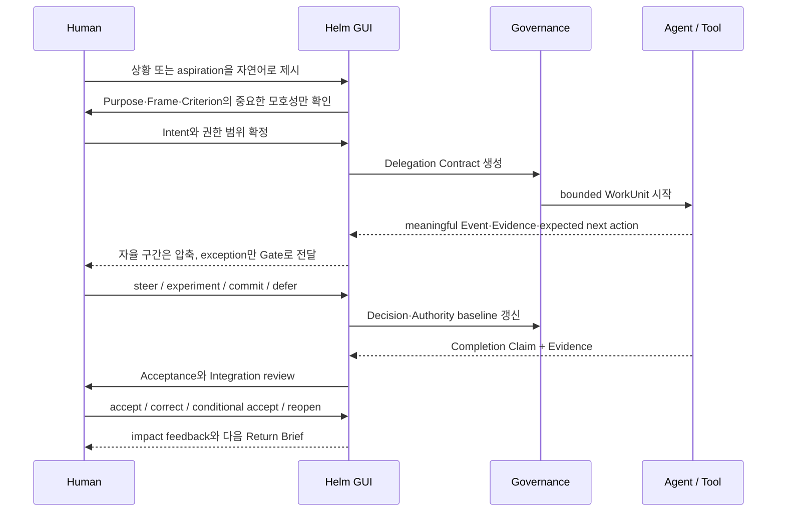

# Commercial Desktop Workflow Agent UX

> Status: product research synthesis v0.1  
> Research snapshot: 2026-08-16  
> Scope: Helm Foundations를 상용 desktop GUI(Electron, Tauri 또는 동등한 shell)의 제품 관점·정보 구조·핵심 상호작용으로 번역  
> Non-goal: 특정 UI framework 확정, 완성된 visual design, 전체 enterprise 기능 명세
> Product language: 사용자에게 보이는 이름과 application domain은 [`../foundations-friendly/README.md`](../foundations-friendly/README.md)를 우선한다.

## 1. 결론

Helm의 상용 GUI는 **agent chat**, **workflow canvas**, **project dashboard** 중 하나가 되어서는 안 된다.

> **Helm은 사용자가 여러 agent의 활동을 감시하는 화면이 아니라, 제한된 주의력으로 공동 목적·믿음·권한·결과를 조정하는 evidence-aware mission control이어야 한다.**

첫 제품의 중심 화면은 채팅이나 Event log가 아니라 다음 두 surface다.

1. **Today / Return Brief** — 사용자가 현재 상황에 빠르게 복귀하고 지금 가장 가치 있는 판단을 찾는 곳
2. **Concern Room** — 하나의 중요한 상황에서 Purpose, ProblemFrame, Evidence, Delegation, Outcome을 함께 조작하는 곳

Chat은 이 상태를 만들고 바꾸는 **행위 채널**이고, node canvas는 반복 가능해진 automation/policy를 편집하는 **보조 projection**이다. 어느 것도 product system of record가 아니다.

이 문서는 원론 추적을 위해 Purpose, Concern, Claim 같은 technical term을 함께 사용한다. 실제 제품에서는 각각 목표, 초점, 판단처럼 [`쉬운 Product Foundations`](../foundations-friendly/01-shared-language.md)의 용어로 투영한다.

상용 제품의 차별점은 agent 수, 실시간 token stream, 화려한 orchestration graph가 아니다. 사용자가 언제든 다음을 할 수 있는가에 있다.

- 현재 Purpose와 중요한 변화 복원
- agent의 다음 행동과 권한 경계 예측
- 사소한 실행을 방해하지 않으면서 중요한 Gate만 판단
- Recommendation의 전제와 Counterevidence 검토
- Intent, Constraint, Criterion을 낮은 비용으로 수정
- Completion Claim을 Evidence에 따라 수락·반려
- 지역 Outcome을 전체 시스템에 Integration
- 과거 Decision을 새 Evidence에 따라 Reopen

## 2. Foundations에서 직접 도출되는 제품 관점

| Foundation 명제 | GUI 제품 번역 | 피해야 할 기본값 |
|---|---|---|
| 목적은 태스크보다 먼저 존재 | 모든 Work/Run에 Purpose trace 표시 | 출처 없는 task inbox |
| 진척은 정당화된 상태 변화 | Activity보다 Decision·Evidence·Outcome 변화 강조 | token, tool call, task count 중심 dashboard |
| 문제 정의도 작업 결과 | Prompt와 active ProblemFrame을 분리하고 수정 가능하게 함 | 첫 prompt를 고정 spec으로 취급 |
| 사실·추론·가설·결정은 다름 | statement kind와 provenance를 일관된 visual grammar로 표현 | 매끄러운 AI summary 한 덩어리 |
| 자율성은 위험 적응적 권한 범위 | WorkUnit별 Authority Envelope와 escalation reason 표시 | agent별 고정 autonomy level |
| 결정은 낮은 유능한 수준에서 | local choice는 자동 처리하고 exception만 Attention Queue로 올림 | 모든 action 승인 또는 완전 방임 |
| 완료 주장·수락·통합은 다름 | Claim → Review → Accept → Integrate 상태를 분리 | `Done` Boolean |
| Context는 시점별 projection | Brief마다 cursor, freshness, omission, source drill-down 제공 | 장문 chat summary를 memory라 부름 |
| 자동화는 인간의 주도성을 보존 | pause보다 steer/reframe/contest를 우선 action으로 제공 | 인간을 승인자·예외 처리자로 축소 |
| 실패와 이견은 학습 신호 | dissent, weak signal, rejected option을 숨기지 않음 | 합의된 요약만 표시 |

따라서 GUI의 기본 단위도 바뀐다.

```text
Task / Thread / Run
  = Concern episode 안의 실행 및 대화 projection

Concern episode
  = Purpose → Frame → Inquiry → Decision → Delegation
    → Outcome Claim → Acceptance → Integration → Reflection
```

## 3. 상용 제품 benchmark

아래 비교는 기능 점수표가 아니다. 현재 제품에서 이미 검증되고 있는 interaction pattern을 Helm의 존재론과 대조한 것이다.

| 제품 | 관찰된 pattern | Helm이 취할 것 | Helm이 넘어서야 할 한계 |
|---|---|---|---|
| OpenAI Codex app | project별 thread, 병렬 agent, 격리된 worktree, diff review, background automation의 review queue, sandbox permission | 여러 자율 구간의 분리, local material isolation, 비동기 복귀와 review queue | thread/run 중심을 Purpose·Decision·Evidence·Integration 중심으로 재구성 |
| Linear Agents | human assignee가 ownership을 유지하고 agent는 delegate로 분리; Agent Session activity와 permission scope 기록 | 책임과 수행의 분리, 기존 work object 안의 agent participation, 불변 activity snapshot | issue status만으로 Epistemic/Normative 변화와 Acceptance를 표현하지 않기 |
| n8n | visual workflow, 실행 이력, 위험 tool별 deterministic human review, 실행 parameter preview | 반복 가능한 automation과 실제 side effect 경계의 명시적 guard | 모든 인간 참여를 approve/deny로 축소하지 않기; open-ended inquiry를 고정 canvas로 강제하지 않기 |
| Microsoft Copilot Studio | real-time/historical activity map, transcript+map, blocked/waiting 상태, input/output와 source drill-down, deterministic agent flow | run observability, status filtering, deep inspection, human-input wait state | agent가 생성한 rationale 또는 chain-of-thought를 정본 Evidence로 취급하지 않기 |
| Zapier Agents | all-agent/pod/agent activity, run detail, messaging channel을 통한 approval, run activity limit | agent fleet overview, channel-independent Gate delivery, resource budget | prompt에 적은 approval instruction과 runtime-enforced Authority를 구분하기 |
| LangSmith | trace/run/thread 계층, human/code/LLM evaluation, annotation queue, pairwise review, online/offline feedback loop | Assurance View, structured review queue, production failure를 다음 evaluation으로 전환 | developer observability를 최종 사용자 공동행위 UX로 그대로 노출하지 않기 |

### 3.1 시장에서 확인되는 공통 방향

1. **병렬성은 이미 table stakes다.** 여러 agent를 시작하는 것보다 사용자가 맥락을 잃지 않고 돌아오고 결과를 비교·통합하는 문제가 남는다.
2. **agent와 human ownership의 분리가 시작됐다.** Linear의 assignee/delegate 분리는 Helm의 HumanActor/AgentActor 비대칭과 잘 맞는다.
3. **위험 action의 selective review가 일반화되고 있다.** n8n은 tool별 review와 실제 parameter를 보여준다. Helm은 여기에 Purpose, consequence, reversibility, alternative를 더해야 한다.
4. **run observability는 중요하지만 충분하지 않다.** Activity map과 trace는 “무슨 일이 일어났는가”를 잘 보여주지만 “무엇을 믿고 받아들일 것인가”는 별도 semantic layer가 필요하다.
5. **chat와 canvas가 공존한다.** 자연어는 진입 비용을 낮추고 canvas는 안정된 반복 구조를 설명한다. 탐구 중인 work는 object-centered room이 더 적합하다.
6. **evaluation은 사후 debug에서 운영 feedback loop로 이동한다.** Helm의 Reflection은 실패 trace가 Contract, Policy, Context를 실제로 바꾸는 곳까지 이어져야 한다.

### 3.2 외부 Human–AI UX 지침과의 정합성

Microsoft의 Human–AI Interaction Guidelines는 capability/quality expectation, context-aware timing, efficient correction/dismissal, explanation, global control, change notification을 강조한다. Google PAIR는 단계적 onboarding, human-like mental model의 위험, feedback 결과의 범위와 시점, control과 automation의 균형을 강조한다.

Helm에 대한 추가 결론은 다음과 같다.

- onboarding은 “무엇이든 해주는 AI”가 아니라 **어디까지 보고·제안·실행하며 언제 멈추는지**를 가르쳐야 한다.
- 사용자의 correction이 현재 WorkUnit만 바꾸는지, team guidance나 policy까지 바꾸는지 명시해야 한다.
- agent persona보다 capability, scope, evidence obligation, last observed action을 먼저 보여줘야 한다.
- AI가 생성한 설명은 출처 기반 설명과 구분해야 한다.

## 4. 핵심 UX 원칙

### P1. State-first, conversation-supported

사용자가 앱을 열었을 때 마지막 message가 아니라 현재 공동 상태를 본다. Chat은 Concern, Decision, Commitment, Evidence에 귀속된다.

**제품 검사:** message를 삭제하거나 다른 channel에서 입력해도 Purpose, Decision, Commitment, Outcome을 복원할 수 있는가?

### P2. Difference-first, log-on-demand

기본 화면은 모든 Event를 나열하지 않고 마지막 cursor 이후 Decision을 바꿀 수 있는 차이를 보여준다. 원본 log는 drill-down으로 남긴다.

**제품 검사:** 24시간 후 사용자가 5분 안에 목적·위험·다음 판단을 정확히 설명할 수 있는가?

### P3. Concern-centered work

Issue, task, thread보다 넓은 Concern을 작업의 home으로 둔다. 하나의 Concern 안에 경쟁 Frame, 여러 WorkUnit, Decision, Outcome을 담는다.

**제품 검사:** 실행 중 문제가 재정의되어도 새 project를 만들거나 chat을 버리지 않고 lineage를 보존하는가?

### P4. OPD+C by construction

모든 active WorkUnit는 다음 네 질문에 답해야 한다.

- Observability: 지금 상태·Evidence·Exception이 보이는가?
- Predictability: 다음 action과 checkpoint를 예상할 수 있는가?
- Directability: Intent·Constraint·Criterion을 낮은 비용으로 바꿀 수 있는가?
- Contestability: Frame·Claim·Recommendation을 반박하고 다시 열 수 있는가?

### P5. Risk-adaptive interaction

Gate의 수가 아니라 precision이 중요하다. 가역성, blast radius, testability, uncertainty, value sensitivity에 따라 다음을 바꾼다.

- 자동 실행 가능 범위
- preview의 깊이
- Evidence burden
- reviewer와 응답 기한
- interrupt와 batch delivery

### P6. Semantic compression with reversible drill-down

정상 반복은 압축하되 dissent, stale Evidence, scope change, authority exception은 별도 객체로 보존한다. 모든 summary에는 source cursor와 원본 경로가 있다.

### P7. Authorship through meaningful modification

핵심 primary action은 `Approve`보다 다음이어야 한다.

- Reframe
- Change criterion
- Narrow/expand scope
- Request discriminating evidence
- Steer or re-delegate
- Accept with conditions
- Reopen decision

### P8. Assurance before closure

agent의 완료 message를 Done으로 변환하지 않는다. 사용자는 criterion별 Evidence coverage, unverified scope, Counterevidence, limitation을 본 뒤 accept/correct/conditionally accept를 선택한다.

### P9. Resumption is a first-class workflow

background run이 많을수록 “실시간으로 계속 보기”보다 복귀 UX가 중요하다. Return Brief는 Change–Assessment–Projection–Recommendation 순으로 구성하고 “지금 읽지 않아도 되는 것”도 알려준다.

### P10. Trust is a product surface

local/cloud 경계, credential use, filesystem/network access, data retention, agent/provider, approval policy를 settings 깊숙이 숨기지 않는다. 중요한 action에서 현재 권한 근거를 바로 확인할 수 있어야 한다.

## 5. 권장 information architecture

상단 navigation을 Entity taxonomy 전체로 만들지 않는다. 사용자의 반복 질문을 기준으로 여섯 surface만 둔다.

| Surface | 사용자의 질문 | 핵심 projection |
|---|---|---|
| **오늘** | 지금 무엇이 중요하고 내가 무엇을 선택해야 하는가? | 복귀 요약 + 선택 요청 |
| **초점** | 우리가 해결하려는 중요한 상황은 무엇인가? | 초점 목록 + 전체 상황 |
| **진행 작업** | 누가 무엇을 어떤 범위로 수행 중인가? | 작업 합의 + 진행 작업 |
| **선택** | 어떤 선택이 열려 있고 무엇을 정했는가? | 선택 요청 + 선택 기록 |
| **근거** | 이 판단과 실제 결과를 왜 믿는가? | 근거 목록 + 결과 확인 |
| **자동화 규칙** | 무엇을 자동으로 허용하고 언제 나에게 묻는가? | 맡긴 범위, 연결, 알림, 보관 규칙 |

Search/command palette는 모든 surface를 가로지른다. `Timeline`, `Agents`, `Artifacts`는 독립적인 최상위 목적보다 context filter 또는 inspector view로 두는 편이 낫다.

### 5.1 Desktop shell

```text
┌──────────────────────────────────────────────────────────────────────────┐
│ Workspace ▾        Search / Command                              Sync ●  │
├───────────────┬──────────────────────────────────────┬───────────────────┤
│ Today         │ Return Brief / Concern Room          │ Context Inspector │
│ Concerns      │                                      │ Source            │
│ Work          │ Meaningful differences               │ Authority         │
│ Decisions  2  │ Evidence-backed recommendation       │ Freshness         │
│ Evidence   1  │ Current/expected path                │ Related decisions │
│ Policies      │                                      │                   │
├───────────────┴──────────────────────────────────────┴───────────────────┤
│ Ask · Frame · Delegate · Steer…                         Active runs 3 ▴  │
└──────────────────────────────────────────────────────────────────────────┘
```

- **Left rail:** stable navigation, workspace/Concern scope, actionable count만 표시
- **Center:** 현재 projection과 공동 작업 surface
- **Right inspector:** 선택한 Claim/Decision/Action의 provenance, authority, relationship
- **Bottom composer:** 현재 scope에 귀속되는 natural-language action; 단순 global chat이 아님
- **Active-run drawer:** agent별 token stream 대신 expected action, last meaningful change, next checkpoint, exception을 요약

## 6. 핵심 화면 계약

### 6.1 Today / Return Brief

앱의 default landing이다.

위에서 아래 순서:

1. **Purpose pulse** — 현재 최상위 Purpose와 바뀐 Criterion
2. **Since you left** — Normative / Epistemic / Material change를 의미 단위로 압축
3. **Attention Queue** — 최대 3개의 active Gate, why now와 delay cost 포함
4. **Active work** — owner/delegate, expected path, next checkpoint, exception
5. **Near-term projection** — 개입하지 않을 때의 다음 action과 last-cheap-point
6. **Background changes** — 낮은 우선순위의 접힌 영역

사용자가 원본을 읽지 않고도 다음 행동을 선택할 수 있어야 하지만, 모든 row는 Event·artifact·source로 drill-down된다.

### 6.2 Concern Room

하나의 Concern을 다루는 중심 workspace다.

권장 tabs:

- **Situation:** Purpose, why it matters, current frame, major changes, risk
- **Inquiry:** competing frames/hypotheses, supporting/challenging Evidence, next experiment
- **Work:** Delegation Contract, active WorkUnits, dependency, authority
- **Outcome:** completion Claims, assurance, Acceptance, Integration
- **History:** semantic Event timeline과 supersede/reopen 관계

Chat transcript는 별도 tab보다 각 객체의 discussion thread로 연결한다. 사용자가 자연어로 말하면 system은 그것이 Question, Constraint change, Decision, Request 중 무엇인지 제안하고 의미 상태 변경 전 차이가 큰 부분만 확인한다.

### 6.3 Attention Queue / Decision Gate

Gate card의 collapsed 상태는 다음만 보여준다.

- 질문
- why now
- 목적 영향
- 권고와 strongest alternative
- reversibility / delay cost / last-cheap-point
- 예상 review time

expanded 상태에서 Criteria, Evidence, Counterevidence, Uncertainty, Consequence, Commitment, reopen trigger를 제공한다.

Primary actions:

```text
Commit recommendation
Choose alternative
Run experiment first
Modify criteria or scope
Delegate decision
Defer until condition
Contest frame/evidence
```

`Approve / Deny`는 정확한 tool parameter가 있는 bounded side effect에만 사용한다.

### 6.4 Delegation Composer

자연어 요청에서 Contract 초안을 만들되 전체 schema form을 노출하지 않는다.

기본으로 보여줄 것:

- Intent / Purpose
- Conditions of satisfaction
- Scope and exclusions
- Allowed external effects
- Evidence obligations
- Escalation triggers
- Expected checkpoint
- Human owner, agent delegate, acceptor

system이 발견한 모호성은 `이 차이가 결과를 바꿀 수 있음`이라는 이유와 함께 inline question으로 제시한다. 영향 없는 빈 필드를 채우게 하지 않는다.

### 6.5 Active Work card

agent의 성격이나 typing animation보다 다음을 보여준다.

- `Doing now` — 현재 의미 있는 action
- `Because` — Purpose/Decision trace
- `Next` — 예상 action과 checkpoint
- `Within` — Authority Envelope 요약
- `Watching` — risk, assumption, escalation trigger
- `Changed` — 마지막 meaningful Event

항상 가능한 action:

```text
Steer intent    Change criterion    Narrow authority
Pause safely    Ask for brief       Open evidence    Cancel/transfer
```

### 6.6 Evidence Inspector

Evidence는 attachment viewer가 아니다.

- Observation / Inference / Hypothesis / NormativeJudgment kind
- supports / challenges / qualifies / invalidates 관계
- provenance와 acquisition method
- scope, freshness, independence, coverage
- 원본 artifact/run 위치
- 이 Evidence가 바뀌면 reopen될 Decision과 invalidated Context

confidence percentage 대신 `직접성`, `남은 Counterevidence`, `검증하지 못한 범위`, `다음으로 줄일 수 있는 불확실성`을 우선한다.

### 6.7 Completion / Integration Review

두 단계로 나눈다.

**Acceptance**

- 만족을 주장하는 Criterion
- Criterion별 Evidence coverage
- unverified scope와 known limitation
- correction / conditional acceptance / acceptance

**Integration**

- 상위 Purpose와 Decision 정합성
- 다른 WorkUnit의 Assumption invalidation
- interface, policy, docs, tests, external state 영향
- rollback/recovery path
- baseline update와 reopen trigger

## 7. 주요 interaction flow



## 8. Chat, canvas, timeline의 정확한 역할

### Chat

**사용:** capture, 질문, 협상, reframe, steering, discussion  
**금지:** Decision/Commitment/Memory의 유일한 정본

모든 message는 current scope를 표시한다. 의미 상태를 바꿀 가능성이 있는 발화는 inline semantic preview를 만든다.

### Node canvas

**사용:** deterministic automation, adapter chain, trigger/action policy, stable subworkflow, execution replay  
**금지:** 모든 open-ended agent reasoning과 Concern episode의 기본 표현

계획이 계속 변하는 탐구 단계에서 canvas를 강제하면 사용자가 실제 state보다 임시 계획 diagram을 유지하는 노동을 하게 된다. canvas는 반복성이 확인된 뒤 `policy projection`으로 승격한다.

### Timeline / trace

**사용:** audit, forensic recovery, debug, provenance  
**금지:** home dashboard와 progress의 기본 표현

Timeline default filter는 `meaningful only`이며 material/tool details는 펼쳐본다. raw chain-of-thought는 근거로 취급하지 않고 tool input/output, explicit Claim, Decision rationale, source를 보여준다.

## 9. Visual and content grammar

### 9.1 상태 언어

- 색상만으로 domain이나 risk를 표현하지 않는다.
- `Running`보다 `Investigating hypothesis`, `Waiting for criterion`, `Claiming complete`, `Integrating`처럼 의미 상태를 쓴다.
- agent-generated, human-authored, policy-derived를 표시하되 인간/agent를 감정적 avatar로 과도하게 의인화하지 않는다.
- stale, contested, inferred, policy-approved를 badge와 문장으로 함께 설명한다.

### 9.2 세 세계의 시각적 구분

| Domain | 질문 | 기본 표현 |
|---|---|---|
| Normative | 무엇을 해야 하고 누가 수락했는가? | Decision/Commitment card, solid boundary |
| Epistemic | 무엇을 알고 의심하는가? | Claim/Evidence relation, qualified state |
| Material | 실제로 무엇이 변했는가? | artifact/diff/run preview, observed timestamp |

세 domain에 고정 color를 줄 수는 있지만 label과 icon을 함께 사용한다. 관계가 중요하므로 서로 다른 tab에 완전히 분리하지 않는다.

### 9.3 Progressive disclosure

세 깊이를 일관되게 제공한다.

1. **Glance:** 지금 중요한 차이와 action
2. **Review:** Criteria, Evidence, consequence, expected path
3. **Audit:** raw Event, artifact, tool I/O, provenance

## 10. Desktop product implications

Electron은 배포 shell이고 Helm의 domain model이 아니다. 현재 headless `HelmApplication`과 server/client 경계를 유지하는 것이 중요하다.

### 10.1 권장 process boundary

```text
Sandboxed renderer
  ↕ narrow typed IPC / local authenticated HTTP
Desktop main process
  ├─ windows, deep links, notifications, updater
  ├─ credential broker and permission prompts
  └─ local core / utility process lifecycle
        ├─ Event ledger and projections
        ├─ agent/tool adapters
        └─ background WorkUnits
```

- renderer가 filesystem, shell, credential API를 직접 소유하지 않는다.
- agent/tool runtime은 UI main thread와 분리한다.
- local core는 GUI가 닫히거나 reload되어도 Event 일관성을 유지한다.
- IPC는 generic `execute`가 아니라 domain action별 최소 API를 노출한다.
- remote content와 local privilege를 같은 renderer context에서 섞지 않는다.

Electron 공식 보안 지침에 따라 context isolation, renderer sandbox, restrictive CSP, IPC sender validation, navigation/window restriction을 기본값으로 둔다. credential은 OS-backed storage를 사용하고 platform별 보안 차이와 일시적 unavailable 상태를 처리한다.

### 10.2 Desktop가 실제로 제공해야 하는 가치

- background run lifecycle과 crash recovery
- deep link로 특정 Gate/Concern 복귀
- attention policy를 존중하는 native notification
- global quick capture / command palette
- filesystem/project identity와 local provenance
- secure credential mediation
- offline-first read/review와 reconnect 후 sync
- update 전에 active WorkUnit와 unsynced Event 보호

Desktop packaging 자체는 Level 1/2 UX 가치를 증명하지 않는다. 현재 Web GUI로 Return Brief, Concern Room, Gate의 사용성을 검증한 뒤 shell을 붙이는 순서가 합리적이다.

## 11. 상용화 관점의 필수 product surface

### Trust Center

- 연결된 provider/tool과 scope
- agent별 capability가 아니라 WorkUnit별 실제 permission
- local/cloud data route와 retention
- credential last-used와 revocation
- audit export와 deletion policy

### Cost and resource budget

- token보다 user-meaningful 단위로 budget을 보여준다: WorkUnit, external action, runtime, provider cost
- Contract에서 hard limit과 escalation threshold를 설정한다.
- budget 초과 직전 `계속할까요?`가 아니라 지금까지 줄어든 불확실성, 남은 예상 가치, 대안을 보여준다.

### Recovery Center

- interrupted/failed/blocked WorkUnit
- safe retry, resume from checkpoint, transfer, rollback
- duplicate external action 방지와 idempotency 상태
- crash/update 이후 Return Brief

### Collaboration and accountability

- human owner, delegate, acceptor를 분리
- Handoff acknowledgement와 unresolved obligation
- team policy와 local exception의 lineage
- Decision과 Acceptance에 author와 authority basis 보존

### Accessibility and internationalization

- keyboard-first command와 full mouse path를 함께 제공
- status/risk를 색상에만 의존하지 않음
- long-running update를 screen reader가 과도하게 반복하지 않음
- 상대 시간과 정확한 timestamp를 함께 제공
- 한국어/영어가 섞인 domain vocabulary의 glossary와 일관된 번역 정책

## 12. 현재 Helm Web v0에 대한 직접 평가

현재 `apps/helm-web`은 Event ledger와 projection boundary를 검증하는 vertical slice로 적절하다. 특히 Purpose, latest Decision, Commitment, Belief, Material change를 한 화면에 모으고 cursor를 노출한 점은 Foundations와 맞는다.

상용 UX로 승격하기 전에 다음 gap을 해결해야 한다.

| 현재 surface | 유지 | 변경 |
|---|---|---|
| Brief | Purpose와 cursor, 세 domain 요약 | latest snapshot에서 `since you left` change–meaning–projection Brief로 전환 |
| Timeline | append-only audit | top-level nav에서 inspector/drill-down 중심으로 낮춤 |
| Capture form | semantic Event 검증 도구 | 자연어 composer + inline semantic preview로 대체 |
| Latest decision | reopen trigger | Decision Queue와 Gate contract, Counterevidence, impact 추가 |
| Commitments | owner/status | delegate, authority, Evidence obligation, next checkpoint 추가 |
| Belief changes | confidence basis | Claim kind, Evidence relation, stale/contested 상태 추가 |
| Material groups | file change grouping | Purpose/Decision/Outcome trace와 Integration impact 추가 |

중요하게, 현재 `Capture what changed meaning` form은 **연구용 계측 장치**로는 좋지만 최종 사용자가 Event taxonomy를 수동 입력하게 만드는 제품 UX가 되어서는 안 된다.

## 13. 우선순위 roadmap

### Slice A — Resumption desktop-quality Web GUI

목표: Level 1 Situation Recovery 검증

- acknowledgement cursor 기반 `Since you left`
- Changes → Assessment → Projection → Recommendation
- active Gate 최대 3개
- source/freshness drill-down
- user acknowledgement와 resumption metric

**아직 하지 않음:** Electron packaging, full agent runtime, graph canvas

### Slice B — Concern Room and Decision leverage

목표: Level 2 Deliberative Inquiry 검증

- Concern identity와 active ProblemFrame
- competing Hypothesis / Evidence relation
- Decision Gate expanded contract
- natural-language capture와 semantic preview
- user correction이 Recommendation/Contract에 미친 impact feedback

### Slice C — Bounded execution control

목표: Level 3 Delegation 검증

- human owner / agent delegate
- Authority Envelope와 permission broker
- active Work card의 OPD+C
- pause/steer/transfer/checkpoint
- 위험 tool action preview와 deterministic enforcement

이 단계에서 desktop shell이 background lifecycle, notification, credential mediation에 실질적 가치를 제공한다.

### Slice D — Acceptance and Integration

목표: Level 4 Assured Integration 검증

- criterion–Evidence coverage
- Claim / Acceptance / Integration 분리
- semantic impact map
- recovery/reopen workflow
- failed Outcome을 evaluation/Policy update로 전환

### Slice E — Team and SaaS

목표: Level 5 Adaptive Institution 후보 검증

- team Common Operating Picture
- shared Attention Queue와 Handoff
- organizational Authority/retention policy
- cross-workspace Evidence·Decision learning
- audit, billing, admin, data residency

## 14. 제품 가설과 UX 지표

| 가설 | 대표 지표 | 반증 신호 |
|---|---|---|
| Return Brief가 복귀를 개선 | time-to-orientation, risk/next-state recall, raw-log fallback | 결국 대부분 log를 처음부터 읽음 |
| Attention Queue가 approval labor를 줄임 | consequential gate precision, ignored gate rate, human minutes | 일괄 승인 또는 중요한 결정 누락 |
| Concern Room이 chat보다 reframe을 돕음 | frame/criterion modification, decision-changed outcome | 사용자 수정 없이 AI 문서만 늘어남 |
| OPD+C가 신뢰 보정을 돕음 | next-action prediction, redirection latency, automation surprise | 상태 노출이 정보 과부하만 만듦 |
| Acceptance/Integration 분리가 hidden work를 찾음 | claim rejection, unowned obligation, post-acceptance conflict | 상태 관료주의만 증가 |
| semantic preview가 form보다 낮은 비용 | capture correction rate, semantic omission, time-to-record | 자동 추출 오류 때문에 form fallback이 상시 필요 |

기능 사용률보다 다음 임계 사건을 우선 관찰한다.

1. 사용자가 Frame 또는 Criterion을 실제로 바꾼다.
2. Counterevidence가 Recommendation을 바꾼다.
3. Gate가 불필요한 실행을 멈추는 대신 더 나은 실험·위임을 만든다.
4. Completion Claim과 Acceptance 사이에서 새로운 결함이 발견된다.
5. Acceptance 이후 Integration에서 shared Assumption 충돌이 발견된다.
6. 사용자의 intervention이 다음 Context, Contract, Policy를 실제로 바꾼다.

## 15. 지금 확정할 것과 보류할 것

### 지금 확정할 제품 방향

- primary home은 Return Brief + Attention Queue다.
- 기본 작업 공간은 thread가 아니라 Concern Room이다.
- chat은 scope-aware action channel이다.
- human owner와 agent delegate를 분리한다.
- Gate는 위험 적응적이고 `why now`를 갖는다.
- completion, acceptance, integration을 분리한다.
- raw Event와 provenance는 항상 drill-down 가능하다.
- desktop renderer와 privileged runtime을 격리한다.

### pilot 전에 확정하지 않을 것

- 최종 Entity schema와 graph database
- agent persona/character system
- 모든 workflow를 위한 node canvas
- 고정 autonomy score
- confidence percentage
- Gate scoring weight
- multi-agent 조직도 UI
- Electron 대 Tauri의 최종 선택
- SaaS team plan과 pricing

## 16. 권장 design principle 한 문장

> **정상 실행은 조용히 흘려보내고, 목적·믿음·권한·통합을 바꿀 수 있는 차이는 근거와 함께 사용자가 조작할 수 있게 만든다.**

## 17. Sources

### Commercial product patterns

- [OpenAI: Introducing the Codex app](https://openai.com/index/introducing-the-codex-app/)
- [Linear: AI Agents](https://linear.app/docs/agents-in-linear)
- [Linear: Assign and delegate issues](https://linear.app/docs/assigning-issues)
- [Linear Developers: Agent interaction best practices](https://linear.app/developers/agent-best-practices)
- [n8n: Human-in-the-loop for AI tool calls](https://docs.n8n.io/build/integrate-ai/ai-examples/human-in-the-loop-for-tools)
- [Microsoft Copilot Studio: Review agent activity](https://learn.microsoft.com/en-us/microsoft-copilot-studio/authoring-review-activity)
- [Microsoft Copilot Studio: Agent flows overview](https://learn.microsoft.com/en-us/microsoft-copilot-studio/flows-overview)
- [Zapier: Review your agent's activity](https://help.zapier.com/hc/en-us/articles/33336184962573-Review-your-agent-s-activity)
- [Zapier: Add approval steps to your agent's instructions](https://help.zapier.com/hc/en-us/articles/41776074420493-Add-approval-steps-to-your-agent-s-instructions)
- [LangSmith: Observability concepts](https://docs.langchain.com/langsmith/observability-concepts)
- [LangSmith: Evaluation concepts](https://docs.langchain.com/langsmith/evaluation-concepts)

### Human–AI interaction

- [Microsoft Research: Guidelines for Human–AI Interaction Design](https://www.microsoft.com/en-us/research/?p=564561)
- [Google PAIR: Mental Models](https://pair.withgoogle.com/guidebook-v2/chapter/mental-models/)
- [Google PAIR: Feedback + Control](https://pair.withgoogle.com/guidebook-v2/chapter/feedback-controls/)

### Desktop implementation boundary

- [Electron: Process Model](https://www.electronjs.org/docs/latest/tutorial/process-model)
- [Electron: Security](https://www.electronjs.org/docs/latest/tutorial/security)
- [Electron: Context Isolation](https://www.electronjs.org/docs/latest/tutorial/context-isolation)
- [Electron: safeStorage](https://www.electronjs.org/docs/latest/api/safe-storage)

## 18. Internal traceability

- [`../foundations/00-manifesto.md`](../foundations/00-manifesto.md)
- [`../foundations/02-epistemology.md`](../foundations/02-epistemology.md)
- [`../foundations/04-co-agency.md`](../foundations/04-co-agency.md)
- [`../foundations/06-interaction-constitution.md`](../foundations/06-interaction-constitution.md)
- [`../foundations/07-architecture-invariants.md`](../foundations/07-architecture-invariants.md)
- [`../foundations/08-falsifiable-hypotheses.md`](../foundations/08-falsifiable-hypotheses.md)
- [`../foundations/09-operating-theory.md`](../foundations/09-operating-theory.md)
- [`bundles/situation-recovery-and-deliberative-inquiry.md`](bundles/situation-recovery-and-deliberative-inquiry.md)
- [`bundles/delegated-action-and-integration.md`](bundles/delegated-action-and-integration.md)
- [`../architecture/helm-system-v0.md`](../architecture/helm-system-v0.md)
