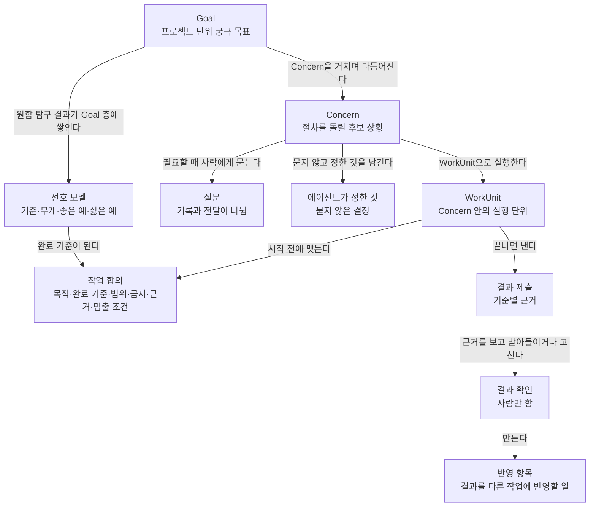
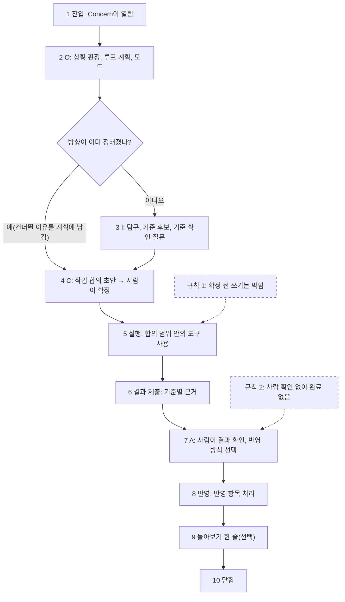

# 1. 제품: Helm이 푸는 문제와 하지 않는 것

## 지시로 일을 맡길 때 무엇이 빠지는가

Claude Code나 pi 같은 에이전트 도구에 일을 맡기는 방식은 지시문에서 시작합니다. 사람이 원하는 것을 글로 쓰면 에이전트가 계획하고 실행한 뒤 "완료했습니다"라고 답합니다. 이 방식은 무엇을 원하는지 사람이 이미 정확히 알고 있을 때 잘 동작합니다. 반대로 원하는 것이 아직 흐린 일에서는 몇 가지가 반복해서 빠집니다.

첫째, 사람이 글로 쓴 요구와 실제로 원하는 것이 다릅니다. 블로그 글을 "짧고 담백하게" 써 달라고 했는데 초안 몇 개를 읽어 보니 정작 끌리는 것은 장면으로 시작하는 글이었다는 식입니다. 원하는 것은 자극을 비교해 본 뒤에야 드러나기 때문에, 지시문을 확정된 요구로 다루면 출발점부터 어긋납니다. 대안 두세 개를 던지고 하나를 고르게 하는 방식도 쓰지 않기로 했습니다. 고르기는 이미 주어진 보기 안에서 끝나므로, 자극을 비교하며 기준을 찾는 과정이 생기지 않기 때문입니다.

둘째, 맡긴 범위와 결과 확인이 생략됩니다. 채팅에서는 지시문이 곧 합의 역할을 하고, 에이전트의 "완료했습니다"가 제출과 확인과 반영을 한꺼번에 끝낸 것처럼 처리됩니다. 무엇을 어디까지 맡겼는지(작업 합의)와 결과를 무엇으로 확인했는지(결과 확인)가 남지 않으면, 나중에 결과가 이상할 때 기준 자체가 없습니다.

셋째, 실행 속도가 이해 속도보다 빠릅니다. 하루 자리를 비웠다 돌아오면 에이전트가 무엇을 바꿨고 무엇을 혼자 정했는지 알기 위해 원본 로그를 다시 읽어야 합니다. 에이전트가 묻지 않고 정한 결정은 로그 곳곳에 흩어져 있어서 이의를 걸 수도 없습니다. 반대로 에이전트가 너무 자주 물으면 사람은 질문을 읽지 않고 넘기는 습관이 생깁니다.

이 가운데 빈칸 채우기가 우회되는 문제와 작업 합의·결과 확인을 건너뛰는 문제는 이전 판(v0.2)을 직접 써 본 기록에서 확인되었습니다. 필수 필드만 채운 결정 기록에 `summary: ㅇ`, `rationale: ㅁㄴㅇ`이 들어가 최신 결정으로 표시되었고, 템플릿 질문 약 197개에 사용자는 폼을 고치지 않고 한 문장으로 답했습니다. 가장 많이 건너뛴 단계는 작업 합의와 결과 확인이었습니다. 그래서 Helm은 사람에게 빈칸을 채우게 하는 방식을 버리고, 모델이 초안을 만들고 사람은 반응하고 고치는 방식을 택했습니다.

## Helm은 무엇을 하는 시스템인가

Helm은 **한 사람이 에이전트와 함께 일할 때, 실제로 원하는 것을 자극과 반응으로 찾고, 무엇을 어디까지 맡겼고 결과를 무엇으로 확인했는지 남기며, 자리를 비워도 일이 이어지고 돌아왔을 때 바로 다시 판단할 수 있게 하는 개인용 에이전트 작업 시스템**입니다. 사용자는 제품 소유자 한 사람뿐이고, 팀이나 조직은 고려하지 않습니다.

구성은 세 부분입니다. 집 서버(Windows PC 안의 WSL2)에 상주하는 데몬 `helmd`가 모든 작업을 실행하고 기록합니다. 데스크톱 앱(macOS, Windows)은 데몬에 붙어 상태를 보여 주고 사람의 조작을 데몬에 보내는 얇은 클라이언트이고, 앱 안에는 Helm의 규칙이 없습니다. 휴대폰은 다음 단계에서 질문에 답하는 용도로 붙습니다. 데몬이 상주하기 때문에 앱을 닫아도 진행 중인 작업은 계속되고, 사람이 돌아오면 그동안 바뀐 것의 요약이 만들어져 있습니다. 이 구성의 세부는 2번 노드에서 다룹니다.

일반 에이전트 도구와 Helm의 차이는 사람이 개입하는 지점과 기록의 기준에 있습니다. 아래 표에서 행마다 왼쪽과 오른쪽을 비교하면 Helm이 어디에 구조를 더했는지 보입니다.

| 항목 | 일반 에이전트 도구 | Helm |
|---|---|---|
| 출발점 | 지시문 | 지시문과, 초안·자극에 대한 사람의 반응 |
| 사람이 하는 일 | 지시를 쓰고 결과를 승인 | 초안에 반응, 맡길 범위 확정, 근거를 보고 결과 확인 |
| 기본 화면 | 대화 | Goal·Concern 상태, 질문함, 에이전트가 정한 것 |
| 완료 | 에이전트의 "완료" 응답으로 끝남 | 결과 제출, 사람의 결과 확인, 전체 반영이 따로 있음 |
| 기록의 기준 | 대화 기록 | 데몬의 이벤트 로그 |

마지막 행이 이후 모든 노드의 바탕입니다. Helm에서 상태를 바꾸는 모든 일은 데몬의 이벤트 로그에 기록되고, 화면과 모델에 주는 문맥은 그 로그를 읽어 계산한 결과입니다. 대화를 지워도 화면의 상태를 복원할 수 있어야 한다는 원칙(상태가 중심이고 대화는 보조)이 여기서 나옵니다. 이벤트 로그와 그 계산 결과(투영)는 4.1번과 4번 노드에서 다룹니다.

## 사용자가 다루는 단위

Helm을 쓰는 사람이 화면에서 만나는 단위는 아홉 가지입니다. 이 단위들은 서로 참조하므로 하나씩 정의를 읽는 것보다 관계를 먼저 보는 편이 빠릅니다. 아래 그림에서 Goal에서 시작해 화살표 라벨을 문장으로 읽으면 됩니다.

**Goal**은 프로젝트 단위의 궁극 목표이고, 버전을 가지며 Concern을 거칠 때마다 다듬어집니다. 확정된 Goal이 없어도 요청을 거부하지 않고 자리표시 Goal("이름 없는 Goal")에 연결해 진행합니다. Goal을 실제로 고치는 확정은 사람만 합니다.

**Concern**은 Helm의 절차를 돌릴 후보가 되는 상황 그 자체입니다. 문제, 기회, 위험, 불확실성, 취향 결정, 반복되는 마찰, 외부 요청, 가벼운 작업의 여덟 종류가 있습니다. Concern은 상황 자체를 뜻하고, 실제로 실행되는 일은 그 안의 WorkUnit입니다. 한 Concern 안에서 탐구, 탐침(작게 해 보고 결과를 보는 실험), 변경, 반영 같은 여러 WorkUnit이 실행됩니다.

작업 합의, 결과 제출, 결과 확인, 반영 항목은 한 WorkUnit의 앞과 뒤를 이룹니다. 다음 절에서 이 네 가지가 왜 따로 있는지 다룹니다. 질문, 에이전트가 정한 것, 선호 모델은 각각 묻기(6번 노드), 혼자 정한 결정, 원함 탐구(10번 노드)의 결과물입니다.

화면에서 사용자에게 N/E/M, OPD+C, 루프 식별자 같은 내부 용어를 외우게 하지 않는다는 원칙도 이 목록과 함께 기억해 둘 만합니다. 코드와 설계 문서에는 `I.want`, `A.confirm` 같은 식별자가 나오지만, 화면 문구는 "원함 탐구", "결과 확인" 같은 한국어 이름을 씁니다.

## 한 Concern은 어떤 순서로 흘러가는가

Concern 안의 일은 다섯 루프의 조합으로 실행됩니다. O는 상황 파악, I는 탐구, C는 작업 합의와 실행, A는 결과 확인과 관찰, S는 Concern 나누기와 합치기 같은 구조 정리입니다. 루프는 정해진 순서로 한 번씩 도는 단계가 아닙니다. 한 작업 안에서 필요에 따라 조합하고 언제든 다른 루프로 넘어갈 수 있으며, 커널(데몬 안에서 상태를 바꾸는 유일한 경로)이 강제하는 것은 의존 규칙뿐입니다. 루프의 세부는 9번 노드에서 다룹니다.

의존 규칙은 다섯 개이고, 그중 세 개가 사용자 결정입니다.

1. write와 send(파일 쓰기, 외부 발송)에는 활성 작업 합의가 필요합니다.
2. "완료"에는 결과 확인이 필요합니다.
3. 판단 승격(관찰과 해석을 "판단"으로 올리는 일)에는 탐구의 근거가 필요합니다.
4. 하위 Concern을 다시 합친 뒤에 닫습니다.
5. Goal을 바꿀 때는 사람이 확인합니다.

이 규칙 때문에 루프 순서가 자유로워도 건너뛸 수 없는 지점이 생깁니다. 아래 그림은 한 Concern의 정상 흐름이고, 판단 노드의 질문을 따라가면 I를 건너뛰는 경우와 거치는 경우가 나뉩니다. 점선으로 표시한 두 상자가 의존 규칙 1과 2가 막는 곳이고, 규칙 3~5는 이 그림에 넣지 않았습니다. 같은 흐름을 명령과 이벤트 이름 수준에서 따라가는 것은 3번 노드입니다.

4단계의 합의가 확정되기 전에 에이전트가 파일을 쓰려 하면 5단계 실행에 들어가지 못합니다. 커널이 그 도구 호출을 막고, 에이전트에게 "작업 합의 먼저"라는 결과를 돌려줍니다. 7단계의 결과 확인은 모델이 할 수 없습니다. 모델에게 주는 도구 목록에 결과 확인 계열이 아예 없고, 커널도 결과 확인 명령의 행위자가 사람인지 검사합니다.

**완료 주장, 결과 확인, 전체 반영은 서로 다른 사건**입니다. 6단계의 결과 제출은 에이전트가 "이 기준을 이 근거로 채웠다"고 내는 것이고, 근거 관찰 없이 서술만으로 "충족"이라고 낸 기준은 제출은 받되 "확인 못함"으로 낮추고, 기록에 없는 관찰 ID를 근거로 댄 제출은 지어낸 근거로 보아 거부합니다. 7단계의 결과 확인은 사람이 그 근거를 보고 받아들이거나, 조건을 붙이거나, 수정을 요청하거나, 거절하거나, 기준이 틀렸다고 하는 것입니다. 8단계의 반영은 그 결과를 다른 작업과 결정에 옮기는 일이고, 열려 있는 반영 항목이 0이 되어야 Concern을 닫을 수 있습니다. 처리했거나 다른 작업으로 넘겼거나 명시적으로 미룬 항목은 열린 것으로 세지 않고, 미룬 항목은 다음 복귀 요약 맨 위에 다시 나타납니다. 화면에서 단독 "완료"라는 말은 반영까지 끝난 뒤에만 씁니다.

Helm이 다섯 루프 가운데 C와 A를 먼저 강제하고, 그 대신 사람의 조작은 가볍게 만드는 데에도 이유가 있습니다. O와 I는 판단이 많아 코드로 강제하기 어렵지만, C와 A는 기록과 검사여서 코드로 강제할 수 있습니다. 그리고 C를 건너뛰면 A에서 비교할 기준이 없습니다. 대신 사람의 부담을 줄이려고, 정상 경로(변경 WorkUnit 하나가 범위 확대, 권리 게이트, 수정 요청, 실패 없이 끝나는 경로)에서 사람이 하는 결정 조작은 두 번 이하로 제한합니다. 합의 확정 한 번과 결과 확인 한 번입니다. 합의가 사람이 이미 맡겨 둔 범위 안에 있음을 커널이 증명할 수 있거나, 명확한 직접 지시를 그대로 옮긴 합의라면 확정 질문도 생략합니다.

## 원함 탐구: 고르기 대신 반응을 받는다

Helm의 출발 동기는 원함 발견입니다. 원하는 것은 자극을 비교해 본 뒤에야 드러난다는 전제이고, 이 전제를 실행하는 루프가 원함 탐구(`I.want`)입니다. 블로그 글 예로 흐름을 따라가 보겠습니다.

사용자가 "Helm 개발기 첫 글을 블로그에 쓰고 싶어. 짧고 담백하게."라고 입력합니다. 목표가 흐리고 취향에 달린 일이므로 Concern이 열리고, 루프 계획은 O → I.want → C.commit → A.confirm → A.reflect가 됩니다. 에이전트는 도입부 초안 여덟 개를 만듭니다. 이때 초안을 만드는 하위 호출들은 서로의 결과를 보지 못하게 해서 비슷한 초안만 나오는 것을 막습니다. 사용자는 초안마다 문장 구간을 짚어 반응합니다. 강하게 끌린다, 별로다, 이유는 모르겠지만 아니다, 이렇게 고쳐 말하고 싶다는 식입니다. 반응 하나하나가 관찰로 기록됩니다.

에이전트는 반응에서 기준 후보를 만듭니다. "장면으로 시작한다", "경험담이 들어간다", "길이보다 톤이 중요하다"가 나왔다고 하면, 사용자가 처음 말한 "짧게"와 반응에서 드러난 기준이 다르다는 사실도 함께 남깁니다. 기준 후보는 반드시 근거가 된 반응 관찰을 하나 이상 가리켜야 하고, 기준을 확정하는 것은 사람의 명령뿐입니다. 사람이 기준을 확정하면 그 기준이 작업 합의의 완료 기준으로 들어가고, 이후 결과 확인에서 그 기준별로 맞는지를 봅니다.

이 예에서 규칙을 뽑으면 다음과 같습니다. 한 라운드가 "하나 고르기"만으로 끝날 수 있으면 설계 위반입니다. 반응은 요소 단위로, 이유 없이도 받습니다. 탐구는 정지 규칙이나 예산 소진으로 끝납니다. 정지 규칙은 사람 입력이 있었던 라운드만 세어, 탐구 상태의 지문이 두 번 연이어 같거나, 한 번 같고 남은 질문 가운데 가장 좋은 것의 점수가 0이면 참이 됩니다(지문의 세부는 10번 노드). 예산이 소진되면 `budget_exhausted`로 따로 기록하고, 탐구를 마친 것으로 처리하지 않습니다. 사용자가 "그냥 하나 골라 줘"라고 직접 지시하면 그 지시를 기록하고 따릅니다. 이 원칙을 설계 문서는 recognition over recall, 또는 초안·반응 원칙이라고 부릅니다. 사람에게 처음부터 쓰게 하지 않고, 모델이 만든 초안을 알아보고 고치게 하는 것입니다. Goal, 작업 합의, 기준 후보, 질문 문장, 복귀 요약이 모두 이 원칙을 따릅니다.

## 묻기와 혼자 정하기

에이전트가 일하는 동안 사람에게 물어야 할 것이 생깁니다. Helm은 질문을 **기록과 전달로 나눕니다**. 질문은 생기는 즉시 기록되지만, 사람에게 언제 어떤 강도로 알릴지는 따로 정합니다. 이렇게 나누면 질문이 많아져도 알림을 묶거나 미룰 수 있어서, 사람이 질문을 읽지 않고 넘기는 습관을 줄일 수 있습니다.

질문은 두 종류의 게이트로 나뉩니다. 권리 게이트는 사람의 허락이 있어야 진행할 수 있는 지점입니다. 외부 발송(send), 결과 확인, Goal 수정이 여기에 속합니다. send처럼 작업을 막는 권리 게이트는 즉시 전달하고, 결과 확인처럼 막지 않는 권리 게이트는 기록만 즉시 하고 전달은 다음 작업 경계로 미룹니다. 정보 게이트는 사람이 답하지 않아도 진행할 수 있는 질문입니다. 에이전트는 임시 가정을 세우고 만료점을 정해 둔 채 진행하며, 만료점까지 답이 없으면 가정이 확정되어 "에이전트가 정한 것"으로 남습니다.

묻지 않고 정한 결정은 모두 기록되고, 사람은 나중에 그 결정에 이의를 걸 수 있습니다. 에이전트가 혼자 정한 결정에는 "왜 묻지 않았는가"가 반드시 들어가야 하고, 이것이 비어 있으면 커널이 그 기록을 거부합니다. 사람이 이의를 걸면 그 결정은 다툼 상태가 되고, 관련 Concern이 다시 열려 사람이 새로 정합니다. 이 영역의 세부 규칙(알림 강도, 만료 임박 승격, 방해 금지)은 6번 노드에서 다룹니다.

## 모드와 다이얼은 설정이다

Helm에는 복귀 안내, 원인 조사, 선택 검토, 취향 탐색, 실행, 검증, 구조 정리, 비상의 여덟 모드가 있습니다. **모드는 설정 묶음**입니다. 루프 계획 기본값, 쓸 수 있는 능력의 부분집합, 다이얼 값을 한 이름으로 묶은 것이고, 에이전트에게 "당신은 꼼꼼한 검증자입니다" 같은 성격 문장을 주지 않습니다. 모드는 Concern에 붙고 그 안의 WorkUnit이 물려받습니다. 모드별 값과 다이얼 목록은 9번 노드에서 다룹니다.

다이얼은 질문 문턱, 탐구 깊이, 증명 부담("가볍게/보통/엄격") 같은 조절 값입니다. 다이얼은 동작의 정도를 바꿀 수 있지만 불변조건을 끌 수는 없습니다. 예를 들어 증명 부담을 "가볍게"로 낮춰도 결과 확인 자체를 건너뛰게 만들 수는 없습니다.

능력은 원시 행동 여섯(read, write, execute, send, spawn, ask)과 기록 능력 다섯(observe, propose, attest, accept, integrate)으로 정의됩니다. 행위자(사람, 작업 에이전트, 라우터, 런타임, 커널 등)마다 가진 능력이 표로 고정되어 있어서, 커널은 명령이 들어오면 그 행위자가 그 능력을 가졌는지부터 검사합니다. 표와 검사 순서는 5번 노드에서 봅니다. 모델이 결과 확인을 못 하는 것도 작업 에이전트 행위자에 `accept` 능력이 없기 때문입니다.

## 어떤 설정에서도 바뀌지 않는 일곱 가지

앞 절들의 규칙은 대부분 다이얼이나 모드로 정도를 조절할 수 있습니다. 반면 불변조건 일곱 개는 어떤 모드, 어떤 다이얼 값에서도 바뀌지 않습니다. 구현을 리뷰할 때 가장 먼저 확인할 기준이 이 일곱 가지이므로, 아래 표는 각 불변조건이 코드에서 어떤 모습으로 지켜져야 하는지와 나란히 놓았습니다. 가운데 열은 원칙, 오른쪽 열은 그 원칙이 구현에서 나타나는 모습입니다. 각 행이 어느 패키지에서 집행되는지는 5번과 16번 노드에서 다룹니다.

| 번호 | 불변조건 | 코드에서 지켜지는 모습 |
|---|---|---|
| 1 | 기록과 진실은 다르다 | 관찰마다 출처와 품질 상태가 있고, 결과 확인에서 기준 자체를 다시 검토할 수 있음 |
| 2 | 관찰, 추측, 판단, 선택은 다르다 | 종류마다 다른 명령. 판단 승격은 커널 행위자만 기록. 에이전트의 선택에는 "왜 묻지 않았는가"가 필수 |
| 3 | 투영은 정본을 쓰지 않는다 | 투영(이벤트 로그에서 계산한 화면용 값과 모델 문맥)을 만드는 코드에는 명령 제출 경로가 없음. 클라이언트는 명령만 보냄 |
| 4 | 권한은 범위를 가진다 | 쓰기와 send는 활성 합의를 참조해야 시작됨. 합의 범위 밖 경로는 막힘 |
| 5 | 완료 주장, 결과 확인, 전체 반영은 다르다 | 세 가지가 서로 다른 명령과 이벤트. 결과 확인 행위자는 사람 |
| 6 | 모르는 것, 이견, 낡은 상태는 숨기지 않는다 | 다툼, 낡음, 결과 불명 상태가 화면과 요약에 남고, 이것을 근거로 "확인됨"을 올리지 않음 |
| 7 | 혼자 정한 결정도 기록되며 이의를 걸 수 있다 | 모든 자율 결정 기록에 이의 명령이 열려 있음 |

커널은 명령을 처리한 뒤 이 조건들을 다시 검사하고, 위반이 나오면 그 변경을 커밋하지 않고 오류를 냅니다. 이 사후 검사와 불변조건별 시험이 테스트 전략(16번 노드)에 따로 있으므로, 리뷰할 때는 불변조건마다 시험이 실제로 위반 사례를 만들어 실패를 확인하는지 보면 됩니다.

## 모든 일이 Concern이 되지는 않는다

Concern 절차를 모든 일에 강제하면 "README 오타 고쳐 줘" 같은 일에도 상황 판정과 합의 카드가 붙어 사람의 부담만 늘어납니다. 그래서 Helm은 일을 시작할 때 진입 여부를 판정합니다. 진입 조건은 목표가 흐림, 해법이 나뉨, 취향에 달림, 오래 걸림, 다른 일과 얽힘의 다섯이고, 근거가 붙은 조건이 두 개 이상 참이면 Concern을 엽니다. 해 보고 결과를 보는 비용이 더 작으면 진입하지 않지만, 취향에 달린 일은 이 제외 규칙을 무시합니다. 사람이 "Concern으로 열어"라고 직접 지정하면 조건과 관계없이 엽니다.

진입하지 않은 일은 가벼운 작업이 되어, 프로젝트마다 하나 있는 보관 Concern 아래 WorkUnit으로 들어갑니다. 가벼운 작업에는 상황 판정, 루프 계획, 탐구가 없습니다. 그래도 의존 규칙 1과 2는 줄인 형태로 지킵니다. 직접 지시를 그대로 옮긴 합의가 작업 합의를 대신하고, 완료는 한 화면에서 확인합니다. 작업 중에 예를 들어 같은 확인이 세 번 실패하거나 범위가 예상보다 커지는 신호가 나오면 "Concern으로 열까요?"를 묻고, 사람이 거절하면 같은 작업에서 다시 묻지 않습니다. 진입 판정도 강등도 에이전트가 정한 것으로 기록되어 이의를 걸 수 있습니다.

## Helm이 하지 않는 것

하지 않는 것은 세 묶음으로 나뉩니다. 각 항목이 앞에서 본 원칙 중 어느 것에서 나오는지 함께 보면 외우지 않아도 됩니다.

첫째, 사람의 판단을 대신하거나 흉내 내는 기능을 만들지 않습니다. 모델이 결과를 승인하거나 Goal을 확정하지 않습니다(모델은 제안하고 커널이 상태를 바꾼다). 승인·거절 버튼 두 개만 주는 확인, 대안 두세 개 중 하나를 고르게 하는 원함 탐구, "확신도 90%" 같은 숫자로 설명을 대신하는 표시를 만들지 않습니다(초안·반응 원칙). 테스트 통과를 결과 확인으로 보지 않습니다(불변조건 5). 에이전트에게 이름, 성격, 아바타를 주지 않습니다(모드는 설정).

둘째, 상태 중심 화면과 맞지 않는 형태를 만들지 않습니다. 대화 중심 화면, 노드 캔버스, 프로젝트 대시보드, 실행 로그의 실시간 감시 화면은 비목표입니다. 채팅 기록이나 pi 세션 파일을 정본으로 쓰지 않습니다. 정본은 데몬의 이벤트 로그 하나입니다.

셋째, 범위 밖의 일을 Helm 안에 넣지 않습니다. 여러 사용자, 팀, 결제, 공개 인터넷 노출, Apple 공증과 앱 스토어 배포는 범위 밖입니다. 어떤 행동이 되돌릴 수 있는지를 판정하는 일(effect class와 가역성)은 권한 레이어의 일이라 Helm이 하지 않고, "되돌릴 수 있음"을 표시할 때는 출처를 붙입니다. 스킬, AGENTS.md, 훅 정책 같은 개인 하네스 자산의 동기화도 하지 않고, 바꾸자는 제안까지만 만듭니다.

## 흔한 오해 네 가지

설계를 처음 읽으면 생기기 쉬운 오해가 있습니다. 구현 리뷰에서 같은 오해가 코드로 굳어 있지 않은지 볼 만한 것들입니다.

"Helm은 대화형 에이전트 앱에 기능을 더한 것이다." 대화 화면이 있을 것 같지만 기본 화면은 Goal과 Concern의 상태, 질문함, 에이전트가 정한 것입니다. 대화를 지워도 상태가 화면에 그대로 복원되어야 하므로, 화면 데이터를 대화 기록에서 뽑는 코드가 있다면 설계와 어긋난 것입니다.

"결과 확인은 승인 버튼이다." 결과 확인은 기준별로 근거를 보고 "맞음, 아님, 모르겠음"을 고르는 일이고, 결과는 받아들임, 조건 붙여 받아들임, 수정 요청, 거절(해결 안 됨), 기준이 틀림 중 하나입니다. 화면에 "승인"이나 단독 "거절" 버튼이 있으면 설계 위반입니다.

"에이전트가 완료를 제출하면 Concern이 끝난다." 제출 뒤에 사람의 결과 확인이 있고, 그 뒤에 열린 반영 항목이 0이 되어야(처리, 넘김, 미룸) Concern이 닫힙니다.

"모드는 에이전트의 역할 설정이다." 모드는 루프 계획 기본값, 능력 부분집합, 다이얼 값의 묶음일 뿐이고 시스템 프롬프트에 성격을 넣지 않습니다.

## 무엇이 성공인가

제품이 성공했는지는 실제로 써 본 뒤 측정합니다. 하루 자리를 비운 뒤 5분 안에 목표, 위험, 다음에 판단할 것을 복원할 수 있어야 합니다. 사람에게 전달된 질문 다수가 방향, 기준, 합의를 실제로 바꿔야 합니다. 완료 주장과 결과 확인 사이의 차이가 구조적으로 드러나야 하고, 원함 탐구가 처음 요청과 다른 기준을 찾아 그 기준이 완료 기준으로 쓰여야 합니다. 정상 경로에서 사람의 결정 조작이 세 번 이상인 경우가 하나라도 나오면 설계 위반으로 봅니다.

이 기준들은 첫 14일 실사용 뒤 숫자를 조정하는 것으로 되어 있습니다. 그래서 구현에서는 기준값 자체보다, 이 값들을 계산할 수 있도록 이벤트가 빠짐없이 기록되는지가 중요합니다. 예를 들어 정상 경로 여부는 따로 저장하지 않고 이벤트 종류에서 계산하므로, 합의 확정과 결과 확인이 각각 정해진 이벤트로 남아야 계산이 됩니다.

## 이 노드의 기준으로 구현을 볼 때

다음 노드부터는 이 원칙들이 구조와 코드로 어떻게 옮겨졌는지를 봅니다. 그 전에, 이 노드만으로도 구현에서 확인할 수 있는 질문을 정리해 둡니다.

- 모델이 쓸 수 있는 도구 목록에 결과 확인, Goal 확정, 판단 승격을 만드는 도구가 없는가
- 활성 작업 합의 없이 파일 쓰기나 외부 발송이 시작되는 경로가 없는가
- 결과 제출, 결과 확인, 반영 완료가 서로 다른 이벤트로 기록되는가
- 에이전트가 혼자 정한 모든 결정에 "왜 묻지 않았는가"가 있고, 이의를 걸 수 있는가
- 원함 탐구 화면이나 프롬프트가 "하나 고르기"로 끝날 수 있는 구조인가
- 다이얼이나 모드 값으로 불변조건 검사를 끌 수 있는 경로가 있는가
- 화면 상태가 대화 기록이 아니라 이벤트 로그에서 계산되는가
