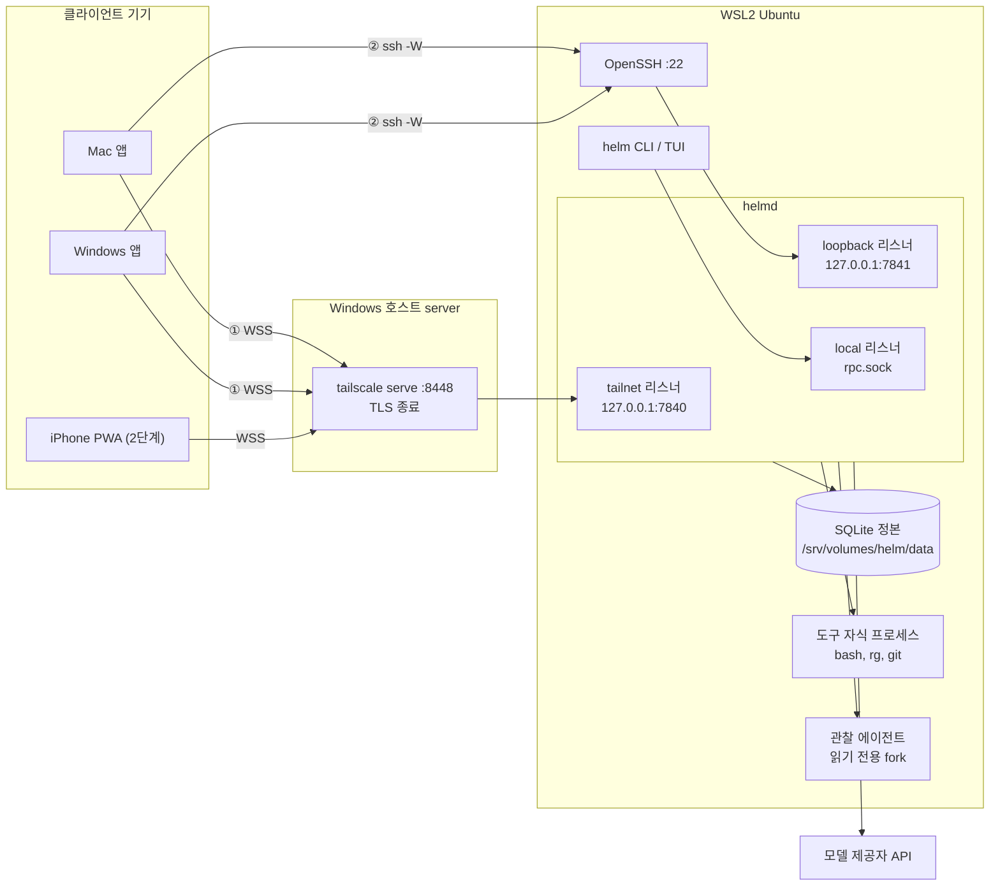

# 2. 전체 구조: 프로세스, 패키지, 배치

## 왜 상태를 데몬 하나에 모으는가

1번 노드의 요구 가운데 구조를 가장 크게 정한 것은 두 가지입니다. 클라이언트가 없어도 작업이 계속되어야 하고, 나중에 다른 에이전트 런타임(Claude Code, Codex, pi CLI)을 붙일 수 있어야 합니다. 이 두 요구를 기준으로 세 배치안을 비교했습니다.

B안은 pi 같은 런타임 프로세스 안에서 Helm이 도는 구조입니다. 런타임이 꺼지면 Helm도 꺼지므로 첫 요구와 충돌합니다. A안은 서버 안에 런타임을 두되 계약 없이 직접 연결하는 구조입니다. 지금은 동작하지만, 다른 런타임을 붙이려면 세션을 담을 호스트를 새로 만들어야 합니다. 그래서 C안을 골랐습니다. **C안에서 상태는 데몬이 갖고, 실행기는 런타임 어댑터 계약을 통해서만 데몬과 통신합니다.** 1차 구현에서 붙는 실행기는 데몬 프로세스 안의 자체 런타임 하나뿐이어서, 실제 프로세스 모양은 A안과 같습니다. 차이는 데몬과 런타임 사이에 계약이 있다는 점이고, 이 계약 덕분에 나중에 외부 런타임 어댑터를 같은 자리에 끼울 수 있습니다.

여기서 "상태"는 커널, 이벤트 저장소, 스케줄러가 다루는 모든 것을 뜻합니다. 이 상태를 바꾸는 프로세스는 데몬 `helmd` 하나뿐이고, 정본(기준 원본)은 SQLite 파일 하나에 들어 있는 이벤트 로그입니다. 데스크톱 앱, 휴대폰, 관리 CLI는 모두 이 데몬에 명령을 보내고 결과를 구독하는 클라이언트입니다.

## 무엇이 어디에서 실행되는가

Helm의 부품은 네 장소에 흩어져 있습니다. 집의 Windows PC(호스트 이름 `server`) 안 WSL2 Ubuntu에 데몬과 데이터가 있고, Windows 호스트에는 Tailscale이 있으며, Mac과 Windows에는 데스크톱 앱이, iPhone에는 다음 단계의 홈 화면 웹 앱이 있습니다. 아래 그림에서 화살표는 연결을 여는 방향입니다. 클라이언트에서 출발해 데몬의 세 리스너 중 어디에 도착하는지 따라가 보면 됩니다.

이 배치에서 세 가지를 짚어 두면 이후 노드가 쉬워집니다.

데이터 위치가 `~/projects` 밖입니다. `~/projects`는 Syncthing으로 Mac과 양방향 동기화되는데, 동기화 중인 SQLite 파일은 깨질 수 있습니다. 그래서 정본 DB는 동기화되지 않는 `/srv/volumes/helm/data/helm.sqlite`에 두고, 데몬은 데이터 디렉터리가 `~/projects` 아래이거나 Windows 디스크(`/mnt/c`)이면 시작하지 않습니다. 백업은 데몬이 만든 검증된 스냅숏을 홈랩의 restic이 매일 가져가는 방식이고, 살아 있는 DB 파일을 직접 백업하지 않습니다.

1차 구현에서 모델 제공자를 호출하는 상주 프로세스는 데몬뿐입니다. 클라이언트와 관찰 에이전트는 모델을 직접 부르지 않고, 모델 API 키도 클라이언트에 없습니다. 나중에 붙는 외부 런타임은 자기 모델 호출을 직접 합니다.

Helm 설치를 위해 Windows 호스트에 새로 해야 하는 변경은 없습니다. 홈랩의 `tailscale serve` 대응표(`serve.table`)에 Helm 포트 한 줄을 더하고 홈랩 레시피로 적용하는 것이 전부이고, 방화벽 규칙은 더하지 않습니다. Windows 쪽에는 상태를 확인만 하는 읽기 전용 스크립트를 두고, 데몬은 serve 설정을 직접 바꾸지 않습니다.

## 리스너가 셋인 이유와 "127.0.0.1은 안전하다"는 오해

데몬은 연결을 받는 입구(리스너)를 세 개 엽니다. TCP 리스너 둘은 `127.0.0.1`(또는 `::1`)에만 바인딩하고 설정에 다른 주소를 쓰면 데몬이 시작을 거부하며, 나머지 하나는 Unix 소켓입니다. 아래 표에서 행마다 연결이 어디서 오고 무엇으로 신원을 증명하는지 비교해 보면, 리스너를 나눈 기준이 인증 방식이라는 것이 보입니다.

| 리스너 | 주소 | 들어오는 연결 | 인증 |
|---|---|---|---|
| `tailnet` | TCP 127.0.0.1:7840 | Windows의 `tailscale serve`가 넘긴 WSS(앱 경로 ①, 휴대폰) | Tailscale 신원 헤더 + whois 대조 + 기기 토큰, 셋 모두 필요 |
| `loopback` | TCP 127.0.0.1:7841 | 앱이 `ssh -W 127.0.0.1:7841 server`로 연 터널(앱 경로 ②) | SSH 키 + 기기 토큰 |
| `local` | Unix 소켓 `rpc.sock` | 서버 안의 `helm` CLI와 TUI | 소켓 파일 권한(같은 OS 사용자) |

`tailnet`과 `loopback`을 한 포트로 합치지 않은 이유가 있습니다. SSH 터널로 들어온 연결에는 Tailscale 신원 헤더가 없습니다. 한 포트에서 "헤더가 없으면 다른 규칙을 쓴다"를 허용하면, 헤더 검사를 건너뛰는 길이 생깁니다. 그래서 헤더를 요구하는 리스너와 요구하지 않는 리스너를 나눴습니다.

흔한 오해는 "127.0.0.1에만 열려 있으니 외부에서 못 들어온다"입니다. WSL의 `networkingMode=mirrored` 설정에서는 Windows 쪽 프로세스도 127.0.0.1 포트에 붙을 수 있습니다. 게다가 에이전트가 실행하는 bash 같은 도구 프로세스는 데몬과 같은 OS 사용자로 실행되므로, 같은 기기 안에서 데몬 포트에 접속할 수 있습니다. **루프백 바인딩은 격리 경계가 아닙니다.** 그래서 네 가지 장치를 함께 둡니다. 모든 TCP 리스너는 기기 토큰 없이는 연결의 주체를 정하지 않습니다. Tailscale 신원 헤더와 whois 대조는 원격 공격자를 거르는 겹이고, 같은 기기의 프로세스는 헤더를 흉내 낼 수 있으므로 같은 기기 안에서 마지막 방어는 기기 토큰입니다. 도구 프로세스는 샌드박스 안에서 `rpc.sock`과 데이터·설정 디렉터리를 볼 수 없습니다. 사람 권한 토큰은 클라이언트 기기의 키체인에만 있습니다. 샌드박스를 쓸 수 없으면 `execute` 능력 자체를 끕니다. 예외는 운영자가 설정 `tools.sandbox="off"`로 격리 없는 실행을 명시적으로 켠 경우뿐이고, 이때는 감사 기록과 상태 경고가 남습니다. 출발지 주소가 127.0.0.1이라는 사실은 어떤 신뢰 근거로도 쓰지 않습니다. 세부는 8번(도구 격리)과 13번(보안) 노드에서 다룹니다.

경로 ①과 ②는 연결 방식만 다르고 그 위의 대화는 같아야 합니다. 메시지 형식, 메서드 집합, 이벤트 순번과 재전송 규칙, 오류 코드, 멱등 키 처리, 기기 인증이 두 경로에서 같고, 테스트 전략에 같은 대본을 두 경로로 돌려 결과를 비교하는 시험이 있습니다. Tailscale serve만 멈췄을 때는 경로 ②로 붙을 수 있지만, Tailscale 자체가 멈추면 SSH도 tailnet을 지나므로 두 경로가 함께 끊깁니다.

## 패키지는 층으로 쌓이고 아래로만 의존한다

코드는 pnpm 모노레포의 패키지들로 나뉩니다. 패키지는 층(레이어)에 속하고, 위층이 아래층에 의존할 뿐 아래층이 위층을 import하지 않습니다. 다만 "아래층이면 무엇이든 import할 수 있다"는 뜻은 아닙니다. 허용되는 의존은 패키지마다 표로 정해져 있고, 표에 없는 의존은 모두 금지입니다. 아래 표는 층을 위에서 아래로 놓고, 대표적인 허용 의존과 금지 의존을 함께 적은 것입니다. 오른쪽 열의 금지 예가 구조의 의도를 가장 잘 보여 줍니다.

| 층 | 패키지 | 의존하는 대상(대표) | 금지 예 |
|---|---|---|---|
| L6 앱 | `desktop`, `mobile`, `cli`, `tui` | 클라이언트 공용, `protocol` | 앱이 `kernel`을 import |
| L6c 클라이언트 공용 | `client`, `client-react`, `ui`, `ui-tokens`, `ui-language` | `client`는 `protocol`만 | `client`가 `domain`·`kernel`을 import |
| L5 호스트 | `daemon` | `engine`, `runtime`, `ai`, `store`의 쓰기·관리 진입점, `protocol` | `daemon`이 `kernel`을 직접 import |
| L4 실행 | `runtime`, `observer` | `runtime`은 `engine`, `kernel`(순수 함수), `ai`, `agent`, `tools` | `runtime`이 `store`를 import. `observer`가 `engine`·`kernel`·`runtime`·`ai`를 import |
| L3 변경 경로 | `engine` | `kernel`, `store` | `engine`이 `ai`·`agent`·`tools`를 import |
| L3' 실행 부품 | `ai`, `agent`, `tools`, `browserd` | 정해진 부품끼리와 `domain`. `browserd`는 `@helm/*`에 의존하지 않음 | 실행 부품이 `engine`·`store`를 import |
| L2 기록 | `store` | `domain`, SQLite 드라이버 | `store`가 `kernel`을 import |
| L1 규칙 | `kernel` | `domain`, TypeBox | `kernel`이 `node:*`나 `process`를 씀 |
| L0 계약 | `domain`, `protocol` | `protocol`은 `domain` | — |

층마다 한 문장으로 역할을 정리하면 다음과 같습니다. `domain`과 `protocol`은 타입과 스키마만 담은 계약입니다. `kernel`은 명령을 받아 허용·거부를 계산하고 상태를 전이하는 순수 함수 묶음입니다. `store`는 SQLite에 읽고 쓰는 유일한 패키지입니다. `engine`은 이벤트를 로그에 추가(append)하는 유일한 패키지입니다. `ai`, `agent`, `tools`는 pi 패키지를 가져오거나 포크한 모델 호출, 에이전트 루프, 도구입니다. `runtime`은 run 하나를 실제로 돌리는 곳이고, `daemon`은 이 모두를 조립해 프로세스로 띄우는 곳입니다. 클라이언트 공용 패키지는 데스크톱, 휴대폰, TUI, CLI가 같은 재접속 로직과 UI 부품을 쓰게 하려고 앱 밖에 둡니다.

`engine`과 실행 부품을 서로 의존하지 않게 하고, 둘을 함께 쓰는 곳을 `runtime` 하나로 제한한 것이 이 구조의 요점입니다. 이렇게 하면 모델 루프 코드(`agent`)에서 기록 계층(`store`, `engine`)으로 가는 import 경로가 아예 없어서, 모델 쪽 코드가 실수로라도 이벤트를 직접 쓸 수 없습니다. "모델은 제안하고 커널이 상태를 바꾼다"는 원칙을 리뷰로 지키는 대신 import 규칙으로 지키는 셈입니다. 같은 방식으로 `kernel`은 현재 시각(`Date.now()`), `Math.random`, 타이머, `console`, `process`를 쓰지 않습니다. 시각과 ID는 `engine`이 인자로 넣어 주기 때문에, 같은 입력에 대해 커널은 언제나 같은 결과를 냅니다.

이 규칙들은 검사 도구로 강제됩니다. 허용 의존 표의 원본이 `scripts/architecture-rules.ts` 한 파일에 있고, `scripts/check-architecture.ts`와 ESLint 금지 import, TypeScript 프로젝트 참조가 함께 위반을 찾아 `just verify`를 실패시킵니다. 구현을 리뷰할 때 import 구조를 눈으로 다 볼 필요는 없고, 이 검사가 실제로 위반 예제를 만들어 실패하는지를 보면 됩니다.

## 모든 상태 변경은 하나의 경로를 지난다

상태를 바꾸는 입력은 다섯 종류입니다. 사람의 명령, 모델의 제안, 도구 실행에서 나온 관찰, 스케줄러의 타이머, 관찰 에이전트의 제안입니다. 다섯 입력은 모두 `engine.submit`이라는 한 경로로 들어가고, 이 경로는 하나의 동기 SQLite 트랜잭션 안에서 다음 순서로 실행됩니다.

1. 멱등 확인: 같은 명령이 이미 처리됐으면 저장된 결과를 그대로 돌려줍니다.
2. 커널 판정: `kernel`이 허용, 거부, 사람 확인 필요, 충돌 중 하나를 계산합니다.
3. 이벤트 추가: 허용된 변경을 이벤트로 로그에 붙이고, 로그 전체에서 하나뿐인 순번(seq)을 받습니다.
4. 투영 갱신: 화면과 조회용 테이블을 같은 트랜잭션에서 고칩니다.
5. 커밋과 알림: 트랜잭션을 커밋한 직후, 같은 JavaScript 실행 차례 안에서 구독 중인 클라이언트에 새 이벤트를 알립니다. 따로 쌓아 두는 발신함(outbox)은 없습니다.

트랜잭션 안에서는 `await`도, 모델 호출이나 파일 읽기 같은 I/O도 하지 않습니다. 트랜잭션 중간에 `await`가 있으면 그 사이 다른 요청의 쓰기가 끼어들어 순서대로 하나씩 쓴다는 전제가 깨지고, 트랜잭션이 길어지면 데몬의 이벤트 루프 전체가 그동안 멈추기 때문입니다. 중간에 예외가 나면 이벤트와 투영과 결과 기록이 모두 함께 되돌려집니다. 멱등과 투영의 정확한 뜻은 4.1번과 4번 노드에서 다룹니다. 거부도 기록됩니다. 커널이 명령을 거부하면 그 사실이 순번을 가진 `command.rejected` 이벤트로 남습니다. 이 경로의 세부, 특히 커널 판정의 단계는 4번과 5번 노드에서 다룹니다.

이 경로가 하나라는 사실에서 화면 쪽 규칙도 나옵니다. 화면과 모델 문맥에 쓰는 읽기 모델(투영)은 로그에서 언제든 다시 만들 수 있어야 하고, 투영을 계산하는 코드는 쓰기 API를 import할 수 없습니다. 1번 노드의 불변조건 3(투영은 정본을 쓰지 않는다)이 이렇게 구조로 지켜집니다.

## 상주하는 것과 잠깐 실행되는 것

데몬 프로세스는 데이터 디렉터리마다 하나만 상주합니다. 같은 데이터 디렉터리에서 두 번째 `helmd`를 띄우면 단일 writer 잠금을 얻지 못하고 종료 코드 3으로 끝납니다. 정식 데몬과 개발용 데몬은 데이터 디렉터리가 달라서 함께 실행할 수 있습니다.

나머지 프로세스는 필요할 때 데몬이 자식으로 띄웠다가 끝냅니다. 도구 실행(`bash`, `rg`, `git`), 웹 본문을 마크다운으로 바꾸는 작업자, 브라우저 세션 하나를 담는 `helm-browserd`, 관찰 에이전트, 시작할 때 비밀을 받아 오는 로더가 여기에 속합니다. 관찰 에이전트는 `child_process.fork`로 띄우고, 정본은 읽기 전용 연결로만 읽으며, 제출과 모델 호출은 IPC로 데몬에 넘깁니다. 데몬은 관찰 에이전트에서 온 제출의 행위자를 무조건 `agent:observer`로 고정하므로, 관찰 에이전트가 다른 행위자를 주장해도 무시됩니다. 관찰 에이전트에게 쓰기 권한이 없다는 원칙은 이렇게 프로세스 경계로 지켜집니다.

## 시작과 종료

데몬은 systemd 사용자 단위 `helmd.service`로 실행되고, WSL이 부팅되면 자동으로 올라옵니다. 시작은 정해진 순서를 따릅니다. 설정을 읽고, 잠금을 잡고, 비밀을 받고, DB를 열어 무결성을 검사하고 마이그레이션하고, 투영을 따라잡은 뒤, 이번 부팅의 번호(`bootEpoch`)를 발급하고 `daemon.booted`를 기록합니다. 그다음 지난 실행에서 중단된 run과 도구 호출을 정리하는 복구를 하고, 스케줄러를 시작하고, 마지막에 리스너를 엽니다.

**정상 시작에서 리스너는 복구가 끝난 뒤에만 열립니다.** 복구 전에 클라이언트가 붙으면, 아직 정리되지 않은 "실행 중" 상태를 보고 그 위에서 명령을 보낼 수 있기 때문입니다. 무결성이 의심되거나 복구가 실패하면 데몬은 남은 단계를 건너뛰고 리스너만 여는데, 이때는 상태를 바꾸는 명령을 모두 거절하는 읽기 전용 상태입니다. systemd도 리스너가 열리고 준비가 끝났다는 확인(`helm ops wait-ready`)을 받은 뒤에야 서비스를 활성으로 봅니다.

데몬의 종료 코드는 재시작 정책과 연결되어 있습니다. 1(예상하지 못한 오류)이면 systemd가 다시 띄웁니다. 2(설정, 경로, 비밀, 포트 같은 환경 문제), 3(다른 데몬이 잠금을 가짐), 4(DB가 코드보다 새 스키마), 5(DB를 열 수 없음)는 다시 띄워도 결과가 같으므로 재시작하지 않습니다. 짧은 시간에 여러 번 실패하면 systemd가 포기하고 알림 단위를 실행합니다. 종료할 때는 새 요청을 거절하고, 스케줄러를 멈추고, 진행 중인 실행에 유예 시간을 준 뒤, 도구 프로세스를 정리하고, 끝나지 않은 도구 호출을 "중단됨"으로 기록합니다. 크래시와 복구의 세부는 7.1번과 12번 노드에서 다룹니다.

## 설정, 비밀, 로그는 각자 다른 곳에 있다

설정 파일(TOML)에는 포트, 경로, 제한 값 같은 운영 설정만 들어갑니다. 다이얼, 모드, 정책처럼 Helm의 의미에 속하는 값은 설정 파일이 아니라 도메인 이벤트로 정본에 기록됩니다. 그래서 화면에서 다이얼을 바꿔도 설정 파일은 바뀌지 않고, 데몬은 설정 파일을 읽기만 합니다.

비밀(모델 API 키 등)의 원본은 SOPS로 암호화한 파일입니다. 데몬은 시작할 때 `secrets run`으로 자식 로더를 실행해 표준 출력으로 값을 받고, 메모리 안의 비밀 저장소에만 둡니다. 값은 데몬의 환경 변수에도, 자식 프로세스 환경에도 남지 않습니다. systemd의 실행 명령 자체를 `secrets run`으로 감싸지 않은 이유는, 그렇게 하면 서비스의 주 프로세스가 sops가 되어 종료 신호 전달이 꼬이기 때문입니다.

기록도 네 흐름으로 나뉘고 섞지 않습니다. 도메인 원장(이벤트 로그), 운영 로그(journald로 가는 JSON 줄), 실험 측정(11번 노드의 지표), 원시 런타임 trace입니다. 서버 오류나 토큰 사용량이 자동으로 도메인 이벤트가 되지 않고, 반대로 사용자에게 의미 있는 변화가 운영 로그에만 남지도 않습니다.

## 다른 런타임을 위한 자리

외부 런타임은 아직 구현 범위가 아니지만, 그 자리는 지금 구조에 들어 있습니다. pi 이벤트 이름, Claude Code 훅 이름 같은 런타임별 이름은 어댑터 안에서만 쓰고, 도메인과 커널은 중립 어휘만 씁니다. 어댑터는 자신이 무엇을 할 수 있는지 능력 목록을 제출하고, 데몬은 그 목록에서 보장 수준을 계산합니다. 실행 전에 막을 수 있으면 `enforced`, 실행 뒤에 알아챌 수만 있으면 `detected`, 지시문으로 부탁할 수만 있으면 `advisory`입니다. 보장 수준이 낮아지면 화면과 감사 기록에 그 사실이 표시됩니다. 어댑터도 이벤트를 직접 추가하지 않고 같은 `engine.submit` 경로로 제출합니다.

## 이 노드의 기준으로 구현을 볼 때

- `check-arch`가 허용 표 밖의 import(예: `apps/desktop`이 `kernel`을 import)를 실제로 실패시키는가
- 이벤트를 로그에 추가하는 코드가 `engine` 패키지 밖에 있는가
- `kernel` 안에 `Date.now()`, `Math.random`, `process`, 타이머가 있는가
- `engine.submit` 트랜잭션 안에 `await`나 I/O가 있는가
- 복구가 끝나기 전에 상태 변경 명령을 받는 경로가 있는가
- 리스너가 `127.0.0.1`이 아닌 주소에 바인딩될 수 있는가, TCP 리스너가 기기 토큰 없이 주체를 정하는 경로가 있는가
- `tools.sandbox="off"`가 아닌데 격리 없이 `execute`가 켜지는 경로가 있는가
- 정본 DB 경로가 `~/projects`나 `/mnt/` 아래일 때 데몬이 시작을 거부하는가
- 비밀 값이 `process.env`, 자식 프로세스 환경, 로그에 나타나는가
- 관찰 에이전트의 제출에서 행위자가 `agent:observer`로 고정되는가
- 화면에서 바꾼 의미 설정이 설정 파일에 쓰이는 경로가 있는가
