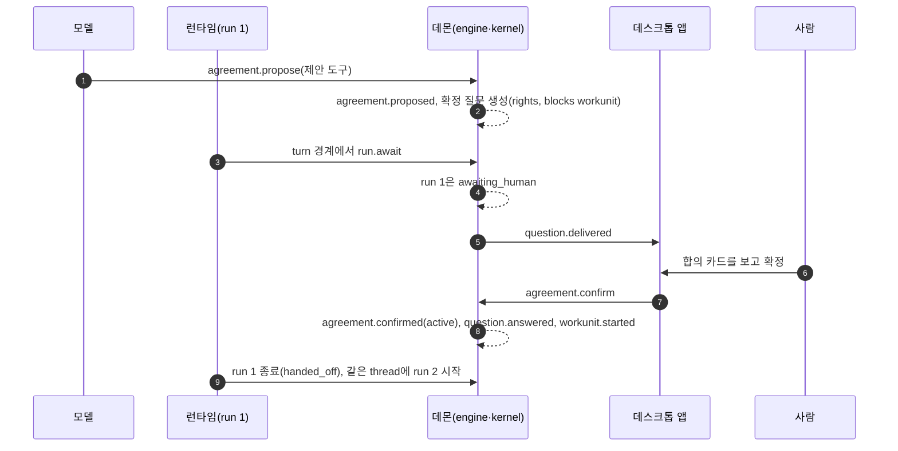
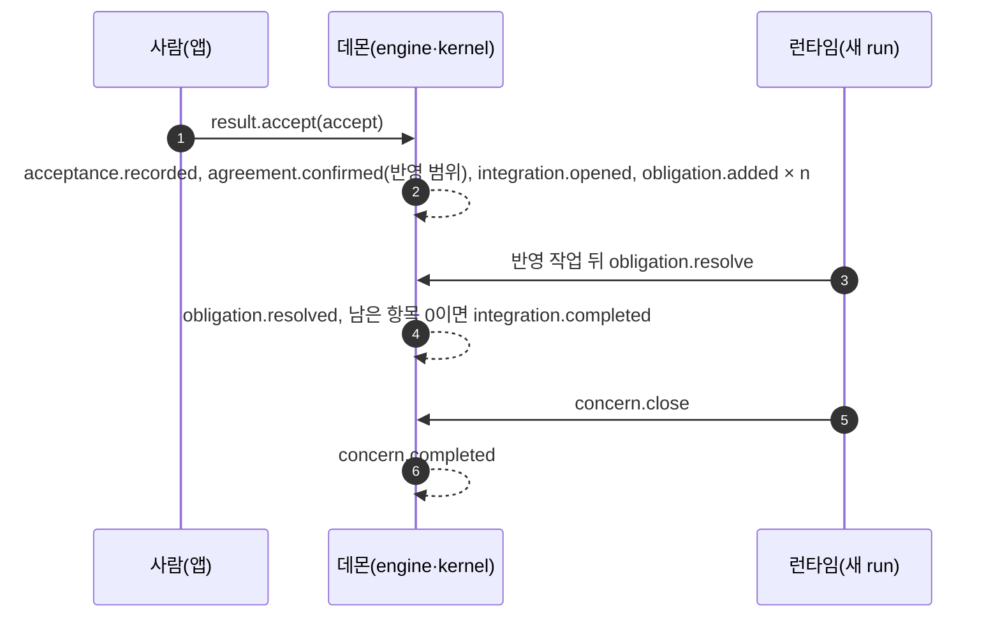

# 3. 한 작업의 일생: 끝에서 끝까지 따라가기

## 이 노드에서 따라갈 일

1번 노드는 Helm이 무엇을 하는지, 2번 노드는 그 일이 어디에서 실행되는지를 다뤘습니다. 이 노드는 둘을 이어서, 일 하나가 처음 입력부터 반영 완료까지 어떤 화면, 메서드, 명령, 이벤트를 지나는지 따라갑니다. 이후 노드에서 커널, 런타임, 묻기, 프로토콜을 하나씩 깊게 볼 때, 각 부품이 이 흐름의 어느 지점에서 실행되는지 기준점으로 쓰려는 것입니다.

따라갈 일은 유즈케이스 UC-03 "여러 날 걸리는 작업"입니다. 저녁에 맡기고 앱을 닫았다가 다음 날 아침에 돌아오는 일이어서, 맡김, 합의, 클라이언트 없는 실행, 두 종류의 질문, 복귀, 결과 확인, 반영이 한 흐름에 모두 들어 있습니다. 예시 작업은 프로젝트의 빌드 설정을 여러 단계에 걸쳐 바꾸는 일이고, 중간에 테스트 도구 문제와 작업 브랜치 push가 생깁니다.

전체 흐름을 시각으로 먼저 보겠습니다. 표의 시각은 유즈케이스에 적힌 예시 시각이고, 행 사이 간격이 사람이 없는 시간입니다. 1일 21:07부터 2일 08:40까지 약 11시간 반 동안 사람은 아무것도 하지 않습니다.

| 시각 | 단계 | 일어나는 일 |
|---|---|---|
| 1일 21:00 | 1 | 데스크톱 입력창에 맡김. Concern이 열리고 루프 계획이 정해짐 |
| 21:01 | 2 | 탐구(I.fact): 설정 파일을 읽어 관찰로 남김 |
| 21:05 | 3 | 작업 합의 초안 |
| 21:07 | 4 | 사람이 합의 확정. WorkUnit 시작. 사람은 앱을 닫음 |
| 21:40 | 5 | 1·2단계 작업 완료 |
| 23:02 | 6 | 테스트 도구 문제. 정보 질문 Q-A, 임시 가정 "Jest 유지" |
| 23:40 | 7 | 작업 브랜치 push 필요. 권리 질문 Q-B, push 호출만 대기 |
| 2일 01:25 | 8 | Q-A 만료점. 가정 확정, "에이전트가 정한 것"으로 기록 |
| 01:30 | 9 | 결과 제출. CI 확인 기준은 "확인 못함" |
| 08:40 | 10 | Mac 앱을 엶. 복귀 요약 |
| 08:42 | 11 | Q-B에 답함 |
| 08:50 | 12 | 결과 확인. 반영 항목 처리 |
| 08:52 | 13 | "에이전트가 정한 것"을 펼쳐 봄. 이의 없음 |

이 흐름을 세 구간으로 나눠 따라갑니다. 맡기고 합의하는 구간(단계 1~4), 사람이 없는 구간(단계 5~9), 돌아와 확인하는 구간(단계 10~13)입니다.

## 첫째 구간: 맡기고 합의하기

사람이 데스크톱 앱의 "새 일" 입력창에 일을 씁니다. 보내기 전에 앱은 `composer.preview`를 호출해 이 입력이 어떻게 해석될지, Concern으로 열릴지를 미리 보여 줍니다. 사람이 보내면 `composer.submit`이 호출됩니다. 이 메서드는 커널 명령이 아닙니다. 데몬은 입력을 런타임 입력으로 기록하고, 같은 트랜잭션에서 사람 발화를 관찰(`observation.recorded`)로 남깁니다. 이 시점에는 Goal이나 Concern 같은 도메인 레코드를 바꾸는 명령이 아직 없고, 그 문장을 읽은 런타임이 명령을 제출할 때 레코드가 바뀝니다.

그다음 일은 런타임 쪽 오케스트레이터가 연달아 명령을 제출하면서 진행됩니다. 진입 판정(`entry.evaluate`)이 "열기"로 나오면 `concern.open`으로 Concern이 열립니다. 상황 판정이 "복잡"으로 나오고, 루프 계획 O → I.fact → C.commit → A.confirm이 채택되고, 모드 "실행"이 배정됩니다. 각 명령은 2번 노드의 `engine.submit` 경로를 지나 이벤트로 남습니다. 이벤트 이름은 대개 명령 이름의 과거형이지만(`entry.evaluate` → `entry.evaluated`, `concern.open` → `concern.opened`), 계획 기록 `loop_plan.record`가 `loop_plan.adopted`가 되고 결과 확인 `result.accept`가 `acceptance.recorded`가 되는 것처럼 다른 경우도 많습니다. 명령은 "해 달라"는 요청이고 이벤트는 "했다"는 기록이라는 대응만 기억하고, 정확한 이름은 이벤트 목록과 명령 목록에서 확인하는 편이 안전합니다.

탐구 단계에서 런타임은 WorkUnit과 run을 시작합니다. WorkUnit은 Concern 안의 실행 단위이고, run은 에이전트를 한 번 실행하는 단위입니다. 한 WorkUnit 안에 run이 여러 개 생길 수 있다는 점이 이 흐름의 중요한 전제인데, 이유는 곧 나옵니다. run 안에서 에이전트가 설정 파일을 읽는 도구 호출은 `toolcall.requested` → `toolcall.started` → `toolcall.completed` 순서로 기록되고, 읽은 내용은 관찰로 남습니다.

탐구가 끝나면 에이전트(모델)가 작업 합의 초안을 제안합니다. 모델은 `agreement.propose`를 제출할 수 있지만 확정할 수는 없습니다. 아래 그림은 이 제안부터 사람의 확정까지 주체 사이에 오가는 메시지입니다. 모델과 런타임을 따로 그렸는데, 모델은 제안 도구로 명령을 내고 run의 시작·대기·종료는 런타임이 낸다는 차이를 보면 됩니다.

3~4번 메시지가 이 흐름의 첫 번째 요점입니다. **사람의 답이 필요한 막는 질문이 생기면, run은 그 자리에서 기다리지 않고 turn 경계에서 끝납니다.** 그리고 사람이 답한 뒤 같은 대화 흐름(thread)에 새 run이 시작됩니다(9번). 사람의 답은 몇 초 뒤일 수도, 다음 날일 수도 있습니다. 그동안 모델 호출이나 프로세스를 붙잡아 두면 데몬이 재시작될 때 상태가 사라지므로, 대기 상태는 run 안이 아니라 질문 레코드와 이벤트 로그에 둡니다. 7번에서 앱이 보내는 `agreement.confirm`은 사람 전용 명령이어서, 커널은 같은 명령이 모델 채널에서 오면 거부합니다.

합의가 활성이 되면 데몬은 첫 쓰기 전에 되돌릴 지점을 만듭니다. git 저장소라면 현재 상태의 스냅숏 커밋 참조를 `rollback_point.registered`로 기록합니다. Helm은 어떤 행동이 되돌릴 수 있는지를 계산하지 않고, 실제로 돌아갈 수 있는 참조만 남깁니다.

## 둘째 구간: 사람이 없는 동안

사람이 앱을 닫아도 데몬은 그대로 실행됩니다. 연결 상태는 클라이언트 쪽의 일이고, 데몬은 연결과 관계없이 WorkUnit을 진행합니다. 이벤트 순번(seq)도 연결 여부와 관계없이 이어지므로, 나중에 다시 연결하면 빈 구간 없이 받아 볼 수 있습니다.

### 정보 질문: 가정을 세우고 계속한다

23:02에 테스트 도구를 Jest로 둘지 바꿀지 정해야 하는 상황이 생깁니다. 결과에 영향은 있지만 사람이 답하지 않아도 진행할 수 있는 질문이므로 정보 게이트이고, 막는 범위는 `nothing`입니다. 모델이 질문을 제안하면 커널이 질문을 기록하고(`question.recorded`), 같은 트랜잭션에서 "Jest 유지"라는 임시 가정을 만듭니다(`assumption.recorded`). 에이전트는 그 가정으로 일을 계속합니다. 사람이 없으므로 질문의 전달은 사람이 돌아오는 시점(`user_return`)으로 예약됩니다.

이 질문에는 만료점이 있습니다. 이 예에서는 "다음 루프 전환"이 만료점이어서, 2일 01:25에 루프가 바뀌는 경계에 도달하면 스케줄러가 질문을 한 번 승격(`question.escalated`)하고, 그래도 답이 없으면 가정을 확정합니다(`question.assumed`). 확정된 가정은 `choice.committed`로 기록되고, "왜 묻지 않았는가"에는 "가정 만료"가 들어갑니다. 이 기록이 다음 날 사람이 보는 "에이전트가 정한 것" 목록에 들어가고, 사람은 여기에 이의를 걸 수 있습니다. 연결된 기기가 하나도 없어도 이 과정은 스케줄러가 진행합니다.

### 권리 질문: 그 행동만 멈춘다

23:40에 에이전트가 작업 브랜치를 push하려 합니다. push는 외부로 나가는 발송(send)이고, send는 합의 범위 안이어도 매번 사람의 허락이 필요한 권리 게이트입니다. 커널은 이 도구 호출을 거부하지 않고 "사람 확인 필요"(`needs_gate`)로 판정합니다. 그 결과 한 트랜잭션에 세 가지가 기록됩니다. 도구 호출 요청(`toolcall.requested`), 승인 대기 상태(`toolcall.approval_requested`), 권리 질문(`question.recorded`, 종류 `send_approval`, 막는 범위 `action`)입니다.

막는 범위가 `action`이라는 점이 중요합니다. **권리 질문은 그 push 호출 하나만 멈추고, run과 WorkUnit의 나머지 일은 계속됩니다.** 그래서 01:30에 에이전트는 push 없이 할 수 있는 일을 마치고 결과를 제출합니다. push를 하지 못해 CI가 돌지 않았으므로, 에이전트는 "CI가 통과한다" 기준을 처음부터 "확인 못함"(`unverified`)으로 내고, 커널은 그대로 받습니다. 결과 제출의 근거 규칙은 두 경우를 구분합니다. 관찰 근거 없이 서술만으로 "충족"이라고 낸 기준은 거부하지 않고 "확인 못함"으로 낮추고, 기록에 없는 관찰 ID를 근거로 댄 제출은 지어낸 근거로 보아 거부합니다(`invalid.evidence_not_found`).

결과 제출과 같은 트랜잭션에서 커널은 결과 확인 질문을 기록하고, 이어서 오케스트레이터가 루프를 A.confirm으로 전환합니다. 결과 확인도 권리 게이트이지만 다른 일을 막지 않으므로 예약 전달됩니다. Concern은 "결과 확인 대기" 상태로 남습니다. 결과 제출 시점에 아직 승인을 기다리던 push 호출은 제출 기록의 "승인 대기 호출" 목록(`awaitingApprovalCalls`)에 실립니다.

권리 질문 Q-B는 막는 질문이라 즉시 전달 대상입니다. 알림 강도는 받을 사람이 있는지에 따라 정해집니다. 사람이 자리에 없고 푸시를 받을 휴대폰도 없으면(휴대폰은 2단계 기능이므로 MVP에서는 이 경우입니다) 강도는 `digest`가 되고 전달 채널은 "복귀 요약"이 됩니다. 푸시 가능한 휴대폰이 있으면 강도 `interrupt`로 휴대폰에 알립니다. 정보 질문 Q-A는 예약 전달이지만, 만료 직전 승격은 강도 `notice`로 한 번 다시 알릴 수 있어서 푸시 가능한 휴대폰이 있고 데스크톱이 모두 부재이면 휴대폰으로 나갈 수 있습니다. 강도와 채널을 고르는 규칙은 6번 노드에서 다룹니다.

## 셋째 구간: 돌아와서 확인하기

다음 날 08:40에 사람이 Mac 앱을 엽니다. 앱은 연결하면서 마지막으로 받은 위치(`storeId`와 `seq`)를 `hello` 메시지에 담아 보내고, 이어서 그 이후의 이벤트를 구독합니다. 데몬은 빠진 이벤트를 순서대로 다시 보내고 실시간 구독으로 이어 줍니다. 그사이 DB가 복원되어 `storeId`가 달라졌다면, 앱은 화면을 처음부터 다시 받습니다. 재연결 규칙의 세부는 14번 노드에서 다룹니다.

앱이 보고한 접속 상태(presence)가 부재에서 `active`로 바뀌면, 오케스트레이터가 "사용자 복귀" 경계를 기록합니다. 이 경계에서 예약되어 있던 질문들이 전달되고 복귀 요약이 열립니다. 복귀 요약의 맨 위에는 지금 선택이 필요한 권리 질문(Q-B)이, 그 아래에는 결과 확인 대기 1건이, 그 아래에는 접힌 상태로 "에이전트가 정한 것"이 놓입니다. 사람이 "여기까지 봤음"을 누르면 `brief.acknowledged`가 기록되고, 다음 복귀 요약은 이 지점 이후만 보여 줍니다. 요약을 열기만 해서는 이 지점이 옮겨지지 않습니다.

### Q-B의 답: 이미 결과가 제출된 뒤의 승인

08:42에 사람이 Q-B를 허락합니다. 그런데 push 호출이 대기 중인 상태에서 결과가 이미 01:30에 제출되었습니다. 커널 설계는 이 경우를 이렇게 처리합니다. 결과 제출 뒤에 온 승인은 호출을 실행하지 않고, 그 호출을 "승인 만료로 실행 안 됨"(`toolcall.not_executed`, 사유 `approval_expired`)으로 닫으며, 새 run도 열지 않습니다. 결과 확인 화면은 이 호출을 "승인됐지만 실행하지 않은 행동"으로 보여 줍니다. 제출된 결과는 push 없이 만들어진 것이므로, 제출 뒤에 실행하면 사람이 확인하는 결과와 실제 상태가 달라지기 때문입니다.

**이 지점은 설계 문서끼리 아직 다르게 적혀 있습니다.** 유즈케이스 문서의 UC-03은 08:42의 허락 뒤 push가 실행되고 CI 결과가 관찰로 붙는다고 적고, 런타임 문서도 같은 흐름을 적습니다. 커널과 오케스트레이션 문서는 위의 "실행하지 않음"을 정합니다. 어느 쪽으로 할지는 제품 동작이 바뀌는 문제라서, 구현 전 정본 점검 때 사용자가 정할 항목으로 올려 두었습니다.

결과 제출 전에 허락이 왔다면 흐름은 분명합니다. 허락하면 `question.answered`, `toolcall.approved`, `approval.issued`가 기록되고, 같은 thread의 새 run이 대기하던 그 호출을 같은 호출 번호(`toolCallId`)로 실행합니다. 실행할 때 `approval.consumed`가 함께 기록되므로 하나의 승인으로 두 번 실행될 수 없습니다. 이 경로는 5번 노드에서 다시 봅니다.

### 결과 확인과 반영

아래 그림은 결과 확인부터 Concern이 닫히기까지의 흐름입니다. 2번 메시지 한 번에 여러 레코드가 함께 기록된다는 점을 눈여겨보면 됩니다.

결과 확인은 사람 전용 명령 `result.accept`입니다. 이 한 번의 조작에서 결과 확인 기록, 반영 작업에 필요한 작업 범위의 합의 확정(`agreement.confirmed`), 반영 작업 열기, 반영 항목 생성이 같은 트랜잭션에 기록됩니다. 합의 확정이 `agreement.confirm` 명령 하나로만 일어나는 것은 아니라는 점을 기억해 두면, 결과 확인 로그에서 `agreement.confirmed`를 보고 당황하지 않게 됩니다.

반영 항목은 결과를 다른 곳에 옮기는 일입니다. 문서나 시험 갱신처럼 근거 관찰로 확인되는 종류는 근거 관찰이 하나 이상 있으면 커널이 닫고, 다른 Concern의 전제를 무효로 만드는 일이나 조건 항목은 사람만 닫습니다. 사람은 일부 항목을 미룰 수 있고, 미룬 항목은 다음 복귀 요약 맨 위로 올라갑니다. 남은 열린 항목이 0이 되면 `integration.completed`가 기록되고, 이어서 오케스트레이터가 `concern.close`를 내 `concern.completed`가 기록되며, 화면에 비로소 "반영 완료"가 표시됩니다.

마지막으로 사람은 "에이전트가 정한 것" 목록을 열어 Jest 유지 가정을 확인합니다. 목록을 열면 `autonomous.seen`이 한 번 기록되지만, 이것은 확인이나 동의로 취급되지 않습니다. 이의를 걸지 않고 둘 수도, "봤고 이대로 둔다"를 명시적으로 남길 수도 있습니다.

## 모든 단계에 공통으로 걸리는 커널 검사

위 흐름의 명령은 모두 같은 커널 검사 순서를 지납니다. 세부는 5번 노드에서 보고, 여기서는 이 유즈케이스에서 실제로 결과가 갈린 장면만 검사 단계별로 정리합니다.

| 검사 단계 | 이 흐름에서 걸리는 장면 | 결과 |
|---|---|---|
| 접수와 멱등 | 응답을 받기 전 연결이 끊겨 앱이 같은 명령을 다시 보냄 | 같은 멱등 키와 같은 내용이면 저장된 결과를 다시 줌 |
| 채널 | 모델이 `agreement.confirm`이나 `result.accept`를 보냄 | 사람 전용 명령이므로 거부 |
| 형식 | 결과 제출이 기록에 없는 관찰 ID를 근거로 댐 | 거부(지어낸 근거) |
| 버전 | 낡은 화면을 보고 합의를 확정함(그사이 합의가 바뀜) | 충돌로 거부, 화면을 새로 받게 함 |
| 자격 | 모델이 결과 확인을 만들려 함 | 작업 에이전트에 결과 확인 능력이 없어 거부 |
| 권한 | 합의 확정 전 쓰기, 금지 경로 쓰기, push | 각각 거부(합의 먼저), 거부(금지 자원), 사람 확인 필요 |
| 의존 규칙 | 결과 확인 전에 WorkUnit을 완료로 옮기려 함 | 거부 |
| 내용 | 근거 관찰 없이 서술만으로 "충족"이라고 낸 기준 | 거부하지 않고 "확인 못함"으로 낮춤 |
| 사후 검사 | 결과 확인 기록의 행위자가 사람이 아님 | 커밋하지 않음 |

거부도 사라지지 않고 순번을 받아 기록됩니다. 도구 호출이 막히면 `toolcall.requested`와 `toolcall.blocked`로, 그 밖의 명령이 거부되면 `command.rejected`로 남습니다. 이 기록 덕분에 나중에 "왜 이 일이 진행되지 않았는가"를 로그에서 찾을 수 있습니다.

## 데몬 재시작이 끼어들면

이 흐름 중간에 Windows가 업데이트로 재부팅되었다고 하겠습니다. 데몬이 다시 시작되면 복구 단계에서 지난 실행의 run과 도구 호출을 정리하고, 그 뒤에 리스너를 엽니다. 대기 중이던 질문과 승인 대기 호출은 이벤트 로그에 남아 있으므로 그대로 유지됩니다. 데몬이 꺼진 시간이 만료 여유보다 길었고 그사이 막지 않는 질문의 만료점이 지났다면, 다이얼 `assumptionDeferOnDowntime`(기본 켬)에 따라 만료 처리를 "복귀 + 30분"으로 미루고, 그렇지 않으면 재시작 직후 처리합니다. 실행 도중 끊긴 도구 호출을 어떻게 다루는지는 7.1번 노드의 주제입니다.

## 이 노드의 기준으로 구현을 볼 때

- 막는 질문이 생겼을 때 run이 turn 경계에서 끝나고, 답 뒤에 같은 thread에 새 run이 생기는가. `run.await`가 런타임 채널에서 제출되는가
- 권리 질문이 `action` 범위일 때 그 호출만 대기하고 나머지 진행이 계속되는가
- 도구 호출의 `needs_gate`가 `toolcall.requested` + `toolcall.approval_requested` + `question.recorded`로 기록되는가
- 결과 제출 시점에 대기 중인 호출이 `awaitingApprovalCalls`에 실리고, 그 뒤 승인의 처리가 정본으로 정한 방식과 같은가(정본 점검 항목)
- 승인된 호출이 같은 `toolCallId`로 실행되고 `approval.consumed`가 기록되는가. 같은 승인으로 두 번 실행될 수 없는가
- 정보 질문의 가정 만료가 클라이언트 연결 없이 스케줄러만으로 처리되고, `choice.committed`에 "가정 만료" 이유가 남는가
- 서술뿐인 "충족"은 "확인 못함"으로 낮추고, 기록에 없는 관찰 ID는 거부하는가
- `result.accept` 한 트랜잭션에서 결과 확인, 반영 범위 합의 확정, 반영 작업 열기, 반영 항목 생성이 함께 커밋되는가
- 사람만 닫을 수 있는 반영 항목을 커널이 닫는 경로가 있는가
- 재연결 때 마지막 seq 이후 이벤트가 빠짐없이 재전송되는가, `storeId`가 다르면 처음부터 다시 받는가
- 복귀 요약을 열기만 했을 때 "여기까지 봤음" 지점이 옮겨지지 않는가
