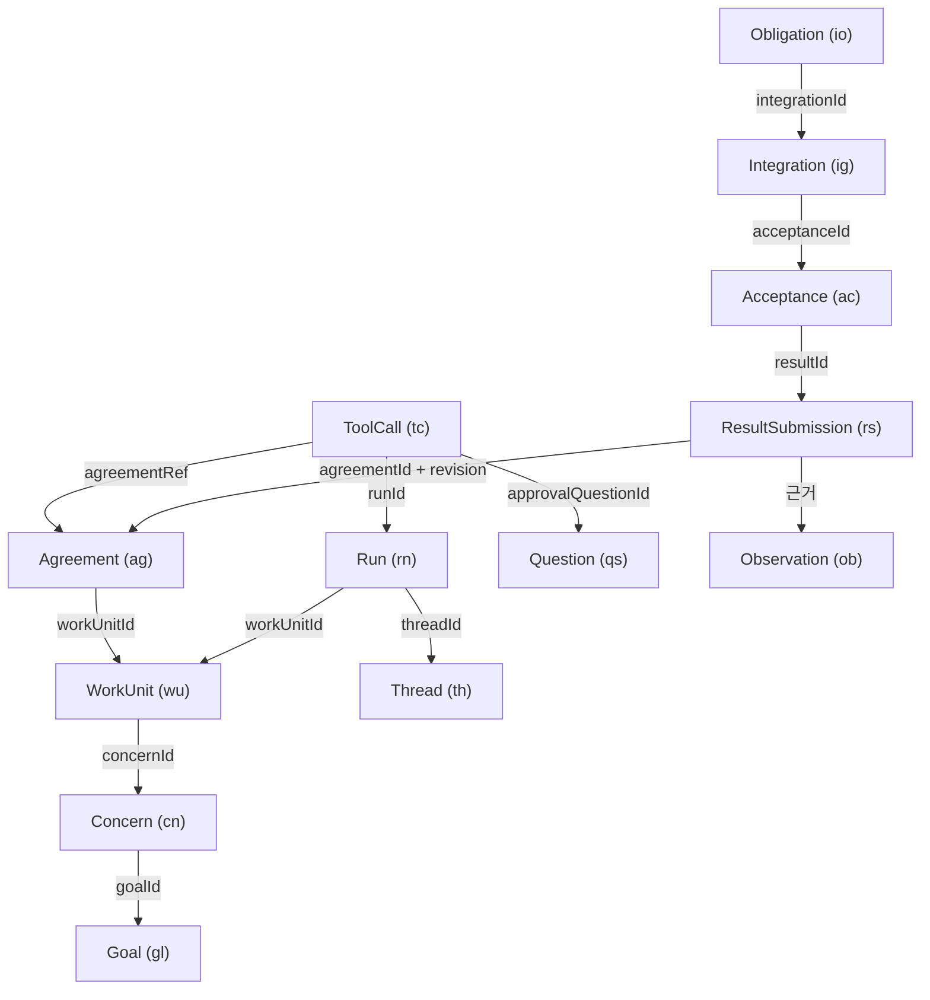

# 4. 정본: 도메인 모델과 이벤트 저장소

4.1에서 세운 모델 위에서, 이 노드는 레코드와 이벤트의 형식, 쓰기 한 번의 안전 장치, 투영 재구성을 다룹니다. 이 계층이 틀리면 위의 모든 규칙이 틀린 데이터 위에서 실행되므로 구현 리뷰에서 가장 많은 시간을 들일 곳입니다. 마이그레이션, 무결성 검사, 백업과 복원은 이 노드에서 요점만 짚고, 운영 절차는 12번 노드가 설명합니다.

## 레코드는 다섯 평면에 놓인다

Helm의 레코드는 무엇을 기록하는지에 따라 다섯 평면으로 나뉩니다. v0.3 이론의 N/E/M/A/P 구분을 그대로 코드의 분류로 옮긴 것입니다.

| 평면 | 담는 것 | 대표 레코드 | 바꿀 수 있는 주체 |
|---|---|---|---|
| N | 하기로 한 것, 지킬 것 | Goal, Concern, Choice, Agreement, Question | 사람, 확인된 제안, 맡긴 범위 안의 정책 |
| E | 안다고 주장하는 것과 모르는 것 | Observation, Assumption, Interpretation, Possibility, Finding | 관찰은 런타임·사람·외부·타이머, 승격은 커널, 모델은 제안만 |
| M | 실제로 바뀐 것 | 세계 자체는 저장하지 않고 참조(`MaterialRef`)만. M을 바꾸는 실행의 기록으로 WorkUnit, Run, ToolCall, Thread | 도구 실행 |
| A | 참여자와 능력 | 행위자 문법, 능력표, Device | 코드. 기기는 사람이 등록 |
| P | 지금 해도 되는가 | Grant, 합의 범위, 정책 수정안 | 사람 |

M 평면은 세계 자체를 저장하지 않는다는 점이 눈에 띕니다. 파일 내용이나 git 커밋 같은 실제 변화는 Helm 밖(작업 디렉터리)에 있고, Helm은 그 변화를 가리키는 참조와 관찰만 남깁니다. M을 바꾸는 실행의 기록(WorkUnit, Run, ToolCall, Thread)은 M 평면의 레코드이므로, 이벤트의 `plane`이 M인 경우를 만나도 이 설명과 어긋나지 않습니다. E 평면에서는 관찰(Observation)이 "누가 무엇을 보았다"는 기록일 뿐 "그것이 참이다"는 뜻이 아니라는 점이 중요합니다. 반응도 관찰이고, 도구 결과도 관찰입니다. 관찰을 근거로 해석과 가능성이 생기고, 충분한 근거와 반증 시도가 모이면 커널이 판단(Finding)으로 승격합니다. 1번 노드의 불변조건 2(관찰, 추측, 판단, 선택은 다르다)가 이렇게 레코드 종류로 구현됩니다.

## ID 접두사로 레코드 종류를 구분한다

레코드 ID는 `<접두사>_<ULID>` 형식입니다. ULID는 앞부분에 시각이 들어 있어 정렬할 수 있는 ID입니다. 접두사는 소문자 두 글자이고, 이벤트(`ev`)와 명령(`cm`) 같은 레코드가 아닌 식별자까지 합쳐 60종이 있으며 그중 레코드 종류는 45개입니다. 예를 들어 `cn_01JA2Z7Q8M3XK4V9TB6N0PRWES`는 Concern입니다. 리뷰와 디버깅 때 자주 볼 접두사는 Goal `gl`, Concern `cn`, WorkUnit `wu`, Agreement `ag`, Question `qs`, Choice `ch`, Observation `ob`, Run `rn`, ToolCall `tc`, Thread `th`, ResultSubmission `rs`, Acceptance `ac`, Obligation `io`, Device `dv`, 이벤트 `ev`입니다.

ID에는 세 가지 규칙이 붙습니다. ID는 바뀌지 않습니다. ULID 안의 시각 부분은 참고용이고, 순서 판단에는 이벤트 순번(`seq`)만 씁니다. 그리고 커널은 ID를 만들지 않습니다. 쓰기 경로가 ID 생성기를 커널에 넣어 주기 때문에, 커널 함수는 같은 입력에 언제나 같은 출력을 냅니다.

## 주요 레코드가 서로를 가리키는 방식

레코드 사이 관계의 정본은 레코드의 필드와 이벤트 payload이고, 투영기가 그로부터 링크 테이블(`p_links`)을 파생합니다. 참조가 유효한지는 쓰기 시점 검사(R-번호 규칙)가 확인합니다. 아래 그림은 한 일의 흐름에 나오는 레코드만 골라, 어느 레코드가 어느 레코드를 가리키는지 그린 것입니다. 화살표는 "필드로 가리킨다"는 뜻이고, 라벨은 그 필드 이름입니다. 무엇이 Agreement를 가리키는지 따라가면 합의가 무엇을 허락하고 무엇이 그것을 채우는지 알 수 있습니다. 합의의 기준(`criteria`)은 별도 레코드가 아니라 합의 안의 항목이라 그림에 노드로 그리지 않았습니다.



이 그림에서 리뷰할 때 확인할 관계가 세 개 있습니다. 첫째, 쓰기와 발송 도구 호출은 활성 합의의 현재 판본을 `agreementRef`로 가리켜야 시작할 수 있습니다(투영기는 이 관계를 `authorizes` 링크로 만듭니다). 이를 어기면 범위 밖 실행이 합의 없이 시작됩니다(R-05). 둘째, 결과 제출은 합의 ID와 판본 번호를 함께 가리키고, 제출한 기준 ID 집합이 그 판본의 기준 집합과 같아야 합니다. 어긋나면 다른 판본의 기준으로 완료를 주장하게 되므로 거부됩니다. 셋째, 결과 확인은 특정 결과 제출을 가리키며 행위자 필드가 `human`으로 고정됩니다. 승인 대기 중인 도구 호출은 승인 질문을 가리키므로, 질문에 답하면 어느 호출이 풀리는지 정해집니다.

레코드마다 상태 기계가 있고, 표에 없는 (상태, 이벤트) 조합은 대부분 `conflict.invalid_transition`으로 거부되고, 이미 끝난 대상은 `conflict.already_resolved`나 `conflict.superseded`로 구분됩니다. 예를 들어 Agreement는 proposed에서 active로 가고, active에서 fulfilled, released, expired 등으로 끝나며, 다시 협상하면 active에서 active로 판본만 1 올라갑니다. Concern의 completed는 결과 확인과 전체 반영까지 끝난 상태이고, closed는 완료하지 않고 끝낸 상태입니다. 둘 다 다시 열 수 있습니다.

## 이벤트 한 줄에 무엇이 들어 있는가

이벤트는 공통 봉투(envelope) 안에 종류별 내용(payload)을 담은 JSON입니다. 봉투의 필드를 묶음별로 보면 각 필드로 이벤트에서 무엇을 확인할 수 있는지 알 수 있습니다.

순서와 정체를 정하는 필드는 버전, 순번 `seq`, ID `ev_…`, 종류 `type`(`<대상>.<과거형 동사>`), payload 판 번호 `typeVersion`입니다. 언제와 누구를 정하는 필드는 효력 시각 `occurredAt`, 데몬 기록 시각 `recordedAt`(단조 증가), 행위자 `actor`, 실제 출처 `via`(어느 기기, 어느 run, 어느 프로세스에서 왔는가)입니다. 왜를 정하는 필드는 `authority`입니다. 상태를 바꾸는 이벤트에는 근거가 하나 이상 있어야 하고, 근거는 `human:device:dv_…`(사람의 직접 조작), `agreement:ag_…@2`(합의 판본 2의 범위), `question:qs_…`(질문의 답), `timer:…`, `rule:…` 같은 형식입니다. 무엇에 영향을 주었는지는 주 대상 `subject`와 관련 레코드 `refs`가, 인과는 명령 ID, 원인 이벤트나 명령 `causationId`, 묶음 키 `correlationId`가 정합니다. 마지막으로 데몬이 부팅할 때마다 새로 만드는 ID `bootEpoch`(ULID)와 해시 체인용 `prevHash`, `hash`가 붙습니다.

`authority`가 이 형식의 핵심입니다. 결과 확인 이벤트에는 "어느 기기에서 사람이 눌렀다"가, 도구 호출 시작 이벤트에는 "어느 합의 판본이 허락했다"가 남습니다. 나중에 "이 파일은 왜 바뀌었는가"를 물으면 이벤트에서 근거 사슬을 따라 사람의 결정까지 거슬러 갈 수 있습니다. 사람의 결정은 직접 확정이거나, 사람이 발급한 Grant나 선택입니다.

봉투 크기는 정규화한 JSON 기준 256 KiB 이하이고, 큰 내용은 blob 파일로 저장한 뒤 `sha256:<hex>` 해시로만 가리킵니다.

## 쓰기 하나: `store.transaction(fn)`

2번 노드에서 모든 상태 변경이 `engine.submit` 한 경로를 지난다고 했습니다. 그 경로의 바닥에 있는 것이 저장소의 `transaction(fn)`입니다. 아래는 쓰기 트랜잭션 하나가 실행하는 순서이고, 번호를 아래 설명에서 그대로 가리킵니다.

```text
transaction(fn):
  0. (트랜잭션 밖) 명령 봉투 스키마 검사, 멱등 범위 키와 지문 계산, 큰 본문은 blob으로 저장
  1. BEGIN IMMEDIATE
  2. 펜싱: meta.current_boot_epoch가 내 bootEpoch와 다르면 롤백하고 프로세스 종료, path.fenced
  3. fn(tx) 안에서 명령마다:
     a. 멱등 조회: 같은 키·같은 지문이면 저장된 결과를 replayed로 반환
                   같은 키·다른 지문이면 key_reused (아무것도 저장하지 않음)
     b. 커널 판정 decide(view, ctx). error면 전체 롤백
     c. 이벤트 초안 (거부·충돌·게이트면 command.rejected 포함)
     d. 이벤트마다: seq = head+1, 해시 = sha256(prevHash + "\n" + 정규화 JSON(prevHash·hash를 뺀 봉투))
                   payload 스키마와 크기(256 KiB) 검사
                   events에 INSERT, 투영기 실행 (투영기 오류면 전체 롤백)
     e. commands에 처리 결과 INSERT
  4. trace INSERT
  5. meta의 head_seq, head_hash 갱신
  6. 1,000건마다 서명(HMAC) 체크포인트
  7. COMMIT
  8. 같은 JS 턴에서 구독자에게 새 이벤트 전달
```

아래 용어는 이 노드의 뒤쪽 절에서 정의합니다. 펜싱(2번)은 "프로세스가 둘이 되는 사고를 막는 세 겹", 멱등 범위 키와 지문(0번, 3a)은 "멱등 키와 지문", 투영기(3d)는 "투영과 재구성", 서명 체크포인트(6번)는 "손상과 위조를 찾는 방법"에 있습니다. `BEGIN IMMEDIATE`(1번)는 SQLite가 트랜잭션 시작 시점에 쓰기 잠금을 잡게 하는 명령이라, 그 직후의 펜싱 검사(2번)가 다른 쓰기와 겹치지 않습니다. `decide(view, ctx)`(3b)는 4.1에서 본 커널의 판정 함수입니다.

한 명령이 이벤트를 여러 개 만들 수 있고, 3d는 그 이벤트마다 반복됩니다. 예를 들어 사람의 확정 명령 하나가 `agreement.confirmed`, `question.answered`, `workunit.started`, `run.queued`, `run.started`를 한 트랜잭션에서 함께 냅니다. 결과 확인 하나가 반영 작업을 열고 반영 항목을 만드는 일이 한 트랜잭션에서 일어나는 것도 같은 이유입니다. 이와 별개로, `fn` 안에서 여러 명령을 차례로 제출하는 경로는 앞 제출의 결과를 보고 뒤 제출을 정해야 하는 제안 도구 경로를 위한 것이고, 이때 뒤 명령은 앞 명령이 같은 트랜잭션에서 쓴 투영과 커널 상태를 봅니다. `fn` 안에서는 `await`, 네트워크, 파일 쓰기를 하지 않습니다. 어느 단계에서든 예외가 나면 이벤트, 명령 기록, 투영, trace가 모두 롤백되어 흔적이 남지 않아야 하고, 1~7번 사이 여러 지점에 이를 확인하는 고장 주입 시험이 있습니다.

### 처리 결과별로 무엇이 남는가

명령의 처리 결과는 주요 여섯 가지이고, 결과마다 저장되는 것이 다릅니다. `needs_gate`는 사람 확인이 필요해 질문을 만든 결과입니다. 아래 표의 마지막 열이 같은 명령을 다시 보냈을 때의 동작입니다.

| 결과 | 명령 기록 | 이벤트 | 같은 키로 재시도하면 |
|---|---|---|---|
| accepted | 저장 | 커널이 만든 이벤트 | 저장된 결과를 그대로 돌려줌 |
| needs_gate | 저장 | `command.rejected` + 질문 기록 | 같음 |
| rejected | 저장 | `command.rejected` | 같음(다시 판정하지 않음) |
| conflict | 저장 | `command.rejected`(conflict) | 같음. 새로 시도하려면 새 키 |
| key_reused | 저장 안 함 | 없음 | 원래 결과를 함께 알려 줌 |
| 명령 봉투가 깨짐 | 저장 안 함 | 없음 | 프로토콜 오류 |
| error·일시 실패 | 저장 안 함 | 없음(롤백) | 처음부터 다시 처리 |

거부와 충돌까지 저장하는 이유가 있습니다. 거부를 저장하지 않으면, 그사이 상태가 바뀐 뒤 같은 키로 재시도한 명령이 통과할 수 있습니다. 그러면 클라이언트는 자기가 보낸 여러 시도 가운데 어느 것이 반영되었는지 판별할 수 없습니다. 재시도 재생에는 보존 기한(365일)이 있고, 그 뒤에는 결과를 줄인 응답이 돌아옵니다.

### 멱등 키와 지문

**멱등**은 같은 요청을 여러 번 보내도 한 번 보낸 것과 결과가 같다는 성질입니다. 네트워크가 끊겨 응답을 받지 못한 클라이언트는 같은 명령을 다시 보내야 하는데, 이때 두 번 적용되면 안 됩니다. Helm은 명령마다 멱등 키를 붙이고, 범위 키 `<채널>|<행위자>|<출처>|<멱등 키>`로 명령 기록을 찾습니다.

같은 키로 다른 내용을 보내는 실수를 잡으려고 지문도 계산합니다. **지문**은 명령 종류, 행위자, 출처, 내용의 해시입니다. 지문에서는 연결 ID, 리스너, 시도 번호, 화면 순번, 제출자가 만든 ID 같은 값을 뺍니다. 재연결 뒤 다른 리스너로 같은 명령을 다시 보내도 지문이 같아야 하기 때문입니다. 사람 명령 외의 내부 쓰기(도구 결과, 스케줄러 타이머, 부팅 복구, 대기 run 이어받기)에도 정해진 키 형식이 있어서, 같은 타이머나 같은 도구 결과를 두 번 처리해도 두 번째는 재생으로 끝납니다. 키 형식은 7.1번 노드에서 다룹니다.

### 낡은 화면에서 보낸 명령

사람의 명령에는 화면이 보고 있던 순번 `basisSeq`가 함께 실립니다. 커널은 대상 레코드의 `revisionSeq`가 `basisSeq`보다 크면 충돌로 판정합니다. `revisionSeq`는 사람에게 보이는 내용을 바꾼 마지막 변경의 순번이고, 근거 링크 추가나 주석은 올리지 않습니다. 어떤 이벤트든 마지막으로 바꾼 순번(`last_seq`)은 따로 있으므로 둘을 혼동하면 안 됩니다. `last_seq`로 비교하면 근거 링크 하나만 붙어도 사람의 응답이 충돌로 거부됩니다. 예를 들어 사람이 합의 카드를 보는 사이 에이전트가 합의를 다시 제안했다면, 사람의 확정은 충돌로 거부되고 화면이 새 판본을 받습니다. 에이전트 제안은 대개 이 값을 넣지 않고 상태 기계 검사에 맡깁니다.

## 프로세스가 둘이 되는 사고를 막는 세 겹

정본에 쓰는 프로세스는 하나여야 합니다. 그런데 수동 실행 실수, 오프라인 관리 명령, 재시작 타이밍 때문에 두 프로세스가 같은 DB에 쓰려는 상황이 생길 수 있습니다. Helm은 이를 세 겹으로 막습니다. systemd 단위가 하나만 있어서 같은 기계에서 데몬 두 개가 뜨지 않습니다. 데이터 디렉터리의 잠금 파일(`helmd.lock`)에 SQLite 배타 트랜잭션을 유지해서, 두 번째 데몬은 시작하자마자 종료 코드 3으로 끝납니다. 마지막으로 모든 쓰기 트랜잭션이 시작 직후 DB에 적힌 현재 부팅 번호(`current_boot_epoch`)와 자기 번호를 대조하고, 다르면 롤백하고 프로세스를 끝냅니다(`path.fenced`). 이 세 번째 장치를 **펜싱**이라고 부릅니다. 앞의 두 겹이 뚫려도, 나중에 시작한 인스턴스가 부팅 번호를 새로 적으면 이전 인스턴스의 쓰기는 커밋되지 못합니다.

같은 원리가 run에도 적용됩니다. run은 자신을 시작한 부팅 번호(`ownerEpoch`)와 시도 번호(`attempt`)를 갖고, run이 낸 명령은 이 값이 현재 값과 같고 run이 실행 중일 때만 받아들여집니다. 다르면 `path.stale_epoch`로 거부됩니다. 그래서 데몬이 재시작된 뒤 이전 부팅의 run에서 늦게 도착한 도구 결과는 상태를 바꾸지 못합니다. 부팅 복구만 이 검사의 예외이고, 대신 `recover:` 형식의 키를 써야 합니다.

## 투영과 재구성

투영 테이블은 이름이 `p_`로 시작하고, 쓰기 트랜잭션 안에서 이벤트마다 투영기가 갱신합니다. 투영기는 이벤트 종류마다 처리 함수를 갖고, 생성 이벤트면 레코드 행을 만들고, 전이 이벤트면 상태 기계로 다음 상태를 계산하고, 마지막 변경 순번(`last_seq`)과 사람에게 보이는 내용이 바뀐 순번(`revision_seq`)을 따로 기록합니다. 복귀 요약의 재료가 되는 주의 항목 테이블(`p_attention`)도 여기서 함께 갱신됩니다. 모든 이벤트 종류에 처리 함수가 있는지 확인하는 망라성 시험이 있습니다.

재구성은 투영을 버리고 로그에서 새로 계산하는 일입니다. 쓰기를 받기 전에만 실행하고, 각 투영 테이블의 새 사본을 만든 뒤 이벤트를 순번대로 5,000건씩 읽어 적용하고, 끝나면 테이블을 바꿔 끼웁니다. 재구성이 결정적인지는 새 DB에서 재구성한 결과와 운영 DB의 투영을 정렬해 요약값으로 비교하는 검사(`helm ops verify --projections`)로 확인합니다. 둘이 다르면 투영기에 버그가 있는 것입니다. 커널 상태는 시작할 때 스냅숏(1만 이벤트마다, 하루 한 번, 정상 종료 직전 중 먼저 오는 때에 저장하는 캐시)에서 읽고, 그 뒤 이벤트만 적용해 빠르게 복원합니다. 스냅숏이 현재 규칙 판과 맞지 않으면 처음부터 적용합니다.

## 형식이 바뀔 때: 마이그레이션과 업캐스터

DB 스키마 판은 `PRAGMA user_version` 정수 하나로 관리하고, 앞으로만 갑니다. DB 판이 코드보다 높으면(옛 코드로 새 DB를 열면) 시작을 거부합니다. 마이그레이션 전에는 백업을 뜨고, 마이그레이션 하나와 판 번호 증가를 한 트랜잭션에서 실행합니다.

이벤트 payload 형식이 바뀌면 저장된 이벤트를 고치지 않습니다. 대신 이벤트의 `typeVersion`을 보고 옛 형식을 새 형식으로 바꿔 읽는 순수 함수(**업캐스터**)를 둡니다. 데이터를 정정해야 할 때도 업캐스터로 의미를 바꾸지 않고, 정정 이벤트를 새로 덧붙입니다. 투영 형식이 바뀌면 투영기 판을 올리고 재구성합니다.

## 손상과 위조를 찾는 방법

이벤트 테이블은 UPDATE와 DELETE를 트리거로 막습니다. 그래도 SQL로 직접 편집하거나 파일이 손상될 수 있으므로, 이벤트마다 앞 이벤트의 해시를 이어 붙인 **해시 체인**을 둡니다. 체인을 처음부터 다시 계산한 위조까지 검출할 수 있도록, 1,000건마다 서버만 아는 키(`HELM_LEDGER_HMAC_KEY`)로 서명한 체크포인트를 남깁니다. 이 키가 없으면 데몬은 시작하지 않습니다. 이 검사는 기록이 손상되거나 바뀌지 않았다는 것만 보장하고, 기록된 내용이 참이라는 것은 보장하지 않습니다(불변조건 1).

검사 종류에 따라 실패 뒤의 동작이 다릅니다. 부팅 때 최근 꼬리 검사가 실패하면 데몬은 읽기 전용으로 시작합니다. 주간 전체 검사가 실패하면 실패 지점을 기록하고 백업 회전을 멈춘 뒤, 읽기 전용으로 바꿀지 계속 쓸지를 사람에게 묻습니다. 손상은 과거 구간이고 새 이벤트의 체인은 끝에서 이어지므로 판단을 사람에게 맡깁니다. 백업 직후 검사가 실패하면 그 백업을 실패로 표시합니다. 어느 경우에도 손상된 꼬리를 자동으로 잘라 내지 않습니다. 세부 동작은 12번 노드가 설명합니다.

## 백업과 복원

백업은 SQLite 온라인 백업 API로 쓰기를 멈추지 않고 사본을 뜬 뒤, 사본을 전체 검사하고 manifest와 함께 백업 디렉터리로 옮깁니다. 홈랩의 restic은 백업 디렉터리와 blob 디렉터리 등을 가져가고, 살아 있는 DB 파일(`helm.sqlite*`)은 가져가지 않습니다. blob은 내용 주소 파일이라 DB 백업에 복사하지 않으며, 사본 검증이 blob 내용 해시까지 확인하지는 않으므로 blob 손실은 따로 점검해야 합니다.

복원은 현재 DB를 지우지 않고 격리 폴더로 옮긴 뒤 진행하며, 복원된 DB에는 새 `storeId`가 붙습니다. 같은 순번이 이제 다른 이벤트를 가리킬 수 있으므로, 클라이언트는 이 값이 바뀐 것을 보면 캐시를 버립니다. 복원 뒤 첫 부팅은 안전 모드로 들어가 run 자동 재개와 새 실행을 멈춥니다. 복원 절차와 안전 모드는 12번 노드에서 다룹니다.

## 이 노드의 기준으로 구현을 볼 때

- 이벤트 테이블에 UPDATE·DELETE를 막는 트리거가 있고, `seq`가 `head + 1`로만 부여되는가
- 이벤트와 투영과 명령 기록이 한 트랜잭션에서 함께 커밋·롤백되는가. 고장 주입 지점마다 흔적이 남지 않는가
- 같은 멱등 키·같은 지문은 재생, 다른 지문은 `key_reused`로 처리되고, 거부·충돌도 명령 기록과 `command.rejected`로 남는가
- 지문 계산에서 연결 ID, 리스너, 시도 번호, 화면 순번, 제출자가 만든 ID가 빠지는가
- 충돌 판정이 `last_seq`가 아니라 `revisionSeq > basisSeq`로 이루어지는가
- 모든 쓰기 트랜잭션이 `BEGIN IMMEDIATE` 직후 부팅 번호를 대조하는가. run 명령의 `ownerEpoch`·`attempt` 검사가 있는가
- 투영 테이블에 쓰는 코드가 투영기 밖에 없는가. 모든 이벤트 종류에 투영 처리 함수가 있는가
- 재구성 결과와 운영 투영을 비교하는 검사가 실제로 실행되는가
- 커널이 ID를 만들지 않고 주입받는가. `fn` 안에 `await`, 네트워크, 파일 쓰기가 없는가
- 이벤트 이름은 바꾸지 않고 `typeVersion`과 업캐스터를 쓰는가. 모르는 이벤트 종류나 더 높은 `typeVersion`이 있으면 시작을 거부하는가
- 마이그레이션이 앞으로만 가고, 전에 백업을 뜨고, 마이그레이션 하나와 `user_version` 증가가 한 트랜잭션인가
- 상태를 바꾸는 이벤트에 `authority`가 있고, 결과 확인 이벤트의 행위자가 `human`으로만 기록되는가
- HMAC 키가 없을 때 데몬이 시작을 거부하는가. 무결성 검사 종류별로 동작이 맞는가(부팅 꼬리 검사는 읽기 전용, 주간 전체 검사는 백업 회전 중단과 사람의 선택, 백업 직후 검사는 해당 백업 실패 표시). 어느 경우에도 자동으로 데이터를 지우지 않는가
- 복원 뒤 `storeId`가 바뀌고 자동 재개가 멈추는가
