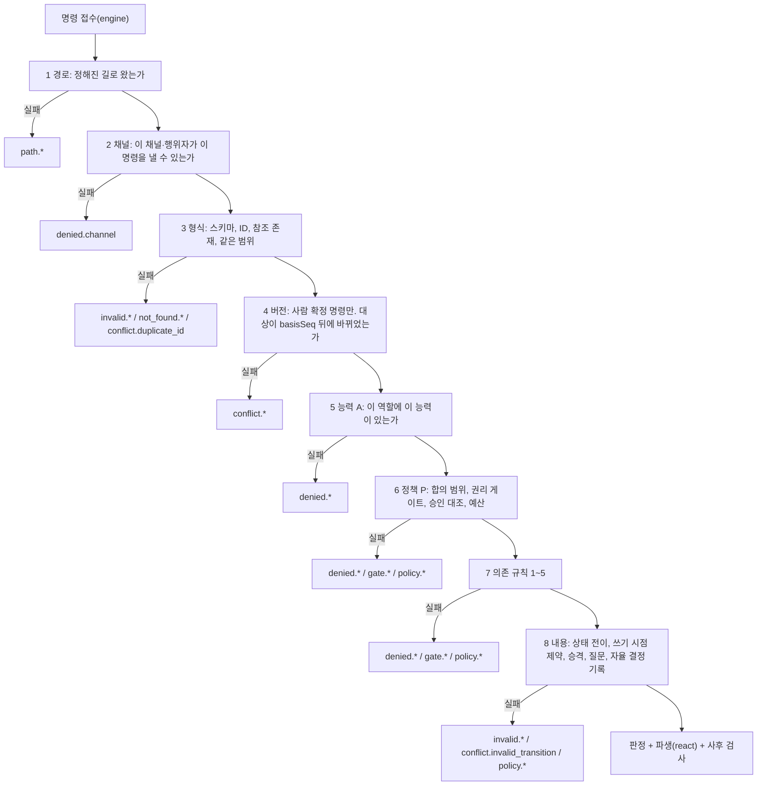

# 5. 커널: 명령이 이벤트가 되기까지

## 커널은 왜 따로 있는가

"모델은 제안하고, 커널이 상태를 바꾼다." 1번 노드에서 본 이 원칙을 코드로 옮긴 것이 커널(`@helm/kernel`)입니다. 사람, 모델, 런타임, 스케줄러, 관찰 에이전트, 외부 어댑터는 모두 정해진 형식의 제출(명령)만 넣을 수 있고, 커널이 허용한 것만 이벤트가 되어 로그에 들어갑니다. 모델이 아무리 그럴듯한 출력을 내도, 그 출력은 명령으로 제출되어 커널 검사를 통과하기 전에는 상태를 바꾸지 못합니다.

커널이 하지 않는 일은 두 부류로 나뉩니다. 먼저 커널 패키지 밖에 있는 것입니다. 레코드 형식과 상태 기계 정의(4번 노드의 `@helm/domain`), SQLite와 해시 체인(4번 노드의 저장소), 에이전트 루프와 문맥 생성, 크래시 복구(7번 노드의 런타임), 도구가 무엇을 하는지와 그 효과가 되돌릴 수 있는지의 판별(8번 노드의 권한 레이어)이 여기에 속합니다. 커널은 권한 레이어의 판별 결과를 입력으로 받아 쓰기만 합니다.

다음은 규칙 문서의 소유가 다른 문서에 있어도 규칙 판정 코드는 커널 패키지 안에 있는 것입니다. 질문 게이트 판정, 전달 결정, 만료 계산(`src/asking/`, 규칙은 11번 문서가 정함)과 루프 계약, 계획 검증 같은 순수 계산(`src/orchestration/`, 규칙은 14번 문서가 정함)은 커널의 순수 함수로 실행됩니다. 커널 밖인 것은 이 규칙의 효과를 실제로 수행하는 부분, 곧 질문 전달의 실행(6번 노드)과 루프의 실행(9번 노드)입니다.

## 세 개의 순수 함수

커널은 세 개의 순수 함수로 되어 있습니다.

- `decide(state, cmd, ctx)`: 명령 하나를 받아 판정(`Decision`)을 돌려줍니다. 판정에는 결과 종류(`status`), 만들 이벤트 초안, 커밋 뒤 할 일(지시), 거부 정보가 들어 있습니다. 상태를 바꾸지 않습니다.
- `apply(state, event)`: 커밋된 이벤트 하나를 상태에 적용합니다. 이벤트를 거부하지 않습니다.
- `react(before, after, drafts, ctx)`: 받아들인 초안을 적용한 상태를 보고, 같은 트랜잭션에 함께 넣을 파생 이벤트를 만듭니다. 예를 들어 결과 확인이 받아들여지면 반영 항목을 만드는 파생 이벤트가 여기서 나옵니다.

판정과 적용을 나누면 두 가지가 쉬워집니다. 재생은 `apply`만으로 되므로(4번 문서의 reducer에 해당), 데몬이 시작할 때 로그를 다시 접어도(스냅숏이 맞으면 그 뒤 이벤트만) 과거 명령을 다시 판정하지 않습니다. 규칙이 바뀌어도 과거 결정이 뒤집히지 않는 이유입니다. 그리고 파생 규칙이 만들어 낸 결과까지 포함해 커밋 전에 한 번에 검사할 수 있습니다.

"순수"는 엄격하게 지켜집니다. 커널은 파일, 네트워크, DB, 환경 변수, 시계, 난수, 타이머, 콘솔을 쓰지 않고, 의존하는 패키지는 `@helm/domain`과 TypeBox뿐입니다. 판정에 필요한 현재 시각, 새 ID 생성기, 규칙 판, 방해 금지 상태, 기기 접속 상태는 모두 `engine`이 `KernelContext`로 넣어 줍니다. 그래서 같은 `(state, cmd, ctx)`에는 언제나 같은 판정이 나오고, 테스트 전략은 이 성질을 속성 테스트로 확인합니다. 시각에도 안전장치가 있습니다. 판정 시각은 벽시계와 마지막 기록 시각 가운데 큰 값이고, 벽시계가 앞으로 설정값(기본 10분) 넘게 뛰면 시각 때문에 생기는 확정(가정 만료, 승인 만료)을 보류하고 사람에게 확인을 묻습니다.

## 명령은 어떤 모양으로 들어오는가

모든 제출은 `CommandEnvelope` 하나의 형식입니다. 명령 이름(`type`, `<대상>.<동사>` 현재형), 행위자, 출처(`via`), 채널, 멱등 키, 내용(`payload`)이 기본이고, 사람이 확정하는 명령에는 화면이 표시한 시점의 순번 `basisSeq`가, 모델 채널의 명령에는 그 판단에 쓰인 문맥 참조 `contextRef`가 필수입니다.

채널은 일곱 가지입니다. 사람 클라이언트, 모델 도구 호출, 런타임, 스케줄러, 외부 어댑터, 보조 에이전트, 마이그레이션입니다. 채널마다 허용되는 행위자가 정해져 있어서, 예를 들어 모델 채널에서는 `agent:work` 같은 에이전트 행위자만, 스케줄러 채널에서는 `scheduler`가 `timer.fire` 하나만 낼 수 있습니다. 커널 자신(`kernel`)은 명령을 제출하지 않습니다.

명령은 약 150개이고, 명령마다 스펙(`CommandSpec`)이 있습니다. 스펙에는 내용 스키마, 허용 채널, 필요한 능력, 사람 전용 여부, 사람 전용 필드, 판정 함수가 들어 있습니다. **사람 전용 명령**(합의 확정, 결과 확인, 질문 답 등)은 인증된 기기에서 오거나, 서버 안에서 사람이 TUI나 터미널로 확인 문자열을 입력한 경우에만 받습니다. 스크립트나 타이머가 관리 CLI로 사람 결정을 내리려 하면 `denied.channel`로 거부됩니다. 명령 하나 안에서 일부 필드만 사람 전용일 수도 있습니다. 예를 들어 `agreement.propose`의 `confirmNow`(제안과 동시에 확정)는 사람만 쓸 수 있고, 모델이 이 값을 담아 보내면(`false`도 값입니다) 거부됩니다.

## 판정 순서: 같은 명령은 언제나 같은 이유로 거부된다

커널은 명령을 정해진 순서로 검사하고, 처음 실패한 검사가 결과 코드가 됩니다. 같은 단계 안에서 여러 규칙이 실패하면 첫 실패가 코드가 되고 나머지는 `alsoFailed`에 남습니다. 앞 단계에서 실패하면 뒤 단계는 평가하지 않습니다. 순서를 고정하는 이유는 같은 명령이 상황에 따라 다른 이유로 거부되면 클라이언트와 사람이 대응하기 어렵기 때문입니다. 아래 그림은 검사 순서와, 각 단계에서 실패했을 때 나오는 거부 코드의 접두사입니다. 5단계와 6단계가 보내는 쪽의 자격을, 3단계와 8단계가 명령 내용을 검사합니다.

형식(3)을 능력(5)보다 먼저 보는 이유는, 모양이 틀린 명령은 누가 보냈든 거부되어야 하기 때문입니다. 반대로 상태 전이(8)를 능력과 정책(5, 6)보다 늦게 보는 이유는, 대상 상태가 맞지 않는 상황에서도 "모델은 결과 확인을 할 수 없다" 같은 자격 거부가 일관되게 보이게 하려는 것입니다. 4단계의 버전 검사는 `basisSeq`를 싣는 사람 확정 명령에만 적용되고, 모델과 런타임이 낸 명령은 건너뜁니다(`basisSeq`는 아래 "낡은 화면에서 온 명령"에서 설명합니다).

7단계의 의존 규칙은 다음 다섯 가지입니다.

| 번호 | 규칙 | 위반했을 때 코드 |
|---|---|---|
| 1 | 쓰기나 발송을 하려면 작업 합의가 있어야 한다 | `denied.agreement_required`(합의 없음), `gate.scope_expansion_required`(범위 밖) |
| 2 | "완료"라고 하려면 결과 확인을 거쳐야 한다 | `policy.acceptance_required` |
| 3 | 판단으로 올리려면 근거가 있어야 한다 | `policy.promotion_requirements` |
| 4 | 하위 Concern이 있으면 재조합 확인 뒤에 닫는다 | `policy.subconcerns_open` |
| 5 | Goal을 바꾸려면 사람이 확인해야 한다 | `gate.human_required` |

규칙 2, 3, 4는 누가 보내도 거부되므로 3갈래 중 내용 갈래의 `policy.*`이고, 사람이 풀 수 있는 규칙 1(범위 밖)과 규칙 5만 자격 갈래입니다. 그래서 그림의 7단계에 세 접두사가 모두 나옵니다.

한 명령으로 따라가 봅니다. 작업 에이전트(`agent:work`)가 모델 채널로 `result.accept`(결과 확인)를 제출했다고 하겠습니다. 1단계 경로는 정해진 길로 왔으므로 통과하고, 2단계 채널에서 `result.accept`는 사람 전용 명령이라 모델 채널이 낼 수 없으므로 `denied.channel`로 끝납니다. 3단계부터 8단계까지는 평가하지 않습니다. 같은 명령을 사람이 낡은 화면(`basisSeq`가 오래됨)에서 보냈다면 2단계는 통과하고 4단계에서 `conflict.version_mismatch`로 끝납니다. 같은 명령이 최신 화면에서 왔는데 완료할 수 없는 상태라면 8단계의 `conflict.invalid_transition`이 됩니다. 이 세 경우는 서로 다른 단계에서 한 번씩만 실패하며, 어느 단계의 코드인지 보면 원인이 단계 하나로 정해집니다.

거부는 성격에 따라 세 갈래로 분류됩니다. 아래 표의 판별 질문 열을 보면, 같은 명령을 다른 행위자가 보냈을 때 통과하는지가 갈래를 정한다는 것을 알 수 있습니다.

| 갈래 | 판별 질문 | 접두사 | 예 |
|---|---|---|---|
| 내용 | 누가 보냈어도 거부되는가 | `invalid.*`, `not_found.*`, `conflict.*`(`conflict.invalid_transition` 등), `policy.*` | 스키마 오류, 없는 참조, 금지 자원 쓰기 |
| 자격 | 다른 행위자나 사람의 허락이 있으면 통과하는가 | `denied.*`, `gate.*` | 모델의 결과 확인, 합의 범위 밖 쓰기 |
| 경로 | 정해진 길을 거치지 않았는가 | `path.*` | 어댑터가 이벤트를 직접 쓰려 함, 지난 부팅의 run이 보낸 명령 |

범위 밖 쓰기가 자격 갈래이고 금지 자원 쓰기가 내용 갈래인 이유가 이 질문에서 나옵니다. 범위 밖 쓰기는 사람이 범위를 넓혀 주면 통과하므로 "누가 허락했는가"의 문제이고, 금지 자원은 누가 보내도 막힙니다. 거부와 다른 것으로 **강등**이 있습니다. 강등은 명령을 받아들이되 일부 값을 낮춰 기록하는 것으로, 근거 없는 기준을 "확인 못함"으로 바꾸는 경우가 대표적입니다. 강등은 `accepted`와 함께 `downgraded.*` 코드를 돌려줍니다. 접두사와 결과 종류가 항상 짝을 이루지는 않습니다. 예를 들어 `policy.structure_cap_exceeded`(하위 Concern 수·깊이 상한 초과)는 접두사가 내용 갈래이지만 결과는 질문을 만드는 `needs_gate`입니다.

## 판정 결과는 다섯 가지다

| 결과 | 뜻 | 기록되는 것 |
|---|---|---|
| `accepted` | 허용 | 도메인 이벤트와 파생 이벤트 |
| `rejected` | 거부 | 도구 호출이 아니면 `command.rejected` 하나. 도구 호출이면 `toolcall.requested`와 `toolcall.blocked`(차단 사유가 도구 호출 레코드에 남음) |
| `needs_gate` | 사람이 답하면 풀리는 거부 | 도구 호출이 아니면 `command.rejected`(질문 번호 포함)와 질문 레코드. 도구 호출이면 `toolcall.requested`, `toolcall.approval_requested`, 질문 레코드이고 `command.rejected`는 없음 |
| `conflict` | 낡은 기준이나 이미 끝난 대상 | `command.rejected`(conflict) |
| `error` | 커널 내부 오류(파생 과다, 사후 검사 실패) | 아무것도 커밋하지 않음 |

4번 노드는 처리 결과를 여섯 가지로 설명했습니다. 이 표가 다섯 가지인 것은 여섯째인 `key_reused`(같은 멱등 키에 다른 지문)를 `engine`이 접수 단계에서 정하고 이벤트도 남기지 않아 커널까지 오지 않기 때문입니다.

`needs_gate`는 자동으로 다시 실행되지 않습니다. 사람이 답한 뒤 제출자가 새 키로 다시 내야 하고, 도구 호출만 예외적으로 같은 호출 번호로 이어 갑니다. 3번 노드에서 본 push 승인 흐름이 이 예외입니다. 도구 호출이 아닌 명령의 거부는 레코드를 바꾸지 않고, 거부 사실을 관찰로 만들지도 않습니다.

## 능력(A)과 정책(P)

자격 검사는 두 층입니다(그림의 5단계와 6단계). 판별 질문은 "일하는 도중에 상황이 바뀌면 답도 바뀌는가?"입니다. 바뀌지 않으면 능력(A), 바뀌면 정책(P)입니다.

능력은 역할별로 고정된 표 `CAPABILITY_TABLE`입니다. 역할(행위자)마다 원시 행동(read, write, execute, send, spawn, ask), 기록 능력(observe, propose, attest, accept, integrate), 낼 수 있는 제안 종류가 정해져 있습니다. 작업 에이전트(`agent:work`)에는 `accept`가 없어서 결과를 확인할 수 없고, 검증 에이전트(`agent:verifier`)에는 쓰기 원시 행동이 없으며, `accept`를 가진 역할은 사람뿐입니다. 이 표는 설정으로 바꿀 수 없는 코드입니다.

정책은 상황에 따라 달라지는 권한입니다. 지금 활성인 합의의 범위, 권리 게이트, 승인과 인자의 대조, 예산, 검증자의 독립성 같은 것이 여기에 속하고, 평가 순서가 P-1부터 P-12까지 정해져 있습니다. 사람이 만든 정책 규칙(예: "이런 종류의 질문은 묻지 말고 정해라")도 이 층에서만 읽힙니다. **불변조건은 정책 규칙으로 끌 수 없습니다.** "묻지 말고 정해라" 같은 규칙은 권리 게이트, 결과 확인, Goal 변경, 정책 변경, 합의 확정에 적용될 수 없고, 커널은 규칙을 적재할 때와 사람이 정책 변경을 받아들일 때 이것을 검사합니다.

## 작업 합의와 범위 검사

작업 합의(Agreement)는 에이전트가 무엇을 어디까지 쓰거나 실행해도 되는지를 정한 레코드입니다. 합의의 범위(Scope)에는 허용 원시 행동, 자원 패턴 목록, 예산(최대 run 수, 최대 도구 호출 수, 최대 시간, 최대 비용), 유효 기간이 들어갑니다. 금지 행동과 금지 자원은 범위보다 우선합니다. 에이전트가 합의를 제안할 때는 의도를 다시 진술한 확인 내용(check-back)을 함께 내야 합니다.

합의가 활성이 되는 길은 사람이 확정하는 길과 사람 조작 없이 활성화되는 길로 나뉩니다. 아래 표는 도메인 모델의 활성화 방식(`Activation`) 여섯 가지입니다.

| 활성화 방식 | 사람 조작 | 조건 |
|---|---|---|
| `human` | 있음 | 사람이 합의 확정 질문에 답함 |
| `direct_instruction` | 있음 | 사람이 `confirmNow`로 직접 지시를 되읽은 합의를 확정함 |
| `result_acceptance` | 있음 | 결과 확인과 같은 조작으로 반영 범위 합의를 확정함 |
| `grant` | 없음 | 사람이 미리 발급한 권한(Grant)의 범위 안에 있음을 커널이 증명함 |
| `choice_scope` | 없음 | 사람이 직접 고른 선택의 구조화 범위 안에 있음을 증명함 |
| `rule` | 없음 | 쓰기가 없는 탐구 합의라서 규칙으로 활성화함(포함 증명이 아니라 쓰기 없음이 조건) |

사람 조작 없는 길 가운데 `grant`와 `choice_scope`는 "사람이 이미 정한 것 안에 들어간다"는 증명이 필요합니다. 어느 길에도 해당하지 않으면 합의 확정 질문(권리 게이트)이 생깁니다. Grant 포함 검사는 보수적이어서, 자원 패턴이 확대되지 않았다는 것을 증명하지 못하면 거짓으로 봅니다.

도구 호출의 범위 검사는 원시 행동에 따라 다릅니다. 읽기는 의존 규칙 1의 대상이 아니므로 합의 범위를 따지지 않습니다. 다만 권한 레이어가 금지 자원으로 판정한 읽기는 거부됩니다. 공개 인터넷 읽기(웹 검색, 페이지 읽기)도 합의 없이 허용하며, 내부망이나 사설 주소 읽기는 8번 노드의 도구 쪽 검사가 막습니다. 쓰기, 실행, 발송은 원시 행동이 범위에 있는지, 유효 기간 안인지, 대상이 금지 목록에 없는지, 대상이 자원 패턴에 맞는지를 차례로 봅니다.

자원 패턴은 정규식을 쓰지 않는 단순한 문법이고, `**`는 `/`를 포함한 0개 이상의 문자, `*`는 `/`를 뺀 0개 이상의 문자입니다. bash 명령처럼 대상 자원을 실행 전에 확정할 수 없는 실행은, 합의가 이를 허용하는 값을 가진 경우에만 받아들이고 실행 뒤 실제 변경을 대조하는 사후 검사로 기록합니다.

## 발송과 승인: 한 번의 허락은 한 번만 쓴다

발송(send)은 MVP에서 합의 범위와 관계없이 언제나 권리 게이트입니다. 외부 효과가 있는지 불확실한 호출(컴퓨터 사용 등)도 권리 게이트로 다룹니다. run이 웹 페이지 내용을 읽은 뒤에는 그 run에 `taint.web` 표식이 붙고, 그 뒤의 발송은 언제나 사람에게 묻습니다. MVP에서는 모든 발송이 이미 사람에게 묻기 때문에 이 표식이 새로 막는 것은 없습니다. 웹 페이지에 숨은 지시가 에이전트를 움직여 정보를 밖으로 보내는 일을 막으려는 것이고, 이후 발송 승인을 줄이는 기능이 생겨도 이 경로는 계속 묻게 하는 안전장치입니다.

승인은 도구 이름과 인자로 계산한 지문(`sha256(toolName + "\n" + 정규화된 인자)`)에 묶입니다. 사람이 승인하면 `approval.issued`가 기본 24시간 유효 기간과 함께 기록되고, 런타임이 같은 호출 번호로 다시 제출하면 커널이 지문을 대조해 맞을 때만 `toolcall.started`와 `approval.consumed`를 냅니다. 인자가 바뀌었거나, 이미 소진했거나, 다른 Concern이면 `gate.approval_mismatch`로 막고 새로 묻습니다. 사람이 인자를 고쳐서 승인하면 원래 호출은 거부로 닫히고, 고친 인자로 정해진 규칙에 따라 새 호출 번호가 만들어집니다. 유효 기간이 지나면 승인은 만료되고, 아직 시작하지 않은 호출은 "실행 안 됨"으로 닫히거나 다시 묻게 됩니다.

합의 확정과 결과 확인 질문은 일반 질문 답(`question.answer`)으로 받지 않고, 전용 명령 `agreement.confirm`과 `result.accept`로만 받습니다. 권리 게이트 질문에는 임시 가정을 둘 수 없고, 발송·범위 확대·결과 확인 질문에는 "에이전트가 정하게 맡기기"(`question.delegate`) 답도 받지 않습니다. 정책 규칙으로 이 질문들을 대신 정하는 것은 앞 절의 불변조건 검사가 따로 막습니다.

## 낡은 화면에서 온 명령

레코드마다 `revisionSeq`가 있습니다. 사람의 판단에 영향을 주는 변경을 마지막으로 한 이벤트의 순번입니다. 전달이나 열람 같은 운영 이벤트는 이 값을 올리지 않습니다. 사람의 확정 명령은 `basisSeq`를 싣고, 커널은 대상 레코드 가운데 `revisionSeq > basisSeq`인 것이 있으면 충돌로 판정합니다. 이 절은 4번 노드의 설명을 `revisionSeq`의 정확한 정의로 보완합니다. 충돌은 다시 세 가지로 나뉩니다. 대상이 이미 끝났으면(답함, 확정, 철회) `conflict.already_resolved`, 다른 판본으로 대체되었으면 `conflict.superseded`, 그 밖이면 `conflict.version_mismatch`입니다. DB 전체의 순번 하나로 충돌을 판정하지 않는 이유는, 사람이 없어도 작업이 계속되어 전체 순번이 계속 움직이기 때문입니다. 레코드별로 비교해야 관계없는 변경 때문에 사람의 확정이 거부되는 일이 없습니다.

## 판단 승격

에이전트가 내놓는 해석과 가능성은 추측입니다. 추측이 판단(Finding)이 되려면 커널의 승격 검사를 통과해야 하고, 승격은 커널 행위자만 기록합니다. 기본 설정에서 검사 조건은 품질이 확인된 근거 관찰, 사후가 아닌 구분 확인, 반증 탐색, 해소되지 않은 반대 근거 없음, 현재성, 그리고 출처 독립성입니다. 출처 독립성은 같은 모델, 같은 루트 run에서 나온 추측끼리 일치하는 것을 근거로 세지 않는다는 뜻입니다.

구분 확인에는 순서 규칙이 있습니다. 관찰하기 전에 "결과가 A면 후보 1, B면 후보 2"처럼 결과 라벨과 후보별 예측을 먼저 선언해야 하고, 관찰이 먼저 있었으면 사후 확인(`posthoc`)으로 표시해 승격에 세지 않습니다. 결과를 본 뒤 예측을 맞춰 끼우는 것을 막으려는 규칙입니다. 판단이 결정에 쓰일 때는 증명 부담 다이얼(가볍게, 보통, 엄격)에 따라 사람 확인 질문이 함께 만들어집니다.

## 파생 규칙과 사후 검사

받아들인 명령의 결과가 다른 레코드에 영향을 주면, 파생 규칙(`react`)이 같은 트랜잭션에 넣을 이벤트를 만듭니다. `react`가 결과 확인에 반응해 반영 항목을 만들고, 근거가 낡음으로 바뀌면 그 근거를 쓰는 레코드를 낡음으로 표시하는 식입니다. 새 초안이 생기면 처음부터 다시 훑고, 8회를 넘으면 오류로 멈춥니다. 파생이 끝없이 이어지는 버그가 커밋되지 않게 하려는 상한입니다.

`decide`는 반환 직전에 결과 초안 전체를 불변조건 검사(V-INV)로 한 번 더 봅니다. 이 검사는 정책과 다이얼을 읽지 않습니다. 앞의 검사에 버그가 있어도 불변조건을 깨는 이벤트가 정본에 들어가지 않게 하는 두 번째 방어선이고, 실패하면 아무것도 커밋하지 않고 `kernel.invariant_violation`을 냅니다.

## 예산: 커널이 집행하는 것과 아닌 것

예산이라는 말은 여러 곳에 나오므로 커널이 집행하는 범위를 구분해 둡니다. 커널은 합의 예산을 두 경로로 집행합니다. 도구 의도를 제출할 때 합의 예산이 다 찼으면 거부하고, 도구 호출이 시작되거나 끝난 뒤 한도를 넘으면 멈춤 조건 충족과 WorkUnit 일시 정지를 냅니다. 모델 사용량 기록은 다른 경로입니다. 사용량은 기록될 때마다 run, WorkUnit, 탐구, 합의, 일, 월 계정에 함께 적히고, 한 계정이라도 한도를 넘으면 같은 트랜잭션에 예산 소진 이벤트와 run 마무리 지시가 나갑니다. 커널의 집행은 여기까지입니다.

주의 예산(사람의 주의를 얼마나 썼는가)은 커널이 읽기만 하고 막는 데 쓰지 않습니다. 이것으로 질문 전달을 미루는 것은 6번 노드의 전달 규칙입니다. 설정 `budget.monthlyCapUsd`의 집행(80%에서 알림, 100%에서 새 실행 중단)과 run 예산의 소프트 비율에 따른 마무리 신호는 계정 기록과 별개로 런타임(7번 노드)이 합니다.

## 커밋 뒤의 일: 지시

판정에는 커밋 뒤에 할 일인 지시(Directive)가 들어 있습니다. 타이머 등록과 취소, 알림, run 신호(일시 정지, 재개, 중단, 계속, 마무리), 에이전트 요청, WorkUnit 시작, 투영 무효화의 일곱 종류입니다. `engine`은 커밋한 뒤 지시를 런타임과 데몬에 넘깁니다. 크래시로 지시를 처리하지 못했어도, 지시는 이벤트에서 다시 계산할 수 있어야 한다는 규칙이 있어서 재시작 뒤 마지막 처리 지점 이후의 이벤트에서 다시 만들어 냅니다. 같은 지시가 두 번 실행되지 않도록 지시를 받는 쪽이 전달 ID와 타이머 ID로 중복을 거릅니다. run 신호는 run, 신호 종류, 원인 이벤트 순번으로 거릅니다.

## 엔진과 포트: 커널을 감싼 것

`decide`를 부르는 곳은 `engine` 하나뿐입니다. `engine`은 명령 봉투를 완성하고, `KernelContext`를 만들고, 저장소 트랜잭션 안에서 `decide`를 부르고, 결과를 기록합니다. 한 트랜잭션 안에서 여러 명령을 처리할 때는 앞 명령의 이벤트를 `apply`로 덧씌운 사본 상태를 뒤 명령에 넘기고, 롤백되면 사본을 버립니다.

런타임은 저장소를 직접 import하지 않고 `RuntimeStorePort`로만 정본을 읽고 씁니다. 런타임이 커널 상태 스냅숏을 받아 커널의 순수 조회 함수(어떤 명령이 지금 가능한가, 어떤 참조를 문맥에 꼭 넣어야 하는가 등)를 직접 부를 수는 있지만, 판정은 반드시 `engine`을 거칩니다. 외부 런타임 어댑터도 같은 명령 봉투를 커널에 넣고, 실행 전에 막을 수 없는 런타임이면 보장 수준을 낮춰 기록합니다.

## 이 노드의 기준으로 구현을 볼 때

- `@helm/kernel`이 `@helm/domain`과 TypeBox 외의 것을 import하는가. 시계, 난수, 환경 변수를 쓰는가
- `decide`를 부르는 코드가 `engine` 밖에 있는가
- 판정 순서가 경로 → 채널 → 형식 → 버전 → 능력 → 정책 → 의존 규칙 → 내용으로 고정되어 있고, 첫 실패가 결과 코드인가. 의존 규칙 위반의 코드가 규칙별 접두사(`denied.*`, `gate.*`, `policy.*`)와 갈래에 일치하는가
- 사람 전용 명령과 사람 전용 필드(`confirmNow`)가 모델·런타임·비대화 CLI에서 거부되는가
- 작업 에이전트 역할에 `accept` 능력이 없는가. 정책 규칙으로 권리 게이트·결과 확인을 우회할 수 없는가
- 발송이 합의 범위와 관계없이 승인을 요구하는가. `taint.web` 뒤 발송이 승인을 요구하는가
- 도구 호출의 거부와 승인 대기가 `command.rejected`가 아니라 `toolcall.requested`와 `toolcall.blocked`(또는 `toolcall.approval_requested`)로 기록되는가
- 합의 활성화 경로(Grant, 선택 범위, 쓰기 없는 탐구)마다 해당 증명이나 조건을 검사하는가. Grant 포함 검사가 보수적인가
- 승인이 인자 지문에 묶이고, 한 번 소진되면 같은 승인으로 다시 실행할 수 없는가
- 충돌 판정이 레코드별 `revisionSeq`와 `basisSeq`로 이루어지는가
- 구분 확인이 관찰 전에 선언되지 않았을 때 승격에 세지 않는가
- 사후 불변조건 검사가 정책과 다이얼을 읽지 않고, 실패 시 아무것도 커밋하지 않는가
- 파생 규칙에 8회 상한이 있는가. 지시가 이벤트에서 다시 계산 가능하고 중복이 걸러지는가
