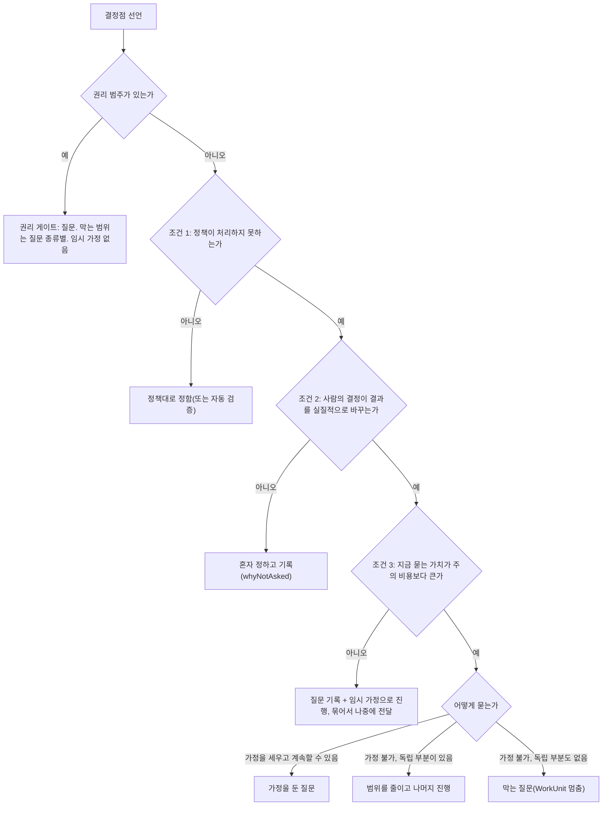

# 6. 묻기와 자율성: 언제 사람을 부르고 언제 혼자 정하는가

## 너무 자주 물어도, 너무 적게 물어도 문제다

에이전트가 일하는 동안 정할 일은 수없이 생깁니다. 변수 이름 같은 작은 결정부터 테스트 도구 교체, 외부 발송까지입니다. 모든 결정을 사람에게 물으면 사람은 질문을 읽지 않고 넘기는 습관이 생기고, 그러면 정작 중요한 질문도 대충 답하게 됩니다. 반대로 묻지 않고 정하면 사람이 원하지 않는 방향으로 일이 흘러가도 알 수 없습니다.

Helm은 결정마다 "사람에게 물어야 하는가"를 규칙으로 판정하고, 묻지 않고 정한 결정은 모두 기록해서 나중에 사람이 이의를 걸 수 있게 합니다. 1번 노드에서 기록과 전달을 나눈다는 원칙과 권리 게이트·정보 게이트의 구분을 짧게 소개했고, 3번 노드에서 정보 질문 Q-A와 권리 질문 Q-B가 실제로 어떻게 처리되는지 보았습니다. 이 노드는 그 처리를 정하는 규칙을 코드와 대조할 수 있는 수준으로 풀어 쓰고, Q-A는 정보 게이트 계산 직후에, Q-B는 전달과 알림 강도 규칙을 본 뒤에 각각 규칙에 다시 통과시킵니다.

## 결정점: 에이전트가 선언하고 코드가 판정한다

판정의 입력은 에이전트가 선언하는 결정점(DecisionPoint)입니다. 에이전트는 결정을 내리거나 질문을 올릴 때 구조화된 값을 붙입니다. 결정 종류, 선택지(각 선택지를 고르면 활성될 합의 범위 포함), 묻지 않으면 따를 기본값, 그리고 판정에 쓰일 선언 값들입니다. 선언 값에는 선택지끼리 결과가 얼마나 다른가, 기본값이 틀릴 가능성, 자동으로 검증할 수 있는가, 가정을 세우고 계속할 수 있는가, 결정과 무관하게 진행할 수 있는 부분이 있는가, 늦게 정하면 드는 비용, 만료 시점이 들어갑니다.

에이전트는 "물어야 한다/아니다"를 직접 정하지 않고 이런 값만 선언하고, 판정은 코드의 규칙과 문턱 다이얼로 합니다. 그래서 같은 선언 값과 같은 다이얼이면 같은 결과가 나오고, 혼자 정한 결정에 이의가 많이 걸리면 문턱 다이얼만 조정하면 됩니다.

결정 종류마다 기본 처리도 데이터 표(결정 종류 레지스트리)로 정해져 있습니다. 표에는 정책이 기본으로 덮는 종류인지(`defaultCovered`)와 사람만 정하는 종류인지(`humanOnly`)가 들어 있습니다. 이름 짓기(`impl.naming`)는 `defaultCovered`가 "예"이고, 구현 방식(`impl.approach`)은 "아니오"입니다. 사실 확인 뒤 방향 선택(`direction.after_fact`)은 `humanOnly`여서 권리 게이트로 다루며, 사람이 명시해서 맡길 때만 예외입니다. `defaultCovered`가 실제 판정에서 어떻게 쓰이는지는 정보 게이트 계산에서 봅니다.

## 게이트 판정

결정점이 들어오면 커널은 그림의 질문을 위에서부터 차례로 확인합니다. 권리 범주가 있으면 바로 권리 게이트로 가고, 없으면 정보 게이트의 세 조건을 차례로 보며 거짓인 첫 조건에서 멈춰 그 조건에 해당하는 갈래를 고릅니다.

**권리 게이트**는 원래 사람이 정할 권리가 있는 결정입니다. 정보 가치가 0이어도 묻습니다. 범주는 두 출처에서 옵니다. 권한 레이어가 행동을 보고 판별하는 다섯 가지(돈을 씀, 사용자를 대신해 말함, 다른 사람에게 영향, 데이터 공개, 되돌릴 수 없는 외부 행동)와, 커널이 명령 종류로 아는 다섯 가지(Goal 변경, 결과 확인, 합의 확정, 정책 변경, 권한 확대)입니다. 다만 정책 변경은 질문을 만들지 않습니다. 관찰 에이전트의 제안을 채택하는 명령이 그대로 사람의 결정입니다.

권리 게이트 질문에는 임시 가정이 없습니다. 답이 없다고 허락으로 보지 않기 때문입니다. 대신 막히는 범위는 질문 종류마다 정해져 있고, 막힌 부분 밖의 일은 계속됩니다. 발송 승인(`send_approval`)은 그 행동(`action`)만 막고, 합의 확정(`agreement_confirm`)은 그 합의의 쓰기(`workunit`)를 막으며 읽기 탐구는 계속됩니다. 결과 확인(`result_review`)과 Goal 수정 확인(`goal_revision`)은 아무것도 막지 않습니다. 시스템이 정한 만료도 없습니다. 대상 자체가 의미를 잃었거나 사람이 정한 마감이 지났을 때만 만료됩니다. 권리 게이트 질문은 질문 수 상한이나 주의 예산 때문에 숨겨지지 않습니다.

권리 범주가 없으면 **정보 게이트**의 세 조건을 봅니다. 세 조건은 AND로 결합됩니다. 각 갈래의 내용은 그림에 있으므로, 여기서는 그림에 없는 계산을 적습니다. 조건마다 문턱 다이얼(`question.threshold.c1`~`c3`)이 있고, 문턱은 적게 묻기, 보통, 많이 묻기 중 하나입니다.

| 조건 | 계산 | 문턱: 적게 / 보통 / 많이 묻기 |
|---|---|---|
| 조건 1: 정책이 처리하지 못함 | `always_ask` 정책이 있으면 참. 없으면 덮임 종류가 문턱이 인정하는 범위 안일 때 거짓, 아니면 참 | 덮임으로 인정하는 종류: 종류 기본값·시스템 정책·사용자 정책 / 시스템 정책·사용자 정책 / 사용자 정책 |
| 조건 2: 결과 차이가 큼 | `outcomeDifference`를 none 0, minor 1, material 2, major 3으로 바꿔 문턱 이상이면 참 | 3 / 2 / 1 |
| 조건 3: 지금 물을 가치가 큼 | `wrongDefaultLikelihood`(low 1, medium 2, high 3)와 결과 차이 숫자의 곱이 문턱 이상이면 참 | 6 / 4 / 2 |

조건 1에서 말하는 정책은 결정 종류 기본값(`defaultCovered`), 시스템 정책, 사용자나 관찰 에이전트가 만든 `autonomy`·`never_ask`·`always_ask` 정책, 자동 검증 정책입니다. 5번 노드의 권한 평가 규칙(P-1~P-12)과 다른 것입니다. 기본 다이얼인 보통에서는 종류 기본값만으로는 덮인 것으로 세지 않습니다. 적게 묻기에서만 `defaultCovered`가 덮임으로 인정됩니다.

조건 2와 3에서 선언 값이 `unknown`이면 2로 세므로 모르면 묻는 쪽으로 기웁니다. 보통 문턱의 조건 2는 결과 차이가 material 이상이어야 참이어서, 예정과 다르기만 한 minor와 차이 없음(none)은 모두 거짓입니다. 따라서 이름 짓기처럼 결과 차이가 none인 결정은, 조건 1이 참이어도 조건 2에서 거짓이 되어 혼자 정하고 이유를 기록합니다.

정보 게이트 판정 결과를 `ask`로 바꾸는 예외가 하나 있습니다. 사람이 이의를 걸어 다시 묻기로 한 결정 지점(되돌리기나 다음부터 묻기를 고른 경우)은 정보 게이트 결과와 관계없이 `ask`가 되어, 다시 혼자 정할 수 없습니다. 권리 게이트는 이 판정보다 앞이므로 영향을 받지 않습니다.

## Q-A를 규칙에 통과시키기

3번 노드의 Q-A는 테스트 도구를 Jest로 둘지 바꿀지 정하는 질문입니다. 3번 노드는 선언 값을 정하지 않았으므로 다음 값을 가정합니다. 결정 종류는 의존성 교체(`impl.dependency`), 선택지끼리 결과 차이는 material, 기본값 "Jest 유지"가 틀릴 가능성은 medium이고, 가정을 세우고 계속할 수 있으며, 다이얼은 모두 보통입니다.

1. 권리 범주가 없으므로 정보 게이트로 갑니다.
2. 조건 1: `impl.dependency`는 `defaultCovered`가 "아니오"이고 적용되는 정책도 없어 덮이지 않으므로 참입니다.
3. 조건 2: material은 2이고 보통 문턱이 2이므로 참입니다.
4. 조건 3: medium 2 곱하기 material 2는 4이고 보통 문턱이 4이므로 참입니다.
5. 세 조건이 모두 참이어서 질문이 됩니다. 가정을 세우고 계속할 수 있으므로 "가정을 둔 질문"이 되고, 막는 범위는 `nothing`이며 임시 가정 "Jest 유지"와 만료점이 함께 기록됩니다.

같은 규칙에 변수 이름 `data`와 `items`를 넣으면 결과가 달라집니다. 결정 종류 `impl.naming`은 보통 문턱에서 덮이지 않아 조건 1이 참이지만, 결과 차이가 none이라 조건 2가 0 대 2로 거짓이 됩니다. 이 결정은 질문 없이 `whyNotAsked`에 정보 게이트 조건 2가 거짓이었다는 이유를 남기고 혼자 정해집니다.

## 질문 레코드와 임시 가정

질문(`qs`)은 게이트와 막는 범위(`blocks`)에 따라 모양이 달라집니다. 막는 범위는 `nothing`, `action`(그 행동만), `workunit`, `concern`입니다. 권리 질문은 막는 범위가 무엇이든 가정 필드가 비어 있고, 막는 정보 질문은 막는 범위가 `nothing`이 아니며, 막지 않는 정보 질문은 `blocks = nothing`이고 임시 가정과 만료점이 반드시 있습니다.

질문 종류는 30가지이고, 종류마다 게이트, 형식, 기본 막는 범위가 정해져 있습니다. 질문의 선택지는 질문마다 자유롭게 만들지 않고 형식에서 정해집니다. 형식은 여섯 가지이고, 형식마다 반드시 있어야 하는 선택지가 있습니다. 예를 들어 일반 답 형식에는 "기준 바꾸기", "먼저 실험", "범위 줄이기", "미루기" 같은 선택지가 늘 들어가고, 승인 형식에는 승인, 고쳐서 승인, 거부, 범위 줄이기, 미루기가 들어갑니다. 형식에서 선택지를 정하므로 모델이 질문마다 선택지를 빼먹을 수 없습니다. 또 "계속할까요?"처럼 실질적인 선택이 없는 질문은 형식이 없어 기록이 거부됩니다.

막지 않는 정보 질문을 기록하는 트랜잭션에서 커널은 임시 가정(`as`)을 함께 만듭니다. 사람의 답이 가정과 같으면 가정은 확정됩니다. 선택을 만드는 답이 가정과 다르면 가정은 무효가 되어 그 가정에 기대어 한 일이 낡음으로 표시되고 재작업 여부가 계산됩니다. "기준 바꾸기", "먼저 실험", "범위 줄이기"처럼 선택을 만들지 않는 답은 가정을 그대로 유지하고, 에이전트가 같은 결정 지점으로 새 질문이나 탐구를 냅니다.

열린 질문(대기 중이거나 전달됨) 가운데 같은 중복 키를 가진 것이 있으면 새로 만들지 않고 기존 질문에 합칩니다. 합치면 막는 범위는 강한 쪽을 따르고 만료점은 이른 쪽을 따릅니다. 게이트가 다르면(기존은 정보, 새것은 권리) 합치지 않고 따로 기록합니다.

**만료점**은 가정이 확정되는 시점입니다. 시각, 어떤 자원에 처음 쓰기 전, 첫 발송 전, 어떤 루프에 들어가기 전, 결과 제출 전, n번째 작업 경계 같은 종류가 있고, "사람이 정할 때까지"(`manual`)는 받지 않습니다. 선언이 없으면 WorkUnit이 끝나는 첫 경계가 기본값이고, 시각형 만료점은 기록 시각에서 최소 30분 뒤여야 하며 더 이르면 기본값으로 바뀝니다. 막는 정보 질문에는 가정이 없으므로 만료점도 없고 답을 기다립니다.

만료점에 가까워져 만료 여유에 들어가면 질문을 한 번 승격합니다. 승격은 질문을 즉시 전달로 다시 올려 알림 강도를 높이는 것입니다. 그래도 답이 없어 만료점에 도달하면 가정을 확정해 "가정 만료"를 이유로 한 혼자 정한 결정으로 남깁니다.

만료점 도달과 사람의 답이 거의 동시에 오면 커널에 커밋된 순서대로 처리됩니다. 답이 먼저 커밋되면 질문은 답을 받은 것으로 닫힙니다. 가정이 먼저 확정되면 뒤늦은 답은 `conflict.already_resolved`로 거부되고, 거부 결과에 확정된 값과 "이의로 보내기"가 다음 행동으로 실립니다. 화면은 사람이 쓰던 답을 이의 초안으로 넘깁니다.

임시 가정을 두고 일하는 동안에는 두 규칙이 안전을 지킵니다.

| 규칙 | 내용 | 실패 코드 |
|---|---|---|
| V-AS-02 | 같은 WorkUnit에 활성 질문 전제가 있으면, 발송이나 권한 레이어가 되돌릴 수 없다고 판정한 행동은 그 질문이 답을 받을 때까지 거부합니다 | `policy.irreversible_under_assumption` |
| V-AS-03 | 활성 질문 전제가 있는 WorkUnit에서 쓰기를 하려면, 전제를 만든 뒤에 등록되었고 대상 자원을 덮는 되돌릴 지점이 있어야 합니다. 대상을 알 수 없는 실행은 작업 공간 전체를 덮는 지점이 필요합니다 | `policy.rollback_point_required` |

두 규칙을 지키면 가정이 틀렸다고 밝혀져도 이미 나간 발송은 없고, 쓰기는 되돌릴 지점으로 복구할 수 있습니다. V-AS-01(권리 게이트 질문에는 가정을 만들지 않음)은 앞서 본 권리 게이트 규칙과 같습니다.

## 전달: 방식과 시점

질문을 기록한 뒤에는 전달 방식을 정합니다. 방식은 네 가지입니다.

- 즉시(`immediate`): 지금 사람 앞에 놓습니다.
- 협상(`negotiated`): 지금 질문함(열린 질문 목록 화면)에 놓고, 언제 볼지는 사람이 정합니다. 기본값입니다.
- 중재(`mediated`): 작업 에이전트와 다른 컨텍스트에서 실행되는 중재 에이전트가 시점을 정합니다.
- 예약(`scheduled`): 작업 경계, 사용자 복귀, 특정 시각, 결과 확인과 같은 때에 놓습니다.

중재 에이전트를 별도 컨텍스트에서 실행하는 이유는, 작업 에이전트가 직접 "지금 물어도 되나"를 판단하면 작업을 계속하는 방향으로 판단이 치우칠 수 있기 때문입니다. 중재 에이전트는 시점만 정하고 끼어들지 여부는 정하지 못합니다. 끼어들기는 아래 표의 D-1~D-3과 D-8에서만 결정되고, 알림 강도도 중재 계획에 들어 있지 않습니다. 중재 에이전트가 정해진 시간(기본 2분) 안에 계획을 내지 못하거나 실패하면 런타임이 협상 방식으로 대신 전달하므로, 중재가 실패해도 질문은 사라지지 않습니다.

작업 경계는 일곱 가지입니다. 탐구 라운드 끝, WorkUnit 끝, 루프 전환, Concern 대기, 사용자 복귀, 검토 창(설정으로 정한 시각에 시작하는 확인 시간대), 하루가 바뀌는 때입니다. Concern 단위 경계(탐구 라운드 끝, WorkUnit 끝, 루프 전환, Concern 대기)는 오케스트레이터가, 전역 경계(사용자 복귀, 검토 창, 하루 전환)는 스케줄러가 `runtime.boundary`로 제출합니다. 예약된 질문은 해당 경계가 기록될 때 전달됩니다.

전달 방식은 아래 표의 규칙을 D-1부터 차례로 대조해 처음 맞는 규칙으로 정해집니다. 순서가 의미를 가지므로, 막는 권리 게이트는 어떤 다이얼에도 걸리지 않고 D-1에서 즉시가 되고, 사람이 부재일 때 정보 질문을 복귀까지 미루는 D-9는 앞선 D-2, D-3이 맞지 않을 때만 적용됩니다.

| ID | 조건 | 방식 | 발화 조건 |
|---|---|---|---|
| D-1 | 권리 게이트, 막음 | 즉시 | 지금 |
| D-1b | 권리 게이트, 막지 않음 | 예약. 결과 확인이고 `notifications.resultReview`가 `immediate`면 즉시 | 그 Concern의 다음 작업 경계 또는 다음 검토 창 중 이른 것 |
| D-2 | 막힘이 있고, 늦게 정하면 드는 비용이 즉시 승격 문턱(`question.immediate_threshold`) 이상 | 즉시 | 지금 |
| D-3 | 만료 여유 안 | 즉시(승격) | 지금 |
| D-4 | 종류별 예외 다이얼이 이 결정 종류의 방식을 지정 | 지정값 | 방식의 기본 |
| D-5 | 정보 게이트 판정 갈래가 digest | 예약 | 사람이 부재면 `user_return`, 아니면 다음 `workunit_end`·`round_end`나 검토 창 중 이른 것 |
| D-6 | 정보 게이트, C·A 루프, WorkUnit의 정상 경로 사람 조작 예산이 남지 않음 | 예약 | 결과 확인과 함께(`with_result_review`) |
| D-7 | 정보 게이트, 막지 않음, 주의 예산 초과 | 예약 | 다음 검토 창, 없으면 `user_return` |
| D-8 | 정보 가치(VoI) 점수가 즉시 문턱 이상이고 시간당 즉시 전달 수가 상한 미만 | 즉시 | 지금 |
| D-9 | 정보 게이트이고 사람이 부재(방해 금지·조용한 시간 포함) | 예약 | `user_return` |
| D-10 | 그 밖 | 루프별·사용자 값을 반영한 `question.default_delivery` 유효값 하나 | 방식의 기본 |

D-10의 루프별 기본값은 다음과 같습니다. 상황 파악(O) 루프는 `user_return` 예약, 탐구(I) 루프는 라운드 끝 예약(막히는 질문은 협상), 합의(C)와 결과 확인(A) 루프는 협상이고, 구조(S) 루프는 루프 전환 예약입니다. D-10으로 협상이 정해졌는데 같은 Concern에서 최근 10분 안에 전달된 정보 질문이 이미 둘 이상이면 다음 경계 예약으로 바꿉니다. 같은 사건으로 전달되는 질문들은 하나의 묶음 ID로 한 번에 전달됩니다.

## 알림 강도는 저장하지 않고 계산한다

알림 강도는 세 가지입니다. `interrupt`는 하던 일을 끊고 알리고, `notice`는 알리되 끊지 않으며, `digest`는 질문함, 배지, 복귀 요약(사람이 돌아왔을 때 열리는 요약 화면)에 묶어서 나중에 보여 줍니다. **알림 강도는 질문 레코드에 저장하지 않고, 전달하는 순간 순수 함수 `urgencyOf`로 계산합니다.** 계산 결과는 전달 기록(`question.delivered`)에 남습니다. 강도를 레코드에 저장하면 사람의 접속 상태가 바뀔 때마다 레코드를 고쳐야 하기 때문입니다.

`urgencyOf`는 아래 표를 위에서부터 보고 처음 맞는 줄의 강도를 돌려줍니다. 방해 금지와 부재의 정의는 다음 두 절에 있습니다. 1행과 2행이 만료 임박 승격보다 앞에 있으므로, 방해 금지 중이거나 자리에 없고 푸시를 받을 곳도 없으면 승격된 질문도 `digest`가 됩니다.

| 순서 | 조건 | 강도 |
|---|---|---|
| 1 | 방해 금지나 조용한 시간 중 | `digest`(권리 게이트도 같음) |
| 2 | 모든 기기가 자리에 없고 푸시를 받을 곳도 없음 | `digest` |
| 3 | 만료 임박 승격이고, 권리 게이트이거나 막는 질문 | `interrupt` |
| 4 | 만료 임박 승격이고, 막지 않는 정보 질문 | `notice` |
| 5 | 즉시 전달이고, 막으면서 권리 게이트이거나 막는 범위가 `workunit`·`concern` | `interrupt` |
| 6 | 즉시 전달인 그 밖의 경우(아무것도 막지 않음, 정보 질문이 `action`만 막음) | `notice` |
| 7 | 협상 전달 | `notice` |
| 8 | 그 밖(예약, 중재로 묶여 놓임) | `digest` |

협상 전달이 기본 방식이므로 기본 경로의 질문은 7행에서 `notice`입니다. 막지 않는 권리 게이트(결과 확인 등)는 D-1b로 예약되어 8행의 `digest`가 되고, `notifications.resultReview`가 `immediate`여서 즉시 전달로 놓일 때만 6행의 `notice`가 됩니다. 정보 질문이 `action`만 막는 경우(예: `semantic_conflict`)는 즉시 전달이어도 5행이 아니라 6행의 `notice`입니다.

3행에는 막지 않는 권리 게이트에 붙는 조건이 하나 더 있습니다. 결과 확인처럼 막지 않는 권리 질문은 원래 다음 작업 경계나 검토 창에 전달되는데, 사람이 정한 마감(`deadline`)이 임박한 경우에만 승격해 `interrupt`로 올립니다. 마감이 지나면 대상 행동은 일어나지 않은 채 질문이 끝나기 때문입니다. 이 승격은 질문당 한 번이고, 시간당 즉시 전달 상한에 세지 않습니다.

## 사람이 자리에 있는가

전달 방식과 강도는 사람이 지금 자리에 있는지에 따라 달라집니다. 기기마다 접속 상태(presence)가 `active`, `idle`, `hidden`, `offline` 네 값 가운데 하나이고, 상태가 바뀔 때만 이벤트가 남습니다. 사람의 부재는 저장하지 않고 계산합니다(`isAway`). 방해 금지 중이면 부재이고, 모든 기기가 부재면 사람이 부재입니다. 기기 하나는 `offline`이면 부재이고, active 보고가 일정 시간(휴대폰 2분, 데스크톱 5분)을 넘기면 idle로 보며, idle이나 hidden이 30분 넘게 이어지면 부재로 봅니다. 모든 기기가 부재여도 푸시를 받을 휴대폰이 있으면 자리에 없다는 이유만으로는 강도를 낮추지 않습니다. 강도가 `digest`로 낮아지는 것은 부재이면서 푸시를 받을 곳도 없을 때입니다.

부재였던 데스크톱이나 TUI가 active가 되면 "사용자 복귀" 경계가 한 번 기록되고, 예약된 질문이 이때 전달됩니다. 휴대폰이 active가 되는 것은 복귀로 치지 않습니다. 그래서 밤에 권리 질문 하나에 답하려고 휴대폰을 열어도 아침용 예약 묶음이 휴대폰으로 쏟아지지 않습니다.

사람이 부재일 때의 처리는 게이트에 따라 다릅니다. 가정을 세울 수 있는 정보 질문은 가정으로 진행하고 복귀 때 전달합니다. 막는 정보 질문은 그 WorkUnit만 멈춥니다. 막는 권리 질문은 즉시 놓이고, 막는 범위는 질문 종류에 따라 그 행동이나 그 합의의 쓰기입니다. 모든 WorkUnit이 막히면 Concern은 "대기" 상태가 됩니다.

## Q-B의 전달과 알림 강도

3번 노드의 Q-B는 작업 브랜치로 push하는 호출입니다. 권한 레이어가 이 호출에 권리 범주를 붙이므로 정보 게이트의 세 조건은 계산하지 않고 권리 게이트로 갑니다. 질문 종류는 `send_approval`이고 그 호출만 막으며 임시 가정이 없습니다. 막는 권리 게이트이므로 전달 규칙 D-1에서 즉시로 정해집니다. 알림 강도는 `urgencyOf` 표에서 나옵니다. 사람이 자리에 없고 푸시를 받을 휴대폰도 없으면 2행에서 `digest`가 되고, 푸시를 받을 휴대폰이 있으면 방해 금지가 아닌 한 5행에서 `interrupt`가 됩니다.

## 휴대폰 알림, 방해 금지, 결과 확인 알림

휴대폰 푸시(2단계 기능)는 전달기가 푸시 계획 함수(`planPush`)를 불러 보낼 기기를 고릅니다. 이 함수는 강도, 접속 상태, 방해 금지, 시간당 상한을 입력으로 봅니다. 휴대폰에는 `interrupt`와 `notice` 강도만 보냅니다. 여기에 조건이 더 붙습니다. 어떤 기기든 `active`이면 보내지 않습니다. `notice`는 데스크톱 기기가 모두 부재이고 휴대폰이 `active`가 아닐 때만 보냅니다. `interrupt`는 다른 기기가 연결만 되어 있고 그 앞에 사람이 없으면 60초 뒤에 보냅니다. 시간당 상한은 사람 기준 하나이고 모든 기기의 합으로 셉니다. 푸시를 보낸 뒤에야 전달 기록(`question.delivered`)이 남으며, 세부 수치는 15번 노드가 다루는 모바일 설계에 있습니다.

방해 금지(`attention.snoozeUntil`)와 조용한 시간(`attention.quietHours`)이 켜져 있으면 `urgencyOf`의 1행에 따라 모든 전달이 `digest`가 됩니다. 질문은 그대로 기록되고, 막힌 상태도 화면에 계속 보입니다. 데스크톱 OS 알림은 방해 금지 중에 띄우지 않습니다.

휴대폰에는 예외 설정 `notifications.dndException`이 하나 있습니다. 값이 `expiringOnly`이면 방해 금지 중에도 만료 임박 승격만 휴대폰으로 보냅니다. 이 예외는 휴대폰 푸시에만 적용되고 데스크톱에는 적용되지 않습니다. 방해 금지가 끝나면 그동안의 알림을 묶음 하나로 보냅니다.

결과 확인 대기 알림은 설정 `notifications.resultReview`로 고릅니다. 기본값 `none`은 휴대폰 푸시 없이 복귀 요약에서 확인하는 것이고, `daily_digest`는 정해진 시각(기본 19:00, 서버 시간대)에 확인 대기 결과가 있으면 묶음 푸시 하나를 보내며, `immediate`는 결과 확인 질문이 생길 때마다 푸시 하나를 보냅니다. `daily_digest`와 `immediate`는 모두 방해 금지와 시간당 상한을 따라서, 방해 금지 중이거나 상한에 걸리면 푸시를 보내지 않고 질문함과 배지에만 남습니다. 데스크톱에서는 결과 확인 대기를 배지로만 표시하고, OS 알림은 `immediate`일 때만 띄웁니다.

## 혼자 정한 결정과 이의

묻지 않고 정한 결정에는 모두 `Autonomy` 블록이 붙습니다. 사람이 정했으면 `HumanDecision`, 에이전트·커널·스케줄러가 정했으면 `AutonomousDecision`이고, 후자에는 **`whyNotAsked`(왜 묻지 않았는가)가 필수**입니다. 이유는 일곱 가지 형식 가운데 하나입니다. 정보 게이트 조건이 거짓이었음, 가정이 만료됨, 맡겨 둔 권한 안이었음, 비상 권한, 자동 검증 가능, 사람이 맡김, 데이터로 정해 둔 규칙(`rule`)에 따름입니다. 마지막 형식에는 루프 계약과 전달 규칙 D-n에 따라 정해진 예약 등이 들어가며, 사람이 직접 만든 정책 규칙과는 다릅니다. 대상은 선택, 루프 계획, 루프 전환, 상황 판정, 구조 변경, 모드 배정의 여섯 레코드와, 다른 레코드 안의 결정 블록 다섯(권한 활성화, 범위 줄이기 등)입니다.

이 기록들은 화면의 "에이전트가 정한 것"에 기본으로 접힌 채 모입니다. 목록을 열면 봤다는 기록이 남지만, 이것은 동의가 아닙니다. 사람은 "봤고 이대로 둔다"를 명시적으로 남길 수도, 이의를 걸 수도 있고, 확인하지 않은 결정에도 이의를 걸 수 있습니다.

이의(`decision.contest` 명령, `objection.filed` 이벤트)는 사람만 겁니다. 이의에는 원하는 효과가 붙습니다. 되돌리고 다시 하기(`reopen`), 다음부터는 묻기(`ask_next_time`), 기록만 남기기(`note_only`)입니다. `note_only`는 기록만 남기고 대상을 이의 상태로 만들지 않으며 아래의 재결정도 만들지 않습니다. 나머지 두 효과에서는 그 결정 지점을 에이전트가 다시 혼자 정할 수 없고, 재결정 질문의 답으로만 다시 정해집니다. 같은 답이 나오면 이의는 기각되고, 다른 답이 나오면 새 사람 결정이 원래 결정을 대체하며 이의는 받아들여집니다. 사람은 질문에 답하지 않고 `objection.dismiss`로 "그대로 둔다"를 고를 수도 있고, 그때 재결정 질문은 철회됩니다. 다음부터 묻기를 고르면 같은 트랜잭션에서 그 결정 종류의 종류별 예외 다이얼에 "항상 묻기"가 기록되며, 확인을 다시 받지 않습니다. 결정이 바뀌어 다시 해야 하는 일은 새 종류의 일을 만들지 않고, 기존 WorkUnit을 가리키는 재작업(`reworkOf`) 표시로 처리하며, 원래 WorkUnit에서는 새 쓰기가 막힙니다.

## 사람 조작 두 번 상한은 어떻게 지켜지는가

1번 노드에서 정상 경로의 결정 조작을 합의 확정 한 번, 결과 확인 한 번으로 제한한다고 했습니다. 커널이 WorkUnit마다 남은 조작 수를 계산해 이 상한을 집행합니다. 남은 조작 수는 2에서 정상 경로 조작 수를 빼고, 결과 확인 전이면 1을 더 뺀 값입니다. 이 값이 0이면 C·A 루프의 정보 게이트 질문은 따로 묻지 않고 결과 확인과 같은 묶음 ID로 예약되어, 사람이 결과 확인 한 번에 함께 답합니다(D-6). 권리 게이트는 묶지 않습니다. 맡겨 둔 권한 범위 안의 합의는 사람 확인 없이 활성화됩니다. 정상 경로 밖의 조작(범위 확대, 권리 게이트, 수정 뒤 재확인, 이의 등)은 상한에 넣지 않고 사유와 함께 셉니다.

## 다이얼은 정도만 바꾼다

질문과 관련된 다이얼은 아홉 개입니다. 세 조건의 문턱, 기본 전달 방식, 즉시 전달 문턱, 만료 여유, 종류별 예외, 루프별 설정, 데몬이 꺼진 동안 만료를 미룰지(`assumptionDeferOnDowntime`)입니다. 다이얼 값을 바꾸면 묻는 빈도와 시점이 달라지지만, 권리 게이트에 가정을 두지 않는 규칙, 필수 선택지, 혼자 정한 결정의 기록은 어떤 값에서도 그대로입니다. 묶음 크기 같은 값은 다이얼이 아닌 설정으로 따로 관리합니다.

## 이 노드의 기준으로 구현을 볼 때

- 에이전트가 "묻는다/안 묻는다"를 직접 정하는 경로 없이, 결정점 선언을 커널이 판정하는가
- 권리 게이트 질문에 임시 가정이 생기는 경로가 있는가. 권리 질문이 주의 예산이나 상한으로 숨겨지는가
- 권리 질문의 막는 범위가 질문 종류별로 맞는가(발송 승인은 `action`, 합의 확정은 `workunit`, 결과 확인은 `nothing`)
- 정보 게이트가 조건 1 → 2 → 3 순서로 AND 판정하고, 거짓인 첫 조건으로 처리가 정해지는가
- 조건 2는 결과 차이 숫자와 문턱(3 / 2 / 1), 조건 3은 틀릴 가능성과 결과 차이의 곱과 문턱(6 / 4 / 2)으로 계산하고 `unknown`을 2로 세는가. 보통 문턱에서 `defaultCovered`만으로 덮임이 되지 않는가
- `reopen`이나 `ask_next_time` 이의가 걸린 결정 지점이 다시 자율로 정해지는 경로가 있는가. `note_only`는 기록만 남기고 이 제한을 만들지 않는가
- 막지 않는 정보 질문 기록과 임시 가정 생성이 한 트랜잭션인가. 만료점 `manual`이 거부되는가
- 임시 가정이 있는 WorkUnit에서 발송과 되돌릴 수 없는 행동이 거부되고(V-AS-02), 쓰기 전에 되돌릴 지점이 있는가(V-AS-03)
- 가정 확정 뒤 온 답이 `conflict.already_resolved`로 거부되고 이의 초안으로 넘어가는가
- 전달 규칙이 D-1, D-1b, D-2 … D-10 순서로 대조되고 처음 맞는 규칙으로 정해지는가
- 알림 강도가 레코드에 저장되지 않고 `urgencyOf`로 계산되어 전달 기록에 남는가. 1행 방해 금지, 2행 부재와 푸시 불가가 승격보다 앞에 있는가. 협상 전달이 `notice`로 계산되는가
- 휴대폰 푸시 조건(`active` 기기 없음, `notice`는 데스크톱 전부 부재와 휴대폰 비활성)이 지켜지는가
- 휴대폰의 active가 사용자 복귀 경계를 만들지 않는가
- `dndException`이 휴대폰에만 적용되고, 방해 금지 중 데스크톱 OS 알림이 없는가
- 결과 확인 대기의 데스크톱 OS 알림이 `immediate`일 때만 뜨는가
- 모든 `AutonomousDecision`에 `whyNotAsked`가 있고, 없으면 거부되는가
- 질문 형식별 필수 선택지가 레지스트리 적재 때 검사되는가
