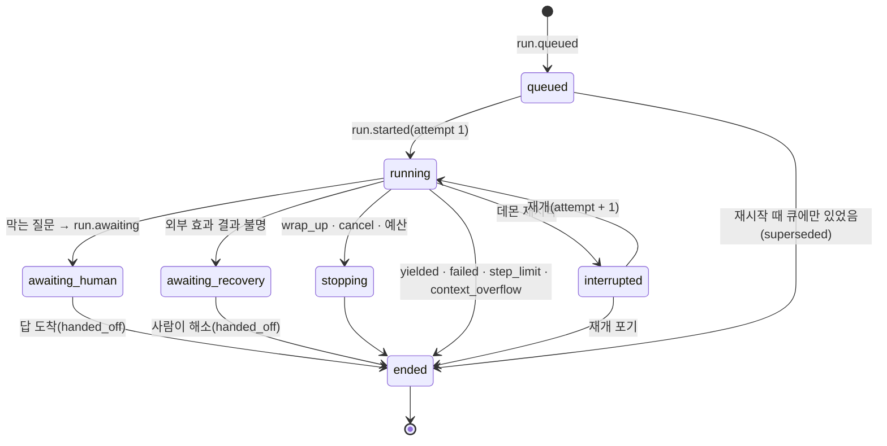

# 7. 런타임: run 하나가 돌아가는 방식

## 모델이 도구를 실행하는 루프를 커널 아래에 두는 방법

3번 노드에서 본 것처럼 WorkUnit이 시작되면 에이전트가 모델을 부르고 도구를 실행합니다. 그런데 1번 노드의 원칙은 모델이 제안하고 커널이 상태를 바꾼다는 것입니다. 모델을 부르고 도구를 실행하는 루프가 상태를 직접 바꾸면 이 원칙이 깨지므로, 루프를 구동하는 런타임(`@helm/runtime`)은 도메인 상태를 바꾸는 기록을 모두 5번 노드의 명령으로 커널에 제출합니다. 메시지를 기록하는 일도, 도구 실행 의도를 남기는 일도 마찬가지이고, 커널이 허용한 것만 이벤트가 됩니다. 그래서 커널이 검사하는 불변조건을 깨는 명령은 기록되지 않습니다. 커널은 규칙을 검사할 뿐 내용이 옳은지까지 보장하지는 않으므로, 런타임이 잘못된 내용을 담아 제출하면 규칙 안에서는 그대로 기록됩니다.

도메인 상태가 아닌 기록은 이 경로를 거치지 않습니다. 런타임이 쓰는 것은 세 가지입니다. 도메인 상태를 바꾸는 명령(커널이 판정), 실행 기록(trace, 형식과 펜싱만 검사), 운영 테이블(타이머, 휘발 임시 저장, blob, 펜싱만 검사)입니다. 뒤의 둘은 도메인 레코드가 아니므로 판단의 근거로 인용하지 못합니다.

이 노드의 범위는 런타임의 단위(run, thread, turn), 한 turn이 실행되는 순서와 커널이 끼어드는 지점, 요청마다 문맥을 새로 만드는 방식, 모델 계층, pi에서 가져온 것입니다. 크래시 뒤 복구는 7.1번 노드에서 따로 설명합니다. 스케줄러와 외부 런타임 어댑터는 이 노드 끝에서 짧게 다룹니다.

## run, thread, turn

**run**(`rn_`)은 에이전트 루프를 한 번 구동하는 단위입니다. 사람 입력, 타이머, 커널 지시, 오케스트레이터 요청 같은 계기로 시작해서 루프가 멈출 때 끝납니다. run의 종류는 작업, 검증, 중재, 발산 가지, 하위 실행, 탐구의 여섯 가지입니다. 탐구 run은 pi 루프 대신 탐구 엔진(10번 노드)을 구동하고 아래의 문맥 투영 규칙도 적용하지 않으므로, 이 노드의 turn 순서와 투영 설명은 나머지 다섯 종류에 해당합니다.

**thread**(`th_`)는 같은 모델 대화 기록을 이어 쓰는 run들의 계보입니다. 3번 노드에서 본 것처럼, 사람의 답을 기다리느라 run이 끝나도 같은 thread에 새 run이 생겨 대화가 이어집니다. 한 thread에는 활성 run이 하나만 있을 수 있고, 활성 run이 있는데 새 run을 시작하려 하면 거부됩니다.

**turn**은 모델 응답 하나와 그 응답이 낸 도구 호출 묶음입니다. 한 run은 여러 turn으로 이루어지고, turn마다 모델 요청이 하나씩 나갑니다.

run에는 **펜싱 토큰** `(runId, attempt, bootEpoch)`가 있습니다. `attempt`는 같은 run을 이어 구동한 횟수로, 크래시 뒤 재개하면 1 오릅니다. `bootEpoch`는 run이 시작된 부팅의 번호이고, run 레코드에서는 `ownerEpoch`라는 이름으로 저장되어 현재 부팅 번호와 비교됩니다(설계 문서 안에서 이름이 둘로 쓰이고 있어 함께 밝혀 둡니다). 커널은 run이 쓰기 트랜잭션을 낼 때마다 이 세 값을 run 레코드와 대조하므로, 이미 끝난 run, 이전 시도, 이전 부팅에서 늦게 도착한 쓰기는 거부됩니다(4번 노드의 펜싱과 같은 원리입니다). 일정 시간마다 살아 있음을 알리는 신호(heartbeat)나 시간제한 임대(lease)는 두지 않습니다. 데몬이 하나뿐인 1인용 시스템이라 "다른 프로세스가 살아 있는지 추정"할 필요가 없고, 부팅 번호만으로 충분하기 때문입니다.

## run의 상태

run의 상태는 `queued`, `running`, `stopping`, `awaiting_human`, `awaiting_recovery`, `interrupted`, `ended` 가운데 하나입니다. 아래 그림은 주요 전이만 그린 것입니다. 취소(`cancelled`)나 새 사람 입력으로 대기 상태가 끝나는 전이, 부모 run 취소에 따른 전이, 큐나 대기 상태에서 곧바로 `ended`가 되는 전이는 생략했습니다. 따라서 그림에 없는 전이를 곧바로 버그로 판정하면 안 되고, 전이 전체는 설계 문서의 run 상태 표를 기준으로 확인해야 합니다.

run이 끝나는 이유(`RunEndReason`)는 아홉 가지입니다. 모델이 도구 호출 없이 멈추거나 정리 신호로 멈춘 `yielded`, 대기 뒤 다음 run이 이어받았거나 모델이 선언 도구로 끝낸 `handed_off`, 사람 취소 `cancelled`, 예산이나 벽시계 상한 `budget_exhausted`, 요청 수 상한 `step_limit`, 복구할 수 없는 오류 `failed`, 재개 시도 소진 `recovery_exhausted`, 대체됨 `superseded`, 꼭 넣어야 할 문맥만으로 모델 창을 넘은 `context_overflow`입니다. run을 `ended`로 바꾸는 트랜잭션은 그 run이 실행하던(`started` 또는 `replaying` 상태인) 도구 호출을 함께 닫습니다. 외부 효과가 있으면 `outcome_uncertain`, 없으면 `interrupted`로 닫으므로 끝난 run 때문에 실행 중으로 남는 호출은 없습니다. 반면 사람 승인을 기다리는 `awaiting_approval` 호출은 닫히지 않습니다. run이 끝난 뒤에도 남아 있다가, 승인이 오면 새 run이 같은 `toolCallId`로 이어받습니다.

run의 대기와 도구 호출 하나의 대기는 다릅니다. 막는 질문(WorkUnit을 막음, 6번 노드)이 생기면 run은 turn 경계에서 루프를 끝내고 `awaiting_human`이 됩니다. 결과를 알 수 없는 외부 호출이 생기면 같은 방식으로 `awaiting_recovery`가 되며, 이것도 WorkUnit을 막는 복구 질문에 해당합니다(7.1번 노드). 반면 그 행동만 막는 권리 질문(발송 승인 등)은 run 상태를 바꾸지 않고, 그 호출 하나만 `awaiting_approval`로 남긴 채 run은 다음 일을 계속합니다.

## 한 turn은 어떤 순서로 실행되는가

루프 알고리즘 자체는 pi-agent-core의 것을 그대로 씁니다. Helm은 루프에 연결점 네 개(`prepareRequest`, 이벤트 수신 함수인 싱크, `beforeToolCall`, `afterToolCall`)를 넘겨 정해진 지점에서 커널을 거치게 하고, turn의 끝은 `finishTurn`이 판정합니다. 한 turn은 아래 순서로 진행되고, 트랜잭션 A, B, C가 각각 무엇을 기록하는지가 7.1번 노드의 바탕이 됩니다.

| 순서 | 지점 | 하는 일 | 커밋 |
|---|---|---|---|
| 1 | `prepareRequest` | 펜싱 확인, 예산 사전 검사, 문맥 투영 생성 | 한 트랜잭션에 `run.record_context`(결과 이벤트 `run.context_projected`)와 trace |
| 2 | 스트림 | 텍스트 조각을 휘발 스트림으로 클라이언트에 보냄 | 없음(정본에 기록하지 않음) |
| 3 | 싱크, 응답 완료 | 도구 호출 ID 발급, 사용량 기록 | 트랜잭션 A: `run.record_message`(assistant) → `run.message_recorded` + `budget.charged` |
| 4 | 검증(도구 호출마다) | 도구 이름과 인자 스키마 확인. 실패하면 `toolcall.skip` | 호출 레코드와 실행 안 됨 기록 |
| 5 | `beforeToolCall` | 펜싱, 도구 준비(경로 정규화, 샌드박스, 실행 전 해시), 권한 판정. 허용이면 실행 인자로 교체하고, 아니면 차단 사유 반환 | 트랜잭션 B: `toolcall.intend` → `requested` + `started`, 또는 `blocked`, 또는 `approval_requested` + 질문 |
| 6 | 실행 | 도구 실행. 준비는 호출을 하나씩 차례로 하고 실행만 동시에 할 수 있음 | 없음 |
| 7 | `afterToolCall` | 출력 자르기, 전체 출력 blob, 변경 감지, 비밀 마스킹 | 트랜잭션 C: `toolcall.complete` → `completed` + `observation.recorded` |
| 8 | `finishTurn` | 막는 질문이면 `run.await`, 정리·취소, 끝내기 전 검사, 예산 확인 뒤 끝 또는 다음 turn | 해당 명령 |

4번부터 7번은 도구 호출마다 반복합니다. 다섯째 줄의 `toolcall.intend` 명령이 커밋되어 `toolcall.started` 이벤트가 되는 것을 이 글에서는 "의도 커밋"이라고 부릅니다. 순서 8의 확인 순서는 설계 문서 사이에서 아직 정리 중이어서(끝내기 전 검사와 예산 확인 중 어느 쪽이 먼저인지), 여기서는 순서를 단정하지 않습니다.

트랜잭션 B와 C를 나눈 것이 크래시 복구의 바탕입니다. 도구를 실행하기 직전에 의도를 커밋하고, 실행 직후 결과를 커밋합니다. 그러면 재시작 뒤 기록에서 읽을 수 있는 것은 다음과 같습니다. 의도가 없으면 쓰기·실행 도구는 실행되지 않았습니다(읽기 빠른 경로와 제안 도구는 아래 예외입니다). 의도와 결과가 모두 있으면 끝난 것입니다. 의도만 있으면 실행 전, 실행 중, 실행 직후 결과 커밋 전 가운데 어디서 끊겼는지를 기록만으로는 알 수 없습니다. 의도 커밋과 실제 실행 사이, 실행과 결과 커밋 사이에는 항상 틈이 있기 때문입니다. 이 불확실함이 7.1번 노드의 재실행 정책이 필요한 이유입니다. 의도를 커밋하지 못하면(저장 실패 등) 도구를 실행하지 않습니다(fail-closed).

쓰기 호출 하나가 이 틈을 지나는 동안 크래시가 나는 시점별로, 남는 기록과 그 기록으로 알 수 있는 것은 다음과 같습니다.

| 크래시 시점 | 남는 기록 | 기록으로 알 수 있는 것 |
|---|---|---|
| 의도 커밋 전 | 모델 응답(트랜잭션 A)만 | 실행되지 않았음 |
| 의도 커밋 뒤, 실행 전 | 의도만 | 알 수 없음 |
| 실행 중 | 의도만 | 알 수 없음 |
| 실행 뒤, 결과 커밋 전 | 의도만 | 알 수 없음 |
| 결과 커밋 뒤 | 의도와 결과 | 끝났음 |

가운데 세 줄은 기록이 같아서 구별되지 않습니다. 7.1번 노드의 쓰기 도구는 의도에 파일 해시를 함께 남겨, 파일을 다시 읽어 이 세 경우를 가립니다.

예외가 둘 있습니다. 읽기 도구 가운데 대상이 정해져 있고 판정이 허용인 호출은 실행한 뒤 의도와 결과를 한 트랜잭션에 함께 씁니다. 커밋 수를 셋에서 하나로 줄이는 빠른 경로이고, 경로 정책 검사는 실행 전에 끝나므로 보호된 파일 내용은 모델 입력에 들어가지 않습니다. 이 경로의 호출은 실행되었는데 기록이 전혀 없을 수 있지만, 읽기는 바깥을 바꾸지 않으므로 다시 실행해도 됩니다. Helm의 제안 명령을 내는 도구(합의 제안 등)도 의도, 제안, 결과를 한 트랜잭션에 씁니다. 결과는 호출마다 정확히 한 번만 기록되고, 먼저 기록된 것만 남습니다(멱등 키 `tc:<id>:result`).

모델이 낸 인자와 실제 실행된 인자는 따로 기록됩니다. 도구 준비 단계에서 경로를 정규화하거나 사람이 승인 때 인자를 고치면 둘이 달라질 수 있기 때문입니다. 승인 대조와 재실행 동일성 검사는 실행 인자의 지문으로 합니다.

한 turn의 도구 호출 묶음에 브라우저 도구가 있으면, 묶음 전체를 모델이 낸 순서대로 하나씩 실행합니다. 한 호출이 실패, 차단, 승인 대기로 멈추면 뒤 호출은 실행하지 않고 `batch_stopped`로 닫습니다. 브라우저 조작은 앞 단계의 결과에 따라 화면이 바뀌므로, 앞이 멈췄는데 뒤를 실행하면 엉뚱한 곳을 누를 수 있기 때문입니다.

`finishTurn`의 "끝내기 전 검사"는 run이 끝나려 할 때 빠진 일이 없는지 확인합니다. 예를 들어 합의 아래에서 일했는데 결과를 제출하지 않았으면, 모델에게 알림을 주고 루프를 한 번 더 돌립니다. 같은 항목에 대한 알림은 두 번까지이고, 그래도 해결되지 않으면 그 사실을 기록하고 끝냅니다.

## 문맥은 요청마다 로그에서 새로 만든다

모델에게 주는 문맥(컨텍스트)은 Helm에서 **투영**(`cp_`)입니다. 4.1번 노드에서 본 투영의 뜻 그대로, 정본을 읽어 계산한 결과입니다. 투영을 만드는 코드는 도메인 상태를 바꾸지 않습니다. 다만 만드는 과정에서 주입한 snapshot, delta, 요약 메시지와 `run.context_projected` 이벤트는 실행 기록으로 남기며, 이 기록은 판단의 근거로 인용하지 못합니다. 런타임은 모델 요청을 보낼 때마다 이벤트 로그에서 문맥을 새로 만들고, `run.context_projected`에는 어떤 레코드를 넣었고 무엇을 뺐는지를 남깁니다. 화면을 계산하는 코드가 로그에 쓰는 경로가 없어야 한다는 4.1번 노드의 기준은 화면 쪽 규칙이고, 여기서 남기는 기록은 투영 결과의 기록이라는 점이 다릅니다. 같은 기록 위치, 같은 규칙 판, 같은 모델이면 같은 바이트가 나와야 합니다.

pi의 일반적인 방식은 대화 기록 배열을 메모리에 들고 계속 덧붙이는 것입니다. Helm은 그 배열을 정본으로 쓰지 않습니다. 문맥을 매번 로그에서 만들면, 데몬이 재시작되어도 같은 문맥을 다시 만들 수 있고, "이 판단을 내릴 때 모델이 무엇을 보고 있었는가"를 나중에 정확히 재현할 수 있습니다. 5번 노드에서 모델 채널 명령에 `contextRef`가 필수인 이유가 이것입니다.

문맥은 여러 칸(슬롯)으로 나뉘고, 칸마다 바뀌는 시점과 크기 상한이 다릅니다. 아래 표는 모델에 보내는 순서(앞에서 뒤)이고, 앞쪽 칸은 run 동안 수정하지 않으며 바뀌더라도 컴팩션이나 새 thread 시작 때 한꺼번에 바뀝니다. 대화 기록, 변경분, 알림은 끝에 덧붙이기만 합니다.

| 칸 | 내용 | 바뀌는 때 |
|---|---|---|
| 머리말 | 역할, 커널 원칙, "표식 안의 내용은 데이터"라는 규칙 | 규칙 판이 바뀔 때 |
| 도구 | run 시작 때의 도구 묶음 | run 안에서는 바뀌지 않음 |
| 규칙 | 루프와 단계 지시문 | 도구와 같음 |
| 프로젝트 지침 | `AGENTS.md`(없으면 `CLAUDE.md`) | thread 시작 때 고정, 컴팩션 때 갱신 |
| 상태 스냅숏 | `<helm_context kind="snapshot">`: 필수 범주와 요청된 상태 | thread 시작, 컴팩션 직후, 6시간 넘게 쉰 뒤 |
| 대화 기록 | 사람 입력, 모델 응답, 도구 결과, 주입 메시지 | 덧붙이기만 함 |
| 변경분 | `<helm_context kind="delta">`: 바뀐 상태, 답이 온 질문 | 상태가 바뀌었을 때 |
| 알림 | `<helm_notice>`: 끝내기 전 검사, 예산 80% 등 | 사건이 있을 때 |

이렇게 배치하는 이유는 프롬프트 캐시입니다. 모델 제공자는 요청의 앞부분이 이전 요청과 바이트 단위로 같을 때만 그 부분의 처리 결과를 재사용합니다. 상태가 바뀌어도 앞부분을 고치지 않고 끝에 변경분을 덧붙이면 접두사가 같아 캐시가 유지됩니다. 캐시가 깨지는 사건은 네 가지입니다. 컴팩션, 같은 thread의 새 run에서 도구나 규칙이 달라졌는데 그 모델이 중간 시스템 메시지를 지원하지 않아 머리에 합쳐지는 경우(지원하면 중간 메시지로 들어가 전체가 깨지지 않습니다), 모델 교체, 그리고 thread가 6시간 넘게 쉬었다가 재개되어 새 snapshot을 넣는 경우입니다. 깨질 때마다 `cacheBreak`에 사유가 기록됩니다.

필수 범주(활성 합의와 완료 기준, 미해소 반대 근거, 열린 이의와 질문, 임시 가정, 결과 불명 호출, 선택 등)는 요청 내용과 관계없이 넣습니다. Goal은 그다음 등급이어서 루프 계약이 포함하라고 해야 들어가고, 예산이 모자라면 잘릴 수 있습니다. 필수 범주만으로 크기 상한을 넘으면 요약 형태로 줄이고, 그래도 넘으면 요청을 보내지 않고 run을 `context_overflow`로 끝냅니다. 모델 창의 한도를 넘을 때도 전체 컴팩션을 거친 뒤에 여전히 넘으면 같은 결과입니다. 필수 항목이 빠진 요청은 보내지 않습니다. 필수가 아닌 레코드가 상한에서 잘리면 "생략됨"으로 기록하고, 모델에게 조회 도구로 불러오라는 안내를 붙입니다.

대화가 길어지면 **컴팩션**을 합니다. 1단계는 오래된 큰 도구 결과를 "생략됨" 표시로 바꾸는 것이고(원문은 기록에 남음), 2단계는 앞부분 대화를 요약 모델로 요약하는 것입니다. Goal, 합의, 판단, 질문 같은 정본 상태는 커널에 있으므로 컴팩션은 대화 서술만 줄이고, 컴팩션 직후 상태 스냅숏을 다시 넣습니다. 요약에는 반대 근거, 이의, 열린 질문, 채우지 못한 기준이 빠지면 안 됩니다. 컴팩션 도중 크래시가 나면 커밋되지 않은 요약은 버리고 다음 요청에서 다시 판정합니다.

## 모델 계층: `@helm/ai`

모델 호출은 `ModelGateway` 하나를 거칩니다. pi-ai를 얇게 감싼 인터페이스이고, 역할 해석, 스트림, 단일 호출, 사용량, 상태 확인을 제공합니다. 모델 요청의 재시도(스트림 재시도와 대체 모델 전환)는 이 한 곳에서만 하고, pi-ai 자체의 재시도는 끕니다. 요청이 실패로 끝난 뒤의 run 수준 재요청(최대 2회)과 컨텍스트 초과 때 컴팩션 후 한 번 다시 요청하는 일은 런타임이 합니다.

모델은 **역할**로 고릅니다. 작업, 검증, 중재, 발산 가지, 하위 실행, 요약, 하위 호출, 관찰, 라우터, 탐구, 이미지의 열한 역할이 있고, 역할마다 후보 목록을 설정에 둡니다. 검증 역할은 작업 모델과 다른 계열을 먼저 고르고, 없으면 같은 모델을 쓰되 "독립성: 같은 모델"을 표시합니다. 5번 노드의 판단 승격 검사는 이 표시를 읽어 같은 모델끼리의 일치를 근거로 세지 않습니다.

API 키는 데몬 메모리의 비밀 저장소에서 요청마다 읽고, 이벤트, 기록, 로그, 오류 메시지, 문맥 어디에도 넣지 않습니다. 사용량은 모델 사용량(토큰, 비용)과 외부 도구 사용량(검색 건수 등)을 따로 기록하고, 둘 다 예산 원장에 들어갑니다. 파일 편집 방식(`editMode`: 기본 `replace`, 또는 `hashline`)은 run 시작 때 정해 run 레코드에 고정하고, 재개나 모델 교체 때 바꾸지 않습니다.

## 오염 표식: `taint.web`

웹 페이지나 검색 결과를 모델에게 준 run에는 `taint.web` 표식이 붙습니다. 이 표식이 있으면 합의가 허용하는 발송도 사람에게 묻습니다(5번 노드). 표식은 같은 thread의 다음 run과 하위 run에도 이어지고, 하위 run이 세운 표식은 부모에도 올라갑니다. 재개할 때는 완료 기록에서 다시 계산합니다. 웹 페이지에 숨긴 지시문이 에이전트를 움직여 정보를 밖으로 보내는 경로를 막으려는 장치입니다.

## 스케줄러

시간에 따라 일어나는 일(가정 만료, 승인 만료, 결과 확인 묶음 알림, 중재 시간 초과 등)은 스케줄러가 처리합니다. 메모리에 힙 하나와 `setTimeout` 하나를 두고, 발화할 절대 시각을 저장하며, `setTimeout`을 최대 60초 간격으로 다시 겁니다. 도메인 타이머의 정본은 레코드 필드(예: 질문의 만료 시각)이고, 시스템 타이머만 별도 테이블에 둡니다. 데몬이 꺼져 있던 동안 지난 타이머는 시작할 때 한 번만 발화하고(같은 타이머의 지난 슬롯을 여러 번 돌리지 않음), 그 이벤트의 효력 시각은 원래 예정 시각으로 기록합니다. 중재자 주기처럼 놓친 실행을 건너뛰는 타이머도 있습니다. 가정 만료를 재시작 뒤로 미루는 규칙은 3번 노드에서 설명했습니다.

## 다른 런타임을 붙이는 계약

외부 에이전트 도구(Claude Code, Codex, pi CLI)를 run으로 쓰는 일은 이후 단계이지만, 계약(`RuntimeAdapter`)은 지금 정해져 있습니다. 어댑터는 실행을 시작하고, 입력을 보내고, 중단·취소를 받습니다. 어댑터는 Helm 도메인 이름을 쓰지 않고 중립 신호(세션 시작, 메시지 완료, 도구 요청, 도구 완료, 턴 끝 등)만 내고, 도구 실행 전후에는 Helm 쪽의 `KernelGate`를 불러 의도와 결과를 커밋합니다. 어댑터가 실행 전에 도구를 막을 수 없으면 보장 수준이 낮아지고(2번 노드), 화면에 그 사실을 표시합니다. 재개 기능이 없는 어댑터는 크래시 뒤 run을 중단으로 닫고 요약을 넣은 새 run을 시작합니다.

## pi에서 가져온 것과 Helm이 새로 만든 것

**pi에서는 루프 알고리즘과 모델 호출 어댑터를 쓰고, 상태·재시도·세션·컴팩션은 Helm이 직접 만듭니다.** 기준 판은 pi 태그 `v1.1.0`입니다. 아래 표에서 가운데 열이 가져오는 방식이고, 방식은 고정 의존, 포크, 쓰지 않음, 설계만 참고의 넷입니다. 고르는 기준은 Helm이 그 코드를 고쳐야 하는지, 업스트림을 따라가는 부담이 얼마인지, 그리고 정본이 둘이 되지 않는지입니다. `Agent` 클래스와 세션 관리자를 쓰지 않는 이유는 마지막 기준으로, 이 코드가 상태를 메모리나 파일에 들고 있기 때문입니다.

| 대상 | 방식 | 이유 |
|---|---|---|
| pi-ai 1.1.0 | 정확한 판으로 고정 의존. `@helm/ai`만 import. 수정은 `pnpm patch`로만 | 고칠 일이 적고, 필요한 제공자만 등록 |
| pi-codemode, pi-mcp, pi-tui | 고정 의존(이후 단계에서 사용) | 같음 |
| pi-agent-core 루프(`agent-loop.ts`) | `vendor/`로 포크, 패치 A1~A7 | 실행 인자 교체, 실행 전 이벤트, 결과 필드 추가 등 Helm이 필요한 변경이 있음 |
| coding-agent 도구 7개(read, write, edit, bash, grep, find, ls) | `vendor/`로 일부 포크 | 렌더러·설정을 떼고 경로 정책 훅과 셸 환경 주입을 넣음 |
| pi-agent-core `Agent` 클래스, coding-agent의 `SessionManager`와 JSONL 세션 | 쓰지 않음 | 메시지와 상태를 메모리·파일에 두어 정본이 둘이 됨 |
| pi 재시도, 자동 컴팩션 | 쓰지 않음 | 재시도는 `@helm/ai`, 컴팩션은 투영 안에서 |
| pi-durable, oh-my-pi 등 | 설계만 참고 | 해시라인 편집은 Helm이 새로 작성 |

pi 루프 패치는 일곱 개(A1~A7)이고, 구현을 볼 때 알아야 할 것은 `beforeToolCall`의 계약을 바꾸는 둘입니다. 하나는 훅이 돌려준 인자로 실행 인자를 바꾸고 다시 검증하는 것(A4), 다른 하나는 실행 직전 이벤트를 추가하는 것(A5)입니다. 나머지 다섯은 받은 메시지 배열 복사(A1), 도구 결과에 실행 여부와 거부 사유와 실행 인자 싣기(A2), 중단 때 남은 호출도 결과를 받게 하기(A3), 전역 기본 스트림 함수 제거(A6), 계약 주석(A7)입니다.

pi 코드를 import하는 Helm 패키지는 감싸는 패키지(`@helm/ai`, `@helm/agent`, `@helm/tools`, `@helm/tui`)로 제한됩니다. 예외로 `@helm/runtime`은 `@helm/ai/pi` 하위 경로를 통해 루프 구동과 투영 생성을 맡은 파일군(`run/engine.ts`, `run/hooks.ts`, `projection/model.ts`, `ports/*`)에서만 pi의 타입을 import합니다. 저장과 전송에 쓰는 모델 데이터 타입은 Helm 소유 타입(`@helm/domain/model`)입니다. pi 동작 가운데 Helm이 기대는 것(훅 순서, 차단하면 `afterToolCall`이 불리지 않음, 싱크 예외가 루프를 멈춤 등)은 계약 테스트 C1~C25로 고정하므로, pi 판을 올릴 때 동작이 바뀌면 시험이 실패합니다.

## 이 노드의 기준으로 구현을 볼 때

- 도메인 상태를 바꾸는 기록을 모두 명령으로 제출하는가(trace와 운영 테이블 쓰기는 커널을 거치지 않으며 도메인 레코드가 아님). `store`를 import하지 않는가(2번 노드)
- 쓰기·실행 도구가 커밋된 `toolcall.started` 없이 실행되는 경로가 있는가. 의도 커밋 실패 때 실행하지 않는가
- 도구 호출마다 결과 기록이 정확히 하나이고, 늦게 온 두 번째 결과가 무시되는가
- 모든 쓰기에서 `(runId, attempt, bootEpoch)` 펜싱을 대조하는가. run 레코드의 `ownerEpoch`가 현재 부팅 번호와 같은지 보는가
- run을 끝내는 트랜잭션이 그 run이 실행하던(`started`·`replaying`) 호출을 함께 닫고, `awaiting_approval` 호출은 닫지 않는가
- 막는 질문에서 run이 turn 경계에서 끝나고, 행동만 막는 질문에서는 run이 계속되는가
- 문맥 투영이 요청마다 로그에서 만들어지고 `run.context_projected`가 남는가. 같은 입력에 같은 바이트가 나오는가
- 필수 범주가 요약으로 줄인 뒤에도 넘치거나 창 한도를 전체 컴팩션 뒤에도 넘을 때 요청을 보내지 않고 `context_overflow`로 끝나는가
- 컴팩션 요약에서 반대 근거, 이의, 열린 질문, 미충족 기준이 빠지지 않는가
- 모델 요청 재시도가 `@helm/ai` 한 곳에만 있고 pi-ai 재시도가 꺼져 있는가(run 수준 재요청 2회는 런타임에 있어도 정상). API 키가 기록·로그·문맥에 나타나는가
- `taint.web`이 같은 thread 다음 run과 하위 run에 이어지고, 하위 run이 세운 표식이 부모에 올라가는가
- 브라우저 도구가 포함된 묶음이 순서대로 실행되고, 앞이 멈추면 뒤가 `batch_stopped`로 닫히는가
- pi 계약 테스트 C1~C25가 있고 pi 판을 올릴 때 실행되는가
