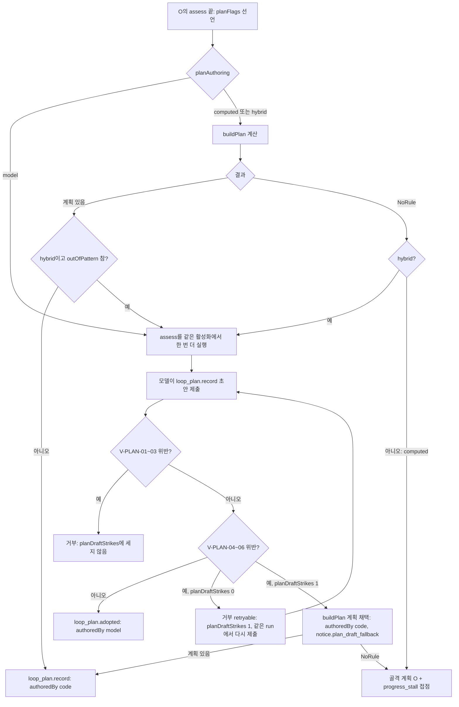

# 9. 루프, 모드, 오케스트레이션

## 무엇을 다음에 할지는 누가 정하는가

1번 노드에서 Concern 안의 일이 O(상황 파악), I(탐구), C(합의와 실행), A(결과 확인과 관찰), S(구조 정리) 다섯 루프의 조합으로 실행된다고 했습니다. 루프는 정해진 순서가 없고, 커널이 강제하는 것은 의존 규칙뿐입니다. 그렇다면 "지금 이 Concern에서 다음에 어떤 루프로 갈지"는 누가, 어떻게 정할까요. 모델이 정하면 같은 입력에도 판단이 달라질 수 있어 재현할 수 없습니다. 코드로만 정하면 처음 보는 유형의 일에서 막힙니다.

Helm은 이 결정을 오케스트레이터(`@helm/kernel/orchestration`의 순수 함수와 런타임의 실행기)가 내리게 하고, 모델은 판단에 필요한 값을 선언만 하게 합니다. 3번 노드에서 따라간 한 작업의 흐름을, 이 노드에서는 오케스트레이터가 어떤 일을 언제 요청하는지의 관점으로 다시 봅니다. 코드를 리뷰할 때 확인할 값 이름과 조건은 각 절에 있고, 마지막 절에 점검 항목으로 모았습니다.

## 루프 식별자와 루프 계약

다섯 루프 계열은 18개 루프 식별자로 나뉩니다.

| 계열 | 식별자 |
|---|---|
| O | `O` |
| I | `I.fact`(사실), `I.want`(원함), `I.possibility`(가능성), `I.outcome`(결과) |
| C | `C.commit`(약속 실행), `C.probe`(탐침), `C.emergency`(비상) |
| A | `A.confirm`(결과 확인), `A.watch`(지속 관찰), `A.reflect`(돌아보기) |
| S | `S.split`, `S.merge`, `S.detach`, `S.relocate`, `S.recombine`, `S.hold`, `S.close` |

식별자마다 **루프 계약**(`LoopContract`)이라는 데이터가 있습니다. 입력과 출력, 들어갈 수 있는 조건, 끝나는 결과별로 다음에 갈 곳, 필요한 원시 행동과 능력, 낼 수 있는 제안 종류, 필요한 합의 종류, 사람 접점, 예산 기본값이 들어 있습니다. 오케스트레이터는 이 데이터를 읽어 동작하므로, 루프의 성격은 계약 데이터를 고치면 바뀝니다.

**Concern당 현재 루프는 하나**입니다. 한 루프 안에서 WorkUnit 여러 개를 동시에 돌릴 수는 있지만(여러 탐침), 서로 다른 루프를 동시에 돌려야 하면 `S.split`으로 Concern을 나눕니다. 화면의 "지금 하는 일"이 하나로 보여야 하기 때문입니다. 발산 가지는 WorkUnit 하나 안의 자식 run이므로 Concern당 동시 WorkUnit 상한에 들어가지 않고 따로 셉니다. Concern이 한 루프에 들어가 나올 때까지의 구간을 루프 활성화라고 부르고, 그 구간의 WorkUnit은 활성화 ID(진입 전환 레코드 ID)를 가집니다.

MVP에서 켜지는 루프는 O, I.fact, I.want, C.commit, A.confirm, A.reflect의 여섯입니다. 나머지는 2단계와 3단계에서 기능 플래그로 켭니다. 꺼진 루프는 계획에 들어가지 않고, A.confirm은 끌 수 없습니다(의존 규칙 2). 꺼진 루프를 가리키는 계획이 어떻게 바뀌는지는 루프 계획 절의 MVP 대체 표에 있습니다.

## 오케스트레이터는 상태를 저장하지 않는다

오케스트레이터의 핵심은 순수 함수 `decide(view, event, ctx)`입니다. 이벤트 하나와 현재 Concern 뷰를 받아 할 일 목록(명령 제출, 작업 요청, 작업 중지, 사람 접점 생성, 타이머 설정·취소, 지표 기록, 복귀 요약 요청)을 돌려주고, 실행기가 이를 실행합니다. **오케스트레이터 전용 저장소는 없습니다.** Concern 뷰(`ConcernView`)는 이벤트 로그를 접어 매번 계산합니다. `ctx.now`도 벽시계가 아니라 트리거 이벤트의 기록 시각입니다. 그래서 재시작 뒤에도 같은 로그에서 같은 판단이 나오고, 가짜 모델 재생 테스트에서 결정적으로 검증할 수 있습니다. 오케스트레이터가 큐나 현재 위치를 따로 저장하는 코드가 있으면 이 성질이 깨지므로 리뷰에서 먼저 찾아볼 대상입니다.

오케스트레이션 관점의 Concern 상태는 `opening`, `working`, `waiting`, `accepted`, `integrated`, `closing`, `closed`, `reopened`입니다. 화면에 보이는 Concern 상태와 이름이 일부 겹치지만 다른 집합이므로 섞어 쓰지 않습니다. `waiting`은 막는 대기가 있고 진행할 다른 WorkUnit이 없는 상태입니다.

한 Concern이 열려서 닫히기까지 오케스트레이터가 내는 일을 이벤트 순서대로 보면 다음과 같습니다. 보관 Concern은 프로젝트마다 하나 있어 가벼운 작업을 담는 Concern이고, run은 모델 호출 한 번의 실행 단위입니다. 각 단계의 세부는 이어지는 절에서 다룹니다.

1. 새 일로 보낸 입력이 오면 보관 Concern에서 진입 판정 run을 요청합니다. "열기"면 `concern.open`, "가벼운 작업"이면 보관 Concern의 WorkUnit으로 시작합니다.
2. `concern.opened`를 받으면 O로 전환합니다.
3. O에 들어가면 판정 WorkUnit을 요청합니다. 모델은 판정 답, 문제 정의, 계획 표시, 요청 형태를 선언하고 run을 넘깁니다.
4. 오케스트레이터가 판정을 계산해 `situation.assess`를 내고, 필요하면 모드를 다시 고르고, 계획을 기록합니다. 초안이 필요하면 같은 활성화에서 판정 작업을 한 번 더 돌립니다.
5. 계획이 채택되면 O를 끝내고 계획의 다음 루프로 전환합니다.
6. I에서는 탐구 엔진(10번 노드)이 라운드를 돌리고, 정지 규칙이 맞으면 다음 단계로 갑니다.
7. C.commit에서는 활성 합의(커널이 확정한 작업 합의)가 없으면 합의 초안 작업을, 확정 뒤에는 실행 작업을 요청합니다. 쓰기 뒤 결과 제출이 없으면 제출을 한 번 요청하고, `result.submitted`를 받으면 A.confirm으로 전환합니다.
8. A.confirm에서는 독립 검증이 켜져 있으면 가능한 한 작업자와 다른 모델로 검증을 돌리고, 결과 확인 뒤 반영 항목마다 반영 작업을 요청합니다. 모두 처리된 뒤의 순서는 돌아보기가 필수인지에 따라 다릅니다. 필수(증명 부담이 `heavy`이거나 C.emergency를 지난 경우)면 돌아보기를 마친 뒤 `concern.close(completed)`를 내고, 선택이면 먼저 `concern.close(completed)`를 낸 다음 `reflect`를 루프 밖 WorkUnit으로 돌려 닫힘이 돌아보기를 기다리지 않게 합니다.

오케스트레이터는 WorkUnit을 직접 시작하지 않고 작업 요청(`WorkRequest`)을 스케줄러 큐에 넣습니다. 요청 ID는 결정적으로 만들어지고(활성화, 목적, 순번, 시도로 구성), 큐 자체도 저장하지 않고 재시작 때 Concern 뷰에서 다시 계산합니다. 하위 run의 대화 흐름 기본값도 정해져 있습니다. 발산 가지와 자극 생성은 같은 시점의 기록을 복사해 시작하여 서로의 결과를 보지 못하게(`fork`), 검증·탐침·반영은 새 대화로(`fresh`), 같은 활성화 안에서 이어지는 WorkUnit은 같은 thread(같은 대화 기록을 이어 쓰는 run 계보, 7번 노드)에서 이어서(`resume`) 시작합니다.

## 상황 판정: 모델은 질문에 답하고 코드가 유형을 계산한다

O 루프의 첫 일은 상황 판정입니다. 상황 유형은 Cynefin의 다섯 가지이고, 일이 진행되면서 바뀔 수 있는 상태입니다. 명확(`clear`)은 해 본 적이 있고 절차가 있는 일, 복잡(`complicated`)은 분석이나 전문가 지식으로 답이 수렴하는 일, 복합(`complex`)은 취향이나 반응에 달려 해 보기 전에는 결과를 모르는 일, 혼돈(`chaotic`)은 당장 피해가 커져 원인을 찾을 시간이 없는 일, 혼란(`disorder`)은 위 유형이 섞여 하나로 정할 수 없는 일입니다.

모델은 유형을 고르지 않습니다. 대신 고정된 판정 질문 아홉 개에 `yes`, `no`, `unknown`으로 답하고, `yes`와 `no`에는 근거 레코드 ID를 하나 이상 붙입니다. 질문은 `q.done_before`(전에 같은 방식으로 여러 번 했는가), `q.procedure_exists`(절차나 스크립트가 있는가), `q.analysis_converges`(분석하면 정답에 가까운 답이 나오는가), `q.expert_knows`(전문가라면 답을 아는가), `q.taste_or_reaction`(정답이 취향이나 반응에 달렸는가), `q.unpredictable`(해 보기 전에는 결과를 예상할 수 없는가), `q.urgent_harm`(지금 당장 무언가를 하지 않으면 피해가 커지는가), `q.no_time_for_cause`(원인을 찾을 시간이 없는가), `q.mixed_parts`(성격이 다른 부분이 섞여 있는가)입니다. 아홉 개 중 `q.procedure_exists`만 모델 답을 쓰지 않고, 코드가 절차 레지스트리를 조회해 채웁니다. 모델이 이미 아는 유형에 맞춰 답하는 경향을 줄이려는 설계입니다.

코드는 아래 표를 위에서부터 보고 처음 맞는 규칙을 씁니다. 표는 테스트 고정값입니다.

| 순서 | 조건 | 유형 |
|---|---|---|
| 1 | `q.urgent_harm`과 `q.no_time_for_cause`가 모두 `yes` | 혼돈 |
| 2 | `q.mixed_parts`가 `yes`이고 부분이 둘 이상이며, 부분마다 이 표를 적용한 결과가 서로 다름 | 혼란 |
| 3 | 최고 점수 유형이 둘 이상 | 혼란 |
| 4 | `unknown`이 5개 이상 | 혼란 |
| 5 | 그 밖 | 최고 점수 유형 |

유형 점수는 해당 질문의 `yes` 수입니다. 명확은 `q.done_before`와 `q.procedure_exists`, 복잡은 `q.analysis_converges`와 `q.expert_knows`, 복합은 `q.taste_or_reaction`과 `q.unpredictable`을 셉니다. 여기에 보정이 둘 있습니다. `q.taste_or_reaction`이 `yes`이면 정답이 취향에 달려 분석으로 답이 나오지 않으므로 복잡 점수에서 1을 뺍니다. `q.procedure_exists`가 `no`이면 명확 점수는 최대 1입니다. 구현이 이 보정을 빠뜨리면 단순한 `yes` 수 계산과 결과가 달라지는 입력이 있으므로 테스트 입력에 포함되어야 합니다.

확신 정도는 최고 점수, 둘째 점수, `unknown` 개수로 정합니다. 높음은 최고 점수 2에 둘째 점수 0이고 `unknown`이 2개 이하일 때입니다. 보통은 최고 2에 둘째 1이거나 최고 1에 둘째 0일 때, 그 밖은 낮음입니다. 낮음이나 보통이면 둘째 유형을 대안(`alternative`)으로 적습니다. 숫자 확률은 화면에 보이지 않습니다. 근거 ID가 없거나 질문이 빠지면 커널이 판정을 거부하고, 오케스트레이터는 같은 활성화에서 한 번 더 묻습니다. 두 번 실패하면 혼란으로 판정합니다.

일하는 도중에 예상 밖 결과, 탐구 불안정, 혼돈 신호, 사람의 요청, 이의 같은 재판정 신호가 생기면 O로 돌아가 다시 판정합니다. 유형이 바뀌면 계획을 새 유형에 맞게 다시 만들고, 모드를 다시 고르고(사용자가 직접 정한 모드는 유지합니다), 유형별 다이얼 기본값을 바꿉니다. 새 유형이 혼돈이면 실행 중인 범위 밖 WorkUnit을 즉시 멈춥니다.

## 루프 계획: 혼합 방식

상황 유형마다 기본 조합이 있습니다.

| 유형 | 기본 조합 |
|---|---|
| 명확 | O → C.commit → A.confirm → (A.reflect) |
| 복잡 | O → I.fact → (I.outcome) → C.commit → A.confirm → (A.reflect) |
| 복합 | O → (I.want 또는 I.possibility) ⇄ C.probe → A.watch → C.commit → A.confirm → (A.reflect) |
| 혼돈 | C.emergency → O(재판정) → 새 유형의 조합 → A.reflect(필수) |
| 혼란 | O → S.split → 하위마다 각자 조합 → S.recombine → A.confirm → (A.reflect) |

괄호는 선택 단계입니다. 이 표는 전체 기능을 켠 경우의 출발점이고, MVP에서는 켜진 루프만 남도록 다음처럼 바뀝니다.

| 꺼진 것 | MVP에서의 대체 |
|---|---|
| I.possibility, I.outcome | 복잡은 `O → I.fact → C.commit → A.confirm`. `deliberate` 모드는 쓰지 않고 `investigate`로 라우팅합니다 |
| C.probe, A.watch | 복합은 `O → I.want → C.commit → A.confirm → (A.reflect)`. 탐침 대신 원함 탐구의 자극으로 시도합니다 |
| S 계열 | 판정이 혼란이면 정보 게이트 질문을 만들어 사람이 부분 목록을 고치게 하고, 답이 오기 전까지는 대안 유형(`alternative`)으로 계획합니다 |
| C.emergency | 판정이 혼돈이면 `emergency_authorization` 즉시 질문을 열어 사람이 직접 조치하거나 C.commit의 범위를 허락하게 합니다 |

따라서 MVP 코드에서 혼돈과 혼란 행의 조합을 그대로 찾으면 안 됩니다. 이 두 유형은 계획이 아니라 질문으로 처리됩니다.

기본 조합은 출발점이고, 실제 계획은 모델이 선언하는 **계획 표시**(`PlanFlags`)로 다듬어집니다. 표시는 일곱 개입니다. 정답이 취향이나 가치 판단에 달렸는가(`wantDependent`), 알려진 해법이 부족한가(`needsPossibilities`), 부작용과 파급이 큰가(`consequentialSideEffects`), 작업 대상을 바꿔야 끝나는가(`needsWrite`), 이미 있는 결과를 확인만 하는가(`reviewOnly`), 산출물이 곧 결과인가(`artifactIsResult`), 그리고 위 여섯으로 나타낼 수 없는가(`outOfPattern`)입니다. 참인 표시에는 근거 ID가 있어야 합니다.

**코드가 계획을 계산하는 함수 `buildPlan`**은 기본 조합에서 시작해 표시로 다듬고, 절차를 적용하고, 돌아보기를 필수로 할지 정하고, 꺼진 루프를 빼고, 사람의 직접 지정을 반영한 뒤, 마지막으로 의존 규칙에 맞춥니다. C 뒤에는 반드시 A.confirm을 넣고, split 뒤에는 recombine과 A.confirm을 넣습니다. 결과가 이전 계획과 같으면 새 판본을 만들지 않습니다. 표시끼리 모순되면(확인만 하는데 작업 대상을 바꿔야 한다는 식) 규칙을 적용할 수 없다는 결과(NoRule)를 냅니다.

### UC-01 사례로 따라가기

"블로그 글 방향을 잡고 싶다"는 요청이 들어온 경우를 판정에서 계획까지 따라갑니다. 요청은 "새 일"로 들어왔으므로 진입 판정을 거치고, 목표가 흐리고 취향에 달렸다는 근거 있는 신호가 둘 이상이라 Concern이 열려 O에 들어갑니다. 판정 작업에서 모델은 `q.taste_or_reaction`과 `q.unpredictable`에 `yes`를 근거와 함께 답하고, 이 예에서는 `q.expert_knows`도 `yes`, 나머지는 `no`로 가정합니다. `q.procedure_exists`는 모델 답과 무관하게 코드가 절차 레지스트리를 조회해 `no`로 채웁니다.

점수는 명확 0, 복잡 1이지만 `q.taste_or_reaction`이 `yes`라 1을 빼서 0, 복합 2입니다. 표의 1~4순서 조건에 해당하지 않으므로 5순서가 적용되어 복합이고, 둘째 점수가 0이며 `unknown`이 없으므로 확신은 높음입니다. 계획 표시는 `wantDependent`만 참입니다. `planAuthoring`은 기본 `hybrid`이고 `outOfPattern`이 거짓이므로 `buildPlan`이 계산하며, 모델 초안은 요청하지 않습니다. 복합의 기본 조합에서 MVP에 꺼진 C.probe와 A.watch를 빼면 계획은 `O → I.want → C.commit → A.confirm → (A.reflect)`입니다. 이 레코드는 `authoredBy: code`, `decidedBy: kernel`로 기록되고, 모드는 취향 탐색(`taste`)으로 라우팅됩니다. 증명 부담이 `heavy`가 아니고 C.emergency도 지나지 않으므로 돌아보기는 선택입니다. 이 뒤 O가 끝나면 계획의 다음 단계인 I.want로 전환됩니다.

### 계획 작성 경로

상황이 일곱 표시와 계산 규칙의 범위를 벗어나면 모델이 계획 전체를 초안으로 쓸 수 있습니다. 모델 설계가 이 경로로 혼합 방식에 들어옵니다. 방식은 다이얼 `planAuthoring`으로 고르고, MVP 설정 화면에서 바꿀 수 있습니다. `computed`는 코드만 계획을 계산하고 모델이 초안을 내면 거부합니다. `hybrid`(기본)는 `outOfPattern`이 참이거나 `buildPlan`이 NoRule을 낼 때만 모델에게 초안을 요청합니다. `model`은 언제나 초안을 요청합니다.

모델이 쓴 초안도 그대로 쓰지 않습니다. 커널이 계획 검사 V-PLAN-01~07을 적용합니다. 형식(01), 방식(02, `computed`에서 초안이 오면 거부), 불필요(03, `hybrid`인데 코드가 규칙으로 정할 수 있는 상황이면 거부)를 먼저 보고, 이어서 쓰기 전 합의가 있는지(04, 의존 규칙 1), 결과 뒤 결과 확인과 분할 뒤 재조합이 있는지(05, 의존 규칙 2·4), 계획의 모든 루프가 기능 플래그로 켜져 있는지(06, 앞 절의 MVP에서 켜지는 루프와 같은 기준)를 봅니다. 07은 두 번째 위반의 처리입니다. 04~06의 검사 함수 `validatePlan`은 모델 계획뿐 아니라 코드와 사람이 만든 계획에도 똑같이 적용되고, 사람 계획과 코드 계획의 04~06 위반은 그 자리에서 거부하며 횟수 규칙을 타지 않습니다.

**두 번째 위반 규칙**이 이 혼합 방식의 안전장치입니다. 01~03 위반은 거부만 하고 위반 횟수(`planDraftStrikes`)에 세지 않습니다. 04~06 위반은 세는데, 같은 Concern에서 첫 위반은 거부하고 같은 run에서 다시 내게 하며, 두 번째 위반부터는 거부하지 않고 `buildPlan`이 계산한 계획을 채택합니다. 이때 "모델 초안 대신 코드 계획을 썼다"는 알림(`notice.plan_draft_fallback`)을 남깁니다. 코드가 계획을 정할 수도 없는 경우(`computed`인데 NoRule, 또는 초안 두 번 위반 뒤 NoRule)에는 O만 있는 골격 계획을 쓰고 사람에게 "계획 표시가 서로 맞지 않습니다"라는 접점을 엽니다.

흐름도의 첫 분기에서 `planAuthoring` 세 값이 구분됩니다. `computed`와 `hybrid`는 `buildPlan`을 먼저 계산하고, `model`은 곧장 초안을 요청합니다. 모델 초안 경로에서만 `validatePlan`과 위반 횟수가 쓰이며, 코드 계산 경로는 초안 없이 기록으로 끝납니다.

계획 레코드에는 본문을 쓴 쪽(`authoredBy`: `code`, `model`, `human`)과 채택한 쪽(`decidedBy`)이 따로 남습니다. 작성자는 제출 채널로 정해지고 모델이 `authoredBy`를 지정하는 경로가 없습니다. 계획은 권고입니다. 계획에 없던 전환도 허용되고, 그때 계획은 새 판본으로 다시 기록됩니다. 계획을 만든 것과 고친 것은 모두 혼자 정한 결정이어서 이의를 걸 수 있습니다. 현재 계획의 어느 단계에 있는지는 저장하지 않고, 마지막 루프 전환과 계획 단계에서 계산합니다.

## 루프 전환

루프를 옮기는 것은 `loop.transition` 명령이고, 결과는 `loop.transitioned` 이벤트와 전환 레코드(`lt_`)입니다. 전환을 판단하는 주체는 셋이고, 전환 레코드의 `decidedBy`에 값이 남습니다. 코드가 이벤트를 보고 규칙으로 계산하는 경우는 `decidedBy: kernel`, 모델이 선언 도구로 전환을 요청하고 코드가 가드를 검사하는 경우는 `agent:<역할>`, 사람이 명령하는 경우는 `human`입니다. 모델은 전환 명령을 직접 낼 수 없고, `transition_request` 선언만 낼 수 있습니다.

전환 규칙은 T01~T33 중 T06, T19, T29를 뺀 규칙과 EXIT, OPEN, REDIRECT로 이루어진 데이터(`TRANSITION_RULES`)입니다. T06과 T19는 루프를 바꾸지 않는 일이어서 번호만 비워 두었습니다. 같은 이벤트 묶음에서 여러 규칙이 맞으면 아래 순서의 앞선 것 하나만 적용하고, 나머지는 다음 이벤트에서 다시 평가합니다.

1. 사람 지시, 결과 확인 답, 이의
2. 혼돈 신호
3. 커널 거부에 대한 처리
4. 유형 변경, 예상 밖 결과
5. 판단 이의, 놀라운 관찰
6. 구조(분할, 병합, 재조합)
7. 그 밖의 규칙
8. 루프 계약의 종료 결과(`EXIT`)
9. 계획의 다음 단계

같은 규칙이 계속 맞아 루프가 제자리를 돌거나 중복 전환이 생기지 않도록 가드 아홉 개가 있습니다. 같은 계기와 같은 규칙은 한 번만 적용하므로(멱등 키 `${계기 이벤트}:${규칙}`) 재시작 뒤 같은 이벤트를 다시 처리해도 전환이 두 번 생기지 않습니다. 진전 없는 순환이 세 번이면 사람에게 "진행이 멈췄다"는 접점을 열고, 자동 재판정은 새 근거가 있을 때만 24시간에 두 번까지 허용하여 재판정이 폭주하지 않게 합니다. 수정 요청이 세 번 반복되면 직전 탐구 제안을 선택지에 넣습니다. 그 밖에 예산, C/A 조작 상한, 제자리 전환, 구조 상한, 막힌 행동 대기 가드가 있습니다. 사람 지시와 이의는 진전 없는 순환, 재판정 간격, 수정 요청 반복, 제자리 전환 가드를 받지 않고, 의존 규칙과 멱등, 예산, 구조 상한 가드는 받습니다.

의존 규칙에 대해서는 역할이 나뉩니다. 거부는 커널이 하고, 오케스트레이터는 커널이 거부하지 않도록 미리 맞춥니다. 5번 노드의 규칙에 맞춰 보면 다음과 같습니다. 활성 합의가 없는데 쓰기가 필요하면 합의 초안 작업을 먼저 돌리고(규칙 1), 결과 확인 전에는 Concern 닫기를 보내지 않으며(규칙 2), 판단 올리기 요청은 사실·결과 탐구 계약에만 열고(규칙 3), 하위 Concern이 모두 끝나면 recombine을 자동으로 켜고(규칙 4), Goal 수정은 언제나 사람 질문이 되게 합니다(규칙 5).

## 모드는 설정 묶음이다

모드는 루프 계획 기본값, 능력 부분집합, 다이얼 값을 묶은 설정입니다. 복귀 안내(`orient`), 원인 조사(`investigate`), 선택 검토(`deliberate`), 취향 탐색(`taste`), 실행(`execute`), 검증(`verify`), 구조 정리(`restructure`), 비상(`emergency`)의 여덟이 있고, MVP에서는 orient, investigate, taste, execute가 켜집니다. 모드는 Concern에 붙고 WorkUnit이 물려받습니다.

모드 선택(라우팅)에는 별도 모델 호출이 없습니다. O 판정에서 이미 선언된 값(상황 유형, 계획 표시, 요청 형태)을 결정표로 계산하고, 사람이 지정한 모드가 있으면 그것이 첫 행으로 우선합니다. 라우팅은 첫 O가 끝날 때, 상황 유형이 바뀔 때, 지정을 해제할 때 다시 합니다.

WorkUnit이 실제로 쓸 수 있는 원시 행동은 교집합으로 정해집니다. 루프 계약의 원시 행동, 모드의 원시 행동, WorkUnit 템플릿의 원시 행동, 행위자 역할의 능력을 모두 교차한 것이고, 실행 시점에는 합의 범위와 권한 레이어가 호출마다 더 좁힙니다. 하위 run은 부모 WorkUnit의 범위를 넘지 못합니다. 루프에 들어갈 때 그 루프에 필요한 원시 행동이 현재 모드에 없으면 루프의 집 모드로 바꾸고, 사용자가 정한 모드면 유지한 채 사람에게 알립니다.

## 다이얼은 층으로 쌓인다

다이얼은 16항목(키 18개)입니다. 질문 쪽에 질문 문턱, 기본 전달 방식, 즉시 전달 문턱, 만료 여유, 종류별 예외, 루프별 설정이 있고, 탐구 쪽에 관점 폭, 탐구 깊이, 근거 범위, 자극 수가 있습니다. 실행 쪽에는 자율 정도, 예산, 증명 부담, 독립 검증이 있고, 나머지는 계획 작성 방식과 데몬 정지 중 가정 만료 미루기입니다. 저장 키 목록은 여기에 구조 상한 두 키를 더한 20개입니다. MVP 설정 화면에는 기본 전달 방식, 질문 빈도, 예산, 자극 수, 탐구 깊이, 계획 작성 방식의 여섯이 나오고, 나머지는 기본값으로 동작합니다.

다이얼 값은 여섯 층을 1층부터 6층까지 차례로 적용해 결정하고, 번호가 큰 층이 작은 층의 값을 덮어씁니다. 시스템 기본값(1), 상황 유형 기본값(2), 모드 값(3), 사용자 저장 설정(4), 이 Concern에서 사용자가 바꾼 값(5), 이번 지시에 붙은 값(6)이므로 6층이 가장 강하고 1층이 가장 약합니다. 해석 함수 `resolveDials`는 2층에서 6층까지 순회하며 값이 정의된 층의 값으로 바꾸는 구조여야 합니다. 저장되는 것은 4~6층뿐이고 1~3층은 코드에서 계산합니다. `planAuthoring`은 1, 4, 5층에서만 정합니다.

예를 들어 명확한 일이면 2층에서 질문 문턱이 모두 "적게", 탐구 깊이 1, 증명 부담 "가볍게"가 됩니다. 사용자가 4층에 질문을 "많이"로 저장해 두었으면 4층이 2층을 덮어 "많이"가 됩니다. 이 Concern의 다이얼 패널에서 5층에 "적게"로 바꾸면 5층이 4층을 덮고, 지시에 "이번에는 많이"를 붙이면 그 WorkUnit에서는 6층이 이깁니다. 순회 방향이 거꾸로이면 이 세 경우가 모두 틀리므로 리뷰의 핵심 점검점입니다.

다이얼을 바꾸면 적용 시점이 항목마다 다릅니다. 질문 다이얼은 즉시, 탐구 다이얼은 다음 라운드 경계, 예산은 다음 턴 경계, 계획과 WorkUnit 구성은 다음 루프 활성화부터 적용됩니다. 어떤 층의 어떤 값도 불변조건을 바꾸지 못하고, 해석기는 권리 게이트에 "묻지 않음"을 거는 값을 거부합니다. 증명 부담은 다음 중 하나가 있으면 해석 마지막에 자동으로 "엄격"으로 올라갑니다. 합의 범위에 사람 허락이 필요하거나 복구가 어려운 행동이 있을 때, 계획 표시 `consequentialSideEffects`가 참이고 다른 열린 Concern·결정과 얽힐 때, 깊이를 정하는 입력 후보 중 모델이 근거와 함께 "높음"으로 선언한 것이 둘 이상일 때입니다. 올린 값은 저장하지 않습니다. 내리는 것은 사람만 할 수 있고, 그것도 5층(이 Concern)이나 6층(이번 지시)에서 정할 때입니다. 요구보다 낮게 정하면 "요구보다 낮게 설정됨" 표시가 남습니다. 4층의 저장 설정은 특정 Concern의 위험을 알고 정한 값이 아니므로 자동 상향 값이 대신하며, 이는 거부가 아닙니다.

## 여러 Concern 사이의 일정과 주의 예산

여러 Concern이 동시에 열려 있을 때 무엇을 먼저 실행할지는 거시 스케줄러가 정합니다. 역할은 나뉩니다. 오케스트레이터 쪽 스케줄러는 논리 배분(우선순위, 주의 예산, 동시 활성 Concern 수, 어떤 작업 요청을 언제 허가할지)을, 런타임은 물리 상한(전역 run 수, 제공자 동시 요청, 도구 프로세스 수)과 타이머를 처리합니다.

우선순위는 다음 아홉 항목을 앞에서부터 사전식으로 비교합니다. 앞 항목이 같을 때만 다음 항목을 봅니다.

1. 사용자가 고정함
2. 혼돈 유형
3. 사람이 답한 권리 게이트를 처리해야 함
4. 이 Concern을 기다리는 다른 것의 수
5. 가장 가까운 만료
6. C/A 루프
7. 이미 진행 중
8. 최근에 사람이 봄
9. 오래됨

허가 함수 `admit`은 이 순서대로 후보를 순회하며 동시 실행 상한, 자리 비움 중 비용 상한, 주의 예산을 확인합니다. 동시 실행 상한의 기본값은 전역 WorkUnit 2, Concern당 3, 활성 Concern 3이고 설정으로 바꿀 수 있습니다. 서버 조건과 모델 API 한도를 고려한 보수적 시작값이므로 코드에 상수로 고정되어 있으면 안 됩니다. 데몬이 정상 모드가 아니면(안전 모드 등) 아무것도 허가하지 않습니다.

**주의 예산**은 사람의 주의를 비용으로 세는 장치입니다. 질문이 사람에게 전달될 때 종류별 비용을 셉니다.

| 접점 | 비용 |
|---|---|
| 발송 승인, 비상 허락 | 2 |
| 합의 확정, 결과 확인, 그 밖의 정보 질문 | 1 |
| 자극 반응 라운드 | 3 |
| 같은 전달에 묶인 둘째 질문부터 | 0.5 |
| 복귀 요약 열람, "에이전트가 정한 것" 열람 | 0 |

한도의 시작값은 하루 20, 시간당 즉시 전달 2입니다. 하루 예산을 넘으면 막지 않는 정보 질문을 다음 검토 창으로 미루도록 묻기 쪽(6번 노드)에 권고하고, 시간당 즉시 전달을 넘으면 다음 즉시 질문을 협상 전달로 낮추도록 권고합니다. 최종 결정은 6번 노드의 전달 규칙이 합니다. 권리 게이트는 예산과 관계없이 전달됩니다.

## 작업 경계

작업 경계는 예약된 질문이 전달되고 다이얼 변경이 반영되는 지점입니다. 종류와 전달 규칙은 6번 노드에서 다뤘으므로 여기서는 이 노드에 해당하는 내용만 적습니다. 경계는 `runtime.boundary` 명령으로 제출되고 `boundary.reached` 이벤트가 되며, 제출하는 곳은 오케스트레이션 하나입니다. 런타임과 탐구 엔진은 경계를 내지 않습니다. 같은 경계가 두 번 나거나 빠지는 것을 막으려는 설계이고, 멱등 키는 `boundary:${종류}:${계기 이벤트}`입니다.

## 모든 일이 Concern이 되지는 않는다

1번 노드에서 본 진입 판정과 가벼운 작업도 오케스트레이션의 일입니다. 새 일로 보낸 입력에 Concern 지정이 없으면 보관 Concern에서 진입 판정 run이 실행되고, 근거가 있는 진입 신호가 두 개 이상이면 Concern을 엽니다(문턱 2는 다이얼이 아닌 고정값). 해 보는 비용이 탐구 비용보다 작으면 진입하지 않지만, 정답이 취향에 달린 경우(EC-3)에는 이 제외 조건을 적용하지 않습니다. 사람이 Concern을 직접 열면 판정 없이 열립니다.

작업 중에는 Concern 열기 제안 신호(같은 확인이 세 번 실패, 서로 다른 해법 둘 이상 등)가 나오면 "Concern으로 열까요?" 질문을 만듭니다. 반대로 Concern이 단순하다고 판명되면 두 갈래로 내립니다. 상황이 명확이고 확신이 높으며 계획 표시가 모두 거짓이고 진입 신호가 문턱을 겨우 넘었고 사람이 직접 연 것이 아니면, Concern을 `S.close`로 닫고 같은 요청을 가벼운 작업으로 이어 가며 구조 변경 `structure.changed`로 기록합니다. 조건 일부만 맞거나 사람이 직접 연 Concern이면 Concern을 유지한 채 증명 부담을 "가볍게"로 두고 O와 합의 초안 작업을 한 WorkUnit으로 합치는 가벼운 계획으로 갑니다. 이 경우는 구조 변경이 아닙니다. 진입 판정과 강등은 모두 혼자 정한 결정으로 기록됩니다.

## 이 노드의 기준으로 구현을 볼 때

- 오케스트레이터 `decide`가 순수 함수이고, 오케스트레이터 전용 저장소 없이 이벤트 로그에서 Concern 뷰를 계산하는지, `ctx.now`가 이벤트 기록 시각인지 확인합니다.
- 상황 판정에서 모델이 유형을 직접 고르는 경로 없이 질문 답과 결정표로 계산하는지 확인합니다. `yes`·`no`에 근거 ID가 필수인지, `q.procedure_exists`를 코드가 채우는지, 점수 보정 두 가지가 구현되어 있는지도 봅니다.
- MVP에서 꺼진 루프를 가리키는 계획이 대체 표대로 바뀌는지, 혼돈·혼란이 질문으로 처리되는지 확인합니다.
- `buildPlan`이 의존 규칙 2·4에 맞춰 A.confirm과 recombine을 자동으로 넣는지 확인합니다.
- `planAuthoring` 세 값의 동작이 정의대로이고, V-PLAN-01~07이 모델·코드·사람 계획 모두에 적용되는지 확인합니다. 01~03 위반이 횟수에 세어지지 않는지도 봅니다.
- 두 번째 위반에서 거부 대신 코드 계획이 `authoredBy: code`, `decidedBy: kernel`로 채택되고 알림이 남는지 확인합니다.
- `authoredBy`가 제출 채널로 정해지는지(모델이 바꿀 수 없는지) 확인합니다.
- 모델이 `loop.transition`을 직접 낼 수 없고 선언만 할 수 있는지, 전환의 `decidedBy`가 `kernel`, `agent:<역할>`, `human` 중 하나인지 확인합니다.
- 전환 가드(멱등, 진전 없는 순환, 재판정 횟수)가 구현되어 있는지 확인합니다.
- Concern당 현재 루프가 하나인지, A.confirm을 끌 수 없는지 확인합니다.
- WorkUnit의 유효 원시 행동이 네 집합의 교집합으로 계산되고, 하위 run이 부모를 넘지 못하는지 확인합니다.
- 다이얼 해석에서 번호가 큰 층이 작은 층을 덮는지, 권리 게이트에 "묻지 않음"을 거는 값이 거부되는지 확인합니다.
- 거시 스케줄러가 안전 모드에서 아무것도 허가하지 않는지, 권리 게이트가 주의 예산으로 미뤄지지 않는지, 동시 실행 상한이 설정에서 읽히는지 확인합니다.
- 작업 경계를 오케스트레이션 한 곳에서만 제출하는지 확인합니다.
