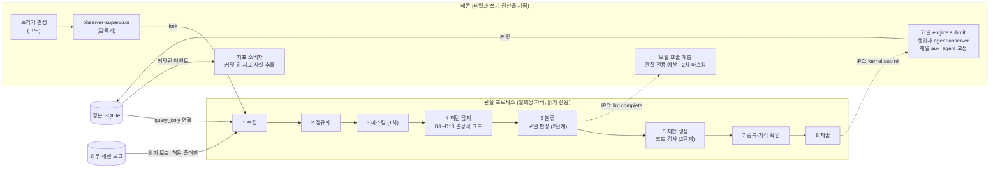

# 11. 관찰 에이전트와 지표

## 일을 하는 에이전트와 일하는 방식을 보는 에이전트

지금까지의 노드는 일을 하는 에이전트(작업 에이전트)를 다뤘습니다. 이 노드의 관찰 에이전트는 다른 역할입니다. 관찰 에이전트는 Helm의 기록과, 사용자가 허용한 폴더의 다른 에이전트 세션 로그(pi, Claude Code, Codex)를 읽어 반복되는 패턴을 찾고, "이 절차를 스크립트로 만들면 어떨까", "이 종류 질문은 묻지 말고 정하게 하면 어떨까" 같은 수정안을 제안합니다(결정 35). 일하는 에이전트는 자기 세션 안에서 같은 절차를 반복해도 여러 세션에 걸친 반복을 모아 볼 수 없고, 사람도 그런 마찰을 직접 알아채기 어렵습니다. 관찰 에이전트는 그 틈을 메웁니다. 경계가 설계에서 분명하게 정해져 있어 구현 리뷰 때 확인할 점이 많습니다.

이 노드에서 "작업"은 일하는 쪽(작업 에이전트, 작업 합의)을 가리킵니다. 관찰 쪽에서 `scan`, `analyze` 같은 job은 "실행 종류"라고 부릅니다.

지표는 이 노드의 다른 절반입니다. Helm이 1번 노드의 성공 기준(하루 비운 뒤 5분 안에 목표·위험·다음 판단을 복원하는가, 질문이 결과를 바꾸는가, 정상 경로 조작이 세 번 이상인 경우가 없는가 등)을 실제로 만족하는지 보는 결정적 계산이고, 장기 관찰·제어 공간(결정 10)의 재료입니다. 두 절반이 한 노드에 있는 이유는 연결되어 있기 때문입니다. 지표 사실을 뽑는 함수는 관찰 패키지(`@helm/observer/metrics`)에 있고, 관찰 에이전트는 외부 세션에서만 얻을 수 있는 값(Helm 밖 변경 집계, 채팅 기준선)을 `observer_report`로 제출하며, 지표 소비자가 그것을 지표 사실로 바꿉니다.

## 단계: 결정적 부분은 MVP, 모델 판정은 2단계

관찰 에이전트 전체가 2단계 기능인 것은 아닙니다. 결정적 단계는 MVP부터 돌고, 모델 판정과 제안은 2단계 기능 플래그가 켜져야 동작합니다.

| 구분 | 내용 | 시점과 플래그 |
|---|---|---|
| 결정적 단계 | 수집, 정규화, 마스킹, 패턴 탐지(D1~D13), 지표 계산, 일일 집계 보고(Helm 밖 변경 `outside_changes`) 제출, Helm 정정에 주석 달기(`observation.annotate`), 2주 평가 보고 | MVP. Helm 기록만 읽는 관찰은 기본 켜짐 |
| 외부 세션 읽기 | 허용 폴더 아래의 pi, Claude Code, Codex 세션 로그 | 프로젝트마다 사람이 켬. 기본 꺼짐 |
| 모델 판정과 제안 | 분류, 제안 생성, 제안 제출, 효과 측정과 되돌리기 제안, 관찰 제안 화면(`SCR-OBSERVER`) | 2단계. `observer.modelJudgement`, 기본 꺼짐 |
| 외부 세션 발췌를 모델에 보냄 | 분류 입력에 발췌를 넣는 일 | 2단계. `observer.externalExcerpts`, 기본 꺼짐 |

`observer.modelJudgement`가 꺼져 있으면 모델 호출 설정과 관계없이 결정적 단계만 돌고, 제안을 내지 않고, 관찰 제안 화면을 그리지 않습니다. 따라서 MVP 코드에 관찰 프로세스, 스캔, 탐지기, 지표 소비자가 있는 것이 정상입니다. 이 노드에서 뒤에 나오는 제안, 채택, 효과 측정 절은 플래그가 켜진 2단계 동작을 설명합니다.

## 전체 흐름과 프로세스 경계

읽기만 하는 별도 프로세스가 기록을 읽고, 코드가 후보를 찾고, 모델은 분류만 하고, 사람이 채택해야 바뀌고, 적용 뒤에 효과를 다시 잽니다. 아래 그림은 이 가운데 앞 세 단계를 프로세스 경계와 함께 보여 줍니다. 점선 화살표는 IPC 메시지이고, 데몬이 값을 고정하거나 다시 검사하는 지점은 데몬 쪽 상자에 적었습니다.

그림에서 2단계 표시가 붙은 5, 6단계를 뺀 나머지가 MVP의 결정적 단계입니다. 8단계 제출은 MVP에서 집계 보고와 정정 주석만 보냅니다. 이후 절은 그림의 순서 대신 주제별로 나뉘어 있어서, 2단계 동작을 다루는 절은 앞머리에 그렇게 밝혀 둡니다.

## 관찰 에이전트는 쓸 수 없다

**관찰 에이전트는 쓰기 권한이 없고, 제안은 커널 명령으로만 제출합니다.** 이 원칙은 네 겹으로 구현됩니다.

첫째 겹은 프로세스 분리입니다. 관찰 에이전트는 데몬 안의 감독기(`observer-supervisor`)가 트리거마다 띄우는 일회성 자식 프로세스이고, 실행 종류 하나(`scan`, `analyze`, `effect`, `digest`, `evaluate`, `rebuild`)를 끝내면 내려갑니다. 기본은 `child_process.fork()`이고, 데몬 운영(12번 노드)의 격리 실행을 켜면 `systemd-run`으로 띄웁니다. 격리를 켰는데 `systemd-run`이 실패하면 fork로 돌아가지 않고 그 실행을 실패로 기록합니다. 로그 파서의 결함이 데몬을 죽이거나, 비밀을 가진 프로세스가 신뢰할 수 없는 입력을 직접 다루지 않게 하려고 데몬 안에서 실행하지 않습니다. 정본은 읽기 전용 SQLite 연결(`query_only`)로만 읽고, 외부 로그는 읽기 모드로만 엽니다. 자식 프로세스 환경에는 허용 목록 변수만 넘어가고 모델 API 키와 `HELM_*` 변수는 없습니다.

둘째 겹은 능력 제한입니다. 관찰 에이전트의 능력은 읽기, 데몬을 거친 하위 모델 호출, 보고 제출, 제안뿐입니다. 쓰기(write)·실행(execute)·발송(send)·묻기(ask)·증언(attest)·결과 확인(accept)·반영(integrate)은 능력표(5번 노드)에 없어서 커널이 자격 거부합니다.

제안 능력 안에는 관찰에 다는 주석(`observation.annotate`)도 있습니다. Helm 기록의 정정이 같은 범위에서 3회 이상이면 마지막 정정 발화에 `repeated_correction` 주석을 달고, 주석 종류는 `repeated_correction`과 `near_miss` 둘로 제한됩니다. 주석은 관찰 내용을 바꾸지 않으며, 도메인 기록이므로 탐구 엔진이 근거로 인용할 수 있습니다. 구현 리뷰에서 `observation.annotated`를 보면 쓰기 금지 위반으로 오해하기 쉬우므로, 행위자와 주석 종류가 이 범위인지 확인합니다.

셋째 겹은 제출 경로입니다. 관찰 프로세스는 제출(`kernel.submit`)과 모델 호출(`llm.complete`)을 IPC 메시지로 데몬에 보내고, 데몬은 행위자를 `agent:observer`, 채널을 `aux_agent`로 고정한 뒤 `engine.submit`으로 넘깁니다. 관찰 프로세스가 다른 행위자를 주장해도 무시됩니다(2번 노드). 모델 호출도 데몬이 대신 하면서 관찰 전용 예산 계정을 적용합니다.

넷째 겹은 기록 종류의 분리입니다. 관찰 에이전트가 만든 집계는 일반 관찰(E 평면)로 기록되지 않습니다. 기록을 다시 읽어 만든 파생 값이므로, 작업 에이전트가 이것을 근거로 판단을 승격하지 못하도록 별도 종류(`observer_report`)로 둡니다. 관찰 결과는 작업 중인 Concern의 대화나 작업 에이전트의 문맥에도 들어가지 않습니다. 지표도 같은 이유로 작업 에이전트에게 보이지 않습니다.

## 무엇을 읽는가

입력은 두 가지입니다. 하나는 Helm 기록 전체입니다. 다만 패턴 탐지 입력에서는 관찰 에이전트 자신의 이벤트, 제안 이벤트, 관찰 실행 이벤트, 측정 이벤트를 뺍니다. 자기가 만든 기록을 보고 다시 제안하는 재귀를 막으려는 것입니다.

다른 하나는 외부 에이전트 세션 로그입니다. 세션의 작업 디렉터리가 허용 폴더 아래인 것만 읽고, 허용 폴더는 사람이 프로젝트 설정에서 외부 세션 관찰을 켠 프로젝트의 루트 경로입니다(기본 꺼짐). 경로 비교는 양쪽 `realpath` 뒤 구분자까지 맞춰서 해서, `/a/b`가 `/a/bc`의 상위로 잘못 판정되지 않게 합니다. `.helm/private/`와 `secrets/` 경로는 읽지 않는데, 기본인 fork 모드에서는 OS가 접근을 막지 않으므로 파일 열기를 감싼 코드가 이 접두사를 거부하는 것이 보호의 전부입니다. 이후 단계에서 git 상태, 셸 히스토리 같은 입력을 늘릴 수 있지만, 각 단계는 앞 단계의 효과가 확인된 뒤 사람이 켜고, 관찰 에이전트가 "입력을 늘리자"고 제안하지는 않습니다.

외부 로그는 신뢰할 수 없는 데이터로 다룹니다. 비밀은 두 번 가립니다. 관찰 프로세스가 정규화 직후 규칙과 엔트로피 검사로 1차 마스킹을 하고, 데몬이 모델 호출과 제출 메시지를 받을 때 2차로 가립니다. 2차는 비밀 저장소에 등록된 값(base64·URL 인코딩 형태 포함)의 완전 일치에 더해 1차와 같은 규칙 표를 다시 적용합니다. 2차에서 하나라도 걸리면 1차가 놓친 것이므로 실행을 실패로 처리하지는 않되 경고를 남기고, 그 후보는 이번에 제출하지 않습니다. 가린 값은 `[REDACTED:<종류>:<h8>]` 토큰으로 바꾸는데, `h8`은 원래 값의 HMAC 앞 8자여서 같은 값은 같은 토큰이 됩니다. 값은 알 수 없지만 반복은 찾을 수 있게 하려는 것입니다. 로그 안에 에이전트를 향한 지시문처럼 보이는 문장이 있으면 의심 표시를 달고 발췌 후보에서 빼며, 제안에도 주입 의심 표시가 남습니다.

## 패턴은 코드가 찾고 모델은 분류만 한다

이 절의 1~4단계(수집에서 패턴 탐지)는 MVP에서 돌고, 분류와 제안 생성은 2단계 플래그가 켜져야 동작합니다. 이 노드의 수치(문턱, 기간, 예산, 효과 판정 기준)는 설계 문서에서 제안으로 표시한 기본값이고 사람이 설정에서 바꿉니다. 구현이 다른 값을 쓰면 기본값이 설계와 다른지 확인하고, 설정으로 바꿀 수 없거나 관찰 에이전트가 이 값을 바꾸자고 제안하면 위반입니다.

관찰 실행 하나는 정해진 파이프라인을 지납니다. 수집, 정규화(공통 형식으로 변환), 마스킹, 패턴 탐지, 분류, 제안 생성, 중복·기각 확인, 제출입니다.

패턴 탐지는 열세 개 탐지기(D1~D13)가 하고, **모두 결정적 코드입니다.** 반복되는 도구 호출 순서, 반복되는 셸 명령, 같은 파일 반복 읽기, 실패 뒤 재시도 고리, 사용자 정정, 토큰을 많이 쓴 turn, 같은 방식으로 풀린 Concern, Helm 밖에서 일어난 변경, 묻기 정책 신호 같은 것을 찾습니다. 도구 순서나 셸 명령 같은 대표 탐지기는 기본값으로 세션 3개 이상, 서로 다른 날 2일 이상, 28일 안이라는 문턱과, 절감 추정 2만 토큰 또는 사람 조작 3회 이상이라는 크기 기준을 넘어야 후보가 됩니다. 같은 방식으로 풀린 Concern(D8), Helm 밖 변경(D9, 판정 없이 일별 집계 보고로 제출), 이의율(D10) 같은 탐지기는 각자의 기준을 씁니다.

모델은 그다음에만 쓰입니다. 모델에는 도구 출력 등급의 원문을 보내지 않고, 사람과 에이전트의 발화 발췌도 마스킹한 뒤 400자 이하로 최대 6개까지만 보냅니다. 후보마다 독립된 호출로 "이것을 무엇으로 굳히는 게 맞는가"를 판정하는데, 탐지기마다 허용된 답만 고를 수 있습니다. 예를 들어 반복 도구 순서는 스킬, 스크립트, 절차, 우연 중 하나이고, 묻기 정책 신호는 정책 하나뿐이며 방향은 코드가 정합니다. 우연으로 판정된 것은 제출하지 않습니다. 모델이 쓴 수치는 버리고 절감 추정은 코드 식으로 계산해 화면에 "추정"과 식을 함께 보입니다. 초안은 제출 전에 코드 검사를 받습니다. 비밀 재검사, `curl … | sh`나 `rm -rf`, `sudo` 같은 위험 명령, 작업 루트 밖 경로, 도구 출력 원문을 길게 베낀 부분이 있으면 제출하지 않습니다.

관찰 에이전트의 제안 종류에는 없는 변경도 정해져 있습니다. 자기 입력 범위(허용 폴더, 소스, 확장 단계), 능력, 예산, 탐지 문턱, 정정 어휘 목록의 변경, 불변조건이나 의존 규칙(결정 15)을 약하게 하는 변경, 권리 게이트 대상을 줄이는 변경, 다른 행위자의 능력표 변경입니다. 늘리는 방향에 한정하지 않고 변경 전체를 막습니다. 관찰 쪽이 미리 거르고, 커널은 정책 변경 제안과 채택 명령에서 금지 패치 검사(V-POL-01)로 거부합니다. 설계 문서 사이에서 아직 정리 중인 점이 있습니다. 한 곳은 이 거부를 자격 거부라고 쓰고 커널 쪽은 V-POL-01을 `invalid.schema`나 적재 실패로 적으며, 불변조건·능력표·입력 범위 변경까지 V-POL-01 하나로 막는지도 커널 쪽에 쓰여 있지 않습니다. 구현 리뷰에서는 금지 항목마다 어느 검사에서 막히는지 확인합니다.

## 사람이 채택해야 바뀐다

이 절과 다음 절은 모델 판정과 제안이 켜진 2단계 동작이고, 파이프라인의 7~8단계와 그 뒤를 다룹니다.

제안은 제안 레코드(`pp_`)로 기록되고, 사용자에게는 두 곳에만 보입니다. 복귀 요약의 "관찰 에이전트" 절(기본 접힘)과 관찰 제안 화면(`SCR-OBSERVER`)입니다. 알림은 보내지 않고, 질문 레코드로 만들지도 않습니다. 사람은 적용, 고쳐서 적용, 기각, 미루기 가운데 하나를 고르고, **채택 명령 자체가 사람의 결정**이므로 따로 권리 질문을 만들지 않습니다. 기본값으로 60일 동안 결정이 없으면 제안은 만료됩니다.

채택된 제안의 적용 방식은 종류에 따라 다릅니다. 다이얼, 라우팅, 합의 템플릿, 정책 규칙 같은 설정 종류는 채택과 같은 트랜잭션에서 커널이 적용하는데, 패치의 "바꾸기 전 값"이 현재 값과 다르면(제안 이후 사람이 이미 설정을 바꿨으면) 거부합니다. 절차는 시험 상태로 등록되고, 효과가 확인되고 사람이 확인하면 신뢰 상태로 바뀝니다. 스킬이나 스크립트처럼 파일을 만드는 종류는 적용용 Concern을 열어 작업 합의와 결과 확인을 거칩니다. 절차의 시험 상태에서 신뢰 상태로 가는 흐름은 9번 노드의 절차와 같은 상태 기계입니다. 진입 기준(`entry_criteria`) 제안은 설정 패치가 없고, 같은 설계 문서 안에서도 설정 종류로 적은 곳과 설명과 근거만 담아 채택하면 설계 변경 Concern을 연다고 적은 곳이 있어 설계 문서 사이에서 아직 정리 중입니다. 구현이 어느 쪽인지 먼저 확인합니다.

사람이 기각한 것을 관찰 에이전트가 계속 다시 내지 않도록 기각 기억이 있습니다. 제안마다 탐지기, 종류, 핵심 내용으로 만든 서명이 있고, 서명이 비슷한 것끼리 패밀리로 묶입니다. 기본값으로 "우연"으로 기각된 패밀리는 90일 억제하고, 일반 기각은 근거가 기각 때의 두 배 이상이고 30일이 지났을 때만 다시 올리며, "다시 보지 않기"는 영구 억제입니다. 사람의 기각에 대한 기억은 정본 이벤트에서 계산하므로 캐시를 지워도 같은 제안이 다시 올라오지 않습니다. 모델이 우연으로 판정한 결과는 캐시에만 있어서 캐시를 지우면 다시 판정받고 모델 비용이 듭니다. 기각된 서명과 겹치는 제출은 관찰 쪽 판정과 커널 검사가 이중으로 막습니다. 열린 제안에 근거가 더 쌓이면 새 제안을 만들지 않고 근거 수만 갱신하고, 사람에게 다시 알리지도 않습니다.

## 효과를 잰다

이 절도 2단계 동작입니다.

적용한 제안이 실제로 효과가 있었는지는 적용 뒤 7일, 14일, 28일에 잽니다. 7일과 14일은 중간 측정이고, 판정은 28일 시점에만 나옵니다. 기준선은 제출 전 28일이고, 활동량 차이는 활동 시간당·세션당으로 보정합니다. 주 지표는 작을수록 좋은 값(반복 횟수, 차단 수, 이의 수 등)으로 정의되고, 품질 보조 지표가 나빠지는 방향은 지표 정의에서 읽습니다. 28일 시점의 판정은 아래 순서대로 정해집니다. 수치는 기본값입니다.

| 순서 | 조건 | 판정 |
|---|---|---|
| 1 | 적용 전후 표본 합이 6 미만 | 판단 보류 |
| 2 | 품질 악화가 0.2 이상 | 해로움 |
| 3 | 주 지표 상대 변화가 -0.2 이하이고 품질 악화가 0.1 미만 | 효과 있음 |
| 4 | 그 밖의 경우(품질 악화 0.1~0.2, 개선이 20% 미만 등) | 효과 없음 |

판단 보류이면 측정을 28일 더 연장해 56일 시점에 한 번 더 재고, 그래도 보류이면 측정을 끝내고 그대로 둡니다. 효과가 없거나 해로우면 다음 분석이 "되돌리자"는 내리기(`demotion`) 제안을 코드로 만들고, 해로운 것은 관찰 제안 화면 맨 위에 둡니다. 내리기 제안도 사람이 채택해야 되돌려집니다.

## 실행 주기

관찰 실행을 띄우는 것은 모두 코드가 판정하는 트리거이고, 모델이 관찰 실행을 띄우는 일은 없습니다.

| 트리거 | 조건 |
|---|---|
| Helm run 종료 | 같은 Concern에 10분간 새 run이 없을 때 |
| 외부 세션 확인 | 15분 주기 |
| 일일 분석 | 매일 저녁 정해진 시각 |
| 효과 측정 | 효과 측정 일자 |
| 평가 | 2주마다 |
| 데몬 시작 | 시작할 때, 그리고 마지막 스캔 성공 뒤 6시간이 지났을 때 |
| 수동 요청 | 사람이 요청할 때 |

모델을 쓰는 분석은 하루 최대 두 번이고, 패턴을 모으는 스캔은 모델을 쓰지 않습니다. 동시에 한 관찰 실행만 돌고, 안전 모드에서는 관찰 실행을 띄우지 않으며, 읽기 전용 모드에서는 스캔만 하고 제출하지 않습니다. 관찰 프로세스가 `job.finished` 없이 죽으면 감독기가 `observer_run.failed`를 제출하고, 같은 종류가 연속 3회 실패하면 그 종류를 6시간 동안 띄우지 않습니다.

예산은 다음 기본값이고 사람이 설정에서 바꿉니다. 한도는 데몬이 집행합니다.

| 항목 | 기본값 |
|---|---|
| 실행당 후보 | 12개 |
| 실행당 모델 호출 | 16회 |
| 호출당 입력 | 6,000 토큰 |
| 하루 입력 | 15만 토큰 |
| 월 비용 | USD 5 |

월 비용이 상한에 도달하면 그 달 남은 기간에는 모델 호출을 끈 것과 같이 결정적 단계만 돕니다. 실행 종류마다 벽시계 상한이 있고 넘기면 종료됩니다. 관찰 에이전트의 캐시(`/srv/volumes/helm/observer/observer.db`)는 파생 데이터라 지워도 되고, 다음 스캔이 다시 만듭니다.

## 지표: 결정적 투영

지표는 정본 이벤트에서 코드로 계산하는 결정적 투영입니다. 결정적이란 같은 이벤트 열에서 언제나 같은 값이 나온다는 뜻이며, 의미 품질을 모델 판정에 맡기지 않으려는 선택입니다. 데몬이 커밋한 뒤 지표 소비자가 이벤트마다 순수 함수로 측정 단위 값(지표 사실, `metric fact`)을 뽑아 저장하고, 화면이 지표를 조회하면 데몬이 지표 정의에 따라 집계합니다. 지표 사실의 ID는 원천 이벤트와 종류로 만들어 같은 이벤트를 두 번 넣어도 중복되지 않습니다. 매일 새벽 스냅숏을 만들고, 투영을 재구성하면 지표도 처음부터 다시 만듭니다. 쓰기 트랜잭션 안에서는 지표 테이블을 건드리지 않습니다. 측정 때문에 쓰기가 느려지지 않게 하려는 것입니다.

지표에는 원칙이 있습니다. **지표는 커널 판정, 런타임 루프, 다이얼에 자동으로 들어가지 않습니다.** 지표가 시스템 동작을 바꾸는 길은 관찰 제안과 사람의 채택 하나뿐입니다. 지표는 관찰 결과와 마찬가지로 작업 에이전트에게 보이지 않습니다. 에이전트가 지표를 보고 지표를 맞추는 쪽으로 행동하는 것을 막으려는 것입니다. 한 방향만 좋아질 수 있는 지표는 짝 지표와 함께 봅니다. 질문 수가 줄었다면 가정 확정 뒤 이의율과, 결과 확인 시간이 줄었다면 확인 뒤 재작업률과 함께 봐야 실제로 나아졌는지 알 수 있습니다. 표본이 부족하면 값 대신 "표본 부족(n/필요 수)"을 보이고, 지표 정의를 바꾸면 판 번호(`defVersion`)를 올려 다른 판의 추세선을 잇지 않습니다.

지표 ID는 `<묶음>.<이름>` 형식이고(예: `ca.agreement_bypass_rate`), 일부 지표에는 CA-1~CA-7 별칭이 붙습니다. CA-1~CA-5는 설계 대화에서 나온 다섯 지표이고 CA-6, CA-7은 상한을 확인하려고 더한 지표입니다. 1번 노드에서 본 성공 기준 가운데 "정상 경로에서 사람의 결정 조작이 세 번 이상인 경우가 하나라도 나오면 설계 위반"은 `ca.normal_path_ops`(CA-6)로 측정합니다. 변경 WorkUnit마다 정상 경로의 사람 결정 조작 수를 세어, 3 이상인 WorkUnit이 하나라도 있으면 위반입니다. 묶음은 OPD+C(사람이 일을 따라가고, 예상하고, 방향을 바꾸고, 이의를 걸 수 있는가를 보는 평가 묶음) 지표, 질문 지표, 원함 탐구 지표, 비용 지표, 푸시 지표 등으로 여럿입니다. 활동, 부재, 복귀 같은 공통 정의도 정해져 있습니다. 활동 구간은 어느 기기든 접속 상태가 `active`인 구간의 합집합이고, 활동 사이 빈틈이 4시간 이상이면 부재, 24시간 이상이면 장기 복귀입니다. 1번 노드의 성공 기준(하루 이상 지난 뒤 5분 안에 복원)과 가설 H1은 다른 것입니다. H1은 "복귀 요약이 복귀 비용을 줄이고 상황 인식을 높인다"는 가설이고, 요약을 보기 전에 기억으로 답한 점수와 본 뒤의 점수 차(복귀 점검), 복귀 후 다시 일을 잡기까지의 시간(`a12.time_to_reengage`), 원본 기록으로 내려간 비율(`a12.raw_log_fallback_rate`)로 측정합니다. 장기 복귀 6회 이상에서 `a12.raw_log_fallback_rate`가 0.8 이상이면 H1을 반증하는 신호로 봅니다. 성공 기준의 복원 시간은 복귀 점검의 답변에 걸린 시간으로 잽니다.

1인 사용이라 통계적 유의성 검정은 하지 않습니다. 효과 크기와 표본 수를 함께 적고, 가설마다 "지지, 약화, 반증 신호, 판단 보류"로 기록합니다. MVP 완료일부터 2주마다 평가 보고가 만들어지고, 진행할지, 상호작용을 수정할지, 다시 정의하거나 중단할지는 사람이 정합니다.

## 이 노드의 기준으로 구현을 볼 때

- MVP 빌드에서 결정적 단계(수집, 탐지, 지표, 집계 보고, 정정 주석)가 돌고, `observer.modelJudgement`가 꺼져 있으면 제안이 나가지 않고 관찰 제안 화면이 없는가
- 관찰 에이전트가 데몬과 다른 프로세스로 실행되고, 정본을 읽기 전용 연결로만 여는가
- 관찰 프로세스 환경에 모델 키와 `HELM_*` 변수가 없는가
- 관찰 프로세스의 제출에서 행위자와 채널이 데몬에서 고정되는가
- 관찰 에이전트의 능력에 쓰기·실행·발송·결과 확인이 없고, 커널이 자격 거부하는가
- 관찰 보고가 일반 관찰과 다른 종류로 기록되어 승격 근거가 되지 않는가
- `observation.annotate`가 주석 종류 둘(`repeated_correction`, `near_miss`)로 제한되고 관찰 내용을 바꾸지 않는가
- 외부 세션 로그를 허용 폴더 경로 비교(`realpath` + 구분자)로만 읽는가. `.helm/private/`, `secrets/`를 읽지 않는가(fork 기본 모드에서는 파일 열기 감싸개 코드가 막는다)
- 2단계 마스킹이 있고, 2차가 등록된 비밀 값(인코딩 형태 포함)과 1차 규칙 표를 모두 적용하며, 2차에서 걸린 후보를 제출하지 않는가
- 패턴 탐지와 절감 추정이 결정적 코드이고, 모델 출력의 수치를 쓰지 않는가
- 금지된 제안(입력 범위·능력·예산·탐지 문턱·정정 어휘 변경, 불변조건 약화, 권리 게이트 축소, 다른 행위자의 능력 변경)이 금지 패치 검사(V-POL-01)에서 거부되고, 항목마다 어느 검사가 막는지 확인되는가
- 채택이 사람 명령으로만 일어나고, 설정 패치의 "바꾸기 전 값" 검사가 있는가
- 사람의 기각 기억이 정본에서 계산되어 캐시를 지워도 같은 제안이 다시 올라오지 않는가. 관찰 쪽 판정과 커널 검사가 이중으로 막는가
- 효과 판정이 28일 시점에만 나오고, 판단 보류이면 56일에 한 번 더 재는가. 수치와 예산이 설정으로 바뀌는가
- 지표가 커널·런타임·다이얼에 자동으로 들어가는 경로가 없는가. 작업 에이전트 문맥에 지표가 없는가
- 지표 사실이 같은 이벤트에서 두 번 만들어지지 않는가. 재구성 때 지표도 다시 만들어지는가
- 안전 모드에서 관찰 실행이 뜨지 않는가
