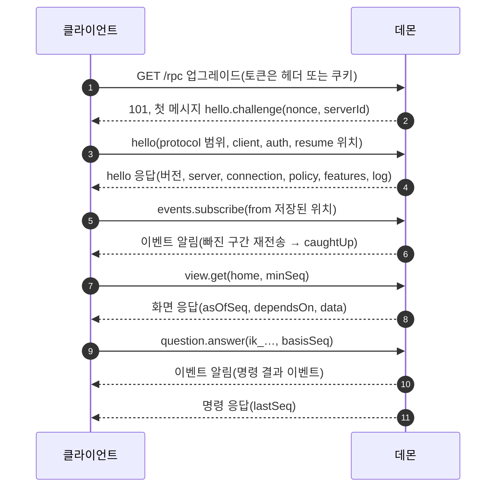

# 14. 클라이언트 프로토콜: 앱과 데몬 사이의 계약

## 끊김이 일상인 환경에서 필요한 세 가지 보장

휴대폰은 화면이 꺼지면 연결이 멈추고, SSH 터널은 노트북이 잠들면 끊기며, 데몬도 가끔 재시작합니다. 그동안에도 데몬은 일을 계속해 이벤트가 쌓이고, 사용자는 끊기기 직전에 누른 버튼의 결과를 모릅니다. 앱 안에는 Helm의 규칙이 없고(1번 노드) 화면은 데몬이 정본에서 계산한 결과이므로(4번 노드), 앱이 보낼 수 있는 요청은 프로토콜에 정의된 메서드뿐입니다. 그러면 끊겼다 다시 붙은 앱이 어긋나지 않으려면 무엇이 필요한지가 이 노드의 질문이고, 답은 세 가지 보장입니다.

1. 위치 이어받기: 영속 이벤트마다 정본 로그의 순번(seq)이 있고, 클라이언트는 `{storeId, seq}` 쌍으로 "여기까지 빠짐없이 받았다"는 위치를 저장합니다. 재연결하면 그 위치 다음부터 다시 받습니다.
2. 무효화: 화면 데이터(뷰)마다 만들 때 읽은 레코드와 집계 이름의 목록(`dependsOn`)이 있고, 이벤트마다 영향받은 목록(`invalidates`)이 있습니다. 두 목록이 겹치면 그 뷰를 다시 받습니다.
3. 멱등: 명령마다 멱등 키가 있고, 서버는 키·지문·출처가 같은 명령을 한 번만 적용합니다. 응답을 받지 못한 명령은 같은 키로 다시 보냅니다.

아래 절은 이 세 보장에 사실을 붙여 갑니다. 메시지 형식과 경로는 세 보장이 올라타는 바탕이고, 마지막의 재연결은 세 보장이 한 순서로 만나는 곳입니다. 데몬 쪽 코드는 "메서드의 권한 범위를 넘어 동작하지 않는가", 앱 쪽 코드는 "끊긴 뒤에도 이벤트를 빠짐없이 받고 명령을 한 번만 보내는가"를 이 기준으로 리뷰합니다.

## 바탕: JSON-RPC 2.0 메시지

메시지는 JSON-RPC 2.0이고, WebSocket 텍스트 메시지 하나가 JSON-RPC 메시지 하나입니다. 규칙은 서로 독립이라 나열합니다.

- 요청은 `{jsonrpc, id, method, params}`, 응답은 `{jsonrpc, id, result}` 또는 `{jsonrpc, id, error}`, 알림은 `id` 없는 `{jsonrpc, method, params}`입니다.
- `id`는 1~64자의 문자열이고, `params`와 `result`는 항상 객체입니다. 결과를 객체로 고정해 두면 필드를 추가하면서 진화할 수 있습니다.
- 배열로 묶은 배치 요청은 `-32600` 오류 하나로 응답합니다.
- 서버는 클라이언트에 요청을 보내지 않고 응답과 알림만 보냅니다. 사람에게 묻는 일은 질문 레코드와 그것을 보여 주는 뷰로 합니다.
- 클라이언트에서 서버로 가는 알림은 요청 취소(`$/cancelRequest`)와 접속 상태 보고(`presence.report`) 둘뿐입니다.

JSON-RPC의 `id`는 같은 연결 안에서 요청과 응답을 짝짓는 값일 뿐이고, 명령의 중복을 막는 멱등 키와 다릅니다. 두 값을 섞으면 재연결 뒤 같은 명령이 두 번 적용될 수 있어서, 멱등 키는 명령 내용 안에 따로 둡니다.

## 바탕: 세 경로, 하나의 대화

2번 노드의 세 리스너가 프로토콜의 전송 경로입니다. 데스크톱 앱은 Tailscale serve를 거친 WSS(`tailnet` 리스너)나 `ssh -W 127.0.0.1:7841` 터널(`loopback` 리스너)로, 서버 안의 TUI와 관리 CLI는 Unix 소켓(`local` 리스너)으로 붙습니다. **세 리스너는 같은 HTTP + WebSocket 코드와 같은 메서드 집합을 쓰고, 리스너마다 다른 것은 연결을 받기 전의 전송 조건, 받는 HTTP 경로, 받는 인증 방식입니다.** 전송 조건은 Host 검사, Origin 검사, Tailscale 신원 확인, 소켓 파일 권한이고, HTTP 경로의 예는 `/m/*`와 `POST /pair`가 `tailnet` 리스너에만 있고 `loopback`에서는 404라는 점입니다. 리스너별 표는 2번 노드에, 검사 순서와 거부 코드는 13번 노드에 있습니다.

그 위의 대화는 경로와 무관하게 같아야 하므로 SSH 경로도 별도 프레임 형식 없이 SSH 표준 입출력 위에 HTTP 업그레이드와 WebSocket을 그대로 얹습니다. `ssh -W`는 원격 명령을 실행하지 않아 셸 시작 파일의 출력이 바이트 스트림에 섞이지 않고, 클라이언트 쪽에 열린 포트도 생기지 않습니다. 같은 적합성 시험을 세 리스너와 실제 `ssh -W` 경로에서 돌려 메시지 열이 같은지 확인합니다.

기기 토큰은 JSON 메시지에 싣지 않고 WebSocket 업그레이드 요청의 헤더(`Authorization: Bearer`, 데스크톱)나 HttpOnly 쿠키(`__Host-helm_dt`, 휴대폰)로만 보냅니다. 판정은 `hello`에서 합니다. 토큰 형식·해시·폐기·만료 검사의 세부는 13번 노드에서 다뤘습니다.

`local` 리스너에는 기기 토큰 말고 두 가지가 더 있습니다.

- `localAdmin`은 소켓을 열 수 있는 같은 사용자(uid)라는 사실만으로 인정하는 로컬 관리자 인증이고, `local` 리스너에서만 받습니다. TUI는 화면의 결정 버튼이 확인 단계입니다. 관리 CLI는 표준 입력과 출력이 모두 터미널일 때만 사람 결정을 낼 수 있고, 결정 명령마다 `localConfirm.request`로 받은 4자 확인 문자열(2분, 1회)을 사람이 입력해 `localConfirm`에 싣습니다. 없거나 틀리면 `1012`입니다. 터미널이 아닌 실행(`interactive: null`)은 읽기와 관리만 합니다.
- `runtimeAdapter`는 외부 런타임 브리지가 특정 run에서만 쓰는 어댑터 토큰이고, 사람 결정 명령을 보낼 수 없습니다.

`localAdmin`의 전제는 에이전트가 실행하는 도구 프로세스가 `local` 소켓을 열 수 없다는 것입니다. 열 수 있으면 모델이 도구로 소켓에 붙어 사람 결정을 보낼 수 있으므로, 이 격리는 13번 노드의 리뷰 항목입니다. TUI의 인증 수단은 설계 문서 안에서 아직 정리 중입니다. 결정 표에는 TUI도 헤더 토큰을 쓴다고 쓰여 있고, 로컬 경로 절과 미결 사항 표에는 `localAdmin`이 기본으로 쓰여 있습니다. `local` 리스너는 어느 쪽이든 받습니다.

## 연결에서 첫 명령까지

연결 하나가 첫 화면을 그리고 명령 하나를 보내기까지의 순서입니다. 아래 그림에서 구독(5번)이 화면 읽기(7번)보다 먼저 가는 점, 그리고 명령 응답(11번)보다 결과 이벤트(10번)가 먼저 오는 점을 따라가 보면 됩니다.

그림은 개략도입니다. 5초 챌린지 타이머, 10초 `hello` 시한, 권한 범위(scope) 부여, `view.get`의 `minSeq` 대기는 생략했습니다. 첫 접속에서는 5번의 `from`이 `"head"`이고, 재접속에서는 저장된 위치이며, 재접속에서는 모든 구독이 `caughtUp`이 된 뒤에 낡은 열린 뷰의 7번을 다시 보냅니다.

핸드셰이크(1~4번)는 서버가 보내는 챌린지로 시작합니다. 클라이언트는 챌린지를 받기 전에 `hello`를 보내지 않고, 5초 안에 챌린지가 오지 않으면 연결을 닫고 다시 시도합니다. 서버는 업그레이드 뒤 10초 안에 `hello`가 끝나지 않으면 연결을 닫습니다. 서버 ID 대조는 이 단계의 일입니다. 챌린지의 `serverId`가 프로필에 저장된 값과 다르면 다른 데몬에 붙은 것이므로 `hello`를 보내지 않고 닫은 뒤 "사람 조치 필요"로 갑니다. 처음 연결이면 `serverId`를 저장합니다.

서버의 `hello` 판정 순서는 연결 상태 확인, 스키마 검사, 버전 고르기, 이 리스너에서 받는 인증 방식인지(`deviceToken`, `localAdmin`, `runtimeAdapter` 중), 방식별 인증, 권한 범위 부여입니다. 권한 범위는 `read`(조회·구독), `decide`(사람 결정 명령), `decideMobile`(휴대폰에 허용된 결정 명령), `devices`(기기·연결 관리), `admin`(로컬 관리자 전용 관리) 같은 이름으로 연결에 붙고, 클라이언트는 받은 범위에 없는 동작을 화면에서 끕니다.

`hello` 응답의 `policy`에는 메시지 상한, tick 주기, 동시 요청 수, 명령 속도, 재생 상한, 멱등 보관 기간, 파일 한도 같은 값이 들어 있습니다. 클라이언트는 이 값을 코드에 고정하지 않고 연결할 때마다 다시 읽습니다. 이 글에 나오는 수치(15초, 35초, 8MiB, 64MiB, 365일, 5분 등)는 모두 기본값입니다.

응답의 `log`에는 저장소 정보가 들어 있습니다. `storeId`, 현재 순번 `headSeq`, 재생할 수 있는 가장 오래된 순번, 클라이언트가 보낸 `resume` 위치에 대한 미리 보기가 그것입니다. 사람의 복귀 요약 확인 위치(`human.briefAckSeq`)는 `log`와 따로 응답에 들어 있습니다.

## 보장 1: 위치로 이어받기

### 영속 이벤트와 재전송

이벤트는 두 종류입니다. 영속 이벤트는 4번 노드의 정본 로그에 커밋된 이벤트이고, 전역 순번(seq)이 있으며, 재전송 대상이고, 서버가 버리지 않습니다. 휘발 스트림은 모델 응답의 텍스트 조각 같은 실시간 변화이고, 순번이 없으며, 느린 클라이언트에게는 버려질 수 있습니다.

**프로토콜의 위치 값은 정본 로그의 seq 그대로이고, 프로토콜 계층에서 따로 순번을 만들지 않습니다.** 연결별 카운터나 메모리 버퍼가 없으므로 데몬이 재시작되어도 seq는 이어집니다. 위치에 `storeId`를 함께 두는 이유는 백업에서 복원하면 `storeId`가 새 값으로 바뀌고 seq가 되돌아갈 수 있기 때문입니다. 같은 seq 숫자라도 저장소가 다르면 다른 이벤트입니다.

`events.subscribe`에 저장한 위치를 주면, 서버는 그다음부터 `(from, to]` 구간 단위로 이벤트를 보냅니다. 서버가 보내는 알림 하나에는 그 구간에서 필터에 맞는 이벤트가 빠짐없이, 중복 없이, seq 순서대로 들어 있습니다. 필터에 맞는 이벤트가 없는 구간은 서버가 빈 알림을 보내 클라이언트의 위치를 앞으로 옮깁니다. 재전송이 끝나면 `caughtUp: true` 알림이 오고 그 뒤는 실시간입니다.

알림의 `from`이 클라이언트가 가진 위치와 다르면 구멍이나 중복 구간이므로(gap), 클라이언트는 구독을 해제하고 자기 위치부터 다시 구독합니다. 정상 동작에서는 gap이 생기지 않아서 이 검사는 서버와 클라이언트의 처리 순서 버그를 찾는 장치이고, 1분에 3번 나면 연결을 닫고 다시 연결합니다.

### 재전송할 수 없는 경우

`events.subscribe`가 `2001 replay.outOfRange`로 끝나는 사유는 네 가지이고, 사유에 따라 클라이언트가 버리는 것이 다릅니다.

| 사유 | 뜻 | 버리는 것 | 남기는 것 |
|---|---|---|---|
| `storeMismatch` | 저장소가 다름(복원으로 `storeId`가 바뀜) | 위치, 이벤트 캐시, 뷰 캐시 모두 | 없음 |
| `aheadOfHead` | 클라이언트 위치가 서버의 `headSeq`보다 앞섬 | 위치, 이벤트 캐시, 뷰 캐시 모두 | 없음 |
| `beforeOldest` | 재생할 수 있는 가장 오래된 순번보다 오래됨 | 위치, 이벤트 캐시 | 뷰 캐시(낡음으로 표시) |
| `tooFar` | `headSeq`와 위치의 차이가 재생 상한(기본 50,000)을 넘음 | 위치, 이벤트 캐시 | 뷰 캐시(낡음으로 표시) |

앞의 두 사유는 클라이언트가 가진 데이터가 다른 저장소의 것일 수 있으므로 전부 버립니다. 뒤의 두 사유는 같은 저장소 안에서 이어받을 수 없을 뿐이므로 뷰 캐시는 낡았을 뿐 틀린 데이터가 아닙니다. 네 사유 모두 그 뒤의 순서는 같습니다. `from: "head"`로 다시 구독하고(응답의 `start`를 H0라 합니다), 열린 뷰를 `minSeq: H0`로 다시 받고, 이벤트 목록을 보이는 화면은 `events.read`로 H0 이전의 최근 이력을 거꾸로 채웁니다. 그보다 앞은 "접속하지 않은 동안 생략됨"으로 표시합니다.

### 구독 먼저, 화면 데이터는 나중에

**구독을 먼저 열고 화면 데이터를 나중에 읽습니다.** 순서를 바꾸면 무엇이 사라지는지 숫자로 보겠습니다. 화면 데이터를 읽는 시점에 서버의 `headSeq`가 100이라고 합니다.

1. 화면 먼저: `view.get`의 응답이 `asOfSeq: 100`으로 옵니다. 그 사이에 101~104가 커밋됩니다. 그다음 `events.subscribe`를 `from: "head"`로 열면 `start`가 104이므로, 101~104의 이벤트는 구독으로도 오지 않고 화면에도 반영되지 않아서, 그 변화는 화면에 반영되지 않은 채 남습니다.
2. 구독 먼저: `events.subscribe`를 `from: "head"`로 열면 `start`가 100입니다. 이후 101, 102가 알림으로 오고, 그 사이에 보낸 `view.get`의 응답이 `asOfSeq: 102`로 옵니다. 알림의 101, 102는 `seq ≤ asOfSeq`이므로 응답에 이미 반영된 것으로 보고 무효화를 무시합니다. 103은 `asOfSeq`보다 뒤이므로 그 이벤트의 `invalidates`가 뷰의 `dependsOn`과 겹칠 때만 다시 받습니다.

2번에서 겹치는 구간(101, 102)은 `asOfSeq`로 걸러지고 빠지는 구간은 없습니다. 정상 재접속에서는 이벤트를 `from`부터 재전송받으므로 이 순서가 저절로 지켜지고, 첫 접속과 위의 범위 밖 처리에서 명시적으로 지킵니다. `asOfSeq`는 응답이 반영한 마지막 seq이므로 클라이언트는 그 뒤의 이벤트만 반영하면 됩니다.

### 명령 응답과 결과 이벤트의 순서

서버는 커밋한 같은 실행 차례에 모든 연결의 실시간 구독에 결과 이벤트 알림을 큐에 넣고, 그 뒤에 명령 응답을 큐에 넣습니다. 그래서 명령을 보낸 연결의 실시간 이벤트 구독 중 필터에 맞는 것에서는 응답의 `lastSeq`까지의 이벤트가 응답보다 먼저 도착합니다.

이 순서가 적용되지 않는 경우가 있습니다. 재생 중인 구독, 이벤트 구독이 없는 연결, 필터가 결과 이벤트를 걸러 내는 구독이 그렇고, WebSocket 큐와 별개인 HTTP 경로(`POST /m/cmd`)의 응답도 이 순서와 무관합니다. 그래서 클라이언트는 응답의 `lastSeq`(이벤트가 없으면 null)와 자기 구독 위치를 비교해 "반영됨"을 판단합니다.

### 느린 소비자와 송신 큐

서버의 송신 큐에는 우선순위가 있습니다. 응답과 오류가 가장 먼저, 그다음 생존 신호와 종료 알림, 그다음 영속 이벤트, 마지막이 휘발 스트림입니다. 대량 이벤트가 쌓여 있어도 응답과 `tick`이 그 뒤에 막히지 않게 하려는 순서입니다.

실시간 단계에서 큐가 8MiB(기본)를 넘으면 그 연결의 휘발 스트림부터 버립니다. 10초 넘게 8MiB 위에 있거나 16MiB를 넘으면 느린 소비자로 보고 `connection.closing`을 시도한 뒤 4008로 닫습니다. 영속 이벤트와 응답은 버리지 않고, 닫힌 클라이언트는 바로 재접속해 자기 위치부터 받습니다. 재생은 큐가 1MiB 아래일 때만 다음 묶음을 읽으므로 재생 때문에 느린 소비자로 끊기는 일은 없습니다.

### 순번이 없는 휘발 스트림

휘발 스트림은 `stream.subscribe`로 구독하고, 구독 범위는 Concern, run, 작업 단위, 전체 중 하나입니다. 조각 번호 `n`은 run마다 1부터 세며, 서버가 버린 조각도 번호를 쓰므로 클라이언트가 다음 조각에서 유실을 압니다. 재접속하면 구독 응답의 `active`로 현재 실행 상태를 받고, 유실된 부분은 `run.partial`로 복원합니다.

휘발 상태를 지우는 시점은 두 규칙으로 나뉩니다. 메시지 완성이나 도구 결과 같은 영속 이벤트가 오면 그 `messageId`·`toolCallId`의 휘발 텍스트를 버립니다. 영속 내용이 정본이기 때문입니다. run이 끝날 때 오는 `end` 조각에는 run 종료 이벤트의 순번 `finalSeq`가 들어 있고, 클라이언트는 이벤트 구독이 그 순번에 이를 때까지 해당 run의 휘발 상태를 지우지 않습니다. 영속 내용이 화면에 오기 전에 텍스트가 사라져 화면이 잠깐 비는 일을 막으려는 규칙입니다.

## 보장 2: 무효화로 화면 맞추기

화면 데이터는 데몬이 정본을 읽어 만든 뷰입니다. 홈, 복귀 요약, 질문함, 질문, 에이전트가 정한 것, Concern, 탐구, 합의, 결과 확인, 스레드, 설정 등 26가지가 있습니다. 클라이언트는 `view.get`으로 받아 캐시하고, 응답에는 기준 순번(`asOfSeq`), 신선도(`current`, `stale`, `rebuilding`, `failed`), 그리고 `dependsOn`이 들어 있습니다. `dependsOn`은 뷰를 만들 때 읽은 레코드 ID와 집계 이름의 목록입니다. 집계 이름은 `@` 접두를 붙인 태그로, 질문함 전체를 가리키는 `@inbox`처럼 레코드 하나가 아닌 묶음에 의존하는 뷰가 씁니다. 뷰 키는 서버가 정하고 클라이언트가 직접 만들지 않습니다.

뷰가 낡았는지는 무효화 태그로 판단합니다. 이벤트마다 커밋 때 계산된 `invalidates`(영향받은 레코드 ID와 집계 이름)가 붙어 오고, 이 집합이 열린 뷰의 `dependsOn`과 겹치면 그 뷰를 다시 받습니다. 두 집합 모두 데몬이 계산하므로 앱에 "이벤트 종류 → 화면" 대응표가 필요 없습니다.

이 규칙이 요구하는 것은 한 방향뿐입니다. 이벤트를 반영해 뷰 데이터가 달라졌다면 두 집합은 반드시 겹쳐야 하고(속성 테스트로 확인), 겹쳤는데 데이터가 같은 것은 허용됩니다. 넓게 다시 받는 쪽으로 틀리는 것은 괜찮고 놓치는 쪽으로 틀리면 안 된다는 뜻입니다. 같은 이유로 태그가 이벤트당 64개, 뷰당 512개를 넘으면 데몬이 집계 이름 하나(예: `@concernTree`)로 줄여 넓게 무효화하는 쪽으로 틀리게 합니다.

다시 받기는 뷰마다 150ms 디바운스하고, 재전송 중에는 미뤘다가 `caughtUp` 뒤 한 번만 합니다. 닫힌 뷰는 낡음 표시만 하고 다시 열릴 때 받습니다. 서버가 이전 값을 저장해 두었다가 변경분(JSON Patch)을 보내는 방식은 쓰지 않습니다. 서버가 연결과 뷰마다 상태를 들고 있어야 하고, 패치 순서가 어긋났을 때를 위한 재동기화가 따로 필요하기 때문입니다.

## 보장 3: 멱등 키로 한 번만 적용하기

### 명령 메서드와 처리 순서

사람의 명령은 메서드마다 대응하는 커널 명령이 하나이고, 둘 이상의 메서드가 같은 커널 명령으로 가기도 합니다(예: `question.proceedWithAssumption`은 `question.answer`의 한 값으로 갑니다). 범용 "실행" 메서드는 없고, `agreement.confirm`, `result.accept`, `question.answer`처럼 도메인 동작마다 메서드가 있습니다. 메서드마다 필요한 권한 범위와 값 검사, 커널 명령으로 바꾸는 변환 함수가 달라서, 이를 한 곳(등록 표 `METHOD_SPECS`)에 두면 타입, JSON Schema, 서버 디스패처, 적합성 시험이 모두 그 표에서 만들어집니다. 메서드는 종류(`ctl` 연결 제어, `read` 조회·구독, `cmd` 사람 명령, `adm` 관리)와 필요한 권한 범위를 가집니다. 휴대폰은 같은 메서드도 일부 값을 쓸 수 없습니다(예: 결과 확인의 거절, 질문 답의 "고쳐서 승인").

모든 사람 명령에는 멱등 키(`ik_` + ULID)와 화면이 본 순번 `basisSeq`가 들어갑니다. 행위자, 채널, 출처는 클라이언트가 보내지 않고 서버가 채우며, 새로 만들어질 레코드의 ID도 데몬이 만듭니다. 사람이 쓴 자유 텍스트는 커널에 넘기기 전에 비밀 형태를 가리는 마스킹을 거칩니다.

서버는 명령을 다음 순서로 처리합니다.

1. 스키마, 권한 범위, `localConfirm`(`tty_cli` 연결이면), 명령 속도, 데몬 모드(읽기 전용이면 거부)를 확인합니다.
2. 메서드별 변환 함수로 커널 명령을 만듭니다.
3. 출처와 멱등 키를 붙여 `engine.submit`에 넘깁니다.
4. 결과를 응답으로 바꿉니다. 응답의 상태는 적용됨, 받아들여짐, 질문으로 바뀜(`gated`)이고, 처리 결과 이벤트 범위(`firstSeq`, `lastSeq`)가 함께 옵니다.

### 멱등 키, 지문, 출처

**멱등 키는 사용자 의도 하나에 하나**입니다. 버튼을 한 번 누르면 키 하나를 만들고, 응답을 받지 못했거나 재연결했거나 다른 경로로 바꿔서 다시 보낼 때는 같은 키와 같은 내용을 보냅니다. 서버는 같은 키와 같은 지문이면 저장된 결과를 `duplicate: true`로 돌려주고, 같은 키에 다른 내용이면 거부합니다(`3006`). 지문에 무엇이 들어가는지는 4번 노드에 있습니다. 이 노드에서 필요한 사실은 지문과 범위 키에 행위자와 출처(기기)가 들어간다는 점입니다. 같은 기기가 같은 키와 같은 내용을 어느 연결, 어느 리스너, 어느 경로(`/m/cmd` 포함)로 보내도 같은 명령입니다. 기기가 바뀌면(다시 페어링하면 기기 ID가 바뀝니다) 범위가 달라져 같은 키라도 같은 명령이 아닙니다. 연결 ID, 리스너, 화면 순번 `basisSeq`는 지문에 들어가지 않으므로 화면이 다시 그려져 `basisSeq`가 바뀌어도 같은 명령입니다.

같은 키의 앞 요청이 아직 처리 중이면 뒤 요청은 그 결과를 기다립니다. 결과는 365일(기본) 보관하고, 그 뒤에는 요약만 남깁니다. 휴대폰은 화면이 꺼지기 직전 진행 중인 명령을 HTTP(`POST /m/cmd`, keepalive)로 같은 키를 붙여 보냅니다.

모든 결과가 저장되는 것은 아닙니다. 저장되는 결과는 적용됨, 받아들여짐, 질문으로 바뀜, 거부(내용·자격·경로), 충돌(판본 불일치·이미 해결됨·대체됨)이고, 같은 키로 다시 보내면 같은 거부가 다시 옵니다. 저장되지 않는 결과는 1단계 검증 오류, `3006`, 데몬 상태 오류(`5001`~`5004`), 커널 내부 오류, 일시 실패이고, 같은 키로 다시 보내면 처음부터 다시 처리하므로 다시 보내도 됩니다. 그래서 거부나 충돌 뒤에 상황이 바뀌어 다시 하려면 새 키가 필요합니다.

### 충돌과 새 키

화면이 낡았는지는 커널이 판정합니다. 4번 노드에서 본 대로 커널은 대상 레코드의 `revisionSeq`가 명령의 `basisSeq`보다 뒤인지 비교하고, 뒤이면 충돌로 거부합니다. 서버는 이를 오류 코드로 돌려줍니다. 판본 충돌(3004)이면 현재 요약을, 이미 처리됨(3008)이면 어떻게 처리되었는지를, 대체됨(3009)이면 새 판본을 함께 줍니다.

앱은 충돌 때 쓰던 내용을 초안으로 되살리고, 정보 질문이 이미 가정으로 확정되었으면 쓰던 답을 이의 초안으로 넘깁니다. 사람이 바뀐 상황을 보고 다시 보낼 때는 새 키를 만듭니다. 같은 키로 보내면 같은 충돌이 저장된 결과로 돌아오기 때문입니다.

**앱은 화면을 미리 바꿔 두는 낙관적 갱신을 하지 않습니다.** "보내는 중"만 표시하고, 결과는 응답과 뒤따르는 뷰 무효화로 받습니다.

## 세 보장이 만나는 곳: 생존 확인과 재연결

### 생존 확인

서버는 기본 15초마다 WebSocket ping과 함께 `tick` 알림(서버 시각, 현재 순번, 모드)을 보냅니다. 클라이언트는 무엇이든 받으면 감시 타이머를 다시 시작하고, 기본 35초(tick 주기의 두 배에 5초를 더한 값) 동안 아무것도 오지 않으면 4000으로 연결을 닫고 다시 연결합니다. 웹뷰의 JavaScript는 WebSocket ping을 볼 수 없으므로 클라이언트 쪽 감시는 `tick`으로 합니다.

### 연결 상태 여덟 가지

클라이언트 코어 `@helm/client`의 `HelmClient`는 데스크톱, 휴대폰, TUI가 함께 쓰는 연결 상태 기계입니다. 상태는 `idle`(대기), `connecting`(연결 중), `handshaking`(핸드셰이크 중), `syncing`(동기화 중), `ready`(준비), `backoff`(재시도 대기), `needsUser`(사람 조치 필요), `closed`(닫힘)의 여덟 가지입니다.

재연결 대기 시간 d는 첫 실패 뒤 0.5초이고 이어서 1초, 2초, 4초로 두 배씩 늘어 30초에서 멈춥니다. 실제 대기는 d/2에 0~d/2 사이의 무작위 값을 더한 값입니다. 응답에 담긴 재시도 대기 시간(`retryAfterMs`)이 이보다 길면 그 값을 하한으로 씁니다. 느린 소비자로 4008을 받은 직후만 바로 다시 연결합니다. 인증 실패, 기기 폐기, 버전 불일치, 서버 ID 불일치처럼 사람이 고쳐야 풀리는 실패는 자동 재연결을 멈추고 `needsUser`로 갑니다. 그 밖의 실패는 포기하지 않고 30초 간격으로 계속 시도합니다.

### 재연결 순서의 예

저장된 위치가 `{S1, 120}`이고, 휴대폰이 꺼져 있는 동안 서버가 150까지 커밋한 경우를 따라가 보겠습니다. 진행 중 명령함에는 응답을 받지 못한 `ik_A`가 있고, 보낼 때의 `storeId`는 S1, 기기 ID는 d1입니다.

1. 전송이 열리고 챌린지를 받습니다. `serverId`가 저장된 값과 같으면 `hello`를 보냅니다. 다르면 여기서 멈추고 `needsUser`로 갑니다.
2. `hello`가 성공해 `syncing`으로 들어갑니다. 이제 `hello.log.storeId`와 `hello.connection.deviceId`를 진행 중 명령함 항목과 대조합니다. S1과 d1이 같으므로 `ik_A`는 재전송 대상으로 남습니다. `log.resume`은 `{status: "ok", behind: 30}`입니다.
3. 저장된 위치로 `events.subscribe`를 보냅니다. 응답은 `start: 120`, `headSeq: 150`, `mode: "replaying"`이고, 이어서 `from: 120`, `to: 150`, `caughtUp: true`인 알림 하나가 옵니다.
4. 구독 첫 응답이 끝난 뒤 `ik_A`를 같은 키와 같은 params로 다시 보냅니다. 이미 140에 커밋되어 있었다면 응답은 `duplicate: true`와 저장된 결과이고, `lastSeq`(140)가 구독 위치 이하이면 반영된 것입니다.
5. 모든 구독이 `caughtUp`이 되어 `ready`로 갑니다. 재전송된 이벤트 중 133과 147의 `invalidates`가 열린 홈 뷰의 `dependsOn`과 겹쳤다면, 이 뷰를 `minSeq: 147`로 한 번만 다시 받습니다.

2단계에서 `hello.log.storeId`가 S2로 달리 왔다면 흐름이 달라집니다. 복원된 저장소에는 `ik_A`가 없을 수 있어 그대로 보내면 같은 일이 두 번 적용될 수 있으므로, 코어는 재전송 전에 이 서버의 캐시를 모두 비우고(`clearServer`) `ik_A`를 자동 재전송에서 뺍니다. 같은 이유로 재전송은 3단계에서 구독이 복원된 뒤에만 시작해서, 3단계의 `2001`보다 먼저 나가는 일이 없어야 합니다. `syncing` 동안 새 사람 결정 명령은 보내지 않지만, 4단계처럼 이미 보낸 명령을 같은 키로 다시 보내는 것은 합니다.

### 자동 재전송에서 빠지는 명령

진행 중 명령 중 다음 여섯 경우는 자동으로 다시 보내지 않고 "보내지 못한 조작"으로 사람에게 보입니다.

1. 항목이 24시간(기본, `pendingCommandMaxAgeMs`)보다 오래됨.
2. `hello.log.storeId`가 항목의 `storeId`와 다름(저장소 복원).
3. `hello.connection.deviceId`가 항목의 `deviceId`와 다름(다시 페어링해 멱등 범위가 바뀜).
4. 프로토콜 버전이나 `schemaHash`가 달라졌고, 그 메서드의 params가 새 스키마를 통과하지 못함. 해시가 다르다는 사실만으로 빼지는 않습니다.
5. 저장되지 않는 영구 오류(`-32600`, `-32601`, `-32602`, `5007`)를 받음.
6. 읽기 전용 데몬의 `5003`을 받음.

빠진 항목은 앱이 입력을 초안으로 되살립니다. 사람이 다시 보내기 전에 앱은 `command.lookup { idempotencyKey: 원래 키 }`로 이미 커밋된 결과가 있는지 먼저 확인하고, 없을 때만 새 키를 만듭니다. 그래서 24시간이 지난 명령도 두 번 적용되지 않습니다. 2·3번은 원래 범위를 조회할 수 없으므로 화면에 "이미 처리됐을 수 있음"을 함께 보입니다.

데스크톱 앱의 WSS와 SSH 경로 전환은 네트워크 실패에서만 하고, 같은 서버면 위치와 진행 중 명령함을 그대로 씁니다. 기기가 폐기되면 그 서버의 뷰 캐시, 진행 중 명령함, 파일 캐시를 지우고 초안만 남깁니다.

## 오류 코드와 닫는 코드

오류는 JSON-RPC 표준 다섯 개(-32700, -32600, -32601, -32602, -32603)와 Helm 코드로 나뉩니다. Helm 코드는 영역별로 범위가 정해져 있습니다. 1xxx는 핸드셰이크·인증·권한 범위·속도, 2xxx는 구독·재전송·뷰, 3xxx는 명령 결과, 4xxx는 파일, 5xxx는 데몬 상태·취소·시한입니다. 모델용 도구의 결과로 오는 코드가 일부 섞여 있어서, 3010(브라우저 참조가 낡음)과 3011(편집 스냅샷이 낡음)은 명령 결과가 아닌 도구 결과이고, 4008~4010과 5008은 모델용 웹 도구의 오류입니다. 오류 객체에는 개발자용 영어 한 줄(화면에 그대로 쓰지 않음)과, 종류 이름, 재시도 가능 여부, 재시도 대기 시간, 커널 거부 코드, 규칙 ID, 다음 행동 후보가 들어갑니다. 화면 문구는 이 값들로 앱이 만듭니다.

커널 거부는 갈래(5번 노드)에 따라 대응합니다. 내용 거부는 3001, 자격 거부는 3002, 경로 거부는 3003, 판본 충돌은 3004, 같은 키 다른 내용은 3006이고, 질문으로 바뀐 경우는 `gated` 상태의 성공 응답으로 돌아옵니다. 내부 오류는 원인을 데몬 로그에만 남기고 클라이언트에는 "Internal error"만 보냅니다.

WebSocket 닫는 코드는 연결을 끊는 프레임에 실리는 숫자이고, 오류 코드는 JSON-RPC 응답의 `error.code`입니다. 두 숫자 체계는 이름 공간이 달라서 같은 숫자가 서로 다른 뜻으로 겹칩니다. 숫자만 보고 뜻을 정하지 말고, 프레임에서 왔는지 응답에서 왔는지 먼저 구분해야 합니다.

| 숫자 | 오류 코드(응답의 `error.code`) | 닫는 코드(WebSocket 프레임) | 닫는 코드를 받았을 때 클라이언트 동작 |
|---|---|---|---|
| 1001 | `handshake.required` | 서버 종료·재시작 | 백오프 재접속, `restartExpectedMs`가 하한 |
| 1008 | `auth.methodNotAllowed` | 정책 위반(인증 실패, 폐기된 기기, 인증 전 제한 위반) | 직전 오류의 종류로 판단, 없으면 `needsUser` |
| 1011 | `rateLimited` | 서버 내부 오류 | 백오프 재접속 |
| 4000 | (없음) | 클라이언트의 `tick` 감시 시간 초과 | 백오프 재접속 |
| 4001 | `blob.tooLarge` | 핸드셰이크 시한 초과 | 백오프 재접속 |
| 4008 | `web.tooLarge` | 느린 소비자 | 바로 재접속(첫 대기 0), 위치부터 재전송 |
| 4009 | `web.unsupportedType` | 기기 폐기·만료, 기기당 연결 수 초과 | 직전 `connection.closing`이 `auth.revoked`면 `needsUser`, `replaced`면 백오프 |

## 큰 데이터

WebSocket 메시지에는 파일 바이트를 싣지 않습니다. 메시지 크기 한도(기본 받기 1MiB, 보내기 4MiB)가 있고, base64로 싣는 첨부는 이 한도를 쉽게 넘기기 때문입니다. 이벤트와 뷰에는 파일 참조(`BlobRef`: ID, 내용 해시, 크기, 형식)만 들어가고, 바이트는 HTTP로 주고받습니다. 파일은 SHA-256 내용 주소로 저장되므로 같은 ID의 내용은 바뀌지 않고, 클라이언트는 ID를 키로 영구 캐시할 수 있습니다. 파일 하나는 기본 64MiB까지입니다.

업로드는 `POST /files/u`에 내용 해시를 함께 보내고, 큰 파일은 청크로 나눠 보내고 끊기면 이어 보냅니다. 올린 파일은 "대기" 상태였다가 명령이 참조하면 보관 상태가 되고, 24시간 안에 참조되지 않으면 정리됩니다. 다운로드는 헤더나 쿠키 인증으로 받거나, 헤더를 붙일 수 없는 곳(웹뷰가 직접 여는 링크)에서는 티켓을 씁니다. 티켓은 기본 5분 유효하고, 발급한 연결이 닫히면 무효이며, 파일 하나만 받을 수 있습니다. 기기 토큰은 URL에 넣지 않습니다. 파일 응답에는 실행을 막는 보안 헤더가 붙습니다(13번 노드). 정보가 가려진 파일은 가림 이벤트가 오면 클라이언트가 캐시를 지웁니다.

## 버전

프로토콜 버전은 정수 하나(지금 1)입니다. 서버와 클라이언트가 지원 범위를 주고받아 겹치는 가장 높은 버전을 쓰고, 겹치지 않으면 앱이 "앱 업데이트 필요" 또는 "서버 업데이트 필요"를 보여 줍니다. 버전 2부터 서버는 현재 버전과 직전 버전을 받습니다.

새 메서드, 새 필드, 새 이벤트 종류 같은 추가형 변경은 버전을 올리지 않고 기능 목록(`features`)으로 알립니다. 삭제, 이름 변경, 뜻 변경, 선택 params를 필수로 바꾸기, 재전송·순서 계약 변경, 오류 코드의 뜻 변경은 버전을 올립니다. 서버는 요청을 엄격하게 검사하고(모르는 필드 거부), 클라이언트는 응답과 알림을 관대하게 읽습니다(모르는 필드 무시, 모르는 값은 "알 수 없음"). 등록 표의 해시(`schemaHash`)가 같으면 양쪽 스키마가 같다는 뜻입니다. 해시가 다를 때는 재연결 때 저장된 명령의 params가 새 스키마를 통과하는지 확인해 다시 보낼지 판단하는 데 씁니다.

## 이 노드의 기준으로 구현을 볼 때

- 메시지가 JSON-RPC 2.0 규칙(문자열 `id`, 객체 `params`, 배치 거부, 서버는 요청을 보내지 않음)을 지키는가
- 세 리스너가 같은 처리기 위에 있고, 리스너별 차이가 전송 조건, 받는 HTTP 경로, 받는 인증 방식 세 가지로 한정되는가. 같은 적합성 시험이 세 리스너와 `ssh -W` 경로에서 통과하는가
- 토큰이 JSON 메시지에 실리지 않는가. `local` 소켓이 도구 프로세스에서 보이지 않고, 비대화 CLI가 사람 결정을 받지 않는가(13번 노드)
- 프로토콜의 위치 값이 정본 seq 그대로이고 연결별 카운터나 메모리 버퍼가 없는가
- 구독 알림이 `(from, to]` 구간을 빠짐없이, 중복 없이, 순서대로 담고, 필터에 맞는 이벤트가 없는 구간은 빈 알림으로 위치를 옮기는가
- `replay.outOfRange`의 사유별로 버리는 것이 표대로인가(`storeMismatch`·`aheadOfHead`는 전부, `beforeOldest`·`tooFar`는 위치와 이벤트 캐시만). 그 뒤 `head` 구독, `minSeq: H0`로 열린 뷰 다시 받기가 이어지는가
- 구독을 먼저 열고 뷰를 나중에 읽으며, `seq ≤ asOfSeq`인 이벤트의 무효화를 무시하는가
- 커밋 뒤 결과 이벤트가 명령 응답보다 먼저 큐에 들어가는가. 클라이언트는 `lastSeq`와 자기 구독 위치를 비교해 반영 여부를 판단하는가(재생 중 구독과 `/m/cmd`는 이 순서 밖)
- 느린 소비자에서 휘발 스트림만 버리고 영속 이벤트와 응답은 버리지 않는가
- 휘발 상태를 영속 이벤트가 오면 해당 메시지만 버리고, run 종료는 `finalSeq`에 이를 때까지 지우지 않는가
- 뷰 무효화 속성(데이터가 바뀌면 태그가 겹친다) 시험이 있는가. `dependsOn`에 집계 이름이 포함되고 태그가 상한을 넘으면 집계 이름 하나로 줄어드는가. 클라이언트가 뷰 키를 직접 만들지 않는가
- 명령에 멱등 키와 `basisSeq`가 있고, 행위자·채널을 클라이언트가 보내지 않는가
- 재전송이 같은 키와 같은 내용이고, 지문에서 연결 ID·리스너·`basisSeq`가 빠지며 출처(기기)가 들어가는가
- 거부·충돌 뒤 사람이 다시 보낼 때 새 키를 만들고, 저장되지 않는 오류에서만 같은 키 재전송에 의존하는가
- 앱이 낙관적 갱신을 하지 않는가. 충돌 때 쓰던 내용을 초안으로 되살리는가
- 파일 바이트가 WebSocket에 실리지 않는가. 티켓이 연결에 묶이고 5분 뒤 무효인가. URL에 토큰이 없는가
- 클라이언트 생존 감시가 `tick` 기반이고, 사람 조치가 필요한 실패에서 자동 재연결을 멈추는가
- 챌린지 단계에서 서버 ID를 대조하고, `hello` 뒤 `log.storeId`·기기 ID를 진행 중 명령함과 대조하는가. `storeId`가 달라진 명령이 재전송되지 않고 캐시가 비워지는가
- 재연결 때 구독 복원 뒤에 명령 재전송이 시작되고, 자동 재전송에서 빠진 항목이 초안으로 되살아나 `command.lookup`을 거치는가
- 닫는 코드와 오류 코드를 숫자만 보고 섞어 처리하지 않는가
