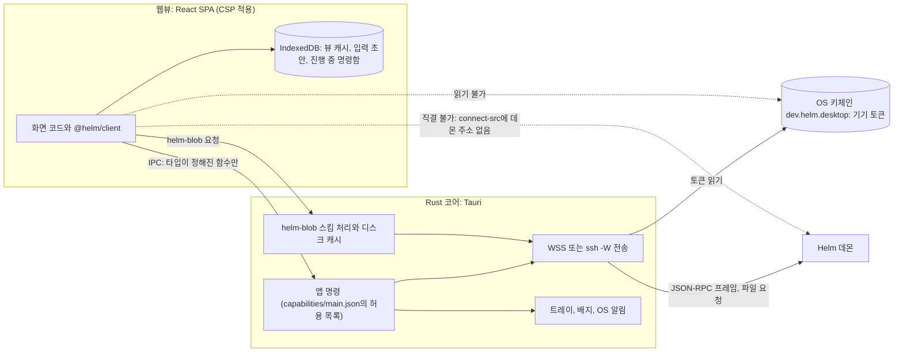

# 15. 클라이언트: 화면, 데스크톱 앱, UI 시스템, 휴대폰

## 앱의 역할: 상태 표시와 명령 전송

앞의 노드들에서 Helm의 규칙은 모두 데몬 안에 있었습니다. 클라이언트는 그 상태를 사람이 보고 판단할 수 있게 보여 주고, 사람의 조작을 명령으로 바꿔 보냅니다. 이 노드에서 리뷰 기준이 되는 것은 클라이언트가 어디까지 하고 어디서 멈추는지입니다.

14번 노드에서 본 대로 화면 데이터는 데몬이 만든 뷰이고, 이벤트는 "어느 뷰가 낡았는가"를 알리는 데만 씁니다. **앱은 투영을 계산하지 않습니다.** 앱이 이벤트를 접어 상태를 직접 계산하면 데몬과 앱이 같은 규칙을 두 벌 갖게 되고, 둘이 어긋나는 순간 화면이 정본과 다른 것을 보여 주기 때문입니다. 같은 이유로 낙관적 갱신도 하지 않습니다. 서버가 거부할 수 있는 명령의 결과를 먼저 화면에 반영하면, 거부된 결정이 잠깐 확정된 것처럼 보입니다. 우선순위, 품질, 가역성 같은 값도 앱이 계산하지 않고 데몬이 정한 값을 씁니다. 알림은 이 원칙이 가장 헷갈리는 곳이라 따로 다룹니다.

## 화면 체계: 상태 중심 화면

화면의 식별자(`SCR-HOME`, `SCR-QUESTION` 같은 이름)와 영역 배치는 UX 설계 문서(03·04)에 정리되어 있습니다. 여기서는 구현 리뷰에서 코드와 맞춰 볼 규칙만 다룹니다.

앱을 열면 홈이 열립니다(결정 10). 마지막 확인 이후 변화가 기준치를 넘으면 복귀 요약이 먼저 열립니다. 전역 대화창은 없고, 대화는 Concern, 질문, 합의 같은 객체에 딸린 탭이며 정본이 아닙니다.

화면 코드는 정본에 쓰지 않습니다. 조작은 명령으로 보내고, 받아들여진 결과가 돌아온 뒤에만 화면이 바뀝니다. 그래서 모든 화면 데이터에는 기준 순번과 시각이 붙고, 낡으면 낡았다고 표시합니다. 화면의 상태 라벨도 정본 상태를 그대로 옮긴 것입니다. 예를 들어 WorkUnit은 "준비 중", "합의 확인 필요", "진행 중", "결과 확인 필요", "결과 확인됨·반영 n개 남음", "완료" 순으로 보이고, **"완료"라는 말은 반영까지 끝난 상태에만 씁니다.** 재시작으로 중단된 run은 "중단됨(재시작)"으로 사람이 멈춘 것과 구분해 보입니다.

사람 행동 요청은 모두 질문 레코드이므로 질문함 하나로 들어옵니다. 질문함은 종류별로 묶어 보여 주고, 합의 확인(`SCR-AGREE`), 결과 확인(`SCR-REVIEW`), Goal 확인, 복구 선택 같은 전용 화면으로 넘깁니다. 권리 게이트 질문(6번 노드)의 카드는 고정 순서로 씁니다. 지금 정할 것, 왜 지금인가, 추천, 다른 선택, 핵심 근거, 아직 모르는 점, 되돌릴 수 있나, 다시 볼 조건입니다. 주 버튼은 세 개까지이고 나머지는 "그 밖에"에 두는데, 여기에는 기준 고치기, 질문 다시 쓰기, 먼저 알아보기, 미루기, 이의가 항상 있습니다. 권리 게이트에는 "가정대로 진행"이 없고, 원함 탐구에서 온 질문에는 추천과 다른 선택이 없습니다.

모든 화면에는 데이터 상태 다섯 가지가 공통입니다. 처음 불러오는 중, 캐시 먼저(마지막으로 받은 화면 표시), 빈 상태("없음"과 "모름"을 구분), 오류, 찾을 수 없음입니다. 진행 중 작업 카드에는 지금 하는 일, 이 일을 하는 이유, 다음 단계, 맡긴 범위와 그 집행 수준("실제로 막음" 또는 "권고만")이 들어가고, "에이전트가 작업 중입니다…" 같은 문장은 쓰지 않습니다.

## 결정 버튼을 막는 조건

연결 상태는 연결됨, 느림, 다시 연결하는 중, 인증 실패, SSH 실패, 버전 불일치, 읽기 전용, 안전 모드 등 16가지 값으로 보이고, 위쪽 막대에 나타납니다. 다만 화면 낡음은 해당 화면 머리에 보입니다. 기준 시점은 기본이 "방금 갱신" 같은 상대 시간이고, 순번 숫자는 개발자 보기에서만 보입니다.

결정 버튼은 서버가 보낸 `freshness`가 `current`가 아니거나 연결이 결정 불가일 때 막습니다. 판정 주체는 서버 값이고, 앱이 직접 계산하지 않습니다. 무효화 뒤 다시 받는 150ms 안팎의 짧은 낡음(클라이언트가 아는 `staleSince`)에는 막지 않습니다. 이 사이에 생긴 충돌은 서버가 `3004 command.revisionConflict`로 거부하므로, 버튼이 깜박이지 않습니다.

"결정 불가"에 속하는 상태는 다음과 같습니다.

- 막지 않는 상태: 연결됨, 느림, 안전 모드(런타임은 멈춰도 사람 명령은 받습니다). 서버가 다시 시작된 경우는 다시 맞추는 중을 거친 뒤 풀립니다.
- 막는 상태: 다시 연결하는 중, 서버 PC 또는 Helm 서버에 연결할 수 없음, 인증 실패, 키체인 거부, SSH 실패, 다른 서버, 버전 불일치, 읽기 전용, 다시 맞추는 중, 서버 종료 중, 그리고 서버 `freshness`가 낡은 화면.

막힌 버튼에는 이유("연결되면 보낼 수 있습니다. 쓰던 답은 저장해 두었습니다.")를 붙입니다. 명령을 보내는 동안 같은 버튼을 다시 누를 수 없고, 화면 상태는 결과가 올 때까지 바꾸지 않습니다.

## 알림: 데몬이 판단하고 앱이 표시합니다

알림에서는 판단과 표시의 경계를 구분해야 합니다. 앱은 어떤 이벤트가 알림 대상인지 판단하지 않습니다. 데몬이 전달 방식과 강도(`interrupt`, `notice`, `digest`, 6번 노드)를 정해 전달 이벤트로 기록하면, 앱은 그 이벤트를 받은 뒤 어떻게 보일지(OS 알림, 앱 안 배너, 묶음, 억제)만 정합니다.

알림 대상은 전달된 질문입니다. 진행 보고, 도구 활동, 에이전트가 정한 것, 관찰 제안에는 보내지 않습니다. 예외는 서버 상태 알림(안전 모드, 읽기 전용)이고, 질문 없이 휴대폰에만 갑니다. 같은 질문은 전달 때 한 번, 만료 임박 승격 때 한 번까지 알리고, 기본 알림 내용은 "확인할 일이 n건 있습니다"로 숨깁니다. 결과 확인 대기는 데스크톱에서 배지로만 보이고, OS 알림은 설정이 `immediate`일 때만 뜹니다(결정 60).

앱 쪽 표시 규칙은 모두 데몬의 전달 이벤트가 담은 값을 따릅니다. 이벤트의 `channel`, `surface`, `targetDevices`, `expiresAt`이 이 기기와 맞지 않거나, 같은 `deliveryId`를 이미 띄웠거나, 방해 금지·조용한 시간이면 띄우지 않습니다. 재전송으로 받은 지난 전달은 하나씩 띄우지 않고 세어서 묶습니다. 창이 열려 있고 해당 화면이 보이면 OS 알림 대신 앱 안 배너로 보입니다. 이것은 표시 방법의 선택이고 전달 여부의 판단이 아닙니다. 시간당 상한은 데몬이 세므로 앱에는 상한 계산이 없습니다.

## 상호작용과 문구

원함 탐구 화면에서는 "하나 고르기"를 여러 반응 가운데 하나("가깝다")로만 두고, 세 개 비교는 "비슷한 둘과 다른 하나의 이유"로 묻습니다. 이의는 이유 없이도 걸 수 있고 기본 처리는 "다시 열기"이며 조작 한 번으로 끝납니다. 입력창의 자연어 입력 가운데 범위를 줄이는 명확한 지시는 적용한 뒤 알리고, 기준이나 범위를 바꾸는 입력은 의미 미리보기를 거칩니다.

문구 규칙은 한국어 합니다체입니다. 직접 확인한 것을 먼저, 지금 읽어야 하는 이유를 먼저 말하고, 시스템이나 에이전트를 사람처럼 꾸미지 않습니다. 버튼은 결과를 말하는 동사구로 씁니다. "확인" 대신 "이 선택으로 진행", "승인" 대신 "결과 확인", "거절" 대신 "수정 요청"이나 "하지 않기", "자세히" 대신 "근거 보기"입니다. **문구는 앱이 만듭니다.** 데몬은 문구 키와 인자만 보내고, 데스크톱·TUI·휴대폰이 공유하는 문구 패키지 `@helm/ui-language`가 문장을 만듭니다. 문구를 고칠 때마다 데몬을 다시 배포하지 않아도 되게 하려는 것입니다.

키보드 단축키는 물리 키(`KeyboardEvent.code`)로 판정해서 한글 입력 상태에서도 같은 키가 동작합니다. 텍스트 입력 중에는 한 글자 단축키가 동작하지 않고, OS가 쓰는 조합은 쓰지 않습니다. 접근성 목표는 WCAG 2.1 AA이고, 상태·위험·게이트를 색만으로 나타내지 않으며, 반투명 표면의 대비는 가장 나쁜 배경에서 잽니다.

## 데스크톱 앱 구조

데스크톱 앱은 Tauri v2 앱 하나이고, 창 하나에 React 19 SPA가 들어 있습니다. Tauri는 Rust 프로세스(코어)가 OS의 웹뷰를 띄우고, 웹뷰의 JavaScript가 IPC(프로세스 사이 호출)로 Rust 함수를 부르는 구조입니다. 웹뷰에서 부를 수 있는 Rust 함수는 capabilities(권한 목록 파일)가 정하고, 웹뷰가 밖으로 낼 수 있는 요청은 CSP(콘텐츠 보안 정책)가 정합니다. 이 두 설정이 웹뷰와 Rust 사이의 경계를 강제하는 수단이므로, 리뷰에서 코드보다 먼저 볼 곳입니다.

아래 그림은 누가 무엇을 소유하는지와 웹뷰가 접근하지 못하는 선을 보여 줍니다. 실선은 허용된 통신이고, 점선은 막혀 있는 통신입니다.

그림에서 웹뷰가 바깥과 통신하는 길은 IPC와 `helm-blob` 스킴(파일을 받는 사용자 정의 URL 스킴) 둘입니다. 웹뷰의 CSP `connect-src`에는 IPC 주소만 있고 데몬 주소가 없으므로, 웹뷰 코드가 데몬에 직접 요청하면 CSP가 막습니다. 기기 토큰은 OS 키체인에 있고 Rust만 읽습니다. 웹뷰에서 XSS가 일어나도 토큰 값은 읽히지 않는다는 점이 이 경계를 두는 이유입니다. 웹뷰는 파일 시스템과 셸에도 접근하지 않습니다.

리뷰에서 확인할 곳은 네 가지입니다. `src-tauri/capabilities/main.json` 하나만 쓰이는지(`tauri.conf.json`의 `app.security.capabilities`가 `["main"]`을 명시), 앱 명령이 `build.rs`에 등록되어 capability의 허용 항목과 일대일인지, `shell`·`fs`·`http` 권한이 없는지, CSP `connect-src`에 원격 주소가 없는지입니다.

Rust는 WSS와 SSH 전송, `helm-blob` 스킴, 연결 프로필 파일, 키체인의 기기 토큰, 페어링, 트레이·배지·창을 처리합니다. Rust 코드는 Helm 도메인 타입이나 JSON-RPC 메서드를 모르고 프레임을 문자열로 넘깁니다. 재연결 시점 판단, 이벤트 해석, 알림 여부 판단, 트레이 숫자 계산은 Rust에 없고 웹뷰의 TS 코드에서 실행됩니다. 웹뷰는 14번 노드의 클라이언트 코어 `@helm/client`로 JSON-RPC, 핸드셰이크, 구독 복원, 명령 재전송을 처리하고 뷰 캐시와 화면 조립을 합니다.

상태 관리는 성격별로 저장 위치가 다릅니다. 데몬 뷰는 TanStack Query 캐시에 두고 IndexedDB에 영속하며, 신선도는 이벤트로 판단하므로 `staleTime`을 `Infinity`로 둡니다. 연결 상태와 휘발 스트림 글자는 zustand 저장소에, 진행 중 명령함과 입력 초안은 IndexedDB에 둡니다. 모든 저장 키에는 서버 ID가 붙습니다. React 19의 `useOptimistic`은 도메인 데이터에 쓰지 않습니다.

연결은 프로필 단위입니다. 서버 하나가 프로필 하나이고, 경로를 여러 개 순서대로 둘 수 있습니다. 기본 템플릿은 WSS(Tailscale 경유) 하나와 SSH 하나이며, SSH는 Tailscale을 쓸 수 없을 때의 대체 경로입니다. SSH 경로는 Rust SSH 라이브러리 대신 시스템 OpenSSH를 자식 프로세스로 실행하고(`ssh -W`), 호스트 키 검사는 엄격 모드가 기본입니다. 두 경로가 같은 코드로 같은 바이트를 보내므로 프로토콜 의미는 같습니다. SSH 키는 전송 인증에만 쓰이고, 기기 인증은 따로 기기 토큰으로 합니다. 경로 선택기는 네트워크 계열 실패에서만 다음 경로로 넘어가고, 인증 실패나 버전 불일치에서는 넘어가지 않습니다. 연결된 뒤에는 경로를 바꾸지 않는데, 같은 멱등 키로 다시 보내는 명령의 의미를 유지하기 위해서입니다.

오프라인이면 마지막 뷰를 읽기 전용으로 보여 주고, 연결이 없을 때 새 사람 결정은 받지 않습니다. 오프라인에서 쌓아 두었다가 나중에 보내는 송신 큐는 두지 않습니다. 사람의 결정은 그 시점의 상태를 보고 내려야 하므로, 오래된 화면에서 내린 결정을 나중에 몰래 보내지 않으려는 것입니다. 응답 전에 끊긴 명령만 진행 중 명령함에 두었다가 같은 멱등 키로 다시 보냅니다.

트레이 메뉴의 숫자는 데몬의 `tray` 뷰 값을 그대로 씁니다. OS 알림은 앞 절의 표시 규칙에 따라 데몬의 전달 이벤트를 받아 띄웁니다.

macOS 빌드는 Mac에서, Windows 설치 파일은 WSL에서 교차 빌드합니다. 1차에는 자동 업데이트가 없고, 앱이 핸드셰이크에서 버전 범위를 확인해 맞지 않으면 갱신 방법을 안내합니다. 화면 E2E 시험은 같은 SPA를 가짜 데몬에 붙여 Playwright로 돌리고, Tauri 셸은 스모크 시험만 합니다.

## UI 시스템

UI 원칙은 앞의 화면 규칙을 시각 언어로 옮긴 것입니다. 상태와 차이를 먼저 보이고, 의미는 글자·아이콘·모양으로 나타내며 색은 보조로만 씁니다. 구분해야 하는 것은 다르게 그리고, 초안을 내밀어 반응을 받습니다. 금지 항목은 고르기만 있는 상호작용, 의인화, `[승인] [거절]` 묶음, 정상 진행 때의 토스트와 알림입니다.

부품은 Radix Primitives를 바탕으로 shadcn/ui 소스를 복사해 Helm 코드로 고쳐 씁니다(결정 41·50). 스타일은 Tailwind CSS v4와 CSS 변수 토큰, 아이콘은 lucide-react이고, 대화 스레드에만 assistant-ui의 일부를 씁니다. 그래프·차트 라이브러리는 1차에 넣지 않습니다.

디자인 토큰은 네 층입니다. 원시 값(색 단계, 간격), 의미 토큰(텍스트 색, 재질, 컨트롤 높이), Helm 의미 토큰(`--helm-*`: 방향·이해·실제, 작성자, 품질, 신선도, 반응 표시), 부품 지역 토큰입니다. 토큰 규칙을 빌드가 강제하는 것은 사람의 주의에 맡기면 색과 간격이 화면마다 달라지기 때문입니다. 부품은 원시 값을 직접 읽지 않습니다. 이전에 만든 디자인 시스템(Caustic)의 값을 복사해 Helm 원본으로 다시 정리했고(결정 43), 데스크톱과 휴대폰이 같은 토큰 패키지 `@helm/ui-tokens`를 씁니다. 토큰 생성기는 대비 검사를 먼저 하고, 규칙이 하나라도 실패하면 빌드를 실패시킵니다. 코드에서는 리터럴 색, `dark:` 변형, 임의 값(`w-[123px]`), 색 알파 수정자를 쓸 수 없습니다.

글래스모피즘(결정 41)은 떠 있는 층에만 씁니다. 표면은 네 층으로, 창 바탕, 반투명 크롬(창 머리, 레일, 상태 줄 등), 불투명 본문(화면, 카드, 목록, 근거 트리), 반투명 오버레이(팝오버, 메뉴, 명령 팔레트, 시트 등)입니다. 본문은 불투명하게 두어 글을 읽는 데 방해가 없게 하고, 동시에 흐림 처리하는 영역은 셋 이하로 둡니다. 흐림 효과를 쓸 수 없거나 사용자가 투명도 줄이기·고대비를 켜면 불투명 표면으로 바꿉니다.

## 휴대폰: 데몬이 서빙하는 홈 화면 웹 앱

휴대폰 클라이언트는 2단계 기능이고, 할 일은 질문에 답하는 것이 중심입니다(결정 42). 질문함 보기와 답하기, 권리 게이트 허락·하지 않기·미루기, 작업 합의 확인, 결과 확인과 수정 요청, 에이전트가 정한 것에 이의, 복귀 요약 요약판, 진행 중 작업 보기와 안전하게 멈추기, 안전 모드 해제가 가능합니다. 결과 확인은 큰 산출물(본문 200 KiB 초과, 바뀐 파일 20개 초과, 그릴 수 없는 형식)이나 취향형이면 미루기만 됩니다. 이 크기 판정은 데몬이 `mobileReviewable`로 실어 보내고, 앱이 세지 않습니다. 조건 붙여 확인, 거절, 기준이 틀림도 휴대폰에서는 하지 않습니다.

구현 방식은 데몬이 서빙하는 PWA입니다(결정 47). 무료 Apple ID로 서명한 네이티브 앱은 7일마다 만료되고 푸시를 쓸 수 없지만, 홈 화면에 추가한 웹 앱은 Apple 개발자 프로그램 없이 Web Push를 받을 수 있기 때문입니다. 휴대폰은 Tailscale 앱이 켜져 있어야 데몬에 접속할 수 있고(`*.ts.net` 요청이 있으면 연결하는 VPN On Demand를 권장), 웹 앱은 데몬의 `/m/` 경로에서 서빙됩니다. 기기 토큰은 `__Host-helm_dt` HttpOnly 쿠키에 싣고(13번 노드), 휴대폰 기기는 좁은 권한 범위(`decideMobile`)만 받아서 범위를 넓히거나 방향을 바꾸는 명령과 페어링 코드 생성은 할 수 없습니다. 웹 앱 묶음은 데몬 릴리스에 들어가 데몬과 같은 판으로 배포되고, 기능 플래그 `clients.mobile`이 꺼져 있으면 모바일 경로가 모두 404입니다.

iOS는 백그라운드 앱의 연결을 곧 끊으므로, 휴대폰 웹 앱은 화면이 숨겨지면 연결을 닫고 다시 보이면 바로 다시 붙습니다. 화면이 꺼지기 직전 진행 중인 명령은 HTTP로 같은 멱등 키를 붙여 보냅니다. 같은 웹 앱이 여러 창으로 열리면 브라우저 잠금으로 한 창만 연결을 갖고 나머지는 읽기 전용이 됩니다.

앱이 꺼져 있을 때의 알림은 데몬이 직접 보내는 Web Push입니다. 서비스 워커(브라우저가 백그라운드에서 푸시를 받아 처리하는 스크립트)가 푸시를 받아 알림을 띄우고, VAPID는 데몬이 이 푸시 서비스에 자신을 증명하는 서명 키입니다. 데몬은 푸시 내용에 문구 키와 인자를 종단 암호화해 싣고, 내용을 보일지는 휴대폰 설정(기본 숨김)으로 서비스 워커가 정합니다. 푸시를 보낼지는 데몬의 푸시 계획이 정하며, 조건은 다음 표와 같습니다. 모든 행에 공통으로, 사람이 어느 기기에서든 활동 중(`active`)이면 보내지 않고, 방해 금지나 조용한 시간에는 보내지 않다가 끝날 때 묶음 하나로 보냅니다. 시간당 상한은 사람 기준 하나(`attention.interruptsPerHour`)입니다.

| 푸시 종류 | 보내는 조건 | 시점 |
|---|---|---|
| `interrupt` | 위 공통 조건만 통과하면 보냅니다 | 연결된 기기가 있으면 60초 뒤에도 열람이 없을 때, 연결된 기기가 없으면 즉시 |
| `notice` | 모든 데스크톱 기기가 부재이고, 휴대폰이 `active`가 아닐 때만 보냅니다 | 휴대폰이 연결되어 있어도 조건이 맞으면 즉시 |
| 결과 확인 묶음 | 설정 `notifications.resultReview`가 `daily_digest`면 설정 시각에 확인 대기 결과가 있을 때 하나, `immediate`면 결과 확인 질문마다 하나. 강도는 `notice`이고 같은 조건을 따릅니다. 기본 `none`은 보내지 않습니다 | 설정 시각 또는 질문이 생길 때 |
| 서버 상태 알림 | 안전 모드와 읽기 전용 같은 서버 상태입니다. 질문과 무관한 유일한 예외입니다 | 휴대폰에만 |

`digest` 강도의 전달은 푸시하지 않습니다(결정 48). 푸시 구독의 원문은 운영 테이블에만 두고, 이벤트와 기기 레코드에는 해시와 앞 8자만 남깁니다. 지원 기기는 iOS 26 이상이고, Android는 범위 밖입니다(결정 49).

휴대폰 화면은 아래 탭 네 개(질문함, 복귀 요약, 에이전트가 정한 것, 진행 중)로 된 한 열 화면이고, 누르는 영역은 44×44pt 이상, 키보드 단축키는 없습니다. 깊은 검토가 필요한 질문은 요약과 함께 "데스크톱에서 보기를 권합니다"를 보이며, 답하는 것은 휴대폰에서도 됩니다. 휴대폰의 동작이 실제로 맞는지는 2단계를 켤 때 실기기 확인 항목(홈 화면 추가, 쿠키 분리, 잠금 화면 푸시, 앱을 완전히 닫은 상태에서 10초 안에 알림 도착 등)으로 검증합니다.

## 이 노드의 기준으로 구현을 볼 때

괄호는 근거가 되는 절입니다.

- 앱이 이벤트를 접어 화면 상태를 직접 계산하는 코드가 있는가. 화면 데이터가 데몬 뷰에서만 오는가(앱의 역할)
- 앱이 우선순위나 트레이 숫자를 직접 계산하는가. 알림 대상인지 판단하는 분기가 있는가(앱의 역할, 알림)
- 낙관적 갱신이 있는가(`useOptimistic`을 도메인 데이터에 쓰는가). 결과가 응답과 뷰 무효화로만 반영되는가(앱의 역할)
- 결정 버튼이 서버 `freshness`가 `current`가 아니거나 연결이 결정 불가일 때만 막히는가. 150ms 안팎의 재조회 중인 낡음으로 버튼을 끄지 않는가(결정 버튼을 막는 조건)
- "완료" 라벨이 반영까지 끝난 상태에만 쓰이는가. `[승인] [거절]` 버튼 묶음이 있는가(화면 체계, 문구)
- 권리 게이트 카드의 고정 순서와 "그 밖에"의 필수 선택지가 있는가. 권리 게이트에 "가정대로 진행"이 없는가(화면 체계)
- 화면 문구가 문구 키와 인자로 앱에서 만들어지는가. 데몬이 완성 문장을 보내는 경로는 없는가(문구)
- 웹뷰가 데몬에 직접 연결하거나 토큰·파일 시스템·셸에 접근하는 경로가 있는가. capability 파일이 하나이고 CSP에 데몬 주소가 없는가. Rust가 도메인 메시지를 해석하는가(데스크톱 앱 구조)
- 기기 토큰이 OS 키체인에만 있고 웹뷰 메모리·IndexedDB·로그에 없는가(데스크톱 앱 구조)
- SSH 경로의 호스트 키 검사가 엄격 모드 기본이고 기기 토큰으로 따로 인증하는가. 경로 선택기가 인증 실패에서 다음 경로로 넘어가지 않는가(데스크톱 앱 구조)
- 오프라인 송신 큐가 없고, 연결 없을 때 새 결정을 받지 않는가(데스크톱 앱 구조)
- OS 알림이 데몬의 전달 이벤트에서만 뜨고, 재전송된 지난 전달을 하나씩 띄우지 않는가. 앱 쪽 억제가 표시 방법의 선택에 머무는가(알림)
- 디자인 토큰 규칙(리터럴 색·`dark:`·임의 값 금지)과 대비 검사가 빌드에서 강제되는가(UI 시스템)
- 휴대폰 웹 앱이 숨겨질 때 연결을 닫고, 쿠키 토큰과 좁은 권한 범위를 쓰는가. `clients.mobile`이 꺼져 있으면 모바일 경로가 404인가(휴대폰)
- 푸시가 표의 조건대로 나가는가. 서버 상태 알림 외에는 `interrupt`·`notice`에만 나가고, `notice`는 데스크톱이 전부 부재이고 휴대폰이 `active`가 아닐 때만 나가는가(휴대폰)
