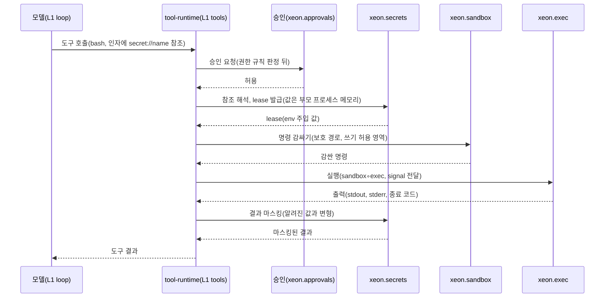

# L0 플랫폼 층

## 1. 목적

L0는 OS와 실행 환경에 따라 달라지는 내부 부분을 공통 인터페이스 뒤에 두고, OS·환경마다 구현만 바꾸는 층이다. 소비자 코드(X, L1~L4)에는 OS 분기를 두지 않는다 [결정: `_research/decisions-log.md` 2026-10-19 설계 규칙, `_research/layer-plan-v2.json` L0 intro "L0는 OS와 실행 환경 차이를 공통 인터페이스 뒤에 둡니다"].

- 범위: 셸·파일 연산의 실행 위치(exec), OS 샌드박스(sandbox), 비밀 해석(secrets), 엔진 프로세스와 전송·자식 수명(process), 단일 SQLite DB와 잠금·블롭(store), 경로·시각·바이너리·알림·감시·텔레메트리(os). 하위 층 6개(`_research/layer-plan-v2.json` L0-a~L0-f)가 패키지 6개에 1:1로 대응한다.
- 층 순위는 F → X → L0 → L1 → L2 → L3 → L4다(`_research/foundation-plan.md` §3). L0 패키지는 F(`@xeon/contracts`)와 X(`@xeon/ext-host`의 등록 API `ExtHost.registerPlatform`, `PlatformModule`, `PlatformContext`)만 import한다. `@xeon/ext-host` import는 서비스 등록·주입 API에 한정한 DR-14 예외다 [결정(잠정): review.decisions-2 U-17]. L0 패키지끼리는 import하지 않는다(`eng.dependency-rules.guide` DR-02). 같은 층 협력은 F에 둔 서비스 인터페이스와 Cordis 서비스 주입으로만 한다.
- L0는 확장 지점을 구독하지 않는다 [제안: `architecture.layers.spec` 4.2절 "L0는 `on`을 쓰지 않는다"]. X에서 쓰는 것은 `PlatformModule.setup`, `PlatformContext.providePort`·`port`, `onDispose`(잠금 해제, 감시 종료, 스팬 내보내기 마무리)뿐이다(`X.primitives.spec` §3.2).
- 예상 가능한 실패는 F `Result`와 `kind` 판별 오류 유니온으로 돌려준다. `throw`는 `Bug`에 한정한다(`eng.typescript.guide` TY-11, TY-12).

순위 제약 [결정(잠정): review.decisions-2 U-14, `architecture.layers.spec` 4.3.3]: X(`ext-host`, 순위 1)는 L0(순위 2) 아래에 둔다. 그래서 `ext-host`는 L0 기능(프로세스 실행, 파일 잠금, 저장, 경로 해석)을 import할 수 없다. X는 이 기능을 F에 둔 포트와 서비스 인터페이스로 주입받는다. 저장은 `ScopedStorePort`, 프로세스 격리는 `ProcessPort`, 탐색과 신뢰 판정용 파일 접근은 `X.loading-trust.spec`의 `LoaderFs`·`LoaderPaths`·`TrustStoreBackend` 포트다. L0가 이 포트를 구현해 `ExtHost.registerPlatform`으로 제공하고, 조립 루트가 `LoaderDeps`로 주입한다. 그래서 OS 분기는 L0 안에만 남는다(DR-13). 순위 유지 조건은 4.3.3의 세 가지다. X 소스와 테스트의 L0·L1 import 0건, 포트와 서비스 인터페이스의 F 정의, L0의 `ExtHost.registerPlatform` 등록이다.

## 2. 도메인

| 계획 v2 id | 도메인 | 패키지 | 서비스 이름(F 인터페이스) | 한 줄 요약 | 범위 | 문서 |
|---|---|---|---|---|---|---|
| L0-a | exec | `platform-exec` | `xeon.exec`(`ExecService`, `ExecutionEnv` 확장) | pi durable `/env` 포크. 파일·셸 연산의 실행 위치(로컬, Docker 어댑터)를 추상화한다 | M0. Docker 어댑터는 M2 이후, 작업 트리 격리는 2차, SSH 원격 워크스페이스는 보류 | [spec](exec/spec.md), [plan](exec/plan.md) |
| L0-b | sandbox | `platform-sandbox` | `xeon.sandbox`(`SandboxService`) | `@anthropic-ai/sandbox-runtime`(srt)로 셸 명령을 Seatbelt·bubblewrap 안에서 실행한다 | M1(OS 샌드박스, 보호 경로). 네트워크 정책·권한 프로필은 2차 | [spec](sandbox/spec.md), [plan](sandbox/plan.md) |
| L0-c | secrets | `platform-secrets` | `xeon.secrets`(`SecretService`) | SOPS + age. 에이전트는 `secret://<name>` 참조만 다루고 값은 실행 직전 부모 프로세스에서 풀린다 | M1(SOPS 참조 1종, lease, 에이전트 env 모드 M1(bash, 실행마다 승인)과 사용 모드 M3, 마스킹 계층 2·4·5). 관리 서비스 `xeon.secretAdmin`, 값 열람 CLI, M4는 M2. sentinel은 후속 | [spec](secrets/spec.md), [plan](secrets/plan.md) |
| L0-d | process | `platform-process` | `xeon.process`(`ProcessService`) | 엔진 전송, 자식 엔진 수명 임대, 백그라운드 프로세스 레지스트리, 공유 서비스 모드 | M1(in-process, 백그라운드 레지스트리). stdio 전송·자식 수명 임대는 M2, 공유 서비스 모드는 제품 1차 범위이고 구현은 M2 이후. 원격 사용(서비스 소켓을 SSH 터널·사설망으로 연결)은 M3. OS 서비스 등록과 내장 TLS 원격 전송은 2차 | [spec](process/spec.md), [plan](process/plan.md) |
| L0-e | store | `platform-store` | `xeon.store`(`StoreService`) | `bun:sqlite` 단일 DB(WAL, 단계 경계 FULL), 세션 소유 잠금, 블롭 저장소 | M0(세션 잠금 포함). 블롭은 M1 | [spec](store/spec.md), [plan](store/plan.md) |
| L0-f | os | `platform-os` | `xeon.os`(`OsService`) | 플랫폼 정보, 디렉터리, 시각·타이머·난수, 로거, 외부 바이너리, 알림·파일 감시·텔레메트리 | M0(경로·시각·ID 발급기 등 기반). 바이너리 해석은 1차(M1). 알림 전달 수단은 1차(M3). 감시·텔레메트리는 2차(M2 이후) | [spec](os/spec.md), [plan](os/plan.md) |

- 서비스 이름과 인터페이스 이름은 `eng.context-map.design` §5.3과 `F.capabilities.spec` §3.12 표가 정본이다. exec의 F 인터페이스는 `ExecService`(`ExecutionEnv` 확장, `withCwd`·`startBackground` 추가)이고, process의 `ProcessService`는 X 포트 `ProcessPort`를 확장한다(`F.extensions.spec` §3.2.1) [결정(잠정): review.decisions-2 D-04].
- 위 표 밖에 L0가 등록하는 서비스가 하나 더 있다. `platform-secrets`의 관리 서비스 `xeon.secretAdmin`(`SecretAdminService`, `L0.secrets.spec` §3.8)이다 [결정(잠정): review.decisions-2 D-04]. 에이전트와 확장에 주지 않고 L4 진입점에만 넘기려고 `xeon.secrets`와 나눴다. `xeon.<도메인>` 이름 규칙(4절)의 예외이고, `F.capabilities.spec` §3.12 표와 `eng.context-map.design` §5.3 표에 행이 있다(9절 10). 패키지 6개 중 exec, sandbox, process는 컨텍스트 `platform-execution` 하나에 속하고, 나머지는 각자 한 컨텍스트다(`eng.context-map.design` §4.1, §4.5).
- 위 서비스 인터페이스와 서비스 이름 상수는 F `@xeon/contracts/services` 서브패스(`src/services/`)에 둔다 [결정(잠정): review.decisions-2 D-04, `F.readme` §3, `F.capabilities.spec` §3.12]. 파일은 `services/exec.ts`(`ExecService`), `services/sandbox.ts`·`services/sandbox-report.ts`(`SandboxService`, `SandboxRunReport`), `services/process.ts`(`ProcessService`), `services/os.ts`(`OsService`), `services/secrets.ts`(`SecretService`), `services/secret-admin.ts`(`SecretAdminService`)다. `StoreService`는 `F.records.spec` §3.9에 있다. 비밀 참조 형식과 비밀 값 타입(`SecretMeta`, `SecretUsePolicy`, `SecretAuditRecord`, `RedactionHit` 등)은 F `capabilities/secrets.ts`가 정본이다(`F.capabilities.spec` §3.10, U-08). 이름과 파일은 F 표에 있고, 필드는 각 도메인 spec 3절의 초안 블록을 F로 옮겨 확정한다(`F.capabilities.plan` P9). 옮기기 전까지는 그 초안이 기준이다.

### 2.1 OS 지원 매트릭스

[결정] 첫 지원 OS는 macOS와 Linux(WSL2 포함)이고 Windows 네이티브는 나중이다(`_research/decisions-log.md` 2026-10-19). 각 칸의 상세와 근거는 해당 도메인 spec의 "플랫폼별 제약" 표에 있다. 확인하지 않은 사실은 [가정]이다.

| 도메인 | macOS | Linux / WSL2 | Windows 네이티브 | 상세 |
|---|---|---|---|---|
| exec | 지원. 시스템 bash·zsh를 쓴다 | 지원 | 제한. bash가 필요하다(Git Bash 등). pi durable env의 셸 가정이 Windows에서 그대로 동작하는지는 [가정] | [L0.exec.spec](exec/spec.md) |
| sandbox | 지원. Seatbelt가 OS에 내장되어 있고 추가로 ripgrep만 필요하다(`_research/notes/L0-1.md`) | 지원. bubblewrap, socat, ripgrep 설치가 필요하다. 없으면 환경 문제로 안내한다 | 미지원. srt Windows는 alpha이고 Claude Code도 네이티브 Windows를 샌드박스 대상에서 뺐다(`_research/refs/claude-code.md` §3.2) | [L0.sandbox.spec](sandbox/spec.md) |
| secrets | 지원. `security find-generic-password -w`로 age 키를 받는다(`SOPS_AGE_KEY_CMD`) | 제한. `secret-tool`은 Secret Service가 필요해 WSL·헤드리스에서 실패하므로 파일 폴백을 쓴다(`_research/notes/L0-3.md`) | 제한. sops `.exe`는 있으나 `cmdkey`로는 암호를 읽을 수 없고, `SOPS_AGE_KEY_CMD`는 셸 없이 실행되어 백슬래시 경로가 깨진다. 키 공급 수단 미정 | [L0.secrets.spec](secrets/spec.md) |
| process | 지원. Unix 소켓 경로 길이 한계(약 104바이트) 때문에 짧은 런타임 디렉터리가 필요하다 | 지원. 파일 소켓과 추상 소켓 모두 실측했다(`_research/notes/L0-2.md`) | 제한. stdio 전송은 같고, Unix 소켓 대안(named pipe 등)이 필요하다 | [L0.process.spec](process/spec.md) |
| store | 제한. 시스템 SQLite의 FTS5 포함 여부가 불확실해 `Database.setCustomSQLite`와 시작 검사가 필요하다(`_research/stack-status.md` 7-D). `flock` 미실측 | 지원. Bun 1.4.3에서 `bun:ffi` `flock`의 SIGKILL 뒤 재획득을 실측했다. WSL `/mnt/*`(drvfs)에는 DB를 두지 않는다 | 제한. `flock`이 없어 잠금 수단이 미정이다. 정적 링크 SQLite의 FTS5 포함 여부는 [미확인] | [L0.store.spec](store/spec.md) |
| os | 지원 | 지원. `notify-send`가 없으면 알림은 무음이다. inotify 감시 한도가 있다 | 제한. 디렉터리 규칙은 정했으나 Windows 알림·감시 구현은 Windows 네이티브 보강 때 하고 권한 비트(0700)는 의미가 없다 | [L0.os.spec](os/spec.md) |

### 2.2 마일스톤 요약

| 도메인 | M0 | M1 | M2 이후(제품 1차 범위) | 2차·후속·보류 |
|---|---|---|---|---|
| exec | 포크 5파일·적합성(Linux), CancelScope·Result·오류 클래스 정리, 플랫폼 provider(darwin·linux), 포크 기록 | env 허용 목록 빌더, `xeon.exec` 서비스 등록, sandbox 데코레이터 접점 시험, `fakeExec`·`memoryFs`, macOS 적합성, 비밀 주입 지점 `secretEnv`(U-19) | 백그라운드 실행 `startBackground`, Docker 어댑터, Windows provider 보강 | 작업 트리 격리(2차), SSH 원격 워크스페이스(보류) |
| sandbox | SB-01 스파이크만(M0 끝) | srt 래핑, 상태 탐지, 보호 경로, 자동 허용 판정, 자가 시험, `onUnavailable`, 위반 기록, `fakeSandbox` | — | 네트워크 정책(2차, M2 이후), 권한 프로필·오프라인 검증(2차), Windows 재평가, 프록시 훅(후속, sentinel 모드) |
| secrets | 코드 없음(F 타입 선행) | SOPS 제공자(목록·lease), 메타 읽기, lease, 에이전트 env 모드 `withEnv`(사용 모드 M1), 사용 모드 M3(`withHttp`), `Redactor` 규칙 1~3, 마스킹 계층 2·4·5, sops 호출 env 필터, 감사 훅, 키 획득(Linux·파일 폴백), `diagnose`, `protectedPaths`, `memorySecrets` | 관리 서비스 `xeon.secretAdmin`(값 열람 `reveal` 포함, CLI M2·데스크톱 화면 M3), 사용 모드 M4, 마스킹 5계층 전체, 키체인 3 OS 실기, 감사 파일 | sentinel 모드(후속), 1Password·Bitwarden·키체인 값 제공자 플러그인 |
| process | — | in-process 전송, 백그라운드 레지스트리, 종료 협조 골격, `xeon.process` 등록 | stdio 전송과 적합성 스위트, 자식 엔진 수명 임대, 잠금 실패 정책, 복구 표식 제시, `ProcessPort.run`(외부 훅)(M2). 공유 서비스 모드(M2 이후). 원격 사용(SSH 터널·사설망, M3) | OS 서비스 등록, 내장 TLS 원격 전송, Windows 전송 대안, `ProcessPort.spawn`(격리 확장 자식)(2차) |
| store | 연결·PRAGMA, FTS5 프로브, 트랜잭션, 접두사 검사, sys v1·v2, 마이그레이션 실행기, 세션 잠금(flock + epoch), `openTestStore` | 블롭(sys v3), 확장 접두사 테이블, 장애 주입 시험, fullfsync 측정 | 블롭 GC, 청크 마이그레이션, Windows `LockProvider`, macOS 동봉 SQLite | — |
| os | `OsInfo`, `OsDirs`, `fsKind`, `Clock`·`Scheduler`·`RandomSource`, `Logger`, `createIdFactory`·`createLocalIdFactory`, 프로세스 지문·`machineId`·`userId`, `tempDir`·`withIsolatedEnv` | 바이너리 해석(rg, security, secret-tool), 서비스 등록 | 알림 전달 수단(M3), 파일 감시, 텔레메트리, 번들 추출 실측 | Windows 보강 |

[결정] M0 범위에 `platform-store`, `platform-exec`가 들어가고 M1에 sandbox(bash), SOPS 비밀 참조 1종이 들어간다(`_research/foundation-plan.md` §5 P4). os 기반을 M0에 두는 것은 store·exec 테스트가 `tempDir`과 시계 구현을 쓰기 때문이다 [제안]. 세션 잠금은 foundation-plan M0 목록(`platform-store` 행)에 있으므로 store M0에 둔다. M1의 SOPS 비밀 참조 1종은 에이전트 env 모드(bash 도구, 실행마다 승인. exec `secretEnv`, secrets `withEnv`)로 검증한다 [결정(잠정): review.decisions-2 U-19].

## 3. 패키지 배치

| 패키지 | 디렉터리 | `package.json` `xeon` 필드 | 진입점 | 테스트 서브패스 |
|---|---|---|---|---|
| `@xeon/platform-exec` | `xeon/packages/platform-exec` | `{"layer": "L0", "domain": "exec"}` | `src/index.ts` | `./testing` |
| `@xeon/platform-sandbox` | `xeon/packages/platform-sandbox` | `{"layer": "L0", "domain": "sandbox"}` | `src/index.ts` | `./testing` |
| `@xeon/platform-secrets` | `xeon/packages/platform-secrets` | `{"layer": "L0", "domain": "secrets"}` | `src/index.ts` | `./testing` |
| `@xeon/platform-process` | `xeon/packages/platform-process` | `{"layer": "L0", "domain": "process"}` | `src/index.ts` | `./testing` |
| `@xeon/platform-store` | `xeon/packages/platform-store` | `{"layer": "L0", "domain": "store"}` | `src/index.ts` | `./testing` |
| `@xeon/platform-os` | `xeon/packages/platform-os` | `{"layer": "L0", "domain": "os"}` | `src/index.ts` | `./testing` |

- 각 패키지의 `src/index.ts`는 L0 등록 단위(`PlatformModule`을 만드는 함수, `X.primitives.spec` §3.2)와 그 설정 타입, 그리고 조립 루트가 쓰는 구현 함수(예: `createExecService`, `createSandboxService`, `openStore`, process의 전송·서비스 모드 함수)를 공개한다 [제안]. 이 진입점은 조립 루트(`apps/host`)만 import한다(`eng.dependency-rules.guide` DR-14 예외 2). 다른 층 소비자는 F 서비스 인터페이스와 F 순수 함수(예: `describeSandboxStatus`, `matchProtectedPath`)로만 쓴다. L4 앱(`apps/cli`, `apps/desktop`)이 구현 함수가 필요하면 `apps/host`가 다시 내보내는 진입점을 쓴다.
- `./testing` 서브패스는 테스트 대역만 공개하고 다른 패키지의 테스트 파일만 import한다(3.3절).
- 임시 타입 규칙 [제안]: F 계약 반영이 늦으면 같은 선언을 패키지 안 비공개 파일(`src/contract-shim.ts`)에 임시로 둘 수 있다. 그 타입을 다른 패키지가 import해야 하는 경우(예: store의 records 타입은 L1·L0 process가 쓴다)에는 이 규칙을 쓰지 않고 F 반영을 기다린다. shim은 F 반영 PR에서 지운다. `L0.exec.plan` EX-02와 `L0.store.plan` 1절이 이 규칙을 따른다.
- 프런트매터 `depends_on`: 라우팅은 `depends_on`을 한 단계만 펼친다(`_routing/routes.yaml` 머리말). 그래서 L0 문서끼리 서로를 적어도 문제가 없고, 본문에서 내용을 가져다 쓰는 L0 문서는 모두 적는다.
- [결정] 내부 패키지는 TS 소스를 그대로 export한다(`_research/foundation-plan.md` §2 빌드 행).

### 3.1 OS provider 규칙

계획 v2는 L0 전체를 "os.* provider. OS별 구현만 바뀜"이라는 한 줄로만 적었다(`_research/layer-plan-v2.json` L0 short). 아래는 그 한 줄을 모든 L0 도메인에 같은 구조로 적용한 것이다 [제안].

| 항목 | 규칙 |
|---|---|
| 인터페이스 | 도메인마다 `<Domain>Provider` 꼴의 내부 계약을 둔다. 이 계약은 패키지 안에만 있고 F에 두지 않는다. F에 두는 것은 소비자가 쓰는 서비스 인터페이스(`OsService` 등)다. provider는 서비스 구현이 OS별 부분을 호출하는 내부 경계다 |
| 구현 파일 | `src/providers/{darwin,linux,win32}.ts` 또는 기능 디렉터리 아래 같은 이름의 파일(`key/`, `lock/`, `registrar/`, `notify/`, `watch/`. 예: `lock/posix.ts`, `registrar/launchd.ts`, `none.ts`). secrets의 `providers/`는 값 제공자(sops) 디렉터리이고 이 표의 OS provider 규칙 밖이다. WSL은 별도 파일 없이 linux provider가 `OsInfo.isWsl` 플래그로 변종 동작을 고른다. 배포 환경에 따라 바뀌는 구현은 OS 이름 대신 환경 id를 쓴다(예: `desktop-tauri`). 환경별 구현은 L4가 플러그인 설정으로 넘긴다 |
| 선택 지점 | `src/select.ts` 한 곳. `process.platform`, `process.arch`, `os.platform()`, WSL 판정(`WSL_DISTRO_NAME`, `/proc/version`)을 읽는 코드는 이 파일에만 둔다. provider 파일(`src/providers/*` 포함)도 이 값을 읽지 않고 `select.ts`가 고른 결과로만 쓰인다 |
| WSL 판정 | 기준은 `L0.os.spec` §3.1 하나다: `platform === "linux"`이고 `WSL_DISTRO_NAME`이 비어 있지 않거나 `/proc/version`에 `microsoft` 또는 `WSL`(대소문자 무시)이 있으면 WSL이다. exec·secrets·store도 이 기준을 쓴다. 예외: sandbox는 그 위에서 WSL1(`/proc/version`에 `Microsoft`가 있고 `WSL2`가 없음)과 WSL2를 나눈다(`L0.sandbox.spec` §3.5) |
| 지원 밖 OS | `select.ts`는 throw하지 않고 값으로 돌려준다(`eng.dependency-rules.guide` DR-13 좋은 예). 그 뒤 동작은 도메인마다 다르다. os·exec: `Result`의 `unsupported_platform`(os는 `unsupported_arch`도)을 받으면 서비스를 등록하지 않고 등록 실패로 알린다(`L0.os.spec` §3.10, `L0.exec.spec` §5.1). os가 등록되지 않으면 나머지 L0도 시작하지 않는다. sandbox: `SandboxProvider`(`kind: "none"`)를 돌려주고 서비스는 등록된 채 `status()`가 `unsupported_os`, 실행은 `onUnavailable` 정책을 따른다(`L0.sandbox.spec` §3.5, §4.5). store: `LockProvider` `none`으로 DB 임대만 쓴다. process: `OsServiceRegistrar` `none`이 `unsupported`를 돌려준다. secrets: win32 동작은 [미결](`L0.secrets.spec` §10 7번). 어느 경우에도 프로세스를 죽이지 않는다 |
| 허용 위치 | OS 분기 표현은 `packages/platform-*/src/**` 안에서만 허용한다(DR-13). 패키지 안에서도 `select.ts` 밖에 두지 않는 것은 이 문서의 추가 규칙이다 [제안] |
| 소비자 | OS 분기를 하지 않는다. OS 차이가 결과에 드러나야 하면 서비스가 능력 질의(예: `OsService.info`, `SandboxService`의 사용 가능 여부)를 제공한다 |

도메인별 OS provider [제안, 이름 확정은 각 도메인 spec]:

| 도메인 | provider | OS별로 바뀌는 것 |
|---|---|---|
| exec | `ExecPlatformProvider` | 기본 셸 경로와 인자, 프로세스 그룹 종료 방식, 경로 구분자 |
| sandbox | `SandboxProvider` | Seatbelt(macOS), bubblewrap + socat(Linux), Windows 미지원 응답 |
| secrets | `KeyProvider` | age 키 조회 명령(macOS `security`, Linux `secret-tool` 또는 파일 폴백, Windows 미정) |
| process | `OsServiceRegistrar`(2차). 소켓 경로 한도와 자식 분리 옵션은 `select.ts`가 고르는 값이다 | launchd·systemd 등록, Unix 소켓 경로 한도. Windows 전송 대안은 [미결 P-6] |
| store | `LockProvider` | `bun:ffi` `flock`(macOS·Linux), Windows 수단 미정 |
| os | `FsKindProvider`, `NotifierProvider`, `WatchBackend`. 디렉터리 규칙은 provider 없이 순수 함수 `resolveDirs`가 `OsInfo`로 분기한다 | 디렉터리 규칙, 파일 시스템 종류 판정, 알림 명령, 감시 백엔드 |

provider id [미결]: 계획 v2는 "os.* provider"라고만 적었고 provider id 이름 규칙(예: `os.exec.shell`, `os.store.lock`)을 정의한 적이 없다. 작성자 권고안은 다음과 같다.

- 슬롯 id는 `os.<도메인>.<슬롯>`이다. 예: `os.exec.shell`, `os.sandbox.isolate`, `os.secrets.key`, `os.process.registrar`, `os.store.lock`, `os.os.notify`, `os.os.watch`. platform-os 자신의 슬롯도 기계적 일관성을 위해 `os.os.`를 쓴다.
- 구현 id는 `darwin`, `linux`, `win32`, `none`(무동작) 또는 환경 id(`desktop-tauri`)다. 전체 표기는 `<슬롯 id>/<구현 id>`다. 예: `os.store.lock/linux`, `os.os.notify/desktop-tauri`.
- 용도는 진단 출력, 로그 필드(`provider`), 환경별 provider 주입 시 대상 지정이다. 설정 키로 provider를 바꾸는 기능은 두지 않는다.

### 3.2 외부 의존 소유

`eng.dependency-rules.guide` DR-07 표 가운데 L0 행을 옮겼다. platform-os 행과 `bun:ffi` 행은 [결정(잠정): review.decisions-2 U-17]로 DR-07 표에 들어갔다. 소유 패키지 밖에서 import하거나 호출하면 `check-layers.ts`가 거부한다.

| 외부 모듈·바이너리 | 소유 패키지 | 근거 | DR-07 표 |
|---|---|---|---|
| `bun:sqlite` | `platform-store` | packages.md §4.2 L0-e, foundation-plan §2 DB 행 | 있음 |
| `sops`, `age` 바이너리 호출 | `platform-secrets` | foundation-plan §2 비밀 행 | 있음 |
| `@anthropic-ai/sandbox-runtime` | `platform-sandbox` | packages.md §4.2 L0-b | 있음 |
| `node:child_process`, `Bun.spawn`, `Bun.spawnSync` | `platform-exec`, `platform-process`, `platform-sandbox`, `platform-secrets`, `platform-os` | DR-13. `platform-os`는 알림 명령, 시스템 바이너리 버전 확인 | 있음 |
| pi durable env 포크 | `platform-exec`(`src/upstream/`) | ADR-0003 포크 배치, foundation-plan §1 결정 1 | 있음 |
| `@vscode/ripgrep` 1.18.0 | `platform-os` | packages.md §4.2 L0-f | 있음 |
| `@parcel/watcher` | `platform-os` | packages.md §4.2 L0-f, 지원 패키지 표 | 있음 |
| `pi-telemetry` 1.3.0, `@opentelemetry/sdk-trace-node` 2.12.0 | `platform-os` | packages.md §4.2 L0-f | 있음 |
| `@opentelemetry/api` 1.10.0 | F는 `import type`만, 값 import는 `platform-os` | F.readme §1, `F.wire-settings.spec` §3.6 | 있음 |
| `bun:ffi` | `platform-store`(`flock`) | `_research/notes/L0-2.md` | 있음 |

- 포크 코드는 포크를 소비하는 패키지의 `src/upstream/` 아래에 두고 `UPSTREAM.json`, `PATCHES.md`, `// XEON-PATCH:` 표지를 맞춘다(adr.0003). L0에서 포크를 두는 패키지는 `platform-exec` 하나다.

### 3.3 테스트 서브패스

| 서브패스 | 제공 | 쓰는 곳 | 근거 |
|---|---|---|---|
| `@xeon/platform-os/testing` | `tempDir`, `withIsolatedEnv` | 모든 L0·L1 패키지의 테스트 | `eng.testing.guide` §1.2, TS-03 |
| `@xeon/platform-exec/testing` | `fakeExec`(명령별 응답 표) | L1 tools, L2 workspace 테스트 | `eng.testing.guide` §1.2, TS-05 |
| `@xeon/platform-secrets/testing` | `memorySecrets`(가짜 값 저장소) | L1 models·tools, L2 web·mcp 테스트 | `eng.testing.guide` §1.2, TS-05 |
| `@xeon/platform-store/testing` | `openTestStore`(실제 `bun:sqlite`, `:memory:` 또는 임시 파일, 고장 주입 옵션) | L1 persistence, L2 knowledge 등 테스트 | `eng.testing.guide` §1.2, TS-07, TS-08 |
| `@xeon/platform-sandbox/testing` | `fakeSandbox`(상태와 판정을 표로 고정, `wrapShell`은 기록만 하는 통과 데코레이터) | L1 tools, L2 workspace 테스트 | `L0.sandbox.spec` §8.1, `L0.sandbox.plan` §2 |
| `@xeon/platform-process/testing` | `fakeEngine`(stdio 자식 엔진 시뮬레이터), `idleClock`, 전송 적합성 하네스 연결 | L4 host-service·desktop 테스트 | `L0.process.spec` §8, `L0.process.plan` §2 |

- 다른 컨텍스트 패키지의 `testing` 서브패스는 테스트 파일에서만 import한다(DR-08, DR-14 예외 3).
- 시계·난수·ID 대역(`manualClock`, `seededRandom`, `fixedIdFactory`)은 F에 두지 않는다. F에는 `./testing` 서브패스가 없고, 대역은 쓰는 패키지의 `test/` 안에 둔다 [결정(잠정): review.decisions-2 U-03]. 운영 구현과 ID 발급기 구현은 `platform-os`다(`L0.os.spec` §3.4).

## 4. 이름 규칙

| 대상 | 규칙 | 예 | 정본 |
|---|---|---|---|
| 패키지 | `@xeon/platform-<도메인>` | `@xeon/platform-store` | `_routing/routes.yaml` layout L0 |
| 서비스 이름 | `xeon.<도메인>`. 예외 `xeon.secretAdmin`(9절 10) | `xeon.os` | `eng.context-map.design` §5.3 |
| F 서비스 인터페이스 | `<Name>Service`와 `<Name>ServiceName` 상수. exec는 `ExecService`(`ExecutionEnv` 확장)와 `ExecServiceName`이다(`L0.exec.spec` §3.1) | `OsService`, `OsServiceName`, `ExecService` | `eng.context-map.design` §5.3, `F.capabilities.spec` §3.12 |
| 내부 OS 계약 | `<Domain>Provider` | `LockProvider` | 3.1절 [제안] |
| provider id | `os.<도메인>.<슬롯>/<구현 id>` | `os.store.lock/linux` | 3.1절 [미결] |
| 설정 키 | `l0.<도메인>.<이름>`. 이름 부분은 소문자 낙타 표기이고 점으로 더 나눌 수 있다 | `l0.store.busyTimeoutMs`, `l0.os.log.level` | `F.wire-settings.spec` §3.8.1 |
| 테이블 | `sys_*`(store만) | `sys_leases` | `eng.context-map.design` §5.2 |
| 오류 판별 필드 | `kind`, snake_case 값 | `{ kind: "unsupported_platform" }` | `eng.typescript.guide` TY-12 |

- 설정 키는 각 도메인 spec 6절 "설정 노출"이 `defineSettings` 선언과 같은 열(키, 타입, 기본값, range, runtimeChange, allowedScopes, ui.tab, secret)과 L4 노출 열로 적는다(`F.wire-settings.spec` §6).
- 이벤트 type 접두사: L0는 소유하지 않는다(6절).

## 5. 소비 지도

`eng.context-map.design` §4.1 (d)열과 §5.3 소비 열에서 옮기고 각 도메인 spec 8절의 소비자 목록으로 보강했다. 보강한 칸(`tool-runtime`의 process·store, `run-engine` 행, `session-core`의 process, `workspace`의 sandbox, L0 안 소비)은 context-map에 아직 없다. §5.3 수정을 요청한다(9절 미결 9).

| 소비 컨텍스트(층) | exec | sandbox | secrets | process | store | os |
|---|---|---|---|---|---|---|
| `tool-runtime`(L1 tools) | ○ | ○ | ○ | ○ | ○(`putBlob`·`readBlob`) | |
| `run-engine`(L1 loop, context) | | | ○(loop 1계층 `mask`, context 4계층 `maskDeep`) | ○(loop 종료 협조) | ○(context `readBlob`) | |
| `model-gateway`(L1 models) | | | ○ | | | |
| `session-core`(L1 persistence) | | | | ○(종료 협조 참여) | ○ | |
| `workspace`(L2) | ○ | ○ | | | | ○ |
| `mcp`(L2) | | | ○ | ○ | ○ | |
| `web`(L2) | | | ○ | | ○ | |
| `knowledge`, `artifacts`(L2) | | | | | ○ | |
| `dialog`(L2) | | | | | | ○ |
| `schedule`(L2) | | | | ○ | ○ | ○ |
| `host`(L4 `apps/host`) | | | | ○ | ○ | ○ |
| `platform-execution`(L0 exec·sandbox·process) | | | ○ | | ○(process `leases`) [제안] | ○ [제안] |
| `platform-secrets`, `platform-store`(L0) | | | | | | ○ [제안] |

- L0 안의 소비(마지막 두 행)는 Cordis 서비스 주입으로 한다. `platform-execution`의 `xeon.secrets` 소비는 context-map에 있고, L0 패키지들의 `xeon.os` 소비(경로, `fsKind`, 바이너리 경로, 시계, 프로세스 지문), sandbox의 `xeon.secrets.protectedPaths()`, process의 `xeon.store` 임대는 context-map (d)열에 아직 없다. 추가를 요청한다(9절 미결 9).
- L4 `apps/cli`·`apps/desktop`이 쓰는 process 함수(`ensureService` 등)는 `apps/host` 경유이고(`L0.process.spec` §3.2), sandbox 상태 문구(`describeSandboxStatus`)는 F 순수 함수다(`L0.sandbox.spec` §3.1). 그래서 L4 클라이언트 행은 표에 두지 않는다.
- `host`는 조립 루트라 서비스를 주입받는 대신 L0 등록 단위를 직접 import해 `ExtHost.registerPlatform`으로 등록한다(DR-14 예외 2). 표의 ○는 런타임에 쓰는 서비스다.

협력 흐름 예: 모델이 bash 도구를 부르는 경우. 비밀 env 주입 단계(아래 `xeon.secrets` lease)는 M1 비밀 검증 경로다 [결정(잠정): review.decisions-2 U-19]. 결합(비밀 해석 → 샌드박스 감싸기 → 실행 → 마스킹)은 L1 tool-runtime이 한다. L0 패키지끼리는 서로 부르지 않는다 [제안, 상세는 `L1.tools.spec`].

## 6. 층 경계

L0가 정하지 않는 것:

| 대상 | 정하는 곳 |
|---|---|
| 도구 권한 규칙, 승인 프로토콜과 승인 UI | `L1.tools.spec`, `L4.settings-ui.spec` |
| 세션 이벤트, `seq` 발급, 투영, 재생·재개 규칙 | `L1.persistence.spec`, `F.records.spec`. L0 store는 DB 열기·PRAGMA·트랜잭션·임대·블롭 같은 일반 기능만 제공한다(`eng.context-map.design` §4.4 10번) |
| 전송 계약 형식(JSON-RPC, 메서드 레지스트리, 커서) | `F.wire-settings.spec` |
| 서비스 명령줄(`xeon service`, `xeon secret …`)과 설정 화면 | `L4.cli.spec`, `L4.host-service.spec`, `L4.settings-ui.spec` |
| 웹 fetch·검색, MCP 서버 연결과 도구 | `L2.web.spec`, `L2.mcp.spec` |
| 모델 호출, 비밀 참조를 쓰는 provider 인증 | `L1.models.spec` |
| 설정 파일 위치와 읽기 | L4. L0 os는 디렉터리 경로만 제공한다 |

이벤트 type 규칙 [제안: `eng.context-map.design` §4.1 (b)열]: `platform-*`는 이벤트 type 접두사를 소유하지 않고 내구 이벤트를 쓰지 않는다. L0 동작의 결과를 기록해야 하면 그 동작을 부른 상위 컨텍스트가 자기 접두사로 쓴다(예: 도구 실행 결과는 `tool.`). 비밀 사용 감사(`_research/layer-plan-v2.json` L0-c "사용 감사 이벤트")도 이 규칙을 따른다. `platform-secrets`는 `onAudit`로 레코드만 내고, 세션 이벤트 `secret.used`, `secret.denied`, `secret.approved`, `secret.masked`는 tool-runtime(`core.tools`)이 기록한다(`F.records.spec` §3.3.1, `L0.secrets.spec` §3.9). 관리 레코드(`created`, `rotated`, `revealed` 등)는 세션 이벤트가 아니다.

변경 규칙:

- L0 서비스 인터페이스는 F에 있으므로 바꿀 때는 F 문서를 먼저 고치고 소비 층 문서와 코드를 같은 변경에서 고친다(F.readme §6).
- 서비스 이름 문자열을 바꿀 때는 `eng.context-map.design` §5.3을 먼저 고친다(CM-04).
- OS provider 구현만 바꾸는 변경은 소비자 문서를 고치지 않는다. 이것이 이 층을 둔 이유다.

## 7. 결정 근거

| 결정 | 근거 |
|---|---|
| [결정] OS·환경마다 달라지는 부분은 공통 인터페이스 뒤에 두고 구현만 바꾼다. 소비자 코드에 OS 분기를 두지 않는다 | `_research/decisions-log.md` 2026-10-19 설계 규칙, `eng.dependency-rules.guide` DR-13 |
| [결정] 첫 지원 OS는 macOS, Linux(WSL 포함). Windows 네이티브는 나중 | `_research/decisions-log.md` 2026-10-19 |
| [결정] 층 순위 F → X → L0 → L1 → L2 → L3 → L4, 같은 층 import 금지 | `_research/foundation-plan.md` §3 |
| [결정] pi durable은 env·tools·images·truncate만 Chord 제거 포크하고, `CancelScope`로 치환한다 | `_research/decisions-log.md` 2026-10-21 결정(3차), adr.0003 |
| [결정] 세션 저장은 SQLite 이벤트 소싱 + 투영, 단일 DB, 확장 접두사 테이블(`x_<확장 id의 하이픈을 밑줄로>_`). 세션 쓰기 소유는 OS 잠금(생존 판정) + `sys_leases.epoch` 펜싱 [결정(잠정): review.decisions-2 U-09, U-18] | `_research/decisions-log.md` 2026-10-21 결정(2차), adr.0004 |
| [결정] DB는 `bun:sqlite`(WAL, 단계 경계 FULL). macOS는 FTS5 포함 SQLite를 지정한다 | `_research/foundation-plan.md` §2 DB 행 |
| [결정] 비밀 기본값은 SOPS(age). 에이전트는 값을 모른 채 참조로 쓴다 | `_research/decisions-log.md` 2026-10-21 결정(2차), `_research/foundation-plan.md` §2 비밀 행 |
| [결정] 샌드박스는 `@anthropic-ai/sandbox-runtime` | `_research/foundation-plan.md` §2 샌드박스 행 |
| [결정] 공유 서비스 모드 `xeon service`(자동 기동, 유휴 종료)는 1차, OS 서비스 등록은 2차. 원격 사용은 1차(M3)이고 서비스 소켓을 SSH 터널·사설망으로 연결한다 [결정(잠정): review.decisions-2 U-11] | `_research/foundation-plan.md` §1 표 2번, adr.0006 |
| [결정] DI는 Cordis 하나. L0는 ext-host `ExtHost.registerPlatform`으로 서비스를 등록한다(DR-14 예외, review.decisions-2 U-17) | `_research/decisions-log.md` 2026-10-21 결정(3차), adr.0002 |
| [결정] Bun 1.4 런타임, 데스크톱은 Tauri 2 + `bun build --compile` 사이드카 | `_research/foundation-plan.md` §1 표 3번, §2 |

## 8. 수용 기준

1. `docs/xeon/L0/{exec,sandbox,secrets,process,store,os}/{spec,plan}.md` 12개가 있고, 각 spec의 서비스 이름이 `eng.context-map.design` §5.3 표(`xeon.exec`, `xeon.sandbox`, `xeon.secrets`, `xeon.process`, `xeon.store`, `xeon.os`)와 같다. `just docs-route --check`가 이 문서들의 `depends_on`·`binds` 오류 0건을 보고한다.
2. `just check-layers`가 `xeon/packages/platform-*` 6개를 `layer: "L0"`으로 인식하고, L0 패키지 사이 import가 0건이다. 일부러 넣은 `platform-os` → `platform-store` import에 `DR-02` 위반을 보고한다.
3. OS 분기 검사(`check-layers.ts`의 DR-13 호출 패턴 검사)가 `process.platform`, `process.arch`, `os.platform()`, `WSL_DISTRO_NAME`, `/proc/version` 참조를 `packages/platform-*/src/**` 밖에서 0건으로 보고한다. 패키지 안에서는 `src/select.ts` 밖 0건이다(`src/providers/*`와 기능 디렉터리의 OS 파일 포함) [제안].
4. L0 여섯 패키지(os, exec, sandbox, secrets, process, store)의 `package.json` `exports`에 `./testing`이 있고, 3.3절 표의 이름을 export한다.
5. `MODULE_OWNERS`(DR-07 코드 상수)에 3.2절 표의 모든 행이 있고, 소유 밖 import 샘플이 `DR-07` 위반으로 실패한다.
6. 어떤 `platform-*` 패키지도 내구 이벤트 kind를 등록하지 않는다(F 이벤트 카탈로그 검사에서 L0 소유 kind 0건).

근거 위치: `_research/layer-plan-v2.json` L0, `eng.context-map.design` §4.1·§5.3, `eng.dependency-rules.guide` DR-02·DR-07·DR-13·DR-14, `eng.testing.guide` §1.2.

## 9. 미결 사항

도메인별 세부 미결은 각 문서의 미결 사항 절에 있다: `L0.exec.spec` 미결 사항, `L0.sandbox.spec` 미결 사항, `L0.secrets.spec` 미결 사항, `L0.process.spec` 미결 사항, `L0.store.spec` 미결 사항, `L0.os.spec` 미결 사항. 아래는 층 전체에 걸친 것만 모은다.

1. [미결] provider id 이름 규칙. 계획 v2는 "os.* provider"만 적었다. 권고안은 `os.<도메인>.<슬롯>/<구현 id>`다(3.1절).
2. [결정(잠정): review.decisions-2 D-04] F에 L0 서비스 인터페이스를 두는 서브패스는 `@xeon/contracts/services`다(2절). `StoreService`는 `F.records.spec` §3.9에 그대로 둔다. `eng.context-map.design` §5.3 표는 L0 서비스 위치를 "(services)"로 적는다.
3. [결정(잠정): review.decisions-2 U-03] `Clock`·`Scheduler`·`RandomSource`·`Logger`는 인터페이스만 F 루트 base에 두고, 운영 구현과 `createIdFactory`·`createLocalIdFactory`는 `platform-os`에 둔다. `@xeon/contracts/testing` 서브패스는 두지 않고 테스트 대역은 쓰는 패키지의 `test/` 안에 둔다(3.3절).
4. [결정(잠정): review.decisions-2 D-04] `CancelScope`는 F `services/exec.ts`에 둔다(`F.capabilities.spec` §3.12 파일별 이름 표, `L0.exec.spec` §3.2). `eng.typescript.guide` §1.2·TY-22 문구 정정과 `abortSignal`의 `undefined` 허용 여부는 `L0.exec.spec` 미결 1로 남는다.
5. [결정(잠정): review.decisions-2 U-09] 세션 쓰기 소유 판정은 OS 잠금(`bun:ffi` `flock` 사이드카 파일, 세션 id 키) + `sys_leases.epoch` 펜싱이다. `session_owner`는 두지 않고 `sys_leases` 행이 표시를 겸한다. adr.0004 §3.4와 adr.0006은 이에 맞게 개정한다(decisions 문서 담당). Windows 수단과 Bun FFI experimental 경고 원문 확인은 `L0.store.spec` 미결 S-5·S-10으로 남는다.
6. [미결] 전송 구현의 층 배치. F.readme §6은 "전송 구현"을 L4가 정한다고 적었고, 계획 v2 L0-d는 "엔진 라이브러리와 전송"(in-process, stdio JSONL)을 L0 process 구성요소로 둔다. 두 문서 중 하나를 고친다.
7. 닫음. 감사 이벤트 소유자는 (a)안(tool-runtime 발행)이다(`F.records.spec` §3.3.1, `L0.secrets.spec` §3.9). 세션 밖 관리 레코드 저장 위치만 `L0.secrets.spec` 미결 1로 남는다.
8. [결정(잠정): review.decisions-2 U-17] DR-07 표에 `platform-os`의 `@vscode/ripgrep`, `@parcel/watcher`, OTel SDK, `pi-telemetry`, `Bun.spawn`(알림 명령, 시스템 바이너리 버전 확인)과 `platform-store`의 `bun:ffi` 행이 있다(`eng.dependency-rules.guide` DR-07, 3.2절).
9. [미결] 서비스 소비 관계의 context-map 반영. (1) exec·sandbox·process·secrets·store가 `xeon.os`(경로, `fsKind`, 바이너리 경로, 시계, 프로세스 지문)를 주입받는 관계, sandbox의 `xeon.secrets`(`protectedPaths`), process의 `xeon.store`(임대)를 `eng.context-map.design` §4.1 (d)열에 더해야 한다. `platform-os`가 쓰는 서비스는 없다. (2) §5.3 소비 열에 `xeon.sandbox` → workspace(이미 있음), `xeon.process` → tool-runtime·run-engine·session-core, `xeon.secrets` → run-engine, `xeon.store` → tool-runtime·run-engine을 더한다(5절 표).
10. [결정(잠정): review.decisions-2 D-04] `xeon.secretAdmin` 서비스(`L0.secrets.spec` §3.8, §10 8번)는 `xeon.<도메인>` 이름 규칙의 예외로 둔다. `F.capabilities.spec` §3.12 표, `SERVICE_NAMES`, `eng.context-map.design` §5.3 표에 행이 있다.
11. [결정(잠정): review.decisions-2 U-19] 마일스톤 M1의 비밀 경로는 에이전트 env 모드(bash 도구, 실행마다 승인)다. exec `secretEnv`와 secrets `withEnv`를 M1에 둔다(`L0.exec.spec` §3.6, `L0.secrets.spec` §3.6). `L2.workspace.spec` §3.3, `product.scope.spec` §4.4 M1 행과 같은 배치다.
