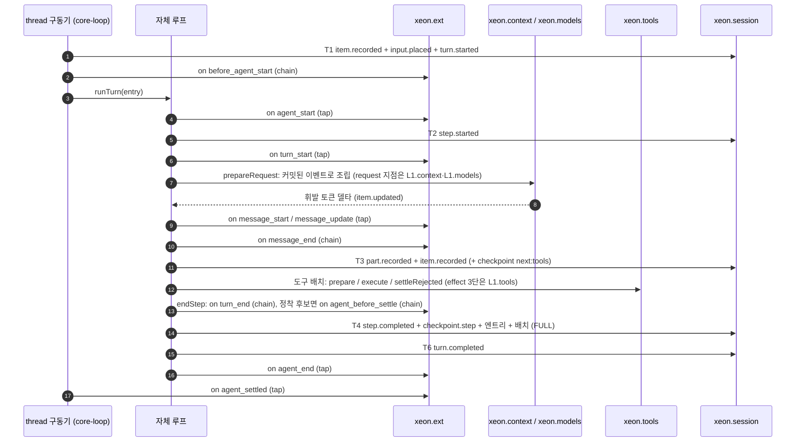

# L1 에이전트 루프 (loop)

- 패키지: `xeon/packages/core-loop`(`@xeon/core-loop`), 계획 id L1-b "에이전트 루프"(`_research/layer-plan-v2.json` L1-b).
- 컨텍스트: `run-engine`(`eng.context-map.design` §4.1, §4.5).
- Cordis 서비스: `xeon.loop`(`eng.context-map.design` §5.3). 이 문서는 인터페이스 이름을 `LoopService`로 정한다.
- 외부 모듈: `@earendil-works/pi-agent-core`는 어느 패키지도 import하지 않는다. 루프는 pi-agent-core 1.3.0 루프를 포크한 core-loop 자체 코드다(adr.0009). `@earendil-works/pi-ai`는 core-models 소유라 core-loop는 직접 import하지 않는다(`eng.dependency-rules.guide` DR-07). 대화 타입(`AgentMessage`, `AgentEvent`, `AgentTool`)은 F conversation이 정의한 것, pi-ai 타입은 F가 다시 export한 이름을 쓴다(`F.conversation.spec` §3.1).

## 1. 목적과 범위

### 1.1 정하는 것

- `LoopService` API: 입력 admit, turn 실행, drive의 `loop.turn` 진입점, 자식 thread turn 진입점(`runChildTurn`), interrupt, resume, 안전 경계 정지.
- 자체 루프 구조: 진입점, 단계 순서, 도구 배치 규칙, pi 루프 대비 처리표.
- `AgentEventMapper`(`F.conversation.spec` §3.5.5) 구현 규칙과 휘발 이벤트 `n`, `afterSeq` 발신.
- turn 하나의 커밋 목록, 단계 체크포인트 커밋, `next` 판별자별 재진입 규칙, 재개 진입.
- 예산(pi 방식), drive 임대 연동, 완료 게이트, 반복 감지(2차), 가드레일 자리(보류).
- 발화 지점 12개의 발화 위치.
- 설정 `l1.loop.*`, 이벤트 소유 제안, F 요청 사항.

### 1.2 다루지 않는 것

- 입력 큐 저장, 범위 트리, 취소 순서, 동시 상한: `L1.tasks.spec`.
- 도구 파이프라인, `tool_call`·`tool_result` 지점 발화, 효과 3단 커밋 순서, 승인 대기: `L1.tools.spec`.
- 컨텍스트 조립, 컴팩션, `context`·`context_with_system` 지점: `L1.context.spec`.
- 모델 선택, provider 요청 지점, 추론 레벨별 토큰 예산 값: `L1.models.spec`.
- 커밋 구현, 투영, 열 때 복구, 재개 횟수 상한: `L1.persistence.spec`.
- 서브에이전트 생성과 목표 판정 모델 호출: `L1.agents.spec`. 목표 지속 기능 자체는 `L2.work.spec`.
- drive 임대 중재와 `LoopHandle` 구현: `X.primitives.spec`.

### 1.3 근거

- [결정] pi-agent-core에 의존하지 않는다. 1.3.0(MIT) 루프를 core-loop로 포크해 자체 루프로 다시 설계하고 pi-agent-core는 참고로만 쓴다(adr.0009, 사용자 지시 2026-10-22). 이전 판의 "1.3.0 정확 고정 + 훅 래핑"(`_research/foundation-plan.md` §2 모델·루프 행)은 adr.0009가 대체한다.
- [결정] 예산은 pi 방식이다. 기본 단계·비용 상한이 없고 상한은 drive 임대에만 건다(`_research/decisions-log.md` 2026-10-21 계획 v2, adr.0007 §3.5 예산 행).
- [결정] 단계 경계에서 한 트랜잭션으로 커밋하고 그 커밋은 `synchronous=FULL`이다(adr.0004, `architecture.runtime-flow.design` §3).
- [결정] 확장은 on, post, drive, scope 4연산으로만 끼어든다. `on` 핸들러는 다시 실행해도 되는 질의다(adr.0007 §3.1, §3.5).
- 조사: pi-agent-core 1.3.0 TS는 1.1.0 릴리스와 바이트 동일하다(`_research/notes/L1-1.md` §0). 이 문서가 인용하는 원본 줄 번호는 `~/projects/_ref/pi-src/packages/agent/src`(1.1.0 = 1.3.0) 기준이다.

## 2. 용어

| 용어 | 뜻 |
|---|---|
| 루프 (own loop) | pi-agent-core 1.3.0 루프를 포크해 다시 설계한 core-loop 내부 모듈. `runTurn(entry)` 하나가 turn 하나를 실행한다(§3.2) |
| 매퍼 (mapper) | 루프가 낸 `AgentEvent`(F 정의) 열을 `LifecycleEvent` 열로 바꾸는 `AgentEventMapper` 구현 |
| thread 구동기 | thread 하나의 turn 시작을 차례로 세우는 core-loop 내부 모듈. 큐 입력과 drive turn 요청을 받는다 |
| 커밋 지점 | 이 문서가 정한 turn 안의 커밋 위치 T1~T6(§3.5) |
| 정착 후보 단계 | 도구 호출이 없거나 배치가 `terminate`로 끝났고, 선택된 steer가 없는 단계. 이어질 요청이 없으면 turn이 정착한다 |
| 게이트 계속 | 정착 후보 단계에서 boundary 지점의 `continue`가 만든 추가 요청 |
| 안전 경계 | 단계 경계. `stopAtSafeBoundary`가 멈추는 위치 |

### 2.1 Xeon turn/step과 pi 이름

`F.conversation.spec` §2.1, `F.extensions.spec` §2를 그대로 따른다. `AgentEvent` 변형 이름은 pi와 같게 두었다(adr.0009 §3.2).

| Xeon | pi agent-core(참고) | 자체 루프 단계 | 지점 이름(pi 이벤트명) |
|---|---|---|---|
| turn 시작 | run 시작, `agent_start` | `runTurn` 시작 | `before_agent_start`(시작 전), `agent_start` |
| step 시작 | `turn_start` | `openStep`(S1 뒤) | `turn_start` |
| step 끝(단계 경계) | `finishTurn` 훅 → `turn_end` | `endStep`(C5) | `turn_end` |
| turn 정착 직전 | (없음) | `endStep`의 정착 후보 판정 뒤 | `agent_before_settle` |
| turn 끝 | `agent_end` | T6 뒤 | `agent_end`, `agent_settled`(정착 뒤) |

## 3. 인터페이스

다른 L1 패키지와 X, L4가 같은 타입을 쓰므로 서비스 인터페이스 `LoopService`와 이름 상수는 F `@xeon/contracts/services` 서브패스에 둔다 [결정: review.decisions-2 D-04](§8.1 FR-L1). `isolatedDeclarations` 때문에 export 상수에는 명시 타입을 단다.

X가 부르는 부분의 기준은 `X.primitives.spec` §3.6 `LoopPort`다. X(순위 1)는 L1을 import할 수 없으므로 L1이 X가 정한 포트를 구현한다. `LoopPort`, `InputQueuePort`와 그 요청·결과 타입은 F.extensions `ports.ts`(`F.extensions.spec` §3.2.1)에 두고 X와 L1이 모두 F에서 import한다(FR-L1). `RecordCommitPort`는 `F.records.spec` §3.9 `session-service.ts`에 있다. `LoopService`는 `LoopPort`를 확장한다. 같은 Cordis 서비스에 두 모양을 함께 둘 때의 규칙은 하나다 [제안]: 최상위 메서드 이름이 포트와 겹쳐 시그니처가 다를 때만 하위 객체로 나누고(`L1.persistence.spec` §3.3 `SessionService.ext`), 겹치지 않으면 포트 메서드를 최상위에 둔다(이 문서, `L1.tasks.spec` §7). 이 문서는 겹치는 `status`를 L1 쪽 이름 `threadStatus`로 바꿔 최상위에 둔다.

### 3.1 LoopService

```ts
// 파일 위치: F @xeon/contracts/services(review.decisions-2 D-04). 포트 타입은 F.extensions ports.ts에서 가져온다
// 그 전까지 아래 경로는 F.records.spec·F.extensions.spec에 실제로 있는 파일과 L1.persistence FR-P1 제안 파일만 가리킨다.
import type { Result } from "../base/index.ts";
import type { EventId, ImageContent, TextContent, ThreadId, TurnId } from "../conversation/index.ts";
// [제안: L1.persistence.spec FR-P1의 records/commit.ts]. F.records.spec §3.8의 현재 파일은 store.ts(AppendError, SessionStore)뿐이다
import type { StoreError } from "../records/commit.ts";
import type { PostItem } from "./index.ts";
// F.extensions.spec §3.2.1 ports.ts의 LoopPort와 요청·결과 타입(FR-L1 반영)
import type { LoopPort, LoopTurnResult, UserBashResult } from "../extensions/index.ts";
import type { InputMode, TaskScope } from "./tasks-service.ts";
// [가정] F 안에서 extensions가 capabilities 타입을 import할 수 있다(F 내부 순서는 F 문서가 정한다)
import type { AdvertisedToolset, CallerId, ChildLimits, PolicyCeiling } from "../capabilities/index.ts";

export const LoopServiceName: "xeon.loop" = "xeon.loop";

export interface AdmitRequest {
  readonly threadId: ThreadId;
  readonly content: string | readonly (TextContent | ImageContent)[];
  /** 대화 범위 멱등 키 1~64자. 생략하면 IdFactory로 만든다 */
  readonly requestId?: string;
  readonly via: "interactive" | "rpc";
  /** turn 실행 중일 때 들어갈 모드. 생략하면 "followUp" */
  readonly whenBusy?: "steer" | "followUp" | "aside";
}

export type AdmitResult =
  | { readonly status: "started"; readonly inputId: EventId; readonly turnId: TurnId }
  | { readonly status: "queued"; readonly inputId: EventId; readonly mode: InputMode; readonly runningTurnId: TurnId | null }
  | { readonly status: "duplicate"; readonly inputId: EventId; readonly turnId: TurnId | null }
  /** input 지점 chain이 handled로 끝났다. 아무것도 기록하지 않는다 */
  | { readonly status: "handled" };

// drive의 LoopHandle.turn 진입점은 LoopPort.runTurn(LoopTurnRequest)이다(X.primitives.spec §3.6, 이 문서 §4.8).
// 요청은 threadId, scopeId, leaseId, leaseEpoch, requestId, input, signal이다.
// 순번(requestId 기본값)과 토큰 예산은 X가 LeaseBudget과 상태 판으로 계산한다(X.primitives.spec §4.4.4). 이 문서는 받지 않는다.

/** 자식 thread turn 실행 요청. L1.agents가 부른다(L1.agents.spec §4.1 5번, 이 문서 §4.13) */
export interface ChildTurnRequest {
  /** 자식 thread. thread.started와 부모의 agent.spawned는 core-agents가 이미 커밋했다 */
  readonly threadId: ThreadId;
  /** 첫 turn이면 task 텍스트(user item). 끝난 자식에게 다시 묻는 경우 그 입력 */
  readonly input: PostItem;
  /** 자식 requestId(L1.agents.spec §4.5). turn.started.requestId가 되고 멱등 키로 쓴다 */
  readonly requestId: string;
  /** 정의 prompt. L1.context 조립의 기본 프롬프트로 넘긴다 */
  readonly systemPrompt: string;
  /** ModelRole 이름 또는 ModelRef 문자열. xeon.models가 해석한다 */
  readonly model: string;
  /** 자식 ToolRunContext에 넣을 값(L1.tools.spec §3.2, §3.4) */
  readonly tools: {
    readonly caller: CallerId;
    readonly depth: number;
    readonly ceiling: PolicyCeiling;
    readonly surfaceThreadId: ThreadId;
    readonly interactive: boolean;
    readonly allow?: readonly string[];
    readonly keepParentList?: { readonly parent: AdvertisedToolset };
  };
  /** 자식 subagent 범위 노드. turn 노드를 이 아래에 연다(L1.tasks.spec §4.1) */
  readonly scope: TaskScope;
  readonly limits?: ChildLimits;
  readonly signal: AbortSignal;
}

/** 사용자 셸(`!명령`, `!!명령`) 실행 요청 [결정: m2 F.8] */
export interface UserBashRequest {
  readonly threadId: ThreadId;
  readonly command: string;                          // 접두 `!`·`!!`를 뗀 명령줄
  readonly excludeFromContext: boolean;              // `!!` 접두. true면 결과를 모델 컨텍스트에 넣지 않는다(UserBashPayload.excludeFromContext)
  readonly requestId?: string;                       // 대화 범위 멱등 키 1~64자. 같은 키로 다시 부르면 기록된 결과를 돌려준다
  readonly signal?: AbortSignal;                     // 중단하면 명령을 끊고 result.cancelled가 참인 결과로 끝난다
}

export type UserBashOutcome =
  /** 실행이 끝났다. replaced가 참이면 user_bash 핸들러가 결과를 대체해 명령을 실행하지 않았다. UserBashResult는 F.extensions의 것이다 */
  | { readonly status: "completed"; readonly result: UserBashResult; readonly replaced: boolean }
  /** user_bash 지점이나 정책 deny가 막았다. 명령을 실행하지 않았다. reason은 사용자에게 보이는 문장이다 */
  | { readonly status: "denied"; readonly reason: string };

export type ResumeFrom = "turn_start" | "request" | "tools" | "await_input" | "turn_end";

export type ResumeResult =
  | { readonly status: "resumed"; readonly turnId: TurnId; readonly from: ResumeFrom }
  | { readonly status: "closed"; readonly turnId: TurnId; readonly reason: "abort_requested" | "owner_cancelled" }
  | { readonly status: "nothing" };

export interface ThreadLoopStatus {
  readonly threadId: ThreadId;
  readonly runningTurnId: TurnId | null;
  readonly stepIndex: number | null;
  readonly phase: "idle" | "requesting" | "tools" | "waiting" | "settling";
}

export type LoopError =
  | StoreError
  | { readonly kind: "thread_not_found"; readonly threadId: ThreadId }
  | { readonly kind: "turn_aborting"; readonly turnId: TurnId }
  | { readonly kind: "input_invalid"; readonly message: string }
  /** LoopTurnRequest.leaseEpoch가 그 scope의 현재 임대 차수보다 작다(펜싱, §4.8) */
  | { readonly kind: "stale_lease"; readonly scopeId: string; readonly leaseEpoch: number };

/**
 * LoopPort(X.primitives.spec §3.6)에서 받는 것:
 * - status(threadId): "idle" | "running"
 * - runTurn(request: LoopTurnRequest): Promise<LoopTurnResult>  drive turn(§4.8)
 * - spawn(request: LoopSpawnRequest): Promise<LoopSpawnResult>   xeon.agents의 spawn에 위임한다(L1.agents.spec §4.2)
 * - whenIdle(threadId, fn)                                        유휴 동안 새 turn 시작을 막는다(§4.1)
 * 포트 메서드는 Result를 쓰지 않는다. turn을 열기 전 실패(stale_lease, StoreError)는 Promise를 LoopError 값으로 거부한다 [제안].
 */
export interface LoopService extends LoopPort {
  /** 사용자 입력 제출. input 지점(chain)을 발화하고 xeon.tasks 큐에 넣는다(§4.1) */
  admit(request: AdmitRequest): Promise<Result<AdmitResult, LoopError>>;
  /** 자식 thread turn. 주 대화와 같은 루프로 돈다. 같은 requestId면 기록된 결과를 돌려주거나 열린 turn을 이어 끝낸다(§4.13) */
  runChildTurn(request: ChildTurnRequest): Promise<Result<LoopTurnResult, LoopError>>;
  /**
   * 사용자 셸 입력(`!명령`) [결정: m2 F.8]. `user_bash`(first)를 발화하고 거부가 아니면 `xeon.tools.runUserShell`로 실행한다(§3.1 끝).
   * turn을 열지 않으므로 turn이 실행 중이어도 부를 수 있다. 실행 실패(명령 오류, 종료 코드)는 completed의 result로, LoopError는 실행 전의 실패(저장소, 없는 대화)다
   */
  runUserBash(request: UserBashRequest): Promise<Result<UserBashOutcome, LoopError>>;
  /** 사용자 중단(Esc). xeon.tasks.abort를 부른다. 중단할 turn이 있었으면 true */
  interrupt(threadId: ThreadId, turnId?: TurnId): Promise<boolean>;
  /** 열린 turn을 재개한다. 자동 재개는 하지 않는다(§4.6) */
  resume(threadId: ThreadId): Promise<Result<ResumeResult, LoopError>>;
  /** 진행 중 turn을 다음 단계 경계에서 멈추고 열린 채로 둔다. 시한 안에 모두 멈추면 true */
  stopAtSafeBoundary(deadlineMs: number): Promise<boolean>;
  /** 화면·호스트용 상세 상태. LoopPort.status와 이름이 겹쳐 threadStatus로 둔다 */
  threadStatus(threadId: ThreadId): ThreadLoopStatus;
}
```

- `LoopPort.status`는 `threadStatus(threadId).phase`가 `"idle"`이면 `"idle"`, 아니면 `"running"`이다.
- `TurnOutcome`은 `F.extensions.spec` §3.2의 것이다. `LoopTurnResult.outcome.status`는 `turn.completed.status`에서 `completed` → `"completed"`, `interrupted` → `"aborted"`, `failed` → `"error"`로 옮긴다.
- L4 `TurnPort`(`L4.host-service.spec` §3.3)의 `submit`은 `admit`, `interrupt`는 `interrupt`, `stopAtSafeBoundary`는 같은 이름에 대응한다. `SubmitOutcome`의 `busy`는 `AdmitResult.status: "queued"`에 대응하고 그때 `turnId`는 `runningTurnId`다 [가정: host 어댑터가 옮긴다].
- `user_bash` 지점(`!명령` 입력)의 진입점은 `runUserBash(request)`다. [결정: m2 F.8] F `LoopService`에 시그니처가 들어갔다(`UserBashRequest`, `UserBashOutcome`). `user_bash`(first)를 발화한 뒤 거부가 아니면 `xeon.tools`의 사용자 셸 경로(`runUserShell`, `includeInContext = !excludeFromContext`)로 실행한다(`L1.tools.spec` 요구). 거부는 `denied`로 돌려주고 실행하지 않는다. 구현은 `src/user-bash.ts`다 [결정: L1F].
  - 순서: (1) 요청 검사(빈 명령, 64자를 넘는 `requestId`는 `input_invalid`)와 대화 확인(`thread_not_found`, 닫힌 대화는 `input_invalid`). (2) `user_bash`(first) 발화. `deny` 결정이나 핸들러 실패는 `denied`(핸들러 실패는 fail-closed)이고, `result` 결정은 명령을 실행하지 않은 `completed{ replaced: true }`다. (3) 거부가 아니면 `xeon.tools.runUserShell`로 실행한다. 레코드의 `details.code`가 `not_executed`·`tool_unavailable`이면 명령이 돌지 않은 것이라 `denied`다. 그 밖에는 성공의 `structuredContent`나 0이 아닌 종료의 오류 상세(`detail`)에서 `UserBashResult`(`output`, `exitCode`, `truncated`, `fullOutputPath`)를 만들고, 요약이 없는 오류(중단 등)는 본문을 `output`으로, `cancelled`는 `aborted` 코드일 때 참으로 둔다.
  - 도구 쪽 실행 맥락(`ToolRunContext`)은 turn을 열지 않으므로 이 호출 전용의 새 `turnId`·`stepId`로 만든다. caller `main`, 깊이 0, 대화형이고 `signal`은 요청의 것이다. 이 id는 어떤 `turn.*` 이벤트와도 이어지지 않아 열린 turn의 재개 판정(`reduceOpenTurn`)에 끼지 않는다. `toolResultItem`·`waitingCheckpoint` 초안은 만들지 않는다(사용자 셸은 toolResult item도 승인 대기도 없다).
  - 컨텍스트 기록: `!`(`excludeFromContext = false`)이면 명령과 출력을 `custom` item 하나로 커밋한다. `customType`은 `core.loop.user_bash`, 본문은 명령 줄("Ran" 다음에 백틱으로 감싼 명령), 출력, 중단·종료 코드·절단 안내 순이고 `details`는 `{ command, exitCode?, cancelled, truncated, replaced }`다. F에 `bashExecution` 역할이 없어(L1.context.spec §10 4번) `custom`으로 흡수했고, `custom` item은 컨텍스트 조립 때 `UserMessage`가 된다. `!!`이면 item을 남기지 않고 효과 3단만 남는다. 커밋 키는 `ubash:<commitKeyPart(requestId)>`다.
  - 멱등: 같은 `(threadId, requestId)`는 진행 중이거나 끝난 결과를 돌려주고 명령을 다시 실행하지 않는다. 이 기억은 프로세스 안(대화당 64개)에만 있다. 실패한 요청(저장소 오류, 없는 대화)은 기억하지 않아 같은 키로 다시 부르면 처음부터 한다. 다만 명령이 이미 돈 뒤 컨텍스트 기록만 실패한 요청은 돈 결과를 프로세스 안(대화당 16개)에 두고, 같은 `requestId`의 재호출이 `user_bash` 발화와 셸 실행을 건너뛰고 기록 커밋만 다시 한다 [결정: 통합 검토 L1]. 그래서 기록 실패 뒤 재시도가 명령을 두 번 실행하지 않는다. 기록이 끝나면 이 보관은 지운다. F `UserShellRequest`에 요청 id가 없어 도구 쪽 호출 id를 고정할 수 없기 때문에, 재시작 뒤 같은 `requestId`는 명령을 다시 실행할 수 있다(컨텍스트 item은 커밋 키로 한 번만 남는다) [미결].
  - turn 실행 중에도 부를 수 있다. 피드가 활성 가지의 마지막 이벤트를 따라가므로(§4.2) 사이에 낀 커밋이 turn의 다음 커밋을 막지 않는다.
  - `user_bash` 페이로드의 `cwd`는 `LoopDeps.workingDirectory(threadId)`(플러그인 옵션 `workingDirectory`)가 돌려주는 그 대화의 작업 디렉터리다 [결정: 통합 검토 L2]. 대화마다 작업 디렉터리가 다를 수 있어 함수로 받는다. 조립 루트가 대화의 작업 디렉터리를 넘기고, 옵션을 생략하거나 `undefined`를 돌려주면 빈 문자열이다.

### 3.2 자체 루프 구조

[결정] turn 하나는 core-loop 자체 루프의 `runTurn(entry)` 호출 하나다(adr.0009). 루프는 pi-agent-core 1.3.0(MIT) `agent-loop.ts`의 `runLoop`, `streamAssistantResponse`, 도구 배치 실행을 포크해 다시 설계한 것이다. pi-agent-core는 import하지 않는다. 원본 줄 번호는 `~/projects/_ref/pi-src/packages/agent/src`(1.1.0 = 1.3.0 바이트 동일) 기준이고 대조용으로만 인용한다.

- 루프는 메시지 배열을 들고 있지 않다. 요청마다 `xeon.context`가 커밋된 이벤트에서 컨텍스트를 다시 만든다. 단계 안에서 나온 메시지(응답, 도구 결과, 배치된 입력)는 커밋된 뒤에만 다음 요청에 들어간다.
- 커밋 지점(§3.5)과 확장 지점(§7)은 루프 단계 함수가 차례로 부른다. 콜백 훅으로 바깥 동작을 끼우지 않는다.
- 이벤트 싱크는 매퍼(§3.4)와 tap 발화만 한다. 싱크는 커밋하지 않는다.
- 한 thread에서 동시에 실행되는 turn은 하나다(`F.conversation.spec` §3.5.1). thread 구동기가 이를 지킨다. 루프 안에서 다른 turn을 시작하지 않는다.
- 예상 가능한 실패(커밋 `busy`·`err`, 모델 해석 실패, 컨텍스트 조립 실패, 도구 거부)는 `Result`나 판별 유니온으로 돌려준다. `Bug`는 루프 불변식 위반에만 던진다(`eng.typescript.guide` TY-11).

진입점과 단계 결과 [제안]:

```ts
// xeon/packages/core-loop/src/loop/types.ts (내부, 공개하지 않는다)
import type { AgentToolCall, AssistantMessage, ItemId, StepId, ToolResultMessage } from "@xeon/contracts/conversation";
import type { EffectIntent } from "@xeon/contracts/records";
import type { ModelBinding } from "@xeon/contracts/services";

/** 재개 판별자(§4.5)가 그대로 진입점이 된다 */
export type TurnEntry =
  | { readonly kind: "fresh"; readonly skipBeforeStart: boolean }
  | { readonly kind: "request"; readonly stepIndex: number; readonly adoptStepId: StepId | null; readonly binding: ModelBinding | null }
  | { readonly kind: "tools"; readonly step: OpenStep; readonly calls: readonly ToolCallResume[]; readonly awaitInput: boolean }
  | { readonly kind: "turn_end"; readonly closing: { readonly step: StepRef; readonly calls: readonly AgentToolCall[] } | null };

export interface OpenStep {
  readonly stepIndex: number;
  readonly stepId: StepId;
  readonly assistantItemId: ItemId;
  readonly assistant: AssistantMessage;
  readonly binding: ModelBinding | null;
}

export type ToolCallResume =
  | { readonly kind: "recorded"; readonly toolCallId: string; readonly itemId: ItemId; readonly message: ToolResultMessage }
  | { readonly kind: "rerun"; readonly toolCallId: string; readonly intent: EffectIntent }
  | { readonly kind: "run"; readonly toolCall: AgentToolCall };

/** 단계 끝(C5) 뒤 루프가 고르는 다음 행동 */
export type StepNext =
  | { readonly kind: "request"; readonly placed: readonly PlacedMessage[] }   // 도구 결과, steer, 게이트 계속. placed는 C5가 커밋한 입력
  | { readonly kind: "settle" }                                              // 정착: 소유 작업을 기다린 뒤 T6. 한도 도달(step_limit, external)은 state.endReason으로 T6 status에 반영
  | { readonly kind: "stop"; readonly reason: "stopped" | "deferred" };      // T6 없이 turn을 열어 둔다(재개 후보). 승인 대기(await_input)는 도구 단계의 대기 체크포인트가 맡는다

/** 단계 함수가 값으로 돌려주는 실패. 예외로 run을 멈추지 않는다. 불변식 위반만 Bug다 */
export type LoopFailure =
  | { readonly kind: "commit_failed"; readonly detail: string }
  | { readonly kind: "read_failed"; readonly detail: string }          // 세션 읽기(활성 가지, 대기 steer 큐, 재실행할 효과 상태)가 실패했다
  | { readonly kind: "model_unavailable"; readonly detail: string }
  | { readonly kind: "context_unavailable"; readonly detail: string }
  | { readonly kind: "tools_unavailable"; readonly detail: string };
```

단계 순서(한 단계):

| 순서 | 루프 단계 | 하는 일 | 원본 대응 |
|---|---|---|---|
| 1 | `openStep` | 바인딩 결정(`xeon.models`), 도구 광고(`xeon.tools.advertise`, 단계 경계에 적용된 scope 토글 반영), S1(T2) 커밋, `turn_start` tap | `turn_start` 이벤트, `prepareNextTurn` |
| 2 | `prepareRequest` | `xeon.context`가 커밋된 이벤트로 컨텍스트 조립. request 지점은 L1.context·L1.models가 발화 | `prepareRequest`, `transformContext`, `convertToLlm` |
| 3 | `streamResponse` | `modelCalls` 슬롯을 잡고 streamFn 호출, 부분 메시지와 휘발 이벤트, `message_start`·`message_update` tap | `streamAssistantResponse`(381-476) |
| 4 | `commitResponse` | `message_end` chain, 도구 선언 차이 system item과 응답을 C3(T3) 커밋, 도구 호출이 있으면 `next:"tools"` 체크포인트 | `message_end` 이벤트 |
| 5 | `runToolBatch` | 도구 배치(§3.3). `stopReason: "length"`면 실행하지 않고 전부 실패 결과 | `executeToolCalls*`(508-660), `failToolCallsFromTruncatedMessage`(478-506) |
| 6 | `endStep` | `turn_end` chain → 정착 후보 판정 → `agent_before_settle` chain → `finalizeBoundary` → 계속 판정 → C5(T4) 커밋(배치 포함) → `StepNext` | `finishTurn`, `getSteeringMessages`, `turn_end` 이벤트 |

turn 순서: T1(구동기) → `before_agent_start`(entry `fresh`) → `agent_start` tap → 단계 반복(`StepNext.kind === "request"`인 동안) → 소유 작업 정착 → T6 → `agent_end` tap → `agent_settled` tap(구동기). 재개 진입은 `entry.kind`에 맞는 단계부터 시작한다: `request`는 1번(`adoptStepId`가 있으면 S1을 다시 쓰지 않음), `tools`는 5번, `turn_end`는 T6 앞.

모델 호출 인자:

| 값 | 출처 | 이 문서 절 |
|---|---|---|
| `model`, 추론 레벨, `thinkingBudgets`, 캐시 정책 | `xeon.models`가 thread 설정으로 해석한 단계 바인딩. 체크포인트 `model` 필드와 같은 값 | §4.7 |
| 컨텍스트(`AgentMessage[]`) | `xeon.context` 조립. `convertToLlm`과 pi-ai `normalizeContext`는 `xeon.models` streamFn 안에서 한다(adr.0009 §3.5) | §4.2 |
| streamFn | `xeon.models`의 streamFn을 `modelCalls` 슬롯으로 감싼 것(`L1.tasks.spec` §4.5 C1). 전역 기본 streamFn은 없다 | |
| 취소 | turn 범위 노드의 `CancelScope`(`L1.tasks.spec` §3.2, adr.0003 §3.1) | §3.3 |

### 3.3 도구 배치와 pi 루프 대비 처리

도구 배치는 원본의 순차·병렬 규칙을 옮긴다 [결정: adr.0009 §3.3]. 한 호출의 준비·실행·마감은 `xeon.tools`의 단계 계약(adr.0009 §3.4, `L1.tools.spec` §3.3)으로 넘긴다.

1. 배치 모드: 설정 기본은 `"parallel"`이다. 호출 중 하나라도 도구 `executionMode`가 `"sequential"`이면 배치 전체를 순차로 돈다(원본 508-523).
2. 준비는 항상 원래 순서대로 하나씩 한다: `tool_execution_start` 발신 → `tools.prepare(call)`. 결과가 `settled`(미발견, 인자 오류, 거부, 중단)면 곧바로 `tool_execution_end`를 낸다.
3. 순차 모드는 준비 직후 `tools.execute`로 실행하고 다음 호출로 간다. 병렬 모드는 준비가 끝난 호출을 모아 함께 실행한다. `tool_execution_end`는 완료 순, toolResult `message_start`·`message_end`는 원래 순서로 낸다(원본 586-660).
4. 취소 확인 위치: 각 준비 뒤, 순차 호출 사이, 병렬 실행 시작 전. 취소되면 남은 호출을 `tools.settleRejected(rest, "not_executed")`로 같은 배치 안에서 닫는다. 결과 없는 호출이 남지 않으므로 단계 끝의 별도 닫기가 필요 없다.
5. `stopReason: "length"`이면 호출을 실행하지 않고 `tools.settleRejected(all, "truncated")`로 닫는다(원본 478-506).
6. `terminate`: 배치의 모든 결과가 `terminate: true`일 때만 정착 후보가 된다(원본 690-692).

pi 루프 대비 처리표. 이전 판의 훅 판정표(07 §3.5 A1~A7)를 자체 루프 기준으로 다시 적는다.

| 항목 | pi-agent-core 1.3.0 사실 | 자체 루프 처리 |
|---|---|---|
| A1 컨텍스트 복사 | `runAgentLoopContinue`(144), `prepareNextTurn`(188), `prepareRequest`(228)가 받은 배열에 push | 해당 없음. 루프는 문맥 배열을 들고 있지 않다 |
| A2 실행 여부·거부 이유·실행 인자 | `tool_execution_end`에 필드 없음 | `tools.prepare`·`execute`가 돌려주는 `ToolCallOutcome`에 상태(실행됨, 거부 코드, 실행 인자)가 있다. 매퍼와 기록은 이 값을 쓴다 |
| A3 중단 시 남은 호출 결과 | `break`로 남은 호출에 결과 없음(575-577, 613-615, 641-643) | §3.3 규칙 4. 같은 배치 안에서 `not_executed`로 닫는다 |
| A4 실행 인자 교체 | `BeforeToolCallResult`에 인자 필드 없음 | 1차 미지원(review.decisions-2 U-06). 2차 chain 지점을 더할 때 `tools.prepare`의 반환 인자로 넣는다. 포크 조건은 없다 |
| A5 실행 직전 이벤트 | 없음 | `tools.execute` 진입 때 휘발 `item.updated`(도구 진행)를 낸다 |
| A6 전역 기본 streamFn | `streamFn ?? getDefaultStreamFn()` | 해당 없음. streamFn은 항상 인자다 |
| A7 `finishTurn` 결정 무시(error/aborted), `replay` 미사용 | 원본 245-256 | `endStep`이 `stopReason`을 먼저 보고 `StepNext`를 고른다. `replay`는 L1.tools가 쓴다 |
| 정착 직전 지점 | 훅 없음 | `endStep`의 정착 후보 판정 뒤 `agent_before_settle`을 발화한다 |
| 리스너 예외 | 싱크 예외가 run 실패로 전파 | 확장 핸들러 예외는 ext-host가 잡는다. 커밋 실패는 값으로 돌아와 run을 끝낸다(§4.2 규칙 6) |

### 3.4 AgentEventMapper 구현과 휘발 발신

[결정] `AgentEvent` → `LifecycleEvent` 변환은 `F.conversation.spec` §3.5.5의 `CreateAgentEventMapper`를 구현한다. 대응표는 §3.5.4를 그대로 따른다.

```ts
// xeon/packages/core-loop/src/event-mapper.ts
import type { AgentEventMapInit, AgentEventMapper, CreateAgentEventMapper } from "@xeon/contracts/conversation";

export const createAgentEventMapper: CreateAgentEventMapper = (init: AgentEventMapInit): AgentEventMapper => { /* … */ };

/** 루프 전용 확장. 이미 기록된 item의 id를 매퍼에 알린다. 공개하지 않는다 */
export interface BoundAgentEventMapper extends AgentEventMapper {
  /** 배치된 입력 메시지(steer 등)나 L1.tools가 기록한 toolResult의 item id */
  bindItem(ref: { readonly message: object } | { readonly toolCallId: string }, itemId: ItemId): void;
}
```

매퍼 규칙 [제안]:

1. 순수하다. 같은 `init`(같은 `ids`)과 같은 이벤트 열이면 같은 알림 열을 낸다. 시계와 난수를 쓰지 않는다. id는 `init.ids`로만 만든다.
2. 이미 기록된 item(T1·T4에서 배치한 입력, L1.tools가 `effect.result`와 같은 커밋에 쓴 toolResult)은 `bindItem`으로 받은 id를 쓰고 새 id를 만들지 않는다.
3. 매퍼는 커밋하지 않는다. 루프 단계 함수가 커밋하고, 매퍼 출력은 그 뒤 휘발로 낸다.
4. 알림 중 카탈로그 kind가 durable인 것(`turn.started`, `turn.completed`, `step.started`, `step.completed`)은 커밋 뒤 저장소 피드로 나간다. 휘발 kind(`turn.updated`, `step.updated`, `item.started`, `item.updated`)는 루프가 휘발 envelope로 낸다. `item.completed` 알림은 카탈로그에 없는 kind라서 wire에 내지 않는다. 클라이언트는 `item.recorded`, `effect.result`로 같은 상태를 만든다(`F.conversation.spec` §3.5.3).

휘발 발신 [결정: `F.records.spec` §4.3 1항, 발신자는 L1-b]:

- envelope는 `VolatileEventEnvelope`(`F.records.spec` §3.1)이고 `durable: false`다.
- `n`: `(threadId, turnId)`마다 0부터 1씩 늘린다. turn 밖 휘발(`turnId: null`)은 `(threadId, null)` 열을 따로 센다. 재개로 같은 turn을 다시 열면 0부터 다시 센다 [제안]. 클라이언트는 재접속 때 휘발 상태를 버리므로 충돌하지 않는다(`eng.events.design` §4.2).
- `afterSeq`: 발신 직전 `xeon.session`의 head seq(`headSeq()`, L1.persistence 요구)다. 루프는 같은 turn의 커밋을 기다린 뒤 다음 휘발을 낸다. 그래서 어떤 휘발 이벤트의 `afterSeq`도 그 휘발이 가리키는 내구 사건(예: 같은 step의 `step.started`)의 seq보다 작지 않다.
- `recordedAt`은 주입한 `Clock`으로 채운다.
- 토큰 델타는 50 ms 단위로 묶고 `data` 하나를 16 KiB 이하로 자른다 [제안: `eng.events.design` §4.3].

### 3.5 커밋 지점과 단계 체크포인트

모든 커밋은 `xeon.session`의 `commit`(`SessionWriter.commit`, TX-07) 하나로 하고 동기다(TX-01). 지점의 이벤트 이름은 F 카탈로그 이름이다. `CommitRequest.requestId`(커밋 키)는 `eng.transactions.design` §4.7·§4.8 형식이고, 키에 넣는 id는 먼저 커밋된 값이다.

| 지점 | 시점 | 커밋 내용 | 커밋 키 | 체크포인트 |
|---|---|---|---|---|
| T1 turn 시작 | 구동기가 turn을 열 때 | `item.recorded`(입력 item들, user·custom) → `input.placed`(큐 입력이면) → `turn.started{inputItemIds, requestId, scopeId}`(`scopeId`는 drive turn만, 그 밖은 null. FR-L8) | `turn:<turnId>:start` | 없음 |
| T2 단계 시작 | 루프 `openStep` | `step.started{stepIndex}` | `step:<turnId>:<i>:start` | 없음 |
| T3 응답 확정 | 루프 `commitResponse`, `message_end` chain 뒤 | 도구 선언 차이 system item(`xeon.models`가 계산, adr.0009 §3.5)의 `item.recorded` → `part.recorded`×N → `item.recorded`(assistant) | `resp:<turnId>:<i>` | 도구 호출이 있으면 `checkpoint.step{next:"tools", pendingToolCalls}` |
| (도구) | L1.tools | `effect.intent`, `effect.exec`, `effect.result` + toolResult `item.recorded` | L1.tools.spec | L1.tools.spec |
| T4 단계 끝 | 루프 `endStep` | `step.completed` → `checkpoint.step` → `turn_end` 엔트리 → (정착 후보면) `agent_before_settle` 엔트리 → 배치(`item.recorded` + `input.placed`, steer·next·aside) | `step:<turnId>:<i>:end` | 예. `next`는 `request`, `await_input`, `turn_end` 중 하나 |
| T6 turn 끝 | 단계 반복이 끝나고 turn 노드의 소유 작업 정착 뒤 | `turn.completed{status, stepCount, usage, error}` | `turn:<turnId>:end` | 없음 |
| 취소 의도 | `xeon.tasks.abort`가 turn 노드의 `abortIntent`로 부른다 | `turn.abort_requested`(FR-T2) | `abort:<turnId>` | 없음 |

- [결정] `turn_end`(Xeon step 끝)에서 `step.completed`와 `checkpoint.step`을 한 커밋(FULL)에 넣는다(`F.conversation.spec` §3.5.4 `turn_end` 행, `F.records.spec` §4.2 1항). T4가 그 커밋이고 같은 경계의 나머지 쓰기(boundary 엔트리, 배치)도 같은 커밋에 넣는다(TX-08).
- [제안] T3에 `next: "tools"` 체크포인트를 함께 쓴다. `F.records.spec` §3.6은 체크포인트를 "단계 경계마다 `step.completed`와 같은 커밋"으로 적었다. 도구 단계에서 끊긴 재개(§4.5 `tools` 행)를 위해 T3에도 쓰도록 F 확인을 요청한다(FR-L3). T3 체크포인트의 `leafEventId`는 같은 커밋의 assistant `item.recorded`다.
- [결정] 입력 item을 먼저 기록한 뒤 `turn.started`를 쓴다(`F.conversation.spec` §3.5.4 첫 행). T1 커밋 안에서 순서가 그렇다.
- 사용자 입력이 유휴 thread에 들어오면 `input.queued`(L1.tasks) 커밋과 T1이 두 커밋이 된다. `eng.transactions.design` §4.1 C1은 한 커밋으로 적었다. 두 커밋 사이에 끊기면 입력은 queued로 남고 다음 turn 시작에서 배치되므로 결과는 같다 [제안]. 한 커밋으로 합칠지는 §10에 둔다.
- 지점 번호 T5는 쓰지 않는다. `agent_before_settle` 엔트리는 같은 경계의 쓰기라서 T4에 합친다(TX-08).
- `L1.persistence.spec` §4.2는 같은 커밋을 C·S·E·A·X 이름으로 적는다. 두 이름의 대응표는 그 절에 있다(T1 = C2, prestart = C2b, T2 = S1, T3 = C3, T4 = C5, T6 = C6, 취소 의도 = X1).
- `before_agent_start`가 추가한 메시지는 T1 바로 뒤 커밋(`turn:<turnId>:prestart`)에 custom item으로 기록한다(§4.2 규칙 1).
- `StepCheckpoint`(`F.records.spec` §3.6) 필드 채우기: `inputCursor.consumedSeq`는 T4 배치 선택의 `consumedSeq`(`L1.tasks.spec` §3.6), `model`은 다음 요청에 쓸 모델·추론 레벨, `leaseRefs`·`scopeRef`는 `xeon.ext`가 알려 준 현재 값, `pendingToolCalls`는 T3에서 도구 호출 목록, T4에서는 승인 대기 중인 호출만이다.

### 3.6 boundary 최종 검증

[결정] `turn_end`, `agent_before_settle`은 모든 핸들러 뒤에 L1이 최종 값을 검증하고, 엔트리로 컨텍스트를 재구성할 수 없으면 `{ entries: [], continue: false }`로 바꾼다. 검증 로직은 L1.loop가 정한다(`F.extensions.spec` §4.1 boundary 최종 검증 항목).

```ts
// xeon/packages/core-loop/src/checkpoint.ts
import type { BoundaryValue } from "@xeon/contracts/extensions";

export interface BoundaryCheckContext {
  readonly threadId: ThreadId;
  readonly turnId: TurnId;
  readonly stepId: StepId;
  /** 카탈로그·확장 등록에서 kind의 payload 스키마를 찾는다 */
  readonly lookup: (kind: string) => CatalogEntry | undefined;
  /** 이미 커밋된 이벤트 id인지 */
  readonly committed: (id: EventId) => boolean;
  /** 계속을 허용하는 조건(§4.9). false면 continue를 false로 바꾼다 */
  readonly canContinue: boolean;
}

export type BoundaryVerdict =
  | { readonly ok: true; readonly value: BoundaryValue }
  | { readonly ok: false; readonly value: { readonly entries: readonly []; readonly continue: false }; readonly issues: readonly string[] };

/** 순수 함수 */
export function finalizeBoundary(value: BoundaryValue, ctx: BoundaryCheckContext): BoundaryVerdict;
```

검증 규칙 [제안]. 하나라도 어기면 값 전체를 `{ entries: [], continue: false }`로 바꾸고 `issues`를 진단 로그에 남긴다.

1. 각 엔트리의 `kind`가 `parseEventKind`를 통과하고 `lookup`으로 payload 스키마를 찾을 수 있으며 payload가 그 스키마를 통과한다.
2. 코어 kind는 `item.recorded`이면서 `item.kind === "custom"`인 것만 허용한다. 그 밖의 코어 kind(`turn.*`, `step.*`, `effect.*`, `checkpoint.step`, `input.*` 등)는 turn·step 구조를 깨므로 거부한다. 확장 kind(`x.`, `grp.`)는 규칙 1만 본다.
3. envelope 범위 필드가 현재 `threadId`, `turnId`, `stepId`(정착 직전이면 마지막 step)와 같다. `durable: true`다.
4. 엔트리 `id`가 서로 다르고 `committed(id)`가 false다.
5. 각 엔트리가 `checkEnvelopeSize`를 통과한다(256 KiB).

- 중간 핸들러가 만든 무효 상태는 허용하고 기록만 한다. 검증은 fold가 끝난 뒤 한 번이다(`F.extensions.spec` §4.1).
- `continue`는 규칙 통과 뒤에도 `ctx.canContinue`가 false면 false로 바꾼다. 이 경우는 무효가 아니므로 엔트리는 남긴다.

### 3.7 이벤트 소유 [제안]

| kind | 생산자 | 비고 |
|---|---|---|
| `turn.started`, `turn.completed` | `core.loop` | T1, T6 |
| `turn.updated`(휘발) | `core.loop` | |
| `turn.abort_requested`(FR-T2) | `core.loop` | turn 노드의 `abortIntent`로 core-tasks가 커밋을 부른다 |
| `step.started`, `step.completed`, `step.updated`(휘발) | `core.loop` | T2, T4 |
| `checkpoint.step` | `core.loop` | T3, T4 |
| `part.recorded` | `core.loop` | T3 |
| `item.recorded`(user, custom, system, assistant) | `core.loop` | T1, T3, T4 |
| `item.recorded`(toolResult) | `core.tools` | `effect.result`와 같은 커밋(`F.records.spec` §4.2 2항) |
| `item.started`, `item.updated`(휘발) | `core.loop`(도구 진행은 `core.tools`) | |
| `input.*`(FR-T1) | `core.tasks` | 배치의 `input.placed`는 T1·T4 커밋 안에서 core-tasks의 초안 함수로 만든다 |

`eng.context-map.design` §5.1 표는 옛 이름(`message.`, `session.`)을 쓴다. F 이름으로 고친 소유표를 그 문서에 요청한다(§8.1 FR-L6).

## 4. 동작 규칙

### 4.1 입력 admit

```text
admit({ threadId, content, requestId, via, whenBusy }):
  1. requestId가 없으면 ids로 만든다. 1~64자 검사
  2. 중복 사전 확인: xeon.tasks inputs의 (threadId, "user", requestId)가 있으면 duplicate를 돌려준다(최종 판정은 3의 커밋 안)
  3. on input (chain). payload { text, images, source: via, streamingBehavior: 실행 중이면 whenBusy ?? "followUp" }
     handled면 { status: "handled" }. 기록 없음
  4. xeon.tasks.inputs.enqueue({ mode: 실행 중이면 whenBusy ?? "followUp", 아니면 "followUp", item: { kind: "user", content: 변형된 text·images }, source: { type: "user", via } })
     duplicate면 { status: "duplicate" }
  5. 유휴 thread면 구동기가 T1을 커밋할 때까지 기다리고 { status: "started", turnId }
     실행 중이면 { status: "queued", runningTurnId }
```

- `input` 지점 발화 위치 [제안, `L1.tasks.spec` §7과 같은 결정]: `F.extensions.spec` §7은 loop, `architecture.runtime-flow.design` §4.1 그림은 tasks로 적어 어긋난다. `LoopService.admit`이 발화하고 순서는 runtime-flow 그림의 "제출 → input → 큐"를 지킨다. runtime-flow §4.1 그림 수정을 요청한다(FR-L7).
- 확장 `post`와 drive turn 입력은 `input` 지점을 지나지 않는다. drive turn 입력은 큐를 거치지 않고 T1에서 바로 배치된다(§4.8).
- 유휴 판정과 turn 시작은 thread 구동기 하나가 한다. 구동기는 `inputs.onQueued`와 turn 정착을 듣고 `turnStart` 배치 선택(`L1.tasks.spec` §4.6)으로 다음 turn을 연다. 큐 입력과 drive turn 요청이 함께 기다리면 큐 입력을 먼저 연다 [제안]. 임대 중재와 맞물리는 최종 규칙은 X.primitives.spec과 함께 정한다(§10).

### 4.2 turn 하나의 순서



규칙:

1. `before_agent_start`의 패치 중 메시지 추가는 첫 요청의 컨텍스트 재구성에 들어간다. 메시지 추가분은 custom item으로 T1 다음 커밋(`turn:<turnId>:prestart`)에 기록한다 [제안]. 재개 때는 다시 발화하지 않고 기록된 item을 쓴다.
   - 시스템 프롬프트 변경은 접두에 넣지 않는다. 접두는 thread에서 처음 만든 뒤 컴팩션까지 고정이므로, 첫 turn의 변경이 접두에 굳고 둘째 turn부터의 변경은 모델에 닿지 않았다(감사 L1-03, M2 마감 G2-03). 루프는 체인 결과에서 기본 프롬프트에 더해진 부분(`promptAddition`: 기본 프롬프트 뒤에 덧붙였으면 나머지, 바꿨으면 바꾼 전체)만 떼어 그 turn 상태에 두고, 단계마다 `AssembleOptions.volatile`의 `instructions` 항목으로 넘긴다. 접두의 `basePrompt`는 변경 전 기본 프롬프트(자식 turn은 요청의 `systemPrompt`) 그대로다. 그래서 turn마다 달라지는 안내(`l2.dialog.commands.advertise`의 명령 광고, 그룹의 turn별 지침)가 캐시된 접두를 깨지 않고 매 단계 전달된다.
   - `instructions`는 커밋하지 않는다. 재개 진입(`request`, `tools`)은 `before_agent_start`를 다시 발화하지 않으므로 재개한 turn의 남은 단계에는 이 안내가 없고 다음 turn부터 다시 붙는다 [제안].
   - 환경 블록의 소유자는 L1.loop이다. 단계마다 `environment` volatile 항목으로 날짜(단계를 여는 시각의 UTC 날짜), 대화의 작업 디렉터리(`workingDirectory`), `platform`(조립 루트가 OS 서비스의 `info`로 채운 `<platform>/<arch>`)을 줄 단위로 넘긴다. 모르는 값은 줄을 내지 않는다. 응답 언어와 도구 사용 규칙을 포함한 기본 프롬프트 문안은 M3의 프롬프트 설계에서 정한다(`review.m3-plan`).
2. `prepareRequest`는 매 요청마다 커밋된 이벤트에서 컨텍스트를 다시 만든다. 그래서 `message_end` chain이 바꾼 메시지는 기록된 모양으로 다음 요청에 들어간다. 루프 안 메모리 배열을 직접 고치지 않는다.
   - 도구 광고(`xeon.tools.advertise`)에 넘기는 `activated`는 이 대화의 `tool_search` 효과 결과(`structuredContent.activated`)의 합집합이다(`L1.tools.spec` §4.1 규칙 5). 루프는 turn마다 활성 가지를 한 번 읽어 집합을 만들고, 같은 turn의 `tool_search` 결과는 도구 배치가 끝날 때 더한다. 재개한 turn도 같은 방법으로 집합을 다시 만들어 광고 목록이 끊기지 않은 실행과 같다(`loop/activation.ts`).
   - 요청 전 임계 검사(`loop/compaction.ts`, M2 마감 G2-01): 모델을 해석한 뒤 조립 앞에서 `xeon.context.shouldCompact(threadId, leaf, binding)`을 부르고, 참이면 `compact({ reason: "threshold", binding, contextWindow, willRetry: false, signal })`를 한다. 컴팩션 커밋은 `core.context` 생산자가 하고, 루프는 커밋 피드로 leaf를 새 값으로 옮긴 뒤 그 leaf로 조립한다. 컴팩션이 실패하거나(`summary_failed` 등) 건너뛰거나(`nothing_to_summarize`) 확장이 거부해도 turn은 멈추지 않는다. 경고를 남기고 이 turn의 남은 단계에서는 다시 시도하지 않는다(`state.compactionBlocked`). 그 요청이 창을 넘으면 아래 오버플로우 복구가 한 번 더 시도한다. `l1.context.autoCompact`가 거짓이면 `shouldCompact`가 거짓이다.
   - 오버플로우 복구: `streamResponse`가 돌려준 종결 메시지가 `stopReason: "error"`이고 `xeon.models.classify(message, contextWindow)`가 `context_overflow`이면 `xeon.context.recoverOverflow(threadId, stepId, message, binding)`을 부른다. `retry`면 실패한 시도를 커밋하지 않고(매퍼가 열어 둔 item만 휘발 알림으로 닫는다) 앞 시도가 쌓은 prelude를 버리고 같은 단계의 요청을 한 번 다시 만들어 보낸다. 단계 시작(`step.started`)은 한 번이다. 다시 보낸 응답이 또 오버플로우여도 복구는 단계당 한 번뿐이므로 그 응답을 오류로 커밋하고 turn은 `failed`로 끝난다. `fail`(`second_overflow`, `compaction_failed`, `compaction_cancelled`, `disabled`)이면 오류 응답을 그대로 커밋하고 사유를 경고로 남긴다. 재개한 turn도 같은 길을 쓴다.
   - 호출하지 않는 것: 수동 컴팩션(`/compact`)은 루프가 부르지 않는다. wire 메서드 `thread.compact`(`F.wire-settings.spec` §3.3.1)가 정했고, 호출자는 L4 host가 `ContextService.compact({ reason: "manual", … })`로 부른다(진행 중인 turn이 있으면 `turn.busy`로 거절하므로 루프와 겹치지 않는다). 떠난 가지 요약은 `L1.context.spec` §4.9 A안대로 호출자(L4 host의 `/tree` 처리)가 `session_before_tree` 결과를 본 뒤 `summarizeBranch`를 부르고 `moveLeaf`에 넘기므로 루프가 부르지 않는다.
3. `openStep`은 단계 경계에 적용된 scope 토글(F.extensions.spec §4.5)을 반영해 도구 광고를 다시 받는다. 모델 바인딩도 여기서 정한다.
4. `endStep` 안의 순서: (a) 결과 없는 호출이 없음을 확인(배치가 이미 닫았다, §3.3 규칙 4. 진입 `turn_end`의 `closing`만 여기서 닫는다) → (b) `turn_end` chain → (c) 정착 후보 판정(도구 호출 없음 또는 배치 `terminate`, 그리고 `inputs.peek`의 steer 없음) → (d) 후보면 `agent_before_settle` chain → (e) `finalizeBoundary` 두 값 → (f) 예산·게이트·중단 판정으로 계속 여부 결정 → (g) T4 커밋(build 안에서 `inputs.drain(view, …, "stepEnd", { continuing })`) → (h) `StepNext` 반환(배치된 입력은 `placed`로 다음 요청 앞에 붙는다). `stopReason`이 `error`·`aborted`이면 (d)는 `outcome`을 그대로 넘기고 `StepNext`는 `settle`이다.
5. (c)의 `peek`와 (g)의 커밋 안 선택 사이에 steer가 새로 들어오면 (g)가 그 steer를 고른다. 이때 이미 발화한 `agent_before_settle`의 엔트리는 그대로 커밋하고 turn은 이어간다 [제안]. 핸들러는 재실행해도 되는 질의라 결과가 어긋나지 않는다.
6. 커밋 실패(`err`)는 `Result`로 돌아와 루프가 단계 반복을 멈춘다. 루프는 T6를 `failed`, `error: "loop_rejected"`로 커밋한다(모델을 해석하지 못한 경우만 §4.3 표의 `model_unavailable: …`). 예외로 run을 멈추지 않는다.
7. T6는 turn 범위 노드의 소유 작업이 모두 정착한 뒤에 쓴다(`eng.transactions.design` §6.2 4항). 그래서 `turn.completed`의 seq는 그 turn의 모든 `effect.result`보다 크다.

### 4.3 `turn.completed.status` 결정

[결정] `F.conversation.spec` §3.5.4의 결정표를 따른다. 마지막 어시스턴트 `stopReason`이 `stop`·`length`·`toolUse`면 `completed`, `aborted`면 `interrupted`, `error`면 `failed`, `deferred`면 turn을 끝내지 않고 `turn.updated{status:"waiting"}`이다.

F 표에 없는 경우 [제안, FR-L4로 F 추가 요청]:

| 경우 | status | error |
|---|---|---|
| turn에 `turn.abort_requested`가 있음(마지막 `stopReason`과 무관) | `interrupted` | 취소 사유 코드 |
| `l1.loop.maxSteps`에 이름 | `interrupted` | `"step_limit"` |
| drive turn 신호(`LoopTurnRequest.signal`, X가 넘기는 thread 취소 신호) | `interrupted` | 취소 사유 코드 |
| 루프 run 실패(커밋 실패 등) | `failed` | `"loop_rejected"` |
| 모델을 해석하지 못함(`xeon.models.resolve`가 `err`: 모르는 모델 id, 차단, provider 없음) | `failed` | `"model_unavailable: <ModelError.kind>: <ModelError.message>"`. 사용자가 설정으로 고칠 수 있는 원인이라 화면이 그대로 보인다 [결정: M2 Mac 실기] |
| 자식 turn 한도(`ChildTurnRequest.limits`) 도달 | `interrupted` | `"child_limit"` |

### 4.4 입력 큐 연결

| 모드 | 루프 쪽 처리 |
|---|---|
| `steer` | T4 build의 `drain`이 고른다. 고른 메시지는 이미 커밋되어 있고 `StepNext.placed`로 돌아와 다음 요청 컨텍스트에 들어간다(원본 `getSteeringMessages` 자리, `agent-loop.ts:290-295`). 정착 후보 판정은 steer가 있으면 후보가 아니다 |
| `followUp` | turn 안에서는 배치하지 않는다. `agent_settled` 뒤 구동기가 `turnStart`로 새 turn을 연다. 루프에 follow-up 반복이 없다 |
| `next`, `aside` | M2. `L1.tasks.spec` §4.9 B안이면 T4에서 `continuing: true`일 때만 steer와 함께 돌려준다. 유휴면 T1에서 붙는다 |

- turn 입력은 T1이 이미 배치했다. 첫 단계 앞에서 큐를 따로 읽지 않는다.
- 큐에 남은 steer는 turn 취소로 지우지 않는다(`L1.tasks.spec` §4.6 끝).

### 4.5 `next` 판별자별 재진입

재개는 마지막 `checkpoint.step`과 그 뒤 내구 이벤트로 상태를 다시 만든 뒤(`F.records.spec` §4.5) 아래 표로 이어간다. 결과 없는 효과의 처리(`decideEffectRecovery`)는 L1.persistence·L1.tools가 먼저 끝낸다.

| 상태 | 판정 근거 | 재진입 | `ResumeFrom` |
|---|---|---|---|
| `turn.started`만 있고 `step.started` 없음 | 체크포인트 없음 | T1 이후부터 다시 한다. `before_agent_start`는 기록된 item이 없을 때만 다시 발화한다. `runTurn({ kind: "fresh" })` | `turn_start` |
| `step.started`는 있고 T3 없음(스트리밍 중 끊김, K1) | 앞 체크포인트 `next: "request"` 또는 체크포인트 없음 | 같은 단계의 모델 요청을 다시 보낸다. 컨텍스트는 커밋된 이벤트로만 만들므로 요청 본문이 같다. 매퍼 `startStepIndex`는 그 단계 번호, 단계 id는 기록된 `step.started`의 것 | `request` |
| `next: "request"` | T4 체크포인트 | 다음 단계를 연다. `startStepIndex = stepIndex + 1`. `runTurn({ kind: "request" })` | `request` |
| `next: "tools"` | T3 체크포인트 | `pendingToolCalls`마다: `effect.result`가 있으면 그 결과, intent만 있으면 L1.tools의 복구 판정 결과, intent가 없으면 L1.tools 파이프라인으로 새로 실행(`tool_call` 지점 발화 포함). 모든 결과가 모이면 T4를 커밋하고 `next`에 따라 계속한다. `runTurn({ kind: "tools" })`로 들어가 주 경로와 같은 `runToolBatch`·`endStep`을 쓴다. 새 실행은 `tools.prepare`·`execute` 단계 계약이다(L1.tools.spec §3.3) | `tools` |
| `next: "await_input"` | 승인 대기 커밋(A1)의 체크포인트(L1.tools.spec §4.7 2번)이거나 `deferred` 응답의 T4 체크포인트, `pendingToolCalls[].waiting`. 승인 대기 체크포인트의 `next`는 이 값 하나다(review.open-issues D-06) | 모델을 부르지 않는다. 승인·`input_required` 응답을 기다리는 상태로 둔다. `waiting: "approval"` 호출은 `ApprovalService.restore` 뒤 `runTurn({ kind: "tools", awaitInput: true })`로 다시 `tools.prepare`를 거쳐 같은 승인 요청을 이어 기다린다(L1.tools.spec §4.7). 응답이 기록되면 `tools` 행처럼 이어간다 | `await_input` |
| `next: "turn_end"` | T4 체크포인트 | 요청을 보내지 않는다. T6가 없으면 소유 작업 정착을 확인하고 T6를 커밋한 뒤 `agent_end`, `agent_settled`를 발화한다 | `turn_end` |
| `turn.abort_requested` 있음, 또는 소유 사슬에 취소 의도 | `L1.tasks.spec` §4.8 3항 | 재개하지 않는다. 열린 효과를 결과 불명·`not_executed`로 닫은 뒤 T6 `interrupted` | `closed` |

- `tool_call` 지점은 이미 결정된 호출(intent가 있는 호출)에 다시 발화하지 않는다(`architecture.runtime-flow.design` §4.2 "재생 시 도구 지점", durable spec 3162-3163).
- 매퍼는 재개된 turn에서 `init.startStepIndex`부터 센다(`F.conversation.spec` §3.5.5 주석).
- `closed` 행은 turn 노드를 먼저 취소하는데, 소유 작업이 없던 노드는 취소 직후 정착한다. 정착한 노드에는 작업을 등록할 수 없으므로(`tasks.scope_settled`) 닫는 작업(`turn_end` 재진입)은 노드가 이미 정착했으면 등록 없이 직접 기다린다(`loop/run-turn.ts`, open-issues N-03·V-10). 닫는 turn의 로그에 `loop.run_rejected`가 남지 않는다.
- `closed` 행(취소 의도, 소유 사슬 취소, 새 입력이 오래 열린 turn을 닫는 경우)에서는 turn을 닫기 전에 `ApprovalService.restore`로 미해결 승인 요청을 읽어, `origin`이 그 turn인 요청을 `cancel`로 닫는다. 답을 받을 호출이 더는 없기 때문이다(`L1.tools.spec` §4.7 8번). 읽기나 취소가 실패해도 turn 닫기는 계속하고 경고만 남긴다.

### 4.6 재개 진입

- 복구 표식 [제안]: 표식은 "열린 turn"이다. T1의 `turn.started` 커밋이 표식을 세우고, T6의 `turn.completed` 커밋이 표식을 지운다. 정상 종료와 사용자 중단은 T6를 쓰므로 표식이 지워지고, 비정상 종료 뒤에는 남는다(`architecture.runtime-flow.design` §4.4 "복구 표식은 루프가 시작될 때 커밋하고, 정상 종료와 사용자 중단 때만 해제한다"). 표식은 별도 쓰기 없이 이벤트에서 나오는 `p_threads` 열(`running_since`, `resume_attempts`)이다(`L1.persistence.spec` §2 용어, §4.8.1). 별도 표식 테이블은 두지 않는다.
- `stopAtSafeBoundary`로 멈춘 turn은 T6를 쓰지 않으므로 표식이 남는다. 다음 열기에서 재개 후보가 된다.
- [제안] 자동 재개는 기본 꺼짐이다. 서비스 모드에서만 설정으로 켠다(`architecture.runtime-flow.design` §3, ADR-0006 §6 [미결]). 설정 키는 `l1.persistence.autoResume`, `l1.persistence.maxResumeAttempts` 둘이다(L4 sessions 탭) [결정: review.decisions-2 S-03]. core-loop는 `resume`을 부를 때만 재개한다.
- 재개 횟수 상한(`resume_attempts`)은 L1.persistence가 센다. `resume`은 그 상한을 넘은 thread에 `thread_not_found`가 아닌 `{ status: "nothing" }`을 돌려준다 [가정: L1.persistence가 후보에서 뺀다].

### 4.7 예산

[결정] 예산은 pi 방식이다. 기본 단계·비용 상한이 없다. 사용자 중단(Esc), 컨텍스트 한도, 추론 레벨별 토큰 예산만 둔다. 상한은 drive 임대 `{turns, tokens, spawns}`에만 걸리고 `LoopHandle.budget`으로 소비를 보고한다(adr.0007 §3.5, `_research/layer-plan-v2.json` L1-b "예산 (pi 방식)").

| 장치 | 위치 | 기본 |
|---|---|---|
| 사용자 중단 | `interrupt` → `xeon.tasks.abort` → turn 신호 → 스트림 `aborted` | 항상 |
| 컨텍스트 한도 | 루프 `prepareRequest` 단계에서 L1.context가 컴팩션·오버플로우 처리 | L1.context.spec |
| 추론 레벨별 토큰 예산 | `ResolvedModel.thinkingBudgetTokens`(`xeon.models`가 설정 `l1.models.*`에서 만든 현재 레벨의 예산)를 pi-ai `SimpleStreamOptions.thinkingBudgets`의 그 레벨 항목 하나(`{ [레벨]: 토큰 }`)로 요청에 싣는다. 값은 바꾸지 않는다. 레벨이 `off`·`xhigh`·`max`이거나 예산이 null이면 싣지 않는다 [가정: 키는 L1.models.spec 소유, L4 models 탭] | 레벨별 pi-ai 기본 |
| 단계 상한 | `l1.loop.maxSteps` | 0(무제한) |
| drive turn 상한 | X가 `LeaseBudget.turns`로 센다 | 임대 설정 |
| drive 토큰 상한 | X가 `LeaseBudget.tokens`로 센다. `loop.turn` 호출 사이에서 검사하고 실행 중인 turn은 끊지 않는다(`X.primitives.spec` §4.4.4) | 임대 설정 |
| drive spawn 상한 | X가 `LeaseBudget.spawns`로 센다. `loop.spawn`은 L1.agents | 임대 설정 |

- 단계 상한: `maxSteps > 0`이고 이 turn의 완료 단계 수가 `maxSteps`에 이르면 T4에서 결정 `end`를 돌려준다. `turn.completed`는 §4.3 `step_limit` 행이다.
- 토큰 수는 assistant `usage.totalTokens`의 합이다 [가정: pi-ai `Usage.totalTokens`가 입력·출력·캐시를 모두 포함한다. `_research/packages.md` §4.3 L1-c 비용·토큰 계측 행].
- `LoopTurnResult.usage`는 turn 합계이고 X가 `LeaseBudget.tokens`를 줄인다.

### 4.8 drive 연동

[결정] drive 함수의 효과는 `loop.turn`, `loop.spawn`, `post`로만 나고, `loop.turn`의 기본 `requestId`는 `${leaseId}:${순번}`이다(`F.extensions.spec` §4.6). X의 `LoopHandle.turn`은 `xeon.loop`의 `LoopPort.runTurn`을 부른다(`X.primitives.spec` §3.6, §4.4.4). 순번과 예산은 X가 계산한다.

```text
runTurn(req: LoopTurnRequest):
  1. 구동기에 turn 시작을 요청한다(실행 중이면 그 turn이 정착한 뒤, 큐 입력이 기다리면 그 뒤)
  2. T1 커밋의 build 안에서(같은 트랜잭션):
     - view.scopeLeaseEpoch(threadId, req.scopeId) > req.leaseEpoch 이면 reject("stale_lease")   // 펜싱
     - view.turnByRequestId(threadId, req.scopeId, req.requestId)가 있으면 reject("turn_exists")  // 멱등
     - 아니면 입력 item(PostItem user → user item, context → custom item) → turn.started{ requestId, scopeId }
     input 지점은 발화하지 않는다
  3. 거부 처리
     - stale_lease: Promise를 LoopError{ kind: "stale_lease" }로 거부한다
     - turn_exists: 기록된 turn이 turn.completed를 가졌으면 기록된 결과로 { outcome, usage, replayed: true }
                    열린 turn이면 resume으로 끝까지 이어간 뒤 그 결과를 { ..., replayed: true }로 돌려준다
  4. turn 실행. req.signal(X가 넘기는 thread 취소 신호)이 켜지면 다음 단계 경계(T4)에서 결정 end, status interrupted
  5. T6 뒤 { outcome: { turnId, status, finalItemId }, usage, replayed: false }
```

- 조회와 T1이 한 트랜잭션이므로 크래시가 조회와 커밋 사이에 끼지 않는다. T1의 커밋 키 `turn:<turnId>:start`는 호출마다 새 `turnId`를 쓰므로 `requests` 표가 재호출을 잡지 못한다. 멱등은 위 `build` 안 조회가 맡는다(`L1.persistence.spec` §3.2 `TxView.turnByRequestId`).
- 2단계 때문에 재호출된 drive 함수가 같은 순서로 같은 `loop.turn`을 부르면 이미 끝난 turn은 다시 실행되지 않는다(`F.extensions.spec` §4.6 재생 규율).
- 멱등 판정은 신원 `(scopeId, requestId)`로만 한다 [제안]. 커밋 지문에도 신원만 넣고 입력 내용은 넣지 않는다(`L1.tasks.spec` §4.7과 같은 원칙). 같은 신원인데 입력이 다르면 `turn_exists`로 기록된 turn을 그대로 돌려주고 진단 로그에 불일치를 남긴다. drive 재생 규율 위반이므로 L3.group-kit.spec의 재생 테스트 도우미가 잡는다.
- 펜싱: `leaseEpoch`는 `p_scopes.lease_epoch`와 같은 트랜잭션에서 대조한다. 임대가 다른 차수로 넘어간 뒤 늦게 도착한 요청은 turn을 열지 않는다.
- 임대 신호는 실행 중인 단계를 끊지 않는다. 단계 경계에서만 멈춘다. `F.extensions.spec` §4.5 "실행 중인 step이나 `loop.turn()`은 중간에 끊지 않는다"와 맞추고, `loop.turn()` 단위로 기다릴지는 X가 신호를 켜는 시점으로 정한다.

### 4.9 완료 게이트

계획 v2 L1-b "완료 게이트"는 2차 구성요소다(`_research/layer-plan-v2.json` L1-b). [제안] 횟수 상한은 M2에 넣는다(`L1.loop.plan`).

- 확장 경로: `agent_before_settle`(chain)과 `turn_end`(chain)의 `BoundaryValue.continue`다. 최종 검증은 `F.extensions.spec` §4.1 finalize와 이 문서 §3.6이다.
- `endStep` 결정: 정착 후보 단계에서 검증을 통과한 `continue: true`면 `StepNext`를 `request`로 고른다(다음 요청 한 번). 원본 `finishTurn`의 `{ action: "continue" }` 의미(`types.ts:145-153`)와 같다. 정착 후보가 아닌 단계(도구 호출, steer)의 `continue`는 요청이 어차피 나가므로 무시하고 세지 않는다.
- 상한: turn 안에서 게이트 계속의 누적 횟수가 `l1.loop.gate.maxContinues`(기본 8)에 이르면 그 뒤의 `continue`를 false로 바꾸고 휘발 알림으로 사용자에게 보인다. 사용자 입력이 새 turn을 열면 0부터 센다. 기본 8은 Claude Code Stop 훅 8회, omp `session_stop` 8회를 따른다(`_research/item-catalog.md` L1-b "완료 게이트" 행). 구현(L1A.6)은 상한을 turn 시작 때 한 번 읽고(`nextTurn`) 0이면 `continue`를 따르지 않는다. 알림 필드 `TurnUpdatedPayload.notice`(FR-L5)는 F에 들어왔다(m2 F.8). 핸들러가 `continue`를 원했는데 상한 때문에만 계속하지 못한 단계(`endStep`의 정착 후보)에서 휘발 `turn.updated { status: "running", notice: { code: "gate_limit", detail: { limit } } }`를 낸다 [결정: L1F]. `finalizeBoundary`가 계속할 수 없는 단계의 `continue`를 false로 바꾸므로 원한 값은 `finalize` 콜백에서 기억한다. 중단·단계 상한 같은 다른 이유로 끝나는 단계에는 알림이 없다. 알림은 내구 기록과 모델 컨텍스트에 들어가지 않는다.
- `canContinue`(§3.6): 다음이 하나라도 참이면 false다. 마지막 `stopReason`이 `error`·`aborted`, turn에 취소 의도, `maxSteps` 도달, drive 신호·토큰 소진, 게이트 상한 도달, `stopAtSafeBoundary` 진행 중.
- 목표 판정의 소비 지점 [제안]: `agent_before_settle`이다. 목표 지속 기능(`L2.work.spec`)이 이 지점에 chain 핸들러를 걸고, 핸들러 안에서 판정 모델 호출을 `xeon.agents`의 판정 API로 한다(`L1.agents.spec`, 결정: 별도 판정 모델 + 실행 횟수 상한, `_research/foundation-plan.md` §1 4번). 판정 결과는 확장 kind 엔트리로 돌려주고 T4에 기록되므로 재개 때 다시 판정하지 않는다(`architecture.runtime-flow.design` §4.5). 미달이면 `continue: true`와 지시 custom item을 낸다. 게이트 상한은 판정 기능의 판정 횟수 상한과 따로 적용된다. M3.

### 4.10 반복 감지 (2차)

- [제안] 관찰만 하고 막지 않는다. `endStep`에서 이번 단계의 도구 호출 서명(도구 이름 + `argsHash`)과 결과 상태를 turn별 창에 쌓는다.
- 감지 조건: 같은 행동-관찰 쌍이 연속 `l1.loop.repeat.actionObservation`(기본 4)회, 같은 행동-오류 쌍이 연속 `l1.loop.repeat.actionError`(기본 3)회. 출발값은 OpenHands stuck detector(`_research/item-catalog.md` L1-b "반복·이상 패턴 감지").
- 알림: 휘발 `turn.updated`에 알림 필드를 실어 L4가 보인다. `TurnUpdatedPayload`에 선택 필드 `notice`를 더하도록 F에 요청한다(FR-L5). 모델 컨텍스트에는 넣지 않는다.
- 참고 구현 omp `session/tool-call-loop-redirect.ts`는 AgentSession 결합이라 읽기 자료다(`_research/packages.md` §4.3 L1-b 반복 감지 행).

### 4.11 입출력 가드레일 (보류)

- 계획 v2 L1-b "입출력 가드레일"의 단계는 "보류"다. 조건(신뢰할 수 없는 사용자를 받는 배포)이 생기면 정한다.
- [제안] 자리와 이름만 둔다. 가드레일은 플러그인으로 두고, 확장 이름 `guardrail`을 예약한다(X.loading-trust.spec 예약 이름 목록 요청). 차단 지점 후보는 `input`(chain, `handled`), `tool_call`(first, `block`), `message_end`(chain)다. core-loop는 이 플러그인을 위해 따로 바꾸는 것이 없다.

### 4.12 결정성

- 주입: `Clock`, `IdFactory`, 모델 테이프 streamFn. core-loop 경로에서 `Date.now`, `Math.random`, `crypto.randomUUID`를 쓰지 않는다(TX-06).
- 같은 모델 테이프와 같은 입력, 같은 주입값이면 이벤트 열(내구 envelope, 휘발 envelope의 `kind`·`n`·`afterSeq`·payload)이 같다(`eng.testing.guide` TS-02 D0).

### 4.13 자식 thread turn (`runChildTurn`)

[제안] L1.agents.spec §4.1 5번과 §8.4의 요청을 받는다. 자식 대화도 주 대화와 같은 루프(§3.2)와 같은 커밋 지점(§3.5)으로 돈다. 다른 점은 시스템 프롬프트, 모델, 도구 맥락을 요청에서 받는다는 것이다.

```text
runChildTurn(req):
  1. T1 build 안에서 view.turnByRequestId(자식 threadId, null, req.requestId)를 찾는다(runTurn 2·3단계와 같다)
     - turn.completed가 있으면 기록된 결과로 { ..., replayed: true }
     - 열린 turn이면 resume으로 끝까지 이어간 뒤 결과를 돌려준다
  2. turn 노드: xeon.tasks.openScope(req.scope, { kind: "turn", id: turnId, abortIntent })
  3. T1: req.input을 item으로 기록(user → user item, context → custom item) → turn.started{ requestId: req.requestId }
     input 지점은 발화하지 않는다(사용자 입력이 아니다. drive turn과 같다). before_agent_start는 주 대화와 같이 발화한다
  4. 바인딩과 조립: xeon.models가 req.model을 해석한다. xeon.context 조립의 기본 프롬프트는 req.systemPrompt다
  5. ToolRunContext: caller, depth, ceiling, surfaceThreadId, interactive를 req.tools에서 그대로 쓴다.
     광고 목록은 xeon.tools.advertise({ run, allow: req.tools.allow, keepParentList: req.tools.keepParentList })
  6. 실행. req.limits.maxSteps는 이 turn의 단계 상한이다. req.limits.maxInputTokens를 넘으면 다음 T4에서 결정 end.
     두 경우 모두 turn.completed{ interrupted, error: "child_limit" }(§4.3)
  7. T6 뒤 { outcome: { turnId, status, finalItemId }, usage, replayed: false }
```

- `subagents` 풀 슬롯은 core-agents가 이 호출 동안 쥔다(L1.tasks.spec §4.5 표). core-loop는 `modelCalls` 슬롯만 다룬다.
- 취소: `req.signal`과 `req.scope`의 신호가 turn 노드에 전파된다. 부모 turn 취소는 소유 사슬로 자식 turn 노드에 이른다(L1.tasks.spec §4.2).
- 자식 대화의 확장 지점은 주 대화와 같은 규칙으로 발화하고 `HandlerContext.threadId`는 자식 thread다(L1.agents.spec §7).
- 결과의 `usage`는 자식 turn 합계다. 부모 `turn.completed`에는 더하지 않는다(L1.agents.spec §3.5 사용량 귀속).
- 구현 [결정: L1A.6]:
  - `model`이 `ModelRole` 이름(`main`, `review`, `summary`, `subagent`, `judge`, `search`)이면 그 역할로 `resolve`하고, 아니면 모델 참조(`provider/id[:레벨]`)로 `main` 역할의 `ref`를 덮어쓴다.
  - 시스템 프롬프트는 `before_agent_start`의 초기 값이고 접두가 기록되기 전 조립의 기본 프롬프트다. turn 노드는 요청의 `scope`(subagent 노드) 아래에 열린다. `req.signal`이 켜지면 turn 노드를 취소한다(`parent` 사유).
  - 단계 상한은 설정 `l1.loop.maxSteps`와 `limits.maxSteps` 중 작은 양수다. 자식 한도가 정한 상한이면 `error: "child_limit"`, 설정이 더 작으면 `step_limit`이다. `maxInputTokens`는 이 turn의 `usage.input` 합이 한도 이상이 되면 그 단계 뒤에 끝낸다.
  - 열린 자식 turn을 같은 `requestId`로 다시 부르면 요청의 프롬프트·모델·도구 맥락으로 이어 끝낸다(재개 항목이 기록하지 않은 값이라 요청에서 다시 받는다).
  - `ToolRunContext`의 `caller`, `depth`, `ceiling`, `surfaceThreadId`, `interactive`는 요청 값이고 광고는 `allow`·`keepParentList`를 함께 넘긴다.
  - 호스트가 자식 thread를 `ExtHost.openThread`로 열어 두어야 한다(경계 지점이 열린 thread를 요구한다).

## 5. 실패와 경계 사례

| 사례 | 처리 |
|---|---|
| 스트리밍 중 사용자 중단 | pi-ai가 부분 assistant 메시지를 `stopReason: "aborted"`로 끝낸다. T3가 부분 내용을 그대로 기록한다(`_research/ref-synthesis.md` L1 (f) "부분 스트림은 aborted로 보존"). T4 `next: "turn_end"`, T6 `interrupted` |
| 도구 실행 중 사용자 중단 | 도구 노드 신호가 켜진다. 결과가 있는 호출은 L1.tools가 기록, 없는 호출은 §3.3 A3 처리로 `not_executed`. 그 뒤 T4, T6 |
| `stopReason: "length"`이고 도구 호출 있음 | 루프가 실행하지 않고 `tools.settleRejected(all, "truncated")`로 닫는다(§3.3 규칙 5, 원본 `agent-loop.ts:478-506`). L1.tools가 `invalid_args` 계열 거부로 기록한다 |
| T3 커밋 실패 | `commitResponse`가 `err`를 돌려주고 단계 반복이 멈춘다. 도구는 실행되지 않는다. 루프가 T6 `failed`를 시도하고, 그것도 실패하면 열린 turn으로 남는다(재개 후보) |
| T4 커밋 `busy` | 같은 요청으로 재시도(TX-05). 실패가 이어지면 run 실패 |
| boundary 값 무효 | §3.6 규칙으로 `{ entries: [], continue: false }`. turn은 정착 쪽으로 간다 |
| 게이트 상한 도달 | `continue` 무시, 휘발 알림 |
| `deferred` 응답 | `turn.updated{status:"waiting"}`, 체크포인트 `next: "await_input"`, `pendingToolCalls`는 비고 `waiting: "deferred"` 표시는 L1.models 재조회 흐름이 정한다 [가정] |
| 같은 thread에 drive turn과 사용자 turn이 동시에 요청 | 구동기가 하나씩 연다(§4.1 끝) |
| 루프 실행 중 같은 thread `admit` | 큐에 들어간다(`queued`). 재진입하지 않는다 |
| 재개 대상 turn의 도구가 사라짐 | `tools` 재진입에서 L1.tools가 `currentReplay: null`로 판정한다(`F.records.spec` §5) |
| 재개 시 컨텍스트 해시가 테이프와 다름(테스트) | `TapeMismatchError`. 컨텍스트 조립이 커밋된 이벤트에서 결정적이지 않다는 뜻이므로 버그다 |
| `stopAtSafeBoundary` 시한 초과 | `false`. 호출자(L4)가 프로세스를 끝내고 다음 열기에서 재개한다 |

## 6. 설정 노출

네임스페이스 `l1.loop`, L4 탭 `budgets`(`F.wire-settings.spec` §3.8.2, `L4.settings-ui.spec` budgets 탭 행). 정의 파일 `core-loop/src/settings.ts`, `defineSettings("l1.loop", …)`.

| 키 | 타입 | 기본값 | range | runtimeChange | allowedScopes | ui | 단계 |
|---|---|---|---|---|---|---|---|
| `l1.loop.maxSteps` | integer | 0 | min 0, max 10000 | `nextTurn` | managed, user, project, local, session | budgets, number, order 10, "turn당 최대 단계", help "0이면 상한 없음", unit "단계" | M1 |
| `l1.loop.gate.maxContinues` | integer | 8 | min 0, max 100 | `nextTurn` | managed, user, project, local, session | budgets, number, order 20, "완료 게이트 연속 계속 상한", help "0이면 boundary 계속 지시를 따르지 않음", unit "회" | M2 |
| `l1.loop.repeat.enabled` | boolean | true | — | `live` | managed, user, project, local, session | budgets, toggle, order 30, "반복 감지 알림" | 2차 |
| `l1.loop.repeat.actionObservation` | integer | 4 | min 2, max 50 | `live` | managed, user, project, local, session | budgets, number, order 31, "같은 행동-관찰 반복 임계", unit "회" | 2차 |
| `l1.loop.repeat.actionError` | integer | 3 | min 2, max 50 | `live` | managed, user, project, local, session | budgets, number, order 32, "같은 행동-오류 반복 임계", unit "회" | 2차 |

- 모든 키의 `layer`는 `"L1"`, `since`는 그 단계 첫 릴리스 판(M1 키는 `"0.1.0"`)이다.
- `l1.loop.maxSteps`는 `F.wire-settings.spec` §3.8.3 사용 예와 같은 정의다.
- 추론 레벨별 토큰 예산은 이 네임스페이스에 두지 않는다. 값은 `l1.models.*`(L4 models 탭) 소유이고 loop는 `xeon.models`가 준 `thinkingBudgets`를 넘기기만 한다(§4.7) [가정: L1.models.spec이 키를 정한다].
- 자동 재개 키는 L1.persistence 소유다(§4.6).
- D1~D9 대조: 키 접두 `l1.loop.` ↔ `layer: "L1"`(D1). 비밀 없음(D2·D3). 기본값이 range 안(D4). number에만 min·max(D5). 제약은 `range`에만(D6). `restart` 키 없음(D7). integer ↔ number, boolean ↔ toggle(D8). `deprecated` 없음(D9).

## 7. 확장 지점

이 도메인은 발화 지점 12개를 소유한다. 이름·kind·fold·페이로드는 `F.extensions.spec` §3.4~§3.5 표를 인용하고 새로 정의하지 않는다.

| # (F 표) | 지점 | kind | fold | 발화 위치 | 결과 처리 |
|---|---|---|---|---|---|
| 1 | `input` | input | chain | `admit` 3단계(§4.1) | `handled`면 기록 없이 끝, `transform`이면 바뀐 내용으로 큐에 넣는다 |
| 2 | `user_bash` | input | first | `runUserBash`(M2, §3.1) | 거부면 실행하지 않는다 |
| 3 | `before_agent_start` | input | chain | T1 뒤, 첫 `openStep` 전(§4.2 규칙 1) | 메시지 추가는 custom item으로 기록 |
| 18 | `agent_start` | boundary | tap | `runTurn` 시작, 첫 단계 전 | 없음 |
| 19 | `turn_start` | boundary | tap | `openStep`, T2 커밋 뒤 | 없음 |
| 20 | `message_start` | boundary | tap | `streamResponse`·도구 배치의 `message_start` 이벤트 | 없음 |
| 21 | `message_update` | boundary | tap | `streamResponse`의 `message_update` 이벤트 | 없음 |
| 22 | `message_end` | boundary | chain | `commitResponse`, T3 전 | 패치된 메시지를 T3에 기록 |
| 23 | `turn_end` | boundary | chain, finalize | `endStep` (b) | §3.6 검증 뒤 T4 엔트리와 계속 결정 |
| 24 | `agent_before_settle` | boundary | chain, finalize | `endStep` (d), 정착 후보 단계에서만 | 같음. 게이트 상한 적용 |
| 25 | `agent_end` | boundary | tap | T6 커밋 뒤 | 없음 |
| 26 | `agent_settled` | boundary | tap | turn 범위 노드 정착 뒤 구동기 | 없음 |

- tap은 커밋 뒤에 실행한다. chain·first 결과는 커밋 전에 받아 커밋에 넣는다(`eng.transactions.design` §4.1 확장 기여).
- `HandlerContext.signal`은 turn 범위 노드의 신호다.
- `turn_start`, `turn_end`는 Xeon step 경계에서 발화한다(§2.1).
- 재생: 커밋 전에 끊기면 같은 지점이 같은 페이로드로 다시 발화한다. 커밋된 결과(T3 메시지, T4 엔트리)가 있으면 다시 발화하지 않는다.
- post: `post`의 큐 처리는 L1.tasks. loop는 배치만 소비한다(§4.4). drive: §4.8. scope: 토글 적용 시점은 단계 경계, 곧 T4 뒤이고 다음 단계의 `openStep`이 도구 광고를 다시 받는다(§4.2 규칙 3).

## 8. 다른 문서와의 인터페이스

제공:

| 이름 | 쓰는 문서 |
|---|---|
| `LoopService`(`LoopPort` 구현 포함), `LoopServiceName`(`xeon.loop`), `AdmitRequest`, `AdmitResult`, `ChildTurnRequest`, `ResumeFrom`, `ResumeResult`, `ThreadLoopStatus`, `LoopError` | X.primitives.spec(`LoopPort.runTurn`·`spawn`·`whenIdle`·`status`), L4.host-service.spec(`TurnPort`), L1.agents.spec(`runChildTurn`으로 자식 thread turn 실행, §4.13) |
| `CreateAgentEventMapper` 구현 | 같은 패키지. F.conversation.plan의 계약 테스트 |
| `finalizeBoundary`, 검증 규칙 | F.extensions.spec §4.1이 가리킨다 |
| 휘발 envelope 발신(`n`, `afterSeq`) | F.records.spec §4.3, L4.host-service.spec(`stream.chunk`) |
| 설정 `l1.loop.*` | L4.settings-ui.spec(budgets 탭), L4.cli.spec |

요구:

| 이름 | 출처 |
|---|---|
| `TaskService`: `openScope`(turn 노드, `abortIntent`), `abort`, `limiter("modelCalls")`, `inputs.enqueue/peek/drain/onQueued` | L1.tasks.spec |
| `SessionService.commit`, `headSeq()`, `TxView.turnByRequestId(threadId, scopeId, requestId)`, `TxView.scopeLeaseEpoch(threadId, scopeId)`, 마지막 체크포인트와 그 뒤 이벤트 읽기, 열린 turn 목록, `TxView.turnAbortRequested` | L1.persistence.spec |
| `ToolService` 도구 단계 계약(`prepare`, `execute`, `settleRejected`, adr.0009 §3.4), `advertise`, `rerun`, 사용자 셸 경로. 도구 단계 재진입과 승인 대기 호출 재실행도 같은 계약으로 한다. 이전 판의 `hooks`·`toAgentTools`·`observe`·`closeUnexecuted`는 이 계약으로 바뀐다 | L1.tools.spec |
| `ContextService`: 커밋된 이벤트에서 `AgentMessage[]` 만들기, `convertToLlm`, 컴팩션 | L1.context.spec |
| `ModelService`: 스레드 설정으로 단계 바인딩(모델, 추론 레벨, `thinkingBudgets`), streamFn(`convertToLlm` 결과 정규화 포함), 도구 선언 차이 계산(adr.0009 §3.5) | L1.models.spec |
| 판정 API(목표 판정, M3), `ChildTurnRequest`를 채우는 쪽 | L1.agents.spec |
| `ExtHost` 디스패치(`dispatch(point, payload)`, 서비스 `xeon.ext`), 현재 `leaseRefs`·`scopeRef`, 단계 경계 토글 적용 알림, `LoopPort`·`LoopTurnRequest`·`LoopTurnResult`·`LoopSpawnRequest`·`LoopSpawnResult` 모양(§3.6) | X.primitives.spec |
| `AgentEventMapInit`, `AgentEventMapper`, `LifecycleEvent`, 상태 enum, `ItemRecord` | F.conversation.spec §3.5 |
| `StepCheckpoint`, `VolatileEventEnvelope`, `DurableEventDraft`, `parseEventKind`, `checkEnvelopeSize`, 카탈로그 | F.records.spec |
| `POINTS`, 페이로드·패치 타입, `BoundaryValue`, `TurnOutcome`, `PostItem` | F.extensions.spec |
| 모델 테이프 `@xeon/core-models/testing` | eng.testing.guide TS-04(테스트 파일에서만 import, DR-14 예외 3) |

### 8.1 F 요청 사항

| id | 대상 문서 | 요청 | 이유 |
|---|---|---|---|
| FR-L1 | F.extensions.spec `ports.ts`, F `@xeon/contracts/services` | (반영됨: F.extensions.spec §3.2.1, F.capabilities.spec §3.12 `services/loop.ts` `LoopService extends LoopPort`) `X.primitives.spec` §3.6의 `LoopPort`, `InputQueuePort`와 요청·결과 타입을 `ports.ts`로 옮긴다(`RecordCommitPort`는 F.records §3.9). §3.1 타입(`ChildTurnRequest` 포함)과 `LoopServiceName`은 `services` 서브패스에 둔다(review.decisions-2 D-04). X와 L1이 모두 F에서 import한다 | X(순위 1)는 L1을 import할 수 없다. 포트 위치 [미결](`X.readme` §8 10번)을 F로 닫는다. context-map §5.3은 위치를 "extensions: drive의 `loop.turn`"으로 적었다 |
| FR-L2 | (철회) | drive 순번은 X가 `requestId`를 만들 때 쓰고 L1에 넘기지 않는다(`X.primitives.spec` §4.4.4) | `LoopTurnRequest`에 순번 필드가 없다 |
| FR-L3 | F.records.spec §3.6 | 체크포인트를 T3(assistant 응답 확정 커밋)에도 `next: "tools"`로 쓸 수 있다고 적는다. `leafEventId` 규칙을 "같은 커밋의 마지막 이벤트"로 넓힌다 | 도구 단계 재진입(§4.5) |
| FR-L4 | F.conversation.spec §3.5.4 | `turn.completed.status` 결정표에 §4.3 추가 행(취소 의도, 단계 상한, drive 예산·신호, 루프 run 실패)과 `error` 코드 값을 더한다 | `stopReason`만으로 정할 수 없는 경우 |
| FR-L5 | F.conversation.spec §3.5.3 (반영됨: m2 F.8, `TurnNotice`) | `TurnUpdatedPayload`에 선택 필드 `notice?: { code: "repeat_detected" \| "gate_limit"; detail: JsonValue }`를 더한다 | 반복 감지·게이트 상한 알림(§4.9, §4.10) |
| FR-L6 | eng.context-map.design §5.1 | 접두 소유표를 F 이름으로 고친다: `turn.`·`step.`·`part.`·`checkpoint.`·`item.`(toolResult 제외) `core.loop`, `input.` `core.tasks`, `effect.`·toolResult `item.recorded` `core.tools` | 옛 이름(`message.`, `session.`, `tool.`) 정리 |
| FR-L7 | architecture.runtime-flow.design §4.1 | 그림의 `TASKS->>EXT: on input`을 `HOST->>LP: admit`, `LP->>EXT: on input`, `LP->>TASKS: enqueue`로 고친다 | F.extensions §7과 어긋남(§4.1). L1.tasks.spec §7과 같은 요청 |
| FR-L8 | F.conversation.spec §3.5.3 | (반영됨) `TurnStartedPayload`에 `scopeId: string \| null`을 더한다. drive turn은 임대 scope, 그 밖은 null | drive turn 멱등 키 `(scopeId, requestId)`(`X.primitives.spec` §3.6)를 투영 `p_turns`에서 찾는다(`L1.persistence.spec` FR-P10) |

## 9. 수용 기준

1. 같은 모델 테이프, 같은 입력, 같은 `Clock`·`IdFactory`로 turn을 두 번 실행하면 내구 이벤트 열과 휘발 envelope 열(`kind`, `n`, `afterSeq`, payload)이 바이트 단위로 같다.
2. T4 커밋 직후(`after_commit`) 프로세스를 끊고 `resume`하면 같은 단계 번호의 다음 요청이 나가고, 그 요청 컨텍스트의 `contextHash`가 끊기지 않은 실행의 같은 요청과 같다. T3 전(스트리밍 중)에 끊으면 같은 단계의 요청이 다시 나간다.
3. 기본 설정(`l1.loop.maxSteps` = 0)에서 도구 호출이 60단계 이어지는 테이프가 단계 상한 없이 끝까지 실행된다.
4. `agent_before_settle` 핸들러가 매번 `continue: true`를 돌려줘도 게이트 계속은 `l1.loop.gate.maxContinues` 회를 넘지 않고 turn이 정착한다.
5. `turn_end` 핸들러가 접두 없는 kind나 `step.completed` 엔트리를 돌려주면 `finalizeBoundary`가 `{ entries: [], continue: false }`를 내고 T4에 그 엔트리가 없다.
6. T4 한 커밋 안에 `step.completed`와 `checkpoint.step`이 함께 있고, 커밋 전 장애 주입 지점에서 끊으면 둘 다 없다.
7. T1에서 입력 `item.recorded`의 seq가 `turn.started`의 seq보다 작다.
8. drive turn을 같은 `requestId`로 두 번 부르면 두 번째는 `replayed: true`이고 `turn.started`가 하나다.
9. 스트리밍 중 `interrupt`하면 부분 assistant item이 `stopReason: "aborted"`로 기록되고 `turn.completed.status`는 `interrupted`다.
10. core-loop의 import 목록에 `@earendil-works/pi-agent-core`, `@earendil-works/pi-ai`, `cordis`, 다른 `@xeon/core-*`(테스트 파일의 `testing` 서브패스 제외)가 없다. 워크스페이스 전체에 `@earendil-works/pi-agent-core` 의존이 없다(adr.0009).
15. 도구 2개 병렬 배치 중 첫 호출이 끝난 뒤 중단하면 남은 호출이 같은 단계 안에서 `not_executed`로 기록되고, C5 커밋 전에 결과 없는 toolCall이 없다.
16. 재개 진입 `tools`·`request`·`turn_end`가 주 경로와 같은 단계 함수(`runToolBatch`, `openStep`, `endStep`)를 쓴다. 같은 테이프에서 끊긴 실행과 끊기지 않은 실행의 내구 이벤트 열이 같다(§9-2와 같은 조건).
11. `runChildTurn`을 같은 `requestId`로 두 번 부르면 두 번째는 `replayed: true`이고 자식 thread에 `turn.started`가 하나다.
12. `runChildTurn`의 모델 요청은 `systemPrompt`를 기본 프롬프트로, `model`을 해석한 바인딩으로 나가고, 그 turn의 도구 호출이 받는 `ToolRunContext`의 `caller`, `depth`, `ceiling`, `surfaceThreadId`가 요청 값과 같다.
13. 같은 scope의 현재 임대 차수보다 작은 `leaseEpoch`로 `runTurn`을 부르면 `turn.started`가 생기지 않고 `stale_lease`로 거부된다.
14. `turn.started`가 커밋된 뒤 T1 커밋 결과를 받기 전에 끊고 같은 `(scopeId, requestId)`로 `runTurn`을 다시 부르면 새 turn을 열지 않고 그 turn을 이어 끝낸다(`replayed: true`).

## 10. 미결 사항

- [미결] `post.when = next`의 시작 여부(adr.0007 §6). loop는 `L1.tasks.spec` §4.9의 B안을 전제로 §4.4를 썼다.
- [미결] `aside` 위치(L1 전용 모드인지 F `PostWhen` 변경인지). `L1.tasks.spec` §4.9.
- [결정: review.decisions-2 U-06] `tool_call` 지점에서 인자 변경은 지원하지 않는다(fold `first`, 허용·거부·결과 대체만). 그래서 A4(실행 인자 교체)는 1차에 필요 없다. 2차에 별도 chain 지점을 더할 때 `tools.prepare`의 반환 인자로 넣는다(§3.3 처리표 A4).
- [미결] 도구 선언 차이 system item을 C3에 둘지 S1에 둘지(adr.0009 §6). 지금은 C3다.
- [미결] 유휴 thread의 입력 수락을 `input.queued`와 T1 두 커밋으로 둘지, `eng.transactions.design` §4.1 C1처럼 한 커밋으로 합칠지(§3.5).
- [미결] T3 체크포인트(`next: "tools"`)를 F가 받아들일지(FR-L3).
- [미결] 큐 입력과 drive turn 요청이 함께 기다릴 때의 순서(§4.1). [제안] 큐 입력 먼저. X.primitives.spec과 정한다.
- [미결] 자동 재개 기본값(ADR-0006 §6). 이 문서는 꺼짐을 [제안]으로 쓴다.
- [미결] 게이트 상한 기본 8과 반복 감지 임계(4, 3)는 참고 구현의 값이다. 테이프 시험 뒤 조정한다.
- [미결] 재개한 turn에서 `before_agent_start`의 시스템 프롬프트 변경(`promptAddition`)을 되살릴지. 시스템 프롬프트 변경의 전달 위치는 §4.2 규칙 1대로 volatile `instructions`로 정했다(M2 마감 G2-03). 재개 진입은 이 지점을 다시 발화하지 않아 남은 단계에서 빠진다. 되살리려면 변경을 확장 kind 엔트리로 남기고 L1.context가 읽어야 한다 [제안].
- [미결] 가드레일 플러그인 이름 `guardrail` 예약(§4.11).
