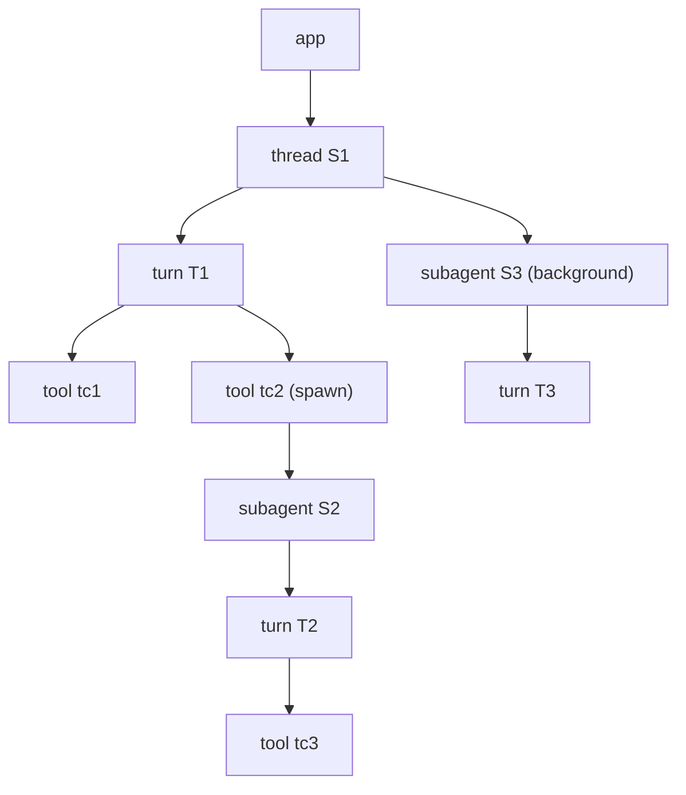

# L1 태스크 엔진 (tasks)

- 패키지: `xeon/packages/core-tasks`(`@xeon/core-tasks`), 계획 id L1-a "태스크 엔진"(`_research/layer-plan-v2.json` L1-a).
- 컨텍스트: `run-engine`(`eng.context-map.design` §4.1, §4.5).
- Cordis 서비스: `xeon.tasks`(`eng.context-map.design` §5.3). 이 문서는 인터페이스 이름을 `TaskService`로 정한다.

## 1. 목적과 범위

### 1.1 정하는 것

- 범위 트리(app > thread > turn > tool·subagent)와 노드별 취소 신호.
- 취소 API와 취소 순서: 의도 내구 기록 → 메모리 신호 → 아래에서 위로 정착.
- 백그라운드 위임 경계.
- 동시 상한 풀 세 개(`tools`, `subagents`, `modelCalls`)와 교착 방지 규칙.
- 일반화한 키 큐(같은 키 직렬화, 읽기 shared·쓰기 exclusive)와 키 산출 책임의 경계.
- 내구 입력 큐: 모드 `steer`, `followUp`, `next`, `aside`, 멱등 `requestId`, 배치(placement) 선택 규칙, 재시작 복원.
- 위 기능의 설정 키 `l1.tasks.*`.
- 이 도메인이 F에 요청하는 이벤트 kind와 타입(§8.1).

### 1.2 다루지 않는 것

- 턴 실행, 단계 체크포인트, 확장 지점 발화: `L1.loop.spec`. `input` 지점도 loop가 발화한다(§7).
- 도구 파이프라인, 효과 3단 기록, 키(realpath) 산출: `L1.tools.spec`.
- 자식 세션 생성, 정의 파일, 깊이 상한, 권한 상한: `L1.agents.spec`.
- 커밋 구현, 투영 테이블 DDL, 재개 절차 전체: `L1.persistence.spec`.
- `post`·`drive`·`scope` 연산의 디스패치와 임대 중재: `X.primitives.spec`.

### 1.3 근거

- [결정] 커널(L1-a/b/f/g)은 직접 구현하고 durable `docs/spec.md`를 설계 근거로 인용한다. 소유 트리 1972-2200, requestId 2288-2301(`_research/foundation-plan.md` §1 표 1번).
- [결정] DI는 Cordis 하나이고 Cordis는 ext-host 뒤에 둔다. core-tasks는 Cordis를 import하지 않는다(ADR-0002 §3 3·4번).
- [결정] 확장 지점은 on, post, drive, scope 4연산이다. `post`는 입력 큐에 넣고, 같은 `requestId`는 한 번만 들어간다(adr.0007 §3.1).
- [결정] Helm은 L3 기본 그룹이다. 학습 그룹도 L3 기본 그룹이며 drive를 쓰지 않는다(`_research/decisions-log.md` 2026-10-21 계획 v2 "Hermes 학습 정책은 L3 학습 그룹(drive 미사용, Helm과 공존)"). 학습 그룹의 검토 포크는 백그라운드 위임으로 돈다(`eng.context-map.design` §3 협력 규칙 4).
- 구성요소 판정: 범위 트리 자체, 취소 전파 설계, 병렬 도구 실행 그대로, 동시 실행 상한 자체, 내구 입력 큐 설계(`_research/packages.md` §4.3 L1-a 행).

## 2. 용어

| 용어 | 뜻 |
|---|---|
| 범위 노드 (task scope) | 범위 트리의 노드 하나. 종류는 `app`, `thread`, `turn`, `tool`, `subagent`. 노드마다 `AbortController` 하나를 둔다 |
| 소유 간선 | 부모 노드 → 자식 노드. 생성 때 정하고 바꾸지 않는다 |
| 소유 작업 (owned work) | 한 노드 아래에서 백그라운드 경계를 건너지 않고 따라 내려가는 노드 전부. durable "ordinary owned work"(spec 2163-2167) |
| 백그라운드 경계 | `background: true`인 `subagent` 노드. 부모의 취소와 정착 대기가 이 노드를 건너지 않는다 |
| 정착 (settle) | 노드의 작업과 소유 작업이 모두 끝난 상태 |
| 취소 의도 | 취소 요청을 내구로 남긴 기록. turn 노드는 `turn.abort_requested`(§3.8, F 요청) |
| 풀 (pool) | 동시 상한을 거는 자원 묶음. `tools`, `subagents`, `modelCalls` |
| 슬롯 (slot) | 풀에서 얻은 실행 권한 하나 |
| 키 큐 (keyed queue) | 문자열 키별 읽기·쓰기 잠금 대기열. 같은 키의 exclusive 작업을 직렬로 돌린다 |
| 입력 큐 | thread별 내구 대기열. 이벤트 `input.*`와 투영 `p_inputs`로 이루어진다 |
| 배치 (placement) | 큐의 입력을 대화에 item으로 넣는 일. 이벤트 `input.placed` |
| 배치 지점 | `turnStart`(turn 시작 커밋)와 `stepEnd`(단계 끝 커밋) 둘 |

turn과 step은 `F.conversation.spec` §2, §2.1을 따른다. pi의 turn은 Xeon의 step이고, pi의 run(`agent_start`~`agent_end`)이 Xeon의 turn이다.

## 3. 인터페이스

이 절의 타입은 다른 L1 패키지(core-loop, core-tools, core-agents)와 X가 함께 쓴다. 같은 층 패키지끼리 import할 수 없으므로(`eng.dependency-rules.guide` DR-14) 서비스 인터페이스 `TaskService`와 서비스 이름 상수는 F `@xeon/contracts/services` 서브패스에 두고, `core-tasks`가 구현한다 [결정: review.decisions-2 D-04]. 파일 위치는 `F.capabilities.spec` §3.12 `services/tasks.ts`(`TaskService extends InputQueuePort`)이고 §8.1 FR-T5가 반영됐다. 코드는 `isolatedDeclarations`를 켠 상태로 컴파일되므로 export 상수에는 명시 타입을 단다.

### 3.1 서비스 진입점

```ts
// xeon/packages/contracts/src/services/tasks.ts  [FR-T5, review.decisions-2 D-04]
import type { Result } from "../base/index.ts";
import type { EventId, ItemId, ThreadId, TurnId } from "../conversation/ids.ts";
// [제안: L1.persistence.spec FR-P1의 records/commit.ts]. F.records.spec §3.8의 현재 파일은 store.ts(AppendError, SessionStore)뿐이다
import type { CommitRequest, InputView, StampedDraft, StoreError, TxView } from "../records/commit.ts";
import type { PostItem, PostReceipt, Unsubscribe } from "./ops.ts";
// [제안: L1.loop.spec FR-L1] X.primitives.spec §3.6의 InputQueuePort, EnqueueRequest, EnqueueResult
import type { InputQueuePort } from "./ports.ts";

export const TaskServiceName: "xeon.tasks" = "xeon.tasks";

/**
 * InputQueuePort(X.primitives.spec §3.6)에서 받는 것:
 * - enqueue(request: EnqueueRequest): Promise<Result<EnqueueResult, EnqueueError>>  확장 post의 진입점(§7). 내부에서 inputs.enqueue를 부르고 InputQueueError를 EnqueueError 값으로 그대로 돌려준다
 * 최상위 이름이 겹치지 않으므로 하위 객체로 나누지 않는다(L1.loop.spec §3 머리말의 규칙)
 */
export interface TaskService extends InputQueuePort {
  /** app 노드. 엔진 인스턴스당 하나 */
  readonly root: TaskScope;
  /** 범위 노드를 만든다. 허용 부모는 §4.1 표. 위반이면 Bug("tasks.invalid_parent")를 던진다 */
  openScope(parent: TaskScope, spec: TaskScopeSpec): TaskScope;
  /** 살아 있는 노드를 찾는다 */
  find(kind: TaskScopeKind, id: string): TaskScope | undefined;
  /** 취소. 의도를 먼저 커밋하고 신호를 보낸다(§4.2) */
  abort(target: TaskScope, reason: AbortReason, options?: AbortOptions): Promise<Result<AbortTicket, StoreError>>;
  /** 풀별 상한기 */
  limiter(pool: PoolName): Limiter;
  /** 키 큐. 엔진 인스턴스당 하나 */
  readonly locks: KeyedQueue;
  /** 내구 입력 큐 */
  readonly inputs: InputQueue;
  activity(): ActivitySnapshot;
  onActivity(listener: () => void): Unsubscribe;
  /** 프로세스 종료용. 모든 노드에 신호만 보내고 의도는 쓰지 않는다. 다음 열기에서 재개된다 */
  close(): Promise<void>;
}
```

- 메서드 이름 [제안]: 후보 이름 `scope(parent, kind)`는 확장 연산 `scope`(`F.extensions.spec` §3.2 `ScopeFn`)와 이름이 같다. 혼동을 막으려고 `openScope`, 노드 타입은 `TaskScope`로 둔다.
- `close()`는 durable `close()`와 같은 뜻이다. 신호를 보내고 결과를 쓰지 않는다(durable spec 1905-1910, 2004-2006).

### 3.2 범위 트리

```ts
export type TaskScopeKind = "app" | "thread" | "turn" | "tool" | "subagent";
export type TaskScopeState = "live" | "aborting" | "settling" | "settled";

/** 취소 의도 커밋 요청을 만든다. 동기. null이면 내구 의도 없이 신호만 보낸다 */
export type AbortIntentWriter = (reason: AbortReason, cause: "direct" | "cascade") => CommitRequest | null;

export interface TaskScopeSpec {
  readonly kind: Exclude<TaskScopeKind, "app">;
  /** thread·subagent는 ThreadId, turn은 TurnId, tool은 toolCallId */
  readonly id: string;
  /** subagent 노드이고 부모가 thread일 때만 true를 허용한다(§4.3) */
  readonly background?: boolean;
  /** 내구 노드(turn, subagent)의 의도 기록기. 소유 패키지가 넘긴다(§4.2) */
  readonly abortIntent?: AbortIntentWriter;
}

export interface ScopeOutcome {
  readonly aborted: boolean;
  readonly reason: AbortReason | null;
}

export interface TaskScope {
  readonly kind: TaskScopeKind;
  readonly id: string;
  readonly parent: TaskScope | null;
  readonly background: boolean;
  /** AbortSignal.any([부모 신호, 자기 신호]). 백그라운드 노드는 [root 신호, 자기 신호] */
  readonly signal: AbortSignal;
  readonly state: TaskScopeState;
  readonly abortReason: AbortReason | null;
  children(): readonly TaskScope[];
  /** 이 노드의 작업으로 등록한다. 등록한 Promise가 끝나기 전에는 정착하지 않는다 */
  track<T>(work: Promise<T>): Promise<T>;
  /** 소유 작업과 track한 작업이 모두 끝나면 이행한다. 여러 번 불러도 같은 Promise */
  settle(): Promise<ScopeOutcome>;
}
```

### 3.3 취소

```ts
export type AbortCode = "user" | "parent" | "lease_revoked" | "budget" | "lease_lost" | "error";

export interface AbortReason {
  readonly code: AbortCode;
  readonly message: string | null;
}

export interface AbortOptions {
  /** true면 백그라운드 경계를 넘어 그 아래도 취소한다(durable spec 2027-2033) */
  readonly background?: boolean;
}

export type AbortTicket =
  | { readonly status: "signalled"; readonly settled: Promise<ScopeOutcome> }
  | { readonly status: "already_aborting"; readonly settled: Promise<ScopeOutcome> }
  | { readonly status: "already_settled" };
```

- `TaskScope.signal`이 켜질 때의 `signal.reason`은 `AbortReason`이다. 부모에서 전파된 자식의 `signal.reason`은 부모의 reason과 같은 객체다. `AbortCode`의 `"parent"`는 자식 노드를 따로 취소할 때 호출자가 부모 사정을 표시하려고 쓴다. 자식이 `abortIntent`로 쓰는 cascade 의도에는 `cause: "cascade"`가 붙는다.

### 3.4 동시 상한

```ts
export type PoolName = "tools" | "subagents" | "modelCalls";

export interface Limiter {
  readonly pool: PoolName;
  capacity(): number;
  inUse(): number;
  waiting(): number;
  /**
   * 슬롯을 얻는다. 꽉 차면 FIFO로 대기한다.
   * 대기 중 owner.signal이 켜지면 대기열에서 빠지고 signal.reason(AbortReason)으로 거부한다.
   */
  acquire(owner: TaskScope): Promise<Slot>;
}

export interface Slot {
  readonly pool: PoolName;
  readonly owner: TaskScope;
  /** 반납. 두 번째 호출은 아무것도 하지 않는다. owner가 정착하면 자동 반납한다 */
  release(): void;
  /** 반납 → wait 대기 → 같은 풀에서 재획득. 다른 노드를 기다릴 때 쓴다(§4.5 규칙 C2) */
  suspendWhile<T>(wait: Promise<T>): Promise<T>;
}
```

### 3.5 키 큐

```ts
export type LockMode = "shared" | "exclusive";

export interface LockRequest {
  /** 불투명 키. 파일이면 L1.tools가 만든 `${env.id}\0${realpath}`(§4.4) */
  readonly key: string;
  readonly mode: LockMode;
}

export interface KeyedQueue {
  /**
   * 키를 사전순으로 차례로 얻은 뒤 fn을 실행하고 모두 놓는다.
   * 대기 중 owner.signal이 켜지면 대기열에서 빠지고 signal.reason으로 거부한다.
   */
  run<T>(locks: readonly LockRequest[], owner: TaskScope, fn: () => Promise<T>): Promise<T>;
  /** 진단용. 이 키를 쥐었거나 기다리는 작업 수 */
  pending(key: string): number;
}
```

### 3.6 내구 입력 큐

```ts
export type InputMode = "steer" | "followUp" | "next" | "aside";
export type DrainMode = "all" | "one-at-a-time";
export type PlacementPoint = "turnStart" | "stepEnd";

export type InputSource =
  | { readonly type: "user"; readonly via: "interactive" | "rpc" }
  | { readonly type: "extension"; readonly scopeId: string }
  | { readonly type: "delegation"; readonly childThreadId: ThreadId }
  | { readonly type: "schedule"; readonly timerId: string };

export interface InputDraft {
  readonly threadId: ThreadId;
  readonly mode: InputMode;
  readonly item: PostItem;
  /** 대화 범위 멱등 키. 브랜드 없는 문자열 1~64자(F.extensions.spec §2) */
  readonly requestId: string;
  readonly source: InputSource;
}

export interface QueuedInput extends InputDraft {
  /** input.queued 이벤트의 id */
  readonly inputId: EventId;
  /** input.queued 이벤트의 seq */
  readonly seq: number;
}

export interface EnqueueReceipt extends PostReceipt {
  readonly inputId: EventId;
  /** duplicate면 기존 입력의 현재 상태 */
  readonly state: "queued" | "placed" | "withdrawn";
}

export interface InputPlacement {
  readonly inputId: EventId;
  readonly itemId: ItemId;
  readonly turnId: TurnId;
}

export interface PlacementSelection {
  /** seq 순서 */
  readonly inputs: readonly QueuedInput[];
  /** 선택한 입력 중 가장 큰 seq. 없으면 직전 값. StepCheckpoint.inputCursor.consumedSeq에 쓴다 */
  readonly consumedSeq: number;
  /** 호출자가 정한 item id로 input.placed 초안을 만든다. 순수 */
  drafts(placements: readonly InputPlacement[]): readonly StampedDraft[];
}

export interface DrainOptions {
  /** stepEnd에서 다음 모델 요청이 이어질지. 도구 호출, 선택된 steer, continue 결정 중 하나라도 있으면 true */
  readonly continuing: boolean;
}

export type WithdrawReason = "user" | "aborted" | "superseded";

export type InputQueueError =
  | StoreError
  | { readonly kind: "invalid_request_id"; readonly requestId: string }
  | { readonly kind: "mode_not_supported"; readonly mode: InputMode }
  | { readonly kind: "thread_closed"; readonly threadId: ThreadId };

export interface InputQueue {
  /** input.queued를 커밋한다. 같은 (threadId, 출처 키, requestId)가 있으면 쓰지 않고 duplicate:true(§4.7) */
  enqueue(draft: InputDraft): Promise<Result<EnqueueReceipt, InputQueueError>>;
  /**
   * 다른 도메인의 커밋 build 안에서 부르는 동기·순수 함수. input.queued 초안을 만든다.
   * 같은 (threadId, 출처 키, requestId)의 입력이 있으면 drafts는 비고 existing에 그 입력을 싣는다.
   * 위임 완료 보고처럼 다른 사실과 한 커밋에 넣어야 하는 입력이 쓴다(L1.agents.spec §4.7)
   */
  draftQueued(view: TxView, draft: InputDraft): { readonly drafts: readonly StampedDraft[]; readonly existing: InputView | undefined };
  /** 투영 p_inputs의 queued 행. seq 순서 */
  peek(threadId: ThreadId, modes?: readonly InputMode[]): Result<readonly QueuedInput[], ReadFailure>;
  /**
   * 커밋 build 안에서 부르는 동기·순수 함수. 선택만 하고 커밋은 호출자(loop)가 한다.
   * 선택 규칙은 §4.6 표. steer·followUp의 drain 모드는 설정 l1.tasks.queue.*를 그때 읽는다.
   */
  drain(view: TxView, threadId: ThreadId, at: PlacementPoint, options: DrainOptions): Result<PlacementSelection, ReadFailure>;
  /** queued 입력을 거둔다. 거둔 수를 돌려준다. 이미 placed인 입력은 세지 않는다 */
  withdraw(threadId: ThreadId, target: EventId | "all", reason: WithdrawReason): Promise<Result<number, InputQueueError>>;
  /** input.queued 커밋 뒤 동기로 부른다. 쓰기가 필요하면 queueMicrotask로 미룬다(TX-09) */
  onQueued(listener: (threadId: ThreadId) => void): Unsubscribe;
}
```

- `peek`와 `drain`은 입력 이벤트를 읽는다. 읽기 연결의 busy·io와 손상 행은 `err(ReadFailure)`로 돌려준다(eng.typescript.guide TY-24). 호출자의 `build`는 `drain`의 `err`를 `{ kind: "abort", error }` 계획으로 돌려준다. 롤백하고 요청 키에 결과를 남기지 않으므로 같은 키로 다시 낼 수 있다(`L1.persistence.spec` §3.2).
- `drain`은 호출자의 커밋 안에서 고르는 일로 정한다 [제안]. 큐에서 실제로 빠지는 시점은 호출자의 커밋에 든 `input.placed`가 투영에 반영되는 때다. 이렇게 하면 배치 기록과 item 기록과 단계 체크포인트가 한 커밋에 들어간다(TX-08).
- 출처 키 [제안]: `user`는 `"user"`, `extension`은 `scopeId`, `delegation`은 `"deleg"`, `schedule`은 `"timer"`다. 서로 다른 출처가 같은 문자열의 `requestId`를 써도 충돌하지 않게 한다. `user`·`deleg`·`timer`는 확장 id로 예약해 확장의 `scopeId`와 겹치지 않는다(F `RESERVED_SOURCE_KEYS`, [결정: review.decisions-2 U-13]).

### 3.7 활동 집계

```ts
export interface ActivitySnapshot {
  /** 정착하지 않은 turn 노드 수 */
  readonly liveTurns: number;
  /** 정착하지 않은 turn, tool, subagent 노드 수. 백그라운드 포함 */
  readonly liveTasks: number;
  /** 전 thread의 queued 입력 수 */
  readonly queuedInputs: number;
}
```

`L4.host-service.spec` `ActivityPort`의 `liveTurns`, `liveTasks`가 이 값을 쓴다. `waitingApprovals`, `pendingSchedules`는 각각 `L1.tools.spec`, `L2.schedule.spec`이 준다.

### 3.8 제안 이벤트 (F 형식)

F 카탈로그(`F.records.spec` §3.3)에 입력 큐와 취소 의도 kind가 없다. 아래를 F 형식(`<영역>.<이름>`, envelope `kind`/`version`/`threadId`/`durable`)으로 옮겨 제안한다(§8.1 FR-T1, FR-T2). 근거 후보는 `eng.events.design` §4.4의 `input.queued|placed|withdrawn`, `turn.abort_requested`다. records는 extensions보다 낮은 순위라 타입을 import하지 않고 같은 모양을 적는다(`F.records.spec` §3.3 `extension-ops.ts`와 같은 방식).

```ts
// xeon/packages/contracts/src/records/catalog/input.ts  [FR-T1, F.records.spec §3.3 반영]
export interface InputQueuedPayload {
  mode: "steer" | "followUp" | "next" | "aside";
  /** F.extensions.spec PostItem의 JSON 표현 */
  item:
    | { kind: "user"; content: string | (TextContent | ImageContent)[] }
    | { kind: "context"; customType: string; content: string | (TextContent | ImageContent)[]; display: boolean; details: JsonValue | null };
  requestId: string;              // 1~64자
  source:
    | { type: "user"; via: "interactive" | "rpc" }
    | { type: "extension"; scopeId: string }
    | { type: "delegation"; childThreadId: ThreadId }
    | { type: "schedule"; timerId: string };
}
export interface InputPlacedPayload {
  inputId: EventId;               // input.queued 이벤트 id
  itemId: ItemId;                 // 같은 커밋의 item.recorded
}
export interface InputWithdrawnPayload {
  inputId: EventId;
  reason: "user" | "aborted" | "superseded";
}

// xeon/packages/contracts/src/records/catalog/turn.ts  [FR-T2, F.records.spec §3.3 반영]
export interface TurnAbortRequestedPayload {
  reason: { code: "user" | "parent" | "lease_revoked" | "budget" | "lease_lost" | "error"; message: string | null };
  cause: "direct" | "cascade";
  /** 백그라운드 경계를 넘는 취소였는지 */
  background: boolean;
}
```

| kind | durable | payload 스키마 | 생산자 [제안] | envelope 범위 필드 |
|---|---|---|---|---|
| `input.queued` | 예 | `InputQueuedPayloadSchema` | `core.tasks` | `threadId`, `turnId: null`, `stepId: null` |
| `input.placed` | 예 | `InputPlacedPayloadSchema` | `core.tasks` | 배치된 turn·step |
| `input.withdrawn` | 예 | `InputWithdrawnPayloadSchema` | `core.tasks` | `turnId: null` |
| `turn.abort_requested` | 예 | `TurnAbortRequestedPayloadSchema` | `core.loop`(turn 노드의 `abortIntent`가 만든다) | 취소 대상 turn |

- 입력 id는 새 ID 접두를 만들지 않는다 [제안]. `input.queued` 이벤트의 `EventId`를 입력 id로 쓴다. F ID 접두 8종(`F.records.spec` §3.1.2)을 늘리지 않기 위해서다.
- `turn.abort_requested`를 따로 두는 이유: `turn.updated`는 F 카탈로그에서 휘발(durable 아니오)이다(`F.records.spec` §3.3). 취소 의도는 크래시 뒤에도 남아야 하므로(`eng.transactions.design` §6.2 7번) `turn.updated{status}`로는 표현할 수 없다.

## 4. 동작 규칙

### 4.1 범위 트리

[제안] 계획 v2 L1-a "범위 트리: app > conversation > turn > tool·subagent"와 durable 소유 트리(spec 2156-2168)를 다음처럼 옮긴다.

| 자식 종류 | 허용 부모 | 만드는 쪽 | 비고 |
|---|---|---|---|
| `thread` | `app` | core-loop(thread를 열 때) | |
| `turn` | `thread`, `subagent` | core-loop | subagent 노드는 자식 thread 역할을 한다 |
| `tool` | `turn` | core-tools | 도구 호출 하나 |
| `subagent` | `turn`, `tool`, `thread` | core-agents | 부모가 `thread`이면 `background: true`여야 한다. `turn`·`tool` 아래는 `background: false`만 |



규칙:

1. 소유 간선은 `openScope` 때 정하고 바꾸지 않는다(durable spec 2164 "Owner edges are immutable"). 내구 기록에서는 turn은 `turn.started`의 thread, 도구 호출은 `effect.intent`의 turn, 자식 thread는 `agent.spawned`(FR-T7, `L1.agents.spec` 요청)의 소유자로 다시 만들 수 있다.
2. 자식 신호는 `AbortSignal.any([부모.signal, 자기 controller.signal])`다(`_research/packages.md` §4.3 L1-a 취소 전파). 백그라운드 노드는 부모 대신 `root.signal`을 쓴다.
3. `settled`가 된 노드 아래에는 `openScope`를 할 수 없다. 호출하면 `Bug("tasks.parent_settled")`다. 끝난 부모 아래의 새 작업(끝난 서브에이전트에게 다시 묻기)은 그 subagent 노드의 정상 작업이다. 그 경우 core-agents는 subagent 노드를 `settled`로 만들지 않고 유휴로 둔다(durable spec 2045-2048 "A terminal owner never cascades").
4. Cordis Fiber의 해제 트리는 참고만 한다 [결정: ADR-0002]. core-tasks는 Cordis를 import하지 않는다. 플러그인 dispose와 `TaskService.close()`의 연결은 `plugin.ts` 한 곳에서 ext-host 플러그인 API로 한다(§8).

### 4.2 취소 순서

[결정] 취소 의도를 내구로 먼저 남기고 신호를 보낸다(`eng.transactions.design` §6.2 2항, durable spec 1980-1987).

```text
abort(target, reason, { background }):
  1. target이 settled면 already_settled. aborting이면 already_aborting
  2. req = target.abortIntent?.(reason, "direct")         // 동기. loop가 turn.abort_requested 초안을 만든다
     req가 있으면 session.commit(req)                      // requestId abort:<turnId>. busy면 같은 req로 재시도(TX-05)
     err(lease_lost)면 3을 그대로 하고 err를 돌려준다       // 임대를 잃은 프로세스는 메모리 작업을 모두 취소한다(eng.transactions.design §8)
     그 밖의 err면 신호를 보내지 않고 err를 돌려준다
  3. target.controller.abort(reason)                       // 소유 작업은 AbortSignal.any로 함께 켜진다
     background면 traverse(target, ignoreBackground=true)의 백그라운드 노드에도 controller.abort(reason)
  4. 각 내구 자식 노드(turn, subagent)는 신호를 받으면 abortIntent(reason, "cascade")로 자기 의도를 커밋한다
  5. ticket.settled = target.settle()                      // 정착은 아래에서 위
```

- 3단계 뒤 대기는 트랜잭션 밖이다. 각 정착은 자기 커밋이다(`eng.transactions.design` §6.2 끝).
- 정착 순서 [결정: `eng.transactions.design` §6.2 4·5항]: 노드는 소유 작업(백그라운드 제외)이 모두 정착한 뒤 정착한다. 그래서 자식 turn → `agent.settled` → 부모 tool → 부모 turn 순서로 끝난다. core-tasks는 이 순서를 `settle()` Promise로 보장하고, 각 단계의 내구 기록(`effect.result`, `agent.settled`, `turn.completed`)은 소유 패키지가 쓴다.
- 4단계의 cascade 의도는 최선 노력이다. 크래시로 빠지면 재개 때 소유 사슬에서 다시 도출한다(§4.8 3번). durable도 cascade 표시를 별도 커밋으로 도출하고 열 때 다시 도출한다(spec 2051-2058).
- 의도가 커밋된 turn 아래에서는 새 작업을 시작하지 않는다. 다른 패키지의 커밋 `build`가 `view.turnAbortRequested(turnId)`면 `reject("turn_aborting")`한다(`eng.transactions.design` §6.2 3항). core-tasks 쪽에서는 `aborting` 노드에 `openScope`하면 즉시 신호가 켜진 노드를 돌려준다.
- 한 호출자의 대기 취소는 내구 취소가 아니다(durable spec 1996-1998). UI가 결과 기다림을 그만두는 것은 `abort`를 부르지 않는다.
- `tool` 노드에는 `abortIntent`가 없다. 도구 하나만 멈추는 경우 내구 기록은 그 도구의 `effect.result{status: "interrupted"}`다(`L1.tools.spec`).

### 4.3 백그라운드 경계

- 백그라운드 위임(L1-g, 학습 그룹의 검토 포크)은 경계다. 보통 취소와 정착 대기는 경계를 건너지 않는다(`eng.transactions.design` §6.1 끝, durable spec 2014-2017).
- 경계를 넘는 경우는 둘이다. 그 노드를 직접 `abort`하거나, 위쪽 노드를 `{ background: true }`로 `abort`할 때다(durable spec 2027-2033).
- `thread` 노드의 `settle()`도 백그라운드 자식을 기다리지 않는다. 엔진 종료(`close()`)는 백그라운드를 포함해 모두에 신호를 보내고 의도는 쓰지 않는다.

### 4.4 병렬 도구와 키 큐

[결정] agent-core의 `toolExecution: "parallel"`(기본)과 도구별 `executionMode`를 그대로 쓴다(`_research/packages.md` §4.3 "병렬 도구 실행: 그대로"). agent-core는 한 배치의 준비(검증, `beforeToolCall`)를 순서대로 끝낸 뒤 실행만 동시에 한다. 도구 하나라도 `executionMode: "sequential"`이면 배치 전체가 순차다(`~/projects/_ref/pi-src/packages/agent/src/agent-loop.ts:508-523`, 586-660).

같은 파일을 쓰는 호출은 키 큐로 직렬화한다. 경계 [제안]:

| 일 | 맡는 곳 | 근거 |
|---|---|---|
| 도구가 어떤 경로를 읽고 쓰는지 선언 | `ToolSpec`(F.capabilities §3.3)에 잠금 선언 필드 추가 요청(FR-T6) | 병렬 허용 필드 `executionMode`가 F에 있다 |
| 선언된 경로 → 키 산출(절대 경로, realpath, 없는 파일은 부모 realpath + 이름) | `L1.tools.spec` 어댑터. `xeon.exec`의 경로 함수를 쓴다 | 파일 시스템 접근은 L0 뒤(DR-13) |
| 키별 대기, shared·exclusive, 다중 키 순서, 취소 시 제거 | `core-tasks` `KeyedQueue` | 이 문서 |

- 포크 원본: `~/projects/_ref/pi-src/packages/durable/src/tools/file-mutation-queue.ts`(pi 커밋 `cdaf6c2`, 55줄). 원본은 `Map<string, Promise<void>>` 꼬리 사슬 하나로 같은 키의 변경을 직렬화한다. 읽기·쓰기 구분과 대기 중 취소는 없고, 키 산출(`mutationKey`, `canonical`)이 같은 파일에 있다.
- 포크에서 바꾸는 점 [제안]:
  1. Chord `Context` 의존(1행 import, `context` 인자)을 지운다. 취소는 `owner: TaskScope`의 `signal`로 받는다(ADR-0003의 `CancelScope` 치환과 같은 목적).
  2. 키 산출 두 함수(`mutationKey`, `canonical`, 원본 7-26행)는 L1.tools로 옮긴다. core-tasks는 불투명 문자열 키만 받는다.
  3. 키마다 FIFO 대기열과 상태(`shared` 보유 수, `exclusive` 보유 여부)를 둔다. `shared`는 앞에 `exclusive`가 없으면 함께 들어간다. `exclusive`는 혼자 들어간다. 대기열 앞에 `exclusive`가 있으면 뒤의 `shared`도 기다린다(쓰기 굶주림 방지).
  4. 여러 키는 사전순으로 차례로 얻는다. 잠금 순서가 하나라서 키 사이 교착이 없다.
  5. 대기 중 `owner.signal`이 켜지면 대기열에서 지우고 `signal.reason`으로 거부한다.
- 원본 주석과 같은 한계: 같은 프로세스 안의 직렬화다. `bash`나 다른 프로세스에 대한 잠금은 아니다(원본 30-31행).
- 잠금 선언이 없는 도구는 키 큐를 쓰지 않는다. 읽기 전용 도구(`hints.readOnly`)는 선언된 경로에 `shared`, 쓰기 도구는 `exclusive`를 건다 [제안].

### 4.5 동시 상한과 교착 방지

[제안] dur와 agent-core에는 상한 코드가 없다(`_research/packages.md` §4.3 "동시 실행 상한: 자체", `_research/refs/pi-durable.md` §3.3 병렬성 항목). 그래서 자체 구현한다.

| 풀 | 슬롯을 얻는 곳 | 쥐는 구간 |
|---|---|---|
| `tools` | core-tools의 `execute` 래퍼 | 도구 `execute()` 실행 동안 |
| `subagents` | core-agents의 자식 turn 실행 | 자식 thread가 모델 요청·도구를 실행하는 동안 |
| `modelCalls` | core-loop의 streamFn 래퍼 | provider 스트림 하나가 열려 있는 동안 |

- 대기열은 풀마다 FIFO다. 대기 중 owner가 취소되면 대기열에서 지운다.
- 상한 값은 설정 `l1.tasks.limits.*`다(§6). 값이 줄면 이미 쥔 슬롯은 그대로 두고 새 획득부터 적용한다.

교착 방지 규칙:

- C1. 슬롯은 자기 코드가 실행되는 구간에만 쥔다. `modelCalls` 슬롯은 스트림이 끝나면 반납한다. 모델 스트림은 다른 노드를 기다리지 않는다.
- C2. 다른 범위 노드의 정착을 기다리는 동안에는 쥔 슬롯을 모두 반납한다. 서브에이전트를 부르고 결과를 기다리는 도구 호출은 `slot.suspendWhile(child.settle())`로 `tools` 슬롯을 내려놓는다. 자식 thread가 손자를 기다릴 때도 `subagents` 슬롯을 같은 방식으로 내려놓는다.
- C3. 키 잠금을 먼저 얻고 슬롯을 나중에 얻는다. 슬롯을 쥔 채 키 잠금을 기다리지 않는다. core-tools는 `locks.run(locks, owner, () => withSlot("tools", …))` 순서만 쓴다.
- C4. 한 노드는 한 풀에서 슬롯을 하나만 쥔다. 두 번째 `acquire`는 `Bug("tasks.slot_reentry")`다.

이유: C1~C3이면 슬롯을 쥔 작업은 어떤 대기에도 들어가 있지 않다. 그래서 쥔 작업은 언제나 진행해 슬롯을 반납하고, FIFO 대기열의 앞 작업이 차례로 슬롯을 얻는다. 잠금은 C3과 §4.4의 사전순 규칙으로 순환이 생기지 않는다. 상한이 1이고 서브에이전트 깊이가 3이어도 대기 사슬이 닫히지 않는다(§9 수용 기준 6).

- 깊이 상한은 `L1.agents.spec`이 정한다. C2 때문에 `subagents` 풀은 "동시에 실행 중인 자식 thread 수"를 세고, 손자를 기다리는 자식은 세지 않는다.

### 4.6 입력 큐 모드와 배치 선택

모드의 뜻 [제안]. `steer`, `followUp`, `next`는 `F.extensions.spec` §4.4와 adr.0007 §3.1을 따른다.

| 모드 | 실행 중 thread | 유휴 thread | agent-core 대응 |
|---|---|---|---|
| `steer` | 다음 `stepEnd`에서 배치한다. 배치되면 다음 모델 요청이 반드시 나간다 | 새 turn을 연다 | `getSteeringMessages`(`types.ts:293`), `PendingMessageQueue`(`agent.ts:143-174`) |
| `followUp` | turn이 정착한 뒤 새 turn의 입력이 된다 | 새 turn을 연다 | `getFollowUpMessages`의 큐를 쓰지 않는다. 새 turn으로 연다(`L1.loop.spec` §4.4) |
| `next` | §4.9 선택지에 따른다. M1에서는 받지 않는다(`mode_not_supported`) | 같음 | pi `deliverAs: "nextTurn"` |
| `aside` | 다음 모델 요청이 어차피 나갈 때만 `stepEnd`에서 함께 배치한다. 요청을 새로 만들지 않는다 | turn을 열지 않는다. 다음 turn의 `turnStart`에서 배치한다 | 없음. omp의 aside(조용한 삽입, `_research/item-catalog.md` L1-a "전달 모드 구분")를 따른다 |

배치 지점별 선택 규칙(`drain`):

| 지점 | steer | followUp | next·aside |
|---|---|---|---|
| `turnStart` | 가장 오래된 시작 가능 입력 하나(steer 또는 followUp, seq 순)를 turn 입력으로 고른다 | 같음 | 그 입력보다 seq가 작은 queued 항목 전부를 함께 배치한다 |
| `stepEnd`, `continuing: false` | `steeringMode`가 `one-at-a-time`이면 첫 항목, `all`이면 전부 | 고르지 않는다 | 고르지 않는다 |
| `stepEnd`, `continuing: true` | 같음 | 고르지 않는다 | 전부 |

- `stepEnd`에서 steer가 하나라도 선택되면 호출자는 `continuing`을 다시 true로 보고 next·aside도 함께 고른다. `drain`은 이 재계산을 안에서 한 번 한다.
- 선택은 seq 순이고 결정적이다(durable spec 2318-2321 "Boundary selection is deterministic by item ID"). drain 모드는 지점마다 그때 설정을 읽는다.
- `followUpMode`는 정착 뒤 새 turn을 열 때 쓴다. `one-at-a-time`이면 queued followUp 하나가 turn 하나를 연다. `all`이면 queued followUp 전부를 한 turn의 입력으로 묶는다(`TurnStartedPayload.inputItemIds`가 배열이다).
- 배치 기록: 호출자 커밋에 `input.placed`(이 문서), `item.recorded`(user 또는 custom item, `L1.loop.spec`), 단계 체크포인트를 함께 넣는다. `StepCheckpoint.inputCursor.consumedSeq`는 `PlacementSelection.consumedSeq`다(`F.records.spec` §3.6).
- thread 취소: turn 취소는 queued 입력을 거두지 않는다 [제안]. 사용자가 Esc 뒤에 큐에 남긴 입력을 잃지 않게 하기 위해서다. thread를 닫거나 사용자가 "큐 비우기"를 하면 `withdraw(threadId, "all", "aborted")`다. durable은 대화 abort 때 queued 입력을 거둔다(spec 2034-2037). 이 차이는 §10에 [미결]로 둔다.

### 4.7 멱등

- [결정] 같은 `requestId`는 한 번만 큐에 들어가고 두 번째 `post`는 `PostReceipt.duplicate: true`를 돌려준다(adr.0007 §3.1, `F.extensions.spec` §4.4).
- 커밋 키: 입력 큐 커밋의 `CommitRequest.requestId`는 `eng.transactions.design` §4.7의 `COMMIT_KEY_PATTERN`을 따른다. 이 정규식이 커밋 키 형식의 정본이다 [결정: review.decisions-2 U-13]. 키는 `in:<sourceKey>:<requestId>`(사용자·확장·위임·예약 공통)이다.
- scope id 치환: `sourceKey`나 다른 부분에 scope id가 들어갈 때 하위 scope 구분자 `/`는 `:`로 바꾼다(예: scope `helm/review`의 확장 post는 `in:helm:review:<requestId>`) [결정: review.decisions-2 U-13]. 치환 뒤 키가 `COMMIT_KEY_PATTERN`(1~200자)을 넘거나 허용 문자 밖이면 `invalid_request_id`다.
- 지문 원천(`fingerprintSource`)은 신원 `{ threadId, sourceKey, requestId }`만이다 [제안]. `mode`, `item`을 넣지 않는다. 저장소는 `requests (thread_id, request_id)` 조회를 `build`보다 먼저 하고, 같은 키·다른 지문을 `key_reused`(호출자 버그)로 돌려준다(`eng.transactions.design` §4.3·§4.7, `L1.persistence.spec` §4.1 3단계). 내용을 지문에 넣으면 같은 `requestId`로 내용이 다른 두 번째 post가 `duplicate: true`가 되지 못하고 `key_reused`가 된다. 그래서 지문은 신원만 담는다. 시각과 생성 id도 넣지 않는다.
- 판정 순서 [제안]:
  1. 같은 키의 두 번째 `enqueue`(재시도이든 다른 내용이든)는 `requests`에서 같은 지문으로 걸려 `replayed: true` 결과가 온다. `enqueue`는 그 결과의 `eventIds`에서 기존 입력 id를 꺼내고 투영 `p_inputs`의 현재 상태로 `duplicate: true` 영수증을 만든다. 큐에 변화가 없다(`X.primitives.spec` 수용 기준 8, `F.extensions.spec` §4.4).
  2. `build(view)` 안에서는 `view.inputByRequestId(threadId, sourceKey, requestId)`를 한 번 더 읽는다. `requests` 행이 없는데 같은 입력이 투영에 있는 경로(다른 커밋 키로 같은 입력을 쓴 경우, `draftQueued`로 다른 커밋에 들어간 입력)를 막는 방어 검사다. 있으면 `reject("duplicate_input")`로 끝내고 1번과 같은 `duplicate: true` 영수증을 만든다. TxView 메서드는 `L1.persistence.spec` 요구다(§8).
  3. 내용 불일치(같은 신원, 다른 `item`·`mode`)는 결과를 바꾸지 않는다. `enqueue`는 기록된 `input.queued` payload와 비교해 다르면 진단 로그만 남긴다.
  4. `key_reused`는 `duplicate: true`로 바꾸지 않는다. 지문이 신원만 담으므로 정상 경로에서는 생기지 않고, 생기면 커밋 키를 만드는 코드의 결함이다. `enqueue`는 `invalid_request_id`로 돌려주고 운영 로그에 남긴다.
- `requestId` 검사: 1~64자, 아니면 `invalid_request_id`. 비어 있는 사용자 입력 키는 core-loop가 `IdFactory`로 만들어 채운다(`L1.loop.spec` §3.1).

### 4.8 재시작과 복원

1. 큐는 이벤트와 투영으로 내구화한다. 메모리 상태는 캐시다. 재시작 뒤 `peek`는 투영 `p_inputs`의 queued 행을 seq 순으로 돌려준다. 다시 쓸 것이 없다.
2. 일관성 검사 [제안]: thread를 열 때 마지막 `checkpoint.step`의 `inputCursor.consumedSeq`보다 seq가 작거나 같은 queued 입력이 있으면 투영과 체크포인트가 어긋난 것이다. 이벤트가 정본이므로 투영을 따르고 진단 로그를 남긴다.
3. 취소 의도 도출: turn에 `turn.abort_requested`가 있으면 재개하지 않고 닫는다(`eng.transactions.design` §6.2 7항). 의도가 없어도 소유 사슬(turn → 부모 tool → 부모 turn …)에 의도가 있고 백그라운드 경계를 건너지 않으면 같은 처리다. 판정 함수 `isCancelledByOwner`는 `L1.persistence.spec`의 재개 절차가 부른다.
4. 복원된 queued 입력은 자동 재개 설정이 꺼져 있으면(기본, `architecture.runtime-flow.design` §3) 스스로 turn을 열지 않는다. 다음 사용자 입력이나 재개 명령 때 `turnStart` 선택 규칙에 따라 배치된다. L4는 queued 수를 보여 준다 [제안].

### 4.9 `post.when = next`의 시작 여부

[미결: adr.0007 §6] `next`가 경계 뒤 요청을 스스로 시작하는지, 다음 사용자 입력이 시작하는 요청에 붙기만 하는지 정해지지 않았다. L1 쪽 선택지:

| 안 | 동작 | 장점 | 단점 |
|---|---|---|---|
| A. 시작한다 | 실행 중이면 `stepEnd`(continuing 여부와 무관)에 배치하고 요청 한 번을 보장한다. 유휴면 turn을 연다 | adr.0007 §3.1 표의 "경계 지점의 `continue`" 대응과 같다 | `agent_before_settle`의 `continue`, drive의 `loop.turn`과 기능이 겹친다(`_research/ext-points.md` §5 안 1 단점 3) |
| B. 붙기만 한다 [제안] | 실행 중이면 `continuing: true`인 `stepEnd`에서만, 유휴면 다음 `turnStart`에서 배치한다. 요청을 만들지 않는다 | 요청을 만드는 경로가 `continue`와 drive로 정리된다. pi `nextTurn`과 같은 뜻으로 읽힌다 [가정: pi `nextTurn` 동작 미확인] | 유휴 thread에 넣은 `next`는 사용자 입력이 올 때까지 머문다 |

- B안이면 `next`와 `aside`의 배치 규칙이 같아진다. 두 모드의 차이는 출처뿐이다. `aside`는 사용자·CLI 입력이고, `next`는 확장 `post`다.

`aside`를 어디에 둘지 [미결]:

| 안 | 내용 |
|---|---|
| 1. L1 입력 모드로만 둔다 [제안] | `InputMode`에 `aside`를 두고 사용자·CLI(`InputSource.type: "user"`)만 쓴다. F `PostWhen`(`steer \| followUp \| next`)은 그대로다. 확장이 같은 동작을 원하면 B안의 `next`를 쓴다 |
| 2. F 변경 요청 | `PostWhen`에 `"aside"`를 더한다(FR-T4). 확장도 aside를 쓴다 |

M1은 두 모드 모두 구현하지 않는다(`mode_not_supported`). M2에서 결정에 맞춰 구현한다(`L1.tasks.plan`).

### 4.10 수락과 완료 분리 (2차)

- [제안] ACP v2처럼 입력 요청의 응답은 수락 시점에 주고, turn 종료와 정지 사유는 상태 알림으로 보낸다(`_research/item-catalog.md` L1-a "프롬프트 수락과 완료 분리").
- M1 wire는 이미 이 모양에 가깝다. `turn.start`는 `turnId`만 돌려주고 종결은 `events.batch`의 `turn.completed`로 온다(`F.wire-settings.spec` §3.3.1). 2차에서 큐에 들어간 입력(`queued`)의 수락 알림과 `input.placed`·`input.withdrawn`의 클라이언트 표시를 정한다.

## 5. 실패와 경계 사례

| 사례 | 처리 |
|---|---|
| 의도 커밋이 `busy` | 같은 `CommitRequest`로 재시도한다(TX-05). 재시도가 다 실패하면 신호를 보내지 않고 err를 돌려준다. 호출자(L4)는 사용자에게 다시 시도하라고 알린다 |
| 의도 커밋이 `lease_lost` | 신호는 보낸다. 쓰기 소유를 잃었으므로 내구 정리는 새 소유자가 결과 불명 규칙으로 한다(`eng.transactions.design` §8) |
| 이미 정착한 노드에 `abort` | `already_settled`. 아무것도 쓰지 않는다 |
| 같은 노드에 `abort` 두 번 | 두 번째는 `already_aborting`. 의도 커밋 키 `abort:<turnId>`가 같아 이벤트도 하나다 |
| 대기 중 슬롯 요청의 owner 취소 | 대기열에서 지우고 `signal.reason`으로 거부한다. 다른 대기자의 순서는 그대로다 |
| 대기 중 키 잠금 요청의 owner 취소 | 같다. 그 요청 뒤의 `shared` 요청이 앞으로 당겨질 수 있다 |
| `fn`이 던진 예외(키 큐) | 잠금을 모두 놓고 예외를 그대로 전한다 |
| `suspendWhile` 중 owner 취소 | 재획득을 하지 않고 `signal.reason`으로 거부한다 |
| 같은 노드의 같은 풀 슬롯 두 번 | `Bug("tasks.slot_reentry")`(C4) |
| 상한 설정이 0 이하 또는 범위 밖 | 설정 검사(D4·D5)가 막는다. 파일 값이 무효면 기본값을 쓴다(`F.wire-settings.spec` §4.8) |
| `enqueue` 대상 thread가 닫힘 | `thread_closed` |
| M1에서 `next`·`aside` | `mode_not_supported` |
| 같은 `requestId`, 다른 내용 | 커밋 안 조회가 먼저 막으므로 `duplicate: true`이고 기존 입력 상태를 돌려준다. 내용 차이는 진단 로그로만 남긴다 [제안] |
| 크래시: `input.queued` 커밋 뒤 | 재시작 뒤 queued로 복원된다 |
| 크래시: 배치 커밋 전 | 입력은 queued로 남고 다음 배치 지점에서 다시 선택된다 |
| 백그라운드 subagent가 남은 채 thread 닫기 | thread `settle()`은 기다리지 않는다. 엔진 종료 때 `close()`가 신호만 보낸다 |

## 6. 설정 노출

네임스페이스 `l1.tasks`, L4 탭 `execution`(`F.wire-settings.spec` §3.8.2 `SettingsTab`, `L4.settings-ui.spec` execution 탭 행). 정의 파일은 `core-tasks/src/settings.ts`이고 `defineSettings("l1.tasks", …)`로 만든다(`F.wire-settings.spec` §3.8.3).

| 키 | 타입 | 기본값 | range | runtimeChange | allowedScopes | ui |
|---|---|---|---|---|---|---|
| `l1.tasks.limits.tools` | integer | 8 | min 1, max 64 | `live` | managed, user, project, local, session | execution, number, order 10, "동시 도구 실행 수", unit "개" |
| `l1.tasks.limits.subagents` | integer | 16 | min 1, max 100 | `live` | managed, user, project, local, session | execution, number, order 20, "동시 서브에이전트 수", unit "개" |
| `l1.tasks.limits.modelCalls` | integer | 16 | min 1, max 100 | `live` | managed, user, project, local, session | execution, number, order 30, "동시 모델 요청 수", unit "개" |
| `l1.tasks.queue.steeringMode` | string | `"one-at-a-time"` | enum `["all", "one-at-a-time"]` | `live` | managed, user, project, local, session | execution, select, order 40, "방향 수정 입력 배치" |
| `l1.tasks.queue.followUpMode` | string | `"one-at-a-time"` | enum `["all", "one-at-a-time"]` | `live` | managed, user, project, local, session | execution, select, order 50, "후속 입력 배치" |

- 모든 키의 `layer`는 `"L1"`, `since`는 `"0.1.0"`, `secret` 없음.

SettingDef 규칙 대조(`F.wire-settings.spec` §3.8.2 D1~D9):

| 규칙 | 이 표에서 |
|---|---|
| D1 | 키가 `l1.tasks.`로 시작하고 `layer: "L1"`이다. 이름 부분 `limits.tools` 등은 낙타 표기 마디다 |
| D2·D3 | 비밀 키가 없다 |
| D4 | 기본값 8, 16, 16은 각 range 안이다. 기본 문자열은 enum 안이다 |
| D5 | min ≤ max. number 키에만 min·max, string 키에만 enum을 둔다 |
| D6 | `type`은 `Type.Integer()`, `Type.String()`만 쓰고 제약은 `range`에만 둔다 |
| D7 | `runtimeChange`가 `restart`인 키가 없으므로 `session` 범위를 허용한다 |
| D8 | integer ↔ `number` 위젯, enum ↔ `select` 위젯 |
| D9 | `deprecated` 없음 |

기본값 근거 [제안]:

| 키 | 근거 | 판단 |
|---|---|---|
| `limits.tools` | Hermes 도구 병렬 워커 8(`_research/item-catalog.md` L1-a "동시 실행 상한") | 그대로 8 |
| `limits.subagents` | Claude Code 서브에이전트 20, 워크플로 16(같은 행). omp `async.maxJobs` 기본 100(`_research/settings.md` §2.3) | 비용 쪽을 보수적으로 16. Helm 렌즈 N개 탐구(UC-2)가 한 번에 돌 수 있는 값 |
| `limits.modelCalls` | 직접 선례 없음. 자식 thread 하나가 스트림 하나를 연다 | `subagents`와 같은 16. 근거가 약하므로 M2에서 조정한다(`L1.tasks.plan` §7) |
| range max 100 | omp `async.maxJobs` 100 | 상한의 상한 |
| `queue.*Mode` | pi `Agent` 기본 `one-at-a-time`(`~/projects/_ref/pi-src/packages/agent/src/agent.ts:247-248`), 값 집합 `all`·`one-at-a-time`(`_research/settings.md` §2.3) | 그대로 |

- L4 노출 [제안]: 동시 상한은 설정 화면(계획 v2 L1-a "동시 실행 상한" L4 "화면"), 큐 모드는 화면과 명령(계획 v2 L1-a "내구 입력 큐" L4 "명령", `_research/settings.md` §2.3 "명령만 (입력창 토글과 함께)"). CLI 명령 이름은 `L4.cli.spec`이 정한다.

## 7. 확장 지점

- 이 도메인이 발화하는 지점은 없다. 발화 소유표(41개)에서 tasks 몫은 0이다.
- `post`: `xeon.tasks`가 `InputQueuePort`(`X.primitives.spec` §3.6)를 구현한다. `enqueue(EnqueueRequest)`를 `TaskService` 최상위에 두고, 안에서 `inputs.enqueue`를 부른다. X의 `ExtensionOps.post`(`F.extensions.spec` §3.2) 구현은 이 포트를 부른다. 대응은 `when` → `mode`, `requestId` → `requestId`, `item` → `item`, `source: { type: "extension", scopeId }`다. 결과 `EnqueueResult.duplicate`는 `EnqueueReceipt.duplicate`다.
- [결정: review.decisions-2 U-05] 확장 post의 커밋에는 `input.queued`(`source.type: "extension"`, `scopeId`, `requestId`) 하나만 넣는다. `post.accepted`는 retire했다(`F.records.spec` §3.3 `retired: true`). 같은 post의 두 번째 호출은 커밋 키 `in:<scopeId>:<requestId>`와 `TxView.inputByRequestId`로 걸러 `duplicate: true` 영수증을 돌려준다. 배치된 item은 `input.placed`가 적는다.
- `drive`: `LoopHandle.turn`은 `xeon.loop`가 처리한다(`L1.loop.spec`). tasks는 drive turn에 turn 노드를 주고, 임대 회수 신호를 받지 않는다. 임대 신호 처리는 loop 몫이다.
- `scope` 토글의 정리(`onDispose`)에서 진행 중 작업을 멈추려는 확장은 자기가 연 노드만 `abort`한다. 확장은 `xeon.tasks`를 직접 받지 않고 X가 노출하는 API를 쓴다(X.primitives.spec).

`input` 지점 발화 위치의 어긋남 [제안, 보고]:

- 어긋남: `F.extensions.spec` §7 표는 `input` 종류 지점의 발화 문서를 `L1.loop.spec`으로 적었다. `architecture.runtime-flow.design` §4.1 그림은 `TASKS->>EXT: on input (chain)`으로 core-tasks가 발화하는 것처럼 그렸다.
- 정한 것: `input`은 `L1.loop.spec`의 `LoopService.admit`이 발화한다. 순서는 runtime-flow 그림과 같게 "제출 → `input` chain → 큐 기록"이다. 그래서 F.extensions §7은 그대로 두고, runtime-flow §4.1 그림의 화살표를 `HOST->>LP: admit`, `LP->>EXT: on input (chain)`, `LP->>TASKS: enqueue`로 고치도록 요청한다. 두 문서(L1.tasks, L1.loop)가 같은 결정을 쓴다.
- 이유: 지점 발화는 loop의 소유표 12개(input 포함)에 이미 들어가 있고, core-tasks는 확장 호스트(`xeon.ext`)를 부르지 않는 하위 기계로 둔다. 그래야 core-tasks의 의존이 `xeon.session` 하나로 줄어든다.
- 확장 `post`는 `input` 지점을 지나지 않는다 [제안]. 확장이 넣은 입력이 다시 확장 핸들러를 부르는 순환을 막기 위해서다. `InputPayload.source`의 `"extension"` 값은 지금 쓰지 않는다. pi가 확장 메시지에 `input`을 발화하는지는 [가정]으로 남긴다(§10).

## 8. 다른 문서와의 인터페이스

제공:

| 이름 | 쓰는 문서 |
|---|---|
| `TaskService`, `TaskServiceName`(`xeon.tasks`) | L1.loop.spec, L1.tools.spec, L1.agents.spec, X.primitives.spec, L2.schedule.spec, L4.host-service.spec |
| `TaskScope`, `TaskScopeSpec`, `TaskScopeKind`, `AbortIntentWriter`, `AbortReason`, `AbortCode`, `AbortTicket`, `ScopeOutcome` | L1.loop.spec, L1.tools.spec, L1.agents.spec |
| `Limiter`, `Slot`, `PoolName` | L1.tools.spec(`tools`), L1.agents.spec(`subagents`), L1.loop.spec(`modelCalls`) |
| `KeyedQueue`, `LockRequest`, `LockMode` | L1.tools.spec |
| `InputQueue`(`draftQueued` 포함), `InputDraft`, `QueuedInput`, `InputMode`, `InputSource`, `PlacementPoint`, `PlacementSelection`, `InputPlacement`, `DrainOptions`, `EnqueueReceipt`, `WithdrawReason`, `InputQueueError` | L1.loop.spec, X.primitives.spec, L1.agents.spec(위임 완료 보고), L2.schedule.spec |
| `InputQueuePort` 구현(`TaskService.enqueue`) | X.primitives.spec(`post`) |
| `ActivitySnapshot` | L4.host-service.spec(`ActivityPort`) |
| 설정 `l1.tasks.*` | L4.settings-ui.spec(execution 탭), L4.cli.spec |

요구:

| 이름 | 출처 |
|---|---|
| `SessionService.commit`(`CommitRequest` → `Result<CommitResult, StoreError>`), `TxView.inputByRequestId(threadId, sourceKey, requestId)`, `TxView.queuedInputs(threadId)`, `TxView.turnAbortRequested(turnId)`, 투영 `p_inputs` 읽기, 재개 판정 `isCancelledByOwner` 호출 | L1.persistence.spec(`xeon.session`), eng.transactions.design §4.2 |
| `ThreadId`, `TurnId`, `ItemId`, `EventId` | F.conversation.spec §3.2 |
| `PostItem`, `PostReceipt`, `PostWhen`, `Unsubscribe` | F.extensions.spec §3.2 |
| `StampedDraft`, `CommitRequest`, `StoreError`, `InputView` | eng.transactions.design §4.2, L1.persistence.spec §3.2(F records `commit.ts`로 이전 예정, FR-P1) |
| `InputQueuePort`, `EnqueueRequest`, `EnqueueResult` | X.primitives.spec §3.6(F `ports.ts`로 이전 요청, `L1.loop.spec` FR-L1) |
| `defineSettings`, `SettingGroup`, 효과 값 읽기 | F.wire-settings.spec §3.8, §3.9 |
| 플러그인 등록 API(서비스 제공·주입·dispose) | X.primitives.spec, X.loading-trust.spec. core-tasks는 Cordis를 import하지 않는다(ADR-0002) |
| 잠금 키 산출(`ToolSpec.locks` → 정규 경로 → 키) | L1.tools.spec §4.2 7b |

### 8.1 F 요청 사항

| id | 대상 문서 | 요청 | 이유 |
|---|---|---|---|
| FR-T1 | F.records.spec §3.2, §3.3 | (반영됨) `CoreArea`에 `"input"`을 더하고, 카탈로그에 `input.queued`, `input.placed`, `input.withdrawn`(모두 durable, version 1)과 §3.8 payload 스키마를 더한다 | F에 입력 큐 kind가 `post.accepted`뿐이었다. 사용자 입력·위임 완료·예약 입력도 같은 큐를 쓴다 |
| FR-T2 | F.records.spec §3.2, §3.3 | (반영됨) `CoreEventKind`에 `turn.abort_requested`(durable, version 1)와 `TurnAbortRequestedPayloadSchema`를 더한다 | `turn.updated`는 휘발이라 취소 의도를 남길 수 없다(§3.8). transactions §6.2 2·7항 |
| FR-T3 | F.records.spec §3.3 | (반영됨, 바뀜) `post.accepted`를 retire한다. 카탈로그 항목은 `retired: true`로 남긴다. 확장 post는 `input.queued` 하나를 쓰고 멱등은 커밋 키가 맡는다 | `input.queued`가 `scopeId`·`requestId`를 이미 싣고 `input.placed`가 item을 적어 영수증 kind가 중복이다. retire안은 [결정: review.decisions-2 U-05]이다(2026-10-22 사용자 확인에서 유지안을 바꿈) |
| FR-T4 | F.extensions.spec §3.2 | [미결] `PostWhen`에 `"aside"`를 더할지(§4.9 표 2안) | 1안을 고르면 요청을 철회한다 |
| FR-T5 | F `@xeon/contracts/services` | (반영됨: `F.capabilities.spec` §3.12 `services/tasks.ts`) §3.1~§3.7의 타입과 `TaskServiceName`을 F `services` 서브패스에 둔다(review.decisions-2 D-04) | 같은 층 import 금지(DR-14) |
| FR-T6 | F.capabilities.spec §3.3 | `ToolSpec`에 잠금 선언 필드를 더한다. [제안] `readonly locks?: (params: Static<P>) => readonly { readonly path: string; readonly access: "read" \| "write" }[]`. 순수 함수 | 키 산출 입력을 도구 정의가 내야 L1.tools가 realpath 키를 만든다(§4.4) |
| FR-T7 | F.records.spec(L1.agents.spec 경유) | (반영됨: `F.records.spec` §3.3 `agent.spawned`·`agent.settled`, `L1.agents.spec` §8.3 3번) 자식 thread 연결 kind `agent.spawned`, `agent.settled` 후보를 F 형식으로 둔다. 소유 간선(부모 turn·tool, background)을 payload에 싣는다 | 소유 트리 복원(§4.1 규칙 1). 정의는 L1.agents.spec이 낸다 |

요청을 반영하기 전에는 core-tasks가 위 타입을 자기 패키지에 임시로 두지 않는다. 다른 L1 패키지가 import할 수 없기 때문이다. FR-T1, FR-T2, FR-T3, FR-T7은 F.records에, FR-T5는 `F.capabilities.spec` §3.12에 반영됐다. FR-T5는 M1 착수 조건이었다(`L1.tasks.plan` §3).

## 9. 수용 기준

1. 부모 turn을 `abort`하면 그 turn의 실행 중 tool 노드와 소유 subagent 노드(자식 thread의 turn과 그 tool 포함)의 `signal`이 모두 켜지고, `ticket.settled`는 모든 자식이 정착한 뒤에 이행한다.
2. 부모 turn을 `abort`해도 `background: true` subagent 노드의 `signal`은 켜지지 않는다. 같은 호출을 `{ background: true }`로 하면 켜진다.
3. `abort` 뒤 이벤트 열에서 `turn.abort_requested`의 seq는 같은 turn의 모든 `effect.result`·`agent.settled`·`turn.completed`의 seq보다 작다. 의도 커밋이 실패하도록 만든 경우(`busy` 지속) 신호는 켜지지 않는다.
4. 같은 `(threadId, 출처, requestId)`로 `enqueue`를 두 번 하면 `input.queued`는 하나이고 두 번째 영수증은 `duplicate: true`, `inputId`가 첫 번째와 같다. 두 번째 호출의 `item`이 첫 번째와 달라도 같고, `key_reused`는 나오지 않는다. 확장 post여도 같은 커밋에 `post.accepted`는 없다(U-05).
5. 상한 2인 풀에서 세 번째 `acquire`는 대기하고, 대기 중 owner를 취소하면 대기열 길이가 0으로 줄고 Promise는 `AbortReason`으로 거부된다. 앞의 슬롯 하나를 반납하면 다음 대기자가 FIFO 순서로 슬롯을 얻는다.
6. `tools`·`subagents` 상한을 모두 1로 두고 깊이 3의 서브에이전트 사슬(도구 → 자식 → 도구 → 손자)을 돌려도 모두 정착한다(C2·C3). 시한 테스트는 수동 시계로 한다.
7. `input.queued` 두 건(steer 1, followUp 1)을 커밋하고 프로세스를 끊은 뒤 다시 열면 `peek`가 같은 두 건을 같은 seq 순서로 돌려준다.
8. 같은 키에 `exclusive` 작업 두 개를 동시에 넣으면 실행 구간이 겹치지 않는다. 다른 키 두 개면 겹친다. 같은 키의 `shared` 두 개는 겹치고, 그 뒤의 `exclusive`는 둘이 끝난 뒤 시작한다.
9. `stepEnd`, `continuing: false`, `steeringMode: "one-at-a-time"`에서 steer 두 건과 followUp 한 건이 queued면 `drain`은 첫 steer 하나만 고른다. `"all"`이면 steer 두 건을 고르고 followUp은 고르지 않는다.
10. `l1.tasks.*` 다섯 키가 `checkSettingDef`와 `buildCatalog`를 통과한다.
11. core-tasks의 import 목록에 `cordis`, 다른 `@xeon/core-*` 패키지, `@earendil-works/*`가 없다(check-layers, DR-07, DR-14).

## 10. 미결 사항

- [미결] `post.when = next`가 요청을 스스로 시작하는지(adr.0007 §6, §4.9). [제안] B안(붙기만 한다).
- [미결] `aside`의 위치: L1 사용자·CLI 전용 모드(1안, [제안])인지 F `PostWhen` 변경(2안, FR-T4)인지(§4.9).
- [결정: review.decisions-2 U-05] `post.accepted`는 retire한다(FR-T3). 멱등은 커밋 키, 기록은 `input.queued`다.
- [미결] turn 취소 때 queued 입력을 거둘지. [제안] 거두지 않는다. durable은 대화 abort 때 거둔다(§4.6 끝).
- [미결] 확장 `post`가 `input` 지점을 지나지 않는 규칙(§7). pi가 확장 메시지에 `input`을 발화하는지 [가정]으로 남아 있다.
- [미결] 동시 상한 기본값 `subagents` 16, `modelCalls` 16. 근거가 약하다(§6). M2에서 Helm 렌즈 탐구 테이프로 조정한다.
- [미결] `turn.abort_requested`의 생산자. [제안] `turn.` 접두 소유(core.loop)를 그대로 두고 turn 노드의 `abortIntent`를 core-loop가 넘긴다. context-map §5.1 표에서 `input.` 생산자는 `core.tasks`로 맞다.
- [미결] `runtime-flow` §4.1 그림 수정 요청(§7)을 architecture 트랙이 받을지.
- [미결] 큐 모드 설정의 범위. pi는 사용자 파일로만 바꾼다(`_research/settings.md` §2.3). [제안] 다섯 범위 모두 허용한다.
