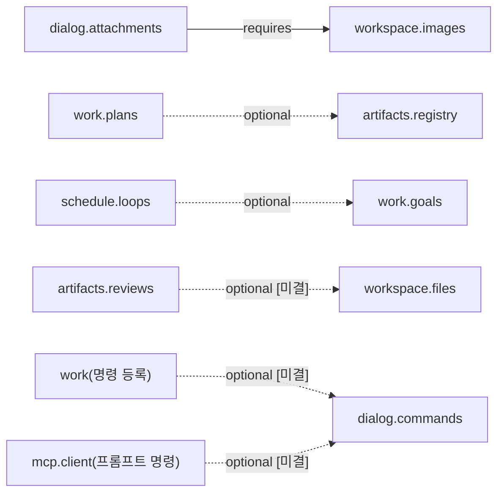

# L2 능력 층

## 1. 목적

L2는 F3 능력 정의(서비스 API + 모델 도구 한 쌍)를 구현한 provider 모음이다. 같은 능력이 서비스 API와 모델 도구로 함께 노출되므로, L3 그룹은 도구 호출 없이 코드에서 서비스를 바로 호출한다(`_research/layer-plan-v2.json` L2 intro, `F.capabilities.spec` §1).

- 층 순위는 4다. F(0) → X(1) → L0(2) → L1(3) → L2(4) → L3(5) → L4(6)이다(`_research/foundation-plan.md` §3, `architecture.layers.spec` §4.1).
- L2 패키지는 F, X, L0, L1만 import한다. L2 패키지끼리는 import하지 않는다(`eng.dependency-rules.guide` DR-02).
- 같은 층 협력은 F의 `ServiceKey`와 매니페스트 `requires`/`optional` 선언으로만 한다. 협력 방향은 §6에 모았다.
- L3는 L2의 정의(F3)만 참조하고 `cap-*` 패키지를 import하지 않는다(`_research/layer-plan-v2-notes.md` 층 사이 규칙 2, `architecture.layers.spec` §3.1 2행).
- 능력 정의의 내용(메서드, 도구, 스키마)은 각 `L2.<domain>.spec`이 정하고, 정의 데이터는 F `xeon/packages/contracts/src/capabilities/defs/<domain>.ts`에 둔다(`F.capabilities.spec` §3.9).
- 유료 provider(Exa, Parallel, Brave, Firecrawl 등)는 사용자가 키를 등록하는 플러그인이다. 공통 계약은 플러그인에도 그대로 적용된다(`_research/layer-plan-v2.json` L2-c note). 학습 정책은 L3가 갖고 L2-d는 저장과 조회만 맡는다(`_research/layer-plan-v2.json` L2-d note).

## 2. 도메인

`routes.yaml` `layout.L2.domains`의 8개 도메인이 계획 v2의 하위 층 8개(L2-a~L2-h)에 1:1로 대응한다. 표의 패키지·능력 ID·서비스 이름·이벤트 접두사·테이블 접두사 값은 L2 문서 전체가 쓰는 공통 규약이다. 바꾸려면 §10에 [미결]로 올리고 다른 문자열을 쓰지 않는다.

| 하위 층 id | 계획 v2 이름 | 도메인 | 패키지 | 능력 ID | 묶음 이름(§5.6) | 이벤트 접두사 | 테이블 접두사 | 마일스톤 | 문서 id |
|---|---|---|---|---|---|---|---|---|---|
| L2-a | 작업 도구 | workspace | cap-workspace | workspace.files, workspace.shell, workspace.images | xeon.workspace | workspace.(예약) | cap_workspace_(예약) | M1(read, ls, bash), M3(write, edit, grep, find)[^ws] | `L2.workspace.spec`, `L2.workspace.plan` |
| L2-b | MCP 통합 | mcp | cap-mcp | mcp.client | xeon.mcp | mcp.(휘발, 예약) | cap_mcp_ | M2(브리지, 서버 정의, 서버 주도 요청)[^mcp] | `L2.mcp.spec`, `L2.mcp.plan` |
| L2-c | 웹 | web | cap-web | web.search, web.fetch, web.browse, web.research | xeon.web | web.(휘발, 예약) | cap_web_ | M2(search, fetch), M2 후반~M3 초입(browse)[^web] | `L2.web.spec`, `L2.web.plan` |
| L2-d | 지식과 기억 (저장소) | knowledge | cap-knowledge | knowledge.skills, knowledge.memory, knowledge.search, knowledge.ledger | xeon.knowledge | knowledge.(예약) | cap_knowledge_ | M2 | `L2.knowledge.spec`, `L2.knowledge.plan` |
| L2-e | 작업 관리 | work | cap-work | work.tasks, work.plans, work.goals, work.reports | xeon.work | work. | cap_work_ | M2(tasks, plans), M3(goals, reports)[^work] | `L2.work.spec`, `L2.work.plan` |
| L2-f | 사용자 대화 | dialog | cap-dialog | dialog.ask, dialog.commands, dialog.status, dialog.attachments, dialog.aside, dialog.styles, dialog.notify | xeon.dialog | dialog.(휘발 status) | 없음 | M2(ask, commands, status, attachments), M3(notify)[^dialog] | `L2.dialog.spec`, `L2.dialog.plan` |
| L2-g | 산출물과 세션 | artifacts | cap-artifacts | artifacts.registry, artifacts.reviews, artifacts.sessions | xeon.artifacts | artifact.(단수 주의) | cap_artifacts_ | M3(정의·카탈로그만 M2)[^art] | `L2.artifacts.spec`, `L2.artifacts.plan` |
| L2-h | 예약과 백그라운드 | schedule | cap-schedule | schedule.loops, schedule.jobs, schedule.sessions, schedule.timers, schedule.remote | xeon.schedule | schedule. | cap_schedule_ | M3(정의·카탈로그만 M2)[^sch] | `L2.schedule.spec`, `L2.schedule.plan` |

- 이름 대응: 계획 v2의 하위 층 이름과 layout 도메인 이름이 다르게 읽히는 곳이 셋이다. L2-a "작업 도구" = `workspace`, L2-e "작업 관리" = `work`, L2-g "산출물과 세션" = `artifacts`. 코드, 서비스 이름, 이벤트·테이블 접두사, 설정 키는 layout 이름을 쓴다(`eng.context-map.design` §4.5, 미결 C-1).
- 이벤트 접두사의 "예약"은 소유만 정해 둔 접두사다. type을 실제로 더할 때 해당 spec의 카탈로그에 올린다(`eng.context-map.design` §5.1). artifacts 도메인의 이벤트 접두사는 단수 `artifact.`이고 테이블 접두사와 서비스 이름은 복수(`cap_artifacts_`, `xeon.artifacts`)다.
- dialog의 테이블 접두사 "없음"은 이 층 공통 규약 값이다. `eng.context-map.design` §4.1은 같은 칸을 "없음(예약 `cap_dialog_*`)"으로 적었다. 예약을 둘지는 §10 미결 6이다.
- 생산자 id는 `cap.<도메인>`이다(`eng.context-map.design` §5.1).
- "묶음 이름" 열의 `xeon.<domain>`은 도메인 묶음 타입(§5.6)을 가리키는 이름이다. 능력의 Cordis 바인딩은 능력마다 하나이고 이름은 `cap:<능력 id>`다(`F.capabilities.spec` §3.5, `X.primitives.spec` §3.7). `xeon.mcp`만 Cordis 서비스로도 등록한다. X `McpPort`(`registerServer`)를 받는 서비스 이름이기 때문이다(§5.6, `F.capabilities.spec` §3.5, `X.primitives.spec` §3.6 규칙 6). 나머지 `xeon.<domain>`은 Cordis에 등록하지 않는다.

마일스톤 칸은 `product.scope.spec` §4.3을 따른다. 계획 v2 JSON의 구성요소 단계(1차/2차/보류)와 다른 곳은 아래 각주에 적는다. 단계와 마일스톤은 다른 구분이다. 단계 '1차'는 첫 사용 버전(M3 종료)에 들어간다는 뜻이고 마일스톤은 그 안의 순서다(`product.scope.spec` §2).

[^ws]: [결정] M1의 `read`, `ls`, `bash`는 `_research/foundation-plan.md` §5 P4와 `F.capabilities.plan` M1과 같다. 나머지 도구는 `product.scope.spec` §4.3 M3. JSON은 "편집 방식" 2차, "이미지와 첨부 처리" 2차, "AST·LSP" 보류다. [제안] `workspace.images`의 최소형(등록, 형식·크기 검사, 리사이즈 없음)은 M2 `dialog.attachments`의 필수 의존이므로 M2에 만든다. photon 리사이즈는 2차다. 퍼지 편집은 `edit-diff.ts` 포크에 함께 들어 있어 M3 `edit`과 같이 온다. 줄 해시 편집은 2차(설계 메모만)다. 세부는 `L2.workspace.plan` §1.
[^mcp]: JSON은 브리지·서버 주도 요청 1차, Tasks·변경 구독·OAuth 2차다. 마일스톤과 같다. Tasks·변경 구독·OAuth는 M3 이후 2차 표에 둔다(`L2.mcp.plan` §1).
[^web]: JSON은 web.search·web.fetch·web.browse·공통 웹 계약 1차, agent-browser provider·web.research 2차, 선택 엔진 플러그인 보류다. 무료 검색 기본값 단계 구성은 M2다(`product.scope.spec` §4.1 I10, ADR-0005). [제안] `web.browse`의 playwright-core provider는 M2 종료 조건에 들지 않으므로 M2 후반에 시작해 늦어도 M3 초입에 끝낸다(`L2.web.plan` §1.1~1.2). 이 시점은 §10 미결 17이다.
[^work]: JSON은 작업 목록·계획 승인 1차, 목표 지속·완료 보고 2차, 작업 보드 보류다. 목표 판정은 3차 결정(별도 판정 모델 + 실행 횟수 상한)으로 범위에 들어와 M3다(`product.scope.spec` §4.1 I11). [제안] `work.reports`는 목표 종결 커밋이 완료 보고를 함께 만들어야 하므로 `work.goals`와 같이 M3에 둔다(`L2.work.spec` §1, `L2.work.plan` §1). JSON의 2차 표기와 다른 이 배치는 §10 미결 17이다.
[^dialog]: JSON은 질문 도구·슬래시 명령·진행 표시·첨부 1차, 곁가지 질문·출력 스타일 2차, 음성 입력 보류다. `dialog.notify`(사용자 알림)는 3차 결정이 범위에 넣었으므로 M3다(`product.scope.spec` §4.1 I13). `dialog.aside`, `dialog.styles`는 2차다.
[^art]: JSON은 산출물 등록·리뷰와 diff 승인·세션 제목과 메타 1차, 세션 핸드오프·내보내기 2차다. M3는 `product.scope.spec` §4.3 "나머지 1차 구성요소(`cap-artifacts` 등)"다. F 정의와 이벤트 카탈로그(`L2.artifacts.plan` A1)는 `cap-work`와 Helm이 정의를 참조해 컴파일되어야 하므로 M2에 둔다.
[^sch]: JSON은 루프·백그라운드 모니터·다중 세션 2차, 예약 실행·원격 제어 보류다. 3차 결정(예약·원격·알림 범위 포함, 데몬 허용)이 JSON 표기를 덮어써 1차로 본다(`product.scope.spec` §4.1 I4 해설, I13). 그래서 M3다. 루프는 서비스 모드가 필요 없지만 `cap-schedule` 묶음으로 함께 만든다(`product.scope.spec` §4.5). F 정의와 이벤트 카탈로그(`L2.schedule.plan` H1)는 M2에 둔다.

## 3. 패키지 배치

```
xeon/packages/
  cap-workspace/   cap-mcp/   cap-web/   cap-knowledge/
  cap-work/        cap-dialog/   cap-artifacts/   cap-schedule/
```

각 패키지의 공통 골격 [제안]:

```
cap-<domain>/
  package.json        # "xeon": { "layer": "L2", "domain": "<domain>" }
  src/
    index.ts          # 플러그인 엔트리. manifest 상수와 apply(ctx) export
    manifest.ts       # defineManifest({ layer: "L2", kind: "plugin", provides, requires, optional, ... })
    service.ts        # 능력별 API 객체 조립과 hostOf(g).provide(key, impl) 등록(§5.6)
    settings.ts       # defineSettings("l2.<domain>", { ... })
    <능력별 디렉터리>/  # 능력 하나당 디렉터리 하나. provider 구현
    upstream/         # 포크 코드가 있을 때만(ADR-0003 §3.4)
    testing/          # 공용 가짜(필요할 때, eng.testing.guide TS-06)
  test/
```

- `package.json`의 `xeon` 필드는 `{"layer": "L2", "domain": "<domain>"}`이고 값은 `routes.yaml` layout과 같아야 한다(`eng.dependency-rules.guide` DR-03).
- 정의 파일은 `cap-*`에 두지 않는다. `@xeon/contracts/capabilities`의 `defs/<domain>.ts`에서 import한다. 그래서 각 L2 plan의 첫 작업은 F `defs/<domain>.ts` 추가다.
- 포크 코드는 `src/upstream/`에 두고 패키지 루트에 `UPSTREAM.json`, `PATCHES.md`, `LICENSE.pi`(pi 포크일 때)를 둔다(ADR-0003 §3.4).
- 외부 SDK 타입은 각 패키지의 경계 어댑터 파일 밖으로 내보내지 않는다(`eng.context-map.design` CM-03). 예: `cap-mcp/src/adapter.ts`.

## 4. 층 안팎 경계

### 4.1 L2가 소유하는 것

- 능력 정의의 내용(메서드·도구·스키마·고유 오류 코드). 정의 데이터의 저장 위치는 F다.
- provider 구현과 provider 선택 체인(§5.2). `F.readme` §6 "능력 provider 구현과 선택" 행이 이 층을 가리킨다.
- 각 도메인의 세션 투영(`cap.<도메인>` 투영기, `cap_<도메인>_` 테이블)과 세션 밖 상태.
- `l2.<domain>.*` 설정 키 선언(§7).

### 4.2 L2가 소유하지 않는 것

| 대상 | 정하는 곳 |
|---|---|
| 권한 모드, 권한 규칙, 승인 프로토콜(`xeon.approvals`, `approval.*` 이벤트), 도구 실행 파이프라인, 도구 노출 켜기·끄기, 결과 경계화 | `L1.tools.spec` |
| 되감기, 체크포인트, 파일 복원, 세션 쓰기(`SessionWriter.commit`), `consumer_cursors` 테이블 | `L1.persistence.spec`, `eng.transactions.design` |
| 프로세스 레지스트리, 샌드박스, 격리, 실행 환경(`ExecutionEnv`), 비밀 저장과 주입, blob 저장 | `L0.process.spec`, `L0.sandbox.spec`, `L0.exec.spec`, `L0.secrets.spec`, `L0.store.spec` |
| 서브에이전트 실행, 백그라운드 위임 | `L1.agents.spec` |
| 학습 정책(언제, 무엇을 배울지), 탐구 정책(단계, drive 임대 사용) | L3 그룹 문서(`L3.readme`) |
| 확장 로딩, 신뢰, provider 등록 API, 4연산 실행 | `X.loading-trust.spec`, `X.primitives.spec` |
| 화면, 명령 표면, 설정 파일 위치 | `L4.settings-ui.spec`, `L4.cli.spec`, `L4.desktop.spec`, `L4.host-service.spec` |

- L2는 drive를 쓰지 않는다. drive 임대는 L3 그룹만 갖는다(`_research/layer-plan-v2-notes.md` 층 사이 규칙 4). L2가 다음 턴을 시작해야 하는 경우(`work.goals`, `schedule.loops`)는 `post`나 `xeon.tasks` 경유 입력으로 한다(각 spec).
- [제안] 한 스레드에서 다음 턴을 투입하는 L2 주체는 하나다. 목표(`work.goals`)를 가진 루프(`schedule.loops`의 `goalId`)에서는 루프가 반복마다 다음 턴을 투입하고 `work.goals`는 판정만 기록하며 post하지 않는다. 이를 위해 목표는 `continuation` 값을 갖는다. `"self"`(기본)면 `work.goals`가 미충족 판정 뒤 post하고, `"external"`이면 판정만 기록한다. `schedule.loops.start`는 `goalId`의 목표가 `continuation: "external"`이 아니면 `invalid_input`(`detail.reason: "goal_continuation_self"`)으로 거부한다. 루프와 목표를 함께 거는 호출자(L4 명령, 그룹)는 `work.goals.set({ continuation: "external" })` 뒤 `schedule.loops.start({ goalId })`를 부른다(`L2.work.spec` §4.3.5, `L2.schedule.spec` §4.1.4). 확정은 §10 미결 18이다.
- L3 그룹 이름은 이 층 문서에 쓰지 않는다. L2 설정의 기본값은 일반 이름으로 두고, 특정 그룹이 필요한 값은 L3가 설정으로 채운다 [결정: review.decisions-2 D-11].

## 5. 공통 provider 규약

이 절은 8개 도메인 spec이 인용하는 정본이다. 도메인별 세부(provider 목록, 탐침 방법, 고유 오류 코드)는 각 `L2.<domain>.spec`이 정한다. 이 절과 도메인 spec이 다르면 이 절을 먼저 고친다.

### 5.1 정의와 구현 (a)

- [결정] 정의는 F3에 있고 provider는 그 정의를 구현한다(`_research/decisions-log.md` 2026-10-21 계획 v2, `_research/layer-plan-v2.json` L2 intro).
- 정의는 F `capabilities/defs/<domain>.ts`에 `defineCapability`로 둔다. 각 spec의 "인터페이스" 절이 TypeBox 완성형을 적고 plan 첫 작업이 이 파일을 만든다.
- 구현은 `cap-<domain>`이 능력마다 `hostOf(g).provide(key, impl)`로 등록한다. X가 공급자 이름(`cap:<id>@<확장 이름>`)과 능력 바인딩(`cap:<id>`)을 만든다(`X.primitives.spec` §3.7). 내장 패키지는 매니페스트에 `provides: [{ id, version }]`을 둔다(`F.extensions.spec` §3.1).
- 외부 플러그인도 같은 능력 id의 provider가 될 수 있다. 플러그인 매니페스트의 `provides`에 내장 능력 id(예: `web.search`)를 적는다(`F.capabilities.spec` §3.1 네임스페이스 규칙 [제안]). 정의의 major와 플러그인이 선언한 버전의 major가 다르면 X가 등록을 거부한다(`F.capabilities.spec` §5 1항).
- [제안] 능력 하나에 provider가 여럿일 때, 내장 `cap-<domain>`은 consumer가 받는 서비스 객체(앞단)를 등록하고, 플러그인 provider는 그 능력의 후보로 등록된다. 앞단이 §5.2 체인으로 후보를 고른다. 그래서 consumer는 어떤 provider가 응답했는지 몰라도 된다. 능력 id별 후보 목록을 얻는 X API는 `X.primitives.spec`이 정한다 [가정]. `X.primitives.spec` §3.7 규칙 2는 공급자가 여럿이면 설정 `x.primitives.capabilityProviders`로 하나를 고르고, 설정이 없으면 `capability_ambiguous` 진단을 낸다. 이 절의 앞단 방식과 맞추려면 플러그인 후보는 능력 바인딩의 공급자에 들지 않고 앞단 후보 목록에만 들어야 한다 [미결](§10 미결 19).
- [제안] provider가 하나뿐인 능력(예: `workspace.files`)은 §5.2 체인을 생략하고 앞단이 곧 구현이다. 설정 키 `l2.<domain>.<능력>.provider`도 두지 않는다.

### 5.2 provider 선택 체인 (b)

[제안] provider가 여럿인 능력은 다음 공통형으로 고른다.

1. 호출 인자 `provider`: 메서드 입력에 `provider` 필드가 있고 값이 주어지면 그 provider만 쓴다.
2. 설정 `l2.<domain>.<능력>.provider`: 값이 `"auto"`가 아니면 그 provider만 쓴다.
3. `"auto"` 체인: 사용자 등록 플러그인(설정 `l2.<domain>.<능력>.pluginOrder` 순) → 감지된 로컬 provider → 내장 기본 provider 순으로 후보를 늘어놓는다.

- 각 provider는 `isAvailable(signal)` 탐침을 갖는다. 탐침이 실패하면 다음 후보로 내려가고 사유를 결과의 `meta.fallbacks`에 남긴다.
- 1·2번처럼 명시로 고른 provider는 다른 후보로 내려가지 않는다. 탐침이 실패하면 `unavailable` 오류를 내고 `detail`에 사유를 싣는다. 사용자가 고른 것을 조용히 바꾸지 않기 위해서다.
- auto 체인에서 호출 중 오류가 `unavailable`, `rate_limited`, `upstream_error`이면 다음 후보로 내려갈 수 있다. 단, 메서드의 `replay`가 `"safe"`일 때만이다. `"unsafe"` 메서드는 효과가 이미 났을 수 있으므로 호출 중 오류로는 내려가지 않는다.
- 후보가 모두 실패하면 `unavailable` 오류를 내고 `detail.fallbacks`에 전체 사유를 싣는다.
- `web.search`의 ADR-0005 §3.3(호출 인자 > 설정 > 키 플러그인 > SearXNG > 내장 검색 래퍼)은 이 규약의 사례다. ADR-0005의 짧은 키 `web.search.provider`는 키 문법(§7.1)에 맞춰 `l2.web.search.provider`로 읽는다. ADR-0005 §6의 [미결](플러그인과 SearXNG 순서)은 이 규약의 3번 순서(플러그인 > 감지 로컬)로 제안하고 확정은 ADR-0005를 따른다.

공통 타입은 F `capabilities/provider.ts`가 정본이다(`F.capabilities.spec` §3.11). 이름은 `PROVIDER_ID_PATTERN`, `ProviderIdSchema`, `ProviderId`, `ProviderOrigin`, `ProviderAvailability`, `ProviderFallback`, `ProviderSelectionMeta`, `ProviderCandidate`, `ProviderOrderInput`, `orderProviderCandidates`다. 내장 provider id는 소문자 이름이고 플러그인 provider id는 `plugin:<확장 이름>`이다.

- `orderProviderCandidates`는 같은 origin 안에서 plugin은 `pluginOrder` 순(목록에 없는 플러그인은 그 뒤에 id 바이트 순), detected와 builtin은 id 바이트 순으로 늘어놓는다. 탐침과 호출은 각 `cap-*`가 한다.
- 출력 필드 이름: provider 체인을 거치는 메서드의 출력은 `meta: ProviderSelectionMeta`(또는 이를 포함하는 도메인 메타. 예: `L2.web.spec` `WebCallMeta`)를 갖고 최상위 `provider` 필드를 두지 않는다(`F.capabilities.spec` §3.11). `F.capabilities.spec` §3.9 `web.search` 예시는 정의 형식을 설명하는 간추린 표기이고, `web.search`의 정본은 `defs/web.ts`와 `L2.web.spec` §3.2다.

### 5.3 도구 노출 (c)

- 모델 도구는 서비스 메서드의 얇은 어댑터다. `ToolSpec`은 `L1.tools`의 어댑터가 서비스 호출로 바꾼다(`F.capabilities.spec` §4.2 환원 규칙 1~5). `toInput`, `toContent`는 순수 함수다.
- 도구의 켜기·끄기와 능력 자체의 켜기·끄기는 단계 경계에서 적용된다. 실행 중인 도구 호출은 끝까지 실행된다(`F.extensions.spec` §4.5, `F.capabilities.spec` §5 5항).
- 도구 순서와 대화 중간 추가·제거는 `orderTools`, `diffToolsets`를 쓴다(`F.capabilities.spec` §4.5). 정적 정의로 표현하지 못하는 동적 도구(MCP 서버 도구)는 X 리소스 등록으로 광고하고 순서 키 `mcp.<서버>`를 쓴다(`F.capabilities.spec` §5 6항, `L2.mcp.spec`).
- 모든 도구에 `replay`, `executionMode`, `hints`를 명시한다. 생략하면 `replay`는 `"unsafe"`이고 `executionMode`는 L1.tools 기본값이다. 명시하면 리뷰와 정합성 검사에서 의도가 보인다 [제안].
- 외부에서 온 텍스트(웹 페이지, MCP 서버 결과, 첨부 URL 내용)는 `toContent`에서 신뢰하지 않는 내용 표지로 감싼다. 표지 이름은 도메인마다 `<untrusted_<출처>_content>`로 쓴다(예: `F.capabilities.spec` §3.9 `<untrusted_web_content>`) [제안].

### 5.4 상태 (d)

| 상태 종류 | 쓰는 경로 | 저장 위치 | 근거 |
|---|---|---|---|
| 세션에 속한 상태(작업 목록, 산출물 색인 등) | 도메인 이벤트(`<접두사>.*`)를 세션 커밋에 넣고, `cap.<도메인>` 투영기가 투영한다 | `cap_<도메인>_` 테이블. `session_id` 열을 둔다 | `eng.context-map.design` §5.2 |
| 세션 밖 상태(MCP 서버 상태, fetch 캐시, 스킬 색인, 타이머) | `xeon.store.scoped`(자기 접두사 범위 핸들) | `cap_<도메인>_` 테이블 | `eng.context-map.design` §5.2 |
| 같은 DB 이벤트의 비동기 소비(세션 검색 FTS 색인 등) | 자기 테이블 쓰기와 커서 갱신을 한 트랜잭션에 넣는다 | `consumer_cursors` 행(`consumer` = `cap.<도메인>.<이름>`) | `eng.transactions.design` §7 |
| 큰 바이너리(이미지, 첨부) | L0 blob API | `sys_blobs` + blob 파일, 참조는 `BlobRef` | `F.records.spec` §3.4, `eng.context-map.design` §5.2 |

- 다른 컨텍스트의 테이블을 직접 읽지 않는다. 필요한 데이터는 서비스 API나 이벤트 구독으로 받는다(`eng.context-map.design` CM-02).
- 세션 투영 테이블은 재생으로 다시 만들 수 있어야 한다. 세션 밖 상태 테이블은 재생 대상이 아니다(`eng.context-map.design` §5.2 마지막 열).
- 세션 쓰기는 `SessionWriter.commit` 한 경로로만 한다(`eng.transactions.design` TX-07). 트랜잭션 안에서 네트워크·모델 호출을 하지 않는다(TX-01).

### 5.5 오류 (e)

- 서비스 메서드는 실패하면 `CapabilityError`로 거부한다. `code`는 공통 코드 10종(`invalid_input`, `not_found`, `unsupported`, `unavailable`, `denied`, `rate_limited`, `timeout`, `upstream_error`, `aborted`, `internal`) 또는 `MethodDef.errors`에 선언한 고유 코드다(`F.capabilities.spec` §3.6).
- 고유 코드는 공통 코드와 같은 이름을 쓸 수 없다(`error_code_shadow`). 고유 코드 이름은 `<도메인 명사>_<상태>` 형식을 권한다(예: `edit_not_found`) [제안].
- 도구 경로에서는 L1.tools가 `CapabilityError`를 `isError: true` 결과로 바꾼다. `aborted`는 중단 결과다(`F.capabilities.spec` §4.2 규칙 5).
- `input_required`는 오류가 아니다. 출력 스키마의 변형으로 표현하고 도구 어댑터가 `ToolResultRecord.status`로 옮긴다(`F.capabilities.spec` §3.6, `F.conversation.spec` §3.6).
- 외부 오류(파일 시스템, 프로세스, HTTP, SDK)는 각 패키지의 경계에서 공통 코드로 바꾼다. 원래 오류 객체를 `detail`에 그대로 넣지 않는다. `detail`은 `JsonValue`이고 비밀 값을 담지 않는다.

### 5.6 도메인 서비스와 `ServiceKey`의 대응 (f)

Cordis 바인딩은 능력 단위다. X가 능력마다 `cap:<능력 id>` 바인딩 하나를 만든다(`F.capabilities.spec` §3.5, `X.primitives.spec` §3.7). 도메인 서비스 묶음 타입은 같은 도메인 능력 API를 모은 TypeScript 타입이고 Cordis 서비스로 등록하지 않는다(`F.capabilities.spec` §3.5). 예외는 `xeon.mcp` 하나다 [결정: review.decisions-2 D-04]. X가 확장의 MCP 서버 등록을 `McpPort`(`registerServer(owner, name, config)`, `F.extensions.spec` §3.2.1)로 넘기므로, `cap-mcp`는 `McpService extends McpPort`를 Cordis 서비스 `xeon.mcp`에 등록한다(`F.capabilities.spec` §3.5, `L2.mcp.spec` §3.2). `McpService`와 `McpServiceName`은 다른 묶음 타입과 달리 F `services/mcp.ts`에 있다(`F.capabilities.spec` §3.12 규칙 7). 능력 API(`mcp.client`)는 다른 도메인과 같이 `cap:mcp.client` 바인딩으로 얻는다.

```ts
// 예: 웹 도메인 묶음 타입. 정의 파일 defs/web.ts에 둔다
import type { CapabilityApi } from "@xeon/contracts/capabilities";
import type { WebSearch, WebFetch, WebBrowse, WebResearch } from "@xeon/contracts/capabilities/defs/web";

export interface WebService {
  readonly search: CapabilityApi<typeof WebSearch>;
  readonly fetch: CapabilityApi<typeof WebFetch>;
  readonly browse: CapabilityApi<typeof WebBrowse>;
  readonly research: CapabilityApi<typeof WebResearch>;
}
```

- consumer는 `ScopeApi.capability(key)`로 능력 단위 API를 얻는다(`F.extensions.spec` §3.2). 반환 타입은 `ApiOf<typeof key>`다. consumer는 묶음 타입이나 `xeon.<domain>` 이름을 쓰지 않는다.
- 묶음 타입은 provider 패키지 안에서 능력별 API 객체를 한곳에 모을 때와 문서에서 도메인을 가리킬 때 쓴다. 속성 이름은 능력 id의 둘째 마디다. 예: `web.search` → `WebService.search`.
- 도메인 묶음 타입 이름은 `eng.context-map.design` §5.3 표(`WorkspaceService`, `McpService`, `WebService`, `KnowledgeService`, `WorkService`, `DialogService`, `ArtifactService`, `ScheduleService`)를 따른다. 그 표의 `xeon.<domain>` 행은 `xeon.mcp`를 빼면 묶음 이름이고 Cordis 등록 이름이 아니다. `xeon.mcp`는 Cordis 등록 이름이다.

### 5.7 질문과 승인

- [결정] 질문 도구와 계획 승인은 L1.tools의 승인 프로토콜 하나로 합친다(`_research/foundation-plan.md` §1 5번). 서비스는 `xeon.approvals`이고 이벤트는 `approval.requested`와 `approval.resolved`다(`eng.context-map.design` §5.1).
- L2는 승인을 요청하고 결과 이벤트를 받는다. 승인 대기 중에는 루프가 승인 대기 상태를 단계 체크포인트로 커밋하고 멈춘다(`architecture.runtime-flow.design` §4.5). 대기 중에 도는 프로세스는 없다.
- L2가 쓰는 kind는 넷이다. `eng.events.design` §4.4의 `approval.requested` kind는 `tool | question | plan` 셋이므로 `review` 추가는 `L1.tools.spec`에 올리는 변경 요청이다(§10 미결 14).

| kind | 쓰는 능력 | 대상(`subject`)·답 스키마를 정하는 문서 | 비고 |
|---|---|---|---|
| `question` | `dialog.ask`, `mcp.client`(MCP 서버 주도 요청) | `L2.dialog.spec` §4.1, `L2.mcp.spec` §4.6 | mcp는 L1.tools가 올리는 안과 `cap-mcp`가 포트로 직접 부르는 안이 [미결]이다(`L2.mcp.spec` §10 미결 2) |
| `plan` | `work.plans` | `L2.work.spec` §4.2.2 | 차단 요청(턴이 기다린다) |
| `review` | `artifacts.reviews` | `L2.artifacts.spec` §4.2.4 | [미결] 비차단 요청. 받아들여지지 않으면 `question` + `answerSchema`로 대신한다(`L2.artifacts.spec` §10 미결 4) |
| `tool` | `knowledge.*` 쓰기 게이트, `schedule.loops`(그룹이 시작한 셸 종료 조건) | `L2.knowledge.spec` §4.5.1, `L2.schedule.spec` §4.1.2 | |

- `schedule.remote`는 요청하지 않고 원격 클라이언트의 응답을 `respond`로 중계만 한다(`L2.schedule.spec` §4.5.2).
- [제안] L2 공통 승인 포트. 각 `cap-*`는 `xeon.approvals`를 패키지 내부 포트 한 곳(`src/ports/approvals.ts`)으로 감싸고 아래 모양을 따른다. L2 패키지끼리 import하지 않으므로 같은 모양을 각자 둔다. 도메인 spec은 kind와 `subject` 타입만 좁힌다. L1.tools.spec의 실제 이름이 다르면 포트만 고친다.

```ts
// cap-<domain>/src/ports/approvals.ts  (패키지 내부. L1.tools.spec 승인 프로토콜을 감싼다 [가정])
export type L2ApprovalKind = "tool" | "question" | "plan" | "review";

export interface ApprovalSnapshot {
  readonly approvalId: ApprovalId;
  readonly state: "pending" | "resolved" | "cancelled";
  /** wire approval.respond의 decision·answer와 같은 값(F.wire-settings.spec §3.3.1) */
  readonly resolution: { readonly decision: "allow" | "deny" | "answer"; readonly answer: JsonValue | null } | null;
}

export interface ApprovalsPort {
  /** 멱등 키는 입력의 requestId다. 같은 requestId로 다시 부르면 새 요청을 만들지 않고 기존 요청의 현재 상태를 돌려준다 */
  request(input: {
    threadId: ThreadId;
    kind: L2ApprovalKind;
    subject: JsonValue;
    /** decision = "answer"일 때 answer를 검사할 스키마. question·plan·review가 쓴다 */
    answerSchema?: TSchema;
    /** false면 턴을 멈추지 않는 비차단 요청(review). 생략하면 true */
    blocking?: boolean;
    requestId: string;
  }): Promise<ApprovalSnapshot>;
  get(threadId: ThreadId, approvalId: ApprovalId): Promise<ApprovalSnapshot | null>;
  respond(input: { threadId: ThreadId; approvalId: ApprovalId; decision: "allow" | "deny" | "answer"; answer?: JsonValue; requestId: string }): Promise<void>;
  cancel(threadId: ThreadId, approvalId: ApprovalId, reason: string): Promise<void>;
  /** 응답이 기록되면 이행되는 메모리 Promise. 프로세스가 끝나면 사라지고 재개 뒤 같은 requestId로 request를 다시 부른다 */
  wait(threadId: ThreadId, approvalId: ApprovalId, signal: AbortSignal): Promise<ApprovalSnapshot>;
}
```

- 능력마다 쓰는 메서드만 쓴다. `request`·`get`은 모두 쓰고, `wait`는 그룹 경로에서 결과를 기다리는 `work.plans`·`dialog.ask`가, `cancel`은 `work.plans`가, `respond`는 `work.plans`의 편의 메서드와 `schedule.remote`가 쓴다.

### 5.8 호출 문맥 (`CallOptions.context`)

여러 L2 서비스가 대상 세션(`work`, `dialog`, `artifacts`, `schedule`), 턴(`artifacts.reviews`), 도구 호출 여부(`artifacts`), 호출 주체(`web`의 세션 상한·정책, `knowledge`의 행위자, `work.goals.judge`의 호출자 확인)를 알아야 한다. 도구 경로의 `toInput`은 순수 함수라 이 값을 입력에 넣을 수 없다.

호출 문맥은 `F.capabilities.spec` §3.2의 `CallOptions.context: CallContext`(`threadId`, `turnId`, `toolCallId`, `caller: CallerInfo`)가 정본이다. 여섯 도메인 spec(`L2.work.spec`, `L2.dialog.spec`, `L2.artifacts.spec`, `L2.schedule.spec`, `L2.web.spec`, `L2.knowledge.spec`)은 이 타입을 인용한다. `CallerInfo`는 `kind`(`model` | `extension` | `host`), `agent`(`main` | `subagent` | `background`), `extension`, `afterUntrusted`를 갖는다. `context`는 L1.tools 어댑터(도구 경로)와 X의 capability 래퍼(그룹·확장 경로)가 덮어써서 채우고 consumer가 직접 채우지 않는다.

- `context`가 없으면 provider는 `{ caller: { kind: "host" } }`로 본다.
- 대상 세션 해석: 메서드 입력에 `threadId`가 있으면 그것을 쓰고, 없으면 `context.threadId`를 쓴다. 둘 다 없으면 `invalid_input`이다. 도구 경로(`context.toolCallId`가 있음)에서 입력 `threadId`가 `context.threadId`와 다르면 `denied`다. 모델이 다른 세션을 대상으로 삼지 못하게 하려는 것이다.
- 도메인 spec에서 `caller.kind`처럼 짧게 쓴 것은 `CallOptions.context.caller.kind`다.

### 5.9 이벤트 카탈로그 형식

L2 도메인의 내구·휘발 이벤트 카탈로그 형식은 `F.records.spec` §3.3.2(도메인 소유 카탈로그)가 정본이다.

- 위치: F `xeon/packages/contracts/src/records/catalog/<domain>.ts`. 이벤트가 있는 도메인(work, dialog, artifacts, schedule)만 만든다. 접두사만 예약한 도메인(workspace, mcp, web, knowledge)은 type을 실제로 더할 때 같은 형식으로 만든다.
- 형식: `F.records.spec` §3.3의 `CatalogEntry`(`kind`, `version`, `durable`, `payload`, `retired?`) 배열이다. export 이름은 `<DOMAIN>_EVENT_CATALOG`(`WORK_EVENT_CATALOG`, `DIALOG_EVENT_CATALOG`, `ARTIFACT_EVENT_CATALOG`, `SCHEDULE_EVENT_CATALOG`)다. 휘발 이벤트는 `durable: false`다. `records/catalog/index.ts`가 코어 카탈로그와 도메인 카탈로그를 병합한다.
- 이름 규칙: `<접두사>.<이름>`, 점 하나, snake_case(`F.records.spec` §3.2 규칙 1)와 과거형(`eng.events.design` §4.5 규칙 1)을 함께 지킨다. 휘발 `<대상>.status`는 `eng.events.design` §4.5 규칙 2를 따른다.
- 접두 예외: 내장 `cap-*`는 자기 도메인 영역(`DomainArea`)을 접두 없이 쓴다. 그룹 레코드 kind와 커스텀 메시지 `customType`은 이 예외에 들지 않고 `RecordKind` 형식(`x.<확장 이름>.…`)을 쓴다(`F.records.spec` §3.2 규칙 3). 그래서 `cap-work`의 이벤트는 `work.goal_judged`이고 커스텀 메시지는 `x.cap-work.goal.continue`다.
- 소유 생산자: `TYPE_PREFIX_OWNERS`(`src/records/owners.ts`)에 `work.` → `cap.work`, `dialog.` → `cap.dialog`, `artifact.` → `cap.artifacts`, `schedule.` → `cap.schedule` 행이 있다. 커밋 때 접두사 소유 검사는 이 표로 한다.
- payload 스키마를 records 쪽에 둘지 capabilities 정의 파일에서 import할지는 F 안의 도메인 순서(`F.readme` §3)를 따르고 `F.records.plan`이 정한다.

## 6. L2 사이 의존

[제안] L2 사이 의존은 서비스 경유(`requires`/`optional` 선언 + `ScopeApi.capability(key)`)만 허용하고 방향은 아래 여섯뿐이다. 그중 둘(`dialog.commands`로 가는 간선)은 [미결]이다(§10 미결 16).



| 의존하는 능력 | 대상 능력 | 종류 | 쓰임 | 선언 위치 |
|---|---|---|---|---|
| `dialog.attachments` | `workspace.images` | requires | 붙여넣은 이미지의 형식·크기 검사와 blob 등록 | `cap-dialog` 매니페스트 `requires`, 정의 `requires` |
| `work.plans` | `artifacts.registry` | optional | 제출된 계획의 각 판을 산출물로 등록(`L2.work.spec` §4.2.4) | `cap-work` 매니페스트 `optional` |
| `schedule.loops` | `work.goals` | optional | 루프 종료 조건에 목표 판정 사용 | `cap-schedule` 매니페스트 `optional` |
| `artifacts.reviews` | `workspace.files` | optional, [미결] | 리뷰 hunk의 현재 파일 내용 조회, 거절 hunk 되돌림(`L2.artifacts.spec` 안 A) | `cap-artifacts` 매니페스트 `optional` |
| `work`(cap-work 시작 시) | `dialog.commands` | optional, [미결] | `/goal`, `/plan`, `/tasks` 동작 명령 등록(`L2.work.spec` §6.2, W-10) | `cap-work` 매니페스트 `optional` |
| `mcp.client` | `dialog.commands` | optional, [미결] | MCP 프롬프트를 슬래시 명령으로 등록(`L2.mcp.spec` §1.2) | `cap-mcp` 매니페스트 `optional` |

- 순환이 없다. 능력 단위로 보면 간선 여섯의 끝점(`workspace.images`, `artifacts.registry`, `work.goals`, `workspace.files`, `dialog.commands`)은 어느 L2 능력에도 의존하지 않는다. 도메인 단위로 묶으면 의존하는 쪽은 schedule → work, work → artifacts, work → dialog, mcp → dialog, artifacts → workspace, dialog → workspace다. workspace는 다른 L2 도메인에 의존하지 않고, artifacts와 dialog는 workspace에만, work는 artifacts와 dialog에만, schedule은 work에만, mcp는 dialog에만 의존한다. 이 순서(workspace → artifacts·dialog → work·mcp → schedule)를 거꾸로 가는 간선이 없으므로 사슬은 닫히지 않는다. dialog는 등록된 명령 처리기를 실행할 뿐 work나 mcp의 서비스를 부르지 않는다(`L2.dialog.spec` §4.3).
- 알림은 간선을 만들지 않는다. 알림 채널은 `dialog.notify`가 소유하고 `schedule`은 알림 대상 이벤트만 낸다(§8, §10 미결 15). `dialog.notify`가 `work.*`·`schedule.*` 이벤트를 분류하는 것은 이벤트 구독이고 서비스 의존이 아니다.
- 필수 의존(`requires`)은 정의의 `CapabilityDef.requires`에도 적는다. 선택 의존(`optional`)은 매니페스트에만 적고, 호출 전에 사용 가능 여부를 확인한다(`F.capabilities.spec` §5 2항).
- 위 표에 없는 L2 사이 의존이 필요해지면 이 절을 먼저 고친다. 새 간선이 순환을 만들면 넣지 않는다. 공통 데이터가 필요하면 F에 타입을 두고 서비스를 거친다(DR-02).
- L1·L0 서비스 의존(`xeon.exec`, `xeon.approvals`, `xeon.store` 등)은 이 그래프에 넣지 않는다. 층 순위상 아래 방향이라 순환이 생기지 않는다. 목록은 `eng.context-map.design` §4.1 (d)열이다.

## 7. 설정 노출 총괄

### 7.1 키 문법

- 키는 `l2.<도메인>.<이름>`이다. 도메인은 layout 이름이고, 이름 부분은 소문자 낙타 표기이며 점으로 더 나눌 수 있다(`F.wire-settings.spec` §3.8.1 `SETTING_KEY_PATTERN`). 예: `l2.web.search.provider`, `l2.workspace.read.maxLines`.
- 이름 부분의 각 마디는 `[a-z][A-Za-z0-9]*`라서 하이픈을 쓰지 않는다.
- provider 체인 키 [제안]: `l2.<domain>.<능력>.provider`(`"auto"` 또는 `ProviderId`, 기본 `"auto"`)와 `l2.<domain>.<능력>.pluginOrder`(`ProviderId` 목록). `<능력>`은 능력 id의 두 번째 마디다. 예외는 `web.fetch` 하나다. fetch는 내장 로컬 파이프라인이 항상 먼저 돌고 플러그인 후보는 빈 결과의 승격 경로에서만 쓰므로(`L2.web.spec` §4.9.1) `l2.web.fetch.provider`를 두지 않고 `pluginOrder`만 둔다.
- 비밀은 값을 저장하지 않고 `secret://<name>` 참조로만 저장한다(`F.wire-settings.spec` §3.8.1 `SecretRef`, D2·D3 규칙).
- 외부 플러그인 provider의 설정(API 키 등)은 `ext.<확장 이름>.*`이고 L2 키가 아니다(`F.wire-settings.spec` §3.8.3 확장 규칙).
- 각 spec의 "설정 노출" 절은 다음 열로 표를 쓴다: 키, 타입, 기본값, range, runtimeChange, allowedScopes, ui.tab, secret. L4 노출(화면, 파일, 명령)이나 단위 같은 설명이 필요하면 마지막에 "비고" 열 하나를 더할 수 있다.
- 표 값 표기 [제안]: allowedScopes는 범위 이름 전체를 쉼표로 늘어놓는다(`managed, user, project, local, session`). 약어를 쓰지 않는다. secret은 `true`/`false`다. range는 수 범위면 `min <최소>, max <최대>`(한쪽만 있으면 그쪽만), 열거형이면 `enum <값>, <값>`, 없으면 `—`다.
- `since` [제안]: 첫 사용 버전(M3 종료)까지 만드는 L2 키는 모두 `since: "0.1.0"`이다. 그 뒤에 더하는 키만 더한 버전을 적는다.
- 범위 제한 규칙 [제안]: project 범위 값은 저장소에 들어 있는 파일이라 저장소를 여는 것만으로 적용된다. 그래서 보안 경계를 넓히는 키는 allowedScopes에 `project`를 넣지 않는다. 해당하는 키는 실행 파일·바이너리 경로, 사설망·루프백 접근 같은 네트워크 방어 해제, 검색어·내용을 보내는 외부 호스트 주소, 원격 기능 켜기, 브라우저 JS 실행·파일 업로드·로그인 프로필 사용, 쓰기 승인·스캔 끄기다(`L2.workspace.spec` §6 `grep.rgPath`, `L2.web.spec` §6, `L2.schedule.spec` §4.5.3, `L2.knowledge.spec` §6). 프로젝트가 정의하는 실행 대상(MCP stdio 서버)은 `project` 범위를 허용하되 프로젝트가 신뢰된 상태(`project_trust` 지점, `F.extensions.spec` §3.4)에서만 적용한다(`L2.mcp.spec` §6).

### 7.2 L4 탭

`F.wire-settings.spec` §3.8.2의 `SettingsTab` 값으로 배치한다. 계획 v2의 "도구와 웹" 탭(MCP 서버, 도구 노출, 스킬, 웹 검색·fetch·브라우저 provider 선택)은 `tools` 탭에 대응한다(`_research/layer-plan-v2-notes.md` "L4 설정 화면 구성안").

| `ui.tab` | L2 내용 [제안] |
|---|---|
| `tools` | workspace 한도, MCP 서버·승인 모드·허용·차단, 웹 provider 선택·도메인 정책, 스킬·메모리 켜기와 쓰기 승인, 명령·첨부·질문 시간 제한(dialog), 작업 목록(work), 리뷰·산출물 도구 켜기(artifacts), schedule 도구 켜기 |
| `models` | L2가 고르는 모델 용도 이름(artifacts 자동 제목·핸드오프 용도). work 목표 판정은 `L1.models.spec` 역할 `judge`(`l1.models.routing.judge`)와 상한 `l1.agents.judge.maxRuns`를 쓰고 L2 키를 두지 않는다 |
| `budgets` | 비용과 반복 횟수 정책(work 판정 실패 정책 `l2.work.goal.onJudgeError`). 판정 상한 키는 `l1.agents.judge.maxRuns` 하나이고 L1.agents 소유다 [결정: review.decisions-2 S-06] |
| `providers` | provider 플러그인 우선순위(`pluginOrder`)의 표시. 플러그인 자체 설정은 `plugins` 탭 |
| `secrets` | L2 키가 참조하는 `secret://` 이름의 표시(예: `l2.schedule.remote.tokenRef`). 값 관리는 L0.secrets 소관 |
| `sessions` | 세션 제목·메타, 핸드오프, 내보내기, 산출물 한도(artifacts), 메모리·세션 검색(knowledge) |
| `execution` | 루프·예약·백그라운드 작업·원격(schedule), 알림(dialog.notify) |
| `permissions` | 계획 모드 승인 키 두 개(`l2.work.plans.requireApproval`, `l2.work.plans.exitOnApprove`). 권한 모드 전환과 연결된 키라 이 탭에 둔다. 그 밖의 도구 승인 규칙은 L1.tools 키다. MCP 도구별 승인 모드처럼 L2가 기본값을 공급하는 키는 `tools` 탭에 두고 L1.tools 규칙 키 형식(`mcp__<서버>`)을 맞춘다 |
| `appearance` | 상태줄 세그먼트와 출력 스타일(`l2.dialog.status.segments`, `l2.dialog.styles.active`) |
| `advanced` | 화면에 두지 않고 파일로만 바꾸는 세부 한도·간격(knowledge, work, artifacts, schedule) |

- 이 표는 L2 키의 `ui.tab` 값이다. L4 탭 표는 각 키를 소유한 층 문서의 `ui.tab`을 따른다 [결정: review.decisions-2 S-11].

## 8. 상주 수준

`_research/l2e.md` §6의 기준을 L2 능력에 적용한다 [제안]. 0은 요청 처리 중 메모리만 쓴다. 1은 앱(세션 프로세스)이 살아 있어야 한다. 2는 앱을 닫아도 독립 프로세스가 살아 있어야 하므로 공유 서비스 모드(`xeon service`, ADR-0006)가 필요하다.

| 수준 | 능력 | 이유 |
|---|---|---|
| 0 | `workspace.files`, `workspace.shell`, `workspace.images`, `web.search`, `web.fetch`, `knowledge.skills`, `knowledge.memory`, `knowledge.search`, `knowledge.ledger`, `work.tasks`, `work.plans`, `work.reports`, `dialog.ask`, `dialog.commands`, `dialog.attachments`, `dialog.styles`, `artifacts.registry`, `artifacts.reviews`, `artifacts.sessions` | 호출 안에서 끝난다. 승인 대기는 내구 상태라 프로세스가 필요 없다 |
| 1 | `mcp.client`(stdio 서버 자식 프로세스, 연결), `web.browse`(브라우저 프로세스), `web.research`(앱 안 루프), `work.goals`(다음 턴 시작), `dialog.status`, `dialog.aside`, `dialog.notify`의 OS 알림, `schedule.loops`, `schedule.sessions`의 목록 | 앱이 켜져 있는 동안만 동작하면 된다 |
| 2 | `schedule.timers`, `schedule.remote`, `schedule.jobs`의 분리 실행, `dialog.notify`의 모바일 푸시 | 앱을 닫아도 실행되어야 한다. 서비스 모드 전용이다 |

- [제안] 알림 채널(OS 알림, 모바일 푸시)은 모두 `dialog.notify`가 소유한다. `schedule.remote`는 원격 클라이언트의 승인·질문 응답만 맡고, `schedule`은 알림 대상 이벤트를 낼 뿐이다. 알림 채널이 한 곳에 있어야 무엇을 어디로 받을지 정하는 사용자 설정이 하나로 모이기 때문이다(`L2.dialog.spec` §4.7.2, `L2.schedule.spec` §4.5.4). 확정은 §10 미결 15다.
- 수준 2 기능을 서비스 모드가 꺼져 있을 때 요청하면 서비스 자동 기동을 시도한다. 기동에 실패하면 `unavailable` 오류를 내고 `detail.reason`에 `"service_mode_off"`와 조치 안내를 싣는다. 앱 프로세스 안에서 대신 실행하지 않는다 [결정: review.decisions-2 U-23]. 예약 생성의 기본값 이름은 `autoStart`다(`L2.schedule.spec` §6).
- 서비스 모드는 1차(M3)이고 OS 서비스 등록(launchd, systemd)만 2차다 [결정: review.decisions-2 S-01]. 원격 사용은 1차(M3)이고, 로컬 서비스 소켓을 SSH 터널이나 사설망으로 연결하는 방식이다. 내장 TLS + 토큰 WebSocket은 2차다 [결정: review.decisions-2 U-11].
- `schedule.sessions`의 공유 관제(여러 클라이언트가 같은 목록을 보는 것)는 수준 2다(`_research/l2e.md` §6 D4).

## 9. 결정 근거

| 결정 | 근거 |
|---|---|
| [결정] L2 능력은 F3 정의를 구현한 provider이고 그룹은 서비스를 코드에서 바로 호출한다 | `_research/layer-plan-v2.json` L2 intro |
| [결정] 같은 층 패키지는 import하지 않는다. 협력은 F 정의와 Cordis 서비스로만 한다 | `_research/foundation-plan.md` §3, `eng.dependency-rules.guide` DR-02 |
| [결정] 유료 웹 API는 플러그인, 기본은 로컬 도구 | `_research/decisions-log.md` 2026-10-21 결정(2차) |
| [결정] 질문 도구와 계획 승인은 승인 프로토콜 하나 | `_research/decisions-log.md` 2026-10-21 결정(3차), `_research/foundation-plan.md` §1 5번 |
| [결정] 예약·원격·알림 범위 포함(데몬 허용) | `_research/decisions-log.md` 2026-10-21 결정(3차), `_research/foundation-plan.md` §1 2번 |
| [결정] pi durable tools·images·truncate는 Chord 제거 포크 | ADR-0003 §3.1 |
| [결정] 세션 저장은 SQLite 이벤트 소싱 + 투영, 단일 DB, 확장 접두사 테이블 | `_research/decisions-log.md` 2026-10-21 결정(2차), ADR-0004 |
| [결정] 학습 정책은 L3, 저장은 L2-d | `_research/decisions-log.md` 2026-10-21 계획 v2 |

## 10. 미결 사항

1. 닫힘. 도메인 서비스 묶음과 `ServiceKey`의 대응(§5.6). `F.capabilities.spec` §3.5와 `X.primitives.spec` §3.7이 능력마다 `cap:<id>` 바인딩 하나로 정했다. 묶음 타입은 등록하지 않는다. 예외로 `xeon.mcp`는 `McpPort`를 확장하는 `McpService`(F `services/mcp.ts`)로 등록한다(`F.capabilities.spec` §3.5·§3.12, `X.primitives.spec` §3.6 규칙 6, §3.9).
2. 닫힘. provider 공통 타입(§5.2)은 F `capabilities/provider.ts`에 있다(`F.capabilities.spec` §3.11).
3. 닫힘. provider 메타 출력 모양은 `meta: ProviderSelectionMeta`다. `F.capabilities.spec` §3.9 예시의 최상위 `provider`는 간추린 표기다(`F.capabilities.spec` §3.11).
4. [미결] 명시 선택 provider의 실패 처리(§5.2). 명시 선택은 내려가지 않는다는 제안과 ADR-0005 §3.3 문구("앞 provider가 실패하면 내려간다")의 적용 범위가 같은지 확인한다.
5. [미결] `artifacts.reviews` → `workspace.files` 선택 의존(§6). 리뷰가 도구 결과 `details`의 diff만으로 충분하면 간선을 없앤다(`L2.workspace.spec`, `L2.artifacts.spec`).
6. [미결] dialog의 테이블 접두사. 공통 규약은 "없음"이고 `eng.context-map.design` §4.1은 "예약 `cap_dialog_*`"다. 예약을 둘지 정한다.
7. [미결] `eng.context-map.design` 미결 C-1(하위 층 이름과 layout 이름)과 C-3(내장 L2 능력 테이블 접두사를 `cap_<도메인>_`으로 둘지 설치형 확장 접두 `x_<extKey>_`로 통일할지). 설치형 확장 접두 `x_<extKey>_`는 [결정: review.decisions-2 U-18]로 정해졌다(`eng.context-map.design` §5.2). 이 층은 C-1의 현재 방침(코드에 layout 이름)과 C-3의 현재 값(`cap_<도메인>_`)을 따른다.
8. [미결] 도구 없는 능력(`F.capabilities.spec` §4.4 [미결]). `workspace.images`처럼 그룹과 다른 능력만 쓰는 능력이 있다. 허용되지 않으면 해당 능력에 관리용 도구를 두어야 한다.
9. [결정: review.decisions-2 U-23] 상주 수준 2 기능의 서비스 모드 꺼짐 처리(§8). 서비스 자동 기동을 시도하고, 실패하면 `unavailable` + `service_mode_off`와 조치 안내로 거부한다. 예약 생성의 기본값 이름은 `autoStart`다.
10. [미결] `workspace.images` 최소형을 M2에 두는 배치(§2 각주 ws). JSON의 "이미지와 첨부 처리 2차"와 `dialog.attachments` 1차(M2) 사이의 차이를 사용자가 확인한다.
11. [결정: 사용자 확인 2026-10-22] 마일스톤 M2·M3 정의가 확정됐다(`product.scope.spec` §4.3). 이 문서의 마일스톤 칸도 그 정의를 따른다.
12. 닫힘. 호출 문맥(§5.8)은 `F.capabilities.spec` §3.2 `CallOptions.context: CallContext`로 들어갔다. 도메인 문서의 옛 요청(`L2.work.spec` W-1, `L2.dialog.spec` D-1, `L2.artifacts.spec` §10 미결 1, `L2.schedule.spec` §8, `L2.web.spec` §10 미결 2, `L2.knowledge.spec` §10 미결 2)도 이 정의를 따른다. `work.goals.judge`·`dialog.notify.emit`의 호출자 확인(`L2.work.spec` W-6, `L2.dialog.spec` D-4)은 `caller.extension`으로 한다.
13. 닫힘. 이벤트 카탈로그 형식(§5.9)은 `F.records.spec` §3.3.2 도메인 소유 카탈로그(`records/catalog/<domain>.ts`, `<DOMAIN>_EVENT_CATALOG`, `TYPE_PREFIX_OWNERS` L2 행, 내장 패키지 접두 예외)로 들어갔다. `L2.work.spec` W-4, `L2.dialog.spec` §3.7, `L2.artifacts.spec` §3.6, `L2.schedule.spec` §3.7도 이 정의를 따른다.
14. [미결] 승인 kind `review` 추가를 `L1.tools.spec`에 요청한다(§5.7). 비차단 요청(`blocking: false`)과 `answerSchema` 인자도 함께 요청한다. 받아들여지지 않으면 `artifacts.reviews`는 `question` + `answerSchema`로 대신한다(`L2.artifacts.spec` §10 미결 4, `L2.schedule.spec` §3.6 `PendingRequestSchema`).
15. [미결] 알림 채널 소유(§8). 제안은 OS 알림과 모바일 푸시를 모두 `dialog.notify`가 소유하고 `schedule.remote`는 원격 응답 중계만 맡는 것이다. `L2.dialog.spec` §10 D-6과 `L2.schedule.spec` §10 미결 3은 이 항목을 가리킨다. 반대로 정하면(푸시를 `schedule.remote`가 소유) `schedule.remote` → `dialog.notify` 읽기 간선이 생기므로 §6 표에 더한다.
16. [미결] `dialog.commands`로 가는 선택 의존 둘(§6): `work`의 동작 명령 등록(`L2.work.spec` W-10)과 `mcp.client`의 프롬프트 명령 등록(`L2.mcp.spec` §1.2). 넣지 않으면 두 경로 모두 L4 클라이언트가 명령을 직접 등록한다.
17. [미결] 1차 구성요소의 마일스톤 배치 차이(§2). `work.reports`를 JSON의 2차 대신 M3에 두는 것(`L2.work.spec` W-9)과 `web.browse`를 M2 후반~M3 초입에 두는 것(`L2.web.plan` §1.2)을 사용자가 확인한다. artifacts·schedule의 정의·카탈로그만 M2에 두는 배치(`L2.artifacts.plan` A1, `L2.schedule.plan` H1)도 함께 확인한다.
18. [미결] 다음 턴 투입 주체(§4.2). 목표가 있는 루프에서 루프만 투입하고 `work.goals`는 `continuation: "external"`로 판정만 기록하는 규칙(`L2.work.spec` §4.3.5, `L2.schedule.spec` §4.1.4)을 확정한다.
19. [미결] 여러 provider 능력의 등록 방식(§5.1). 앞단(`cap-<domain>`)만 능력 바인딩 공급자로 두고 플러그인 provider는 앞단 후보 목록에만 넣는 방식과, `X.primitives.spec` §3.7 규칙 2(공급자 여럿이면 `x.primitives.capabilityProviders` 설정 선택, 없으면 `capability_ambiguous`)를 맞춘다. `X.primitives.spec`과 함께 정한다.
