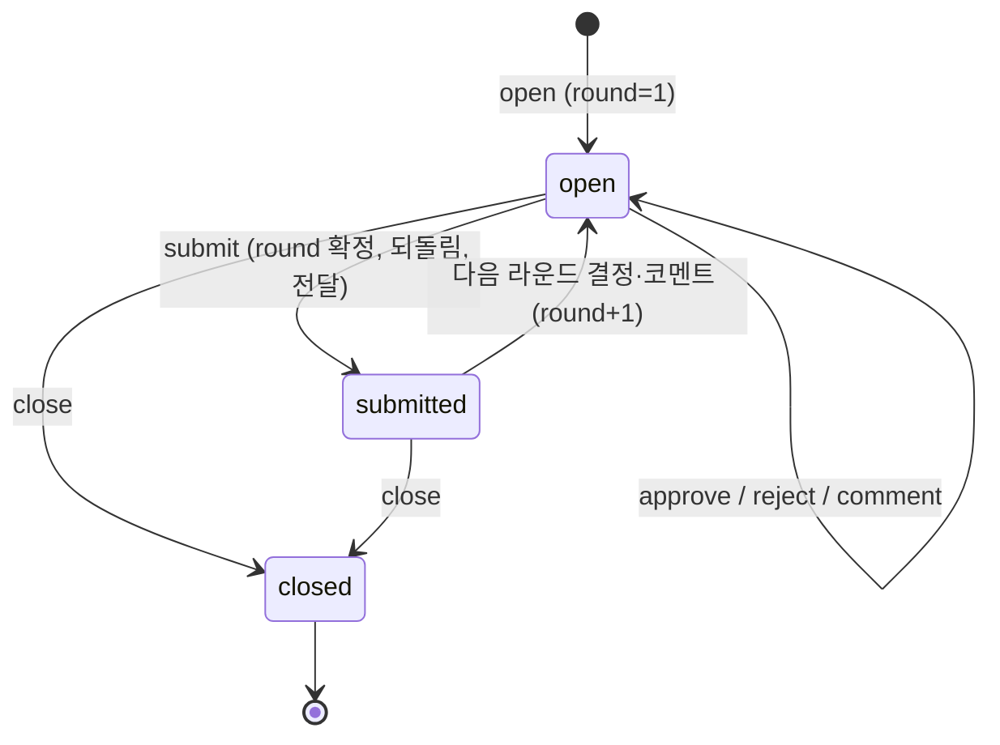

# L2 산출물과 세션 (artifacts)

패키지: `@xeon/cap-artifacts`. 서비스 이름: `xeon.artifacts`(`ArtifactService`). 능력 ID: `artifacts.registry`, `artifacts.reviews`, `artifacts.sessions`. 이벤트 접두사: `artifact.`(단수). 테이블 접두사: `cap_artifacts_`.

이벤트 접두사는 단수 `artifact.`이고, 서비스 이름·능력 ID·테이블 접두사·설정 키는 복수 `artifacts`다. 이 차이는 의도한 것이다(`eng.context-map.design` §4.1 artifacts 행, §5.1 `artifact.` 행). 코드에서 `artifacts.registered` 같은 복수형 kind를 쓰면 접두사 소유 검사(`EventCatalog.owns`)가 거부한다.

## 1. 목적과 범위

계획 v2 하위 층 L2-g "산출물과 세션"(`_research/layer-plan-v2.json` L2-g)을 구현하는 능력 셋을 정한다. 대화 중에 생긴 결과물을 찾을 수 있게 등록하고, 파일 변경을 hunk 단위로 승인·거절하며, 세션 자체의 제목·라벨·이전·내보내기를 다룬다.

정하는 것:

- 능력 정의 3개의 TypeBox 완성형(§3.2~§3.4). 정의 파일은 F `xeon/packages/contracts/src/capabilities/defs/artifacts.ts`에 둔다(`F.capabilities.spec` §3.9 정의 위치 [제안]).
- 산출물 레지스트리: 종류(kind), blob 참조, 버전, 출처 세션·턴, 미리보기 메타(§4.1).
- 리뷰와 diff 승인: hunk 분할, hunk 단위 승인·거절, 줄 코멘트, 코멘트를 에이전트 입력으로 되돌리는 규칙(§4.2).
- 세션 제목·라벨 메타와 메타 검색(§4.3). 자동 제목 생성의 트리거와 모델 용도.
- 세션 핸드오프의 데이터 형식(2차, §4.4)과 Markdown·HTML 내보내기(2차, §4.5).
- `artifact.*` 이벤트 카탈로그와 `cap_artifacts_` 투영 테이블(§3.6, §3.7). 형식은 `eng.events.design` §4.4·§5.1이고 필드 이름은 `F.records.spec` §3.3 `CatalogEntry`를 따른다.
- 설정 키 `l2.artifacts.*`(§6).

다루지 않는 것:

- 미리보기 렌더링(표 그리기, Markdown 렌더, 이미지 표시, diff 화면): L4(`L4.desktop.spec`, `L4.cli.spec`). 이 층은 kind와 메타만 소유한다.
- 챕터와 목차(C5): 헤딩 이벤트에서 파생하는 L4 기능이다(`_research/l2e.md` §3.3 C5 "API: 없음(헤딩 이벤트에서 파생)"). 이 능력은 C5용 API와 이벤트를 두지 않는다. L4가 `item.recorded`의 어시스턴트 텍스트에서 헤딩을 뽑는다. 산출물 본문(문서 kind)의 목차가 필요하면 L4가 `get`으로 본문을 받아 같은 방법으로 만든다.
- 되감기와 체크포인트(B3): `L1.persistence.spec` 소유다(`_research/l2e.md` §2 B3 "소유는 L1-f"). 이 층은 리뷰의 근거로 체크포인트 파일 상태를 읽고, 거절 적용 후보 하나로 L1 복원 호출을 쓸 수 있을 뿐이다(§4.2.5).
- JSONL 내보내기: `L1.persistence.spec` 소유다(`_research/l2e.md` §2 C2 "세션 JSONL 내보내기 (L1-f)").
- 세션 제목 이벤트: `L1.persistence.spec` 소유다(`eng.context-map.design` §4.4 4행). 이 층은 `xeon.session`의 제목 변경 API를 부르기만 한다(§4.3).
- 세션 본문 전문 검색(FTS): `knowledge.search` 소유다(`eng.context-map.design` §4.1 knowledge 행 "세션 검색 FTS"). 이 층의 `search`는 제목·라벨 메타 검색만 한다(§4.3.3).
- 공유 링크: 보류(§4.6).

### 1.1 소유 경계표

[제안] 이 능력은 L0·L1·L4와 겹치는 부분이 많다. 아래 표로 경계를 고정한다. 표에 없는 동작을 더할 때는 이 표를 먼저 고친다.

| 이 층이 소유하는 것 | 호출만 하는 것 (소유자) | 다른 층이 소유하는 것 |
|---|---|---|
| 산출물 레코드(kind, 제목, 버전, 출처, 메타)와 `artifact.registered`·`artifact.updated`·`artifact.archived` | blob 쓰기·읽기 `xeon.store` blob API (`L0.store.spec`, `sys_blobs`) | blob 저장 위치, fsync 순서, 정리(`L0.store.spec`) |
| 산출물 kind 목록과 미리보기 메타 스키마 | 세션 커밋 `xeon.session` `SessionWriter.commit` (`L1.persistence.spec`, TX-07) | 미리보기 렌더링과 화면(L4) |
| 리뷰 상태(hunk 분할, 결정, 코멘트, 라운드)와 `artifact.review_*` 이벤트 | 승인 요청 `xeon.approvals` (`L1.tools.spec`) | 승인 프로토콜과 `approval.*` 이벤트(L1.tools) |
| diff 정규화와 hunk ID 규칙 | workspace 도구 결과 `details`의 diff (`L2.workspace.spec`) | 파일 쓰기 도구와 그 결과 형식(L2.workspace) |
| 코멘트를 에이전트 입력으로 만드는 규칙과 멱등 키 | 입력 큐 `xeon.tasks` post (`L1.tasks.spec`) | 입력 큐, 전달 모드, `input.*` 이벤트(L1.tasks) |
| 거절 hunk의 역패치 계산 | 파일 되돌림 `workspace.files` 또는 L1 복원 ([미결] §4.2.5) | 체크포인트와 되감기, 파일 상태 복원(L1.persistence) |
| 세션 라벨과 `artifact.session_labeled` | 제목 변경 `xeon.session` retitle (`L1.persistence.spec`) | 제목 이벤트(`session.retitled`)와 `session.info.after` 지점 디스패치(L1·X) |
| 자동 제목 생성 시점과 프롬프트 | 소형 모델 호출 `xeon.models` 용도 라우팅 (`L1.models.spec`) | 모델 라우팅과 용도 이름(L1.models) |
| 메타 목록·검색(제목, 라벨, 산출물 수) | 없음 | 세션 본문 전문 검색(`knowledge.search`) |
| 핸드오프 패키지 형식(2차) | 세션 생성 `xeon.session`, 입력 post `xeon.tasks` | 컴팩션 요약 생성(`L1.context.spec`) |
| Markdown·HTML 렌더러와 내보내기 필터(2차) | 이벤트 읽기 `xeon.session` 피드 | JSONL 내보내기(L1.persistence) |

## 2. 용어

| 용어 | 뜻 |
|---|---|
| 산출물 (artifact) | 세션에서 만들어져 이름과 종류를 붙여 등록한 결과물. 본문은 blob 하나다 |
| kind | 산출물 종류. 미리보기 방식을 고르는 열쇠다. 내장 7종과 확장 접두 종류가 있다(§3.1) |
| 버전 (version) | 산출물 본문·제목·메타의 판 번호. 등록이 1이고 갱신마다 1씩 늘어난다 |
| 출처 (origin) | 산출물을 만든 세션(`threadId`), 턴(`turnId`), 도구 호출(`toolCallId`), 생산자 |
| 리뷰 (review) | 파일 변경 묶음 하나에 대한 승인 절차. 변경 묶음은 `changeset` 산출물로 함께 등록한다 |
| hunk | 통합 diff(unified diff)의 `@@` 블록 하나 |
| 라운드 (round) | 리뷰 결정과 코멘트를 에이전트에게 한 번 전달하는 단위. 제출(submit)마다 1씩 늘어난다 |
| 역패치 | 거절한 hunk의 변경을 되돌리는 패치. hunk의 old/new를 바꾼 것이다 |
| 핸드오프 (handoff) | 한 세션의 요약·계획·산출물 참조를 묶어 새 세션의 시작 입력으로 넘기는 일 |
| 세션 | `F.conversation.spec`의 thread. ID 타입은 `ThreadId`다. 이 문서의 "세션"은 모두 thread다 |
| `CallContext` | 서비스 호출을 일으킨 세션·턴·도구 호출·호출자 정보. L2 공통 F 변경 요청이다(§3.5, `L2.readme` §5.8) |

## 3. 인터페이스

모든 정의는 `@xeon/contracts/capabilities`의 `defineCapability`로 만든다. 아래 코드는 `F.capabilities.spec` §3.9 예시처럼 읽기 쉽도록 export 상수의 타입 주석을 생략했다. 실제 파일은 `isolatedDeclarations` 때문에 export마다 명시 타입 주석을 단다(`F.capabilities.spec` §3.9 첫 항목).

### 3.1 공통 스키마

```ts
// xeon/packages/contracts/src/capabilities/defs/artifacts.ts (1/4)
import { Type, type Static } from "typebox";
import { ULID_PATTERN, ThreadIdSchema, TurnIdSchema, CheckpointIdSchema } from "../../conversation/index.ts";
import { BlobRefSchema } from "../../records/index.ts";
import { defineCapability, serviceKey, type ToolContent } from "../index.ts";

/** 지역 ID. 접두는 F.conversation.spec §3.2.1 LocalIdPrefix 표(art, rvw, cmt, hof)이고 LocalIdFactory로 만든다. 패턴은 localIdPattern(prefix)와 같다 */
export const ArtifactIdSchema = Type.String({ pattern: `^art_${ULID_PATTERN}$` });
export const ReviewIdSchema = Type.String({ pattern: `^rvw_${ULID_PATTERN}$` });
export const CommentIdSchema = Type.String({ pattern: `^cmt_${ULID_PATTERN}$` });
export const HandoffIdSchema = Type.String({ pattern: `^hof_${ULID_PATTERN}$` });

/** 리뷰 안에서만 유일하다. f<파일 순번>h<hunk 순번>. 정규화한 diff에서 결정적으로 만든다(§4.2.2) */
export const HunkIdSchema = Type.String({ pattern: "^f[0-9]{1,4}h[0-9]{1,4}$" });

/** 도구 호출 ID. 형식은 F.conversation.spec이 정하고 여기서는 길이만 제한한다 */
export const ToolCallIdSchema = Type.String({ minLength: 1, maxLength: 128 });

/** F.extensions.spec PostWhen과 같은 값 집합 */
export const PostWhenSchema = Type.Union([Type.Literal("steer"), Type.Literal("followUp"), Type.Literal("next")]);

/** 내장 7종 + 확장 종류. 확장 종류의 형식은 F.records.spec §3.2 확장 kind의 앞 세 마디와 같다 */
export const ArtifactKindSchema = Type.Union([
  Type.Literal("document"),    // 글. text/markdown, text/plain 등
  Type.Literal("table"),       // 표. text/csv, application/json(행 배열)
  Type.Literal("plan"),        // 계획. work.plans가 등록한다
  Type.Literal("changeset"),   // 파일 변경 목록. 리뷰가 등록한다. 본문은 통합 diff
  Type.Literal("file"),        // 작업 공간 파일의 등록 시점 사본
  Type.Literal("image"),       // 이미지
  Type.Literal("log"),         // 명령 출력, 실행 기록
  Type.String({ pattern: "^(x|grp)\\.[a-z][a-z0-9-]{1,31}\\.[a-z][a-z0-9_]{0,31}$" }),   // 가운데 마디는 F.extensions.spec EXTENSION_NAME_PATTERN(review.decisions-2 U-18)
]);
export type ArtifactKind = Static<typeof ArtifactKindSchema>;

export const MediaTypeSchema = Type.String({ pattern: "^[a-z]+/[a-z0-9.+-]+$", maxLength: 128 });

/** 등록·갱신 입력의 본문. 저장할 때는 항상 blob 하나가 된다(§4.1.2) */
export const ArtifactContentInputSchema = Type.Union([
  Type.Object({
    type: Type.Literal("inline"),
    text: Type.String({ maxLength: 1_048_576 }),
    mediaType: MediaTypeSchema,
  }),
  Type.Object({ type: Type.Literal("blob"), ref: BlobRefSchema }),
  Type.Object({ type: Type.Literal("file"), path: Type.String({ minLength: 1, maxLength: 4096 }) }),
]);

/** 웹 유래 출처와 그 캐시 정책. 값 집합은 L2.web.spec의 Source.usage.cache와 같다(§4.5.3) */
export const SourceCacheSchema = Type.Union([Type.Literal("none"), Type.Literal("session"), Type.Literal("persist")]);
export const ArtifactSourceSchema = Type.Object({
  url: Type.String({ minLength: 1, maxLength: 2048 }),
  title: Type.Optional(Type.String({ maxLength: 300 })),
  cache: SourceCacheSchema,
  license: Type.Optional(Type.String({ maxLength: 200 })),
});

/** 미리보기 메타. L4가 본문을 열지 않고 카드를 그릴 때 쓴다. 직렬화 크기 16 KiB 이하(§4.1.4) */
export const ArtifactMetaSchema = Type.Object({
  summary: Type.Optional(Type.String({ maxLength: 500 })),
  preview: Type.Optional(Type.Object({
    lines: Type.Optional(Type.Integer({ minimum: 0 })),
    rows: Type.Optional(Type.Integer({ minimum: 0 })),
    columns: Type.Optional(Type.Integer({ minimum: 0 })),
    pages: Type.Optional(Type.Integer({ minimum: 0 })),
    files: Type.Optional(Type.Integer({ minimum: 0 })),   // changeset
    hunks: Type.Optional(Type.Integer({ minimum: 0 })),   // changeset
    language: Type.Optional(Type.String({ maxLength: 32 })),
    width: Type.Optional(Type.Integer({ minimum: 0 })),   // image
    height: Type.Optional(Type.Integer({ minimum: 0 })),  // image
  })),
  tags: Type.Optional(Type.Array(Type.String({ minLength: 1, maxLength: 32 }), { maxItems: 16, uniqueItems: true })),
  sources: Type.Optional(Type.Array(ArtifactSourceSchema, { maxItems: 64 })),
  custom: Type.Optional(Type.Record(Type.String({ pattern: "^[a-z][a-zA-Z0-9]{0,31}$" }), Type.Unknown())),
});

/** 생산자. "model"(도구 경로), "user"(L4 명령), "cap.<도메인>"(다른 L2), "x.<확장>" 또는 "grp.<그룹>" */
export const ArtifactProducerSchema = Type.String({
  pattern: "^(model|user|cap\\.[a-z][a-z0-9-]{1,31}|(x|grp)\\.[a-z][a-z0-9-]{1,31})$",   // 확장·그룹 이름은 EXTENSION_NAME_PATTERN(review.decisions-2 U-18)
});

export const ArtifactOriginSchema = Type.Object({
  threadId: ThreadIdSchema,
  turnId: Type.Union([TurnIdSchema, Type.Null()]),
  toolCallId: Type.Union([ToolCallIdSchema, Type.Null()]),
  producer: ArtifactProducerSchema,
});

export const ArtifactStatusSchema = Type.Union([Type.Literal("active"), Type.Literal("archived")]);

export const ArtifactSummarySchema = Type.Object({
  artifactId: ArtifactIdSchema,
  kind: ArtifactKindSchema,
  title: Type.String({ minLength: 1, maxLength: 200 }),
  version: Type.Integer({ minimum: 1 }),
  status: ArtifactStatusSchema,
  content: BlobRefSchema,
  /** content.type이 "file"로 등록된 경우 그 경로. 작업 공간 기준 상대 경로 */
  sourcePath: Type.Union([Type.String(), Type.Null()]),
  meta: ArtifactMetaSchema,
  origin: ArtifactOriginSchema,
  /** 등록 이벤트와 마지막 갱신 이벤트의 recordedAt(ms) */
  createdAt: Type.Integer({ minimum: 0 }),
  updatedAt: Type.Integer({ minimum: 0 }),
});
export type ArtifactSummary = Static<typeof ArtifactSummarySchema>;

export const ArtifactRefSchema = Type.Object({
  artifactId: ArtifactIdSchema,
  version: Type.Optional(Type.Integer({ minimum: 1 })),   // 생략하면 최신
});
```

- [제안] kind는 닫힌 내장 목록과 확장 접두 문자열의 합이다. 내장 kind는 L4가 반드시 미리보기를 제공한다. 확장 kind(예: `x.mermaid.diagram.flow`)는 L4가 렌더러를 찾지 못하면 `mediaType` 기준 기본 미리보기(텍스트, 이미지, 내려받기)로 대신한다. 이 규칙 덕분에 kind를 늘려도 L4 변경이 강제되지 않는다(§7 위험은 `L2.artifacts.plan` §7).
- [제안] `ArtifactMetaSchema.sources`는 내보내기 필터(§4.5.3)의 입력이다. 웹 결과를 바탕으로 만든 산출물은 생산자가 출처와 `cache` 값을 그대로 옮겨 적어야 한다. 옮겨 적지 않으면 내보내기가 그 본문을 걸러 낼 근거가 없다(§5 사례 12).

### 3.2 `artifacts.registry`

```ts
// defs/artifacts.ts (2/4)
export const RegisterInputSchema = Type.Object({
  /** 생략하면 CallContext.threadId(§3.5) */
  threadId: Type.Optional(ThreadIdSchema),
  kind: ArtifactKindSchema,
  title: Type.String({ minLength: 1, maxLength: 200 }),
  content: ArtifactContentInputSchema,
  meta: Type.Optional(ArtifactMetaSchema),
  /** 생략하면 CallContext로 정한다. 도구 경로는 "model" */
  producer: Type.Optional(ArtifactProducerSchema),
});

export const UpdateInputSchema = Type.Object({
  artifactId: ArtifactIdSchema,
  /** 낙관적 동시성. 현재 최신 버전과 같아야 한다 */
  baseVersion: Type.Integer({ minimum: 1 }),
  title: Type.Optional(Type.String({ minLength: 1, maxLength: 200 })),
  content: Type.Optional(ArtifactContentInputSchema),
  /** 주면 메타 전체를 바꾼다. 부분 병합은 하지 않는다 */
  meta: Type.Optional(ArtifactMetaSchema),
});

export const ListInputSchema = Type.Object({
  threadId: Type.Optional(ThreadIdSchema),       // 생략하면 모든 세션
  kinds: Type.Optional(Type.Array(ArtifactKindSchema, { minItems: 1, maxItems: 16 })),
  status: Type.Optional(Type.Union([ArtifactStatusSchema, Type.Literal("all")])),   // 기본 "active"
  turnId: Type.Optional(TurnIdSchema),
  cursor: Type.Optional(Type.String({ maxLength: 128 })),
  limit: Type.Optional(Type.Integer({ minimum: 1, maximum: 200, default: 50 })),
});
export const ListOutputSchema = Type.Object({
  items: Type.Array(ArtifactSummarySchema),
  nextCursor: Type.Union([Type.String(), Type.Null()]),
});

export const GetInputSchema = Type.Object({
  artifactId: ArtifactIdSchema,
  version: Type.Optional(Type.Integer({ minimum: 1 })),
  /** 참이면 텍스트 mediaType이고 256 KiB 이하일 때 본문을 text로 싣는다 */
  includeText: Type.Optional(Type.Boolean()),
});
export const GetOutputSchema = Type.Object({
  artifact: ArtifactSummarySchema,                 // 요청한 버전 기준
  latestVersion: Type.Integer({ minimum: 1 }),
  text: Type.Union([Type.String(), Type.Null()]),
});

export const ArchiveInputSchema = Type.Object({
  artifactId: ArtifactIdSchema,
  reason: Type.Optional(Type.Union([Type.Literal("user"), Type.Literal("retention"), Type.Literal("limit")])),
});

function renderArtifact(out: ArtifactSummary): ToolContent {
  return {
    content: [{
      type: "text",
      text: `artifact ${out.artifactId} v${out.version} kind=${out.kind} title=${JSON.stringify(out.title)}`,
    }],
    structuredContent: out,
  };
}

export const ArtifactsRegistry = defineCapability({
  id: "artifacts.registry",
  version: "1.0.0",
  description: "세션 산출물 등록·갱신·조회. 본문은 blob이고 버전과 출처를 기록한다.",
  service: {
    methods: {
      register: {
        description: "산출물을 새로 등록한다. 버전 1을 만든다.",
        input: RegisterInputSchema,
        output: ArtifactSummarySchema,
        replay: "safe",
        errors: {
          artifact_limit_reached: { description: "세션당 산출물 상한(l2.artifacts.maxPerSession)을 넘음", retryable: false },
          content_too_large: { description: "본문이 l2.artifacts.maxContentBytes를 넘음", retryable: false },
          file_unreadable: { description: "content.type file의 경로를 읽을 수 없음", retryable: false },
        },
      },
      update: {
        description: "산출물의 새 버전을 만든다. baseVersion이 최신과 같아야 한다.",
        input: UpdateInputSchema,
        output: ArtifactSummarySchema,
        replay: "safe",
        errors: {
          version_conflict: {
            description: "baseVersion이 최신 버전과 다름",
            retryable: false,
            detail: Type.Object({ latestVersion: Type.Integer({ minimum: 1 }) }),
          },
          artifact_archived: { description: "보관된 산출물은 갱신할 수 없음", retryable: false },
          content_too_large: { description: "본문이 l2.artifacts.maxContentBytes를 넘음", retryable: false },
          file_unreadable: { description: "content.type file의 경로를 읽을 수 없음", retryable: false },
        },
      },
      list: {
        description: "산출물 목록을 최근 갱신 순으로 돌려준다.",
        input: ListInputSchema,
        output: ListOutputSchema,
        replay: "safe",
      },
      get: {
        description: "산출물 하나와 선택한 버전을 돌려준다.",
        input: GetInputSchema,
        output: GetOutputSchema,
        replay: "safe",
      },
      archive: {
        description: "산출물을 보관 상태로 바꾼다. 이벤트와 blob은 지우지 않는다.",
        input: ArchiveInputSchema,
        output: ArtifactSummarySchema,
        replay: "safe",
      },
    },
  },
  tools: [
    {
      name: "artifact_create",
      label: "산출물 만들기",
      description:
        "작업 결과(문서, 표, 계획, 로그 등)를 세션 산출물로 등록한다. 사용자가 나중에 목록에서 찾아 열 수 있다. " +
        "대화에 이미 쓴 짧은 답은 등록하지 않는다.",
      method: "register",
      parameters: Type.Object({
        kind: Type.Union([
          Type.Literal("document"), Type.Literal("table"), Type.Literal("plan"), Type.Literal("log"),
        ]),
        title: Type.String({ minLength: 1, maxLength: 200 }),
        text: Type.String({ minLength: 1, maxLength: 1_048_576, description: "본문" }),
        mediaType: Type.Optional(MediaTypeSchema),
        summary: Type.Optional(Type.String({ maxLength: 500 })),
      }),
      toInput: (p) => ({
        kind: p.kind,
        title: p.title,
        content: { type: "inline", text: p.text, mediaType: p.mediaType ?? (p.kind === "table" ? "text/csv" : "text/markdown") },
        ...(p.summary === undefined ? {} : { meta: { summary: p.summary } }),
        producer: "model",
      }),
      outputSchema: ArtifactSummarySchema,
      toContent: renderArtifact,
      replay: "safe",
      executionMode: "sequential",
      hints: { readOnly: false, destructive: false, idempotent: true, openWorld: false },
    },
    {
      name: "artifact_update",
      label: "산출물 고치기",
      description: "등록한 산출물의 새 버전을 만든다. baseVersion은 마지막으로 본 버전 번호다.",
      method: "update",
      parameters: Type.Object({
        artifactId: ArtifactIdSchema,
        baseVersion: Type.Integer({ minimum: 1 }),
        title: Type.Optional(Type.String({ minLength: 1, maxLength: 200 })),
        text: Type.Optional(Type.String({ minLength: 1, maxLength: 1_048_576 })),
        mediaType: Type.Optional(MediaTypeSchema),
        summary: Type.Optional(Type.String({ maxLength: 500 })),
      }),
      toInput: (p) => ({
        artifactId: p.artifactId,
        baseVersion: p.baseVersion,
        ...(p.title === undefined ? {} : { title: p.title }),
        ...(p.text === undefined ? {} : { content: { type: "inline", text: p.text, mediaType: p.mediaType ?? "text/markdown" } }),
        ...(p.summary === undefined ? {} : { meta: { summary: p.summary } }),
      }),
      outputSchema: ArtifactSummarySchema,
      toContent: renderArtifact,
      replay: "safe",
      executionMode: "sequential",
      hints: { readOnly: false, destructive: false, idempotent: true, openWorld: false },
    },
  ],
});
export const ArtifactsRegistryKey = serviceKey(ArtifactsRegistry);
```

- `replay: "safe"`의 근거: `register`·`update`·`archive`는 커밋할 때 `CallOptions.requestId`를 세션 커밋의 멱등 키로 쓴다(§4.1.3). 같은 키로 다시 부르면 저장된 결과가 돌아오고 이벤트가 늘지 않는다(`eng.transactions.design` §4.7 결과 저장 규칙). 도구 경로의 `requestId`는 `toolCallId`에서 결정적으로 만들어지므로(`F.capabilities.spec` §4.2 규칙 3) 재실행이 효과를 두 번 내지 않는다. 그룹 코드가 `requestId` 없이 부르면 멱등이 보장되지 않는다. 그 경우 provider는 `requestId`를 `art:<새 ULID>`로 만들고 경고 로그를 남긴다 [제안].
- `artifact_update` 도구의 `meta`는 `summary`만 바꾼다. 도구 경로에서 `toInput`은 `meta`를 `{ summary }`로 통째로 바꾸므로 기존 `tags`·`sources`가 사라진다. [제안] provider는 도구 경로(`producer: "model"` 또는 `CallContext.toolCallId`가 있는 호출)의 `meta`를 기존 메타와 `summary` 필드만 병합한다. 서비스 경로는 §3.2 주석대로 전체 교체다.
- `artifact_create`의 `kind`는 텍스트로 만들 수 있는 4종으로 줄였다. `changeset`은 리뷰가, `file`·`image`는 서비스 경로가 등록한다.

### 3.3 `artifacts.reviews`

```ts
// defs/artifacts.ts (3/4)
/** 리뷰할 변경을 어디서 모을지 */
export const ChangeSourceSchema = Type.Union([
  /** 한 턴의 workspace 쓰기 도구 결과 details.diff 전부. turnId 생략 시 CallContext.turnId */
  Type.Object({ type: Type.Literal("turn"), turnId: Type.Optional(TurnIdSchema) }),
  /** 지정한 도구 호출들의 결과 details.diff */
  Type.Object({ type: Type.Literal("toolCalls"), toolCallIds: Type.Array(ToolCallIdSchema, { minItems: 1, maxItems: 64 }) }),
  /** L1 체크포인트의 파일 상태와 현재 파일의 차이 */
  Type.Object({
    type: Type.Literal("checkpoint"),
    checkpointId: CheckpointIdSchema,
    paths: Type.Optional(Type.Array(Type.String({ minLength: 1, maxLength: 4096 }), { minItems: 1, maxItems: 256 })),
  }),
  /** 호출자가 준 통합 diff */
  Type.Object({ type: Type.Literal("patch"), patch: Type.String({ minLength: 1, maxLength: 4_194_304 }) }),
]);

export const HunkDecisionSchema = Type.Union([Type.Literal("pending"), Type.Literal("approved"), Type.Literal("rejected")]);
export const HunkAppliedSchema = Type.Union([
  Type.Literal("none"), Type.Literal("reverted"), Type.Literal("conflict"),
]);

export const HunkViewSchema = Type.Object({
  hunkId: HunkIdSchema,
  header: Type.String({ maxLength: 512 }),        // "@@ -12,5 +12,7 @@ function foo"
  oldStart: Type.Integer({ minimum: 0 }),
  oldLines: Type.Integer({ minimum: 0 }),
  newStart: Type.Integer({ minimum: 0 }),
  newLines: Type.Integer({ minimum: 0 }),
  decision: HunkDecisionSchema,
  applied: HunkAppliedSchema,
  commentCount: Type.Integer({ minimum: 0 }),
});

export const ReviewFileViewSchema = Type.Object({
  fileIndex: Type.Integer({ minimum: 0 }),
  path: Type.String(),
  oldPath: Type.Union([Type.String(), Type.Null()]),
  change: Type.Union([Type.Literal("added"), Type.Literal("modified"), Type.Literal("deleted"), Type.Literal("renamed")]),
  /** 이진 파일은 hunk가 없고 파일 단위로만 결정한다(§4.2.2) */
  binary: Type.Boolean(),
  hunks: Type.Array(HunkViewSchema),
});

export const CommentTargetSchema = Type.Union([
  Type.Object({
    type: Type.Literal("hunk"),
    hunkId: HunkIdSchema,
    line: Type.Optional(Type.Object({
      side: Type.Union([Type.Literal("old"), Type.Literal("new")]),
      number: Type.Integer({ minimum: 1 }),
    })),
  }),
  Type.Object({ type: Type.Literal("file"), path: Type.String({ minLength: 1, maxLength: 4096 }) }),
  Type.Object({ type: Type.Literal("review") }),
]);

export const CommentViewSchema = Type.Object({
  commentId: CommentIdSchema,
  target: CommentTargetSchema,
  body: Type.String({ minLength: 1, maxLength: 8000 }),
  round: Type.Integer({ minimum: 1 }),
  /** 에이전트 입력으로 전달된 라운드. 아직이면 null */
  deliveredRound: Type.Union([Type.Integer({ minimum: 1 }), Type.Null()]),
});

export const ReviewStatusSchema = Type.Union([
  Type.Literal("open"), Type.Literal("submitted"), Type.Literal("closed"),
]);

export const ReviewViewSchema = Type.Object({
  reviewId: ReviewIdSchema,
  threadId: ThreadIdSchema,
  /** 변경 묶음을 담은 changeset 산출물 */
  artifactId: ArtifactIdSchema,
  title: Type.String({ maxLength: 200 }),
  status: ReviewStatusSchema,
  /** 현재 라운드. 열 때 1, 제출할 때마다 1 증가 */
  round: Type.Integer({ minimum: 1 }),
  files: Type.Array(ReviewFileViewSchema),
  comments: Type.Array(CommentViewSchema),
});
export type ReviewView = Static<typeof ReviewViewSchema>;

export const ApplyOutcomeSchema = Type.Object({
  path: Type.String(),
  hunkIds: Type.Array(HunkIdSchema),
  result: Type.Union([Type.Literal("reverted"), Type.Literal("conflict"), Type.Literal("skipped")]),
  /** 되돌림에 쓴 경로. §4.2.5 [미결]의 후보 이름 */
  method: Type.Union([Type.Literal("workspace_files"), Type.Literal("checkpoint_restore"), Type.Literal("none")]),
  detail: Type.Optional(Type.String({ maxLength: 500 })),
});

const HunkSelectionSchema = Type.Union([
  Type.Array(HunkIdSchema, { minItems: 1, maxItems: 4096 }),
  Type.Literal("all"),
]);

export const ArtifactsReviews = defineCapability({
  id: "artifacts.reviews",
  version: "1.0.0",
  description: "파일 변경을 hunk 단위로 승인·거절하고 코멘트를 에이전트 입력으로 되돌린다.",
  service: {
    methods: {
      open: {
        description: "변경을 모아 리뷰를 연다. changeset 산출물을 함께 등록하고 사용자 승인 요청을 낸다.",
        input: Type.Object({
          threadId: Type.Optional(ThreadIdSchema),
          title: Type.Optional(Type.String({ minLength: 1, maxLength: 200 })),
          changes: ChangeSourceSchema,
          /** 제출 시 코멘트를 넣을 전달 모드. 생략하면 l2.artifacts.reviews.deliverAs */
          deliverAs: Type.Optional(PostWhenSchema),
          /** 거짓이면 승인 요청을 내지 않는다(그룹 코드가 직접 결정할 때). 기본 참 */
          requestApproval: Type.Optional(Type.Boolean()),
        }),
        output: ReviewViewSchema,
        replay: "safe",
        errors: {
          no_changes: { description: "모은 변경이 없음", retryable: false },
          diff_unparsable: {
            description: "diff를 통합 diff로 해석할 수 없음",
            retryable: false,
            detail: Type.Object({ source: Type.String(), line: Type.Integer({ minimum: 0 }) }),
          },
          review_too_large: { description: "파일 수나 hunk 수가 상한을 넘음", retryable: false },
        },
      },
      get: {
        description: "리뷰 상태를 돌려준다.",
        input: Type.Object({ reviewId: ReviewIdSchema }),
        output: ReviewViewSchema,
        replay: "safe",
      },
      approve: {
        description: "hunk를 승인으로 표시한다.",
        input: Type.Object({ reviewId: ReviewIdSchema, hunks: HunkSelectionSchema }),
        output: ReviewViewSchema,
        replay: "safe",
        errors: {
          review_closed: { description: "닫힌 리뷰", retryable: false },
          hunk_unknown: { description: "리뷰에 없는 hunkId", retryable: false },
        },
      },
      reject: {
        description: "hunk를 거절로 표시한다. 되돌림은 submit에서 적용한다.",
        input: Type.Object({ reviewId: ReviewIdSchema, hunks: HunkSelectionSchema }),
        output: ReviewViewSchema,
        replay: "safe",
        errors: {
          review_closed: { description: "닫힌 리뷰", retryable: false },
          hunk_unknown: { description: "리뷰에 없는 hunkId", retryable: false },
        },
      },
      comment: {
        description: "hunk의 줄, 파일, 리뷰 전체에 코멘트를 단다.",
        input: Type.Object({
          reviewId: ReviewIdSchema,
          target: CommentTargetSchema,
          body: Type.String({ minLength: 1, maxLength: 8000 }),
        }),
        output: CommentViewSchema,
        replay: "safe",
        errors: {
          review_closed: { description: "닫힌 리뷰", retryable: false },
          hunk_unknown: { description: "리뷰에 없는 hunkId", retryable: false },
          line_out_of_range: { description: "줄 번호가 hunk 범위 밖", retryable: false },
        },
      },
      submit: {
        description: "현재 라운드를 확정한다. 거절 hunk를 되돌리고 결정·코멘트를 에이전트 입력으로 넣는다.",
        input: Type.Object({
          reviewId: ReviewIdSchema,
          deliverAs: Type.Optional(PostWhenSchema),
          /** 참이면 남은 pending hunk를 승인으로 본다. 기본 거짓 */
          approveRemaining: Type.Optional(Type.Boolean()),
        }),
        output: Type.Object({
          review: ReviewViewSchema,
          applied: Type.Array(ApplyOutcomeSchema),
          delivery: Type.Union([
            Type.Object({ requestId: Type.String(), when: PostWhenSchema, duplicate: Type.Boolean() }),
            Type.Null(),
          ]),
        }),
        replay: "safe",
        errors: {
          review_closed: { description: "닫힌 리뷰", retryable: false },
          decisions_pending: { description: "pending hunk가 남았고 approveRemaining이 거짓", retryable: false },
          revert_unavailable: { description: "거절 적용 경로(§4.2.5)를 쓸 수 없음", retryable: true },
        },
      },
      close: {
        description: "리뷰를 닫는다. 이후 결정·코멘트를 받지 않는다.",
        input: Type.Object({
          reviewId: ReviewIdSchema,
          reason: Type.Union([Type.Literal("done"), Type.Literal("discarded")]),
        }),
        output: ReviewViewSchema,
        replay: "safe",
      },
    },
  },
  tools: [
    {
      // [제안] 모델이 사용자 리뷰를 요청하는 도구. 기본 노출 여부는 l2.artifacts.tools.reviewRequest
      name: "review_request",
      label: "변경 리뷰 요청",
      description:
        "이번 턴(또는 지정한 도구 호출)에서 바꾼 파일을 사용자 리뷰에 올린다. 결과를 기다리지 않는다. " +
        "사용자의 결정과 코멘트는 나중에 사용자 입력으로 들어온다.",
      method: "open",
      parameters: Type.Object({
        toolCallIds: Type.Optional(Type.Array(ToolCallIdSchema, { minItems: 1, maxItems: 64 })),
        title: Type.Optional(Type.String({ minLength: 1, maxLength: 200 })),
      }),
      toInput: (p) => ({
        changes: p.toolCallIds === undefined ? { type: "turn" } : { type: "toolCalls", toolCallIds: p.toolCallIds },
        ...(p.title === undefined ? {} : { title: p.title }),
      }),
      outputSchema: ReviewViewSchema,
      toContent: (out) => ({
        content: [{
          type: "text",
          text: `review ${out.reviewId} opened: ${out.files.length} files, ` +
            `${out.files.reduce((n, f) => n + f.hunks.length, 0)} hunks. Decisions arrive as later user input.`,
        }],
        structuredContent: out,
      }),
      replay: "safe",
      executionMode: "sequential",
      hints: { readOnly: false, destructive: false, idempotent: true, openWorld: false },
    },
  ],
});
export const ArtifactsReviewsKey = serviceKey(ArtifactsReviews);
```

### 3.4 `artifacts.sessions`

```ts
// defs/artifacts.ts (4/4)
export const LabelSchema = Type.String({ pattern: "^[\\p{L}\\p{N}][\\p{L}\\p{N} ._/-]{0,47}$" });

export const SessionMetaViewSchema = Type.Object({
  threadId: ThreadIdSchema,
  title: Type.Union([Type.String(), Type.Null()]),
  /** 제목을 정한 쪽. 제목 이벤트의 source에서 투영한다(§4.3.1) */
  titleSource: Type.Union([Type.Literal("user"), Type.Literal("auto"), Type.Literal("model"), Type.Null()]),
  labels: Type.Array(LabelSchema),
  workspace: Type.Union([Type.String(), Type.Null()]),
  artifactCount: Type.Integer({ minimum: 0 }),
  handoffFrom: Type.Union([ThreadIdSchema, Type.Null()]),
  createdAt: Type.Integer({ minimum: 0 }),
  updatedAt: Type.Integer({ minimum: 0 }),
});

export const ExportFormatSchema = Type.Union([Type.Literal("markdown"), Type.Literal("html")]);

export const HandoffPackageSchema = Type.Object({
  schemaVersion: Type.Literal(1),
  handoffId: HandoffIdSchema,
  from: Type.Object({
    threadId: ThreadIdSchema,
    /** 패키지를 만든 시점의 leaf 이벤트. 원본 세션 링크의 정확한 위치 */
    leafEventId: Type.String({ minLength: 1, maxLength: 64 }),
    title: Type.Union([Type.String(), Type.Null()]),
  }),
  summary: Type.Object({
    text: Type.String({ maxLength: 32_000 }),
    /** compaction: 컴팩션 요약을 그대로 씀, compaction+tail: 요약 + 그 뒤 구간 요약, generated: 새로 생성 */
    origin: Type.Union([Type.Literal("compaction"), Type.Literal("compaction+tail"), Type.Literal("generated")]),
    compactionEventId: Type.Union([Type.String(), Type.Null()]),
  }),
  artifacts: Type.Array(Type.Object({
    artifactId: ArtifactIdSchema,
    version: Type.Integer({ minimum: 1 }),
    kind: ArtifactKindSchema,
    title: Type.String(),
  }), { maxItems: 128 }),
  instructions: Type.Union([Type.String({ maxLength: 4000 }), Type.Null()]),
  labels: Type.Array(LabelSchema),
});
export type HandoffPackage = Static<typeof HandoffPackageSchema>;

export const ArtifactsSessions = defineCapability({
  id: "artifacts.sessions",
  version: "1.0.0",
  description: "세션 제목·라벨 메타, 메타 검색, 핸드오프, 내보내기.",
  service: {
    methods: {
      setMeta: {
        description: "세션 제목과 라벨을 바꾼다. 제목은 xeon.session 제목 변경 API로 기록한다.",
        input: Type.Object({
          threadId: Type.Optional(ThreadIdSchema),
          title: Type.Optional(Type.String({ minLength: 1, maxLength: 200 })),
          labels: Type.Optional(Type.Object({
            set: Type.Optional(Type.Array(LabelSchema, { maxItems: 32, uniqueItems: true })),
            add: Type.Optional(Type.Array(LabelSchema, { minItems: 1, maxItems: 32 })),
            remove: Type.Optional(Type.Array(LabelSchema, { minItems: 1, maxItems: 32 })),
          })),
        }),
        output: SessionMetaViewSchema,
        replay: "safe",
        errors: {
          too_many_labels: { description: "라벨이 32개를 넘음", retryable: false },
        },
      },
      list: {
        description: "세션 메타 목록. 라벨·작업 공간으로 거른다.",
        input: Type.Object({
          labels: Type.Optional(Type.Array(LabelSchema, { minItems: 1, maxItems: 8 })),
          workspace: Type.Optional(Type.String({ maxLength: 4096 })),
          order: Type.Optional(Type.Union([Type.Literal("updated"), Type.Literal("created")])),
          cursor: Type.Optional(Type.String({ maxLength: 128 })),
          limit: Type.Optional(Type.Integer({ minimum: 1, maximum: 200, default: 50 })),
        }),
        output: Type.Object({
          items: Type.Array(SessionMetaViewSchema),
          nextCursor: Type.Union([Type.String(), Type.Null()]),
        }),
        replay: "safe",
      },
      search: {
        description: "제목과 라벨에서 부분 문자열로 세션을 찾는다. 대화 본문은 찾지 않는다(knowledge.search).",
        input: Type.Object({
          query: Type.String({ minLength: 1, maxLength: 200 }),
          labels: Type.Optional(Type.Array(LabelSchema, { minItems: 1, maxItems: 8 })),
          limit: Type.Optional(Type.Integer({ minimum: 1, maximum: 100, default: 20 })),
        }),
        output: Type.Object({ items: Type.Array(SessionMetaViewSchema) }),
        replay: "safe",
      },
      handoff: {
        description: "[2차] 세션의 요약·산출물 참조를 묶어 새 세션을 시작한다.",
        input: Type.Object({
          fromThreadId: Type.Optional(ThreadIdSchema),
          instructions: Type.Optional(Type.String({ maxLength: 4000 })),
          artifacts: Type.Optional(Type.Union([
            Type.Literal("all"), Type.Literal("none"),
            Type.Array(ArtifactRefSchema, { minItems: 1, maxItems: 128 }),
          ])),
          title: Type.Optional(Type.String({ minLength: 1, maxLength: 200 })),
          workspace: Type.Optional(Type.String({ maxLength: 4096 })),
        }),
        output: Type.Object({
          handoffId: HandoffIdSchema,
          threadId: ThreadIdSchema,
          package: BlobRefSchema,
        }),
        replay: "safe",
        errors: {
          summary_unavailable: { description: "요약을 만들 수 없음(모델 호출 실패 등)", retryable: true },
        },
      },
      export: {
        description: "[2차] 세션을 Markdown 또는 HTML 파일로 내보낸다.",
        input: Type.Object({
          threadId: Type.Optional(ThreadIdSchema),
          format: Type.Optional(ExportFormatSchema),            // 생략하면 l2.artifacts.export.defaultFormat
          includeArtifacts: Type.Optional(Type.Boolean()),       // 기본 참: 산출물 본문을 부록으로
          toolOutput: Type.Optional(Type.Union([Type.Literal("none"), Type.Literal("summary"), Type.Literal("full")])),
          destination: Type.Optional(Type.Union([
            Type.Object({ type: Type.Literal("blob") }),
            Type.Object({ type: Type.Literal("file"), path: Type.String({ minLength: 1, maxLength: 4096 }) }),
          ])),
        }),
        output: Type.Object({
          ref: BlobRefSchema,
          path: Type.Union([Type.String(), Type.Null()]),
          /** 걸러 낸 개수. 사용자에게 보인다 */
          omitted: Type.Object({
            sourceBodies: Type.Integer({ minimum: 0 }),
            artifacts: Type.Integer({ minimum: 0 }),
            toolOutputs: Type.Integer({ minimum: 0 }),
          }),
        }),
        replay: "safe",
        errors: {
          export_too_large: { description: "출력이 l2.artifacts.export.maxBytes를 넘음", retryable: false },
        },
      },
    },
  },
  tools: [
    {
      // [제안] 기본 노출 여부는 l2.artifacts.tools.sessionRename
      name: "session_rename",
      label: "세션 이름 바꾸기",
      description: "현재 세션의 제목을 바꾼다. 사용자가 이름을 요청했을 때만 쓴다.",
      method: "setMeta",
      parameters: Type.Object({ title: Type.String({ minLength: 1, maxLength: 200 }) }),
      toInput: (p) => ({ title: p.title }),
      toContent: (out) => ({ content: [{ type: "text", text: `title: ${out.title ?? ""}` }] }),
      replay: "safe",
      executionMode: "sequential",
      hints: { readOnly: false, destructive: false, idempotent: true, openWorld: false },
    },
    {
      // [제안][2차] 기본 노출 여부는 l2.artifacts.tools.handoff
      name: "handoff",
      label: "새 세션으로 넘기기",
      description: "지금까지의 요약과 산출물 참조를 새 세션으로 넘긴다. 사용자가 요청했을 때만 쓴다.",
      method: "handoff",
      parameters: Type.Object({
        instructions: Type.Optional(Type.String({ maxLength: 4000 })),
        artifacts: Type.Optional(Type.Union([Type.Literal("all"), Type.Literal("none")])),
      }),
      toInput: (p) => ({
        ...(p.instructions === undefined ? {} : { instructions: p.instructions }),
        ...(p.artifacts === undefined ? {} : { artifacts: p.artifacts }),
      }),
      toContent: (out) => ({ content: [{ type: "text", text: `handoff ${out.handoffId} -> ${out.threadId}` }] }),
      replay: "safe",
      executionMode: "sequential",
      hints: { readOnly: false, destructive: false, idempotent: true, openWorld: false },
    },
  ],
});
export const ArtifactsSessionsKey = serviceKey(ArtifactsSessions);
```

- `session_rename`과 `handoff` 도구는 `toContent`가 `structuredContent`를 채우지 않으므로 `outputSchema`를 두지 않는다(`F.capabilities.spec` §4.2 부속 규칙 3).
- `LabelSchema`의 `\p{L}` 정규식은 `u` 플래그가 필요하다. [가정] TypeBox `Value.Check`와 L1.tools의 JSON Schema 검사기가 `pattern`을 `u` 플래그로 해석한다. 아니면 F `toJsonSchema` 규칙에 맞춰 ASCII와 한글 범위(`[0-9A-Za-z가-힣]`)로 좁힌다. 확인은 plan A1의 테스트로 한다.

### 3.5 `CallContext`

[제안] 도구 경로의 `toInput`은 순수 함수라 현재 세션 ID를 알 수 없다. 그런데 `register`, `open`, `setMeta`, `handoff`는 대상 세션이 필요하다. 이 문서는 `F.capabilities.spec` §3.2 `CallOptions.context: CallContext`(`threadId`, `turnId`, `toolCallId`, `caller: CallerInfo`)를 쓴다(`L2.readme` §5.8).

- 해석 규칙(`L2.readme` §5.8과 같다): 입력의 `threadId`가 있으면 그것을 쓴다. 없으면 `options.context.threadId`를 쓴다. 둘 다 없으면 `invalid_input`이다.
- 입력 `threadId`와 `context.threadId`가 다르면 입력을 따르되, 도구 경로(`context.toolCallId`가 있음)에서는 다른 세션을 대상으로 할 수 없다. 이 경우 `denied`다 [제안]. 모델이 다른 세션의 산출물을 만들거나 제목을 바꾸지 못하게 하려는 것이다.
- 호출한 확장 이름은 `context.caller.extension`이다. 도구 경로면 `context.caller.kind`가 `"model"`이다.

### 3.6 이벤트 카탈로그 (`artifact.*`)

[제안] 소유 생산자 id는 `cap.artifacts`다(`eng.context-map.design` §5.1). 카탈로그 파일은 `xeon/packages/contracts/src/records/catalog/artifact.ts`이고 `CatalogEntry`(`F.records.spec` §3.3) 배열 `ARTIFACT_EVENT_CATALOG`를 export한다(`F.records.spec` §3.3.2 도메인 소유 카탈로그, `L2.readme` §5.9). 모두 version 1, 내구다. 휘발 이벤트는 두지 않는다(`artifact.` 휘발은 예약으로 남긴다). kind 이름은 `F.records.spec` §3.2 규칙 1(`<영역>.<이름>`, 점 하나, snake_case)과 `eng.events.design` §4.5 규칙 1(과거형)을 함께 지킨다. `artifact` 영역과 `TYPE_PREFIX_OWNERS`의 `artifact.` → `cap.artifacts` 행은 `F.records.spec` §3.3.2에 있다.

<!-- catalog:artifact:start -->
| kind | durable | payload 스키마 | 생산 시점 | 단계 |
|---|---|---|---|---|
| `artifact.registered` | 예 | `ArtifactRegisteredPayloadSchema` | `register` 커밋 | 1차 |
| `artifact.updated` | 예 | `ArtifactUpdatedPayloadSchema` | `update` 커밋 | 1차 |
| `artifact.archived` | 예 | `ArtifactArchivedPayloadSchema` | `archive`, 보관 기한 정리 | 1차 |
| `artifact.review_opened` | 예 | `ReviewOpenedPayloadSchema` | `open` 커밋(changeset 등록과 같은 커밋) | 1차 |
| `artifact.review_decided` | 예 | `ReviewDecidedPayloadSchema` | `approve`, `reject`, 승인 답 반영 | 1차 |
| `artifact.review_commented` | 예 | `ReviewCommentedPayloadSchema` | `comment`, 승인 답 반영 | 1차 |
| `artifact.review_applied` | 예 | `ReviewAppliedPayloadSchema` | 거절 hunk 되돌림 결과 | 1차 |
| `artifact.review_submitted` | 예 | `ReviewSubmittedPayloadSchema` | 라운드 확정과 전달 키 기록 | 1차 |
| `artifact.review_closed` | 예 | `ReviewClosedPayloadSchema` | `close` | 1차 |
| `artifact.session_labeled` | 예 | `SessionLabeledPayloadSchema` | `setMeta`의 라벨 변경 | 1차 |
| `artifact.handoff_sent` | 예 | `HandoffSentPayloadSchema` | 원본 세션에 기록 | 2차 |
| `artifact.handoff_received` | 예 | `HandoffReceivedPayloadSchema` | 새 세션에 기록 | 2차 |
<!-- catalog:artifact:end -->

```ts
// xeon/packages/contracts/src/records/catalog/artifacts.ts
// capabilities/defs/artifacts.ts의 스키마를 import하지 않는다. records는 capabilities보다 먼저 쓰이는 하위 모듈이라
// 같은 모양을 적고, 두 정의의 일치는 F.records.plan의 테스트가 확인한다 [가정: F.readme §3의 서브패스 순위].
export interface ArtifactRegisteredPayload {
  artifactId: string;              // art_<ULID>
  kind: string;                    // ArtifactKind
  title: string;
  version: 1;
  content: BlobRef;                // 본문 blob. 등록 전에 L0 blob API로 써 둔다(§4.1.2)
  sourcePath: string | null;
  meta: JsonValue;                 // ArtifactMeta. 16 KiB 이하
  turnId: TurnId | null;           // 출처 턴. envelope.turnId와 같지 않을 수 있다(서비스 경로)
  toolCallId: string | null;
  producer: string;                // ArtifactProducer
}
export interface ArtifactUpdatedPayload {
  artifactId: string;
  version: number;                 // baseVersion + 1
  baseVersion: number;
  title: string | null;            // 바뀌지 않았으면 null
  content: BlobRef | null;         // 바뀌지 않았으면 null
  sourcePath: string | null;
  meta: JsonValue | null;          // 바뀌지 않았으면 null. 주면 전체 교체
}
export interface ArtifactArchivedPayload { artifactId: string; reason: "user" | "retention" | "limit" }

export interface ReviewOpenedPayload {
  reviewId: string;                // rvw_<ULID>
  artifactId: string;              // 같은 커밋의 artifact.registered(kind "changeset")
  title: string;
  /** 변경을 모은 근거. patch 원문은 담지 않는다(diff blob에 있다) */
  basis:
    | { type: "turn"; turnId: TurnId; toolCallIds: string[] }
    | { type: "toolCalls"; toolCallIds: string[] }
    | { type: "checkpoint"; checkpointId: CheckpointId; paths: string[] | null }
    | { type: "patch" };
  /** 정규화한 통합 diff blob. changeset 산출물 본문과 같은 blob */
  diff: BlobRef;
  files: { fileIndex: number; path: string; oldPath: string | null; change: string; binary: boolean;
           hunks: { hunkId: string; header: string; oldStart: number; oldLines: number; newStart: number; newLines: number;
                    patchSha256: string }[] }[];
  deliverAs: "steer" | "followUp" | "next";
  approvalId: string | null;       // 승인 요청을 냈으면 그 id
}
export interface ReviewDecidedPayload {
  reviewId: string;
  round: number;
  decisions: { hunkId: string; decision: "pending" | "approved" | "rejected" }[];
  by: "user" | "model" | "group" | "remote";
}
export interface ReviewCommentedPayload {
  reviewId: string;
  round: number;
  commentId: string;               // cmt_<ULID>
  target: { type: "hunk"; hunkId: string; line?: { side: "old" | "new"; number: number } }
        | { type: "file"; path: string } | { type: "review" };
  body: string;                    // 8000자 이하
  by: "user" | "group" | "remote";
}
export interface ReviewAppliedPayload {
  reviewId: string;
  round: number;
  outcomes: { path: string; hunkIds: string[]; result: "reverted" | "conflict" | "skipped";
              method: "workspace_files" | "checkpoint_restore" | "none"; detail?: string }[];
}
export interface ReviewSubmittedPayload {
  reviewId: string;
  round: number;                   // 확정한 라운드. 다음 라운드는 round + 1
  /** 에이전트 입력 전달. 전달할 결정·코멘트가 없으면 null */
  delivery: { requestId: string; when: "steer" | "followUp" | "next"; commentIds: string[] } | null;
}
export interface ReviewClosedPayload { reviewId: string; reason: "done" | "discarded" }

export interface SessionLabeledPayload { labels: string[] }   // 대상 세션 = envelope.threadId. 전체 목록(교체)

export interface HandoffSentPayload { handoffId: string; toThreadId: ThreadId; package: BlobRef }
export interface HandoffReceivedPayload {
  handoffId: string;
  fromThreadId: ThreadId;
  fromLeafEventId: EventId;
  package: BlobRef;
}
```

- 모든 payload의 문자열 필드는 256 KiB 한도(`F.records.spec` §3.4 규칙 3) 안에 든다. 본문과 diff는 항상 blob이므로 이벤트에는 참조만 실린다(`eng.events.design` EV-04).
- `artifact.review_decided`의 `by: "model"`은 그룹이나 모델이 결정하는 경우를 위해 남겨 둔다. 도구 경로에는 결정 도구가 없으므로 1차에서는 나오지 않는다.
- [미결] 제목 이벤트의 이름: `eng.events.design` §4.4는 `session.retitled`, `F.records.spec` §3.3은 `thread.updated`(`ThreadUpdatedPayload.title`)를 둔다. 이 문서는 두 이름이 같은 L1 소유 이벤트를 가리킨다고 보고 "제목 이벤트"로 부른다. 어느 쪽이든 artifacts는 그 kind를 쓰지 않는다(§10 미결 2).

### 3.7 투영 (`cap.artifacts`)

[제안] 투영기 이름은 `cap.artifacts`, 버전 1이다(`eng.events.design` §5.1 규칙 5). 관심 type은 `artifact.*` 전부와 세션 메타를 복사하기 위한 L1 이벤트(세션 생성, 제목 이벤트, 세션 닫힘)다. 투영기는 다른 컨텍스트의 이벤트를 읽을 수 있고 다른 컨텍스트의 테이블은 읽지 않는다(`eng.events.design` §5.1 규칙 6). 그래서 세션 제목을 `p_sessions`에서 조인하지 않고 제목 이벤트에서 자기 테이블로 복사한다.

```sql
CREATE TABLE cap_artifacts_items (
  artifact_id      TEXT PRIMARY KEY,
  session_id       TEXT NOT NULL,
  kind             TEXT NOT NULL,
  title            TEXT NOT NULL,
  status           TEXT NOT NULL CHECK (status IN ('active','archived')),
  latest_version   INTEGER NOT NULL,
  origin_turn_id   TEXT,
  origin_tool_call TEXT,
  producer         TEXT NOT NULL,
  created_seq      INTEGER NOT NULL,
  created_at       INTEGER NOT NULL,
  updated_at       INTEGER NOT NULL
) STRICT;
CREATE INDEX cap_artifacts_items_by_session ON cap_artifacts_items(session_id, updated_at DESC, artifact_id);

CREATE TABLE cap_artifacts_versions (
  artifact_id  TEXT NOT NULL,
  version      INTEGER NOT NULL,
  session_id   TEXT NOT NULL,
  title        TEXT NOT NULL,
  blob_sha256  TEXT NOT NULL,
  blob_size    INTEGER NOT NULL,
  media_type   TEXT,
  source_path  TEXT,
  meta_json    TEXT NOT NULL,
  event_id     TEXT NOT NULL,
  recorded_at  INTEGER NOT NULL,
  PRIMARY KEY (artifact_id, version)
) STRICT;

CREATE TABLE cap_artifacts_reviews (
  review_id     TEXT PRIMARY KEY,
  session_id    TEXT NOT NULL,
  artifact_id   TEXT NOT NULL,
  title         TEXT NOT NULL,
  status        TEXT NOT NULL CHECK (status IN ('open','submitted','closed')),
  round         INTEGER NOT NULL,
  deliver_as    TEXT NOT NULL,
  approval_id   TEXT,
  opened_seq    INTEGER NOT NULL,
  closed_reason TEXT
) STRICT;

CREATE TABLE cap_artifacts_review_hunks (
  review_id    TEXT NOT NULL,
  hunk_id      TEXT NOT NULL,
  session_id   TEXT NOT NULL,
  file_index   INTEGER NOT NULL,
  path         TEXT NOT NULL,
  header       TEXT NOT NULL,
  old_start    INTEGER NOT NULL, old_lines INTEGER NOT NULL,
  new_start    INTEGER NOT NULL, new_lines INTEGER NOT NULL,
  patch_sha256 TEXT NOT NULL,
  decision     TEXT NOT NULL CHECK (decision IN ('pending','approved','rejected')),
  applied      TEXT NOT NULL CHECK (applied IN ('none','reverted','conflict')),
  PRIMARY KEY (review_id, hunk_id)
) STRICT;

CREATE TABLE cap_artifacts_review_comments (
  comment_id      TEXT PRIMARY KEY,
  review_id       TEXT NOT NULL,
  session_id      TEXT NOT NULL,
  round           INTEGER NOT NULL,
  target_json     TEXT NOT NULL,
  body            TEXT NOT NULL,
  delivered_round INTEGER
) STRICT;

CREATE TABLE cap_artifacts_sessions (
  session_id     TEXT PRIMARY KEY,
  title          TEXT,
  title_source   TEXT,
  workspace      TEXT,
  labels_json    TEXT NOT NULL DEFAULT '[]',
  artifact_count INTEGER NOT NULL DEFAULT 0,
  handoff_from   TEXT,
  created_at     INTEGER NOT NULL,
  updated_at     INTEGER NOT NULL
) STRICT;

CREATE TABLE cap_artifacts_labels (
  session_id TEXT NOT NULL,
  label      TEXT NOT NULL,     -- NFC 정규화, 소문자 비교용 사본은 두지 않는다(§4.3.3)
  PRIMARY KEY (session_id, label)
) STRICT;
```

| 테이블 | 갱신하는 kind | 재생으로 다시 만들 수 있나 |
|---|---|---|
| `cap_artifacts_items`, `cap_artifacts_versions` | `artifact.registered`, `artifact.updated`, `artifact.archived` | 예 |
| `cap_artifacts_reviews`, `cap_artifacts_review_hunks`, `cap_artifacts_review_comments` | `artifact.review_*` | 예 |
| `cap_artifacts_sessions`, `cap_artifacts_labels` | L1 세션 생성·제목·닫힘 이벤트, `artifact.session_labeled`, `artifact.registered`(개수), `artifact.handoff_received` | 예 |

- 모든 테이블이 `session_id` 열을 두므로 세션 삭제 때 session-core가 이 투영기의 `ddl`에 선언된 테이블에서 그 세션 행을 지운다(`eng.context-map.design` §5.2 둘째 항목).
- 투영은 순수 함수다. 시각은 envelope의 `recordedAt`만 쓴다(`eng.events.design` EV-06). `artifact_count`는 `artifact.registered`마다 1 늘리고 보관해도 줄이지 않는다.
- 목록 커서는 `(updated_at, artifact_id)` 쌍을 base64url로 묶은 불투명 문자열이다. 재생성 뒤에도 같은 값이 나오므로 커서가 유지된다.

### 3.8 요구하는 하위 서비스 [가정]

아래 시그니처는 이 능력이 쓰는 부분만 적은 것이다. 정본은 괄호 안 문서이고, 이름이 다르면 그 문서를 따른다.

```ts
// L1.persistence.spec (xeon.session) [가정]
interface SessionServiceUsedByArtifacts {
  /** TX-07 단일 쓰기 경로. drafts의 kind 접두사 소유를 producer로 검사한다 */
  commit(input: {
    threadId: ThreadId; producer: "cap.artifacts"; requestId: string;
    drafts: readonly { kind: string; payload: unknown; turnId?: TurnId | null }[];
  }): Promise<{ firstSeq: number; lastSeq: number; replayed: boolean }>;
  /** 제목 변경. 이벤트는 session-core가 쓴다(context-map §4.4 4행) */
  retitle(input: { threadId: ThreadId; title: string; source: "user" | "auto" | "model"; onlyIfUntitled?: boolean },
          options: { requestId: string }): Promise<{ applied: boolean }>;
  create(input: { workspace?: string; title?: string }, options: { requestId: string }): Promise<{ threadId: ThreadId }>;
  readEvents(threadId: ThreadId, afterSeq: number, limit?: number): readonly DurableEventEnvelope[];
  /** 체크포인트 시점의 파일 내용. 리뷰 근거(§4.2.1)와 거절 적용 후보 B(§4.2.5) */
  checkpointFile(input: { threadId: ThreadId; checkpointId: CheckpointId; path: string }): Promise<BlobRef | null>;
  restoreFiles?(input: { threadId: ThreadId; checkpointId: CheckpointId; paths: readonly string[] },
                options: { requestId: string }): Promise<{ restored: readonly string[] }>;
}
// L0.store.spec (xeon.store) [가정]
interface BlobApi {
  put(bytes: Uint8Array, mediaType: string | null): Promise<BlobRef>;   // 내용 주소. 같은 내용은 같은 ref
  get(ref: BlobRef): Promise<Uint8Array>;
}
// L1.tasks.spec (xeon.tasks) [가정]: F.extensions.spec PostItem·PostOptions·PostReceipt를 그대로 쓴다
interface TaskPostApi {
  post(threadId: ThreadId, item: PostItem, options: PostOptions): Promise<PostReceipt>;
}
// L1.tools.spec (xeon.approvals) [가정]. 포트 모양은 L2.readme §5.7의 L2 공통 ApprovalsPort다.
// 이 능력은 request(kind "review", answerSchema = ReviewAnswerSchema, blocking: false)와 get만 쓴다.
type ApprovalsPortUsedByArtifacts = Pick<ApprovalsPort, "request" | "get">;
// L1.models.spec (xeon.models) [가정]
interface ModelPurposeApi {
  complete(input: { purpose: string; system: string; prompt: string; maxTokens: number }, options: { signal?: AbortSignal }):
    Promise<{ text: string }>;
}
```

- `eng.context-map.design` §4.1 artifacts 행의 (d)열은 `xeon.session`, `xeon.store`, `xeon.tools`만 적었다. 이 문서는 `xeon.tasks`(코멘트 전달), `xeon.approvals`(리뷰 승인), `xeon.models`(자동 제목, 핸드오프 요약), `xeon.exec`(file 본문 읽기)를 더 쓴다. context-map 개정 요청을 §10 미결 5에 둔다.

### 3.9 서비스 묶음

```ts
// defs/artifacts.ts (끝부분)
/** artifacts 도메인 묶음 타입(L2.readme §5.6). Cordis에 등록하지 않는다. 등록은 능력마다 cap:<id> 바인딩이다 */
export interface ArtifactService {
  readonly registry: CapabilityApi<typeof ArtifactsRegistry>;
  readonly reviews: CapabilityApi<typeof ArtifactsReviews>;
  readonly sessions: CapabilityApi<typeof ArtifactsSessions>;
}
/** 묶음 이름. eng.context-map.design §5.3 표의 이름이고 Cordis 등록 이름이 아니다 */
export const ArtifactServiceName = "xeon.artifacts" as const;
export const ARTIFACTS_CAPABILITIES = [ArtifactsRegistry, ArtifactsReviews, ArtifactsSessions] as const;
```

- 인터페이스 이름 `ArtifactService`는 `eng.context-map.design` §5.3 표를 따른다. 서비스 이름과 능력 ID는 복수 `artifacts`다.
- consumer는 `ScopeApi.capability(ArtifactsRegistryKey)`처럼 능력 단위 키로 API를 얻는다(`L2.readme` §5.6). 묶음 타입은 `cap-artifacts`의 `service.ts`가 조립할 때 쓴다.

## 4. 동작 규칙

### 4.1 산출물 레지스트리

#### 4.1.1 종류와 본문

- 산출물 하나는 버전마다 blob 하나를 가진다. 여러 파일 묶음은 `changeset`(통합 diff 하나) 또는 확장 kind(예: zip 묶음)로 표현한다.
- `mediaType`은 등록 입력의 값을 쓴다. `blob` 입력은 `BlobRef.mediaType`을, `file` 입력은 확장자 표(L0.os의 MIME 추정 [가정])를 쓴다.
- 미리보기 메타는 생산자가 채운다. 비어 있으면 provider가 텍스트 본문에서 `lines`를, CSV에서 `rows`·`columns`를 계산해 채운다 [제안]. 계산은 커밋 전에 한다(TX-01).

#### 4.1.2 등록 순서

1. 입력을 검사한다. 대상 세션은 §3.5 규칙으로 정한다.
2. 본문을 blob으로 만든다. `inline`은 UTF-8로 인코딩해 `BlobApi.put`, `file`은 `xeon.exec`의 `ExecutionEnv`로 읽어 `put`, `blob`은 `get`으로 존재와 크기를 확인한다. 크기가 `l2.artifacts.maxContentBytes`를 넘으면 `content_too_large`다.
3. `xeon.session.commit`으로 `artifact.registered` 하나를 커밋한다. `requestId`는 §4.1.3이다. 상한(`l2.artifacts.maxPerSession`) 검사는 커밋의 `build` 단계에서 자기 투영 테이블을 읽어 한다 [가정: L1.persistence가 build 안의 읽기를 허용]. 넘으면 커밋을 거부하고 `artifact_limit_reached`다.
4. 커밋 결과(`replayed` 포함)로 `ArtifactSummary`를 투영 테이블에서 읽어 돌려준다.

- blob을 먼저 쓰고 이벤트를 나중에 쓴다(`F.records.spec` §3.4 규칙 6). 2단계 뒤 3단계 전에 프로세스가 죽으면 참조 없는 blob이 남는다. 정리는 L0.store의 blob 정리 규칙이 한다.
- `update`도 같은 순서다. `baseVersion`이 최신과 다르면 `version_conflict`이고 `detail.latestVersion`을 싣는다. 비교는 커밋 `build` 안에서 한다.

#### 4.1.3 멱등 키

| 호출 | requestId |
|---|---|
| 도구 경로 | `CallOptions.requestId` 그대로(L1.tools가 `toolCallId`에서 만든다) |
| 서비스 경로, 호출자가 준 키 | 그대로. 형식은 `eng.transactions.design` §4.7 `REQUEST_ID_PATTERN` |
| `work.plans`의 계획 등록 | `plan:<planId>:<planVersion>` (§8 제공 표) |
| 리뷰가 등록하는 changeset | `review:<reviewId>:open` (리뷰 열기 커밋과 같은 키) |
| 호출자가 키를 주지 않음 | `art:<새 ULID>` + 경고 로그(멱등 없음) |

- 키는 64자 이하다(`F.capabilities.spec` §2 `requestId` 1~64자). 위 형식은 모두 64자 안에 든다(`plan:`의 `planId`는 `PLAN_ID_PATTERN` `^p[1-9][0-9]{0,5}$`로 최대 7자이고 판 번호는 최대 999라 최대 16자다, `L2.work.spec` §3).

#### 4.1.4 보관과 한도

- `archive`는 상태만 바꾼다. 이벤트와 blob은 지우지 않는다. 이벤트 원장은 불변이기 때문이다(`eng.events.design` EV-01).
- 보관 기한(`l2.artifacts.retentionDays`)이 0보다 크면, 세션을 열 때 기한이 지난 `active` 산출물을 `artifact.archived { reason: "retention" }`으로 보관한다. 판정 시각은 provider가 주입받은 `Clock`으로 커밋 전에 계산한다(TX-06).
- 보관된 산출물의 blob을 실제로 지우는 일은 L0.store blob 정리(참조 계산)에 맡긴다. 이벤트가 blob을 참조하는 한 지워지지 않는다. 그래서 보관은 디스크 공간을 줄이지 않는다. 공간 회수는 세션 삭제나 L1.persistence의 정리 기능이 한다 [가정].
- 메타 JSON은 16 KiB 이하다. 넘으면 `invalid_input`이다.

#### 4.1.5 `work.plans`의 계획 등록 경로

[제안] `work.plans`는 계획 판을 제출할 때(승인 요청 전) `artifacts.registry`를 선택 의존(`optional`)으로 부른다(`L2.readme` §6 표, `L2.work.spec` §4.2.4 2단계). 승인 화면이 대상에서 산출물을 열 수 있게 하려는 것이다.

```ts
// cap-work 쪽 호출 예. artifacts.registry가 없으면 건너뛴다
await registry.register(
  {
    threadId,
    kind: "plan",
    title: plan.title,
    content: { type: "blob", ref: planBlob },          // 계획 본문 Markdown
    meta: { summary: plan.summary, custom: { planId: plan.planId, planVersion: plan.version } },
    producer: "cap.work",
  },
  { requestId: `plan:${plan.planId}:${plan.version}` },
);
```

- 계획의 새 판은 `update`로 같은 산출물의 버전을 늘린다. `work.plans`는 `planId → artifactId` 대응을 자기 투영(`cap_work_*`)에 둔다. artifacts는 `meta.custom.planId`를 해석하지 않는다.
- 계획 상태(제출, 승인, 반려)는 `work.` 이벤트가 정본이다. 산출물은 사본이고 목록·미리보기·핸드오프에 쓰인다.
- 제출 시점에 등록하므로 반려·수정 요청·철회된 판도 산출물 버전으로 남는다. artifacts는 판의 승인 여부를 싣지 않는다. 화면은 `meta.custom`의 `planId`·`planVersion`으로 `work.plans`를 조회해 판의 상태를 함께 보인다 [제안].

### 4.2 리뷰와 diff 승인

#### 4.2.1 변경 수집

| `changes.type` | 근거 | 수집 방법 |
|---|---|---|
| `turn` | 그 턴의 `tool.settled` 중 workspace 쓰기 도구(`edit`, `write`) 결과 | 결과 `details.diff`를 도구 호출 순서로 모은다. 같은 파일의 여러 diff는 §4.2.2 규칙 4로 합친다 |
| `toolCalls` | 지정한 도구 호출의 결과 | 위와 같다. workspace 도구가 아닌 호출이 섞이면 무시하고 `review_opened`에 빠진 호출을 적지 않는다 |
| `checkpoint` | L1 체크포인트의 파일 상태와 현재 파일 | `checkpointFile`로 기준 내용을 얻고 현재 내용은 `xeon.exec`로 읽어 diff를 계산한다 |
| `patch` | 호출자가 준 통합 diff | 그대로 정규화한다 |

- [가정] `L2.workspace.spec`은 `edit`·`write` 도구 결과 `details`에 `{ diff: string; path: string }`(통합 diff, 컨텍스트 3줄)을 싣는다. 이 계약이 바뀌면 이 능력의 수집기도 바뀐다(`L2.artifacts.plan` §7 위험 2). 이 의존을 줄이려고 F에 `WorkspaceDiffDetailsSchema`를 두는 안을 §10 미결 6에 둔다.
- 도구 결과는 이벤트(`tool.settled`)에서 읽는다. `p_tool_calls`는 다른 컨텍스트 테이블이라 읽지 않는다(CM-02). 1차 구현은 `xeon.session.readEvents`로 그 턴 구간을 읽는다.

#### 4.2.2 정규화와 hunk ID

1. 입력 diff를 파일 블록(`--- a/…`, `+++ b/…`)과 hunk(`@@ -a,b +c,d @@`)로 해석한다. 해석 실패는 `diff_unparsable`이다.
2. 파일 블록을 경로 바이트 순으로 정렬하고 0부터 `fileIndex`를 붙인다. hunk는 파일 안에서 `oldStart` 순으로 0부터 번호를 붙인다. `hunkId = "f" + fileIndex + "h" + hunkIndex`다. 같은 diff에서 늘 같은 ID가 나온다.
3. hunk마다 `patchSha256 = sha256(hunk 본문 바이트)`를 계산한다. 거절 적용 때 hunk가 바뀌지 않았는지 확인하는 데 쓴다.
4. 같은 파일에 여러 diff가 있으면(한 턴에 같은 파일을 두 번 편집) 기준(첫 diff의 old)과 최종(마지막 diff의 new)으로 다시 diff를 계산해 하나로 합친다. 중간 상태의 hunk는 보이지 않는다 [제안]. 다시 계산하려면 기준 내용이 필요하므로, 첫 diff를 현재 파일에 역적용해 기준을 복원한다. 복원이 실패하면 diff를 이어 붙이지 않고 `diff_unparsable`로 거부한다.
5. 이진 파일(`Binary files … differ`)은 hunk 없이 `binary: true`로 둔다. 이진 파일은 파일 단위 결정만 가능하고 거절 적용은 `skipped`다.
6. 상한: 파일 256개, hunk 4,096개, diff 4 MiB. 넘으면 `review_too_large`다.
7. 정규화한 diff를 blob으로 쓰고 `changeset` 산출물로 등록한다. 산출물 등록과 `artifact.review_opened`는 한 커밋(`requestId = review:<reviewId>:open`)에 넣는다.

#### 4.2.3 상태 머신



- hunk 결정 값은 `pending → approved | rejected`이고, 제출 전에는 얼마든지 바꿀 수 있다. 제출 뒤에 `rejected`이고 `applied: reverted`인 hunk는 다시 `approved`로 바꿀 수 없다. 이미 되돌렸기 때문이다. 이 요청은 `invalid_input`으로 거부한다.
- `submitted` 상태에서 새 결정이나 코멘트가 오면 라운드를 1 늘리고 `open`으로 돌아간다. 이는 에이전트가 고친 뒤 사용자가 다시 의견을 다는 흐름이다. 같은 리뷰 안의 새 라운드는 새 변경을 포함하지 않는다. 에이전트가 다시 고친 변경은 새 리뷰로 연다 [제안].

#### 4.2.4 사용자 결정의 도착 경로

[제안] 사용자의 결정은 승인 프로토콜 하나로 들어온다(`L2.readme` §5.7, 결정 5). `open`이 `requestApproval: true`(기본)이면 `xeon.approvals.request`에 `kind: "review"`, `subject: { reviewId, artifactId, files: 요약 }`, 답 스키마 `ReviewAnswer`를 넘긴다.

```ts
export const ReviewAnswerSchema = Type.Object({
  decisions: Type.Array(Type.Object({ hunkId: HunkIdSchema, decision: HunkDecisionSchema }), { maxItems: 4096 }),
  comments: Type.Array(Type.Object({ target: CommentTargetSchema, body: Type.String({ minLength: 1, maxLength: 8000 }) }),
    { maxItems: 256 }),
  /** 참이면 결정 반영 뒤 submit까지 한다 */
  submit: Type.Boolean(),
  approveRemaining: Type.Optional(Type.Boolean()),
});
```

- L4는 `approval.respond { decision: "answer", answer: ReviewAnswer }`(F wire §3.3.1)로 답한다. provider는 `approval.resolved` 이벤트를 받으면 `artifact.review_decided`, `artifact.review_commented`를 커밋하고, `submit`이 참이면 §4.2.6 제출 절차를 탄다. 원격 클라이언트도 같은 경로를 쓴다(`L2.schedule.spec` §4.5.2).
- 승인 kind 값은 지금 `tool | question | plan`이다(`eng.events.design` §4.4 `approval.requested`). `review` 추가는 L1.tools 변경 요청이고 [미결]이다(§10 미결 4, `L2.readme` §5.7·§10 미결 14). 받아들여지지 않으면 `question` kind에 `answerSchema`를 붙이는 안으로 대신한다.
- 리뷰 승인 요청은 도구 호출을 막지 않는다. `review_request` 도구는 리뷰를 연 뒤 바로 돌아가고, 승인 대기는 대화 진행과 별개다. 그래서 승인 요청은 L1.tools의 "도구 승인 대기"와 달리 턴을 멈추지 않는 비차단 요청이어야 한다 [가정: L1.tools.spec이 비차단 승인 요청을 허용]. 허용하지 않으면 리뷰 결정은 L4의 리뷰 화면이 `approve`/`reject`/`comment`/`submit`을 부르는 경로로만 들어오고, 그 경로는 F wire 메서드 추가가 필요하다(§10 미결 4).
- 그룹 코드는 서비스 메서드(`approve`, `reject`, `comment`, `submit`)를 직접 부른다. 이때 `by`는 `group`이다.

#### 4.2.5 거절 적용 [미결]

거절한 hunk를 파일에서 되돌리는 방법은 정하지 않았다. 후보를 비교한다.

| 후보 | 방법 | 단위 | 장점 | 단점 |
|---|---|---|---|---|
| A. `workspace.files` | 거절 hunk의 역패치를 현재 파일에 적용하고 `xeon.workspace`의 파일 쓰기 API로 쓴다(선택 의존 `artifacts.reviews → workspace.files`) | hunk | hunk 단위가 자연스럽다. 보호 경로·샌드박스 정책을 workspace가 그대로 적용한다. 대화 leaf가 움직이지 않는다 | L2 사이 의존이 하나 생긴다(`L2.readme` §6 [미결]). workspace에 "패치 적용" 서비스 메서드가 있어야 한다 |
| B. L1 복원 | `xeon.session.restoreFiles`로 체크포인트 시점 파일을 되살리고, 같은 파일의 승인 hunk를 다시 적용한다 | 파일 | L1의 파일 상태 기록을 재사용한다. L2 사이 의존이 없다 | 복원은 파일 단위라 hunk 단위를 만들려면 재적용이 필요하다. 되감기와 책임이 겹친다. 복원이 대화 leaf를 옮기는 설계라면(`thread.leaf_moved` `restore`) 리뷰 하나가 대화 분기를 만든다 |
| C. 직접 쓰기 | 역패치를 계산해 `xeon.exec`의 `ExecutionEnv`로 직접 쓴다 | hunk | 의존이 가장 적다 | workspace의 원자 쓰기·줄 끝 처리·보호 경로 검사를 다시 구현한다. L0.sandbox 정책을 우회할 위험이 있다 |

- 작성자 제안은 A다. 리뷰는 파일 편집의 사후 조정이고 편집은 workspace의 일이기 때문이다. B는 체크포인트 이후 파일이 바뀐 적이 없을 때만 안전하고, C는 정책 우회 위험이 있다.
- 어느 후보든 공통 규칙은 같다.
  1. 파일 단위로 원자적이다. 한 파일의 거절 hunk 중 하나라도 적용이 실패하면 그 파일은 쓰지 않고 그 파일의 hunk 모두 `conflict`다.
  2. 적용 전 확인: 현재 파일에서 hunk의 new 쪽 줄이 `newStart` 위치(±`l2.artifacts.reviews.fuzzLines`, 기본 3줄)에 그대로 있어야 한다. 없으면 `conflict`다. 내용 비교는 줄 끝을 정규화하지 않고 바이트로 한다.
  3. 승인 hunk와 거절 hunk가 같은 파일에 섞여 있으면 거절 hunk만 역적용한다. 역적용은 `newStart`가 큰 hunk부터 한다. 그래서 앞쪽 hunk의 줄 번호가 바뀌지 않는다.
  4. 결과는 `artifact.review_applied`로 기록한다. 기록 커밋은 파일 쓰기 뒤에 한다. 쓰기와 기록 사이에 죽으면 다음 제출에서 확인 단계(2)가 이미 되돌려진 hunk를 `conflict`로 보고, 사용자에게 상태를 보여 준다 [제안]. 파일 쓰기는 효과이므로 결과 불명 규칙(`eng.transactions.design` §5)의 3단 기록을 쓰는 안도 있다. 1차는 단순한 쪽을 택한다.
- 수용 기준 3은 어느 후보로 정해도 "거절한 hunk만 되돌린다"를 확인한다.

#### 4.2.6 제출과 코멘트 전달

`submit` 절차:

1. 상태가 `closed`면 `review_closed`다. pending hunk가 있고 `approveRemaining`이 거짓이면 `decisions_pending`이다.
2. `approveRemaining`이면 pending hunk를 `approved`로 하는 `artifact.review_decided`를 커밋한다.
3. 이번 라운드에 새로 `rejected`가 된 hunk에 §4.2.5를 적용하고 `artifact.review_applied`를 커밋한다.
4. 전달 내용을 만든다(아래). 전달할 것이 없으면(모두 승인, 코멘트 없음) `delivery: null`이다.
5. `requestId = review:<reviewId>:r<round>`로 `xeon.tasks.post(threadId, item, { when, requestId })`를 부른다. `when`은 입력 `deliverAs` → 리뷰의 `deliverAs` → 설정 `l2.artifacts.reviews.deliverAs` 순이다.
6. `artifact.review_submitted { round, delivery }`를 커밋한다. 이 커밋의 `requestId`도 `review:<reviewId>:r<round>:submitted`로 고정한다.

- 멱등: 5단계의 post는 같은 `requestId`면 `duplicate: true`를 돌려주고 큐에 넣지 않는다(`F.extensions.spec` §4.4). 6단계가 커밋되기 전에 프로세스가 죽어 `submit`을 다시 불러도 같은 라운드 번호로 같은 키가 만들어지므로 입력이 두 번 들어가지 않는다. 수용 기준 4가 이 규칙을 확인한다.
- 라운드 번호는 6단계 커밋 전에는 늘지 않는다. 그래서 재시도는 같은 라운드를 다시 확정한다.
- 전달 형식 [제안]: `PostItem`은 `kind: "user"`다. 코멘트는 사용자가 쓴 글이기 때문이다. `context` kind를 쓰면 `customType`은 `RecordKind` 형식 `x.cap-artifacts.<이름>`이다(`F.records.spec` §3.2 규칙 3. 내장 `cap-*`도 커스텀 메시지는 접두 예외에 들지 않는다). 본문은 다음 Markdown이다.

```text
[review rvw_… round 2]
거절하고 되돌림: src/a.ts f0h1, f0h3
되돌리지 못함(충돌): src/b.ts f1h0
승인: 나머지 5개 hunk

코멘트:
- src/a.ts f0h2 new 41행: 이 조건은 null도 걸러야 한다.
- 리뷰 전체: 테스트를 함께 고쳐 달라.
```

- 본문은 모델 컨텍스트에 그대로 들어간다. 코드 원문은 넣지 않고 경로·hunk ID·줄 번호만 넣는다. 모델이 원문을 다시 보려면 파일을 읽는다 [제안]. 토큰을 아끼고, 사용자가 코멘트로 붙인 비밀이 아닌 한 새 비밀이 대화에 들어가지 않게 하려는 것이다.

#### 4.2.7 자동 리뷰 요청

- 설정 `l2.artifacts.reviews.autoRequest`가 `"turnEnd"`이면 provider는 `boundary.settle.after` 지점(F.extensions.spec #26, tap)에서 그 턴에 workspace 쓰기 도구 결과가 있었는지 보고 `open({ changes: { type: "turn", turnId }, requestApproval: true })`를 부른다. `requestId`는 `review:auto:<turnId>`다.
- 기본값은 `"off"`다. 매 턴 리뷰 요청은 사용 흐름을 끊기 때문이다.

### 4.3 세션 제목과 메타

#### 4.3.1 제목

- `setMeta`의 `title`은 `xeon.session.retitle({ threadId, title, source })`로만 기록한다. 이 능력은 제목 이벤트를 커밋하지 않는다. `source`는 서비스 경로면 `"user"`(L4 명령) 또는 호출 확장에 따라 `"user"`, 도구 경로(`session_rename`)면 `"model"`이다. 수용 기준 2가 확인한다.
- `requestId`는 도구 경로면 `CallOptions.requestId`, 서비스 경로면 `retitle:<clientUlid>`(`eng.transactions.design` §4.8 표 마지막 행)다.
- 투영은 L1의 제목 이벤트에서 `cap_artifacts_sessions.title`과 `title_source`를 복사한다.

#### 4.3.2 자동 제목

- 트리거: 세션의 첫 turn이 정착할 때(`boundary.settle.after`, #26, `dispatch: detached` 핸들러) 세션 제목이 없고 `l2.artifacts.autoTitle.enabled`가 참이면 만든다. 이후 턴에서는 만들지 않는다 [제안]. 제목이 붙은 세션의 주제가 바뀌어도 사용자가 고치기 전에는 그대로 둔다.
- 모델: `xeon.models`에 용도(purpose) `l2.artifacts.autoTitle.purpose`(기본 `"title"`)로 요청한다. 용도 이름에서 실제 모델로 가는 라우팅은 `L1.models.spec`이 정한다(opencode의 요청 종류 `title`, `_research/refs/opencode.md` 169행). 입력은 첫 사용자 메시지 앞 2,000자와 첫 어시스턴트 텍스트 앞 1,000자다. 도구 결과와 첨부는 넣지 않는다.
- 출력 처리: 한 줄, 60자 이하로 자르고, 앞뒤 따옴표와 마침표를 지운다. 비면 제목을 붙이지 않는다.
- 기록: `retitle({ title, source: "auto", onlyIfUntitled: true }, { requestId: "retitle:auto:<turnId>" })`. `onlyIfUntitled`는 모델 호출 중에 사용자가 이름을 붙였을 때 덮어쓰지 않게 하려는 조건이다 [가정: L1.persistence가 이 조건을 커밋 안에서 검사].
- 실패: 모델 호출 실패나 시간 초과(10초)는 조용히 건너뛰고 운영 로그만 남긴다. 다음 턴에서 다시 시도하지 않는다.
- 근거: 패키지 판정 "세션 제목과 메타 | 설계 | oc `session/title.ts` | 이벤트 한 건이라 자체"(`_research/packages.md` §4.4 L2-e 270행).

#### 4.3.3 라벨과 메타 검색

- 라벨은 이 능력이 소유한다. `setMeta.labels`의 `set`·`add`·`remove`를 적용한 결과 전체를 `artifact.session_labeled { labels }`로 커밋한다. 라벨은 NFC로 정규화하고 앞뒤 공백을 지운다. 32개가 상한이다.
- `search`는 제목과 라벨만 본다. 비교는 NFC 정규화 뒤 대소문자 무시 부분 문자열(SQLite `instr(lower(...))`, ASCII 범위만 소문자화)이다. FTS를 쓰지 않는다. 그래서 `knowledge.search`의 세션 본문 색인과 겹치지 않는다.
- 경계 [제안]: 대화 내용으로 세션을 찾는 기능은 `knowledge.search`다. L4 세션 목록 화면이 두 결과를 함께 보여 줄 수 있지만, artifacts는 knowledge를 호출하지 않는다(`L2.readme` §6에 이 간선이 없다). knowledge도 라벨을 색인하지 않는다.

#### 4.3.4 `session.info.after` 지점과의 관계

- `session.info.after`(F.extensions.spec #31, session, tap, `dispatch: detached`)는 세션 정보(이름 등)가 바뀐 뒤 확장에게 알리는 관찰 지점이다. pi에서는 세션 이름 변경 뒤 발사된다(`types.ts:750`).
- [제안] 이 지점의 디스패치는 제목 이벤트를 쓴 L1(session-core가 커밋한 뒤 X가 디스패치)이 한다. artifacts는 이 지점을 발사하지 않는다. 자동 제목이든 `session_rename`이든 같은 L1 경로를 타므로 지점이 한 번만 발사된다.
- artifacts는 이 지점에 핸들러를 달지 않는다. 투영이 제목 이벤트를 직접 읽기 때문이다. 지점 핸들러로 상태를 만들면 재생 때 다시 실행되지 않는다(`eng.events.design` EV-08).
- 라벨 변경은 이 지점을 발사하지 않는다 [제안]. `SessionInfoChangedPayload`에 라벨을 넣을지는 §10 미결 7이다.

### 4.4 세션 핸드오프 (2차)

1. 원본 세션을 정한다(§3.5). 원본의 현재 leaf 이벤트 id를 읽는다.
2. 요약을 정한다.
   - 원본에 컴팩션 요약(`thread.compacted`, 또는 `eng.events.design`의 `compaction.recorded`)이 있고, 그 뒤 구간이 `l2.artifacts.handoff.reuseCompactionMaxTurns`(기본 3턴) 이하면 요약을 그대로 쓰고(`origin: "compaction"`), 뒤 구간이 있으면 그 구간만 소형 모델로 요약해 덧붙인다(`compaction+tail`).
   - 그 밖에는 `xeon.models` 용도 `l2.artifacts.handoff.purpose`(기본 `"compaction"`)로 새로 요약한다(`generated`). 요약 프롬프트는 L1.context의 컴팩션 프롬프트를 재사용하지 않는다. 핸드오프 요약은 "다음 세션이 이어서 할 일" 중심이라 목적이 다르다 [제안].
   - 컴팩션 요약 재사용 근거: omp `/handoff`는 요약을 만든 뒤 컴팩션하고 Zed는 "요약으로 새 스레드"다(`_research/l2e.md` §3.3 C3). 재사용하면 모델 호출 한 번을 아낀다.
3. 산출물 참조를 고른다. 기본은 원본의 `active` 산출물 전부(최대 128개, 최근 갱신 순)이고 각 최신 버전을 고정한다. 계획은 kind `plan` 산출물로 들어간다. artifacts는 work를 호출하지 않는다.
4. `HandoffPackage`를 만들어 blob으로 쓴다.
5. `xeon.session.create`로 새 세션을 만든다. `requestId = handoff:<handoffId>:create`.
6. 새 세션에 `artifact.handoff_received`를, 원본 세션에 `artifact.handoff_sent`를 커밋한다. 두 세션은 커밋이 따로다. 원본 쪽 기록이 빠져도 새 세션 쪽 기록이 원본 링크(`fromThreadId`, `fromLeafEventId`)를 갖는다.
7. 새 세션에 `post({ kind: "user", content: 렌더한 패키지 }, { when: "next", requestId: "handoff:<handoffId>:input" })`. 렌더 형식은 요약, 산출물 목록(ID·제목·kind), 지시 순이다. 산출물 본문은 넣지 않는다. 모델은 필요할 때 `artifacts.registry.get`을 쓰지 않고 L4가 보여 준다. 모델용 산출물 읽기 도구는 두지 않는다 [제안: 필요해지면 `artifact_read` 도구를 추가].
- 원본 세션은 바뀌지 않는다. 핸드오프는 분기(fork)와 다르다. 새 세션은 원본의 이벤트를 복사하지 않는다.
- 다른 기기·메신저로의 핸드오프(Hermes `/handoff`)는 상주 수준 2이고 범위 밖이다(`_research/l2e.md` §6 C3).

### 4.5 내보내기 (2차)

#### 4.5.1 범위

- 형식은 Markdown과 HTML이다. JSONL은 `L1.persistence.spec` 소유라 이 능력에 두지 않는다. HTML은 Markdown 렌더 결과를 단일 파일(인라인 CSS, 스크립트 없음)로 감싼 것이다 [제안].
- 입력은 `xeon.session.readEvents`로 읽은 현재 leaf까지의 경로다. 버려진 가지는 넣지 않는다.
- 사용자·어시스턴트 메시지를 순서대로 쓰고, 도구 호출은 `toolOutput` 옵션에 따라 이름만(`none`), 이름과 첫 20줄(`summary`), 전체(`full`)로 쓴다. 기본은 `summary`다.
- 산출물 본문은 부록으로 붙인다(`includeArtifacts`). 텍스트 kind만 본문을 넣고 나머지는 이름과 크기만 쓴다.
- 비밀 값: 이벤트에는 이미 마스킹된 값만 있다(L1.tools 결과 경계화). 내보내기는 추가 마스킹을 하지 않는다 [가정: L0.secrets 마스킹이 기록 전에 적용됨].

#### 4.5.2 결과 위치

- `destination` 기본은 `blob`이다. blob ref를 돌려주고 L4가 저장 대화 상자로 파일을 쓴다. `file`이면 `ExecutionEnv`로 그 경로에 쓴다. 경로는 작업 공간 안이어야 한다.
- 내보내기 결과를 산출물로 등록하지 않는다 [제안]. 내보내기는 세션 밖으로 가져가는 사본이라 세션 목록에 남길 이유가 적다.

#### 4.5.3 웹 출처 캐시 정책 전파

[제안] `L2.web.spec`의 `Source.usage.cache` 규칙(provider 약관 제약을 결과에 싣고 내보내기·공유에도 적용한다, `_research/web-tools.md` §4.1·§5 provider별 `cachePolicy` 항목)을 내보내기에 다음과 같이 적용한다.

| `cache` 값 | 내보내기에서 |
|---|---|
| `none` | 본문(발췌, 페이지 텍스트)을 넣지 않는다. 제목과 URL만 인용으로 남기고 `[본문 생략: 출처 약관]` 표시를 둔다. 수용 기준 5 |
| `session` | 본문을 넣지 않는다 [제안]. 세션 안에서만 쓸 수 있는 값을 세션 밖 파일로 옮기는 일이기 때문이다. 확정은 §10 미결 8 |
| `persist` | 그대로 넣는다 |

- 적용 대상 1: web 도구 결과. `tool.settled`의 구조화 결과에 `sources[].usage.cache`가 있으면 그 결과의 passages를 위 표로 거른다 [가정: L2.web.spec의 결과 모양].
- 적용 대상 2: 산출물. `meta.sources`에 `cache: "none"`이나 `"session"`이 하나라도 있으면 그 산출물의 본문을 부록에 넣지 않고 제목과 출처 목록만 쓴다.
- 한계: 어시스턴트가 웹 내용을 자기 말로 옮겨 쓴 텍스트는 거를 수 없다. 이 규칙은 원문 발췌와 산출물 본문에만 적용된다.
- 걸러 낸 개수는 출력 `omitted`에 싣는다.

### 4.6 공유 링크 (보류)

호스팅 공유 링크는 이 능력의 범위에 넣지 않는다. 공유 링크는 내보낸 내용을 받아 두는 호스팅 서버가 있어야 하고 그 서버는 앱을 닫아도 살아 있어야 한다. 조사에서 opencode는 공유 기능을 중단하고 내보내기만 남겼고, Amp는 자사 클라우드에 의존한다(`_research/l2e.md` §1 7항). 상주 수준으로도 C2 공유 링크는 2이고 "개인 용도에서는 범위 밖 가능"으로 분류되었다(`_research/l2e.md` §6 C2 행). Xeon은 첫 공개 릴리즈까지 운영 서버를 두지 않고, 3차 결정이 허용한 데몬도 사용자 기기의 `xeon service`일 뿐 외부에서 접근하는 호스팅이 아니다(ADR-0006 §5 "원격 실행" 범위 밖). 그래서 1차·2차에는 Markdown·HTML 파일 내보내기로 공유를 대신하고, 공유 링크는 호스팅 방식(자가 호스팅 서버, 종단 간 암호화 릴레이)을 정할 때 다시 연다.

## 5. 실패와 경계 사례

| # | 사례 | 처리 |
|---|---|---|
| 1 | blob 쓰기 실패(디스크 가득) | `unavailable`(retryable). 이벤트를 커밋하지 않는다 |
| 2 | blob은 썼고 커밋 전에 프로세스 종료 | 참조 없는 blob이 남는다. L0.store 정리가 회수한다. 같은 `requestId` 재시도는 같은 내용이면 같은 blob ref를 얻어 정상 커밋한다 |
| 3 | 같은 `requestId`로 다른 내용 등록 | 커밋이 `key_reused`(`eng.transactions.design` §4.7)를 돌려준다. provider는 `internal`로 바꾸고 운영 로그에 남긴다 |
| 4 | `update`의 `baseVersion`이 낡음 | `version_conflict`, `detail.latestVersion`. 도구 결과로 모델이 최신 버전을 다시 받는다 |
| 5 | `file` 본문 경로가 작업 공간 밖이거나 보호 경로 | `denied`(L0.sandbox 판정). `file_unreadable`과 구별한다 |
| 6 | 도구 경로에서 다른 세션 지정 | `denied`(§3.5) |
| 7 | diff 해석 실패 | `diff_unparsable`, `detail.line` |
| 8 | 리뷰 열린 뒤 파일이 다시 바뀜 | 거절 적용 확인(§4.2.5 규칙 2)에서 `conflict`. 다른 hunk에는 영향이 없다 |
| 9 | 같은 파일에 거절 hunk 둘, 하나만 충돌 | 그 파일 전체를 쓰지 않고 두 hunk 모두 `conflict`(§4.2.5 규칙 1) |
| 10 | 승인 서비스가 `review` kind를 받지 않음 | `open`은 `requestApproval`을 무시하고 리뷰만 연다. 경고 로그. 결정은 L4·그룹 경로로만 들어온다 |
| 11 | 제출 중 post 성공 뒤 `review_submitted` 커밋 전에 종료 | 재시도에서 post는 `duplicate: true`, 커밋은 처음 한 번 된다 |
| 12 | 웹 내용을 쓴 산출물에 `meta.sources`가 없음 | 내보내기가 본문을 그대로 넣는다. 생산자 책임이다. L3 그룹은 web 결과로 산출물을 만들 때 출처를 옮겨 적는다(§3.1 둘째 항목) |
| 13 | 자동 제목 모델 호출 실패 | 건너뛴다. 오류를 사용자에게 보이지 않는다 |
| 14 | 사용자가 이름을 붙이는 사이 자동 제목 도착 | `onlyIfUntitled`로 자동 제목이 적용되지 않는다 |
| 15 | 투영 테이블 손상·버전 변경 | 열 때 `cap.artifacts` 투영기만 재생성한다(`eng.events.design` §5.4). 목록이 같다(수용 기준 1) |
| 16 | 핸드오프 중 새 세션 생성 뒤 종료 | 재시도에서 `handoff:<handoffId>:create` 키로 같은 세션을 돌려받는다 [가정: L1.persistence create의 requestId 멱등]. 같은 `handoffId`를 쓰려면 호출자가 재시도 때 같은 `requestId`를 줘야 하고, `handoffId`는 `requestId`에서 결정적으로 만든다 |
| 17 | 산출물이 상한에 도달 | `artifact_limit_reached`. 자동 보관은 하지 않는다 |
| 18 | 확장 kind의 렌더러가 L4에 없음 | L4가 `mediaType` 기본 미리보기를 쓴다. 이 층은 처리하지 않는다 |

## 6. 설정 노출

키 문법은 `l2.artifacts.<이름>`이다(`F.wire-settings.spec` §3.8.1, `L2.readme` §7.1). 모두 `layer: "L2"`, `since: "0.1.0"`, `secret: false`다.

| 키 | 타입 | 기본값 | range | runtimeChange | allowedScopes | ui.tab | secret | 비고 |
|---|---|---|---|---|---|---|---|---|
| `l2.artifacts.maxPerSession` | integer | 500 | min 1, max 10000 | live | managed, user, project, local | sessions | false | 화면 |
| `l2.artifacts.maxContentBytes` | integer | 26214400 | min 1024, max 268435456 | live | managed, user, project, local | sessions | false | 화면. 단위 바이트(25 MiB) |
| `l2.artifacts.retentionDays` | integer | 0 | min 0, max 3650 | nextTurn | managed, user, project, local | sessions | false | 화면. 0은 무기한 |
| `l2.artifacts.autoTitle.enabled` | boolean | true | — | live | managed, user, project, local, session | sessions | false | 화면, 명령 |
| `l2.artifacts.autoTitle.purpose` | string | `"title"` | — | nextTurn | managed, user, project, local | models | false | 화면. 값은 L1.models 용도 이름 [가정] |
| `l2.artifacts.reviews.autoRequest` | string | `"off"` | enum `off`, `turnEnd` | nextTurn | managed, user, project, local, session | tools | false | 화면 |
| `l2.artifacts.reviews.deliverAs` | string | `"followUp"` | enum `steer`, `followUp`, `next` | live | managed, user, project, local, session | tools | false | 화면 |
| `l2.artifacts.reviews.fuzzLines` | integer | 3 | min 0, max 20 | live | managed, user, project, local | advanced | false | 파일만 |
| `l2.artifacts.tools.reviewRequest` | boolean | true | — | nextTurn | managed, user, project, local, session | tools | false | 화면. 도구 노출 |
| `l2.artifacts.tools.sessionRename` | boolean | false | — | nextTurn | managed, user, project, local, session | tools | false | 화면. 도구 노출 |
| `l2.artifacts.tools.handoff` | boolean | false | — | nextTurn | managed, user, project, local, session | tools | false | 화면. 2차 |
| `l2.artifacts.handoff.purpose` | string | `"compaction"` | — | nextTurn | managed, user, project, local | models | false | 화면. 2차 |
| `l2.artifacts.handoff.reuseCompactionMaxTurns` | integer | 3 | min 0, max 50 | live | managed, user, project, local | advanced | false | 파일만. 2차 |
| `l2.artifacts.export.defaultFormat` | string | `"markdown"` | enum `markdown`, `html` | live | managed, user, project, local | sessions | false | 화면, 명령. 2차 |
| `l2.artifacts.export.maxBytes` | integer | 52428800 | min 1048576, max 1073741824 | live | managed, user, local | advanced | false | 파일만. 2차 |

- L4 노출 구분: "화면"은 설정 화면 항목(`ui`가 있음), "명령"은 CLI 명령(`/rename`, `/export`, `/handoff`, `xeon session label`)이 같은 키나 메서드를 쓰는 경우, "파일만"은 `ui`를 두지 않는 키다(`F.wire-settings.spec` §3.8.2 `ui` 주석). 명령 이름은 `L4.cli.spec`이 정한다.
- `autoTitle.purpose`가 존재하지 않는 용도 이름이면 L1.models가 기본 모델로 대신하는지 거부하는지는 `L1.models.spec`을 따른다. 거부하면 자동 제목을 건너뛴다.
- 도구 노출 키(`l2.artifacts.tools.*`)는 L1.tools의 도구 켜기·끄기 규칙과 겹친다. [제안] 이 키는 능력의 기본 노출값이고, L1.tools의 사용자 규칙이 있으면 그것이 우선한다.

## 7. 확장 지점

| 지점 / 연산 | 이 능력의 쓰임 |
|---|---|
| `boundary.settle.after` (#26, tap) | 자동 제목(§4.3.2)과 자동 리뷰 요청(§4.2.7)의 트리거. 핸들러는 `dispatch: detached`로 등록하고 모델 호출은 커밋 밖에서 한다 |
| `session.info.after` (#31, tap) | 발사하지 않고 핸들러도 달지 않는다(§4.3.4) |
| `tool.call.before` / `tool.result` (#13, #14) | 이 능력의 도구도 지난다. 이 능력이 핸들러를 달지는 않는다 |
| post | 직접 쓰지 않고 `xeon.tasks.post`를 쓴다(코멘트 전달 §4.2.6, 핸드오프 입력 §4.4). 멱등 키 규칙은 `F.extensions.spec` §4.4와 같다 |
| drive | 쓰지 않는다. L2는 drive를 쓰지 않는다(`L2.readme` §4.2) |
| scope | 능력 켜기·끄기는 X의 scope 규칙을 따른다. 꺼지면 도구가 다음 단계 경계에서 빠지고 열린 리뷰는 그대로 남는다 |

- 그룹 사용 예: 탐구 그룹은 탐구 노트·비교표를 `register`로 등록하고, 출처를 `meta.sources`로 옮겨 적는다.

## 8. 다른 문서와의 인터페이스

제공:

| 이름 | 쓰는 문서 |
|---|---|
| `ArtifactsRegistry`, `ArtifactsRegistryKey`, `ArtifactSummary`, `ArtifactKind` | `L2.work.spec`(계획 등록, optional), `L3.helm.spec`, `L4.desktop.spec`(산출물 패널) |
| `ArtifactsReviews`, `ArtifactsReviewsKey`, `ReviewView`, `ReviewAnswerSchema` | `L4.desktop.spec`, `L4.cli.spec`(리뷰 화면), `L1.tools.spec`(승인 kind 요청), `L2.schedule.spec`(원격 승인 중계) |
| `ArtifactsSessions`, `ArtifactsSessionsKey`, `HandoffPackage` | `L4.cli.spec`·`L4.desktop.spec`(세션 목록, `/rename`, `/export`, `/handoff`) |
| `ArtifactService`, `ArtifactServiceName`, `ARTIFACTS_CAPABILITIES`(§3.9) | `L2.readme` §5.6, `X.primitives.spec` |
| `ARTIFACT_EVENT_CATALOG`와 payload 타입 | `F.records.spec`(카탈로그 병합), `eng.events.design` §4.4(분류표 참조) |
| 투영기 `cap.artifacts`와 `cap_artifacts_*` DDL | `L1.persistence.spec`(투영기 등록, 세션 삭제) |
| 설정 그룹 `l2.artifacts` | `L4.settings-ui.spec` |

요구:

| 이름 | 출처 |
|---|---|
| `defineCapability`, `serviceKey`, `ToolContent`, `CallOptions`, `CapabilityError`, `validateCapability` | `F.capabilities.spec` |
| `CallOptions.context`(`CallContext`) | `F.capabilities.spec` §3.2 (§3.5, `L2.readme` §5.8) |
| `BlobRef`, `BlobRefSchema`, `CatalogEntry`, kind 이름 규칙, `CoreArea`에 `artifact` 추가 | `F.records.spec` |
| `ThreadIdSchema`, `TurnIdSchema`, `CheckpointIdSchema`, `ULID_PATTERN`, `LocalIdPrefix`(`art`·`rvw`·`cmt`·`hof`), `LocalIdFactory` | `F.conversation.spec` §3.2.1 |
| `PostItem`, `PostOptions`, `PostReceipt`, `PostWhen`, 지점 #26·#31 | `F.extensions.spec` |
| `SettingDef`, `defineSettings` | `F.wire-settings.spec` |
| blob API, `sys_blobs` | `L0.store.spec` |
| `SessionWriter.commit`, 제목 변경 API, 세션 생성, 이벤트 읽기, 체크포인트 파일 상태, 복원 | `L1.persistence.spec` |
| 입력 post | `L1.tasks.spec` |
| 승인 요청과 `approval.resolved`, `review` kind, 공통 승인 포트 모양 | `L1.tools.spec`, `L2.readme` §5.7 |
| 용도 라우팅(`title`, `compaction`) | `L1.models.spec` |
| workspace 도구 결과 `details.diff`, 파일 패치 적용(후보 A) | `L2.workspace.spec` |
| `Source.usage.cache` | `L2.web.spec` |
| 투영 규칙, 카탈로그 형식 | `eng.events.design` §4.4·§5 |
| 접두사·테이블·서비스 소유 | `eng.context-map.design` §4.1·§4.4·§5 |

## 9. 수용 기준

1. 한 세션에 산출물 3개를 등록하고 그중 하나를 2회 갱신, 하나를 보관한 뒤, `cap.artifacts` 투영 테이블을 모두 지우고 이벤트 재생으로 다시 만들면 `list({ status: "all" })` 결과(항목, 순서, 버전, 커서)가 재생 전과 같다. `expectProjectionsRebuildable`(`eng.events.design` §5.4)도 통과한다.
2. `setMeta({ title })`과 `session_rename` 도구 호출이 끝난 뒤 events 테이블에 L1 소유 제목 이벤트가 정확히 하나씩 있고, `producer`가 `cap.artifacts`인 이벤트 중 제목을 담은 것은 없다. `cap.artifacts` 생산자로 제목 이벤트 kind를 커밋하려 하면 접두사 소유 검사가 거부한다.
3. 한 파일에 hunk 3개(f0h0, f0h1, f0h2)가 있는 리뷰에서 f0h1만 거절하고 제출하면, 파일 내용은 f0h1의 old 줄로 돌아가고 f0h0·f0h2의 new 줄은 그대로다. 다른 파일은 바뀌지 않는다. `artifact.review_applied`의 `outcomes`에 f0h1만 `reverted`로 있다.
4. 같은 리뷰 라운드에 `submit`을 두 번 부르면(첫 호출 뒤 `review_submitted` 커밋 전에 실패를 주입한 경우 포함) `xeon.tasks.post`가 받은 `requestId`가 둘 다 `review:<reviewId>:r<round>`이고, 입력 큐에 들어간 항목은 하나다(두 번째 `PostReceipt.duplicate`가 참).
5. `cache: "none"`인 Source의 발췌가 담긴 web 도구 결과와 `meta.sources`에 `cache: "none"`이 있는 산출물을 가진 세션을 내보내면, 출력에 그 발췌 텍스트와 산출물 본문이 없고 URL·제목은 있으며 `omitted.sourceBodies`와 `omitted.artifacts`가 1 이상이다.
6. `ArtifactsRegistry`, `ArtifactsReviews`, `ArtifactsSessions` 세 정의 각각에 `validateCapability`를 돌리면 이슈가 0건이고(경고 포함), 세 정의와 다른 L2 정의를 함께 넣은 `validateCapabilitySet`에 `tool_name_conflict`가 없다.

## 10. 미결 사항

1. 닫힘. `CallOptions.context`(`CallContext`)는 `F.capabilities.spec` §3.2에 있다(§3.5).
2. [미결] 제목 이벤트 이름: `session.retitled`(eng.events.design §4.4) 대 `thread.updated`의 `title`(F.records.spec §3.3). 제목 출처(`source: user | auto | model`)를 payload에 둘지도 함께 정한다. 이 문서의 `titleSource` 투영은 그 필드를 전제한다.
3. [결정: review.decisions-2 K-09] 새 ID 접두 `art`, `rvw`, `cmt`, `hof`는 F `IdPrefix`에 더하지 않고 F.conversation.spec §3.2.1 `LocalIdPrefix` 표의 지역 ID로 둔다.
4. [미결] 리뷰 결정의 도착 경로(§4.2.4). (a) 승인 프로토콜에 비차단 `review` kind 추가(제안), (b) `question` kind + `answerSchema`, (c) F wire에 `artifacts.review.*` 메서드 추가. L1.tools.spec·F.wire-settings.spec 소유자와 정한다.
5. [미결] `eng.context-map.design` §4.1 artifacts 행 (d)열에 `xeon.tasks`, `xeon.approvals`, `xeon.models`, `xeon.exec`를 더하는 개정(§3.8). CM-04에 따라 그 문서를 먼저 고친다.
6. [미결] 거절 적용 경로(§4.2.5): A `workspace.files`(제안), B L1 복원, C 직접 쓰기. A로 정하면 `L2.workspace.spec`에 패치 적용 서비스 메서드와 F `WorkspaceDiffDetailsSchema`를 요청한다. 정해지면 `L2.readme` §10 미결 5도 닫는다.
7. [미결] `SessionInfoChangedPayload`에 라벨을 넣고 라벨 변경 때도 #31을 발사할지(§4.3.4). F.extensions.spec 소유.
8. [미결] `cache: "session"` 출처 본문을 내보내기에서 뺄지(§4.5.3). 제안은 뺀다. `L2.web.spec`의 정의와 맞춘다.
9. [미결] 핸드오프 입력의 형식. 지금은 `PostItem kind: "user"` 텍스트다. `context` kind로 바꾸면 `customType`은 `x.cap-artifacts.handoff`다(`F.records.spec` §3.2 규칙 3). 어느 쪽을 쓸지만 남았다.
10. [미결] `ArtifactKind` 확장 형식(`x.<ext>.<영역>.<이름>`의 앞 세 마디)을 F에 공용 패턴으로 둘지. 지금은 이 정의 파일 안의 정규식이다.
