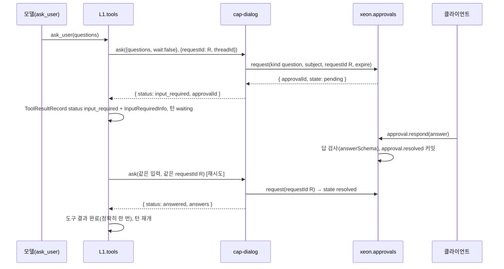

# L2 사용자 대화 (dialog)

패키지: `xeon/packages/cap-dialog`. 서비스: `xeon.dialog`. 능력: `dialog.ask`, `dialog.commands`, `dialog.status`, `dialog.attachments`, `dialog.aside`, `dialog.styles`, `dialog.notify`. 이벤트 접두사: `dialog.`(휘발 `status`). 테이블: 없음. 생산자 id: `cap.dialog`.

## 1. 목적과 범위

사용자와 에이전트 사이의 입출력 채널을 능력으로 정한다. 모델이 사용자에게 묻는 질문 도구, 사용자가 쓰는 슬래시 명령, 진행 표시, 입력 첨부, 곁가지 질문, 출력 스타일, 알림 분류가 대상이다.

L2-e 묶음 대응(`_research/l2e.md` §5): L2-e1 작업 관리(A1, A2, A2b, A5, A6, A7) → `work`(`L2.work.spec`), L2-e2 사용자 대화(B1, B2 노출, B4, B5, B7, B8, B9, B10, D5) → `dialog`.

정하는 것:

- `dialog.ask`: 질문 도구 `ask_user`, 질문·답 스키마, 승인 프로토콜(kind `question`) 사용 방식, 시간 제한·취소·무응답 정책, 내구 대기와 메모리 대기의 차이
- `dialog.commands`: 명령 파일 형식, 인자 치환, 우선순위, 셸 주입 확인, 동작 명령 등록, 클라이언트 선언 스키마
- `dialog.status`: 상태줄 세그먼트 API와 휘발 이벤트 `dialog.status`
- `dialog.attachments`: 이미지·파일·URL 첨부와 blob 참조
- `dialog.aside`(2차), `dialog.styles`(2차): 인터페이스와 경계
- `dialog.notify`: 알림 분류 5종, 알림 채널(OS 알림, 모바일 푸시), 경계
- `dialog.*` 이벤트 카탈로그, `l2.dialog.*` 설정 키

다루지 않는 것:

- 승인 요청 레코드의 필드 정의(`approvalId`, kind, 대상, 선택지, 결과), `approval.*` 이벤트, 승인 대기 체크포인트: `L1.tools.spec`, `L1.loop.spec`. 이 문서는 kind `question`의 대상과 답의 내용만 정한다.
- 실행 중 입력 큐와 전달 모드(steer, followUp, next, aside): `L1.tasks.spec`. 이 문서는 노출 계약만 쓴다(§4.8).
- 되감기, 체크포인트, 분기: `L1.persistence.spec`. 노출 계약만 쓴다(§4.8).
- 이미지 형식 검사·리사이즈: `L2.workspace.spec`(`workspace.images`).
- 원격 클라이언트의 승인·질문 응답 중계: `L2.schedule.spec`(`schedule.remote`). 모바일 푸시 채널은 이 문서 소관이다(§4.7.2). 모바일 푸시를 포함한 알림 채널은 모두 `dialog.notify`가 소유하고, `schedule.remote`는 원격 클라이언트의 승인·질문 응답 중계만 맡으며 `schedule`은 알림 대상 이벤트를 낼 뿐이다 [제안]. 확정은 `L2.readme` §10 미결 15다.
- 화면 그리기(질문 대화상자, 상태줄, 명령 자동완성): L4.
- 음성 입력: L4 입력 어댑터로 보류한다. 마이크 스트림을 받아 텍스트로 바꾸는 일은 클라이언트가 하고, 결과는 일반 사용자 입력으로 들어온다. 웨이크워드는 상주 리스너가 필요하므로(`_research/l2e.md` §6) 범위 밖이다. 이 문서는 음성 입력용 능력을 두지 않는다.

결정 반영:

- [결정] 질문 도구와 계획 승인은 승인 프로토콜 하나로 합친다(`_research/decisions-log.md` 2026-10-21 3차, `_research/foundation-plan.md` §1 5번). `_research/l2e.md` §8의 열린 결정 "승인 프로토콜 통합"은 이 결정으로 닫혔다. 판정자 분리도 같은 결정으로 닫혔다(`L2.work.spec` §4.3).
- 마일스톤: `ask`, `commands`, `status`, `attachments`는 M2(`_research/layer-plan-v2.json` L2-f 1차). `aside`, `styles`는 2차(M3 이후). `notify`는 3차 결정(예약·원격·알림 범위 포함)으로 M3 [제안][^n].

[^n]: `_research/layer-plan-v2.json` L2-f에는 알림 행이 없다. 알림은 `_research/l2e.md` §3.2 B4에서 왔고 3차 결정이 범위에 넣었다. `L2.readme` §2 각주 dialog와 같다.

## 2. 용어

| 용어 | 뜻 |
|---|---|
| 질문 (question) | 모델이 사용자에게 묻는 항목 하나. 선택지, 자유 입력, 다중 선택을 가진다 |
| 묻기 (ask) | 한 번의 질문 묶음(1~4개). 승인 요청 하나에 대응한다 |
| 내구 대기 | 승인 요청이 내구 이벤트로 기록되고 턴이 대기 상태로 커밋된 상태. 프로세스가 없어도 유지된다 |
| 메모리 대기 | 같은 프로세스 안에서 답을 기다리는 Promise. 프로세스가 끝나면 사라진다 |
| 명령 (command) | `/이름 인자`로 부르는 사용자 입력 줄임말. 템플릿 명령과 동작 명령이 있다 |
| 템플릿 명령 | 본문 텍스트에 인자를 치환해 사용자 입력으로 보내는 명령. pi 프롬프트 템플릿 형식 |
| 동작 명령 | 등록한 처리기를 실행하는 명령. 예: `/goal`(L2.work.spec §6.2) |
| 셸 주입 | 템플릿 본문의 `!{명령}` 자리. 실행 결과로 치환한다 |
| 상태 세그먼트 | 상태줄의 항목 하나. `id`와 짧은 텍스트 |
| 첨부 (attachment) | 입력에 붙이는 이미지, 파일, URL |
| 곁가지 질문 (aside) | 사용자가 여는 별도 대화. 본류 컨텍스트를 읽기만 한다 |
| 출력 스타일 (style) | 세션 단위로 바꾸는 시스템 프롬프트 조각 |
| 알림 (notice) | 사용자 주의가 필요한 상태를 분류한 신호 |

다른 문서의 이름: `ThreadId`, `TurnId`, `ResultStatus`, `InputRequiredInfo`, `TextContent`, `ImageContent`, `JsonValue`(F.conversation.spec), `defineCapability`, `serviceKey`, `CapabilityApi`, `CallOptions`, `ToolContent`(F.capabilities.spec), `ApprovalId`(eng.domain-types.guide DT-06), `BlobRef`, `VolatileEvent`(eng.events.design §4.1, §4.3), `SettingDef`(F.wire-settings.spec §3.8.2).

## 3. 인터페이스

정의 파일은 F `xeon/packages/contracts/src/capabilities/defs/dialog.ts`다(`L2.readme` §5.1). 읽기 쉽도록 export 상수의 명시 타입 주석을 생략했다. 실제 파일은 `isolatedDeclarations` 때문에 export마다 주석을 단다.

호출 문맥: 서비스 메서드는 대상 스레드를 `CallOptions.context.threadId`로 받는다(`L2.readme` §5.8). 이 필드는 `F.capabilities.spec` §3.2 `CallContext`에 있다.

### 3.1 `dialog.ask`

```ts
// xeon/packages/contracts/src/capabilities/defs/dialog.ts (1/7)
import { Type, type Static, type TSchema } from "typebox";
import { ApprovalIdSchema } from "../../base/index.ts";
import { ThreadIdSchema, TextContentSchema, ImageContentSchema, type ThreadId, type JsonValue } from "../../conversation/index.ts";
import { BlobRefSchema } from "../../records/index.ts";
import { defineCapability, serviceKey, type CapabilityApi, type ToolContent } from "../index.ts";

const ShortId = Type.String({ pattern: "^[a-z0-9][a-z0-9_-]{0,31}$" });

export const AskOptionSchema = Type.Object(
  {
    id: ShortId,
    label: Type.String({ minLength: 1, maxLength: 80 }),
    description: Type.Optional(Type.String({ maxLength: 300 })),
    /** 추천 항목. 질문마다 최대 하나. 시간 초과 시 이 항목을 고른다(§4.1.3) */
    recommended: Type.Optional(Type.Boolean()),
  },
  { additionalProperties: false },
);

export const AskQuestionSchema = Type.Object(
  {
    id: ShortId,
    /** 화면의 짧은 머리표. 예: "범위" */
    header: Type.Optional(Type.String({ minLength: 1, maxLength: 16 })),
    question: Type.String({ minLength: 1, maxLength: 1000 }),
    /** 없으면 자유 입력 질문이다 */
    options: Type.Optional(Type.Array(AskOptionSchema, { minItems: 2, maxItems: 8 })),
    multiSelect: Type.Optional(Type.Boolean()),
    /** 선택지가 있을 때 자유 입력도 받을지. 기본 true */
    allowFreeText: Type.Optional(Type.Boolean()),
  },
  { additionalProperties: false },
);
export type AskQuestion = Static<typeof AskQuestionSchema>;

const AskParamsShape = {
  questions: Type.Array(AskQuestionSchema, { minItems: 1, maxItems: 4 }),
  /** 답을 기다리는 최대 시간(초). 생략하면 설정 l2.dialog.ask.timeoutSec. 0은 제한 없음 */
  timeoutSec: Type.Optional(Type.Integer({ minimum: 0, maximum: 86400 })),
};
export const AskParams = Type.Object(AskParamsShape, { additionalProperties: false });
export const AskInput = Type.Object(
  {
    ...AskParamsShape,
    /** 참이면 답이 올 때까지 반환을 미룬다(메모리 대기). 도구 경로는 거짓(§4.1.4) */
    wait: Type.Optional(Type.Boolean()),
  },
  { additionalProperties: false },
);

export const AskAnswerItemSchema = Type.Object(
  {
    questionId: ShortId,
    /** 고른 선택지 id. 자유 입력만 했으면 빈 배열 */
    selected: Type.Array(ShortId, { maxItems: 8, uniqueItems: true }),
    text: Type.Union([Type.String({ minLength: 1, maxLength: 4000 }), Type.Null()]),
  },
  { additionalProperties: false },
);
/** 승인 응답(decision "answer")의 answer 내용 */
export const AskAnswerSchema = Type.Object(
  { answers: Type.Array(AskAnswerItemSchema, { minItems: 1, maxItems: 4 }) },
  { additionalProperties: false },
);
export type AskAnswer = Static<typeof AskAnswerSchema>;

export const AskOutput = Type.Union([
  Type.Object({ status: Type.Literal("input_required"), approvalId: ApprovalIdSchema }, { additionalProperties: false }),
  Type.Object({
    status: Type.Literal("answered"),
    approvalId: ApprovalIdSchema,
    answers: Type.Array(AskAnswerItemSchema),
    /** 시간 초과로 추천 항목을 고른 경우 참 */
    defaulted: Type.Boolean(),
  }, { additionalProperties: false }),
  Type.Object({
    status: Type.Literal("cancelled"),
    approvalId: ApprovalIdSchema,
    reason: Type.Union([Type.Literal("timeout"), Type.Literal("dismissed"), Type.Literal("aborted")]),
  }, { additionalProperties: false }),
]);
export type AskResult = Static<typeof AskOutput>;

/** 승인 요청의 대상(subject) 내용. kind = "question" */
export const AskApprovalSubjectSchema = Type.Object(
  {
    questions: Type.Array(AskQuestionSchema, { minItems: 1, maxItems: 4 }),
    /** 이 질문 묶음의 답을 검사하는 JSON Schema(buildAskAnswerSchema 결과). 응답 검사에 쓴다 */
    answerSchema: Type.Record(Type.String(), Type.Unknown()),
  },
  { additionalProperties: false },
);

export type AskAnswerIssue =
  | { readonly code: "unknown_question"; readonly questionId: string }
  | { readonly code: "missing_answer"; readonly questionId: string }
  | { readonly code: "unknown_option"; readonly questionId: string; readonly optionId: string }
  | { readonly code: "too_many_selected"; readonly questionId: string }
  | { readonly code: "free_text_not_allowed"; readonly questionId: string }
  | { readonly code: "empty_answer"; readonly questionId: string };

/** 질문 정의 위반 검사. 순수 함수. 같은 질문 id 중복, 추천 둘 이상, 선택지 id 중복이면 문자열 이슈 목록을 낸다 */
export function checkAskQuestions(questions: readonly AskQuestion[]): readonly string[];
/** 답이 질문 묶음에 맞는지 검사한다. 순수 함수. 빈 배열이면 통과 */
export function validateAskAnswer(questions: readonly AskQuestion[], answer: AskAnswer): readonly AskAnswerIssue[];
/** 질문 묶음에서 답 JSON Schema를 만든다(선택지 id enum, 다중 선택 maxItems). 순수 함수 */
export function buildAskAnswerSchema(questions: readonly AskQuestion[]): TSchema;
/** 모든 질문에 추천 항목이 있으면 그 항목으로 답을 만들고, 아니면 null. 순수 함수 */
export function defaultAskAnswer(questions: readonly AskQuestion[]): AskAnswer | null;

/** ask_user 결과의 모델용 문장. 순수 함수 */
export function renderAsk(out: AskResult): ToolContent;

export const DialogAsk = defineCapability({
  id: "dialog.ask",
  version: "1.0.0",
  description: "모델이나 그룹 코드가 사용자에게 질문하고 답을 받는다. 답은 승인 프로토콜(kind question)로 받는다.",
  service: {
    methods: {
      ask: {
        description: "질문 묶음을 사용자에게 보내고 답을 받는다.",
        input: AskInput,
        output: AskOutput,
        replay: "safe",
        errors: {
          ask_invalid_questions: { description: "질문 정의가 규칙(checkAskQuestions)을 어김", retryable: false,
            detail: Type.Object({ issues: Type.Array(Type.String()) }) },
          ask_unavailable_headless: { description: "답할 클라이언트가 없는 실행(비대화형)에서 질문함", retryable: false },
        },
      },
    },
  },
  tools: [
    {
      name: "ask_user",
      label: "사용자에게 질문",
      description:
        "요구가 모호해 추측해야 할 때 사용자에게 1~4개 질문을 한다. 선택지를 주면 2~8개로 하고, 가장 무난한 항목에 recommended를 표시한다. " +
        "답이 오면 그 답으로 계속한다. 사용자가 답하지 않거나 취소하면 그 사실이 결과로 온다.",
      method: "ask",
      parameters: AskParams,
      toInput: (p) => ({ ...p, wait: false }),
      toContent: renderAsk,
      outputSchema: AskOutput,
      replay: "safe",
      executionMode: "sequential",
      hints: { readOnly: true, destructive: false, idempotent: true, openWorld: false },
    },
  ],
});
export const DialogAskKey = serviceKey(DialogAsk);
```

- 도구 이름은 `ask_user`다(`_research/l2e.md` §3.2 B1 제안 이름을 확정).
- [결정: review.m2-plan DG.1] 승인 요청에 싣는 대상은 L1.tools의 `QuestionBody`다(§4.1.1). `AskApprovalSubjectSchema`와 `answerSchema` 필드는 전송에 쓰지 않는다. L1.tools가 `QuestionBody`로 응답을 검사하기 때문이다.
- 질문 수 1~4개, 선택지 2~8개는 Claude Code AskUserQuestion의 범위(질문 1~4개)를 따르고 선택지 상한은 화면 폭을 고려한 [제안]이다.
- `executionMode: "sequential"`: 같은 단계에서 질문 도구가 둘 나오면 순서대로 묻는다. Hermes는 질문 도구를 병렬 실행에서 뺀다(`_research/refs/hermes.md` L1d-7).
- `hints.readOnly: true`: 질문은 환경을 바꾸지 않는다. L1.tools가 이 힌트로 계획 모드에서도 질문을 허용한다 [가정].
- `ask_unavailable_headless`: `xeon -p` 같은 비대화형 실행에서는 답할 클라이언트가 없다. 이때 L1.tools가 승인 요청을 받지 않는다고 알려 주면(포트의 `interactive: false`) 즉시 이 오류를 낸다 [가정].
  - [잠정: review.m2-plan DG.1] 호출 문맥(`CallContext`)에 대화형 여부가 없다. cap-dialog는 조립 루트가 넘기는 판정 함수 `interactive(context)`로 이 오류를 낸다(기본은 항상 대화형). 판정 함수가 없고 L1.tools가 비대화형 요청을 `approval.resolved{ deny, noninteractive }`로 끝내면 `ask`는 이를 `cancelled(dismissed)`로 읽는다. F `CallContext.interactive`가 들어갔으므로(m2 F.8) 조립 루트가 판정 함수를 넘기지 않아도 `ask`는 `options.context.interactive === false`이면 `ask_unavailable_headless`를 낼 수 있다. 판정 함수가 있으면 그것이 이긴다.

### 3.2 `dialog.commands`

```ts
// defs/dialog.ts (2/7)
export const COMMAND_NAME_PATTERN = "^[a-z][a-z0-9-]{0,47}(:[a-z][a-z0-9-]{0,47})?$";
export const CommandNameSchema = Type.String({ pattern: COMMAND_NAME_PATTERN });

export const CommandSourceSchema = Type.Union([
  Type.Literal("builtin"),     // L4 클라이언트 고유 명령(/model, /resume 등)
  Type.Literal("capability"),  // L2·L3 코드가 등록
  Type.Literal("project"),     // 프로젝트 명령 파일
  Type.Literal("user"),        // 사용자 명령 파일
  Type.Literal("extension"),   // 확장 매니페스트 components.commands 파일
]);
export type CommandSource = Static<typeof CommandSourceSchema>;

/** 자동완성용 인자 선언. 치환 규칙과 별개로 클라이언트에 알려 주는 정보다 */
export const CommandArgSchema = Type.Object(
  {
    name: Type.String({ pattern: "^[a-z][a-z0-9-]{0,31}$" }),
    description: Type.Optional(Type.String({ maxLength: 200 })),
    required: Type.Optional(Type.Boolean()),
    /** 고를 수 있는 값. 있으면 자동완성 목록이 된다 */
    choices: Type.Optional(Type.Array(Type.String({ maxLength: 64 }), { maxItems: 32 })),
    /** 참이면 남은 모든 인자를 받는다(마지막 인자만) */
    rest: Type.Optional(Type.Boolean()),
  },
  { additionalProperties: false },
);

export const CommandInfoSchema = Type.Object(
  {
    name: CommandNameSchema,
    description: Type.String({ maxLength: 200 }),
    argumentHint: Type.Union([Type.String({ maxLength: 120 }), Type.Null()]),
    args: Type.Array(CommandArgSchema, { maxItems: 16 }),
    kind: Type.Union([Type.Literal("template"), Type.Literal("action")]),
    source: CommandSourceSchema,
    /** 등록 주체(확장 이름이나 파일 경로). 표시용 */
    origin: Type.String({ maxLength: 512 }),
    /** 템플릿 본문에 셸 주입이 있는지 */
    hasShell: Type.Boolean(),
  },
  { additionalProperties: false },
);
export type CommandInfo = Static<typeof CommandInfoSchema>;

export const CommandRegisterInput = Type.Object(
  {
    name: CommandNameSchema,
    description: Type.String({ minLength: 1, maxLength: 200 }),
    argumentHint: Type.Optional(Type.String({ maxLength: 120 })),
    args: Type.Optional(Type.Array(CommandArgSchema, { maxItems: 16 })),
    /** 템플릿 본문. pi 치환 문법(§4.2.2) */
    template: Type.String({ minLength: 1, maxLength: 32768 }),
    /** 등록 주체 이름(확장 이름). 예: "<그룹 이름>" */
    origin: Type.String({ minLength: 1, maxLength: 64 }),
  },
  { additionalProperties: false },
);
export const CommandListInput = Type.Object(
  { prefix: Type.Optional(Type.String({ maxLength: 48 })), includeHidden: Type.Optional(Type.Boolean()) },
  { additionalProperties: false },
);
export const CommandExpandInput = Type.Object(
  { text: Type.String({ minLength: 1, maxLength: 65536 }) },
  { additionalProperties: false },
);
export const ShellInjectionSchema = Type.Object(
  { index: Type.Integer({ minimum: 0 }), command: Type.String({ maxLength: 4096 }) },
  { additionalProperties: false },
);
export const CommandExpandOutput = Type.Union([
  Type.Object({ matched: Type.Literal(false) }, { additionalProperties: false }),
  Type.Object({
    matched: Type.Literal(true),
    name: CommandNameSchema,
    kind: Type.Literal("template"),
    args: Type.Array(Type.String()),
    /** 셸 주입을 실행하기 전의 치환 결과. 셸 자리는 그대로 남는다 */
    text: Type.String(),
    shell: Type.Array(ShellInjectionSchema, { maxItems: 16 }),
  }, { additionalProperties: false }),
  Type.Object({
    matched: Type.Literal(true),
    name: CommandNameSchema,
    kind: Type.Literal("action"),
    args: Type.Array(Type.String()),
  }, { additionalProperties: false }),
]);
export const CommandRunInput = Type.Object(
  {
    text: Type.String({ minLength: 1, maxLength: 65536 }),
    /** 셸 주입 실행을 사용자가 확인했는지 */
    confirmShell: Type.Optional(Type.Boolean()),
  },
  { additionalProperties: false },
);
export const CommandRunOutput = Type.Union([
  Type.Object({ status: Type.Literal("not_command") }, { additionalProperties: false }),
  /** 사용자 입력으로 보낼 최종 텍스트 */
  Type.Object({ status: Type.Literal("expanded"), name: CommandNameSchema, text: Type.String() }, { additionalProperties: false }),
  /** 셸 주입이 있어 확인이 필요함. confirmShell: true로 다시 부른다 */
  Type.Object({ status: Type.Literal("needs_confirmation"), name: CommandNameSchema, shell: Type.Array(ShellInjectionSchema) }, { additionalProperties: false }),
  /** 동작 명령의 처리 결과 */
  Type.Object({ status: Type.Literal("done"), name: CommandNameSchema, message: Type.Union([Type.String({ maxLength: 4000 }), Type.Null()]), result: Type.Unknown() }, { additionalProperties: false }),
]);

const CommandErrors = {
  command_name_taken: { description: "같은 출처 등급에 같은 이름이 이미 있다", retryable: false },
  command_args_invalid: { description: "동작 명령 인자가 선언(args)에 맞지 않는다", retryable: false,
    detail: Type.Object({ message: Type.String() }) },
  command_shell_disabled: { description: "설정이 셸 주입을 끔(l2.dialog.commands.shellInjection = off)", retryable: false },
} as const;

export const DialogCommands = defineCapability({
  id: "dialog.commands",
  version: "1.0.0",
  description: "슬래시 명령과 프롬프트 템플릿. 모델은 명령을 호출하지 않는다.",
  service: {
    methods: {
      register: { description: "템플릿 명령을 등록한다.", input: CommandRegisterInput, output: Type.Object({ command: CommandInfoSchema }), replay: "safe", errors: CommandErrors },
      list: { description: "명령 목록과 인자 선언을 돌려준다.", input: CommandListInput, output: Type.Object({ commands: Type.Array(CommandInfoSchema) }), replay: "safe" },
      expand: { description: "입력이 명령이면 치환 결과를 돌려준다. 아무것도 실행하지 않는다.", input: CommandExpandInput, output: CommandExpandOutput, replay: "safe", errors: CommandErrors },
      run: { description: "명령을 실행한다. 템플릿은 최종 텍스트를, 동작 명령은 처리기 결과를 돌려준다.", input: CommandRunInput, output: CommandRunOutput, replay: "unsafe", errors: CommandErrors },
    },
  },
  tools: [],
});
export const DialogCommandsKey = serviceKey(DialogCommands);
```

동작 명령 등록은 함수(처리기)를 넘기므로 JSON 메서드로 표현할 수 없다. `dialog.commands` 능력 바인딩(`cap:dialog.commands`)이 돌려주는 API 객체에 TS 메서드로 더한다 [제안].

```ts
// defs/dialog.ts (3/7)
export interface CommandActionContext {
  readonly threadId: ThreadId;
  /** 명령 입력의 멱등 키. 클라이언트 입력 키에서 파생한다 */
  readonly requestId: string;
  readonly signal: AbortSignal;
}
export interface CommandActionResult {
  readonly message: string | null;
  readonly result?: JsonValue;
}
export interface CommandActionDecl {
  readonly name: string;           // COMMAND_NAME_PATTERN
  readonly description: string;
  readonly argumentHint?: string;
  readonly args?: readonly Static<typeof CommandArgSchema>[];
  readonly origin: string;
}
export type CommandActionHandler = (args: readonly string[], ctx: CommandActionContext) => Promise<CommandActionResult>;

export interface CommandActionRegistry {
  /** 동작 명령을 등록한다. 반환 함수로 해제한다. 이름 충돌은 CapabilityError(command_name_taken) */
  registerAction(decl: CommandActionDecl, handler: CommandActionHandler): () => void;
}
```

- 모델은 명령을 호출하지 않는다. 도구가 없다. 목록은 광고만 한다(§4.2.5).
- `run`은 동작 명령 처리기를 실행하므로 효과가 있을 수 있다. 그래서 `replay: "unsafe"`다. 처리기 안의 효과는 처리기가 `requestId`로 멱등을 지킨다.
- 클라이언트 선언 스키마는 `CommandInfoSchema`다. 클라이언트는 `list` 결과로 자동완성(이름, `argumentHint`, `args[].choices`)을 만든다.

### 3.3 `dialog.status`

```ts
// defs/dialog.ts (4/7)
/** "core.turn", "<그룹 이름>.phase" 같은 "<소유자>.<이름>" */
export const STATUS_ITEM_ID_PATTERN = "^[a-z][a-z0-9-]{0,31}\\.[a-z][a-z0-9-]{0,31}$";
export const StatusItemSchema = Type.Object(
  {
    id: Type.String({ pattern: STATUS_ITEM_ID_PATTERN }),
    text: Type.String({ maxLength: 120 }),
    tone: Type.Optional(Type.Union([Type.Literal("normal"), Type.Literal("busy"), Type.Literal("warn"), Type.Literal("error")])),
    /** 작을수록 앞. 생략하면 500 */
    order: Type.Optional(Type.Integer({ minimum: 0, maximum: 999 })),
  },
  { additionalProperties: false },
);
export type StatusItem = Static<typeof StatusItemSchema>;

export const DialogStatus = defineCapability({
  id: "dialog.status",
  version: "1.0.0",
  description: "상태줄 세그먼트 등록. 변경은 휘발 이벤트 dialog.status로만 나간다.",
  service: {
    methods: {
      setItem: { description: "세그먼트를 만들거나 바꾼다.", input: StatusItemSchema, output: Type.Object({}), replay: "safe" },
      clearItem: { description: "세그먼트를 지운다.", input: Type.Object({ id: Type.String({ pattern: STATUS_ITEM_ID_PATTERN }) }, { additionalProperties: false }), output: Type.Object({}), replay: "safe" },
      list: { description: "현재 세그먼트 전체(재접속 뒤 다시 그리기용).", input: Type.Object({}, { additionalProperties: false }), output: Type.Object({ items: Type.Array(StatusItemSchema) }), replay: "safe" },
    },
  },
  tools: [],
});
export const DialogStatusKey = serviceKey(DialogStatus);
```

- `list`는 브리프의 `setItem`, `clearItem`에 더한 읽기 메서드다 [제안]. 휘발 이벤트는 재접속 뒤 다시 오지 않으므로(eng.events.design §4.2) 클라이언트가 현재 상태를 다시 얻을 경로가 필요하다.

### 3.4 `dialog.attachments`

```ts
// defs/dialog.ts (5/7)
export const AttachmentSourceSchema = Type.Union([
  /** 로컬 파일 경로(드래그 앤 드롭, @경로) */
  Type.Object({ kind: Type.Literal("path"), path: Type.String({ minLength: 1, maxLength: 4096 }) }, { additionalProperties: false }),
  /** 붙여넣은 바이트(클립보드 이미지). base64 */
  Type.Object({
    kind: Type.Literal("data"), data: Type.String({ minLength: 1 }),
    mime: Type.String({ minLength: 1, maxLength: 128 }), name: Type.Optional(Type.String({ maxLength: 255 })),
  }, { additionalProperties: false }),
  Type.Object({ kind: Type.Literal("url"), url: Type.String({ minLength: 1, maxLength: 4096, pattern: "^https?://" }) }, { additionalProperties: false }),
]);

export const AttachmentSchema = Type.Object(
  {
    kind: Type.Union([Type.Literal("image"), Type.Literal("text"), Type.Literal("file"), Type.Literal("url")]),
    name: Type.String({ maxLength: 255 }),
    mime: Type.Union([Type.String({ maxLength: 128 }), Type.Null()]),
    size: Type.Union([Type.Integer({ minimum: 0 }), Type.Null()]),
    /** 바이트를 저장했으면 그 참조(sys_blobs). url과 큰 파일 참조는 null */
    blob: Type.Union([BlobRefSchema, Type.Null()]),
    path: Type.Union([Type.String({ maxLength: 4096 }), Type.Null()]),
    url: Type.Union([Type.String({ maxLength: 4096 }), Type.Null()]),
    image: Type.Union([Type.Object({ width: Type.Integer({ minimum: 1 }), height: Type.Integer({ minimum: 1 }), resized: Type.Boolean() }), Type.Null()]),
  },
  { additionalProperties: false },
);
export type Attachment = Static<typeof AttachmentSchema>;

export const AttachmentAddInput = Type.Object({ source: AttachmentSourceSchema }, { additionalProperties: false });
export const AttachmentAddOutput = Type.Object(
  {
    attachment: AttachmentSchema,
    /** 사용자 입력(turn.start input)에 그대로 넣을 파트 */
    parts: Type.Array(Type.Union([TextContentSchema, ImageContentSchema]), { minItems: 1, maxItems: 2 }),
  },
  { additionalProperties: false },
);

export const DialogAttachments = defineCapability({
  id: "dialog.attachments",
  version: "1.0.0",
  description: "이미지, 파일, URL을 사용자 입력에 붙인다. 큰 바이너리는 blob 참조로 저장한다.",
  requires: ["workspace.images"],
  service: {
    methods: {
      add: {
        description: "첨부 하나를 검사하고 저장한 뒤 입력 파트를 만든다.",
        input: AttachmentAddInput,
        output: AttachmentAddOutput,
        replay: "safe",
        errors: {
          attachment_too_large: { description: "l2.dialog.attachments.maxBytes 초과", retryable: false,
            detail: Type.Object({ size: Type.Integer(), limit: Type.Integer() }) },
          attachment_type_unsupported: { description: "읽을 수 없는 형식", retryable: false },
        },
      },
    },
  },
  tools: [],
});
export const DialogAttachmentsKey = serviceKey(DialogAttachments);
```

### 3.5 `dialog.aside`(2차), `dialog.styles`(2차)

```ts
// defs/dialog.ts (6/7)
export const AsideAskInput = Type.Object(
  { question: Type.String({ minLength: 1, maxLength: 8000 }) },
  { additionalProperties: false },
);
export const AsideAskOutput = Type.Object(
  {
    answer: Type.String(),
    /** 곁가지 모델 호출 사용량. 본류 기록에는 들어가지 않는다 */
    usage: Type.Union([Type.Object({ inputTokens: Type.Integer(), outputTokens: Type.Integer() }), Type.Null()]),
  },
  { additionalProperties: false },
);
export const DialogAside = defineCapability({
  id: "dialog.aside",
  version: "1.0.0",
  description: "본류 컨텍스트를 읽기만 하는 별도 질문. 본류 기록을 바꾸지 않는다.",
  service: {
    methods: {
      ask: { description: "본류 스냅숏을 읽고 별도 모델 호출로 답한다.", input: AsideAskInput, output: AsideAskOutput, replay: "safe" },
    },
  },
  tools: [],
});
export const DialogAsideKey = serviceKey(DialogAside);

export const StyleIdSchema = Type.String({ pattern: "^[a-z][a-z0-9-]{0,31}$" });
export const StyleSchema = Type.Object(
  {
    id: StyleIdSchema,
    name: Type.String({ minLength: 1, maxLength: 64 }),
    description: Type.String({ maxLength: 300 }),
    /** 시스템 프롬프트에 붙는 조각 */
    prompt: Type.String({ maxLength: 8192 }),
    origin: Type.String({ maxLength: 64 }),
  },
  { additionalProperties: false },
);
export const DialogStyles = defineCapability({
  id: "dialog.styles",
  version: "1.0.0",
  description: "세션 단위 출력 스타일. 적용은 다음 턴 시작이다.",
  service: {
    methods: {
      register: { description: "스타일을 등록한다.", input: StyleSchema, output: Type.Object({}), replay: "safe" },
      select: {
        description: "이 세션의 스타일을 고른다. null은 기본 스타일.",
        input: Type.Object({ id: Type.Union([StyleIdSchema, Type.Null()]) }, { additionalProperties: false }),
        output: Type.Object({ active: StyleIdSchema, appliesAt: Type.Literal("next_turn") }),
        replay: "safe",
        errors: { style_unknown: { description: "등록되지 않은 스타일", retryable: false } },
      },
    },
  },
  tools: [],
});
export const DialogStylesKey = serviceKey(DialogStyles);
```

### 3.6 `dialog.notify`

```ts
// defs/dialog.ts (7/7)
export const NoticeKindSchema = Type.Union([
  Type.Literal("completed"),            // 턴·목표가 끝나 사용자 차례
  Type.Literal("approval_waiting"),     // 도구·계획 승인 대기(입력 필요)
  Type.Literal("question_waiting"),     // 질문 대기(입력 필요)
  Type.Literal("error"),                // 턴 실패, 판정 실패 등
  Type.Literal("background_completed"), // 백그라운드 위임·서브에이전트 완료
]);
export type NoticeKind = Static<typeof NoticeKindSchema>;
export const INPUT_NEEDED_KINDS: readonly NoticeKind[] = ["approval_waiting", "question_waiting"];

export const NoticeSchema = Type.Object(
  {
    kind: NoticeKindSchema,
    title: Type.String({ minLength: 1, maxLength: 120 }),
    body: Type.Union([Type.String({ maxLength: 1000 }), Type.Null()]),
    /** 이 알림을 만든 내구 이벤트의 seq */
    seq: Type.Integer({ minimum: 1 }),
    /** 파생 알림이면 원인 이벤트 type, emit이면 "dialog.notified" */
    sourceType: Type.String({ maxLength: 128 }),
  },
  { additionalProperties: false },
);
export type Notice = Static<typeof NoticeSchema>;

export const NotifyEmitInput = Type.Object(
  {
    kind: NoticeKindSchema,
    title: Type.String({ minLength: 1, maxLength: 120 }),
    body: Type.Optional(Type.String({ maxLength: 1000 })),
    origin: Type.String({ minLength: 1, maxLength: 64 }),
  },
  { additionalProperties: false },
);
export const NotifyListInput = Type.Object(
  {
    afterSeq: Type.Integer({ minimum: 0 }),
    kinds: Type.Optional(Type.Array(NoticeKindSchema, { minItems: 1, maxItems: 5, uniqueItems: true })),
    limit: Type.Optional(Type.Integer({ minimum: 1, maximum: 500 })),
  },
  { additionalProperties: false },
);

export const DialogNotify = defineCapability({
  id: "dialog.notify",
  version: "1.0.0",
  description: "사용자 주의가 필요한 상태를 5종으로 분류하고 알린다.",
  service: {
    methods: {
      emit: { description: "그룹·플러그인이 알림을 직접 낸다(내구 기록).", input: NotifyEmitInput, output: Type.Object({ notice: NoticeSchema }), replay: "safe" },
      list: { description: "afterSeq 뒤의 알림을 분류해 돌려준다(당겨 읽기).", input: NotifyListInput, output: Type.Object({ notices: Type.Array(NoticeSchema), nextSeq: Type.Integer() }), replay: "safe" },
    },
  },
  tools: [],
});
export const DialogNotifyKey = serviceKey(DialogNotify);

/** 같은 프로세스 소비자용 밀어주기 구독. JSON 메서드로 표현할 수 없어 dialog.notify 능력 API 객체에 TS 메서드로 둔다 */
export interface NoticeFeed {
  subscribe(filter: { readonly kinds?: readonly NoticeKind[] }, listener: (threadId: ThreadId, notice: Notice) => void): () => void;
}

/** dialog 도메인 묶음 타입(L2.readme §5.6). Cordis에 등록하지 않는다. 등록은 능력마다 cap:<id> 바인딩이다 */
export interface DialogService {
  readonly ask: CapabilityApi<typeof DialogAsk>;
  readonly commands: CapabilityApi<typeof DialogCommands> & CommandActionRegistry;
  readonly status: CapabilityApi<typeof DialogStatus>;
  readonly attachments: CapabilityApi<typeof DialogAttachments>;
  readonly aside: CapabilityApi<typeof DialogAside>;
  readonly styles: CapabilityApi<typeof DialogStyles>;
  readonly notify: CapabilityApi<typeof DialogNotify> & NoticeFeed;
}
/** 묶음 이름. eng.context-map.design §5.3 표의 이름이고 Cordis 등록 이름이 아니다 */
export const DialogServiceName = "xeon.dialog";
export const DIALOG_CAPABILITIES = [DialogAsk, DialogCommands, DialogStatus, DialogAttachments, DialogAside, DialogStyles, DialogNotify] as const;
```

- 브리프의 `subscribe`는 리스너 함수를 받으므로 서비스 객체의 TS API(`NoticeFeed.subscribe`)로 둔다. JSON 소비자(L4 wire, 원격 클라이언트)는 `list`로 당겨 읽는다 [제안].
- `dialog.aside`, `dialog.styles`, `dialog.notify`, `dialog.status`, `dialog.commands`, `dialog.attachments`는 모델 도구가 없다. F.capabilities.spec §4.4의 도구 없는 능력 [미결]에 기댄다(`L2.readme` §10 미결 8).

### 3.7 이벤트 카탈로그

형식은 `F.records.spec` §3.3.2 도메인 소유 카탈로그(`DIALOG_EVENT_CATALOG`, `L2.readme` §5.9)다. 소유 생산자 `cap.dialog`(`owners.ts` `TYPE_PREFIX_OWNERS`). 질문의 기록은 L1.tools의 `approval.requested`(kind `question`)와 `approval.resolved`이고 dialog 이벤트가 아니다.

| type | 구분 | 주요 payload(휘발은 data) | 멱등 키 | 소비자 |
|---|---|---|---|---|
| `dialog.status` | 휘발 | `{ threadId, items: StatusItem[] }`(전체 스냅숏, 최대 32개) | 없음(휘발, `afterSeq`만 싣는다) | L4 상태줄 |
| `dialog.notified` | 내구 | `{ notice: { kind, title, body, origin } }` | `dialog:notify:<호출 requestId>` | `dialog.notify.list`, L4, 푸시 채널(§4.7.2) |

```ts
// xeon/packages/contracts/src/records/catalog/dialog.ts
export const DialogStatusDataSchema = Type.Object(
  { threadId: ThreadIdSchema, items: Type.Array(StatusItemSchema, { maxItems: 32 }) },
  { additionalProperties: false },
);
export const DialogNotifiedSchema = Type.Object(
  { notice: Type.Object({ kind: NoticeKindSchema, title: Type.String({ maxLength: 120 }), body: Type.Union([Type.String({ maxLength: 1000 }), Type.Null()]), origin: Type.String({ maxLength: 64 }) }, { additionalProperties: false }) },
  { additionalProperties: false },
);
/** CatalogEntry 형식(L2.readme §5.9). 생산자 cap.dialog는 owners.ts가 정한다 */
export const DIALOG_EVENT_CATALOG: readonly CatalogEntry[] = [
  { kind: "dialog.status", version: 1, durable: false, payload: DialogStatusDataSchema },
  { kind: "dialog.notified", version: 1, durable: true, payload: DialogNotifiedSchema },
];
```

- `dialog.status`는 휘발 이름 규칙 `<대상>.status`를 따른다(eng.events.design §4.5 규칙 2). 재생 대상이 아니다.
- `dialog.notified`는 M3다. `eng.context-map.design` §5.1의 `dialog.` 행은 내구 type을 "L2.dialog.spec 카탈로그"로 두었으므로 이 표가 그 카탈로그다.
- `notification.` 접두사는 금지 접두사다(eng.events.design §4.5 규칙 4). 그래서 내구 이벤트 이름을 `dialog.notified`로 둔다.

## 4. 동작 규칙

### 4.1 질문

#### 4.1.1 승인 요청의 사용 방식

- [결정] 질문은 `xeon.approvals`에 kind `question`으로 요청한다. 계획 승인(kind `plan`, `L2.work.spec` §4.2)과 같은 레코드 형식이다. 레코드 필드(`approvalId`, kind, 대상, 선택지, 결과)의 정의는 L1.tools.spec이 소유하고, 이 문서는 대상 내용(`AskApprovalSubjectSchema`)과 답 내용(`AskAnswerSchema`)만 정한다.
- cap-dialog는 `xeon.approvals`를 포트 한 곳(`cap-dialog/src/ports/approvals.ts`)으로 감싼다. 포트 모양은 F의 L2 공통 `L2ApprovalsPort`(`L2.readme` §5.7)이고 kind는 `"question"`이다. 요청이 낸 쪽(출처)은 호출마다 정해지므로 포트는 호출 문맥으로 포트를 만드는 팩토리(`ApprovalsPortFactory.forCall`)로 받는다. 도구 호출 안이면 문맥의 `toolCallId`가 요청의 `origin`이 되어 L1.tools가 그 호출의 대기 체크포인트를 같은 커밋에 넣는다. 기본 팩토리는 `questionApprovalsOver(approvals)`다. `dialogPlugin`은 `DialogPluginOptions.approvals`가 없으면 `xeon.approvals` 포트를 이 함수로 감싼다. 이 어댑터는 서비스의 메모리 대기 목록이 비어 있는 재시작 직후에 모르는 `approvalId`를 만나면 그 대화의 `restore`를 먼저 부르고, 같은 `requestId`의 두 번째 요청이 처음과 다른 질문 묶음이면 `key_reused`로 거부한다(서비스는 키만 보고 처음 요청을 돌려주므로 어댑터가 비교한다).
- [결정: review.m2-plan DG.1] 레코드 모양은 L1.tools가 정한다. cap-dialog가 도메인 모양과 레코드 모양을 옮긴다(`ask/mapping.ts`).
  - 대상: `AskQuestion[]`을 `QuestionBody`(`{ questions: [{ id, text, options: [{ id, label, description? }], multiSelect, allowFreeText }] }`)로 옮긴다. `question`은 `text`가 되고, 선택지가 없는 질문은 `options: []`와 `allowFreeText: true`다(L1.tools는 선택지 없는 질문의 `allowFreeText`가 참이어야 받는다). `header`와 `recommended`도 레코드에 싣는다(F.8에서 `QuestionItem.header`, `QuestionOption.recommended`가 들어왔다). 화면이 추천 표시를 그리고, 시간 제한의 추천 답은 입력(`AskInput`)의 `defaultAskAnswer`가 정한다.
  - 응답: `approval.respond`의 `answer`는 `QuestionAnswer`(질문 id → `{ selected, text? }`)다. cap-dialog가 `AskAnswer`(`{ answers: [{ questionId, selected, text }] }`)로 옮기고 `validateAskAnswer`로 다시 검사한다. `AskAnswer`는 wire를 지나지 않는다. 클라이언트는 `QuestionBody`를 그려 정본 `QuestionAnswer`(records `QuestionAnswerSchema`, 질문 4개까지)로 답하고, 모양이 다르면 `approval.respond`가 `-32602`, kind와 decision이 어긋나면 `applied: false`다. `toQuestionAnswer`·`fromQuestionAnswer`가 두 모양을 서로 옮기고, 테스트(`ask-schema.test.ts`)가 변환 결과를 정본 스키마로 검사한다.
  - `answerSchema`는 요청에 싣지 않는다.

| wire `approval.respond` | `answer` | `ask` 출력 |
|---|---|---|
| `decision: "answer"` | `AskAnswer` | `answered`(`defaulted: false`) |
| `decision: "deny"` | null | `cancelled`(`reason: "dismissed"`) |
| `decision: "allow"` | 쓰지 않음 | 질문에는 허용·거부가 없으므로 L1.tools가 거부한다 [가정]. 들어오면 `cancelled(dismissed)`로 본다 |
| 시간 초과(L1.tools가 해결) | 추천 답 또는 없음 | `answered(defaulted: true)` 또는 `cancelled(timeout)` |
| 요청 취소(턴 취소, 스레드 닫힘) | 없음 | `cancelled(aborted)` |

#### 4.1.2 도구 결과와 재개



1. 질문 정의를 `checkAskQuestions`로 검사한다. 위반이면 `ask_invalid_questions`.
2. 대상 `subject`를 `QuestionBody`로 만든다(§4.1.1).
3. `L2ApprovalsPort.request`를 호출 `requestId`로 부른다. 승인 요청 키는 1~48자라 `requestId`가 48자를 넘으면 앞 24자와 해시 23자로 줄인다(앞이 같은 서로 다른 호출이 같은 키가 되지 않게 한다). 같은 키로 다시 부르면 L1.tools는 새 요청을 만들지 않고 기존 요청의 현재 상태를 돌려준다 [가정, L1.tools.spec].
4. 상태가 `pending`이면 `{ status: "input_required", approvalId }`를 돌려준다. L1.tools 어댑터가 이를 `ToolResultRecord.status: "input_required"`와 `inputRequired: InputRequiredInfo`로 옮긴다(F.conversation.spec §3.6). [제안] `InputRequiredInfo.requestState`에는 `approvalId`를, `inputRequests`에는 `{ kind: "question", approvalId }`를 싣는다. 값 모양의 확정은 L1.tools.spec이 한다.
5. 상태가 해결이면 §4.1.1 표로 완료 출력을 만든다. 저장된 답을 `validateAskAnswer`로 다시 검사하고, 위반이면(구버전 클라이언트 등) `cancelled(dismissed)`로 처리하고 운영 로그에 남긴다.
6. [가정] L1.tools는 승인이 해결되면 `input_required` 결과를 낸 도구 호출을 같은 입력과 같은 `requestId`로 다시 불러 완료 결과를 얻는다(MCP client 2.3.1의 `input_required` 재시도와 같은 모양, `_research/notes/L2-1.md` 1항). 도구 결과 커밋 키는 `tool:<toolCallId>:result` 하나라 재시작 뒤 재시도가 여러 번 일어나도 완료 처리는 한 번이다(eng.transactions.design §4.8).

#### 4.1.3 시간 제한, 취소, 무응답

- 시간 제한값: 입력 `timeoutSec`, 없으면 설정 `l2.dialog.ask.timeoutSec`. 0이면 제한이 없다.
- 시간 제한이 있으면 승인 요청에 만료 시각과 만료 시 결과를 함께 넘기는 것이 정본이다 [가정: L1.tools.spec이 만료를 내구적으로 관리한다. F.wire-settings.spec §4.6 A안 "대기 시간 제한을 엔진이 따로 관리한다"]. 만료 시 결과는 `defaultAskAnswer(questions)`가 있으면 그 답(`decision: "answer"`)이고, 없으면 취소(`cancel`)다.
  - [잠정: review.m2-plan DG.1] F `ApprovalRequestInput`과 `L2ApprovalRequest`에 만료 필드가 없다(F 요청). 그동안 `ask/expiry.ts`가 프로세스 안 타이머(`xeon.os`의 `scheduler`)로 같은 일을 한다. 승인이 아직 대기이면 `ask`가 타이머를 걸고, 만료되면 추천 답으로 `respond`하거나 `cancel`한다. 사용자가 먼저 답했으면 `respond`의 `applied: false`로 끝난다.
  - 잠정 구현의 한계: 프로세스가 끝나면 타이머가 사라지고, 재시작 뒤 같은 `requestId`로 `ask`를 다시 부르면 제한 시간을 처음부터 다시 잰다. `defaulted`와 `timeout` 표지는 메모리에만 있어 재시작 뒤에는 각각 `defaulted: false`와 `aborted`로 읽힌다. F에 만료 필드가 오르면 이 타이머를 지운다.
  - 모든 질문에 추천 항목이 있을 때만 자동 답을 만든다. 일부 질문만 추천이 있으면 나머지 답을 지어내야 하므로 만들지 않는다 [제안].
  - 정본 설계에서 만료 시각은 요청 커밋 시각 + 제한이다. 프로세스가 없던 동안 시각이 지났으면 다음 실행 때 L1.tools가 해결하고 cap-dialog는 타이머를 갖지 않는다.
- 취소: 사용자가 대화상자를 닫으면 클라이언트가 `decision: "deny"`로 응답한다(`cancelled(dismissed)`). 턴을 끊으면 L1이 승인 요청을 취소하고 도구 호출은 중단 결과가 된다(F.capabilities.spec §3.6 `aborted`). 이때는 재시도가 없다.
- 무응답(시간 제한 0): 내구 대기가 계속된다. 세션을 닫았다가 다시 열어도 질문이 남아 있다(architecture.runtime-flow.design §4.5). 대기 중에 도는 프로세스는 없다.

#### 4.1.4 서비스 API의 대기: 내구 대기와 메모리 대기

- `_research/l2e.md` §3.2 B1의 `prompts.ask(spec) → 답 Promise`는 이 문서의 `dialog.ask.ask`다.
- 기본(`wait` 생략 또는 거짓): 메서드는 요청을 만든 즉시 `input_required`를 돌려준다. 대기는 승인 기록(내구)으로만 존재한다. 도구 경로는 항상 이 방식이다(`toInput`이 `wait: false`를 넣는다).
- `wait: true`(그룹 경로): 메서드가 `ApprovalsPort.wait`로 해결까지 기다린 뒤 완료 출력을 돌려준다. 이 Promise는 메모리 대기다.
  - 프로세스가 끝나면 Promise는 사라진다. 승인 요청과 답은 내구 기록에 남는다.
  - 호출자는 재개 뒤 같은 `requestId`로 `ask`를 다시 불러 저장된 답을 받는다. drive 함수는 재개 때 같은 순서로 다시 호출되므로(F.extensions.spec §4.6) 같은 키를 쓰면 질문이 두 번 나가지 않는다.
  - `CallOptions.signal`이 취소되면 기다림만 멈추고 `aborted` 오류를 낸다. 승인 요청은 취소하지 않는다. 요청을 거두려면 L1 취소 경로를 쓴다.
- 요약: 내구 대기는 "기록이 남아 있는 한 언제든 답을 받을 수 있다"이고, 메모리 대기는 "같은 프로세스가 살아 있는 동안 답을 바로 받는다"다. 정확히 한 번의 보장은 내구 기록과 `requestId`가 주고, Promise는 편의다.

#### 4.1.5 답 검증 스키마

- 답은 `AskAnswerSchema`를 통과하고 `validateAskAnswer`가 빈 이슈를 내야 한다. 규칙:
  - 모든 질문에 답 항목이 정확히 하나 있다(`missing_answer`, `unknown_question`).
  - `selected`의 id는 그 질문의 선택지에 있다(`unknown_option`).
  - `multiSelect`가 거짓이면 `selected`는 0~1개(`too_many_selected`).
  - `allowFreeText: false`이면 `text`는 null이고 `selected`는 1개 이상(`free_text_not_allowed`, `empty_answer`).
  - 선택지 없는 질문은 `text`가 있어야 한다(`empty_answer`).
- `buildAskAnswerSchema`는 위 규칙 중 JSON Schema로 표현되는 부분(선택지 id `enum`, `maxItems`, 질문 id 고정 순서)을 담는다. L1.tools와 L4 클라이언트는 이 스키마로 응답 전에 검사할 수 있다. 의미 검사 전체는 `validateAskAnswer`이고 F에 있으므로 L4도 import해 쓸 수 있다.

### 4.2 슬래시 명령

#### 4.2.1 명령 파일

- 형식: pi 프롬프트 템플릿과 같다. 파일 하나가 명령 하나이고 이름은 파일 이름(`.md` 제외)이다. 앞머리(frontmatter)는 선택이다.

```markdown
---
description: 주제를 탐구한다
argument-hint: <주제> [깊이]
args:
  - { name: topic, required: true }
  - { name: depth, choices: [quick, deep] }
---
$1에 대해 ${2:-quick} 수준으로 탐구하라. 참고 자료: !{git log --oneline -5}
```

- `description`이 없으면 본문 첫 줄 앞 60자를 쓴다(pi 동작, 60자를 넘으면 `...`을 붙인다). `args`는 Xeon이 더한 필드다. 자동완성 정보이며 치환에는 영향이 없다. 선언이 `CommandArgSchema` 배열(최대 16개)에 맞지 않으면 그 필드만 무시하고 명령은 남긴다.
- 파일 이름이 `COMMAND_NAME_PATTERN`에 맞지 않거나 셸 주입이 16개를 넘는 파일은 건너뛴다. 건너뛴 파일은 운영 로그 `dialog.command_file_skipped`(경로, 사유)에 남는다. 앞머리 YAML은 `Bun.YAML.parse`로 읽고, 앞머리가 매핑이 아니거나 해석되지 않으면 그 파일만 건너뛴다.
- 디렉터리를 읽는 일은 호출마다 하되, 디렉터리 안 `.md` 파일의 이름·크기·수정 시각이 같으면 앞서 해석한 결과를 다시 쓴다.
- 위치 [제안]: 사용자 `~/.xeon/commands/*.md`, 프로젝트 `<프로젝트>/.xeon/commands/*.md`(프로젝트는 대화의 작업 폴더, 모르면 엔진 cwd), 설정 `l2.dialog.commands.dirs`의 추가 디렉터리(`~/`는 홈, 상대 경로는 프로젝트 기준, 출처는 `user`이고 기본 사용자 디렉터리 뒤), 확장 매니페스트 `components.commands`(F.extensions.spec §3.1, 외부 확장 로더가 들어오는 M3에 붙인다). 디렉터리는 재귀하지 않는다. 기본 디렉터리 이름 `.xeon`은 [가정]이고 L4.host-service.spec이 정한다. pi는 `prompts/`를 쓰지만 Claude Code 관례(`commands/`)를 따른다.
- 이름에 `:`을 한 번 쓸 수 있다(예: `review:start`). 하위 디렉터리 이름 공간은 2차다.

#### 4.2.2 인자 치환

pi `substituteArgs`를 그대로 쓴다(`~/projects/_ref/pi-src/packages/coding-agent/src/core/prompt-templates.ts` 56-103행). 인자 분리는 pi `parseCommandArgs`(따옴표 묶음, 공백 분리)다.

| 표기 | 값 |
|---|---|
| `$1`, `$2`, … | n번째 인자. 없으면 빈 문자열 |
| `$@`, `$ARGUMENTS` | 모든 인자를 공백으로 이은 값 |
| `${N:-기본}` | n번째 인자가 없거나 비면 기본값 |
| `${@:-기본}`, `${ARGUMENTS:-기본}` | 인자가 없으면 기본값 |
| `${@:N}` | n번째부터 끝까지 |
| `${@:N:L}` | n번째부터 L개 |

- 치환은 템플릿 문자열에만 한 번 한다. 인자 값 안의 `$1` 같은 문자열은 다시 치환하지 않는다(pi 주석).
- 셸 자리(`!{…}`)는 치환 전에 찾고, 글자 조각과 셸 명령 조각에 따로 치환한다. 인자 값 안의 `!{…}`는 셸 자리가 되지 않는다. 그래서 사용자가 넘긴 인자가 확인 없이 실행되는 명령을 만들 수 없다.
- `$0`은 빈 문자열이다(pi 테스트 "should handle $0").

#### 4.2.3 우선순위와 충돌

- [제안] 같은 이름이 여러 출처에 있으면 `builtin` > `capability` > `project` > `user` > `extension` 순으로 앞의 것을 쓴다. 가려진 명령은 `list({ includeHidden: true })`에서 보이고 진단을 남긴다.
- pi는 사용자(전역) 파일을 먼저 읽고 첫 일치를 쓰므로 사용자가 프로젝트보다 앞선다(`prompt-templates.ts` 238-304행). Xeon은 설정 우선순위(프로젝트가 사용자보다 앞섬, F.wire-settings.spec §4.7)와 맞추려고 순서를 바꾼다.
- `capability` 출처끼리 같은 이름을 등록하면 뒤 등록이 `command_name_taken`으로 거부된다. 그룹 명령은 `<그룹>:<이름>` 형식을 권한다.
- 동작 명령(`registerAction`)은 `capability` 출처다. `L2.work.spec` §6.2의 `/goal`, `/plan`, `/tasks`가 여기에 들어간다.
- `builtin` 출처는 클라이언트(L4)가 `declareBuiltin(명령 선언 목록)`으로 알린다(`dialog.commands` API 객체의 TS 메서드, 반환 함수로 해제). 이 패키지는 `builtin` 명령을 실행하지 않는다. `builtin`이 이긴 이름은 `expand`가 `matched: false`, `run`이 `not_command`를 돌려주고 실행은 클라이언트가 한다. 목록과 광고에는 보인다.
- 같은 등급 안에서는 들어온 순서가 앞선 것이 이긴다(파일 명령은 프로젝트 디렉터리, 사용자 디렉터리, 설정 디렉터리 순). 템플릿 `register`로 올린 명령에는 해제 수단이 없다. 코드가 해제해야 하면 `registerAction`을 쓴다.

#### 4.2.4 실행과 셸 주입

- `expand`는 아무것도 실행하지 않는다. 입력이 `/이름`으로 시작하고 명령이 있으면 치환 결과와 셸 주입 목록을 돌려준다.
- `run`의 순서:
  1. 명령이 아니면 `not_command`.
  2. 동작 명령이면 인자를 `args` 선언으로 검사하고(`command_args_invalid`) 처리기를 `{ threadId, requestId, signal }`으로 부른다. 결과를 `done`으로 돌려준다.
  3. 템플릿에 셸 주입이 없으면 치환 결과를 `expanded`로 돌려준다. 클라이언트는 이 텍스트를 `turn.start` 입력으로 보낸다.
  4. 셸 주입이 있고 설정이 `off`면 `command_shell_disabled`.
  5. 셸 주입이 있고 `confirmShell`이 참이 아니면 `needs_confirmation`과 명령 목록을 돌려준다. 실행하지 않는다.
  6. `confirmShell: true`면 각 `!{명령}`을 L1.tools의 셸 도구 실행 경로로 순서대로 실행한다. 실행 경로는 `ToolService.runUserShell`(L1.tools.spec, 정책은 caller `main` 대화형)이고, 이 패키지는 `ShellPort`(`ports/shell.ts`)로만 부른다. 기본 구현 `shellPortOver(loop)`는 turn 밖에서 부를 수 있는 `LoopService.runUserBash`(`excludeFromContext: true`)를 거쳐 `runUserShell`을 부른다. `denied`는 포트의 `denied`, 0이 아닌 종료와 중단은 `failed`, 실행 전 실패(`LoopError`)도 `failed`다. 일반 도구 권한과 샌드박스 규칙이 그대로 적용된다. 출력은 끝의 줄바꿈을 걷어 자리에 치환하고 `expanded`를 돌려준다. 실패한 명령(0 아닌 종료, 시간 초과)은 `[셸 오류: <코드>]`로 치환하고 이어서 실행한다.
  - 명령마다 멱등 키 `<호출 requestId>:sh<순번>`을 넘긴다. 셸 실행과 동작 명령에는 `CallOptions.context.threadId`와 `requestId`가 필요하다. 없으면 `invalid_input`이다.
- 셸 주입 문법 `!{…}`와 실행 전 확인은 Gemini CLI 사용자 명령을 참고했다(`_research/l2e.md` §3.4 D5). 중괄호 짝 맞추기는 Gemini 규칙처럼 중첩을 센다 [가정].
- 설정 `l2.dialog.commands.shellInjection`이 `off`이면 셸 주입이 있는 템플릿은 확인 단계에 가기 전에 `command_shell_disabled`다. 셸 포트가 조립되지 않았으면 `unavailable`(`detail.reason: "shell_missing"`)이다.
- 클라이언트가 `/`로 시작하는 입력을 `run`을 거치지 않고 `turn.start`로 보내면, cap-dialog의 `input` 지점 핸들러(chain)가 템플릿 명령만 치환한다(셸 주입이 없는 것만). 동작 명령과 셸 주입 명령은 이 경로에서 치환하지 않고 그대로 둔다. on 핸들러는 효과를 내지 않아야 하기 때문이다(F.extensions.spec §4.3).

#### 4.2.5 모델에 대한 광고

- 모델은 명령을 호출하지 않는다. 도구가 없다.
- [제안] 설정 `l2.dialog.commands.advertise`가 참이면 명령 이름과 설명 목록(이름 바이트 순, 최대 50개)을 시스템 프롬프트 조각으로 붙인다. 모델이 사용자에게 명령을 권할 수 있게 하려는 것이다. 목록이 바뀔 때만 조각이 바뀌므로 프롬프트 캐시 접두는 명령 추가·제거 때만 바뀐다. [결정: review.m2-plan DG.2] M2는 `before_agent_start` 지점의 `systemPrompt` 교체 패치로 현재 시스템 프롬프트 뒤에 붙인다. 조각을 붙이는 전용 API가 L1.context.spec에 생기면 그쪽으로 옮긴다.

#### 4.2.6 클라이언트 선언

- 클라이언트는 `list`로 `CommandInfo[]`를 받아 자동완성을 만든다. 명령 목록이 바뀌면 다음 `list`에서 반영된다.
- [미결] wire 노출. F.wire-settings.spec §3.3.1 메서드 표에는 명령·첨부·상태줄 메서드가 없다. `commands.list`, `commands.run`, `attachments.add`, `status.list`, `notify.list`(M3), `aside.ask`(2차)를 코어 wire 메서드로 더하도록 요청한다. 대안은 M2 이후 열리는 확장 메서드(`ext.<id>.<동사>`, F.wire-settings.spec §4.2)다(§10 D-2).

### 4.3 동작 명령과 다른 L2 능력

- cap-dialog는 동작 명령을 등록한 능력(예: cap-work)을 호출하지 않는다. 등록할 때 받은 처리기만 실행한다. 그래서 dialog → work 서비스 의존이 생기지 않고, work → dialog(선택)와 mcp → dialog(선택)의 한 방향만 있다. 두 간선은 `L2.readme` §6 표의 [미결] 간선이다(`L2.work.spec` §10 W-10, `L2.readme` §10 미결 16).

### 4.4 상태줄

- 내장 세그먼트 [제안]. cap-dialog가 피드 구독으로 직접 채운다.

| id | 내용 | 갱신 계기 |
|---|---|---|
| `core.turn` | 대기, 실행 중(단계 n), 승인 대기, 질문 대기 | `turn.started`, 휘발 `turn.progress`, `approval.requested`/`resolved`, `turn.completed` |
| `core.tools` | 실행 중인 도구 이름(최대 3개) | `tool_execution_start`/`end` 지점(tap) |
| `core.usage` | 이 세션 누적 토큰과 비용 | `turn.completed.usage` |

- 그룹 상태 세그먼트: 그룹은 `"<자기 이름>.<이름>"` 형식 id로 `setItem`을 부른다(예: `<그룹 이름>.phase`에 "2/3단계"). 다른 소유자의 id를 쓰는 것을 막을 호출자 확인 수단은 §10 D-4다.
- 표시 순서는 `order`, 같으면 id 바이트 순이다. 설정 `l2.dialog.status.segments`는 표시할 id 목록이다. `"*"`로 끝나는 항목은 접두 일치다(예: `"<그룹 이름>.*"`). 항목 `"*"` 하나는 앞 항목이 고르지 않은 모든 세그먼트다. 같은 id는 한 번만 표시한다.
- 변경은 휘발 이벤트 `dialog.status`(전체 스냅숏)로 나간다. 스냅숏은 스레드마다 마지막 상태 하나만 메모리에 둔다. 같은 단계 안의 변경은 100 ms 단위로 묶는다 [제안]. 첫 변경부터 100 ms 뒤에 마지막 상태를 한 이벤트로 내보낸다.
- [결정: review.m2-plan DG.3] 구현 규칙:
  - 설정 `status.segments`가 고른 세그먼트만 `list`와 이벤트에 나온다. 둘이 같은 목록을 쓰므로 재접속한 클라이언트가 이벤트와 같은 화면을 그린다. 이벤트는 앞 32개만 싣고, `list`는 선택된 전체를 돌려준다.
  - 스레드마다 세그먼트는 256개까지다. 새 id가 넘으면 `invalid_input`이다.
  - 내장 세그먼트는 내구 이벤트 피드(`turn.started`, `turn.completed`, `approval.requested`, `approval.resolved`)와 `tool_execution_start`·`tool_execution_end` 지점에서 계산한다. `core.turn`은 이벤트를 하나라도 본 스레드에서 보인다. `core.usage`는 `turn.completed.usage`의 `totalTokens`와 `cost.total`을 누적한다. 같은 `seq`의 이벤트는 한 번만 센다.
  - 피드 구독은 구독한 뒤 커밋되는 이벤트만 받는다. 재시작 전 누적 사용량은 따라잡지 않는다 [미결: 재시작 뒤 `core.usage` 복원 정책].
  - 세그먼트 id 소유자 확인(D-4)은 아직 하지 않는다. `setItem`은 어떤 id든 받는다.
- 재생 대상이 아니다. 재접속한 클라이언트는 `list`로 다시 그린다. 상태줄 정보는 정본이 아니므로 놓쳐도 내구 이벤트만으로 같은 최종 화면을 만들 수 있어야 한다는 규칙(eng.events.design EV-10)을 어기지 않는다.
- F.extensions.spec의 `ui_prompt_start`, `ui_prompt_end` 지점(41종 표 40·41번)과의 구분: 두 지점은 확장 UI 대화상자가 열리고 닫히는 것을 관찰하는 tap 지점이다. `dialog.status`는 표시 항목을 등록하는 서비스 API다. 질문 도구의 대기는 `approval.*` 이벤트로 드러나며 `ui_prompt_*`를 발화하지 않는다 [제안]. L1이 승인 대기에 `ui_prompt_*`를 발화할지는 L1.tools.spec이 정한다.

### 4.5 첨부

- `add`의 처리:

| 원천 | 판정 | 저장 | 입력 파트 |
|---|---|---|---|
| 이미지(경로 또는 붙여넣기) | MIME `image/png`, `image/jpeg`, `image/gif`, `image/webp` | `workspace.images`로 형식·크기 검사와 blob 등록. 결과 `BlobRef` | `ImageContent` 하나 + 이름을 적은 `TextContent` 하나 |
| 텍스트 파일 | UTF-8로 읽히고 256 KiB 이하 | blob 등록 | `<attachment name="…" path="…">` 본문 `</attachment>` 텍스트 하나 |
| 큰 파일, 바이너리 | 위에 해당하지 않음 | 저장하지 않음(`blob: null`) | 경로만 적은 텍스트 하나. 모델은 read 도구로 읽는다 |
| URL | `http(s)://` | 저장하지 않음 | `<attachment url="…"/>` 텍스트 하나. 내용을 가져오지 않는다 |

- 큰 바이너리는 `sys_blobs` 참조(`BlobRef`)로 저장한다(F.records.spec §3.4, `L2.readme` §5.4). 입력 파트의 이미지 base64는 사용자 입력 기록 때 records의 문자열 분리 규칙으로 같은 해시의 blob 자리표시로 바뀐다. 같은 바이트는 같은 해시라 blob이 두 번 저장되지 않는다.
- `workspace.images`는 정의 `requires`다(`L2.readme` §6). 호출 시 `unavailable`이면 원본 바이트를 크기 한도만 검사해 직접 blob 등록하고 `image.resized: false`로 둔다 [제안]. 리사이즈는 `workspace.images`의 2차 기능이다(`L2.readme` 각주 ws).
- 한도: 첨부 하나 `l2.dialog.attachments.maxBytes`(기본 20 MiB). 넘으면 `attachment_too_large`. 이미지는 모델 provider 한도(긴 변 픽셀 등)를 `workspace.images`가 맞춘다.
- [결정: review.m2-plan DG.3] 구현 규칙:
  - 이미지 판정: 머리 바이트(png, jpeg, gif, webp), 없으면 붙여넣기 때 알려 준 형식, 없으면 확장자(bmp 포함)로 본다. 이미지로 본 첨부는 항상 `workspace.images.register`로 보낸다. 파일은 이 패키지가 읽어 base64로 넘긴다(`load`는 작업 폴더 밖 경로를 막기 때문이다). `register`의 `image_unsupported`, `image_decode_failed`는 `attachment_type_unsupported`로, `image_too_large`는 `attachment_too_large`(`detail.limit`은 `register`가 알려 준 한도)로 옮긴다. `unavailable`이거나 `workspace.images`가 없으면 원본을 `maxBytes`만 검사해 직접 blob으로 등록하고 `image`는 크기를 모르므로 null이다.
  - 입력 파트: 이미지 파트의 `data`는 `blob:sha256:<hex>` 자리표시다(`workspace.images`의 `read` 결과와 같은 형식). 이미지 파트 뒤에 파일 이름 텍스트 파트가 온다.
  - 텍스트: 256 KiB 이하이고 UTF-8로 온전히 읽히며 NUL이 없으면 텍스트다. blob(`text/plain`)으로 등록하고 `<attachment name="…" path="…">` 본문 `</attachment>` 한 파트다. 속성 값의 따옴표와 줄바꿈은 공백으로 바꾼다.
  - 큰 파일과 바이너리: `kind: "file"`, `blob: null`, 경로만 적은 한 파트다. 붙여넣은 데이터(경로 없음)가 이미지도 텍스트도 아니면 디스크에 다른 사본이 없으므로 `attachment_type_unsupported`다.
  - 한도: 파일은 읽기 전에 `fileInfo`의 크기로, 붙여넣기는 디코드 전에 base64 길이로 `maxBytes`를 검사한다.
  - URL: 이름은 경로 끝 마디(없으면 호스트)다. 네트워크 호출이 없다.
- URL을 가져오지 않는 이유 [제안]: 가져오기는 `web.fetch`의 신뢰·정책(도메인 허용, 신뢰하지 않는 내용 표지)을 거쳐야 한다. 첨부 단계에서 가져오면 그 정책을 우회한다.
- `path` 원천은 작업 폴더 밖 경로도 받는다. 사용자가 직접 붙인 파일이기 때문이다. 읽기는 `xeon.exec`의 `FileSystem.readBinaryFile`(`L0.exec.spec` §3.1)로 한다. `xeon.os`(`OsService`, `L0.os.spec` §3.10)에는 파일 읽기 API가 없다(확인함).

### 4.6 곁가지 질문과 출력 스타일(2차)

곁가지 질문:

- 사용자가 `/btw <질문>` 같은 명령이나 화면 버튼으로 연다. 모델은 열 수 없다.
- 본류의 활성 가지를 호출 시점에 스냅숏으로 읽고, 별도 모델 호출(L1.models 용도 `aside` [가정])로 답한다. 본류에 이벤트를 쓰지 않는다. 답과 사용량은 메서드 반환값으로만 남는다.
- L1.tasks의 전달 모드 `aside`와 다르다. 전달 모드 `aside`는 입력 큐에 들어간 사용자 입력을 본류 세션 안에서 처리하는 방식이고(정의는 L1.tasks.spec), `dialog.aside`는 본류 밖의 별도 대화다.
- [미결] 곁가지 대화의 기록 위치(기록 없음, 자식 스레드, 별도 세션)와 사용량 집계(§10 D-5).

출력 스타일:

- 스타일은 시스템 프롬프트 조각이다. 기본 스타일 `default`는 빈 조각이다.
- `select`는 세션 범위 설정 `l2.dialog.styles.active`를 쓴다(F.wire-settings.spec §3.8.1 `session` 범위). 그래서 재개 때 선택이 복원된다. 기록은 `settings.changed`(F.records.spec §3.3)다.
- [제안] 적용 시점은 다음 턴 시작이다. 턴 시작은 단계 경계의 하나다 [결정: review.decisions-2 U-01]. 턴 중간의 단계 경계에서 시스템 프롬프트를 바꾸면 그 턴의 프롬프트 캐시 접두가 깨지기 때문에 턴 시작까지 미룬다. 출력 `appliesAt: "next_turn"`이 이 규칙을 알린다.
- 등록은 코드(`register`)와 파일(`~/.xeon/styles/*.md`, 2차)이다.

### 4.7 알림

#### 4.7.1 분류

[제안] Warp의 Request 이벤트가 명령 승인, 권한 요청, 유휴 프롬프트를 "입력 필요" 하나로 묶는 방식(`_research/l2e.md` §7)을 따라 5종으로 나누고, 그중 둘을 "입력 필요" 묶음(`INPUT_NEEDED_KINDS`)으로 둔다.

| kind | 입력 필요 | 원인 이벤트 | 제목 예 |
|---|---|---|---|
| `completed` | 아니오 | `turn.completed`(종결 `completed`), `work.goal_settled`(`met`, `limit_reached`) | "작업이 끝났다" |
| `approval_waiting` | 예 | `approval.requested`(kind `tool`, `plan`) | "승인이 필요하다: bash" |
| `question_waiting` | 예 | `approval.requested`(kind `question`) | "질문에 답이 필요하다" |
| `error` | 아니오 | `turn.completed`(종결 `failed`), `work.goal_settled`(`judge_failed`) | "턴이 실패했다" |
| `background_completed` | 아니오 | `agent.settled`(background), `schedule.*` 실행 완료 [가정: L2.schedule.spec 이벤트 이름] | "백그라운드 작업이 끝났다" |

- `turn.completed`의 종결 `interrupted`는 사용자가 직접 끊은 것이라 알리지 않는다.
- 파생 알림은 새 이벤트를 쓰지 않는다. 원인 내구 이벤트에서 순수 함수 `classifyNotice(event): Notice | null`로 계산한다. 그래서 `list`는 `afterSeq` 뒤의 내구 이벤트를 읽어 같은 결과를 낸다.
- `emit`은 그룹·플러그인이 직접 알릴 때 쓰고 `dialog.notified` 내구 이벤트를 남긴다.

#### 4.7.2 전달 경로와 경계

| 경로 | 소유 | 상주 수준(`L2.readme` §8) |
|---|---|---|
| 같은 프로세스 소비자(L4 in-process 클라이언트, 그룹) | `NoticeFeed.subscribe` | 1 |
| 클라이언트 당겨 읽기 | `dialog.notify.list`(wire는 §4.2.6 [미결]) | 1 |
| OS 알림(데스크톱 알림 센터) | cap-dialog가 `xeon.os`의 `notify(n, signal)`을 부른다(`L0.os.spec` §3.7, §3.10. 확인함). M3 이전 빌드와 provider `none`이면 `disabled`를 돌려준다 | 1 |
| 모바일 푸시 | cap-dialog(`dialog.notify`)의 푸시 채널 [제안]. 외부 중계와 인증 계층은 서비스 모드(`L4.host-service.spec`)가 준다 | 2(서비스 모드) |

- OS 알림은 kind별 설정(`l2.dialog.notify.<kind>`)과 `l2.dialog.notify.os`가 모두 켜졌을 때만 보낸다. 클라이언트 창이 앞에 있을 때 보내지 않는 조건은 클라이언트만 알 수 있으므로 [미결](§10 D-6).
- 모바일 푸시를 포함한 알림 채널은 모두 `dialog.notify`가 소유하고, `schedule.remote`는 원격 클라이언트의 승인·질문 응답 중계만 맡으며 `schedule`은 알림 대상 이벤트를 낼 뿐이다 [제안]. 확정은 `L2.readme` §10 미결 15다. 알림 채널이 한 곳에 있어야 무엇을 어디로 받을지 정하는 사용자 설정이 하나로 모인다. 모바일 푸시는 상주 서비스와 인증 계층이 필요하므로(`_research/l2e.md` §6 B4) 서비스 모드에서만 켜지고, 꺼져 있으면 `unavailable`(`detail.reason: "service_mode_off"`)이다(`L2.readme` §8). 이 경계에서는 `schedule.remote`가 dialog를 읽지 않으므로 L2 사이 간선이 생기지 않는다(`L2.readme` §6).
- OS 알림 kind 대응 [제안]: `xeon.os`의 `notify`는 `NotifyKind` 4종(`done`, `approval`, `question`, `error`)을 받는다(`L0.os.spec` §3.7). 알림 5종을 다음과 같이 옮긴다.

| `NoticeKind` | `L0.os` `NotifyKind` |
|---|---|
| `completed` | `done` |
| `approval_waiting` | `approval` |
| `question_waiting` | `question` |
| `error` | `error` |
| `background_completed` | `done` |

- 알림은 1차(M3)다. 켜기 기본값, 종류 목록, 설정 탭은 이 문서의 `l2.dialog.notify.*`(§6)가 정본이다. L0.os는 전달 수단(`xeon.os`의 `notify`)만 소유하고 켜기·종류 키를 두지 않는다 [결정: review.decisions-2 S-04]. OS가 알림을 막아 `notify`가 전달하지 못하면 cap-dialog는 이를 실패로 보지 않고 운영 로그에 남긴다.

### 4.8 노출 계약: 입력 큐와 되감기

- 큐와 steering은 L1.tasks가 소유한다(`input.queued`의 `mode`: steer, followUp, next, aside, eng.events.design §4.4). cap-dialog는 이를 감싸는 API를 두지 않는다. L4 입력창의 모드 전환은 L1.tasks.spec과 F.wire-settings.spec의 입력 메서드를 직접 쓴다.
- 되감기와 분기는 L1.persistence가 소유한다(wire `thread.revert`, `thread.fork`, F.wire-settings.spec §3.3.1). 모델에 되감기 도구를 주지 않는다(`_research/l2e.md` §3.2 B3 권장). cap-dialog는 이를 감싸는 API를 두지 않는다.
- L4 클라이언트가 이 기능에 붙이는 슬래시 명령(`/rewind`, `/fork`)은 `builtin` 출처 명령이고 cap-dialog 목록에는 클라이언트가 선언만 한다 [제안].

## 5. 실패와 경계 사례

1. 질문 정의 위반(같은 질문 id, 추천 둘 이상, 선택지 id 중복): `ask_invalid_questions`. 모델 도구 경로에서는 `isError: true` 결과로 모델이 고쳐 다시 묻는다.
2. 답이 스키마를 어긴 채 기록됨(구버전 클라이언트): §4.1.2 5번. `cancelled(dismissed)`로 끝내고 운영 로그에 남긴다.
3. 같은 `requestId`로 다른 질문을 보냄: L1.tools의 승인 요청 멱등이 `key_reused`를 낸다 [가정]. 호출자 버그로 `internal`.
4. 비대화형 실행에서 질문: `ask_unavailable_headless`.
5. 서브에이전트가 질문: [제안] 서브에이전트의 질문은 부모 세션의 승인 표면으로 올라간다(Claude Code 백그라운드 권한 프롬프트가 메인 세션에 표면화되는 방식, `_research/refs/claude-code.md` 204행). 서브에이전트에 질문 도구를 줄지는 L1.agents.spec이 정한다. Hermes는 주지 않는다(`_research/refs/hermes.md` L1g-2).
6. 명령 파일 앞머리 YAML 오류: 그 파일만 건너뛰고 진단을 남긴다(pi 동작).
7. 셸 주입 실행 중 사용자가 거부(도구 승인 거부): 그 자리를 `[셸 거부]`로 치환하고 계속하지 않는다. `run`은 `CapabilityError(denied)`를 낸다.
8. 상태줄 세그먼트 32개 초과: 뒤 항목은 휘발 이벤트에서 빠지고 `list`에는 남는다.
9. 첨부 경로가 없음: `not_found`. 읽기 권한 없음: `denied`.
10. 알림 원인 이벤트가 같은 단계에서 여러 개: 같은 kind는 한 번만 OS 알림을 보낸다(1초 안 같은 스레드·같은 kind 묶음) [제안].

## 6. 설정 노출

`defineSettings("l2.dialog", …)`로 선언한다. 비고 열의 L4 노출은 `_research/layer-plan-v2.json` L2-f의 L4 열(슬래시 명령: 파일, 진행 표시: 화면, 곁가지: 명령, 출력 스타일: 화면)을 따른다.

| 키 | 타입 | 기본값 | range | runtimeChange | allowedScopes | ui.tab | secret | 비고(L4: 화면/파일/명령) |
|---|---|---|---|---|---|---|---|---|
| `l2.dialog.ask.timeoutSec` | integer | 0(제한 없음) | min 0, max 86400 | nextTurn | user, project, local, session | tools | false | 화면, 파일 |
| `l2.dialog.commands.dirs` | string[] | `[]` | — | nextTurn | user, project, local | tools | false | 파일(명령 본문은 파일), 화면(목록) |
| `l2.dialog.commands.advertise` | boolean | true | — | nextTurn | user, project, local, session | tools | false | 화면, 파일 |
| `l2.dialog.commands.shellInjection` | string | `"confirm"` | enum `confirm`, `off` | nextTurn | managed, user, project, local | tools | false | 화면, 파일 |
| `l2.dialog.status.segments` | string[] | `["core.turn", "core.tools", "core.usage", "*"]` | — | live | user, project, local | appearance | false | 화면 |
| `l2.dialog.attachments.maxBytes` | integer | 20971520 | min 1024, max 104857600 | nextTurn | managed, user, project, local | tools | false | 파일 |
| `l2.dialog.styles.active` | string | `"default"` | — | nextTurn | user, project, local, session | appearance | false | 화면, 명령(`/style`) |
| `l2.dialog.notify.os` | boolean | true | — | live | user | execution | false | 화면 |
| `l2.dialog.notify.completed` | boolean | true | — | live | user, project, local | execution | false | 화면 |
| `l2.dialog.notify.approvalWaiting` | boolean | true | — | live | user, project, local | execution | false | 화면 |
| `l2.dialog.notify.questionWaiting` | boolean | true | — | live | user, project, local | execution | false | 화면 |
| `l2.dialog.notify.error` | boolean | true | — | live | user, project, local | execution | false | 화면 |
| `l2.dialog.notify.backgroundCompleted` | boolean | true | — | live | user, project, local | execution | false | 화면 |

- 질문 기본 시간 제한 0은 Claude Code의 기본(제한 없음)과 같고, 시간 제한은 옵션이다(`_research/l2e.md` §3.2 B1).
- `segments` 기본값의 `"*"`는 내장 셋 뒤에 다른 모든 세그먼트(그룹·확장 세그먼트)를 보인다는 뜻이다. 이 능력은 L3 그룹 이름을 기본값에 쓰지 않는다. 특정 그룹 세그먼트만 보이려면 L3나 사용자가 설정으로 목록을 채운다 [결정: review.decisions-2 D-11].
- `shellInjection`을 `managed`에서 `off`로 잠그면 조직이 명령 파일의 셸 실행을 막을 수 있다.
- `styles.active`의 값 검사는 등록된 스타일 목록과 대조하는 의미 검사라 `range.enum`으로 두지 않는다. 모르는 값이면 `default`로 적용하고 진단을 남긴다.
- 알림 분류별 켜기·끄기를 키 다섯 개로 나눈 이유: 설정 화면이 토글 목록으로 그리기 쉽고, `range`가 문자열 배열을 다루지 않기 때문이다(F.wire-settings.spec D5).

## 7. 확장 지점

```ts
// xeon/packages/cap-dialog/src/manifest.ts
export const manifest = defineManifest({
  schemaVersion: 1,
  name: "cap-dialog",
  version: "0.1.0",
  layer: "L2",
  kind: "plugin",
  entry: "./src/index.ts",
  provides: [
    { id: "dialog.ask", version: "1.0.0" }, { id: "dialog.commands", version: "1.0.0" },
    { id: "dialog.status", version: "1.0.0" }, { id: "dialog.attachments", version: "1.0.0" },
    { id: "dialog.aside", version: "1.0.0" }, { id: "dialog.styles", version: "1.0.0" },
    { id: "dialog.notify", version: "1.0.0" },
  ],
  requires: [{ id: "workspace.images", range: "^1.0.0" }],
  points: ["input", "tool_execution_start", "tool_execution_end", "before_agent_start"],
  usesPost: false,
  usesDrive: false,
});
```

| 지점 | fold | 쓰임 |
|---|---|---|
| `input` | chain | `/`로 시작하는 입력의 템플릿 명령 치환(셸 주입 없는 것만, §4.2.4). 질의와 치환만 한다 |
| `tool_execution_start`, `tool_execution_end` | tap | 상태줄 `core.tools` 갱신 |
| `before_agent_start` | chain | 명령 목록 광고와 출력 스타일 조각(시스템 프롬프트 조각 API가 이 지점이 아니면 L1.context 경로로 옮긴다 [가정]) |

- post와 drive를 쓰지 않는다.
- 내구 피드 구독(`xeon.session`)으로 `turn.*`, `approval.*`, `agent.settled`, `work.goal_settled`를 받아 상태줄 `core.turn`과 알림 분류를 계산한다. 구독자는 `seq`로 중복을 거른다(EV-05).
- `ask_user`는 `tool_call`(first), `tool_result`(chain) 지점을 지난다(F.capabilities.spec §7).

## 8. 다른 문서와의 인터페이스

제공:

| 이름 | 쓰는 문서 |
|---|---|
| `DialogAsk`, `DialogCommands`, `DialogStatus`, `DialogAttachments`, `DialogAside`, `DialogStyles`, `DialogNotify`, 각 `*Key`, `DialogService`, `DialogServiceName` | L3 그룹 문서, L3.group-kit.spec, L2.work.spec(명령 등록), L4 |
| `AskQuestion`, `AskAnswer`, `AskResult`, `AskApprovalSubjectSchema`, `validateAskAnswer`, `buildAskAnswerSchema`, `defaultAskAnswer` | L1.tools.spec(kind `question`의 대상·답 검사), L4 질문 화면, L2.mcp.spec(서버 주도 요청의 화면 모양 참고) |
| `CommandInfo`, `CommandActionRegistry`, `CommandArg` | L4.cli.spec, L4.desktop.spec, L2.work.spec |
| `StatusItem`, 휘발 `dialog.status` | L4 |
| `NoticeKind`, `Notice`, `INPUT_NEEDED_KINDS`, `NoticeFeed`, 내구 `dialog.notified` | L4, L4.host-service.spec |
| 설정 `l2.dialog.*` 13개 | L4.settings-ui.spec |

요구:

| 이름 | 출처 |
|---|---|
| `defineCapability`, `CallOptions`(`context: CallContext`, `L2.readme` §5.8), 도구 없는 능력 허용 | F.capabilities.spec |
| `InputRequiredInfo`, `ResultStatus`, `TextContent`, `ImageContent` | F.conversation.spec |
| wire `approval.respond`, 메서드 표 추가(§4.2.6), 설정 정의 형식 | F.wire-settings.spec |
| 승인 프로토콜(kind `question`, 요청 멱등, 만료 관리, `input_required` 재시도), 사용자 개시 셸 실행 | L1.tools.spec |
| 입력 큐 전달 모드(노출 계약) | L1.tasks.spec |
| OS 알림 API(`notify`) | L0.os.spec §3.7, §3.10 |
| 첨부·명령 파일 읽기(`FileSystem.readBinaryFile`, `readTextFile`, `listDir`) | L0.exec.spec §3.1 |
| `workspace.images`(형식·크기 검사, blob 등록) | L2.workspace.spec |
| 휘발 이벤트 형식, `TYPE_PREFIX_OWNERS`, 피드 구독 | eng.events.design |
| `CatalogEntry`, `CoreArea`에 `dialog` 추가(`L2.readme` §5.9) | F.records.spec |
| `notify`, `NotifyKind` | L0.os.spec §3.7 |

## 9. 수용 기준

1. `ask_user` 도구 호출 하나가 `approval.requested`(kind `question`) 기록 하나와 `status: "input_required"`인 도구 결과(`InputRequiredInfo` 포함)를 만든다. 같은 시나리오의 계획 제출(`L2.work.spec` §9-1)과 두 `approval.requested` payload가 L1.tools의 같은 스키마를 통과한다.
2. 답이 기록된 뒤 프로세스를 강제 종료하고 재개하면 도구 결과의 완료 커밋(`tool:<toolCallId>:result`)이 정확히 한 번 있다. 재시도 호출이 여러 번 일어나도 승인 요청은 하나다.
3. 인자 치환 표 테스트: §4.2.2 표의 여섯 표기와 pi 테스트(`prompt-templates.test.ts`의 `substituteArgs` 묶음)를 옮긴 사례가 모두 통과한다.
4. `dialog.status` 이벤트는 `events` 테이블에 저장되지 않고, 투영 재생성과 `readEvents` 결과에 나타나지 않는다. 재접속 뒤 `list`가 현재 세그먼트를 돌려준다.
5. §3의 일곱 정의가 `validateCapability` 이슈 0건이다(도구 없는 능력 허용이 [미결]인 동안 그 검사만 제외).
6. 알림 분류 5종이 §4.7.1 표로 정의되고, `classifyNotice`가 표의 원인 이벤트마다 해당 kind를 내며 `interrupted` 턴에는 null을 낸다.
7. 셸 주입이 있는 템플릿은 `confirmShell` 없이 `run`하면 아무 명령도 실행하지 않고 `needs_confirmation`을 낸다.
8. 프로젝트와 사용자에 같은 이름의 명령 파일이 있으면 프로젝트 것이 쓰이고, 사용자 것은 `includeHidden`에서만 보인다.

## 10. 미결 사항

- D-1 닫힘. 호출 문맥은 `F.capabilities.spec` §3.2 `CallOptions.context`다(`L2.readme` §5.8).
- D-2 [미결] wire 메서드 추가. `commands.list`, `commands.run`, `attachments.add`, `status.list`, `notify.list`, `aside.ask`를 F.wire-settings.spec 코어 표에 둘지, 확장 메서드(`ext.cap-dialog.*`)로 둘지. 클라이언트 명령 선언 형식이 F.wire-settings와 어긋날 위험이 여기서 생긴다.
- D-3 [일부 닫힘, review.m2-plan DG.1] L1.tools.spec과의 약속. 닫힌 것: 승인 요청 멱등(같은 `requestKey`, core-tools `open`), `input_required` 재시도(`status: "input_required"`에 `approvalId`, L1A.4), 질문에 `allow` 응답 거부(`applied: false`), 응답 모양(`QuestionAnswer`, §4.1.1). 닫힌 것(m2 F.8): (2) 비대화형 판정(`CallContext.interactive`), (3) `QuestionItem.header`, `QuestionOption.recommended`, (4) F `ApprovalService`의 비차단 `open`·`wait`·`get`(L1.tools.spec §8.3 F 요청 11). (4)로 정식 `ApprovalsPortFactory`(`questionApprovalsOver`)를 만들었고 실제 `ApprovalService` 위에서 시험한다. 같은 키의 서비스 쪽 내용 비교와 재시작 뒤 재요청이 처음 요청의 body를 돌려주는 것은 L1A 쪽 한계로 남았다(어댑터가 메모리 안에서 비교한다). 남은 것(F 요청): (1) 만료 시각과 만료 결과의 내구 관리 필드(`ApprovalRequestInput`, `L2ApprovalRequest`, `resolvedBy: "expired"`). 이것은 L1.tools의 만료 타이머와 함께 정해야 해서 F가 받지 않고 남겨 두었다.
- D-4 [미결] 상태줄 id와 `dialog.notify.emit`의 `origin` 확인. `CallOptions.context.caller.extension`(`L2.readme` §5.8)과 대조한다. X의 capability 래퍼가 채우는 값이 확장 이름인지 scope id인지 `X.primitives.spec`과 맞춘다(`L2.work.spec` W-6과 같은 문제).
- D-5 [미결] 곁가지 질문의 기록 위치와 사용량 집계(2차).
- D-6 [미결] 알림 소유 경계. 모바일 푸시를 포함한 알림 채널은 모두 `dialog.notify`가 소유하고, `schedule.remote`는 원격 클라이언트의 승인·질문 응답 중계만 맡으며 `schedule`은 알림 대상 이벤트를 낼 뿐이다 [제안]. 확정은 `L2.readme` §10 미결 15다. 창이 앞에 있을 때 알림을 생략하는 조건의 위치(클라이언트 대 엔진)도 함께 정한다.
- D-7 [미결] 명령 우선순위(`builtin` > `capability` > `project` > `user` > `extension`)와 pi 순서(사용자 우선)의 차이.
- D-8 [미결] 명령 파일 기본 디렉터리 이름(`.xeon/commands`)과 사용자 설정 디렉터리 위치. L4.host-service.spec과 정한다. M2는 사용자 `<홈>/.xeon/commands`, 프로젝트 `<작업 폴더>/.xeon/commands`로 구현했고 `CommandRoots` 포트 한 곳에서 바꾼다.
- D-9 [미결] `dialog.attachments`의 `workspace.images` 의존 종류. `L2.readme` §6은 `requires`, 브리프는 "없으면 원본"이다. 이 문서는 정의 `requires`를 두고 호출 시 `unavailable`이면 원본으로 계속한다.
- D-10 [미결] 테이블 접두사 예약(`cap_dialog_`). 공통 규약은 "없음"이고 eng.context-map.design은 "예약"이다(`L2.readme` §10 미결 6). 이 문서의 M2·M3 범위는 테이블이 필요 없다.
- D-11 [결정: review.decisions-2 S-04] 알림 마일스톤. 알림은 1차(M3)다. 켜기 기본값·종류 목록·탭은 이 문서가 정하고 L0.os는 전달 수단만 소유한다.
