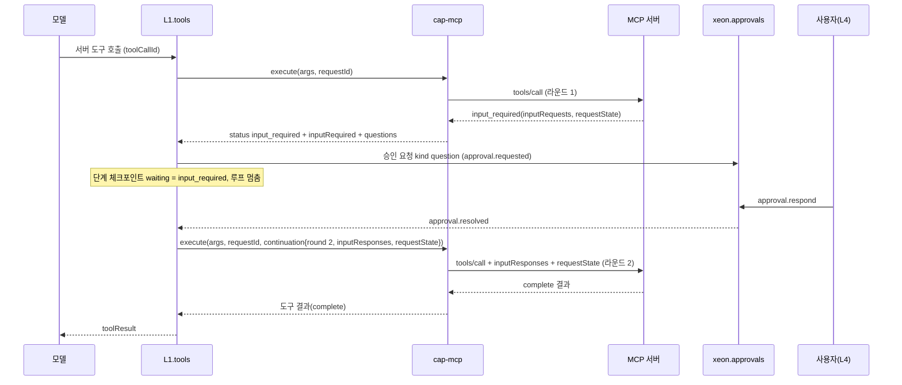

# L2 MCP 통합 (mcp)

패키지: `@xeon/cap-mcp` (`xeon/packages/cap-mcp`). 서비스: `xeon.mcp`. 계획 v2 하위 층: L2-b "MCP 통합".

## 1. 목적과 범위

### 1.1 정하는 것

- MCP 브리지: 서버 연결, 서버 도구·프롬프트·리소스를 Xeon 도구와 서비스로 노출(`_research/layer-plan-v2.json` L2-b "MCP 브리지").
- 능력 `mcp.client`의 정의(서비스 메서드와 관리용 정적 도구).
- 서버 도구의 동적 광고(X 리소스 등록), 순서 키, annotations → `ToolHints` 대응.
- 서버 정의: 사용자·프로젝트 범위, 전송(stdio, Streamable HTTP, SSE), 비밀 참조, 허용·차단·도구별 승인.
- 서버 주도 요청(1차): `input_required` 결과를 승인 프로토콜로 올리고 응답을 붙여 같은 요청을 재시도하는 규칙.
- 2차: MCP Tasks, 변경 구독, OAuth.
- 실패 처리, 상태 저장(`cap_mcp_`), 설정 키 `l2.mcp.*`.

### 1.2 다루지 않는 것

| 대상 | 정하는 곳 |
|---|---|
| 도구 기계 이름의 네임스페이스와 충돌 해소 규칙 | `F.capabilities.spec` §10 미결(a/b/c). 이 문서는 후보를 정하지 않는다 |
| 승인 프로토콜, 승인 요청 payload 형식, 권한 규칙 평가, 결과 경계화 | `L1.tools.spec` |
| 자식 프로세스 기동·종료·그룹 kill | `L0.process.spec` |
| 비밀 저장, 참조 해석, 실행 직전 주입, 마스킹 | `L0.secrets.spec` |
| 동적 도구 등록 API(리소스 등록), 확장 켜기·끄기 | `X.primitives.spec`, `F.extensions.spec` §4.5 |
| MCP 프롬프트를 슬래시 명령으로 보이는 일 | `L2.dialog.spec`(`dialog.commands`). `cap-mcp`가 `dialog.commands`에 등록하는 선택 의존은 `L2.readme` §6 표의 [미결] 간선이다(`L2.readme` §10 미결 16). 넣지 않으면 L4 클라이언트가 등록한다 |
| 서버 목록·연결 상태 화면, OAuth 브라우저 열기 | `L4.settings-ui.spec`, `L4.desktop.spec`, `L4.cli.spec` |
| MCP 서버 모드(Xeon을 MCP 서버로 노출) | 범위 밖 |

### 1.3 SDK 결정

- [결정] `@modelcontextprotocol/client` 2.3.1을 정확 고정한다(`_research/foundation-plan.md` §2 MCP 행).
- [제안] 대상 사양은 2026-07-28이다(무상태 프로토콜, 다중 왕복 요청 MRTR, Tasks 확장, `subscriptions/listen`). 2.3.1이 이 사양을 구현한다는 조사 결과(`_research/notes/L2-1.md` §1, §8)에 따른 작성자 선택이고, foundation-plan에는 사양 날짜가 없다.
- 불채택: v1 SDK `@modelcontextprotocol/sdk` 1.32.1과 pi `pi-mcp` 1.3.0. 둘 다 2025-11-25 사양까지라 무상태 프로토콜과 MRTR을 지원하지 않는다(`_research/packages.md` §4.4 L2-b, §5 MCP 행). v1.32.1의 2026 미지원은 확인하지 않은 [가정]이다(`_research/notes/L2-1.md` §10).
- SDK API 근거: 아래 항목은 `_research/notes/L2-1.md`(tarball 선언 파일과 소스맵 원본 읽기, 실행 없음)의 조사 결과이고 표지 없이 그 절을 근거로 단다. 선언 파일 읽기로도 확인하지 못한 것과 실행으로 확인하지 않은 동작은 [가정]으로 둔다.
  - MRTR: `InputRequiredResult { resultType: "input_required", inputRequests?, requestState? }`, `ClientOptions.inputRequired`(`autoFulfill` 기본 `true`, `maxRounds` 기본 10), 호출 옵션 `allowInputRequired`(`_research/notes/L2-1.md` §3).
  - 구독: `Client.listen(filter)` → `McpSubscription { honoredFilter, close(), closed }`. SDK는 재연결 때 다시 listen하지 않는다(§6).
  - OAuth: `OAuthClientProvider`, `auth(provider, options)`, `StreamableHTTPClientTransport`의 `authProvider`, `finishAuth(code, iss?)`, `validateAuthorizationResponseIssuer`(§7).
  - 버전 협상 기본값은 `legacy`다. 2026 경로는 `versionNegotiation: { mode: "auto" }` 또는 `{ pin: "2026-07-28" }`로 켠다(§8).
  - Tasks 확장(`io.modelcontextprotocol/tasks`)은 2.3.1에 구현이 없다(`_research/notes/L2-1.md` §4.1). 명시 스키마 요청 경로(`client.request(..., resultSchema)`)에서 era 게이트를 건너뛰는 스펙 메서드는 `tasks/get`, `tasks/cancel` 둘이다(같은 문서 §4.2, 코드 경로 읽기). `tasks/update`는 스펙 메서드 목록 밖의 확장 메서드라 같은 경로로 보낼 수 있다고 본다 [가정](같은 문서 §4.2, 조사 표지 "추측"). 세 메서드 모두 실제 와이어 전송은 확인하지 않았다 [가정]. 그래서 `_research/packages.md` §4.4 L2-b "MCP Tasks: 그대로"는 "자체 어댑터"로 고친다.
  - elicitation·sampling·roots는 2026에서 와이어 메서드가 아니고 MRTR의 `inputRequests` 항목으로만 온다. roots와 sampling은 2026-07-28에서 deprecated다(§5).

## 2. 용어

| 용어 | 뜻 |
|---|---|
| 서버 | MCP 서버 하나. 서버 id로 부른다 |
| 서버 id | `^[a-z][a-z0-9-]{0,31}$`. 설정 키와 순서 키에 쓴다. `.mcp.json`의 자유 이름은 이 형식으로 바꾼다(§4.2) |
| 서버 정의 | 서버 하나의 연결 방법과 정책. `McpServerDef` |
| 동적 도구 | 서버가 `tools/list`로 광고하는 도구. 정적 `CapabilityDef.tools`로 표현하지 못하므로 X 리소스 등록으로 광고한다(`F.capabilities.spec` §5 6항) |
| 정적 도구 | `mcp.client` 정의에 들어 있는 관리용 도구 |
| 라운드 | MRTR에서 `input_required`를 받고 응답을 붙여 다시 보내는 한 번. 첫 요청이 라운드 1이다 |
| 입력 요청 | `inputRequests`의 항목 하나. elicitation(form, url), sampling, roots |
| 연속 정보 | 다음 라운드에 붙이는 `inputResponses`와 `requestState`. `McpContinuation` |

## 3. 인터페이스

### 3.1 서버 정의

```ts
// xeon/packages/contracts/src/capabilities/defs/mcp.ts
import { Type, type Static } from "typebox";
import { defineCapability, serviceKey, type CapabilityApi, type ToolContent } from "../index.ts";

export const MCP_SERVER_ID_PATTERN = "^[a-z][a-z0-9-]{0,31}$";
export const McpServerIdSchema = Type.String({ pattern: MCP_SERVER_ID_PATTERN });

const McpValue = Type.String({ maxLength: 8192 });   // secret:// 참조 또는 평문. 형식 검사는 cap-mcp가 정의를 읽을 때 한다
const EnvName = Type.String({ pattern: "^[A-Za-z_][A-Za-z0-9_]{0,127}$" });
const HeaderName = Type.String({ pattern: "^[A-Za-z0-9-]{1,128}$" });

export const McpTransportSchema = Type.Union([
  Type.Object({
    type: Type.Literal("stdio"),
    command: Type.String({ minLength: 1 }),
    args: Type.Optional(Type.Array(Type.String())),
    cwd: Type.Optional(Type.String()),
    /** 값은 secret:// 참조 또는 평문 문자열이다. secret:// 참조는 실행 직전에 L0.secrets가 주입한다 */
    env: Type.Optional(Type.Record(EnvName, McpValue)),
  }),
  Type.Object({
    type: Type.Literal("http"),            // Streamable HTTP
    url: Type.String({ pattern: "^https?://" }),
    headers: Type.Optional(Type.Record(HeaderName, McpValue)),
    /** OAuth 사용(2차) */
    oauth: Type.Optional(Type.Boolean()),
  }),
  Type.Object({
    type: Type.Literal("sse"),             // 2025 이전 서버 호환
    url: Type.String({ pattern: "^https?://" }),
    headers: Type.Optional(Type.Record(HeaderName, McpValue)),
  }),
]);

export const McpApprovalModeSchema = Type.Union([Type.Literal("prompt"), Type.Literal("auto"), Type.Literal("deny")]);

export const McpServerDefSchema = Type.Object({
  title: Type.Optional(Type.String({ maxLength: 80 })),
  transport: McpTransportSchema,
  enabled: Type.Optional(Type.Boolean()),          // 기본 true
  tools: Type.Optional(Type.Object({
    /** 노출할 서버 도구 이름. 없으면 전부 */
    allow: Type.Optional(Type.Array(Type.String())),
    /** 노출하지 않을 서버 도구 이름. allow보다 우선 */
    deny: Type.Optional(Type.Array(Type.String())),
    /** 서버 도구 이름 → 승인 모드. 없으면 l2.mcp.approvalMode */
    approval: Type.Optional(Type.Record(Type.String(), McpApprovalModeSchema)),
  })),
  timeouts: Type.Optional(Type.Object({
    connectMs: Type.Optional(Type.Integer({ minimum: 1000, maximum: 600000 })),
    callMs: Type.Optional(Type.Integer({ minimum: 1000, maximum: 3600000 })),
  })),
  /** 참이면 annotations를 승인 정책 입력으로 쓴다(§3.4). 기본 false */
  trustAnnotations: Type.Optional(Type.Boolean()),
  /** 서버별 샌드박스 설정. 있으면 출처별 기본값보다 우선한다(L2.mcp.spec §4.3, M3-REQ-97) */
  sandbox: Type.Optional(Type.Boolean()),
});
export type McpServerDef = Static<typeof McpServerDefSchema>;
```

- 서버 정의는 설정 키 `l2.mcp.servers`(서버 id → `McpServerDef`)에 둔다. F5 설정 스키마 하나에서 화면·파일·명령이 나오도록 하기 위해서다(`_research/layer-plan-v2-notes.md` 층 사이 규칙 6).
- `env`와 `headers`의 값은 `secret://` 참조이거나 평문 문자열이다(최대 8192자). 스키마는 값을 문자열로만 본다. 참조 형식 검사와 비밀 이름 패턴(`KEY`, `TOKEN`, `SECRET` 등) 거부는 `cap-mcp`가 정의를 읽을 때 한다 [결정: review.m3-design-inputs D-M3-19].
- `sandbox`는 서버별 샌드박스 설정이다. 없으면 출처별 기본값(프로젝트 출처 켬, 사용자 출처 끔)을 쓰고, 있으면 기본값보다 우선한다. 적용 대상은 stdio 서버이며 http·sse 정의의 값은 쓰지 않는다 [결정: review.m3-design-inputs D-M3-19].
- `.mcp.json` 호환 [제안]: 프로젝트 루트의 `.mcp.json`과 `.xeon/mcp.json`(`{ "mcpServers": { "<이름>": { "command", "args", "env", "url", "type", "headers" } } }`, Claude Code 형식, `_research/settings.md` §2.10 MCP 서버 정의 행)을 읽기 전용으로 가져온다. 변환 규칙은 §4.2다. 사용자 범위 파일 위치는 L4가 정하는 설정 디렉터리 규칙을 따른다 [가정].

### 3.2 능력 정의 `mcp.client`

```ts
// defs/mcp.ts (계속)

export const McpServerStateSchema = Type.Union([
  Type.Literal("disabled"), Type.Literal("connecting"), Type.Literal("connected"),
  Type.Literal("reconnecting"), Type.Literal("failed"), Type.Literal("blocked"),
]);

export const McpServerStatusSchema = Type.Object({
  server: McpServerIdSchema,
  title: Type.Optional(Type.String()),
  /** 정의 출처. 예: "settings:user", "settings:project", "mcpjson:project", "ext:<확장 이름>" */
  source: Type.String(),
  state: McpServerStateSchema,
  transport: Type.Union([Type.Literal("stdio"), Type.Literal("http"), Type.Literal("sse")]),
  /** 협상된 사양 버전. 예: "2026-07-28", "2025-11-25" */
  protocolVersion: Type.Optional(Type.String()),
  toolCount: Type.Integer({ minimum: 0 }),
  promptCount: Type.Integer({ minimum: 0 }),
  resourceCount: Type.Optional(Type.Integer({ minimum: 0 })),
  /** 비밀 값을 담지 않는다 */
  lastError: Type.Optional(Type.Object({ code: Type.String(), message: Type.String(), at: Type.Integer() })),
  /** blocked일 때 사유: "denied_by_policy" | "not_in_allowlist" | "managed_only" | "untrusted_project" | "approval_required" | "sandbox_unavailable" */
  blockedReason: Type.Optional(Type.String()),
});

const ServerRef = Type.Object({ server: McpServerIdSchema });

/** MRTR 연속 정보. 첫 라운드에는 두지 않는다 */
export const McpContinuationSchema = Type.Object({
  /** 이번에 보낼 라운드 번호(2부터) */
  round: Type.Integer({ minimum: 2 }),
  /** 입력 요청 키 → 응답. 값 모양은 MCP 사양을 따른다 */
  inputResponses: Type.Record(Type.String(), Type.Unknown()),
  /** 직전 라운드의 requestState. 바이트 그대로 돌려보낸다 */
  requestState: Type.Union([Type.String(), Type.Null()]),
});

/** 입력 요청을 사람에게 묻기 위한 질문. 승인 요청 payload에 싣는다(§4.6) */
export const McpQuestionSchema = Type.Union([
  Type.Object({ key: Type.String(), kind: Type.Literal("elicitation_form"), server: McpServerIdSchema,
    message: Type.String(), requestedSchema: Type.Unknown() }),
  Type.Object({ key: Type.String(), kind: Type.Literal("elicitation_url"), server: McpServerIdSchema,
    message: Type.String(), url: Type.String() }),
  Type.Object({ key: Type.String(), kind: Type.Literal("sampling"), server: McpServerIdSchema,
    summary: Type.String() }),
]);

/** input_required 변형. F.conversation.spec §3.6 InputRequiredInfo에 questions와 round를 더한다 */
const InputRequiredVariant = Type.Object({
  status: Type.Literal("input_required"),
  /** 응답을 받은 라운드 번호 */
  round: Type.Integer({ minimum: 1 }),
  inputRequests: Type.Record(Type.String(), Type.Unknown()),
  requestState: Type.Union([Type.String(), Type.Null()]),
  questions: Type.Array(McpQuestionSchema),
});

const ImageBlob = Type.Object({   // F.records.spec §3.4 BlobRef와 같은 모양(L2.workspace.spec §3.1과 같은 이유)
  type: Type.Literal("blob"), sha256: Type.String({ pattern: "^[0-9a-f]{64}$" }),
  size: Type.Integer({ minimum: 0 }), mediaType: Type.Union([Type.String(), Type.Null()]),
});

/** 서버 결과 내용을 Xeon 쪽 모양으로 바꾼 것. 이미지는 blob으로 옮긴다 */
export const McpContentSchema = Type.Union([
  Type.Object({ type: Type.Literal("text"), text: Type.String() }),
  Type.Object({ type: Type.Literal("image"), blob: ImageBlob, mimeType: Type.String() }),
  Type.Object({ type: Type.Literal("resource_link"), uri: Type.String(), name: Type.Optional(Type.String()), mimeType: Type.Optional(Type.String()) }),
  Type.Object({ type: Type.Literal("resource"), uri: Type.String(), mimeType: Type.Optional(Type.String()), text: Type.Optional(Type.String()), blob: Type.Optional(ImageBlob) }),
  /** audio 등 다루지 않는 종류. 모델에는 설명 텍스트로 보낸다 */
  Type.Object({ type: Type.Literal("unsupported"), originalType: Type.String() }),
]);

export const McpToolInfoSchema = Type.Object({
  server: McpServerIdSchema,
  /** 서버가 광고한 원래 이름 */
  name: Type.String(),
  /** Xeon 기계 이름(§3.3). 노출하지 않는 도구는 null */
  machineName: Type.Union([Type.String(), Type.Null()]),
  title: Type.Optional(Type.String()),
  description: Type.Optional(Type.String()),
  inputSchema: Type.Unknown(),
  annotations: Type.Optional(Type.Object({
    readOnlyHint: Type.Optional(Type.Boolean()), destructiveHint: Type.Optional(Type.Boolean()),
    idempotentHint: Type.Optional(Type.Boolean()), openWorldHint: Type.Optional(Type.Boolean()),
  })),
  exposed: Type.Boolean(),
  /** 노출하지 않는 사유: "denied" | "not_allowed" | "name_conflict" | "name_invalid" | "schema_invalid" */
  hiddenReason: Type.Optional(Type.String()),
});

export const CallToolInput = Type.Object({
  server: McpServerIdSchema,
  tool: Type.String({ minLength: 1 }),
  arguments: Type.Record(Type.String(), Type.Unknown()),
  continuation: Type.Optional(McpContinuationSchema),
});
export const CallToolOutput = Type.Union([
  Type.Object({
    status: Type.Literal("complete"),
    content: Type.Array(McpContentSchema),
    structuredContent: Type.Optional(Type.Unknown()),
    /** 서버가 결과에 isError를 표시함 */
    isError: Type.Boolean(),
    truncated: Type.Optional(Type.Object({ shownBytes: Type.Integer(), totalBytes: Type.Integer() })),
  }),
  InputRequiredVariant,
]);

export const PromptInfoSchema = Type.Object({
  server: McpServerIdSchema,
  name: Type.String(),
  title: Type.Optional(Type.String()),
  description: Type.Optional(Type.String()),
  arguments: Type.Array(Type.Object({
    name: Type.String(), description: Type.Optional(Type.String()), required: Type.Optional(Type.Boolean()),
  })),
});
export const GetPromptInput = Type.Object({
  server: McpServerIdSchema,
  name: Type.String({ minLength: 1 }),
  arguments: Type.Optional(Type.Record(Type.String(), Type.String())),
  continuation: Type.Optional(McpContinuationSchema),
});
export const GetPromptOutput = Type.Union([
  Type.Object({
    status: Type.Literal("complete"),
    description: Type.Optional(Type.String()),
    messages: Type.Array(Type.Object({
      role: Type.Union([Type.Literal("user"), Type.Literal("assistant")]),
      content: McpContentSchema,
    })),
  }),
  InputRequiredVariant,
]);

export const ResourceInfoSchema = Type.Object({
  server: McpServerIdSchema,
  uri: Type.String(),
  name: Type.String(),
  title: Type.Optional(Type.String()),
  description: Type.Optional(Type.String()),
  mimeType: Type.Optional(Type.String()),
  size: Type.Optional(Type.Integer({ minimum: 0 })),
});
export const ListResourcesInput = Type.Object({
  server: Type.Optional(McpServerIdSchema),
  /** 서버별 페이지 커서. 키는 서버 id */
  cursor: Type.Optional(Type.Record(Type.String(), Type.String())),
});
export const ListResourcesOutput = Type.Object({
  resources: Type.Array(ResourceInfoSchema),
  nextCursor: Type.Optional(Type.Record(Type.String(), Type.String())),
});
export const ReadResourceInput = Type.Object({
  server: McpServerIdSchema,
  uri: Type.String({ minLength: 1 }),
  continuation: Type.Optional(McpContinuationSchema),
});
export const ReadResourceOutput = Type.Union([
  Type.Object({ status: Type.Literal("complete"), contents: Type.Array(McpContentSchema) }),
  InputRequiredVariant,
]);

const ReadResourceToolParams = Type.Object({ server: McpServerIdSchema, uri: Type.String({ minLength: 1 }) });

const MCP_ERRORS = {
  server_unknown: { description: "정의에 없는 서버 id", retryable: false },
  server_blocked: { description: "허용·차단 정책이나 관리 잠금으로 막힌 서버", retryable: false },
  server_disconnected: { description: "서버 연결이 끊겨 있음", retryable: true },
  tool_unknown: { description: "서버가 광고하지 않은 도구", retryable: false },
  input_rounds_exceeded: { description: "input_required 라운드가 l2.mcp.inputRequired.maxRounds를 넘음", retryable: false },
  input_unsupported: { description: "서버가 선언하지 않은 입력 종류를 요청함", retryable: false },
  protocol_error: { description: "서버 응답이 사양을 위반함", retryable: false },
} as const;

function wrapUntrusted(server: string, text: string): string {
  return `<untrusted_mcp_content server="${server}">\n${text}\n</untrusted_mcp_content>`;
}

function renderServers(out: { servers: readonly Static<typeof McpServerStatusSchema>[] }): ToolContent {
  const lines = out.servers.map((s) => `${s.server} ${s.state} 도구 ${s.toolCount}개${s.lastError ? ` 오류: ${s.lastError.code}` : ""}`);
  return { content: [{ type: "text", text: lines.join("\n") }], structuredContent: out };
}

function renderResources(out: Static<typeof ListResourcesOutput>): ToolContent {
  const lines = out.resources.map((r) => `${r.server} ${r.uri}${r.title ? ` ${r.title}` : ""}`);
  return { content: [{ type: "text", text: lines.join("\n") }], structuredContent: out };
}

function renderRead(out: Static<typeof ReadResourceOutput>): ToolContent {
  if (out.status === "input_required") {
    return { content: [{ type: "text", text: "서버가 추가 입력을 요구함" }], structuredContent: out };
  }
  const parts = out.contents.map((c) => (c.type === "text" ? c.text : c.type === "resource" && c.text ? c.text : `[${c.type}]`));
  return { content: [{ type: "text", text: wrapUntrusted("resource", parts.join("\n\n")) }], structuredContent: out };
}

export const McpClient = defineCapability({
  id: "mcp.client",
  version: "1.0.0",
  description: "MCP 서버 연결 관리와 서버 도구·프롬프트·리소스 호출.",
  service: {
    methods: {
      listServers: { description: "정의된 서버와 상태 목록.", input: Type.Object({}),
        output: Type.Object({ servers: Type.Array(McpServerStatusSchema) }), replay: "safe", readOnly: true },
      status: { description: "서버 하나의 상태.", input: ServerRef, output: McpServerStatusSchema, replay: "safe", readOnly: true, errors: MCP_ERRORS },
      connect: { description: "꺼진 서버를 이 세션에서 켜고 연결한다.", input: ServerRef, output: McpServerStatusSchema, errors: MCP_ERRORS },
      reconnect: { description: "연결을 닫고 다시 연결한다. 도구 목록을 다시 읽는다.", input: ServerRef, output: McpServerStatusSchema, errors: MCP_ERRORS },
      disable: { description: "이 세션에서 서버를 끈다. 도구는 다음 단계 경계에서 빠진다.", input: ServerRef, output: McpServerStatusSchema, errors: MCP_ERRORS },
      listTools: { description: "서버가 광고한 도구와 노출 여부.", input: ServerRef,
        output: Type.Object({ tools: Type.Array(McpToolInfoSchema) }), replay: "safe", errors: MCP_ERRORS },
      callTool: { description: "서버 도구를 호출한다. input_required면 연속 정보를 돌려준다.",
        input: CallToolInput, output: CallToolOutput, replay: "unsafe", errors: MCP_ERRORS },
      listPrompts: { description: "서버 프롬프트 목록.", input: ServerRef,
        output: Type.Object({ prompts: Type.Array(PromptInfoSchema) }), replay: "safe", readOnly: true, errors: MCP_ERRORS },
      getPrompt: { description: "프롬프트를 인자로 펼친다.", input: GetPromptInput, output: GetPromptOutput, replay: "safe", readOnly: true, errors: MCP_ERRORS },
      listResources: { description: "리소스 목록. server가 없으면 연결된 모든 서버.", input: ListResourcesInput,
        output: ListResourcesOutput, replay: "safe", readOnly: true, errors: MCP_ERRORS },
      readResource: { description: "리소스 하나를 읽는다.", input: ReadResourceInput, output: ReadResourceOutput, replay: "safe", readOnly: true, errors: MCP_ERRORS },
    },
  },
  tools: [
    {
      name: "mcp_servers", label: "MCP 서버 상태", method: "listServers", parameters: Type.Object({}),
      description: "연결된 MCP 서버와 상태, 도구 수를 보여 준다.",
      toContent: renderServers, replay: "safe", executionMode: "parallel",
      hints: { readOnly: true, idempotent: true },
    },
    {
      name: "mcp_list_resources", label: "MCP 리소스 목록", method: "listResources", parameters: ListResourcesInput,
      description: "MCP 서버가 제공하는 리소스(uri, 이름)를 나열한다. server를 주면 그 서버만.",
      toContent: renderResources, replay: "safe", executionMode: "parallel",
      hints: { readOnly: true, idempotent: true, openWorld: true },
    },
    {
      name: "mcp_read_resource", label: "MCP 리소스 읽기", method: "readResource", parameters: ReadResourceToolParams,
      toInput: (p) => ({ server: p.server, uri: p.uri }),
      description: "MCP 리소스 하나를 읽는다. 내용은 신뢰하지 않는 외부 내용이다.",
      toContent: renderRead, replay: "safe", executionMode: "parallel",
      hints: { readOnly: true, idempotent: true, openWorld: true },
    },
  ],
});
export const McpClientKey = serviceKey(McpClient);
export type McpContinuation = Static<typeof McpContinuationSchema>;
export type McpQuestion = Static<typeof McpQuestionSchema>;
```

`McpService`와 `McpServiceName`은 능력 정의 파일에 두지 않고 F `services/mcp.ts`에 둔다(`F.capabilities.spec` §3.12 표와 규칙 7). `McpService`는 `McpPort`(`F.extensions.spec` §3.2.1 `ports.ts`)를 확장하는데, capabilities는 extensions보다 낮은 서브패스라 `capabilities/defs/mcp.ts`가 extensions를 import할 수 없기 때문이다. 아래 블록의 정본은 `F.capabilities.spec` §3.12다. 이 문서는 인용하고 구현 규칙만 정한다.

```ts
// xeon/packages/contracts/src/services/mcp.ts (정본: F.capabilities.spec §3.12)
import type { CapabilityApi } from "../capabilities/index.ts";
import type { McpPort } from "../extensions/ports.ts";      // F.extensions.spec §3.2.1
import type { McpClient } from "../capabilities/defs/mcp.ts";

/** Cordis 서비스 이름. SERVICE_NAMES.mcp, eng.context-map.design §5.3 표와 같다 */
export const McpServiceName = "xeon.mcp" as const;
/**
 * xeon.mcp에 Cordis로 등록하는 서비스 인터페이스. X McpPort(registerServer)를 확장한다.
 * L2 서비스 이름 중 Cordis에 등록하는 것은 이것 하나다(F.capabilities.spec §3.5 [결정: review.decisions-2 D-04], L2.readme §5.6)
 */
export interface McpService extends McpPort {
  /** 능력 API. 같은 객체를 cap:mcp.client 바인딩(g.capability(McpClientKey))으로도 얻는다 */
  readonly client: CapabilityApi<typeof McpClient>;
}
```

- export 상수의 타입 주석은 `F.capabilities.spec` §3.9와 같은 이유로 생략했다. 실제 파일은 명시 주석을 단다.
- `xeon.mcp` 등록: `cap-mcp`는 능력 바인딩(`hostOf(g).provide(McpClientKey, impl)`, `cap:mcp.client`)과 별도로 `McpService` 구현 하나를 Cordis 서비스 `xeon.mcp`에 등록한다(`hostOf(g).providePort(McpPortKey, impl)`, `X.primitives.spec` §3.6 규칙 4·6, §3.8). `cap-mcp`는 `builtin` 확장이라 `xeon.*` 이름을 제공할 수 있다. 같은 서비스 이름에 다른 인터페이스는 등록하지 않는다.
- `registerServer(owner, name, config)`: 확장이 `hostOf(g).registerMcpServer(name, config)`로 부르면 X가 이 메서드를 부른다(`X.primitives.spec` §4.8). 규칙은 다음과 같다.
  - `name`은 서버 id이고 `MCP_SERVER_ID_PATTERN`을 따른다. `config`(`McpServerResourceDef`)는 `McpServerDefSchema`로 검사한다. 어긋나면 `CapabilityError("invalid_input")`을 던진다.
  - 같은 id가 설정(`l2.mcp.servers`)이나 `.mcp.json`에 있으면 `CapabilityError("invalid_input")`으로 거부한다. 확장끼리의 같은 이름 판정은 X `ResourcePolicy`가 먼저 한다(`X.primitives.spec` §4.8 등록 규칙 3).
  - 출처(`McpServerStatusSchema.source`)는 `ext:<확장 이름>`이다. 확장 이름은 `owner`(`ScopeId`)의 첫 마디다. 허용·차단(§4.4)과 `secret://` 규칙(§4.3)은 설정 출처 서버와 같다.
  - 돌려준 `Unsubscribe`를 부르면(scope가 꺼질 때 X가 자동으로 부른다) 다음 단계 경계에서 연결을 닫고 그 서버의 동적 도구를 해제한다.
- `connect`, `reconnect`, `disable`, `callTool`은 `replay`를 생략해 `"unsafe"`다. `callTool`은 서버 쪽 효과를 알 수 없으므로 `unsafe`로 둔다.
- 정적 도구 3개는 모두 읽기다 [제안]. 서버를 켜고 끄는 일은 사용자 명령과 설정 화면만 하고 모델 도구로 두지 않는다. 모델의 서버 도구 호출은 §3.3 동적 도구로 한다.
- 서버 도구를 모델이 부르는 경로는 동적 도구이고, 그룹 코드가 부르는 경로는 `callTool` 메서드다. 두 경로 모두 §4.6 MRTR 규칙을 따른다.
- `mcp_read_resource`의 `toContent`는 `server`를 모르므로 감싸기 표지에 `"resource"`를 쓴다. 동적 도구 결과는 실제 서버 id를 쓴다(§4.5).

### 3.3 동적 도구 광고

서버 도구는 X 리소스 등록으로 광고한다(`F.capabilities.spec` §4.4 마지막 단락, §5 6항). 등록 API는 `hostOf(g).registerTool(def: ToolResourceDef)`이고 X가 `ToolsPort.register(owner, def)`(`xeon.tools`)로 넘긴다(`X.primitives.spec` §3.8, §3.9, §4.8). 등록은 `cap-mcp` scope 세대의 fiber effect라 scope가 꺼지면 자동으로 해제된다(`X.primitives.spec` §4.8 등록 규칙 1). 서버가 끊기거나 도구가 사라질 때는 `cap-mcp`가 등록할 때 잡은 해제기를 부른다 [제안]. `cap-mcp` 내부에서 쓰는 값은 다음 모양이고, 등록할 때 `ToolResourceDef`로 바꾼다 [제안].

```ts
// xeon/packages/cap-mcp/src/client/dynamic-tools.ts (패키지 내부 타입)
import type { ToolWire, ToolHints } from "@xeon/contracts/capabilities";
import type { AgentToolResult, InputRequiredInfo, ReplayPolicy } from "@xeon/contracts/conversation";   // AgentToolResult는 pi 재노출
import type { McpContinuation } from "@xeon/contracts/capabilities/defs/mcp";   // 서브패스 경로는 F가 정한다

export interface McpDynamicTool {
  /** F.capabilities.spec §4.5 순서 키의 capability 자리 */
  readonly orderKey: `mcp.${string}`;
  readonly wire: ToolWire;                 // name = mcpToolName(server, tool), description, parameters
  readonly label: string;
  readonly hints: ToolHints;
  readonly replay: ReplayPolicy;           // 항상 "unsafe"
  readonly executionMode: "parallel";
  /** 같은 도구 호출의 다음 라운드는 continuation을 받는다(§4.6) */
  execute(args: Record<string, unknown>, ctx: {
    readonly signal: AbortSignal;
    readonly requestId: string;
    readonly continuation?: McpContinuation;
  }): Promise<AgentToolResult & { status?: "complete" | "input_required"; inputRequired?: InputRequiredInfo }>;
}

/** 기계 이름 생성. 규칙은 F.capabilities.spec §10 미결의 결정을 따른다. 이 함수 하나만 바꾸면 되게 둔다 */
export function mcpToolName(server: string, tool: string): string;
```

- 순서 키: `mcp.<서버 id>`, 그다음 기계 이름(`F.capabilities.spec` §4.5).
- 기계 이름 형식: 이 문서는 후보를 정하지 않는다. `F.capabilities.spec` §10 미결의 (a) 충돌 시 등록 거부, (b) `<확장>__<이름>` 이중 밑줄 접두, (c) 충돌한 쪽만 접두 중 결정을 `mcpToolName`에 반영한다. 결정 전 M2 구현은 서버가 광고한 이름을 그대로 쓰고 이름이 겹치면 서버 id 바이트 순으로 뒤쪽을 숨긴다(내장 도구 이름과 겹쳐도 같다). F.capabilities.plan M0가 강제하는 범위(`TOOL_NAME_WIRE_PATTERN` 오류, 이름 충돌은 등록 거부)만 따른다.
- 서버 도구 이름에 `TOOL_NAME_WIRE_PATTERN`(`^[a-zA-Z0-9_-]{1,64}$`) 밖 문자가 있거나 길이가 넘으면 노출하지 않고 `hiddenReason: "name_invalid"`로 둔다. 문자를 임의로 바꾸지 않는다. 바꾸면 두 도구가 같은 이름이 될 수 있기 때문이다 [제안].
- `inputSchema`는 MCP가 준 JSON Schema를 그대로 `parameters`로 쓴다. `$ref`가 외부를 가리키거나 크기·깊이 한도(`F.capabilities.spec` §4.3)를 넘으면 노출하지 않고 `hiddenReason: "schema_invalid"`로 둔다 [제안].
- 인자 검증: L1.tools의 파라미터 검증(`F.capabilities.spec` §4.2 규칙 1)을 그대로 거친다. JSON Schema를 TypeBox 검증기에 넣는 방법은 L1.tools가 정한다. 서버도 다시 검증한다.
- `eng.context-map.design` CM-03 예시의 `name: \`mcp:${serverId}:${t.name}\``은 경계 어댑터의 위치를 보이는 예시다. `:`는 `TOOL_NAME_WIRE_PATTERN`에 없으므로 그대로 쓰지 않는다(§10 미결 1).

### 3.4 annotations → `ToolHints`

| MCP 필드 | MCP 기본값 | `ToolHints` / `ToolSpec` 필드 | 비고 |
|---|---|---|---|
| `title` | 없음 | `label` | 없으면 서버 도구 `name` |
| `annotations.title` | 없음 | `label` | `title`이 없을 때 |
| `annotations.readOnlyHint` | false | `readOnly` | |
| `annotations.destructiveHint` | true | `destructive` | `readOnlyHint`가 참이면 의미 없음 |
| `annotations.idempotentHint` | false | `idempotent` | |
| `annotations.openWorldHint` | true | `openWorld` | |
| (없음) | — | `replay` | 항상 `"unsafe"`. 힌트로 넓히지 않는다 |
| (없음) | — | `executionMode` | `"parallel"` |

- 이름만 바꾼다(`F.capabilities.spec` §3.3 대응 표 `hints` 행). MCP 기본값은 annotations가 없을 때 채운다 [가정: MCP 사양의 기본값].
- 신뢰: annotations는 서버의 자기 선언이다. 서버 정의의 `trustAnnotations`가 거짓(기본)이면 `cap-mcp`는 힌트를 표시용으로만 넘기고, 승인 정책 입력으로 쓰지 말라는 표지(`hints`를 비우고 `details.mcpAnnotations`에 원본을 둠)를 붙인다 [제안]. 그러면 L1.tools는 서버 도구를 기본값(파괴 가능, 열린 대상)으로 다룬다.

### 3.5 이벤트, 레코드, 테이블

- 이벤트 접두사 `mcp.`는 휘발 예약이다(`eng.context-map.design` §5.1). 이 문서는 내구 이벤트를 정의하지 않는다. 서버 도구 호출 기록은 L1.tools의 `tool.*`, 서버 주도 요청은 `approval.*`다.
- [제안] 휘발 `mcp.server_status`(서버 상태 변경을 화면에 알림)를 후보로 둔다. L4 화면이 필요로 할 때 카탈로그에 올린다.
- 세션 밖 상태 테이블(`xeon.store.scoped`):

```sql
CREATE TABLE cap_mcp_servers (
  server_id          TEXT PRIMARY KEY,
  source             TEXT NOT NULL,              -- "settings:user" 등
  state              TEXT NOT NULL,              -- McpServerState
  last_error_code    TEXT,
  last_error_message TEXT,                       -- 비밀 값 없음(마스킹 후)
  last_error_at      INTEGER,
  last_connected_at  INTEGER,
  protocol_version   TEXT,
  tools_fingerprint  TEXT,                       -- 광고 도구 집합의 toolsetFingerprint
  updated_at         INTEGER NOT NULL
) STRICT;
```

- 이 테이블은 재생으로 다시 만들지 않는다. 재시작 뒤 화면이 마지막 오류를 보여 주는 용도다.
- 서버 주도 요청의 승인 기록을 `cap_mcp_`에도 둘지는 [미결 3]이다. 승인 요청과 해결은 `approval.*` 이벤트(L1.tools 소유)로 세션에 남으므로 이 도메인은 복사본을 두지 않는 쪽을 제안한다.

### 3.6 효과 분류 [결정: M3-REQ-88]

ADR-0015 §3.3의 표지로 메서드를 나눈다. `readOnly`는 대화 기록, 사용자 파일과 사용자가 쓴 데이터, 외부 시스템의 상태를 바꾸지 않는 읽기다. 관찰상 순수한 파생 데이터(캐시, 색인, 내용 주소 blob, 사용량·비용 계량, 시간과 현재 데이터만으로 정해지는 정리)는 쓸 수 있다 [결정: 2026-10-28 오케스트레이터, ADR-0015 §3.3]. `idempotent`는 `requestId`를 받아 같은 키의 재호출에 효과를 더하지 않고 처음 결과를 돌려주는 쓰기이며, 기억은 효과와 같은 커밋에 둔다. 둘 다 없으면 선언 없음이고 `replay`는 `"unsafe"`다. 재실행되는 코드(on 핸들러, drive)에서는 `idempotent`와 `readOnly`(drive만)만 부를 수 있다. 정의는 F `defs/` 파일이 정본이고 `contracts/test/capabilities/l2-effect-classes.test.ts`가 이 표와 같은 값을 고정한다.

| 메서드 | 분류 | replay | 근거 |
|---|---|---|---|
| `mcp.client.listServers` | readOnly | safe | 메모리 상태 조회 |
| `mcp.client.status` | readOnly | safe | 같음 |
| `mcp.client.connect` | 선언 없음 | unsafe | 서버 연결 상태를 바꾼다 |
| `mcp.client.reconnect` | 선언 없음 | unsafe | 같음 |
| `mcp.client.disable` | 선언 없음 | unsafe | 같음 |
| `mcp.client.listTools` | readOnly | safe | MCP `tools/list`. 외부 서버의 읽기 메서드를 부르는 것은 허용한다. 서버 상태를 바꾸지 않는다 |
| `mcp.client.callTool` | 선언 없음 | unsafe | 서버 쪽 효과를 알 수 없다 |
| `mcp.client.listPrompts` | readOnly | safe | MCP `prompts/list` |
| `mcp.client.getPrompt` | readOnly | safe | MCP `prompts/get`(사양상 읽기) |
| `mcp.client.listResources` | readOnly | safe | MCP `resources/list` |
| `mcp.client.readResource` | readOnly | safe | MCP `resources/read`(사양상 읽기) |

## 4. 동작 규칙

### 4.1 연결 수명

- 시작: 세션 시작(`session.start`) 뒤 활성 서버 정의마다 연결을 시작한다. 연결은 세션 시작을 막지 않는다. 연결 전 서버의 도구는 첫 요청 도구 집합에 없고, 연결되면 다음 단계 경계에 `toolsAdded`로 들어간다.
- 버전 협상 [제안]: `versionNegotiation`은 설정 `l2.mcp.versionNegotiation` 값을 쓰고 기본은 `"auto"`(2026 탐침 뒤 2025로 폴백)다. SDK 기본값 `legacy`를 그대로 두면 2026 기능(MRTR, `listen`)이 꺼지기 때문이다(`_research/notes/L2-1.md` §8).
- MRTR 모드 [제안]: `ClientOptions.inputRequired.autoFulfill = false`로 두고 호출마다 `allowInputRequired: true`를 준다. SDK 자동 처리(기본 10라운드)는 메모리 안에서 핸들러를 부르므로 재시작 뒤 이어지지 않는다. 사람 응답은 승인 프로토콜로 받아야 하므로 수동 모드를 쓴다(§4.6).
- 능력 선언: `elicitation: { form: {}, url: {} }`만 선언한다. `sampling`과 `roots`는 기본으로 선언하지 않는다. 선언하지 않은 입력 종류는 서버가 보내면 안 된다(MRTR 서버 요구 7, `_research/notes/L2-1.md` §3).
- 연결 단계: 전송 생성(§4.3) → `connect`(또는 2026 `server/discover`) → `tools/list`, `prompts/list`(페이지 끝까지) → 노출 필터(§4.4) → 상태 `connected`, `cap_mcp_servers` 갱신 → `session.mcp.after` 지점 발화(§7).
- 종료: 세션 종료, `disable`, 서버 정의 삭제 때 연결을 닫는다. stdio 서버는 L0.process가 종료한다(SIGTERM 뒤 유예, 그다음 SIGKILL. 유예 시간은 `L0.process.spec`). 엔진이 닫히면 L0 레지스트리가 남은 서버 트리를 모두 정지한다(`L0.process.spec` §4.9).

### 4.2 서버 정의 로딩

1. 설정 `l2.mcp.servers`의 유효 값(관리 > … > 사용자 범위 병합, `F.wire-settings.spec` §4.7)을 읽는다.
2. `l2.mcp.importMcpJson`이 참이고 프로젝트가 신뢰된 상태면(`session.trust.before` 지점, `F.extensions.spec` §3.4 27번, 판정은 X `resolveProjectTrust`) 프로젝트 루트 `.mcp.json`과 `.xeon/mcp.json`을 읽는다 [결정: review.m2-plan §8 D6]. 신뢰되지 않았으면 파일 내용을 읽지 않고 파일이 있다는 진단(`untrusted_project`)만 남긴다. 파일을 읽지 못하면 서버 이름을 알 수 없어 `blocked` 서버로 나열하지 못한다.
   - 이름 변환: 소문자로 바꾸고 `[a-z0-9-]` 밖 문자를 `-`로 바꾸고 32자로 자른다. 결과가 형식에 맞지 않거나 1번 목록의 id와 겹치면 그 항목을 건너뛰고 진단을 남긴다.
   - `type` 생략 + `command` 있음 → `stdio`, `type: "http"`·`"streamable-http"` → `http`, `type: "sse"` → `sse`.
   - [결정: M3-REQ-97] `env`·`headers` 값은 `secret://` 참조이거나 평문이다. 평문은 허용하되 이름이 비밀처럼 보이면 그 서버를 건너뛰고 `plaintext_secret` 진단(값 없음)을 남긴다. 이름은 `_`·`-`·대소문자 경계로 낱말을 나눠 `KEY`, `APIKEY`, `TOKEN`, `SECRET`(S), `PASSWORD`, `PASSWD`, `PWD`, `CREDENTIAL`(S), `AUTH`, `AUTHORIZATION`, `COOKIE`, `BEARER` 중 하나가 있으면 비밀 이름이다(`MAX_TOKENS`, `KEYBOARD`는 아니다). `secret://`로 시작하는데 참조 형식이 아닌 값은 `invalid_definition`이다(오타가 평문으로 나가지 않게 한다). 같은 검사를 설정 `l2.mcp.servers`와 `registerServer`에도 한다.
   - 출처는 루트 `.mcp.json`이 `mcpjson:project`, `.xeon/mcp.json`이 `mcpjson:xeon`이다. 같은 id가 있으면 설정이 이기고, 두 파일 사이에서는 `.xeon/mcp.json`이 이긴다.
   - 확장이 `registerServer`로 등록한 서버(§3.2 `xeon.mcp` 등록)를 더한다. 출처는 `ext:<확장 이름>`이고, 설정·`.mcp.json`의 id와 겹치는 등록은 등록 시점에 거부되었으므로 여기서 다시 겹치지 않는다.
3. 허용·차단(§4.4)을 적용해 `blocked` 서버를 표시한다.
4. 변경 반영: 설정이나 `.mcp.json`이 바뀌면 다음 단계 경계에서 차이(추가·삭제·변경된 서버)만 연결·해제한다. 정의가 바뀐 서버는 다시 연결한다.

### 4.3 전송과 비밀

- stdio [제안]: SDK의 stdio 전송(`./stdio` 서브패스, 내부에서 `cross-spawn`)을 쓰지 않고, `xeon.process`로 띄운 자식 프로세스의 표준 입출력을 SDK `Transport` 인터페이스로 감싼 `ProcessStdioTransport`를 둔다. 프로세스 레지스트리, 그룹 종료, 비밀 주입을 L0 한 곳에서 하기 위해서다(`eng.context-map.design` §4.1 mcp 행 `xeon.process`). SDK `Transport` 인터페이스는 선언 파일로 확인했다: `start`, `send`, `close`와 콜백 속성 `onclose`, `onerror`, `onmessage`다(`L2.mcp.plan` §8.2). F `ProcessPort.spawn`은 격리 확장용이고 `ExecService.startBackground`는 스트림을 주지 않으므로, 스트림과 `secret://` env 주입을 주는 포트를 `McpProcessPort`(`src/ports/process.ts`)로 선언하고 L0 구현을 요청했다(`L2.mcp.plan` §8.5).
- `env`의 `secret://` 값은 `cap-mcp`가 풀지 않는다. 참조 그대로 `xeon.process`에 넘기고 L0.secrets가 실행 직전에 주입한다(`_research/secrets.md` §6, `L0.secrets.spec`).
- HTTP·SSE: SDK의 `StreamableHTTPClientTransport`, `SSEClientTransport`를 쓴다(공개 export, `_research/notes/L2-1.md` §2). `headers`의 `secret://` 값은 요청 직전에 `xeon.secrets`로 풀어 붙이는 fetch 감싸기를 전송 옵션으로 넘긴다 [확인: 두 전송의 옵션 모두 `fetch`를 받는다, `L2.mcp.plan` §8.2].
- 비밀 값은 `cap-mcp`의 로그, 이벤트, 오류 `message`, `cap_mcp_servers`, 모델 요청에 나타나지 않는다. 서버 stderr와 오류 메시지는 L0.secrets 마스킹을 거친 뒤 저장한다.
- 기동 승인 [결정: M3-05, D-M3-19 행 2 권고 적용]: `env`에 `secret://` 값이 있는 stdio 서버는 정의 해시마다 한 번 사용자의 기동 승인을 받아야 뜬다. 승인 포트 `McpStartGate`(`src/ports/start-gate.ts`)가 판정하고(`L1.tools.spec` §4.12.1), 전송 팩토리가 spawn 전에 부른다. `pending`이면 서버는 `blocked`(`blockedReason: "approval_required"`)로 두고 spawn하지 않으며 재시도 타이머를 쓰지 않는다. 응답이 오면 게이트가 서버 id로 알리고 레지스트리가 연결을 다시 시작한다. `denied`면 spawn하지 않고 `lastError.code = "secret_denied"`다. 승인 증거는 `McpSpawnSpec.approval`로 L0에 가고 `mcp.start:<서버 id>` 맥락으로 비밀을 푼다(`L0.process.spec` §4.9). 승인을 올릴 대화는 가장 최근에 정의를 읽은 대화다. 대화가 없으면 대화가 생기는 첫 단계 경계에서 다시 시도한다. 평문 env는 `McpSpawnSpec.env`로 간다.
- 샌드박스 [결정: M3-REQ-97, D-M3-19 행 1]: stdio 서버를 샌드박스에 넣을지는 서버별 `sandbox`(F `McpServerDef`)가 있으면 그 값이고, 없으면 출처별 설정 키다. 사용자 설정(`settings:user`) 출처는 `l2.mcp.sandbox.userSource`(기본 끔), 그 밖의 출처(`settings:project`, `settings:local`, `mcpjson:*`, `ext:*`)는 `l2.mcp.sandbox.projectSource`(기본 켬)다. 두 키는 managed·user 범위만 받는다(프로젝트가 스스로 끄지 못한다). 결과는 `McpSpawnSpec.sandbox`로 L0에 가고 L0가 강제한다(`L0.sandbox.spec` §4.8).
- 샌드박스 격리 불가 [해소 P-15]: 샌드박스에 넣을 stdio 서버는 `sandbox`가 참인 `McpSpawnSpec`으로 `McpProcessPort.spawn`을 부른다. L0는 샌드박스 명령줄(`wrapArgv`)로 띄우고, 격리를 쓸 수 없으면 `sandbox_unavailable`(`reason`)을 돌려준다(`L0.process.spec` §4.9). 전송 팩토리는 이를 열기 실패 `sandbox_unavailable`로 바꾼다. 서버는 띄우지 않고 `blocked`(`blockedReason: "sandbox_unavailable"`), `lastError.code = "sandbox_unavailable"`로 둔다. 재시도 타이머와 실패 횟수는 쓰지 않는다(기동 승인 대기와 같다). 같은 서버는 다음 연결 시도에서 다시 판정한다. 다음 연결 시도는 `connect`나 `reconnect` 메서드 호출, 또는 정의가 바뀌어 서버를 다시 시작할 때다. `l2.mcp.sandbox.*` 값만 바뀐 경우는 서버를 다시 시작하지 않으므로 다시 판정하지 않는다 [미결 15]. 격리 없이 띄우는 것은 사용자가 정한 때뿐이다. 서버별 `sandbox: false`나 출처 키를 끈 것은 격리를 요청하지 않는 설정이다. 격리를 요청한 채 `l0.sandbox.enabled`를 끄거나 `l0.sandbox.onUnavailable`을 `run_unsandboxed`로 둔 때는 L0가 경고 `mcp.sandbox_not_enforced`를 남기고 띄운다.

### 4.4 허용, 차단, 도구 노출, 승인

- 서버 수준(`_research/settings.md` §2.10 "MCP 허용과 차단(관리)" 행):
  - `l2.mcp.deniedServers`에 걸리면 `blocked`(`denied_by_policy`). 차단이 허용보다 우선이다.
  - `l2.mcp.allowedServers`가 비어 있지 않고 거기 없으면 `blocked`(`not_in_allowlist`).
  - `l2.mcp.managedOnly`가 참이면 관리 범위에서 정의된 서버만 허용한다(`managed_only`).
  - 목록 항목 형식 [제안]: `id:<서버 id>`, `command:<실행 파일 이름>`, `url:<URL 접두>`.
  - 관리 범위 값은 낮은 범위가 덮어쓰지 못한다(`F.wire-settings.spec` §4.7). 화면은 잠금 표시를 한다.
- 도구 수준: 서버 정의의 `tools.deny` > `tools.allow` 순으로 거른다. 걸러진 도구는 `listTools` 결과에 `exposed: false`로 남고 모델 도구 집합에는 없다. 도구를 시야에서 빼는 방식이다(`_research/item-catalog.md` 진보된 설계 5번).
- 승인 모드: `prompt`(매번 묻기), `auto`(묻지 않음), `deny`(호출 거부). 서버 정의 `tools.approval[도구]` > `l2.mcp.approvalMode` 순으로 정한다.
  - 승인 판정과 실행은 L1.tools가 한다. `cap-mcp`는 위 값을 L1.tools 권한 규칙으로 공급한다. 규칙 키 형식은 `mcp__<서버 id>`(서버 전체)와 `mcp__<서버 id>__<서버 도구 이름>`(도구 하나)이다(`_research/settings.md` §2.10 도구별 승인 행 omp `mcp__<이름>`) [제안]. 이 키는 권한 규칙 키이고 도구 기계 이름과 별개다.
  - 규칙을 공급하는 API는 `L1.tools.spec`이 정한다 [가정]. `ToolService.registerRules`는 `core:` 출처만 받으므로 구현은 `McpRulesSink` 포트(`src/ports/rules.ts`)로 규칙을 내고 L1A 레인에 확장 티어 공급 API를 요청했다(`L2.mcp.plan` §8.5).

### 4.5 도구 호출

1. L1.tools가 동적 도구의 `execute`를 부른다. `requestId`는 `toolCallId`에서 만든 값이다(`F.capabilities.spec` §4.2 규칙 3).
2. 서버 상태가 `connected`가 아니면 `server_disconnected` 오류 결과(재시도 가능 표시)를 바로 돌려준다. 재연결이 끝날 때까지 호출을 붙잡아 두지 않는다.
3. SDK `callTool`을 `allowInputRequired: true`, 제한 시간 `timeouts.callMs ?? l2.mcp.callTimeoutMs`, `signal`로 부른다. 취소되면 SDK가 `notifications/cancelled`를 보낸다 [가정].
4. 결과가 `input_required`면 §4.6으로 간다.
5. 완료 결과 변환:
   - `text` → 텍스트. 모든 텍스트를 `<untrusted_mcp_content server="<id>">`로 감싼다.
   - `image` → base64를 L0 blob API로 `sys_blobs`에 저장하고 `ImageContent.data`에 `blob:sha256:<hex>` 자리표시를 넣는다(`L2.workspace.spec` §4.6과 같은 규칙).
   - `resource_link`, `resource` → uri와 텍스트 요약. 바이너리 리소스는 blob 참조.
   - `audio`와 모르는 종류 → `unsupported` 항목과 "[지원하지 않는 내용: <종류>]" 텍스트.
   - 서버의 `isError: true` → `AgentToolResult.isError: true`. 오류 내용도 텍스트로 모델에 보낸다.
   - `structuredContent` → 그대로 `structuredContent`. 서버가 `outputSchema`를 광고했으면 L1.tools가 검증한다.
6. 크기 한도: 텍스트 합이 `l2.mcp.result.maxBytes`를 넘으면 앞부분만 남기고 `truncated`와 안내 문장을 붙인다. L1.tools 결과 경계화가 그 뒤에 한 번 더 적용된다.
7. 시간 초과는 `timeout`, 연결 끊김은 `server_disconnected`, SDK의 사양 위반 오류는 `protocol_error`다.
8. 블롭은 `pinBlob`으로 고정하지 않는다. `image`와 바이너리 `resource`의 블롭 참조는 cap-mcp의 표나 상태에 남지 않고, 커밋된 도구 결과 항목에 `blob:sha256:<hex>` 자리표시로만 남는다. `p_blob_refs`가 그 자리표시를 모으므로(`L0.store.spec` §10 S-15, 해소) 고정은 필요 없다. cap-mcp에는 고정을 풀 시점(스레드 삭제, 항목 폐기)이 없어서 고정하면 풀리지 않는다. `getPrompt`와 `readResource`의 블롭 참조는 이 호출을 부른 쪽이 커밋하지 않는 한 어디에도 남지 않는다.

### 4.6 서버 주도 요청 (MRTR, 1차)



규칙 [제안]:

1. `cap-mcp`는 `input_required`를 받으면 각 입력 요청을 `McpQuestion`으로 바꾸고, 결과를 `status: "input_required"`, `inputRequired: { inputRequests, requestState }`(`F.conversation.spec` §3.6 `InputRequiredInfo`), `details.questions`로 돌려준다. 이 결과는 도구 호출의 최종 결과가 아니다.
2. L1.tools는 이 결과를 받으면 `xeon.approvals`에 kind `question` 승인 요청을 올린다. 요청 payload에 `questions`와 `server`, 서버 도구 이름을 싣는다. 승인 요청과 대기 체크포인트(`PendingToolCall.waiting = "input_required"`, `F.records.spec` §3.6)는 같은 커밋이다. 이 흐름은 `L2.readme` §5.7 "L2는 요청하고 결과 이벤트를 받는다"의 MCP 사례다. 승인 요청 payload 모양과 커밋 순서는 `L1.tools.spec`이 정한다 [가정].
3. 응답 변환: 사용자 응답을 입력 요청 키별 `inputResponses`로 바꾼다.
   - elicitation form: `{ action: "accept", content: <폼 값> }`, 거절은 `{ action: "decline" }`, 닫기는 `{ action: "cancel" }`. 폼 값은 `requestedSchema`로 검증한 뒤 넣는다.
   - elicitation url: 사용자가 URL 흐름을 마쳤다고 답하면 `{ action: "accept" }`. URL 열기는 L4가 한다.
   - sampling: 지원하지 않는다(§4.7). 서버가 보내면 `input_unsupported` 오류 결과다.
4. 재시도: L1.tools는 승인 해결 뒤 같은 `toolCallId`, 같은 인자로 `execute`를 다시 부르고 `continuation = { round: 이전 라운드 + 1, inputResponses, requestState }`를 넘긴다. `cap-mcp`는 원래 params에 `inputResponses`와 `requestState`(바이트 그대로)를 붙여 같은 요청을 다시 보낸다(MRTR 클라이언트 요구 2·3, `_research/notes/L2-1.md` §3). SDK가 새 JSON-RPC id를 붙인다.
5. 라운드 상한: `round`가 `l2.mcp.inputRequired.maxRounds`(기본 10, SDK 기본과 같음)를 넘으면 `input_rounds_exceeded` 오류 결과다.
6. `requestId` 규칙: 라운드 r의 요청 키는 `<기본 requestId>#r<r>`이다. 기본값은 `CallOptions.requestId`이고, 합친 길이가 64자를 넘으면 기본값 부분을 SHA-256 앞 32자 hex로 줄인다. 같은 라운드를 다시 보낼 때 같은 키를 쓴다(`eng.transactions.design` TX-05).
7. 재시작 뒤 재개: 대기 상태(질문, `inputRequests`, `requestState`, 라운드)는 승인 요청 이벤트와 도구 결과 레코드에 내구로 있으므로 `cap-mcp` 메모리 없이 4번을 다시 할 수 있다. 서버 연결은 재시작 뒤 새로 맺는다. 2026 무상태 서버는 `requestState`만으로 이어진다. 2025 세션 서버는 세션이 바뀌어 `requestState`가 무효일 수 있고, 그때 서버 오류가 그대로 도구 오류 결과가 된다.
8. 멱등: 승인 해결 뒤의 재시도는 L1.tools가 의도를 먼저 커밋하고 보낸다. 보낸 뒤 결과가 기록되기 전에 프로세스가 죽으면 그 라운드는 결과 불명이고 `callTool`이 `unsafe`라 자동으로 다시 보내지 않는다(`F.records.spec` §3.5 판정 표). 승인 대기 중의 재시작은 아직 보내지 않은 상태라 재시도가 한 번만 일어난다.
9. 같은 규칙을 `getPrompt`, `readResource`에도 쓴다. MRTR이 이 세 요청에만 `input_required`를 허용하기 때문이다(`_research/notes/L2-1.md` §3 사양 제약). 그룹 코드가 서비스로 부를 때는 `CallToolOutput`의 `input_required` 변형을 그룹이 직접 처리하고, 사람에게 물을 때는 `xeon.approvals`를 쓴다.
10. elicitation 보안: 비밀번호, API 키, 토큰, 결제 정보는 form 모드로 받지 않는다(사양 규칙, `_research/notes/L2-1.md` §5). form 스키마 필드 이름이 비밀처럼 보이면(`password`, `token`, `apiKey`, `secret` 등) 질문에 경고를 붙이고(`McpQuestion`에 경고 필드가 없어 구현은 `message` 앞에 경고 문장을 붙인다) 응답을 저장할 때 L0.secrets 마스킹을 거친다 [제안].

### 4.7 sampling과 roots

- sampling [결정: M3-REQ-97, D-M3-19 행 4]: 지원하지 않는다. 능력을 선언하지 않으므로 사양을 지키는 서버는 sampling 입력 요청을 보내지 않는다. 그래도 오면 `input_unsupported` 오류 결과다. 설정 키 `l2.mcp.sampling`은 없다. 2026-07-28에서 deprecated이고(`_research/notes/L2-1.md` §5), 서버가 사용자 모델 비용을 쓰게 하는 경로라 열지 않는다.
- roots [제안]: 선언하지 않는다. deprecated이고, 작업 디렉터리를 알려야 하는 서버는 서버 정의 `args`나 도구 인자로 받는다(`_research/notes/L2-1.md` §9 신규 행).

### 4.8 재연결

- 연결이 끊기면 상태를 `reconnecting`으로 바꾸고, 다음 단계 경계에서 그 서버의 도구를 `toolsRemoved`로 뺀다(`diffToolsets`의 `removed`).
- 지수 백오프: 1초, 2초, 4초 … `l2.mcp.reconnect.maxDelayMs`까지. 연속 `l2.mcp.reconnect.maxAttempts`번 실패하면 `failed`로 두고 자동 시도를 멈춘다. `reconnect` 메서드나 설정 변경이 다시 시작시킨다. 시계는 주입한다(`eng.transactions.design` TX-06).
- 복구되면 도구 목록을 다시 읽고 다음 단계 경계에 `toolsAdded`로 넣는다. 정의가 같은 도구는 같은 기계 이름을 다시 쓰므로 `diffToolsets`의 `added`에 들어간다.
- stdio 서버 프로세스가 죽은 경우도 같은 규칙이다. 재기동은 `xeon.process`로 한다.
- 재연결 중 들어온 호출은 §4.5 2번대로 바로 `server_disconnected`다.

### 4.9 목록 변경과 진행 중 호출

- 서버 도구 목록 변경(재연결, 2차 구독 알림, `reconnect`)은 메모리에 모아 두고 단계 경계에서 한 번에 반영한다. 반영 시점은 단계를 여는 `boundary.step.before` 지점이다: 앞 단계의 도구 결과가 커밋된 뒤이고 이 단계의 도구 광고 앞이라(`L1.loop.spec` 단계 1), 바뀐 도구가 이 단계부터 보이고 단계 중간에는 도구 표가 바뀌지 않는다(U-01). `request.provider.before`는 광고 뒤라 쓰지 않는다.
- 정의 다시 읽기: 같은 `boundary.step.before`에서 조립 루트가 `reload(signal, { threadId })`를 부르면 설정 `l2.mcp.servers`와 `.mcp.json`을 다시 읽고, 서버 정의·프로젝트 신뢰·`l2.mcp.*` 설정으로 만든 지문이 직전 반영과 다를 때만 서버를 맞춘다(추가는 연결, 삭제는 종료, 바뀐 정의는 재연결). 그래서 `nextTurn`인 `l2.mcp.servers` 변경이 다음 단계부터 적용된다. 읽는 설정 층은 `layers(threadId)`(프로젝트·로컬 층의 서버 정의가 그 대화에서 보인다)이고, 프로젝트 루트는 `workspaceOf(threadId)`, 곧 `boundary.step.before`를 낸 대화의 작업 폴더다. 작업 폴더가 없는 대화에는 프로젝트 출처 정의가 없다(`L2.readme` §5.10). 작업 폴더가 다른 대화가 번갈아 단계를 열면 프로젝트 출처 정의가 그때마다 바뀌어 재연결이 잦다 [미결 13]. 반영 순서: 새 도구 집합 계산 → `diffToolsets(prev, next)` → L1.context가 `toolsAdded`/`toolsRemoved` 시스템 메시지로 기록(`F.capabilities.spec` §4.5) → `session.mcp.after` 발화.
- 직접 등록한 동적 도구의 호출은 `executeWithContinuation`의 `threadId`로 그 대화의 설정 층(세션 층 `l2.mcp.result.maxBytes` 등)을 읽는다(`L1.tools.spec` §3.3).
- 진행 중인 호출은 시작할 때의 연결과 정의로 끝까지 간다. 목록에서 빠진 도구의 진행 중 호출도 끝까지 간다(`F.capabilities.spec` §5 5항).
- 서버 정의 삭제·`disable`: 도구는 다음 단계 경계에서 빠진다. 진행 중 호출이 있으면 `callMs` 제한 시간까지 끝나기를 허용한 뒤 연결을 닫는다. 그 뒤에 남은 호출은 `server_disconnected`다.

### 4.10 2차: Tasks

- SDK 2.3.1은 Tasks 확장을 구현하지 않는다(`_research/notes/L2-1.md` §4.1). [제안] `cap-mcp/src/tasks/`에 자체 어댑터를 둔다.
  - 요청별 능력에 `extensions: { "io.modelcontextprotocol/tasks": {} }`를 싣는다(`registerCapabilities`, 실제 전송은 [가정]).
  - `CreateTaskResult`(`resultType: "task"`, `taskId`, `status`, `ttlMs`, `pollIntervalMs`)를 판별한다.
  - `client.request(..., resultSchema)` 명시 스키마 경로로 `tasks/get`(폴링), `tasks/update`(input_required 응답), `tasks/cancel`(협조적 취소)을 보낸다. `tasks/get`·`tasks/cancel`은 era 게이트 예외로 이 경로를 쓸 수 있고, `tasks/update`가 같은 경로로 나가는지는 [가정]이다(§1.3, `_research/notes/L2-1.md` §4.2). 세 메서드의 실제 전송은 어댑터 착수 전에 스텁 서버로 확인한다. `tasks/result`, `tasks/list`는 2026에서 쓰지 않는다.
  - 필드 이름과 `notifications/tasks` 존재 여부는 [가정]·[미결]이다(`_research/notes/L2-1.md` §4.5, §10). 명세 본문 확인 전에는 구현하지 않는다.
- 장시간 호출은 task handle을 받으면 도구 결과를 "진행 중"으로 두고 백그라운드 완료 신호 경로(L1 백그라운드 위임과 같은 경로, `L1.agents.spec`)로 끝을 알린다 [제안]. 상태가 `input_required`면 §4.6과 같은 승인 흐름을 쓰고 응답은 `tasks/update`로 보낸다.

### 4.11 2차: 변경 구독

- 2026 연결: `Client.listen({ toolsListChanged, promptsListChanged, resourcesListChanged })`를 연결마다 연다(`_research/notes/L2-1.md` §6). `honoredFilter`에 없는 종류는 재연결 때만 갱신한다.
- 2025 연결: `ClientOptions.listChanged`의 자동 처리와 `notifications/*/list_changed`를 쓴다.
- SDK는 재연결 때 다시 listen하지 않으므로(`_research/notes/L2-1.md` §6) `cap-mcp`가 재연결 뒤 다시 연다. 사양도 stdio 재연결 때 다시 listen을 요구한다.
- 변경 알림은 §4.9 규칙으로 단계 경계에서 반영한다.

### 4.12 2차: OAuth

- SDK `OAuthClientProvider`를 구현한 `XeonOAuthProvider`를 둔다 [제안]. 토큰, 클라이언트 정보, code verifier, 인가 서버 URL은 `xeon.secrets`에 저장한다. 서버별로 발급자(`iss`) 단위 키를 쓴다(발급자 혼동 방지, `_research/item-catalog.md` L2 MCP OAuth 행).
- 흐름: `auth(provider, options)`가 `"REDIRECT"`면 `redirectToAuthorization(url)`에서 L4가 브라우저를 연다. 콜백을 받으면 `finishAuth(code, iss)`를 부른다(API 이름은 `_research/notes/L2-1.md` §7). `iss` 검증은 `validateAuthorizationResponseIssuer`를 쓴다(판정 세부 [가정]).
- 등록: 2026 사양에서 CIMD(`clientMetadataUrl`)가 권장이고 DCR은 deprecated다. CIMD 동작 세부는 확인하지 않은 [가정]이다(`_research/notes/L2-1.md` §7).
- 콜백 수신: 루프백 포트 하나를 열지, 데스크톱 앱의 커스텀 스킴을 쓸지는 L4가 정한다(`L2.mcp.plan` 위험 표).
- 403 `insufficient_scope`의 단계 상승 재인증은 SDK가 한다(`_research/notes/L2-1.md` §7).

## 5. 실패와 경계 사례

| # | 상황 | 동작 |
|---|---|---|
| 1 | stdio 서버가 시작 직후 종료 | `failed` 또는 백오프 재시도(§4.8). stderr 마지막 줄(마스킹 후)을 `lastError.message`에 |
| 2 | 호출 중 서버 크래시 | 진행 중 호출은 `server_disconnected` 오류 결과. 결과 불명이라 자동 재호출하지 않는다 |
| 3 | 호출 제한 시간 초과 | `timeout`. SDK가 취소 알림을 보낸다 [가정] |
| 4 | 결과가 `l2.mcp.result.maxBytes` 초과 | 앞부분만 남기고 `truncated` |
| 5 | 서버 도구 이름이 다른 서버나 내장 도구와 충돌 | F 결정 전에는 늦게 온 쪽을 노출하지 않는다(`hiddenReason: "name_conflict"`). 판정 순서는 서버 id 바이트 순 [제안] |
| 6 | 서버가 선언하지 않은 입력 종류 요청 | `input_unsupported` |
| 7 | `input_required` 라운드 초과 | `input_rounds_exceeded` |
| 8 | 승인 대기 중 서버 정의 삭제 | 응답 뒤 재시도 때 `server_unknown` 오류 결과 |
| 9 | 승인 대기 중 앱 재시작 | 대기 상태 복원. 응답 뒤 새 연결로 재시도(§4.6 7번) |
| 10 | 비밀 참조 미등록 | 연결 실패, `lastError.code = "secret_missing"`(L0.secrets 오류 코드를 따른다). 값이나 참조 이름 외 정보는 남기지 않는다 |
| 11 | `.mcp.json`에 비밀 이름의 평문 env·header 값, 형식이 틀린 `secret://` 값 | 그 서버만 건너뛰고 진단(값 없음) |
| 12 | 신뢰하지 않는 프로젝트의 `.mcp.json` | 읽지 않는다. 상태 `blocked`(`untrusted_project`)로 목록에만 보인다 |
| 13 | 서버가 2025 사양만 지원 | `auto` 협상으로 2025 연결. MRTR 대신 2025 서버 → 클라이언트 elicitation 요청이 올 수 있다. 수동 모드에서 처리기를 두지 않아 SDK가 그 요청을 오류로 거절한다(`mrtr.test.ts`로 확인) |
| 14 | 도구 `inputSchema`가 한도 초과 | 노출하지 않음(`schema_invalid`) |
| 15 | 같은 도구 호출이 병렬로 여럿 | 모두 진행. 서버 쪽 동시성 한도는 서버 몫 |
| 16 | 샌드박스를 요청한 stdio 서버를 이 기기에서 격리할 수 없음 | 띄우지 않는다. `blocked`(`sandbox_unavailable`), `lastError.code = "sandbox_unavailable"`, 재시도 타이머 없음(§4.3). 도구는 노출하지 않고 호출은 `server_blocked`(`reason: "sandbox_unavailable"`)다 |

## 6. 설정 노출

`F.wire-settings.spec` §3.8 형식. 모든 키의 `layer`는 `"L2"`, `since`는 `"0.1.0"`이다. 서버 정의 안의 비밀은 `secret://` 참조만 저장하므로 `secret` 열은 모두 `false`다(키 값 자체가 비밀은 아니다).

| 키 | 타입 | 기본값 | range | runtimeChange | allowedScopes | ui.tab | secret |
|---|---|---|---|---|---|---|---|
| `l2.mcp.servers` | object(서버 id → `McpServerDef`) | `{}` | — | nextTurn | managed, user, project, local | tools | false |
| `l2.mcp.importMcpJson` | boolean | true | — | nextTurn | managed, user, project | tools | false |
| `l2.mcp.connectTimeoutMs` | integer | 30000 | min 1000, max 600000 | nextTurn | managed, user, project, local | tools | false |
| `l2.mcp.callTimeoutMs` | integer | 120000 | min 1000, max 3600000 | nextTurn | managed, user, project, local, session | tools | false |
| `l2.mcp.approvalMode` | string | `"prompt"` | enum prompt, auto, deny | nextTurn | managed, user, project, local, session | tools | false |
| `l2.mcp.allowedServers` | array(string) | `[]` | — | nextTurn | managed, user | tools | false |
| `l2.mcp.deniedServers` | array(string) | `[]` | — | nextTurn | managed, user, project | tools | false |
| `l2.mcp.managedOnly` | boolean | false | — | restart | managed | tools | false |
| `l2.mcp.sandbox.userSource` | boolean | false | — | nextTurn | managed, user | tools | false |
| `l2.mcp.sandbox.projectSource` | boolean | true | — | nextTurn | managed, user | tools | false |
| `l2.mcp.inputRequired.maxRounds` | integer | 10 | min 1, max 50 | nextTurn | managed, user, project | tools | false |
| `l2.mcp.result.maxBytes` | integer | 51200 | min 1024, max 10485760 | nextTurn | managed, user, project, local, session | tools | false |
| `l2.mcp.reconnect.maxDelayMs` | integer | 60000 | min 1000, max 3600000 | nextTurn | managed, user | tools | false |
| `l2.mcp.reconnect.maxAttempts` | integer | 5 | min 1, max 100 | nextTurn | managed, user | tools | false |
| `l2.mcp.versionNegotiation` | string | `"auto"` | enum auto, legacy, pin | restart | managed, user, project | tools | false |

- `l2.mcp.servers`의 project 범위 값은 stdio 서버의 실행 명령을 정하므로 `.mcp.json`과 같이 프로젝트가 신뢰된 상태(`session.trust.before` 지점, §4.2)에서만 적용한다. 신뢰하지 않는 프로젝트의 서버 정의는 상태 `blocked`(`untrusted_project`)로 목록에만 보인다 [제안](`L2.readme` §7.1 범위 제한 규칙).
- `l2.mcp.servers`의 화면 위젯은 `table`이고, 서버별 행에 켜기 토글, 연결 상태(`listServers`), 도구 체크 트리(`listTools`의 `exposed`)를 보인다(`_research/settings.md` §2.10 권장 열). 정의 편집은 파일과 명령으로도 된다.
- `versionNegotiation`의 `pin`은 2026-07-28 고정이다. 고정 버전 값을 따로 두지 않는다.
- `allowedServers`, `deniedServers`, `managedOnly`를 관리 범위에서 정하면 낮은 범위는 덮어쓰지 못하고 화면에 잠금 표시가 나온다.
- `approvalMode`와 서버 정의의 `tools.approval`은 L1.tools 권한 규칙(`mcp__<서버 id>`, `mcp__<서버 id>__<도구>`)으로 공급된다(§4.4). 권한 탭의 규칙 편집기에서도 같은 키가 보인다.
- CLI 명령(목록, 추가, 재연결, 켜기·끄기)은 같은 F5 스키마에서 만든다(`F.wire-settings.spec` §4.9). 명령 이름은 `L4.cli.spec`이 정한다.

## 7. 확장 지점

- `session.mcp.after`(session, fold tap, `dispatch: detached`, `F.extensions.spec` §3.4 29번): 서버 상태나 노출 도구 집합이 바뀐 단계 경계에서 한 번 발화한다. 페이로드 타입 `McpServersChangePayload`의 필드는 `F.extensions.spec`이 정한다. `cap-mcp`는 바뀐 서버 id 목록, 서버별 상태, 추가·제거된 도구 기계 이름(`toolsAdded`, `toolsRemoved`)을 채운다 [가정: 페이로드에 이 정보를 담을 자리가 있다].
- 서버 도구 호출은 `tool.call.before`(first), `tool.result`(chain), `tool_execution_*`(tap)를 지난다. 페이로드의 `capability`는 동적 도구라 비어 있을 수 있다. [제안] 동적 도구는 `capability: { id: "mcp.client", method: "callTool" }`를 싣고 서버 id와 원래 도구 이름을 `details`에 둔다. 그러면 그룹 핸들러가 MCP 도구 전체를 한 조건으로 고를 수 있다.
- `session.trust.before`(first): `.mcp.json`을 읽을지 결정에 쓴다(§4.2).
- 이 문서는 새 지점을 정의하지 않는다.

## 8. 다른 문서와의 인터페이스

제공:

| 이름 | 쓰는 문서 |
|---|---|
| `McpClient`, `McpClientKey`(F `capabilities/defs/mcp.ts`) | L3 그룹 spec, `L4.host-service.spec`(상태 조회), `L2.readme` |
| `McpService` 구현(`registerServer`는 `McpPort` 구현, Cordis `xeon.mcp`). 타입 `McpService`, `McpServiceName`은 F `services/mcp.ts`에 있다 | `X.primitives.spec`(`hostOf(g).registerMcpServer`), L3 그룹 spec |
| `McpServerDef`, `McpServerDefSchema`, `McpServerStatusSchema` | `L4.settings-ui.spec`, `L4.cli.spec` |
| `McpQuestionSchema`, `McpContinuationSchema` | `L1.tools.spec`(승인 payload, 재호출), `L2.dialog.spec`(질문 표시) |
| 권한 규칙 키 `mcp__<서버 id>`, `mcp__<서버 id>__<도구>` | `L1.tools.spec` |
| 동적 도구(`McpDynamicTool`)의 등록 | `X.primitives.spec` |

요구:

| 이름 | 출처 |
|---|---|
| 동적 도구 등록 API(`hostOf(g).registerTool`, 자동 해제), `McpPort`·`McpPortKey`, `providePort` | `X.primitives.spec` §3.8, §3.9, §4.8 |
| `input_required` 결과를 승인 요청으로 올리고 `continuation`을 붙여 재호출하는 경로, 권한 규칙 공급 API, JSON Schema 인자 검증 | `L1.tools.spec` |
| `toolsAdded`/`toolsRemoved` 기록 | `L1.context.spec` |
| 자식 프로세스 기동·종료, stdio 핸들 | `L0.process.spec` |
| `secret://` 해석, 실행 직전 주입, 마스킹 | `L0.secrets.spec` |
| blob 등록, `xeon.store.scoped` | `L0.store.spec` |
| `InputRequiredInfo`, `ResultStatus`, `ReplayPolicy` | `F.conversation.spec` |
| `ToolWire`, `ToolHints`, `diffToolsets`, `toolsetFingerprint`, `CapabilityError` | `F.capabilities.spec` |
| `McpService`, `McpServiceName`(`services/mcp.ts`, `SERVICE_NAMES.mcp`) | `F.capabilities.spec` §3.12 |
| `McpPort`, `McpPortKey`, `McpServerResourceDef`(`ports.ts`) | `F.extensions.spec` §3.2.1 |
| `McpServersChangePayload`, `session.trust.before` | `F.extensions.spec` |
| requestId 재시도 규칙, 결과 불명 처리 | `eng.transactions.design` §4.7, §5, TX-05 |

## 9. 수용 기준

1. SDK 서버 스텁(인메모리 전송)의 도구 2개가 연결 뒤 첫 단계 경계에서 모델 도구 집합에 나타나고, `tools.deny`에 넣은 도구는 나타나지 않는다. `product.scope.spec` §4.4 M2 종료 조건 "테스트 MCP 서버의 도구가 도구 목록에 노출된다"를 이 테스트가 확인한다.
2. 스텁 서버가 `input_required`(elicitation form)를 돌려주면 `approval.requested`(kind `question`) 레코드가 기록되고 단계 체크포인트의 대기 상태가 `input_required`다. 응답(`approval.resolved`) 뒤 같은 `toolCallId`의 라운드 2 요청에 `inputResponses`와 원래 `requestState`가 바이트 그대로 실리고, 스텁이 완료 결과를 돌려주면 도구 결과가 `complete`로 끝난다.
3. 연결이 끊기면 다음 단계 경계의 `diffToolsets` 결과 `removed`에 그 서버 도구가 모두 있고, 재연결되면 `added`에 다시 나타난다.
4. `env`·`headers`에 `secret://` 참조를 둔 서버로 한 턴을 돌린 뒤 이벤트 DB 전체, `cap_mcp_servers`, 모델 요청 본문(테이프 기록)에서 비밀 값 문자열이 0건이다.
5. `McpClient` 정의가 `validateCapability` 이슈 0건이다.
6. 승인 대기 중 프로세스를 재시작하고 응답하면 라운드 2 요청이 정확히 한 번 나간다.
7. 라운드가 `l2.mcp.inputRequired.maxRounds`를 넘으면 `input_rounds_exceeded` 오류 결과다.
8. annotations `readOnlyHint: true`인 서버 도구는 `trustAnnotations: true`일 때만 `hints.readOnly: true`로 광고된다.
9. 서버 텍스트 결과는 모두 `<untrusted_mcp_content server="<id>">`로 감싸여 모델에 간다.
10. `cap-mcp`의 `src/` 중 `adapter.ts`와 `src/transport/`, `src/testing/`, `src/oauth/` 밖에서 `@modelcontextprotocol/*` import가 0건이다(`eng.context-map.design` CM-03). `testing/`는 스텁 서버가 SDK의 인메모리 전송을 쓰기 때문에 허용 목록에 있다.
11. 가짜 확장이 `hostOf(g).registerMcpServer("stub", def)`로 스텁 서버를 등록하면 `listServers`에 `source: "ext:<확장 이름>"`으로 나타나고, 그 확장의 scope를 끄면 다음 단계 경계에서 서버와 동적 도구가 모두 사라진다. 설정의 서버 id와 같은 이름이면 `invalid_input`으로 거부된다.

## 10. 미결 사항

1. [미결] 서버 도구 기계 이름 형식(`F.capabilities.spec` §10의 a/b/c). 이 문서는 정하지 않고 `mcpToolName` 한 곳에 모은다. `eng.context-map.design` CM-03 예시의 `mcp:<서버>:<도구>`는 `TOOL_NAME_WIRE_PATTERN`과 맞지 않으므로 예시를 고치도록 요청한다.
2. [결정: review.m2-plan §8 D5] `input_required` 흐름의 책임 나눔(§4.6)은 L1.tools가 kind `question` 승인을 올리고 `continuation`으로 재호출하는 (a)안이다. `cap-mcp`는 `askWithApprovals`(`L2ApprovalsPort`)로 같은 질문을 올리는 경로도 갖고 있어 그룹 코드가 쓴다. F 요청 12(`L1.tools.spec` §8.3)의 F 쪽은 닫혔다(m2 F.8): `CallOptions.continuation`(`CallContinuation`)과 질문 옮기기 규칙(F `defs/mcp-questions.ts`의 `planMcpQuestionBody`, `decodeMcpAnswer`, `uniformMcpAnswer`)이다. cap-mcp의 `callTool`·`getPrompt`·`readResource`는 `options.continuation`을 입력의 `continuation`보다 먼저 읽는다. core-tools 어댑터 연결과 동적 도구 경로(`AgentTool.execute`에 연속 정보 자리가 없음)는 [미결]이다.
3. [미결] 서버 주도 요청의 승인 기록을 `cap_mcp_`에 둘지. 제안은 두지 않는 것이다.
4. [결정: review.m3-design-inputs D-M3-19 행 3] 서버 정의 `env`·`headers`에 평문 값을 허용하되, 비밀 이름 패턴(`KEY`, `TOKEN`, `SECRET` 등) 키의 평문은 거부한다. 명시 답이 없어 권고를 적용했다 [가정]. 구현했다(§4.2).
5. [결정: review.m2-plan §8 D6] M2는 stdio 서버를 사용자 권한으로 실행하고 `.mcp.json`(루트와 `.xeon/mcp.json`)은 프로젝트 신뢰 뒤에만 읽는다. 샌드박스 적용 범위(쓰기 경로, 네트워크)는 bwrap 시험 환경이 생긴 뒤 정한다.
6. [결정: review.m3-design-inputs D-M3-19 행 4, 구현 M3-REQ-97] sampling은 지원하지 않는다. 설정 키 `l2.mcp.sampling`을 지웠다. 이전 기록: sampling은
7. [미결] Tasks 명세 본문의 필드와 `notifications/tasks` 존재 여부(`_research/notes/L2-1.md` §4.5, §10). 확인 전에는 Tasks 어댑터를 구현하지 않는다.
8. [미결] `_research/packages.md` §4.4 L2-b "MCP Tasks: 그대로" 판정을 "자체 어댑터(명시 스키마 요청)"로 고칠지. 이 문서는 고친 판정을 따른다.
9. [결정: L2.mcp.plan §8.2] 2025 사양 서버의 서버 → 클라이언트 elicitation 요청은 수동 모드에서 처리기가 없어 오류로 거절된다(§5 13번). 사람에게 묻는 2025 경로는 필요가 생기면 그 요청만 승인 프로토콜로 옮기는 처리기를 둔다.
10. [미결] 동적 도구 지점 페이로드의 `capability` 값(§7). `{ id: "mcp.client", method: "callTool" }`을 싣는 제안을 `F.extensions.spec` §3.5와 맞춘다.
11. [미결] `l2.mcp.servers`를 세션 범위에서 바꿀 수 있게 할지. 지금은 뺐다. 세션 한정 끄기는 `disable` 메서드로 한다.
12. [미결] 사용자 범위 서버 정의 파일(설정 파일 밖의 별도 `mcp.json`)을 둘지. 이 문서는 설정 키 하나와 프로젝트 `.mcp.json` 가져오기만 둔다.
13. [미결] 작업 폴더가 서로 다른 대화가 한 엔진에서 동시에 돌 때 프로젝트 출처 서버 정의의 범위. 지금은 단계를 연 대화의 루트를 따르므로 번갈아 열면 재연결이 일어난다. 대화(작업 폴더)별 레지스트리로 나누는 안이 있다(`L2.readme` §5.10).
14. [결정: review.m3-design-inputs D-M3-19 행 2] 비밀 env 서버의 기동 승인은 서버 정의마다 한 번이고 정의가 바뀌면 다시 받는다. 승인 레코드에 정의 해시를 싣는다. 명시 답이 없어 권고를 적용했다 [가정]. 샌드박스는 출처별 기본값(프로젝트 출처 켬, 사용자 출처 끔)이다(D-M3-19 행 1). 이전 기록: 비밀 env가 있는 stdio 서버. env 모드는 실행마다 승인 증거를 요구하는데(`L0.secrets.spec` §4.2) 서버 시작에는 승인 지점이 없어 `secret_denied`로 끝난다(`L0.process.spec` 미결 P-12, ADR-0011). 구현은 M3다(`review.m3-plan`). 비밀 없는 서버와 HTTP 서버는 영향이 없다.
15. [미결] `l2.mcp.sandbox.*` 값만 바뀐 때 서버를 다시 판정할지. 지금 레지스트리는 정의나 정책 막힘 사유가 바뀔 때만 서버를 다시 시작한다(§4.9). 그래서 샌드박스 키를 바꿔도 `sandbox_unavailable`로 막힌 서버는 다음 `connect`·`reconnect`나 정의 변경 전까지 그대로다. §4.9는 지문이 바뀌면 서버를 맞춘다고 적었다. 샌드박스 값을 다시 시작 조건으로 넣을지 정한다.
