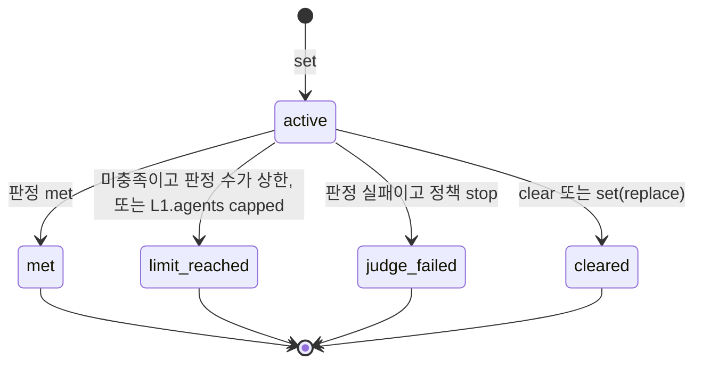

# L2 작업 관리 (work)

패키지: `xeon/packages/cap-work`. 서비스: `fresnel.work`. 기능: `work.tasks`, `work.goals`, `work.reports`(`work.plans`는 2026-11-15 정리로 지웠다 [결정: 2026-11-15 사용자]). 이벤트 접두사: `work.`. 테이블 접두사: `cap_work_`. 생산자 id: `cap.work`.

## 1. 목적과 범위

작업 관리 기능의 서비스 API, 모델 도구, 이벤트, 투영, 설정을 정한다. 이 기능은 대화 안에서 작업 목록을 유지하고, 완료 조건을 걸어 둔 작업을 별도 판정 모델의 판정으로 이어 가게 한다. 계획 모드와 계획 승인은 없앴다 [결정: 2026-11-13 사용자].

L2-e 묶음 대응(`_research/l2e.md` §5): L2-e1 작업 관리(A1, A2, A2b, A5, A6, A7) → `work`, L2-e2 사용자 대화(B1, B2 노출, B4, B5, B7, B8, B9, B10, D5) → `dialog`(`L2.dialog.spec`). A3 작업 보드와 A4 외부 트래커는 보류다.

정하는 것:

- `work.tasks`: 작업 항목(내용, 상태, owner, 선행 작업), 의존 간선과 순환 거부, 막힘 표시, 자동 시작 옵션, 목록 연산 도구 `task_write`
- `work.plans`: 기능이 지워졌다. 계획 모드와 계획 승인은 삭제됐고 옛 기록을 읽던 `versions`도 지웠다 [결정: 2026-11-13 사용자], [결정: 2026-11-15 사용자]
- `work.goals`: 목표 설정·상태·해제, 턴마다의 판정, 판정 횟수 상한, 판정 주입(L3 판정자 대체)
- `work.reports`: 완료 보고 스키마와 생성
- `work.*` 이벤트 카탈로그와 `cap_work_` 투영
- `l2.work.*` 설정 키

다루지 않는 것:

- 권한 모드 자체(모드 상태 저장, 쓰기 도구 차단 규칙): `L1.tools.spec`. 계획 모드는 없으므로 이 문서는 모드를 다루지 않는다 [결정: 2026-11-13 사용자].
- 승인 요청 레코드의 필드 정의(`approvalId`, kind, 대상, 선택지, 결과)와 `approval.*` 이벤트: `L1.tools.spec`. 이 문서는 옛 kind `plan` 기록을 읽는 방식을 2026-11-15 정리로 지웠다(§4.2).
- 판정 모델의 선택과 호출 구현: `L1.models.spec`(용도별 라우팅). 이 문서는 용도 이름만 넘긴다.
- 턴 시작·정착, 입력 큐: `L1.loop.spec`, `L1.tasks.spec`.
- 슬래시 명령 해석: `L2.dialog.spec`. 이 문서는 등록할 명령 목록만 정한다(§6.2).
- 산출물 저장: `L2.artifacts.spec`. 이 문서는 선택 의존으로 등록만 요청한다.
- 작업 보드(칸반 보기)는 L4 화면이다. 데이터는 `work.tasks.list`를 읽는다. 외부 트래커(GitHub, Linear, Jira) 연동은 X 플러그인이 자기 기능으로 제공한다(`_research/l2e.md` §3.1 A3·A4). 둘 다 보류다.

결정 반영:

- [결정] 목표 판정은 별도 판정 모델을 두고 실행 횟수 상한을 건다(`_research/decisions-log.md` 2026-10-21 3차, `_research/foundation-plan.md` §1 4번). `_research/l2e.md` §8의 열린 결정 "판정자 분리 방식"은 이 결정으로 닫혔다.
- [결정] 질문 도구와 계획 승인은 L1 승인 프로토콜 하나로 합친다(같은 결정, §1 5번). `_research/l2e.md` §8의 "승인 프로토콜을 B1과 A2b에서 하나로 합칠지"도 닫혔다. [결정: 2026-11-13 사용자] 계획 승인은 삭제됐다. 승인 프로토콜은 질문만 쓴다.
- 마일스톤: `work.tasks`는 M2, `work.goals`, `work.reports`는 M3다(`product.scope.spec` §4.1 I9·I11). `work.plans`는 M2였고 2026-11-15 정리로 지웠다 [결정: 2026-11-15 사용자]. `_research/layer-plan-v2.json` L2-e는 목표 지속·완료 보고를 2차로 적었으나 3차 결정이 목표 판정을 범위에 넣었으므로 M3로 둔다[^ms].

[^ms]: `L2.readme` §2 각주 work는 `work.reports`를 2차로 남겼다. 이 문서는 목표 판정의 종료가 완료 보고를 만들어야 하므로(§4.4 2항) 보고 스키마와 생성을 M3에 함께 둔다. 차이는 §10 W-9와 `L2.readme` §10 미결 17이다.

## 2. 용어

| 용어 | 뜻 |
|---|---|
| 작업 항목 (work task) | 턴 사이에 유지되는 할 일 하나. L1 `core-tasks`의 실행 태스크(`TaskId`)와 다른 개념이라 타입 이름에 `Work`를 붙인다 |
| 선행 작업 (`blockedBy`) | 이 작업보다 먼저 끝나야 하는 작업 목록. 의존 간선은 `작업 → 선행 작업` 방향이다 |
| 막힘 (blocked) | 선행 작업 중 끝나지 않은 것이 있는 상태. 저장하지 않고 계산한다 |
| 계획 (plan) | 모델이 제출한 실행 계획 문서. 버전을 가진다. 더는 만들지 않는다(옛 기록 읽기 전용) |
| 계획 버전 | 같은 계획의 n번째 제출본. 제출 후 내용은 바뀌지 않는다(옛 기록) |
| 계획 모드 | 삭제됨 [결정: 2026-11-13 사용자]. 쓰기 도구를 막던 권한 모드였다. 용어로만 남는다 |
| 목표 (goal) | 완료 조건 문장과 판정 방식. 스레드마다 활성 목표는 하나다 |
| 판정 (judgment) | 한 턴이 끝난 뒤 목표 충족 여부를 정한 결과 하나 |
| 판정자 (judge) | 판정을 내리는 주체. 기본은 별도 판정 모델이고 L3 그룹이 대신할 수 있다 |
| 완료 보고 (report) | 결과 요약, 사용 자원, 남은 항목, 산출물 참조를 정해진 스키마로 묶은 기록 |

이 문서는 다음 이름을 다른 문서에서 가져다 쓴다.

- `ThreadId`, `TurnId`, `ResultStatus`, `InputRequiredInfo`, `JsonValue`: F.conversation.spec §3.2, §3.6
- `CapabilityDef`, `defineCapability`, `serviceKey`, `CapabilityApi`, `CallOptions`, `CapabilityError`, `ToolContent`: F.capabilities.spec §3
- `ApprovalId`, `ApprovalIdSchema`, `Brand`, `REQUEST_ID_PATTERN`, `deriveRequestId`: eng.domain-types.guide DT-06, eng.typescript.guide §1.2
- `CatalogEntry`, `CoreArea`: F.records.spec §3.2·§3.3(`L2.readme` §5.9). `Projector`, `ProjectionTx`, `BlobRef`, `TYPE_PREFIX_OWNERS`: eng.events.design §4.1, §5.1
- `PostItem`, `PostOptions`, `RegistrationId`: F.extensions.spec §3.2
- 스레드와 대화: F.conversation.spec은 `ThreadId`를, eng.events.design은 `SessionId`를 쓴다. 이 문서는 서비스 API에 `ThreadId`를 쓰고 투영 테이블 열은 `session_id`로 둔다(eng.context-map.design §5.2). [가정] 두 ID는 같은 단위를 가리킨다.

## 3. 인터페이스

정의 파일은 F `xeon/packages/contracts/src/capabilities/defs/work.ts`다(F.capabilities.spec §3.9 정의 위치 [제안], `L2.readme` §5.1). 이 절의 코드는 그 파일의 완성형이다. 읽기 쉽도록 export 상수의 명시 타입 주석을 생략했다. 실제 파일은 `isolatedDeclarations` 때문에 export마다 타입 주석을 단다(F.capabilities.spec §3.9 마지막 문단과 같은 생략).

### 3.1 공통: ID와 호출 문맥

```ts
// xeon/packages/contracts/src/capabilities/defs/work.ts (1/6)
import { Type, type Static } from "typebox";
import type { Brand } from "../../base/index.ts";
import { ApprovalIdSchema } from "../../base/index.ts";
import { TurnIdSchema } from "../../conversation/index.ts";
import { defineCapability, serviceKey, type CapabilityApi, type ToolContent } from "../index.ts";

/** 스레드 안 순번 ID. 모델이 읽고 쓰기 쉬운 짧은 문자열이다. 발급 규칙은 §4.1 */
export type WorkTaskId = Brand<string, "WorkTaskId">;   // "t1", "t2", ...
export type PlanId = Brand<string, "PlanId">;           // "p1", ...
export type GoalId = Brand<string, "GoalId">;           // "g1", ...
export type ReportId = Brand<string, "ReportId">;       // "r1", ...

export const WORK_TASK_ID_PATTERN = "^t[1-9][0-9]{0,5}$";
export const PLAN_ID_PATTERN = "^p[1-9][0-9]{0,5}$";
export const GOAL_ID_PATTERN = "^g[1-9][0-9]{0,5}$";
export const REPORT_ID_PATTERN = "^r[1-9][0-9]{0,5}$";

export const WorkTaskIdSchema = Type.Unsafe<WorkTaskId>(Type.String({ pattern: WORK_TASK_ID_PATTERN }));
export const PlanIdSchema = Type.Unsafe<PlanId>(Type.String({ pattern: PLAN_ID_PATTERN }));
export const GoalIdSchema = Type.Unsafe<GoalId>(Type.String({ pattern: GOAL_ID_PATTERN }));
export const ReportIdSchema = Type.Unsafe<ReportId>(Type.String({ pattern: REPORT_ID_PATTERN }));

/** owner 문자열: "main", 서브에이전트 이름, 플러그인 그룹의 Registration id 등. 해석은 하지 않는다 */
export const OWNER_PATTERN = "^[A-Za-z0-9][A-Za-z0-9_./:-]{0,63}$";
export const OwnerSchema = Type.String({ pattern: OWNER_PATTERN });

/** 산출물 참조. 모양의 정본은 L2.artifacts.spec이다 [가정] */
export const ArtifactRefSchema = Type.Object(
  { artifactId: Type.String({ minLength: 1, maxLength: 64 }), kind: Type.String({ maxLength: 32 }), title: Type.Union([Type.String({ maxLength: 200 }), Type.Null()]) },
  { additionalProperties: false },
);
export type ArtifactRef = Static<typeof ArtifactRefSchema>;
```

- [제안] 작업·계획·목표·보고 ID는 ULID 접두 ID(eng.domain-types.guide DT-06)를 쓰지 않고 스레드 안 순번을 쓴다. 모델이 `task_write`에서 ID를 직접 적어야 하므로 짧아야 한다(Claude Code 작업 도구도 순번 ID를 쓴다, `_research/l2e.md` §3.1 A1). DT-06의 "외부 발급 ID는 브랜드만 붙이고 패턴은 따로 둔다" 규칙과 같은 처리다. 다른 스레드의 같은 ID와 구별할 일이 없다. 모든 조회는 스레드 범위다.
- 호출 문맥: 서비스 메서드는 대상 스레드를 알아야 한다. 대상 스레드는 `F.capabilities.spec` §3.2 `CallOptions.context: CallContext`의 `threadId`다(`L2.readme` §5.8). 도구 경로에서는 L1.tools가 도구 호출의 스레드로 채우고, 그룹 경로에서는 X의 capability 래퍼가 `HandlerContext.threadId`(F.extensions.spec §3.2)로 채운다. 없으면 `invalid_input`이다.
- 쓰기 메서드의 `requestId`는 필수다 [제안]. 없으면 `invalid_input`이다. 같은 `requestId`의 재호출은 이벤트를 다시 쓰지 않고 처음 결과를 돌려준다(eng.transactions.design §4.7, TX-05). 그래서 쓰기 메서드에 `replay: "safe"`와 `idempotent: true`를 선언한다. 계획 쓰기 메서드 여섯 개(`enterMode`, `exitMode`, `submit`, `approve`, `reject`, `revise`)는 계획 모드와 함께 삭제됐다 [결정: 2026-11-13 사용자](§3.9 표).

### 3.2 `work.tasks`

```ts
// defs/work.ts (2/6)
export const WorkTaskStatusSchema = Type.Union([
  Type.Literal("pending"), Type.Literal("in_progress"), Type.Literal("completed"),
  Type.Literal("failed"), Type.Literal("cancelled"),
]);
export type WorkTaskStatus = Static<typeof WorkTaskStatusSchema>;

const Content = Type.String({ minLength: 1, maxLength: 500 });
const ActiveForm = Type.String({ minLength: 1, maxLength: 200, description: "진행 중일 때 표시할 문장. 예: '테스트를 고치는 중'" });

export const WorkTaskSchema = Type.Object(
  {
    id: WorkTaskIdSchema,
    content: Content,
    activeForm: Type.Union([ActiveForm, Type.Null()]),
    status: WorkTaskStatusSchema,
    owner: Type.Union([OwnerSchema, Type.Null()]),
    blockedBy: Type.Array(WorkTaskIdSchema, { maxItems: 32, uniqueItems: true }),
  },
  { additionalProperties: false },
);
export type WorkTask = Static<typeof WorkTaskSchema>;

/** 조회용. 투영에서 계산한 값을 더한다 */
export const WorkTaskViewSchema = Type.Object(
  {
    ...WorkTaskSchema.properties,
    blocked: Type.Boolean(),
    /** 이 작업을 선행 작업으로 둔 작업들 */
    blocks: Type.Array(WorkTaskIdSchema),
  },
  { additionalProperties: false },
);
export type WorkTaskView = Static<typeof WorkTaskViewSchema>;

/** 같은 write 호출 안에서 새 작업을 가리키는 임시 참조. "@" + 1~16자 */
export const TaskRefSchema = Type.String({ pattern: "^@[a-z0-9_-]{1,16}$" });
const TaskTarget = Type.Union([WorkTaskIdSchema, TaskRefSchema]);

export const TaskCreateInput = Type.Object(
  {
    content: Content,
    activeForm: Type.Optional(ActiveForm),
    status: Type.Optional(WorkTaskStatusSchema),
    owner: Type.Optional(OwnerSchema),
    blockedBy: Type.Optional(Type.Array(WorkTaskIdSchema, { maxItems: 32, uniqueItems: true })),
  },
  { additionalProperties: false },
);
export const TaskUpdateInput = Type.Object(
  {
    id: WorkTaskIdSchema,
    content: Type.Optional(Content),
    activeForm: Type.Optional(Type.Union([ActiveForm, Type.Null()])),
    status: Type.Optional(WorkTaskStatusSchema),
    owner: Type.Optional(Type.Union([OwnerSchema, Type.Null()])),
    /** 막힌 작업을 in_progress로 바꿀 때만 쓴다(§4.1.3) */
    force: Type.Optional(Type.Boolean()),
  },
  { additionalProperties: false },
);
export const TaskLinkInput = Type.Object(
  {
    id: WorkTaskIdSchema,
    blockedBy: Type.Array(WorkTaskIdSchema, { minItems: 1, maxItems: 32, uniqueItems: true }),
    op: Type.Union([Type.Literal("add"), Type.Literal("remove")]),
  },
  { additionalProperties: false },
);
export const TaskListInput = Type.Object(
  {
    status: Type.Optional(Type.Array(WorkTaskStatusSchema, { minItems: 1, maxItems: 5, uniqueItems: true })),
    owner: Type.Optional(OwnerSchema),
  },
  { additionalProperties: false },
);

export const TaskOpSchema = Type.Union([
  Type.Object({
    op: Type.Literal("create"),
    ref: Type.Optional(TaskRefSchema),
    content: Content,
    activeForm: Type.Optional(ActiveForm),
    status: Type.Optional(WorkTaskStatusSchema),
    owner: Type.Optional(OwnerSchema),
    blockedBy: Type.Optional(Type.Array(TaskTarget, { maxItems: 32, uniqueItems: true })),
  }, { additionalProperties: false }),
  Type.Object({
    op: Type.Literal("update"),
    id: TaskTarget,
    content: Type.Optional(Content),
    activeForm: Type.Optional(Type.Union([ActiveForm, Type.Null()])),
    status: Type.Optional(WorkTaskStatusSchema),
    owner: Type.Optional(Type.Union([OwnerSchema, Type.Null()])),
    force: Type.Optional(Type.Boolean()),
  }, { additionalProperties: false }),
  Type.Object({
    op: Type.Union([Type.Literal("link"), Type.Literal("unlink")]),
    id: TaskTarget,
    blockedBy: Type.Array(TaskTarget, { minItems: 1, maxItems: 32, uniqueItems: true }),
  }, { additionalProperties: false }),
]);
export type TaskOp = Static<typeof TaskOpSchema>;

export const TaskWriteInput = Type.Object(
  { ops: Type.Array(TaskOpSchema, { minItems: 1, maxItems: 50 }) },
  { additionalProperties: false },
);
export const TaskWriteOutput = Type.Object(
  {
    tasks: Type.Array(WorkTaskViewSchema),
    created: Type.Array(Type.Object({ ref: Type.Union([TaskRefSchema, Type.Null()]), id: WorkTaskIdSchema }, { additionalProperties: false })),
  },
  { additionalProperties: false },
);
const TaskOutput = Type.Object({ task: WorkTaskViewSchema }, { additionalProperties: false });
const TaskListOutput = Type.Object({ tasks: Type.Array(WorkTaskViewSchema) }, { additionalProperties: false });

const TaskErrors = {
  task_cycle: { description: "선행 간선을 더하면 순환이 생긴다. detail.path는 순환 경로", retryable: false,
    detail: Type.Object({ path: Type.Array(WorkTaskIdSchema) }) },
  task_blocked: { description: "끝나지 않은 선행 작업이 있어 시작할 수 없다", retryable: false,
    detail: Type.Object({ blockers: Type.Array(WorkTaskIdSchema) }) },
  task_transition_invalid: { description: "허용하지 않는 상태 전이(§4.1.2)", retryable: false,
    detail: Type.Object({ from: WorkTaskStatusSchema, to: WorkTaskStatusSchema }) },
  task_ref_unknown: { description: "write 안의 임시 참조가 앞선 create에 없다", retryable: false },
  task_limit: { description: "스레드의 작업 수 상한(MAX_WORK_TASKS) 초과", retryable: false },
} as const;

/** task_write 결과를 모델용 체크리스트로 그린다. 순수 함수 */
export function renderTaskList(out: Static<typeof TaskWriteOutput>): ToolContent {
  const mark = { pending: "[ ]", in_progress: "[>]", completed: "[x]", failed: "[!]", cancelled: "[-]" } as const;
  const lines = out.tasks.map((t) =>
    `${mark[t.status]} ${t.id} ${t.status === "in_progress" && t.activeForm ? t.activeForm : t.content}` +
    (t.blocked ? ` (막힘: ${t.blockedBy.join(", ")})` : "") +
    (t.owner ? ` @${t.owner}` : ""));
  const created = out.created.filter((c) => c.ref !== null).map((c) => `${c.ref}=${c.id}`).join(", ");
  return {
    content: [{ type: "text", text: (created ? `생성: ${created}\n` : "") + (lines.length ? lines.join("\n") : "(작업 없음)") }],
    structuredContent: out,
  };
}

export const MAX_WORK_TASKS = 500;

export const WorkTasks = defineCapability({
  id: "work.tasks",
  version: "1.0.0",
  description: "턴 사이에 유지되는 작업 목록과 선행 간선.",
  service: {
    methods: {
      create: { description: "작업 하나를 만든다.", input: TaskCreateInput, output: TaskOutput, replay: "safe", idempotent: true, errors: TaskErrors },
      update: { description: "작업의 내용, 상태, owner를 바꾼다.", input: TaskUpdateInput, output: TaskOutput, replay: "safe", idempotent: true, errors: TaskErrors },
      link: { description: "선행 간선을 더하거나 뺀다. 순환이 생기면 거부한다.", input: TaskLinkInput, output: TaskOutput, replay: "safe", idempotent: true, errors: TaskErrors },
      list: { description: "작업 목록을 조회한다.", input: TaskListInput, output: TaskListOutput, replay: "safe", readOnly: true },
      write: { description: "여러 연산을 한 번에 적용한다. 전부 적용되거나 하나도 적용되지 않는다.", input: TaskWriteInput, output: TaskWriteOutput, replay: "safe", idempotent: true, errors: TaskErrors },
    },
  },
  tools: [
    {
      name: "task_write",
      label: "작업 목록",
      description:
        "작업 목록을 만들고 갱신한다. ops에 create, update, link, unlink 연산을 순서대로 적는다. " +
        "같은 호출에서 만든 작업은 ref(@a 같은 이름)로 가리킬 수 있다. 한 번에 in_progress는 하나만 두기를 권한다. " +
        "결과로 전체 목록을 돌려준다.",
      method: "write",
      parameters: TaskWriteInput,
      toContent: renderTaskList,
      outputSchema: TaskWriteOutput,
      replay: "safe",
      executionMode: "sequential",
      hints: { readOnly: false, destructive: false, idempotent: true, openWorld: false },
    },
  ],
});
export const WorkTasksKey = serviceKey(WorkTasks);

/** renderTaskList 결과 글을 거꾸로 읽는다(화면이 그 시점 전체 목록을 그린다, L4.desktop-ux DP-143). 머리 줄과 모르는 줄은 건너뛰고, 체크리스트 줄이 없으면 null */
export function parseTaskList(text: string): readonly { id: string; status: WorkTaskStatus; label: string }[] | null;
```

- [제안] 모델 도구는 `task_write` 하나다(`_research/l2e.md` §3.1 A1의 "도구: task_write(목록 연산)"). 결과가 전체 목록이라 조회 도구를 따로 두지 않는다. `create`, `update`, `link`, `list`는 그룹 코드와 L4 화면이 쓰는 서비스 메서드다.
- 상태 5종 [제안]: `pending`, `in_progress`, `completed`, `failed`, `cancelled`. omp todo의 5종 상태와 수가 같다(`_research/l2e.md` §3.1 A1). 막힘은 상태로 두지 않고 계산한다. 상태로 두면 선행 작업이 끝날 때마다 다른 작업의 상태를 고쳐야 하기 때문이다.
- `executionMode: "sequential"`: 같은 단계에서 `task_write`가 두 번 호출되면 순서대로 적용해야 결과 목록이 결정적이다.
- `MethodDef.errors`의 고유 코드는 `task_` 접두로 공통 코드와 겹치지 않는다(`L2.readme` §5.5).
- [결정: WK.1] `task_write`는 L1.tools 등록에서 `risk: "read"`다. 작업 목록은 작업 영역의 파일을 바꾸지 않으므로 read로 두고, 매번 승인을 묻지 않는다. 계획 모드는 삭제됐다 [결정: 2026-11-13 사용자]. 클래스 표지(`classes`)는 달지 않는다. 서브에이전트는 자기 스레드의 목록을 쓰기 때문이다.
- [결정: WK.1] `list`도 스레드별 쓰기 큐(§4.1.1)를 지난다. 먼저 부른 쓰기가 끝난 뒤의 목록을 본다.

### 3.3 `work.plans` [삭제됨 [결정: 2026-11-13 사용자]; 정리 [결정: 2026-11-15 사용자]]

계획 모드와 계획 승인을 없앴다. 모델은 계획을 글로 쓰고 필요하면 `ask_user`로 묻는다. 그래서 계획 도구(`enter_plan_mode`, `exit_plan_mode`, `submit_plan`), 계획 쓰기 메서드(`enterMode`, `exitMode`, `submit`, `approve`, `reject`, `revise`), 설정 `l2.work.plans.*`, 명령 `/plan`은 모두 없다. 계획 렌더 함수(`renderPlanSubmit`)와 계획 실패 값도 없다. [근거: 2026-11-13 사용자 결정]

2026-11-15 정리로 옛 계획 기록을 읽던 기능 `work.plans`, 메서드 `versions`, wire 메서드 `work.plans.versions`, 판 모양(`PlanVersion`)도 지웠다. 코드에 남는 것은 보고서의 `plan` 칸을 읽는 계획 상태 모양(`PlanId`, `PlanStatus`)뿐이다 [결정: 2026-11-15 사용자]. 옛 `work.plan_submitted`와 `work.plan_withdrawn`은 카탈로그에 은퇴 종류(`retired: true`)로 남아 값을 검사하지 않고 읽기만 한다(§3.7).

- 옛 기록의 `withdrawn`은 승인 없이 철회된 판이다. 2026-11-15 정리 전에도 `revision_requested`는 투영이 만들지 않았다(§4.2 표).
- 투영이 읽던 옛 기록(`work.plan_submitted`, `work.plan_withdrawn`, 계획 승인 요청과 해결)은 2026-11-15 정리로 읽지 않는다(§3.7, §3.8) [결정: 2026-11-15 사용자].

### 3.4 `work.goals`

```ts
// defs/work.ts (4/6)
/** 판정 방식. model: 별도 판정 모델(기본). delegated: 다른 주체가 judge 메서드로 판정을 넣는다(L3 판정자) */
export const GoalJudgeSpecSchema = Type.Union([
  Type.Object({
    kind: Type.Literal("model"),
    /** 판정 기준 목록. L1.agents JudgeInput.goal.criteria로 넘긴다. 모델 역할은 L1.models 역할 표의 judge로 고정이다 */
    rubric: Type.Optional(Type.Array(Type.String({ minLength: 1, maxLength: 500 }), { maxItems: 20 })),
  }, { additionalProperties: false }),
  Type.Object({
    kind: Type.Literal("delegated"),
    /** 판정을 넣을 주체의 Registration id(F.extensions.spec RegistrationId). 예: "<그룹 이름>" */
    owner: Type.String({ minLength: 1, maxLength: 64 }),
    /** 턴이 끝난 뒤 판정을 기다리는 시간. 생략하면 설정 l2.work.goal.delegatedTimeoutSec */
    timeoutSec: Type.Optional(Type.Integer({ minimum: 1, maximum: 3600 })),
  }, { additionalProperties: false }),
]);
export type GoalJudgeSpec = Static<typeof GoalJudgeSpecSchema>;

export const GoalVerdictSchema = Type.Object(
  {
    met: Type.Boolean(),
    reason: Type.String({ minLength: 1, maxLength: 2000 }),
    /** 미충족이면 부족한 점. 다음 턴 안내문에 들어간다 */
    missing: Type.Array(Type.String({ maxLength: 500 }), { maxItems: 20 }),
  },
  { additionalProperties: false },
);
export type GoalVerdict = Static<typeof GoalVerdictSchema>;

export const GoalStatusSchema = Type.Union([
  Type.Literal("active"), Type.Literal("met"), Type.Literal("limit_reached"),
  Type.Literal("cleared"), Type.Literal("judge_failed"),
]);
export type GoalStatus = Static<typeof GoalStatusSchema>;

/** 미충족 판정 뒤 다음 턴을 누가 투입하는가. self: work.goals가 post. external: 판정만 기록(goalId 루프가 투입, L2.readme §4.2) */
export const GoalContinuationSchema = Type.Union([Type.Literal("self"), Type.Literal("external")]);
export type GoalContinuation = Static<typeof GoalContinuationSchema>;

export const GoalSchema = Type.Object(
  {
    goalId: GoalIdSchema,
    condition: Type.String({ minLength: 1, maxLength: 2000 }),
    judge: GoalJudgeSpecSchema,
    /** 목표 설정 시점의 l1.agents.judge.maxRuns 값. 표시용이다. 상한 판정은 L1.agents가 한다(§4.3.2) */
    maxRuns: Type.Integer({ minimum: 1 }),
    continuation: GoalContinuationSchema,
    judgments: Type.Integer({ minimum: 0 }),
    status: GoalStatusSchema,
    lastVerdict: Type.Union([GoalVerdictSchema, Type.Null()]),
  },
  { additionalProperties: false },
);
export type Goal = Static<typeof GoalSchema>;

export const GoalJudgmentSchema = Type.Object(
  {
    goalId: GoalIdSchema,
    /** 1부터 시작하는 판정 순번 */
    n: Type.Integer({ minimum: 1 }),
    turnId: TurnIdSchema,
    /** 판정 실패면 null */
    verdict: Type.Union([GoalVerdictSchema, Type.Null()]),
    judgeKind: Type.Union([Type.Literal("model"), Type.Literal("delegated")]),
    failure: Type.Union([Type.Object({ code: Type.String(), message: Type.String({ maxLength: 1000 }) }, { additionalProperties: false }), Type.Null()]),
  },
  { additionalProperties: false },
);
export type GoalJudgment = Static<typeof GoalJudgmentSchema>;

export const GoalSetInput = Type.Object(
  {
    condition: Type.String({ minLength: 1, maxLength: 2000 }),
    judge: Type.Optional(GoalJudgeSpecSchema),
    /** 생략하면 "self" */
    continuation: Type.Optional(GoalContinuationSchema),
    /** 참이면 활성 목표를 cleared로 끝내고 새 목표를 건다 */
    replace: Type.Optional(Type.Boolean()),
  },
  { additionalProperties: false },
);
export const GoalStatusInput = Type.Object({ goalId: Type.Optional(GoalIdSchema) }, { additionalProperties: false });
export const GoalClearInput = Type.Object({ goalId: Type.Optional(GoalIdSchema) }, { additionalProperties: false });
export const GoalJudgeInput = Type.Object(
  { goalId: GoalIdSchema, turnId: TurnIdSchema, verdict: GoalVerdictSchema },
  { additionalProperties: false },
);
const GoalOutput = Type.Object({ goal: GoalSchema }, { additionalProperties: false });
const GoalStatusOutput = Type.Object(
  { goal: Type.Union([GoalSchema, Type.Null()]), recent: Type.Array(GoalJudgmentSchema, { maxItems: 10 }) },
  { additionalProperties: false },
);
const GoalJudgeOutput = Type.Object({ goal: GoalSchema, judgment: GoalJudgmentSchema }, { additionalProperties: false });

const GoalErrors = {
  goal_active: { description: "활성 목표가 이미 있다. replace: true로 바꿀 수 있다", retryable: false,
    detail: Type.Object({ goalId: GoalIdSchema }) },
  goal_closed: { description: "끝난 목표에 판정이나 해제를 요청함", retryable: false },
  goal_not_delegated: { description: "delegated 판정자가 아닌 목표에 judge를 호출함", retryable: false },
  goal_turn_stale: { description: "판정 대상 턴이 그 목표의 판정 대기 턴이 아님", retryable: false },
} as const;

export const WorkGoals = defineCapability({
  id: "work.goals",
  version: "1.0.0",
  description: "완료 조건을 걸고 턴마다 별도 판정자의 판정으로 다음 턴을 이어 간다. 모델 도구는 없다.",
  service: {
    methods: {
      set: { description: "목표를 건다.", input: GoalSetInput, output: GoalOutput, replay: "safe", idempotent: true, errors: GoalErrors },
      status: { description: "활성 목표(또는 지정 목표)와 최근 판정을 조회한다.", input: GoalStatusInput, output: GoalStatusOutput, replay: "safe", readOnly: true },
      clear: { description: "목표를 해제한다.", input: GoalClearInput, output: GoalOutput, replay: "safe", idempotent: true, errors: GoalErrors },
      judge: { description: "delegated 판정자가 판정을 넣는다.", input: GoalJudgeInput, output: GoalJudgeOutput, replay: "safe", idempotent: true, errors: GoalErrors },
    },
  },
  tools: [],
});
export const WorkGoalsKey = serviceKey(WorkGoals);
```

- [결정] 모델 자가 판정은 채택하지 않는다(`_research/decisions-log.md` 2026-10-21 결정(3차) "목표 판정은 별도 판정 모델+상한", §4.3.1). 그래서 `work.goals`에는 모델 도구가 없다. `_research/l2e.md` §3.1 A5가 제안한 `goal_complete`(자가 판정일 때만)는 정의하지 않는다. 이름은 예약만 해 둔다.
- `tools: []`는 F.capabilities.spec §4.4의 "도구 없는 기능"에 기댄다. 그 문서에서 아직 [미결]이다(`L2.readme` §10 미결 8). 허용되지 않으면 §10 W-3의 대안을 쓴다.
- `judge` 메서드가 판정 주입 인터페이스다. 함수 객체를 넘기는 주입은 JSON 스키마로 표현할 수 없고 재개 때 다시 붙일 수도 없다. 그래서 판정 방식은 데이터(`GoalJudgeSpec`)로 목표에 기록하고, `delegated` 판정자는 턴이 끝난 뒤 `judge`로 결과를 넣는다 [제안]. L3 그룹의 기준 검사기는 이 경로로 기본 판정 모델을 대신한다(§7.3).

### 3.5 `work.reports`

```ts
// defs/work.ts (5/6)
export const ReportSubjectSchema = Type.Union([
  Type.Object({ kind: Type.Literal("goal"), goalId: GoalIdSchema }, { additionalProperties: false }),
  Type.Object({ kind: Type.Literal("turn"), turnId: TurnIdSchema }, { additionalProperties: false }),
]);

export const ReportOutcomeSchema = Type.Union([
  Type.Literal("met"), Type.Literal("limit_reached"), Type.Literal("cleared"),
  Type.Literal("judge_failed"), Type.Literal("turn_completed"), Type.Literal("turn_failed"),
]);

export const ReportUsageSchema = Type.Object(
  {
    inputTokens: Type.Integer({ minimum: 0 }),
    outputTokens: Type.Integer({ minimum: 0 }),
    cacheReadTokens: Type.Integer({ minimum: 0 }),
    cacheWriteTokens: Type.Integer({ minimum: 0 }),
    /** provider가 비용을 주지 않으면 null */
    costUsd: Type.Union([Type.Number({ minimum: 0 }), Type.Null()]),
  },
  { additionalProperties: false },
);

export const WorkReportSchema = Type.Object(
  {
    reportId: ReportIdSchema,
    subject: ReportSubjectSchema,
    outcome: ReportOutcomeSchema,
    /** 결과 요약. 4,000자 이하 */
    summary: Type.String({ maxLength: 4000 }),
    resources: Type.Object(
      {
        /** 대상 범위 턴들의 모델 사용량 합계 */
        agent: ReportUsageSchema,
        /** 판정 모델 사용량 합계. 목표가 아니면 0 */
        judge: ReportUsageSchema,
        turns: Type.Integer({ minimum: 0 }),
        judgments: Type.Integer({ minimum: 0 }),
        /** 첫 턴 시작부터 마지막 기록까지. recordedAt 차이(ms) */
        durationMs: Type.Integer({ minimum: 0 }),
      },
      { additionalProperties: false },
    ),
    remaining: Type.Object(
      {
        tasks: Type.Array(Type.Object({ id: WorkTaskIdSchema, content: Type.String(), status: WorkTaskStatusSchema }, { additionalProperties: false }), { maxItems: 100 }),
        /** 마지막 판정의 missing */
        missing: Type.Array(Type.String({ maxLength: 500 }), { maxItems: 20 }),
      },
      { additionalProperties: false },
    ),
    artifacts: Type.Array(ArtifactRefSchema, { maxItems: 100 }),
    plan: Type.Union([Type.Object({ planId: PlanIdSchema, version: Type.Integer({ minimum: 1 }), status: PlanStatusSchema }, { additionalProperties: false }), Type.Null()]),
  },
  { additionalProperties: false },
);
export type WorkReport = Static<typeof WorkReportSchema>;

export const ReportBuildInput = Type.Object(
  {
    subject: ReportSubjectSchema,
    /** 호출자가 요약을 주면 그대로 쓴다. 없으면 §4.4 3항 규칙으로 만든다 */
    summary: Type.Optional(Type.String({ maxLength: 4000 })),
    /** 호출자가 아는 산출물. artifacts.registry가 있으면 그 목록과 합친다 */
    artifacts: Type.Optional(Type.Array(ArtifactRefSchema, { maxItems: 100 })),
  },
  { additionalProperties: false },
);
const ReportBuildOutput = Type.Object({ report: WorkReportSchema }, { additionalProperties: false });

export const WorkReports = defineCapability({
  id: "work.reports",
  version: "1.0.0",
  description: "완료 보고를 정해진 스키마로 만들고 이벤트로 남긴다. 턴 결과 형식이며 모델 도구는 없다.",
  service: {
    methods: {
      build: { description: "대상(목표 또는 턴)의 완료 보고를 만든다.", input: ReportBuildInput, output: ReportBuildOutput, replay: "safe", idempotent: true },
    },
  },
  tools: [],
});
export const WorkReportsKey = serviceKey(WorkReports);
```

### 3.6 서비스 묶음

```ts
// defs/work.ts (6/6)
/** work 도메인 묶음 타입(L2.readme §5.6). Cordis에 등록하지 않는다. 등록은 기능마다 cap:<id> 바인딩이다 */
export interface WorkService {
  readonly tasks: CapabilityApi<typeof WorkTasks>;
  readonly goals: CapabilityApi<typeof WorkGoals>;
  readonly reports: CapabilityApi<typeof WorkReports>;
}
/** 묶음 이름. eng.context-map.design §5.3 표의 이름이고 Cordis 등록 이름이 아니다 */
export const WorkServiceName = "fresnel.work";
export const WORK_CAPABILITIES = [WorkTasks, WorkGoals, WorkReports] as const;
```

- consumer는 `RegistrationApi.capability(WorkTasksKey)`처럼 기능 단위 키로 API를 얻는다(`L2.readme` §5.6). L3 문서가 [가정]으로 적은 `work.task.create`는 이 문서의 `work.tasks`의 `create` 메서드다.

### 3.7 이벤트 카탈로그

형식은 `F.records.spec` §3.3.2 도메인 소유 카탈로그(`WORK_EVENT_CATALOG`, `L2.readme` §5.9)다. 모두 내구, 소유 생산자 `cap.work`(`owners.ts` `TYPE_PREFIX_OWNERS`), 버전 1이다. 휘발 이벤트는 두지 않는다. 멱등 키는 커밋의 `requestId`(eng.transactions.design §4.7 `REQUEST_ID_PATTERN`)다. 한 커밋의 이벤트는 같은 키를 쓴다.

| type | 구분 | 주요 payload | 멱등 키(커밋 `requestId`) | 소비자 |
|---|---|---|---|---|
| `work.task_created` | 내구 | `{ task: WorkTask, ref }` | `work:tasks:<호출 requestId>` | `cap.work` 투영, L4 작업 목록·보드, L3 그룹 |
| `work.task_changed` | 내구 | `{ taskId, from, set, cause }` | 같음. 자동 시작은 원인 커밋의 키를 같이 쓴다 | 투영, L4, L3 그룹 |
| `work.task_linked` | 내구 | `{ taskId, blockedBy[] }` | `work:tasks:<호출 requestId>` | 투영, L4 그래프 |
| `work.task_unlinked` | 내구 | `{ taskId, blockedBy[] }` | 같음 | 투영, L4 그래프 |
| `work.plan_submitted` | 내구(옛 기록, 더는 쓰지 않음 [결정: 2026-11-13 사용자]) | 아무 값(`Type.Unknown()`, 읽기만 [결정: 2026-11-15 사용자]) | — | 투영, L4 계획 카드(읽기) |
| `work.plan_withdrawn` | 내구(옛 기록, 더는 쓰지 않음) | 아무 값(`Type.Unknown()`, 읽기만 [결정: 2026-11-15 사용자]) | — | 투영, L4 계획 카드(읽기) |
| `work.goal_set` | 내구 | `{ goal: Goal }`(`judgments: 0`, `status: "active"`) | `work:goals:<호출 requestId>` | 투영, L4 상태줄, schedule.loops |
| `work.goal_judged` | 내구 | `GoalJudgment & { usage }` | `work:goal:<goalId>:judge:<turnId>` | 투영, L4, 보고 생성, L3 그룹 |
| `work.goal_settled` | 내구 | `{ goalId, status, judgments }` | 종결 원인 커밋의 키 | 투영, L4, schedule.loops |
| `work.report_built` | 내구 | `{ report: WorkReport }` | 목표 종결이면 그 커밋의 키, 직접 호출이면 `work:reports:<호출 requestId>` | 투영, L4 보고 화면, 알림(dialog.notify) |

- [결정: 2026-11-13 사용자] 계획 쓰기 경로는 없다. 옛 계획의 결정(승인·반려·수정 요청)은 L1의 `approval.requested`(kind `plan`)와 `approval.resolved`에 남아 있다. 2026-11-15 정리로 `cap.work` 투영기는 그것을 더는 읽지 않는다(§3.8, §4.2) [결정: 2026-11-15 사용자]. 투영기는 다른 컨텍스트의 이벤트를 읽을 수 있다(eng.events.design §5.1 규칙 6). [근거: 2026-11-13 사용자 결정]
- `work.task_changed.cause`: `"call"`(서비스 호출) 또는 `"auto_start"`(§4.1.4).
- 큰 값(옛 기록): `work.plan_submitted.body`는 64 KiB 이하라 envelope 한도 256 KiB 안에 든다. 그래서 blob으로 옮기지 않는다(eng.events.design EV-04).

코드 모양(옛 설계. 2026-11-15 정리로 코드에서 지웠다 [결정: 2026-11-15 사용자]):

```ts
// xeon/packages/contracts/src/records/catalog/work.ts
import { Type } from "typebox";
import type { TSchema } from "typebox";
import type { CatalogEntry } from "./index.ts";
import {
  ArtifactRefSchema, GoalIdSchema, GoalJudgmentSchema, GoalSchema, GoalStatusSchema, PlanIdSchema,
  TaskRefSchema, WorkReportSchema, WorkTaskIdSchema, WorkTaskSchema, WorkTaskStatusSchema, ReportUsageSchema,
} from "../../capabilities/defs/work.ts";

const def = (kind: string, payload: TSchema): CatalogEntry =>
  ({ kind, version: 1, durable: true, payload });   // 생산자 cap.work는 owners.ts가 정한다

export const WorkTaskCreatedSchema = Type.Object({ task: WorkTaskSchema, ref: Type.Union([TaskRefSchema, Type.Null()]) }, { additionalProperties: false });
export const WorkTaskChangedSchema = Type.Object({
  taskId: WorkTaskIdSchema,
  from: WorkTaskStatusSchema,
  set: Type.Object({
    content: Type.Optional(Type.String()), activeForm: Type.Optional(Type.Union([Type.String(), Type.Null()])),
    status: Type.Optional(WorkTaskStatusSchema), owner: Type.Optional(Type.Union([Type.String(), Type.Null()])),
  }, { additionalProperties: false, minProperties: 1 }),
  cause: Type.Union([Type.Literal("call"), Type.Literal("auto_start")]),
}, { additionalProperties: false });
export const WorkTaskLinkSchema = Type.Object({ taskId: WorkTaskIdSchema, blockedBy: Type.Array(WorkTaskIdSchema, { minItems: 1 }) }, { additionalProperties: false });
export const WorkPlanSubmittedSchema = Type.Object({
  planId: PlanIdSchema, version: Type.Integer({ minimum: 1 }), title: Type.String(), body: Type.String({ maxLength: 65536 }),
  artifact: Type.Union([ArtifactRefSchema, Type.Null()]), supersedes: Type.Union([Type.Integer({ minimum: 1 }), Type.Null()]),
}, { additionalProperties: false });
export const WorkPlanWithdrawnSchema = Type.Object({
  planId: PlanIdSchema, version: Type.Integer({ minimum: 1 }),
  reason: Type.Union([Type.Literal("exit_mode"), Type.Literal("goal_cleared"), Type.Literal("call")]),
}, { additionalProperties: false });
export const WorkGoalSetSchema = Type.Object({ goal: GoalSchema }, { additionalProperties: false });
export const WorkGoalJudgedSchema = Type.Object({ ...GoalJudgmentSchema.properties, usage: Type.Union([ReportUsageSchema, Type.Null()]) }, { additionalProperties: false });
export const WorkGoalSettledSchema = Type.Object({ goalId: GoalIdSchema, status: GoalStatusSchema, judgments: Type.Integer({ minimum: 0 }) }, { additionalProperties: false });
export const WorkReportBuiltSchema = Type.Object({ report: WorkReportSchema }, { additionalProperties: false });

export const WORK_EVENT_CATALOG: readonly CatalogEntry[] = [
  def("work.task_created", WorkTaskCreatedSchema),
  def("work.task_changed", WorkTaskChangedSchema),
  def("work.task_linked", WorkTaskLinkSchema),
  def("work.task_unlinked", WorkTaskLinkSchema),
  def("work.plan_submitted", WorkPlanSubmittedSchema),
  def("work.plan_withdrawn", WorkPlanWithdrawnSchema),
  def("work.goal_set", WorkGoalSetSchema),
  def("work.goal_judged", WorkGoalJudgedSchema),
  def("work.goal_settled", WorkGoalSettledSchema),
  def("work.report_built", WorkReportBuiltSchema),
];
```

- `WorkGoalSettledSchema.status`에는 `"active"`가 오지 않는다. 투영 단위 테스트가 확인한다.
- [가정] records 카탈로그(`catalog/work.ts`)가 capabilities 정의 파일을 import할 수 있다. F 안의 도메인 순서(F.readme §3)가 records → capabilities 방향만 허용하면 payload 스키마를 records 쪽에 두고 정의 파일이 그것을 import한다. 이 판단은 F.records.plan이 한다(§10 W-4).
- `work` 영역과 `TYPE_PREFIX_OWNERS`의 `work.` → `cap.work` 행은 `F.records.spec` §3.3.2에 있다. 내장 `cap-work`는 자기 도메인 영역을 접두 없이 쓴다(`F.records.spec` §3.2 규칙 3).

### 3.8 투영 테이블

[제안] 투영기 이름은 `cap.work`, 버전 1이다. 모든 테이블은 `session_id` 열을 두고 재생으로 다시 만든다(eng.events.design §5.1 규칙 3·5).

```sql
CREATE TABLE cap_work_tasks (
  session_id   TEXT NOT NULL,
  task_id      TEXT NOT NULL,          -- "t1"
  ord          INTEGER NOT NULL,       -- 생성 순번(숫자 부분)
  content      TEXT NOT NULL,
  active_form  TEXT,
  status       TEXT NOT NULL,
  owner        TEXT,
  created_seq  INTEGER NOT NULL,
  updated_seq  INTEGER NOT NULL,
  PRIMARY KEY (session_id, task_id)
) STRICT;
CREATE TABLE cap_work_edges (
  session_id   TEXT NOT NULL,
  task_id      TEXT NOT NULL,
  blocked_by   TEXT NOT NULL,
  PRIMARY KEY (session_id, task_id, blocked_by)
) STRICT;
CREATE TABLE cap_work_goals (
  session_id   TEXT NOT NULL,
  goal_id      TEXT NOT NULL,
  ord          INTEGER NOT NULL,       -- "g1"의 숫자 부분. 읽기 순서
  goal         TEXT NOT NULL,          -- Goal JSON(최신)
  status       TEXT NOT NULL,
  set_seq      INTEGER NOT NULL,
  set_at       INTEGER NOT NULL,       -- work.goal_set의 recordedAt. 보고의 durationMs 기준이다 [결정: M3-REQ-90]
  settled_seq  INTEGER,
  PRIMARY KEY (session_id, goal_id)
) STRICT;
-- [결정: M3-REQ-90] 투영기 등록부가 접두 뒤 지역 이름에 밑줄을 허용하지 않아 `cap_work_goal_judgments`를 `cap_work_judgments`로 바꿨다.
-- 한 turn 안에서 완료 게이트가 판정을 여러 번 할 수 있어 `UNIQUE (session_id, goal_id, turn_id)`를 두지 않는다. 같은 턴의 위임 판정 재호출은 조회로 걸러 첫 판정을 돌려준다
CREATE TABLE cap_work_judgments (
  session_id   TEXT NOT NULL,
  goal_id      TEXT NOT NULL,
  n            INTEGER NOT NULL,
  turn_id      TEXT NOT NULL,
  judgment     TEXT NOT NULL,          -- work.goal_judged payload JSON(usage 포함)
  seq          INTEGER NOT NULL,
  PRIMARY KEY (session_id, goal_id, n)
) STRICT;
CREATE TABLE cap_work_reports (
  session_id   TEXT NOT NULL,
  report_id    TEXT NOT NULL,
  ord          INTEGER NOT NULL,
  report       TEXT NOT NULL,          -- WorkReport JSON
  seq          INTEGER NOT NULL,
  PRIMARY KEY (session_id, report_id)
) STRICT;
CREATE TABLE cap_work_meta (
  session_id   TEXT NOT NULL PRIMARY KEY,
  turns_completed INTEGER NOT NULL,     -- turn.completed 개수(방치 알림용)
  last_task_change_turn INTEGER NOT NULL  -- 버전 4에서 권한 모드 추적 열을 뺐다
) STRICT;
```

관심 type: `work.task_*`, `work.goal_*`, `work.report_built`, `turn.completed`. 옛 계획 기록(`work.plan_*`)과 승인 요청·해결은 2026-11-15 정리로 읽지 않는다 [결정: 2026-11-15 사용자].

| 입력 이벤트 | 갱신 |
|---|---|
| `work.task_created` | `cap_work_tasks` 행 추가, `blockedBy`마다 `cap_work_edges` 행. `last_task_change_turn = turns_completed` |
| `work.task_changed` | 해당 행 갱신, `updated_seq`. `cap_work_meta.last_task_change_turn = turns_completed` |
| `work.task_linked` / `work.task_unlinked` | 간선 행 추가·삭제, 해당 작업 행의 `updated_seq`. `last_task_change_turn = turns_completed` |
| `settings.changed` | 권한 모드 추적은 버전 4에서 뺐다 [결정: 2026-11-13 사용자]. 이 투영은 이 이벤트를 읽지 않는다 |
| `work.goal_set` | 목표 행 추가 |
| `work.goal_judged` | 판정 행 추가, 목표 JSON의 `judgments`, `lastVerdict` 갱신 |
| `work.goal_settled` | 목표 `status`, `settled_seq` |
| `work.report_built` | 보고 행 추가 |
| `turn.completed` | `cap_work_meta.turns_completed + 1` |

- 옛 계획 기록(`work.plan_submitted`, `work.plan_withdrawn`, 계획 승인 요청과 해결)은 종류 목록에 없어 건너뛴다. 재구성은 이들을 읽지 않으므로 실패하지 않는다 [결정: 2026-11-15 사용자].
- 순번 ID 발급(§4.1.1)에 필요한 최댓값은 이 테이블에서 계산한다.
- [결정: WK.1] 방치 알림(§4.1.6)의 기준 턴은 작업 이벤트 네 종류(`task_created`, `task_changed`, `task_linked`, `task_unlinked`)가 모두 갱신한다. 목록을 처음 만든 호출도 목록을 쓴 것으로 센다. `cap_work_meta` 행은 첫 작업 이벤트나 첫 `turn.completed`에서 만든다.
- [결정: WK.1] 간선 행의 읽기 순서는 삽입 순서(`rowid`)다. `blockedBy` 배열의 순서가 재생성 뒤에도 같다.
- [결정: WK.3 통합] 작업 의존 간선 테이블 이름은 `cap_work_edges`다. 투영기 등록부(F.records.spec §3.4)가 접두 뒤 지역 이름에 밑줄을 허용하지 않아 `cap_work_task_edges`를 바꿨다. 투영 대역이 이 검사를 하지 않아 실제 등록부로 바꾸기 전에는 드러나지 않았다.
- 투영기 `cap.work` 버전 5는 `cap_work_tasks`, `cap_work_edges`, `cap_work_meta`와 목표·보고의 `cap_work_goals`, `cap_work_judgments`, `cap_work_reports`를 만든다(버전 1은 작업 셋, 버전 2는 계획 추가, 버전 3은 목표·보고 추가, 버전 4는 계획 모드 제거로 권한 모드 추적 열을 뺌, 버전 5는 계획 표 `cap_work_plans`와 그 인덱스를 지웠다 [결정: 2026-11-15 사용자]. 버전 5 재구성의 첫 문장이 옛 DB에 남은 `cap_work_plans`를 `DROP`으로 지운다).
- [삭제됨 [결정: 2026-11-13 사용자]] 권한 모드 추적(`settings.changed`)과 직전 모드 기억은 계획 모드와 함께 없앴다(§10 W-16 닫힘).
- 투영기는 승인 이벤트를 읽지 않는다(2026-11-15 정리). 옛 `approval.resolved` payload의 결정 필드 이름은 L1.tools.spec이 정한다(§10 W-2).

### 3.9 효과 분류 [결정: M3-REQ-88]

ADR-0015 §3.3의 표지로 메서드를 나눈다. `readOnly`는 대화 기록, 사용자 파일과 사용자가 쓴 데이터, 외부 시스템의 상태를 바꾸지 않는 읽기다. 관찰상 순수한 파생 데이터(캐시, 색인, 내용 주소 blob, 사용량·비용 계량, 시간과 현재 데이터만으로 정해지는 정리)는 쓸 수 있다 [결정: 2026-10-28 오케스트레이터, ADR-0015 §3.3]. `idempotent`는 `requestId`를 받아 같은 키의 재호출에 효과를 더하지 않고 처음 결과를 돌려주는 쓰기이며, 기억은 효과와 같은 커밋에 둔다. 둘 다 없으면 선언 없음이고 `replay`는 `"unsafe"`다. 재실행되는 코드(on 핸들러, drive)에서는 `idempotent`와 `readOnly`(drive만)만 부를 수 있다. 정의는 F `defs/` 파일이 정본이고 `contracts/test/capabilities/l2-effect-classes.test.ts`가 이 표와 같은 값을 고정한다.

| 메서드 | 분류 | replay | 근거 |
|---|---|---|---|
| `work.goals.set` | idempotent | safe | `work.goal_set`을 `work:goals:<requestId>` 커밋 키로 남긴다 |
| `work.goals.status` | readOnly | safe | 투영 조회 |
| `work.goals.clear` | idempotent | safe | `work.goal_settled`(cleared)를 `work:goals:<requestId>` 커밋 키로 남긴다 |
| `work.goals.judge` | idempotent | safe | `work.goal_judged`를 `work:goals:<requestId>` 커밋 키로 남기고 같은 턴 판정이 있으면 기존 판정을 돌려준다 |
| `work.plans` 쓰기 6개(`enterMode`, `exitMode`, `submit`, `approve`, `reject`, `revise`) | 삭제됨 [결정: 2026-11-13 사용자] | — | 계획 모드와 함께 없앴다 |
| `work.plans.versions` | 삭제됨 [결정: 2026-11-15 사용자] | — | 옛 계획 기록 조회도 지웠다 |
| `work.reports.build` | idempotent | safe | `work.report_built`를 `work:reports:<requestId>` 커밋 키로 남긴다 |
| `work.tasks.create` | idempotent | safe | `work:tasks:<requestId>` 커밋 키(TX-05) |
| `work.tasks.update` | idempotent | safe | 같음 |
| `work.tasks.link` | idempotent | safe | 같음 |
| `work.tasks.list` | readOnly | safe | 투영 조회(쓰기 큐 뒤에서 읽는다) |
| `work.tasks.write` | idempotent | safe | 같음. 처음 결과의 `created`를 이벤트에서 복원한다 |

## 4. 동작 규칙

### 4.1 작업 목록

#### 4.1.1 ID 발급과 쓰기 순서

- [제안] cap-work는 스레드마다 쓰기를 직렬화한다(스레드별 비동기 큐 하나). 한 스레드의 쓰기 소유자는 프로세스 하나다(eng.transactions.design §3.3). 그래서 메모리의 순번 카운터로 ID를 발급해도 충돌하지 않는다.
- [결정: WK.1] 순번 카운터를 메모리에 두지 않는다. 쓰기 큐 안에서 투영의 현재 목록을 읽을 때마다 `max(ord) + 1`을 다음 순번으로 쓴다. 쓰기 소유자가 프로세스 하나이고 큐가 직렬이므로 충돌하지 않고, 재생성이나 프로세스 재시작 뒤에도 따로 채울 것이 없다. 발급한 ID는 이벤트 payload에 기록되고, 재생은 기록된 ID를 읽는다(F.conversation.spec §4 규칙 1).
- 쓰기 메서드의 처리 순서: (1) 입력 검사(`requestId`, 호출 문맥의 `threadId`), (2) 쓰기 큐에서 투영의 현재 목록을 읽는다, (3) `SessionWriter.commit` 한 번. 규칙 검사(§4.1.2~§4.1.3)와 이벤트 초안 만들기는 이 커밋의 `build` 안에서 한다(순수 함수 `planWrite`). (4) 커밋 뒤 투영을 다시 읽어 출력을 만든다. 트랜잭션 안에서 await나 I/O를 하지 않는다(TX-01).
- [결정: WK.1] 같은 `requestId`의 재호출은 저장소가 `build` 전에 처음 결과를 돌려주므로, 상태가 바뀐 뒤에도 규칙 검사를 다시 하지 않는다. 결과 해석: (a) 커밋됨 + 재전송이면 `created`를 그 커밋의 `work.task_created` 이벤트에서 복원하고 `tasks`는 현재 목록이다. (b) 규칙 거부는 커밋 거부(reject) 레코드로 같은 키에 남기고(`code`는 오류 코드, `detail`은 `{ opIndex, failure }` JSON) 재호출이 같은 `CapabilityError`를 되풀이한다. (c) 모든 연산이 효과 없이 끝나 이벤트가 0개인 호출은 거부 코드 `noop`을 남기고 성공으로 답한다(`created`는 빈 배열). 같은 키로 다른 입력은 `key_reused`이고 `internal`로 바꿔 운영 로그 `work.tasks.key_reused`에 남긴다(§5.2).
- 커밋 키는 `work:tasks:<requestId>`이고 `requestId`가 커밋 키 형식(`COMMIT_KEY_PATTERN`)에 맞지 않거나 120자를 넘으면 F `commitKeyPart`가 해시 형태로 바꾼다. 이벤트 `turnId`는 호출 문맥의 `turnId`, 없으면 `null`이다. `stepId`, `causationId`, `correlationId`는 `null`이다.
- `write`는 연산을 순서대로 메모리 사본에 적용해 검사한 뒤 모든 이벤트를 커밋 하나에 넣는다. 한 연산이라도 실패하면 아무것도 커밋하지 않고 첫 실패의 오류를 낸다. `detail`에 실패한 연산 번호 `opIndex`를 싣는다.

#### 4.1.2 상태 전이

[제안] 행은 현재 상태, 열은 바꿀 상태다. ○ 허용, ✕ `task_transition_invalid`.

| 현재 \ 다음 | pending | in_progress | completed | failed | cancelled |
|---|---|---|---|---|---|
| pending | (변화 없음) | ○ 막힘 검사 | ○ | ✕ | ○ |
| in_progress | ○ | (변화 없음) | ○ | ○ | ○ |
| completed | ○ 다시 열기 | ✕ | (변화 없음) | ✕ | ✕ |
| failed | ○ 다시 열기 | ○ 막힘 검사 | ✕ | (변화 없음) | ○ |
| cancelled | ○ 다시 열기 | ✕ | ✕ | ✕ | (변화 없음) |

- 같은 상태로의 갱신은 이벤트를 만들지 않는다. 다른 필드도 바뀌지 않았으면 그 연산은 효과가 없다.
- `pending → completed`를 허용한다. 모델이 시작 표시 없이 끝난 항목을 한 번에 완료로 적는 일이 흔하다(`_research/l2e.md` §3.1 A1의 평면 목록 도구들).
- `create`의 `status` 생략값은 `pending`이다. `create`에서 `in_progress`를 주면 막힘 검사를 한다.

#### 4.1.3 의존 간선과 막힘

- 간선 `A blockedBy B`는 "B가 끝나야 A를 시작한다"를 뜻한다.
- 순환 거부: 간선 `A blockedBy B`를 더하기 전에 B에서 `blockedBy` 간선을 따라 A에 이르는 경로가 있는지 깊이 우선으로 찾는다. 있으면 `task_cycle`로 거부하고 `detail.path`에 `[A, B, …, A]`를 싣는다. 자기 간선(`A blockedBy A`)도 같은 오류다. `write`에서는 같은 호출 안에서 앞서 더한 간선까지 포함해 검사한다.
- 없는 작업을 가리키는 간선은 `not_found`다. 작업 하나의 선행 작업은 32개 이하다.
- 막힘 계산: `blocked = blockedBy` 중 상태가 `completed`도 `cancelled`도 아닌 작업이 하나라도 있으면 참. `failed` 선행 작업은 막힘을 유지한다 [제안]. 실패한 선행 작업을 무시하고 진행하면 안 되기 때문이다.
- 막힌 작업을 `in_progress`로 바꾸면 `task_blocked`다. `force: true`이면 허용하고 그대로 기록한다. 사용자가 순서를 알고 무시하는 경우를 위한 것이다.

#### 4.1.4 자동 시작

- [제안] 설정 `l2.work.tasks.autoStart`가 참이면, 어떤 작업이 `completed`나 `cancelled`가 되어 다른 작업 X의 막힘이 풀릴 때, X가 `pending`이고 `owner`가 null이 아니면 같은 커밋 안에서 X를 `in_progress`로 바꾼다(`work.task_changed`, `cause: "auto_start"`).
- owner가 null인 작업은 자동 시작하지 않는다. 누가 진행할지 정해지지 않은 작업을 진행 중으로 표시하면 목록이 실제와 달라진다.
- 자동 시작은 상태 표시만 바꾼다. 서브에이전트를 띄우거나 턴을 시작하지 않는다. 카드별 실행(Cline Kanban, Hermes 칸반 디스패치)은 작업 보드(보류)와 함께 검토한다.
- 기본값은 거짓이다.

#### 4.1.5 턴 사이 유지와 재생성

- 작업 목록의 정본은 `work.*` 내구 이벤트다. `cap_work_` 테이블은 재생으로 다시 만든다. 투영을 지우고 이벤트에서 재생성한 결과는 원래 테이블과 행 단위로 같아야 한다(eng.events.design §5.4 `expectProjectionsRebuildable`).
- 되감기(L1.persistence)로 활성 가지가 바뀌면, 조회는 활성 가지의 이벤트로 만든 상태를 보여야 한다. [가정] 투영은 모든 가지의 행을 갖고 조회가 사슬로 거른다는 eng.events.design §6의 규칙을 cap 투영에 그대로 적용하면, 작업 행마다 마지막 갱신 이벤트의 가지를 알아야 한다. M2에서는 되감기 뒤 `cap.work` 투영을 활성 가지만으로 재생성하는 방식을 쓴다 [제안]. 조회 시점 필터링은 §10 W-5로 남긴다. WK.1 구현은 투영이 모든 가지의 행을 그대로 가지며, 되감기 뒤 활성 가지 기준 재생성은 구현하지 않았다(W-5가 닫힐 때까지 되감기를 한 스레드의 목록은 되감기 이전 이벤트를 포함한다).

#### 4.1.6 방치 알림

- [제안] 설정 `l2.work.tasks.reminderTurns`가 N(> 0)이면, `pending`이나 `in_progress` 작업이 있고 마지막 작업 변경 뒤 완료된 턴이 N개 이상일 때 다음 턴 시작에 알림 문장을 컨텍스트에 더한다. omp `todo_reminder` 이벤트와 같은 목적이다(`_research/refs/oh-my-pi.md` 확장 이벤트 표).
- 구현은 `input.agent.before` 훅(collect) 핸들러다. 핸들러는 투영을 읽는 질의만 하고 이벤트를 쓰지 않는다(F.extensions.spec §4.3). 패치는 확장 메시지 추가(`BeforeAgentStartPatch`의 message 병합)다. `customType`은 `x.cap-work.tasks.reminder`, `display: false`다.
- 기본값은 0(끔)이다. 알림 문장은 프롬프트 캐시 접두 뒤에 붙으므로 캐시를 깨지 않는다 [가정: L1.context가 확장 메시지를 대화 끝에 둔다].

### 4.2 계획 모드와 승인 [삭제됨 [결정: 2026-11-13 사용자]]

계획 모드와 계획 승인은 없앴다. 모델은 계획을 글로 쓰고 필요하면 `ask_user`로 묻는다. 시스템 프롬프트, 환경 블록, 도구 설명에는 계획 모드 문장을 넣지 않는다. 그래서 다음이 모두 없다: 권한 모드 `plan`으로의 진입과 이탈, 계획 도구 3개, 계획 승인 요청(`kind: "plan"`)의 새 생성, 승인 뒤 모드 자동 복원(`exitOnApprove`), 승인 필수 설정(`requireApproval`), 대화를 다시 열 때의 계획 재요청과 모드 복원(§4.5), 외부 편집기 수정 후보. 새 `kind: "plan"` 승인 요청은 L1.tools가 `approvals.request_invalid`로 거부한다. [근거: 2026-11-13 사용자 결정]

옛 계획 기록은 2026-11-15 정리 전까지 읽기만 했다. 투영기(§3.8)가 옛 승인 해결을 계획 판의 상태로 옮기던 규칙은 다음 표와 같다. 2026-11-15 정리로 이 규칙은 코드에서 지웠고, 표는 옛 기록의 뜻만 남긴다 [결정: 2026-11-15 사용자]. 새 기록은 생기지 않는다.

| 옛 기록 | 계획 판 상태 |
|---|---|
| `approval.resolved`, `allow` | `approved` |
| `approval.resolved`, `deny`(`feedback`이 있으면 함께) | `rejected`. 수정 요청도 같은 `deny`라서 `revision_requested`는 만들어지지 않았다 |
| `approval.resolved`, `resolvedBy` `cancelled`·`superseded`·`expired` | `withdrawn`. 사람이 정한 결정이 아니다 |
| `work.plan_withdrawn` | `withdrawn`(대기 중인 판만) |
| 같은 계획의 새 판 `work.plan_submitted` | 이전 판이 아직 대기 중이었으면 `superseded` |

읽기 규칙의 정본이던 `outcomeOf`(`src/plans/decision.ts`)는 2026-11-15 정리로 지웠다 [결정: 2026-11-15 사용자].

### 4.3 목표 지속

#### 4.3.1 판정자 분리

- [결정] 완료 판정은 루프를 도는 모델에 맡기지 않고 별도 판정자가 증거를 보고 내린다(`_research/foundation-plan.md` §1 4번, architecture.runtime-flow.design §4.5).
- 자가 판정을 채택하지 않는 근거:
  1. 작업을 한 모델이 스스로 끝났다고 선언하면 조건을 낮춰 읽을 유인이 있다. 판정을 다른 문맥의 모델에 맡기면 같은 출력에 대한 확인이 한 번 더 생긴다(Claude Code의 별도 evaluator, OpenHands SDK의 별도 judge, Hermes의 보조 모델 판정자, `_research/l2e.md` §3.1 A5).
  2. 자가 판정 도구(omp `goal`, Letta 완료 도구)는 판정 결과와 작업 출력이 같은 응답에 섞여 판정만 따로 기록하고 재현하기 어렵다.
  3. 판정이 별도 호출이면 판정 횟수에 상한을 걸 수 있다. 상한은 비용과 무한 반복을 막는 장치다.
- 판정자는 두 종류다. `model`(기본, §4.3.3)과 `delegated`(§4.3.4)다.

#### 4.3.2 상태와 순서



- 스레드마다 활성 목표는 하나다. 활성 목표가 있는데 `set`을 부르면 `goal_active`다. `replace: true`면 이전 목표를 `cleared`로 끝내고 새 목표를 같은 커밋에 건다.
- `set` 시점에 `judge` 생략값은 `{ kind: "model" }`, `continuation` 생략값은 `"self"`다. 값은 `work.goal_set`에 기록한다.
- 판정 상한 키는 `l1.agents.judge.maxRuns` 하나다(L1.agents 소유, 기본 3, `(threadId, goalRef)`마다) [결정: review.decisions-2 S-06]. 이 기능은 상한 키를 따로 두지 않고 목표별 상한 인자도 받지 않는다. `goalRef`는 `goalId`다. `Goal.maxRuns`는 목표 설정 시점의 값을 표시용으로 기록한 것이다.
- [결정: M3-new-02, D-M3-15] 판정 계기: 완료 게이트다. cap-work는 `boundary.settle.before` chain 핸들러를 하나 건다(L1.loop.spec §4.9). turn이 정착하려 할 때(`outcome: "completed"`) 활성 목표가 있고 판정자가 `model`이면 이 핸들러가 판정한다. 사용자가 끊은 turn(`aborted`)과 실패한 turn(`error`)은 판정하지 않는다 [제안: 계속할 수 없는 단계의 판정은 상한만 소모한다]. `delegated` 목표는 이 훅이 판정하지 않고 `work.goals.judge`로 판정이 들어온다. 이전 설계의 `turn.completed` 피드 구독 러너는 쓰지 않는다.
- 판정 순서(핸들러 안):
  1. 활성 목표를 투영에서 읽는다. 없으면 아무것도 하지 않는다.
  2. 증거를 모은다(§4.3.3 `GoalEvidence`). 정착 훅의 컨텍스트 미리보기에서 이번 turn의 최종 텍스트와 도구 호출을, 투영에서 작업 목록과 직전 판정을 읽는다.
  3. 공개 기능 `agents.judge`를 부른다(`g.capability(AgentsJudgeKey).judge(input, { requestId })`, 커밋 밖). `requestId`는 `judge:<단계 id 또는 턴 id>:<goalId>`다. 판정 포트 `fresnel.agents`는 쓰지 않는다(hooks-core-boundary §6.2, D-30). L1.agents가 상한을 세고 `agent.judged`를 자기 커밋으로 남긴다. 결과 `JudgeOutcome`을 `goalGateDecision`(L1.agents.spec §4.8)으로 옮긴다.
  4. 결과를 목표 쪽 이벤트로 자기 커밋에 남긴다. 커밋 키는 `work:goal:<goalId>:judge:<run>`(판정), `work:goal:<goalId>:settle:capped`, `work:goal:<goalId>:settle:failed`다. 판정을 기록하는 동안 목표가 지워졌거나 끝났으면 기록하지 않고 게이트는 끼어들지 않는다.
     - `judged`·`recorded`(`met`) → `work.goal_judged`, `work.goal_settled(met)`, `work.report_built`. turn은 정착한다.
     - `judged`·`recorded`(`not_met`·`undecidable`) → `work.goal_judged`(`n` = `record.run`). `n`이 그 시점의 `l1.agents.judge.maxRuns` 이상이면 `work.goal_settled(limit_reached)`와 `work.report_built`를 같은 커밋에 더하고 turn을 끝낸다. 아니면 목표는 활성으로 남고 한 단계 더 돈다.
     - `capped` → 판정 기록 없이 `work.goal_settled(limit_reached)`와 `work.report_built`. turn을 끝낸다.
     - `failed` → `work.goal_settled(judge_failed)`와 `work.report_built`. 판정 없이 계속 돌지 않고 turn을 끝낸다(§4.3.6).
  5. 한 단계 더 돌 때는 지시 문장(영어, 판정 모델의 원문 이유 포함)을 custom 항목(`customType: "x.cap-work.goal.continue"`, `display: false`, 모델 문맥 전용)으로, 사용자에게는 한국어 해요체 한 줄("목표 판정 n/최대: 아직 달성하지 못했어요")을 `x.cap-work.goal.notice` 항목(`display: true`)으로 `BoundaryPatch.entries`에 싣고 `continue: true`를 돌려준다. turn을 끝낼 때(상한, 판정 실패)는 한국어 안내 문장(상한 도달, 판정 실패)을 `x.cap-work.goal.notice` custom 항목으로 싣고 `continue: false`를 돌려준다. 판정 모델의 원문 이유는 화면에 보이지 않는다 [결정: 오케스트레이터 기본값, rtG]. 단계 id를 모르면(`boundary.step.after`가 먼저 발화하지 않은 경우) 지시는 싣지 않고 계속만 하며 끝내는 안내는 `stepId: null`인 turn 수준 항목으로 남긴다 [제안]. 정착 훅의 payload에는 단계 id가 없어 엔트리의 범위 필드를 맞추려고 `boundary.step.after`에서 마지막 단계 id를 기억한다(같은 단계 안에서 `boundary.step.after`가 먼저 발화한다).
- 판정을 기다리지 않는 한 단계가 지나면 같은 turn 안에서 다시 정착 후보가 되고 판정은 `n`을 늘리며 반복한다. 한 turn의 계속 횟수는 게이트 상한(`l1.loop.gate.maxContinues`)이 따로 막고, 판정 횟수는 `l1.agents.judge.maxRuns`가 막는다.
- 판정 실행 중에 사용자 입력으로 새 turn이 시작되는 경우는 없다. 판정은 turn 정착 전에 끝나는 한 호출이다. 이전 설계의 "다음 턴 시작(post)"은 쓰지 않는다. 한 단계 더 도는 것이 다음 턴을 대신한다.
- 알려진 한계 [제안]: 정착 직전에 판정하므로 목표 종결 보고의 `resources.agent`에는 마지막 turn의 사용량이 들지 않는다(그 turn의 `turn.completed`가 아직 없다). 필요하면 마지막 turn은 `work.reports.build({ subject: { kind: "turn" } })`로 따로 만든다.

#### 4.3.3 기본 판정자: 판정 모델

- 판정 모델 호출은 L1.agents의 `judge`(`L1.agents.spec` §3.4, §4.8)로 한다. L1.agents가 L1.models 역할 표의 `judge` 역할(설정 `l1.models.routing.judge`, 대체 순서 `review` → `main`)로 모델을 고르고, 상한 `l1.agents.judge.maxRuns`를 세며, `agent.judged`를 자기 커밋으로 남긴다 [결정: review.decisions-2 S-06]. 이 기능은 판정 역할 키를 따로 두지 않는다.
- 증거(`GoalEvidence`) [제안]:

```ts
// xeon/packages/cap-work/src/goals/evidence.ts (패키지 내부)
export interface GoalEvidence {
  readonly condition: string;
  readonly rubric: readonly string[];
  readonly turnId: TurnId;
  readonly turnStatus: "completed" | "failed";
  /** 그 턴의 마지막 어시스턴트 텍스트. 앞에서 8,000자까지 */
  readonly finalText: string;
  /** 그 턴의 도구 호출 요약. 최대 50개 */
  readonly toolCalls: readonly { readonly name: string; readonly status: string; readonly isError: boolean }[];
  /** 작업 목록 요약 */
  readonly tasks: readonly { readonly id: WorkTaskId; readonly content: string; readonly status: WorkTaskStatus }[];
  /** 직전 판정 최대 3개 */
  readonly previous: readonly { readonly n: number; readonly met: boolean; readonly reason: string }[];
  readonly n: number;
  readonly maxRuns: number;
}
```

- `GoalEvidence`는 `JudgeInput`으로 바꿔 넘긴다. `goal.text` = `condition`, `goal.criteria` = `rubric`, `evidence`는 `finalText`(`assistant_text`), 도구 호출 요약(`tool.result`), 작업 목록(`work_item`), 직전 판정(`note`)이다.
- 증거는 `fresnel.session`의 이벤트 읽기로 모은다(eng.context-map.design §4.1 work 행의 의존 `fresnel.session`). 다른 컨텍스트의 테이블을 직접 읽지 않는다(CM-02).
- 결과 대응: `judged`·`recorded`의 `record.verdict`가 `met`이면 `met: true`, `not_met`·`undecidable`이면 `met: false`다. `reason`은 `record.rationale`, `missing`은 `record.missing`이다. `failed`는 판정 실패이고 `failure.code`는 `upstream_error`다. `capped`는 §4.3.2의 상한 처리다.
- 사용량은 `record.usage`를 `work.goal_judged.usage`에 남긴다. 보고의 `resources.judge`가 이 합계다.
- 판정 호출은 공개 기능 `agents.judge`로 한다. 매니페스트는 `optional: [{ id: "agents.judge", range: "^1.0.0" }]`로 선언하고 공급자는 core-agents다. `g.capability`가 `capability_unavailable`을 내면 공급자가 없다고 보고 판정 실패로 둔다 [근거: xeon/packages/cap-work/src/plugin.ts]. 포트를 얻지 않으므로 L2는 core-agents를 import하지 않는다(D-30).

```ts
// xeon/packages/cap-work/src/ports/judge.ts  (L1.agents.spec §3.4 judge를 감싼다)
export interface JudgePort {
  /** goalRef = goalId. 반환은 L1.agents JudgeOutcome(judged | recorded | capped | failed) */
  judge(input: { threadId: ThreadId; turnId: TurnId; goalId: GoalId; evidence: GoalEvidence }): Promise<JudgeOutcome>;
}
```

#### 4.3.4 판정 주입: delegated 판정자

- `judge: { kind: "delegated", owner }` 목표는 판정 모델을 부르지 않는다. 턴이 끝나면 cap-work는 판정 대기 상태가 되고, `owner` 주체가 `work.goals.judge({ goalId, turnId, verdict })`를 부르면 그 값을 판정으로 기록한다.
- `judge` 호출 검사: 목표가 `active`이고 `delegated`여야 한다(`goal_not_delegated`). `turnId`는 판정 대기 중인 턴이어야 한다(`goal_turn_stale`). 같은 턴의 판정이 이미 있으면 기존 판정을 돌려준다(멱등).
- 대기 시간이 `timeoutSec`(생략하면 `l2.work.goal.delegatedTimeoutSec`)을 넘으면 판정 실패(`failure.code = "timeout"`)로 기록한다.
- delegated 판정자(L3 그룹의 기준 검사기 등)는 `boundary.settle.after` 훅 핸들러에서 `goals.status`로 대기 상태를 확인하고 `judge`를 부른다. 이 호출에는 `requestId`를 넘긴다. on 핸들러의 외부 효과 금지(F.extensions.spec §4.3)와의 관계는 그 L3 문서가 정한다.
- 그룹이 판정자를 바꾸는 방법은 목표를 걸 때 `judge`를 지정하는 것뿐이다. 판정자 교체는 `set({ replace: true, judge })`다.
- `owner` 확인: 다른 주체가 `judge`를 부르는 것을 막으려면 호출자 식별이 필요하다. [제안] `CallOptions.context.caller.extension`(`F.capabilities.spec` §3.2, `L2.readme` §5.8)이 `owner`와 같을 때만 받고, 다르면 `denied`다(§10 W-6).

#### 4.3.5 다음 단계 시작

- [결정: M3-new-02] 미충족이고 종결이 아니면 완료 게이트가 `continue: true`를 돌려주고 지시 custom 항목을 같은 단계 경계 커밋에 싣는다(§4.3.2 5번). `post`로 다음 턴을 시작하지 않는다. 지시 문장은 `goalGateDecision`이 만든 영어 문장이다(`The goal is not yet shown to be met. <rationale> Missing: <criteria>. Continue working, and show evidence for each criterion.`).
  - `customType`이 `work.` 접두가 아니고 `x.cap-work.…`인 이유: 내장 `cap-*`가 접두 없이 쓸 수 있는 것은 자기 도메인 영역의 이벤트 kind뿐이다. 커스텀 메시지 `customType`은 `RecordKind` 형식(`x.<확장 이름>.…`)을 쓴다(`F.records.spec` §3.2 규칙 3, `F.conversation.spec` §3.5.2). `cap-work`의 확장 이름은 `cap-work`다. 경계 엔트리로는 core kind 중 custom `item.recorded`만 쓸 수 있다(`L1.loop.spec` §3.6).
- `continuation`은 목표에 기록하는 값이다. 게이트는 `"self"`와 `"external"`을 구별하지 않고 판정과 한 단계 더 돌기만 한다. `goalId`를 가진 루프(`schedule.loops`)와의 결합(`"external"`이면 `work.goals`가 다음 턴을 투입하지 않는다)은 `L2.schedule.spec` §4.1.4가 정한다 [미결: 그 문서의 구현이 들어올 때 확인].
- `delegated` 판정자 목표는 게이트가 판정하지 않는다. 판정이 `work.goals.judge`로 들어오면 기록하고 종결 여부를 정하지만 다음 단계를 시작하지는 않는다 [미결: 위임 판정자가 미충족 뒤 다음 턴을 시작하는 길(`post`)은 이 구현에 없다. 그룹이 `goals.status`로 결과를 읽고 자기 `drive`로 이어 간다].
- `goals.status`는 `goalId`가 없으면 활성 목표를 돌려주고 없으면 `null`이다. `closed: true`를 주면 활성이 없을 때 가장 최근에 건 목표(달성·상한·해제로 끝난 것)를 돌려준다. 상태 막대 목표 칸이 끝난 목표의 결과를 보이려고 쓴다 [결정: 오케스트레이터 기본값, rtG]. 시험: `test/goals-service.int.test.ts`.
- 위임 판정의 대기 시간 제한(`l2.work.goal.delegatedTimeoutSec`)은 이 구현에 없다 [미결: 타이머 주체와 `failure.code = "timeout"` 기록은 위임 판정자를 쓰는 그룹이 생길 때 정한다].
- `schedule.loops`는 `work.goals`를 선택 의존으로 쓴다(`L2.readme` §6). 루프 종료 조건으로 목표 판정을 쓰는 방법은 `L2.schedule.spec` §4.1.4가 정한다.

#### 4.3.6 판정 실패 정책

- 판정 실패는 L1.agents가 `failed`를 돌려준 경우다. 이때 `agent.judged`가 없으므로 L1.agents의 상한 셈(`agent.judged` 수)에 들지 않는다. `undecidable`은 판정으로 기록되고 상한 셈에 든다.
- [결정: review.m3-design-inputs D-M3-15, M3-new-02] 판정 실패는 `stop`이다. 목표를 `judge_failed`로 끝내고 `work.report_built`를 남기며 turn을 끝낸다. 판정 모델이 계속 실패하는 상태에서 작업 단계를 이어 가면 판정 없이 비용만 쌓이기 때문이다. `agents.judge` 공급자가 없거나 호출이 던지거나 판정 기록 커밋이 실패한 경우도 같다(커밋이 실패하면 목표는 활성으로 남고 turn만 끝나며 재개 때 같은 판정을 다시 기록한다).
- 설정 `l2.work.goal.onJudgeError`는 지운다. 게이트는 이 값을 읽지 않았고, D-M3-15가 판정 실패를 `stop`으로 닫았으므로 정책을 고르는 설정이 필요 없다 [결정: 키 삭제, W-7].

### 4.4 완료 보고

1. 보고는 턴 결과 형식이다. 모델 도구가 없고 모델이 보고를 쓰지 않는다.
2. 목표가 종결되면(`met`, `limit_reached`, `judge_failed`, `cleared`) cap-work가 같은 커밋에 `work.report_built`를 넣는다. 그룹이나 L4는 `reports.build`로 턴 단위 보고를 따로 만들 수 있다.
3. `summary` 생성 규칙 [제안]: 호출자가 준 값이 있으면 그대로 쓴다(4,000자까지). 없으면 목표 보고는 마지막 판정의 `reason`이다. 목표 종결은 turn 정착 직전에 일어나 마지막 turn의 최종 텍스트가 아직 기록 전이라 목표 보고에 넣지 않는다. 턴 보고는 그 turn의 마지막 어시스턴트 텍스트 앞부분이다(합계 4,000자 이하). 요약을 위해 모델을 따로 부르지 않는다. 판정 모델이 이미 결과를 읽었고 추가 비용을 들이지 않으려는 것이다.
4. `resources.agent`는 대상 범위 턴들의 `turn.completed.usage` 합계, `resources.judge`는 `work.goal_judged.usage` 합계, `durationMs`는 범위 첫 이벤트와 마지막 이벤트의 `recordedAt` 차이다. 범위는 목표면 `work.goal_set`부터 종결 커밋까지, 턴이면 그 턴이다.
5. `remaining.tasks`는 `pending`, `in_progress`, `failed` 작업(최대 100개)이다.
6. `artifacts`는 호출자가 준 목록이다. `artifacts.registry`의 범위 조회와 합치는 규칙은 `L2.artifacts.spec`이 범위 조회를 제공할 때 더한다 [미결: 이 구현에 없다. 목표 종결 보고의 산출물은 비어 있다].
7. `plan`은 항상 `null`이다. 계획 기록이 없어져 범위 안의 결정된 계획을 찾을 곳이 없다. 칸은 옛 보고를 읽으려고 타입에 남긴다 [결정: 2026-11-15 사용자]. [근거: 2026-11-15 사용자 결정]
8. 보고는 `work.report_built` 이벤트로 남아 다른 소비자(L4 보고 화면, `dialog.notify`의 완료 알림, 학습 그룹)가 읽는다.

### 4.5 재개

계획 재개는 없앴다 [결정: 2026-11-13 사용자]. 대화를 다시 열면 cap-work는 훅을 쓰지 않고 투영에서 읽을 뿐이다. 남는 재개 규칙은 목표 판정뿐이고, 모든 동작은 결정적 키를 쓰므로 여러 번 해도 결과가 같다.

| 상황 | 동작 |
|---|---|
| 활성 목표가 있고 turn이 정착 직전에 재개됨 | 완료 게이트가 같은 판정을 다시 부른다. L1.agents가 기록된 판정이면 `recorded`를 돌려주고 같은 판정 순번의 커밋 키가 같아 `work.goal_judged`는 한 번만 쓰인다 |
| 판정 커밋 전에 프로세스가 끝남 | 판정이 기록되지 않았으므로 다시 판정한다. 판정자 실행은 읽기만 하는 동작이라 다시 해도 된다 |

- 판정 결과는 내구 이벤트로 남으므로 재개 때 같은 판정 순번은 다시 쓰이지 않는다(architecture.runtime-flow.design §4.5).

### 4.6 동시성

- 한 스레드의 cap-work 쓰기는 직렬이다(§4.1.1). 판정 실행은 그 큐 밖의 비동기 호출이고(핸들러 안의 `await`) 기록 커밋만 큐를 지난다. 커밋 직전에 목표가 아직 활성인지 다시 본다.
- 판정 작업은 그 스레드의 소유 트리에 속한다 [가정: L1.tasks.spec이 L2 비동기 작업을 소유 트리에 붙이는 API를 둔다]. 스레드가 닫히거나 턴이 취소되어 소유자가 사라지면 판정 작업도 취소되고, 판정은 기록되지 않는다(eng.transactions.design §6).

## 5. 실패와 경계 사례

1. `requestId` 없이 쓰기 메서드를 부름: `invalid_input`. 멱등을 보장할 수 없는 쓰기를 받지 않는다.
2. 같은 `requestId`, 다른 입력: 저장소가 `key_reused`로 거부한다(eng.transactions.design §4.7). cap-work는 `internal`로 바꾸고 운영 로그에 남긴다. 호출자 버그다.
3. `write`의 중간 연산 실패: 전체를 커밋하지 않는다. 오류의 `detail.opIndex`가 실패 위치다.
4. 작업 수 상한(`MAX_WORK_TASKS = 500`) 초과: `task_limit`. 완료 작업을 지우는 연산은 두지 않는다. 지우는 대신 새 스레드로 넘기는 것이 맞다 [제안].
5. (삭제됨 [결정: 2026-11-13 사용자]) 계획 도구가 없다. 계획 모드 밖 제출 규칙도 없다. [근거: 2026-11-13 사용자 결정]
6. (삭제됨 [결정: 2026-11-13 사용자]) 계획 제출 대기 규칙(`plan_pending`)이 없다. [근거: 2026-11-13 사용자 결정]
7. (2026-11-15 정리 전 규칙. 계획 판 투영은 지웠다 [결정: 2026-11-15 사용자]) 승인 요청이 L1에서 취소됨(턴 취소, 스레드 닫힘)이면 투영이 버전을 `withdrawn`으로 두었다(§4.2 표). [가정] 취소도 `approval.resolved`(결정 값 `cancelled` 계열)로 기록된다. L1.tools.spec의 표현에 맞춘다.
8. (삭제됨 [결정: 2026-11-13 사용자]) 계획 산출물 등록은 없다. [근거: 2026-11-13 사용자 결정]
9. 판정 모델이 조건과 관계없는 답을 냄: 스키마는 통과하면 판정으로 기록한다. 판정 품질은 이 계약의 범위 밖이다. 상한이 비용을 막는다.
10. `l1.agents.judge.maxRuns`보다 많은 판정 시도: 상한에 이른 목표는 종결이므로 더 판정하지 않는다. `judge` 호출은 `goal_closed`다.
11. 목표가 있는 스레드에서 drive 그룹이 켜짐: 판정은 계속하고 post만 멈춘다(§4.3.5).
12. 투영 테이블 손상: 재생성으로 복구한다(eng.events.design §5.4). 순번 카운터는 재생성 뒤 다시 채운다.
13. 되감기로 목표 설정 이전으로 돌아감: §4.1.5의 재생성 방식에서는 활성 가지에 `work.goal_set`이 없으므로 목표가 없다. 되감은 가지에서 남은 post는 L1.tasks의 입력 큐 규칙을 따른다.

## 6. 설정 노출

### 6.1 설정 키

`defineSettings("l2.work", …)`로 선언한다(F.wire-settings.spec §3.8.3). 비고 열의 L4 노출은 `_research/layer-plan-v2.json` L2-e의 L4 열(계획 모드와 계획 승인: 명령, 2026-11-13 폐지 [결정: 2026-11-13 사용자]. 목표 지속: 명령)을 따른다.

| 키 | 타입 | 기본값 | range | runtimeChange | allowedScopes | ui.tab | secret | 비고(L4) |
|---|---|---|---|---|---|---|---|---|
| `l2.work.goal.delegatedTimeoutSec` | integer | 300 | min 1, max 3600 | nextTurn | user, project, local | advanced | false | 파일 |
| `l2.work.tasks.autoStart` | boolean | false | — | nextTurn | user, project, local, launch | tools | false | 화면, 파일 |
| `l2.work.tasks.reminderTurns` | integer | 0(끔) | min 0, max 50 | nextTurn | user, project, local, launch | tools | false | 화면, 파일 |

- 판정 상한과 판정 모델 역할은 이 기능의 키가 아니다. 상한은 `l1.agents.judge.maxRuns`(L1.agents.spec §6, `ui.tab` `models`), 역할 라우팅은 `l1.models.routing.judge`(L1.models.spec)다 [결정: review.decisions-2 S-06].
- [삭제됨 [결정: 2026-11-13 사용자]] `l2.work.plans.requireApproval`, `l2.work.plans.exitOnApprove`는 계획 모드와 함께 없앴다. 저장된 값은 알 수 없는 키처럼 무시하고, 쓰기는 `settings.unknownKey`로 거부한다(`settings.test.ts`).
- `l1.agents.judge.maxRuns`는 runtimeChange `nextTurn`이라 진행 중인 목표에도 다음 판정부터 적용된다. `Goal.maxRuns`는 설정 시점의 표시값이다.

### 6.2 명령

[제안] 목표와 작업 목록 명령은 슬래시 명령으로 등록한다(`L2.dialog.spec` §3.2의 동작 명령). cap-work가 시작할 때 `dialog.commands`가 사용 가능하면 등록하고, 없으면 명령 없이 서비스만 제공한다. `/plan` 명령은 계획 모드와 함께 없앴다 [결정: 2026-11-13 사용자].

| 명령 | 인자 | 호출 |
|---|---|---|
| `/goal <조건>` | 조건 문장 | `goals.set({ condition })`. 판정 상한은 `l1.agents.judge.maxRuns`를 바꾼다(`launch` 범위 가능) |
| `/goal status` | 없음 | `goals.status({})` |
| `/goal clear` | 없음 | `goals.clear({})` |
| `/tasks` | 없음 | `tasks.list({})` 결과 표시 |

- [결정: WK.3] 구현은 `/tasks`, `/goal <조건>`, `/goal status`, `/goal clear`다(`src/commands.ts`). `/goal`은 `replace` 없이 `goals.set`을 부르므로 활성 목표가 있으면 "먼저 /goal clear로 해제하세요"를 답한다 [결정: 오케스트레이터 기본값, scH]. `/goal clear`는 활성 목표가 없으면 "해제할 활성 목표가 없습니다."를 답한다. 등록부(`CommandActionRegistry`)는 조립 루트가 `WorkPluginOptions.commands`로 넘길 때만 쓴다. 기능 선택 의존(W-10)이 확정되면 매니페스트 `optional`로 받는다. 서비스 거부(`CapabilityError`)는 예외 대신 `[<코드>] <메시지>` 한 줄 응답으로 바꾼다.
- `/goal status`와 `/goal <조건>`의 결과 줄은 목표 상태를 엔진 코드(`active` 등) 대신 한국어 낱말로 쓴다: 진행 중, 충족, 판정 한도 도달, 해제됨, 판정 실패("진행 중 · 판정 0/3") [결정: 2026-11-12 사용자 지시, dzG, L4.desktop-ux DP-144].
- 명령 실행의 `requestId`는 클라이언트 입력 키(`in:<clientUlid>`)에서 파생한다(eng.transactions.design §4.8 사용자 입력 행).
- 이 등록은 work → `dialog.commands` 선택 의존을 만든다. `L2.readme` §6 표에 [미결] 간선으로 올라 있다(§10 W-10, `L2.readme` §10 미결 16).

## 7. 훅

### 7.1 cap-work 매니페스트

```ts
// xeon/packages/cap-work/src/manifest.ts
export const manifest = defineManifest({
  schemaVersion: 2,
  name: "cap-work",
  version: "0.1.0",
  entry: "./src/index.ts",
  plugins: [{
    layer: "L2",
    provides: [
      { id: "work.tasks", version: "1.0.0" },
      { id: "work.goals", version: "1.0.0" }, { id: "work.reports", version: "1.0.0" },
    ],
    optional: [
      { id: "dialog.commands", range: "^1.0.0" },   // §6.2, [미결] W-10
      { id: "agents.judge", range: "^1.0.0" },   // 층 E: 목표 판정(완료 게이트)
    ],
    hooks: ["input.agent.before", "boundary.step.after", "boundary.settle.before"],
  }],
});
```

- `input.agent.before`(collect): 방치 알림 메시지 추가(§4.1.6). 질의만 한다.
- `boundary.step.after`(chain): 정착 직전 단계 id를 기억한다. 값을 바꾸지 않는다(§4.3.2 5번).
- `boundary.settle.before`(chain): 완료 게이트. 활성 모델 판정자 목표를 판정하고 한 단계 더 돌지 turn을 끝낼지 정한다(§4.3.2).
- drive: 쓰지 않는다. L2는 drive 락을 갖지 않는다(`L2.readme` §4.2).
- 피드 구독은 없다. 승인 해결을 받아 모드를 복원하던 구독자는 계획 모드와 함께 없앴다 [결정: 2026-11-13 사용자]. [근거: 2026-11-13 사용자 결정]

### 7.2 도구 훅

- `task_write`는 일반 도구처럼 `tool.call.before`(first), `tool.result`(chain) 훅을 지난다(F.capabilities.spec §7). 페이로드의 `capability` 필드로 `work.tasks` 등을 고를 수 있다.

### 7.3 L3와의 관계

- L3 그룹은 작업 생성(`work.tasks.create`), 목표 판정 대체(`judge: { kind: "delegated", owner: "<그룹 이름>" }` + `work.goals.judge`)를 쓸 수 있다. 모두 서비스 경로이고 그룹은 `cap-work`를 import하지 않는다.
- drive를 쓰지 않는 그룹은 `work.*` 이벤트를 읽기만 할 수 있다(예: 실패 작업 수를 세는 투영).

## 8. 다른 문서와의 인터페이스

제공:

| 이름 | 쓰는 문서 |
|---|---|
| `WorkTasks`, `WorkGoals`, `WorkReports`, 각 `*Key`, `WorkService`, `WorkServiceName` | L3 그룹 문서, L3.group-sdk.spec, L2.schedule.spec, L4 |
| `WorkTaskId`, `PlanId`, `GoalId`, `ReportId`와 스키마, `WorkTask`, `WorkTaskView`, `Goal`, `GoalJudgment`, `GoalVerdict`, `GoalJudgeSpec`, `WorkReport`, `ArtifactRef`(work 쪽 사본) | L3, L4, L2.dialog.spec(알림), L2.schedule.spec |
| `work.*` 이벤트 10종(`WORK_EVENT_CATALOG`) | eng.events.design 카탈로그, L4, L3 그룹, L2.dialog.spec(알림) |
| 설정 `l2.work.*` 3개 | L4.settings-ui.spec |
| 명령 `/goal`, `/tasks` | L2.dialog.spec, L4.cli.spec |

요구:

| 이름 | 출처 |
|---|---|
| `CapabilityDef`, `defineCapability`, `serviceKey`, `CallOptions`(`context: CallContext`, `L2.readme` §5.8), `CapabilityError` | F.capabilities.spec |
| `ThreadId`, `TurnIdSchema`, `ResultStatus`, `InputRequiredInfo` | F.conversation.spec |
| `turn.completed` payload(`usage`, 종결 상태), `CatalogEntry`와 도메인 소유 카탈로그(§3.3.2) | F.records.spec |
| 승인 프로토콜(`fresnel.approvals`, `approval.*` payload, 질문 kind), `input_required` 결과 재시도 규칙 | L1.tools.spec |
| 승인 대기 체크포인트, 턴 정착 | L1.loop.spec |
| 목표 판정 `judge`(`JudgeInput`, `JudgeOutcome`), 상한 `l1.agents.judge.maxRuns`, `agent.judged` | L1.agents.spec |
| 역할 `judge` 라우팅(`l1.models.routing.judge`) | L1.models.spec(L1.agents 경유) |
| `Projector`, 피드 구독, `TYPE_PREFIX_OWNERS` | eng.events.design |
| `SessionWriter.commit`, `requestId` 형식, 결과 불명 규칙 | eng.transactions.design |
| `artifacts.registry`의 등록·범위 조회(선택) | L2.artifacts.spec |
| `dialog.commands`의 동작 명령 등록(선택) | L2.dialog.spec |

## 9. 수용 기준

1. (삭제됨 [결정: 2026-11-13 사용자]) 질문과 계획 제출이 같은 승인 레코드 모양을 쓴다는 기준. 질문 쪽은 `L2.dialog.spec` §9-1이 본다.
2. `t2 blockedBy t1`, `t3 blockedBy t2`가 있을 때 `link({ id: "t1", blockedBy: ["t3"], op: "add" })`처럼 순환을 만드는 간선 추가는 `task_cycle` 오류를 내고 `detail.path`가 순환 경로이며 이벤트 수가 늘지 않는다. 자기 간선도 같다.
3. `l1.agents.judge.maxRuns = 3`에서 판정 기능(가짜 `agents.judge` 공급자)이 세 번 `not_met`을 내면 세 번째 판정 커밋에 `work.goal_settled(limit_reached)`와 `work.report_built`가 함께 있고 완료 게이트가 turn을 끝낸다. 판정 기능이 `capped`를 돌려주면 판정 기록 없이 같은 종결 커밋이 생기고 사용자 안내 항목이 남는다. 판정 실패는 `judge_failed`로 끝낸다(`goals-gate.test.ts`).
4. L1.agents가 `recorded`를 돌려주면(재개) 같은 판정 순번의 커밋 키가 같아 `work.goal_judged`가 두 번 쓰이지 않는다(`goals-gate.test.ts` resuming).
5. (삭제됨 [결정: 2026-11-13 사용자]) 승인 전 계획 모드 종료 거부와 승인 뒤 모드 복원 기준.
6. §3.2~§3.5의 네 정의가 `validateCapability` 이슈 0건이다(`tools: []` 허용이 [미결]인 동안은 그 검사 하나를 제외하고 0건).
7. 임의의 작업 연산열(고정 시드 무작위 1,000개)을 적용한 뒤 `cap_work_` 테이블을 지우고 이벤트에서 재생성하면 행 해시가 같다(`expectProjectionsRebuildable`).
8. 같은 `requestId`로 `write`를 두 번 부르면 두 번째 호출은 이벤트를 쓰지 않고 첫 결과와 같은 출력을 낸다.
9. (삭제됨 [결정: 2026-11-13 사용자]) 승인 대기 계획의 재개 기준.
10. delegated 목표에서 `judge` 호출이 판정을 기록하고, 판정 기능(`agents.judge`)은 호출되지 않는다(판정자 교체).
11. `continuation: "external"` 목표에서 미충족 판정이 세 번 기록되는 동안 `work.goals`의 post 호출이 0회다. 같은 시나리오에 `goalId` 루프를 붙이면 한 반복 경계마다 입력 큐 투입이 정확히 하나(`loop:` 키)이고 `goal:` 키 투입이 없다(이중 투입 검사, `L2.schedule.spec` §9와 공동). [미결: `schedule.loops` 구현이 들어올 때 공동 시험한다. 이 구현의 게이트는 `continuation` 값을 읽지 않는다(§4.3.5)]

## 10. 미결 사항

- W-1 닫힘. 호출 문맥은 `F.capabilities.spec` §3.2 `CallOptions.context: CallContext`다(`L2.readme` §5.8).
- W-2 [삭제됨 [결정: 2026-11-13 사용자]] 계획 승인과 `submit_plan`의 약속(판별 필드, 재시도, `approval.resolved` 결정 값)이었다. 계획 도구가 없어 해당 없다. [근거: 2026-11-13 사용자 결정]
- W-3 [미결] 도구 없는 기능(`work.goals`, `work.reports`). F.capabilities.spec §4.4가 허용하지 않으면 두 기능의 메서드를 `work.tasks`에 옮기지 않고, 관리용 읽기 도구(`goal_status`)를 하나 두는 안을 쓴다. 이 경우에도 판정 결과를 쓰는 도구는 두지 않는다.
- W-4 [미결] 이벤트 카탈로그 형식은 `F.records.spec` §3.3.2(`records/catalog/work.ts`, `WORK_EVENT_CATALOG`, `TYPE_PREFIX_OWNERS`)로 정해졌다. 남은 것은 records 카탈로그가 capabilities 정의를 import할 수 있는지이고 F.records.plan이 정한다.
- W-5 [미결] 되감기 뒤 cap 투영. M2는 활성 가지 기준 재생성을 제안한다. 조회 시점에 가지로 거르는 방식이 eng.events.design §6에 맞는지 L1.persistence.spec과 정한다.
- W-6 [미결] `goals.judge` 호출자 확인. `owner`와 `CallOptions.context.caller.extension`을 대조한다(§4.3.4). X의 capability 래퍼가 그룹 호출에 이 값을 채운다(`F.capabilities.spec` §3.2 주석). 채우는 값이 그룹 이름인지 scope id인지는 `X.primitives.spec`과 맞춘다.
- W-7 닫힘 [결정: review.m3-design-inputs D-M3-15]: 판정 실패는 `stop`이다(§4.3.6). 설정 `l2.work.goal.onJudgeError`는 [결정: 키를 지운다. 게이트가 값을 읽지 않았고 정책이 `stop`으로 닫혔으므로 설정이 필요 없다. §6.1 표에서도 뺐다].
- W-8 [삭제됨 [결정: 2026-11-13 사용자]] `l2.work.plans.*` 키와 그 탭 배치 질문. 키가 없다. [근거: 2026-11-13 사용자 결정]
- W-9 [결정: 2026-11-04 사용자 B16] `work.reports` 마일스톤. 결정(D-M3-30 행 2)대로 M3에서 `work.goals`와 같은 커밋(d74e980c)으로 구현했다. 배치와 구현이 일치한다. 이 문서와 `L2.readme` §2는 목표 종결 보고 때문에 M3로 둔다. JSON의 2차 표기와 다른 배치이고 사용자가 인정했다(`L2.readme` §10 17번).
- W-10 [미결] work → `dialog.commands` 선택 의존. `L2.readme` §6 표에 [미결] 간선으로 올렸다(`L2.readme` §10 미결 16). 순환은 생기지 않는다(dialog는 work를 부르지 않고 등록된 처리기만 실행한다, `L2.dialog.spec` §4.3). 넣지 않으면 명령 등록을 L4 클라이언트가 직접 한다.
- W-11 [미결] 작업 상태 5종의 확정(`failed` 포함 여부)과 `failed` 선행 작업이 막힘을 유지하는 규칙.
- W-12 [결정: review.decisions-2 S-06] 판정 상한 키는 `l1.agents.judge.maxRuns` 하나다. 이 기능은 판정 상한 키와 판정 역할 키를 두지 않는다(§6.1).
- W-13 [미결] 목표의 `continuation` 필드와 루프 결합 규칙(§4.3.5). `L2.readme` §10 미결 18과 같은 항목이다.
- W-14 [미결] 작업 오류의 `detail.opIndex`: `write`만 싣고 단일 연산 메서드(`create`, `update`, `link`)는 싣지 않는다(WK.1 구현). 정의 파일의 `TaskErrors.detail`은 `task_` 오류의 고유 필드만 선언하고, `opIndex`는 선언 밖의 덧붙임이다. F `defs/work.ts`가 `opIndex`를 선언에 넣을지 F 레인과 정한다.
- W-15 [삭제됨 [결정: 2026-11-13 사용자]] 계획 승인 어댑터(`planApprovalsOver`)와 그 대기 복원 규칙. 계획 승인이 없다. [근거: 2026-11-13 사용자 결정]
- W-16 [삭제됨 [결정: 2026-11-13 사용자]] 계획 모드 직전 모드의 출처. 직전 모드를 기억할 계획 모드가 없다. [근거: 2026-11-13 사용자 결정]
