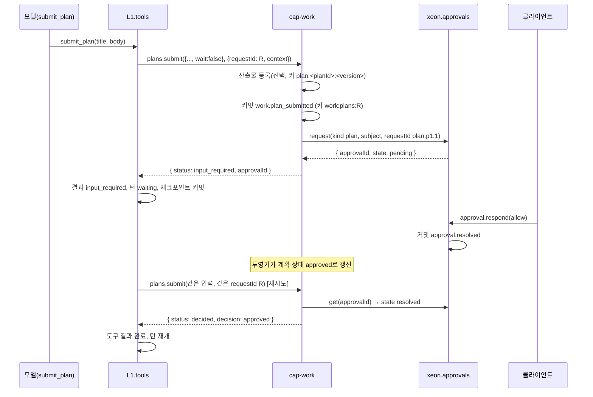
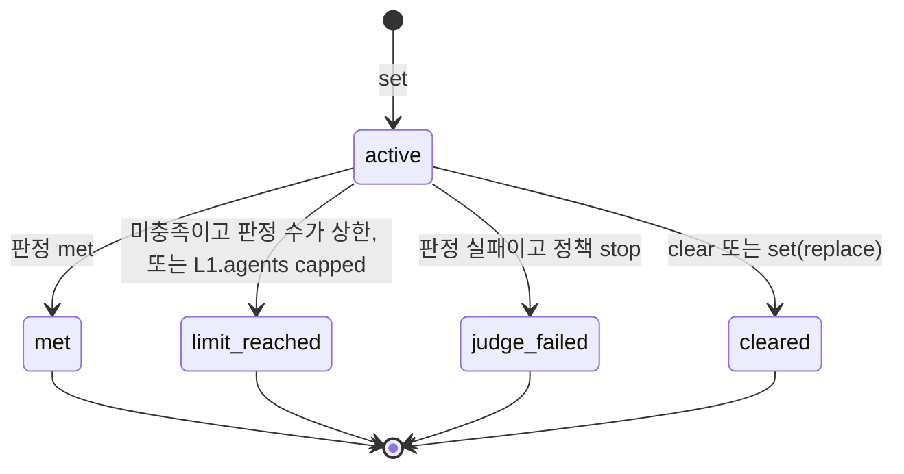

# L2 작업 관리 (work)

패키지: `xeon/packages/cap-work`. 서비스: `xeon.work`. 능력: `work.tasks`, `work.plans`, `work.goals`, `work.reports`. 이벤트 접두사: `work.`. 테이블 접두사: `cap_work_`. 생산자 id: `cap.work`.

## 1. 목적과 범위

작업 관리 능력의 서비스 API, 모델 도구, 이벤트, 투영, 설정을 정한다. 이 능력은 대화 안에서 작업 목록을 유지하고, 계획을 승인받은 뒤 실행하게 하고, 완료 조건을 걸어 둔 작업을 별도 판정 모델의 판정으로 이어 가게 한다.

L2-e 묶음 대응(`_research/l2e.md` §5): L2-e1 작업 관리(A1, A2, A2b, A5, A6, A7) → `work`, L2-e2 사용자 대화(B1, B2 노출, B4, B5, B7, B8, B9, B10, D5) → `dialog`(`L2.dialog.spec`). A3 작업 보드와 A4 외부 트래커는 보류다.

정하는 것:

- `work.tasks`: 작업 항목(내용, 상태, owner, 선행 작업), 의존 간선과 순환 거부, 막힘 표시, 자동 시작 옵션, 목록 연산 도구 `task_write`
- `work.plans`: 계획 객체, 계획 버전, 제출·승인·반려·수정 흐름, 계획 모드 진입·종료 요청
- `work.goals`: 목표 설정·상태·해제, 턴마다의 판정, 판정 횟수 상한, 판정 주입(L3 판정자 대체)
- `work.reports`: 완료 보고 스키마와 생성
- `work.*` 이벤트 카탈로그와 `cap_work_` 투영
- `l2.work.*` 설정 키

다루지 않는 것:

- 권한 모드 자체(계획 모드에서 쓰기 도구를 막는 규칙, 모드 상태 저장): `L1.tools.spec`. 이 문서는 모드 전환을 요청만 한다.
- 승인 요청 레코드의 필드 정의(`approvalId`, kind, 대상, 선택지, 결과)와 `approval.*` 이벤트: `L1.tools.spec`. 이 문서는 kind `plan`의 사용 방식만 쓴다.
- 판정 모델의 선택과 호출 구현: `L1.models.spec`(용도별 라우팅). 이 문서는 용도 이름만 넘긴다.
- 턴 시작·정착, 입력 큐: `L1.loop.spec`, `L1.tasks.spec`.
- 슬래시 명령 해석: `L2.dialog.spec`. 이 문서는 등록할 명령 목록만 정한다(§6.2).
- 산출물 저장: `L2.artifacts.spec`. 이 문서는 선택 의존으로 등록만 요청한다.
- 작업 보드(칸반 보기)는 L4 화면이다. 데이터는 `work.tasks.list`를 읽는다. 외부 트래커(GitHub, Linear, Jira) 연동은 X 플러그인이 자기 능력으로 제공한다(`_research/l2e.md` §3.1 A3·A4). 둘 다 보류다.

결정 반영:

- [결정] 목표 판정은 별도 판정 모델을 두고 실행 횟수 상한을 건다(`_research/decisions-log.md` 2026-10-21 3차, `_research/foundation-plan.md` §1 4번). `_research/l2e.md` §8의 열린 결정 "판정자 분리 방식"은 이 결정으로 닫혔다.
- [결정] 질문 도구와 계획 승인은 L1 승인 프로토콜 하나로 합친다(같은 결정, §1 5번). `_research/l2e.md` §8의 "승인 프로토콜을 B1과 A2b에서 하나로 합칠지"도 닫혔다.
- 마일스톤: `work.tasks`, `work.plans`는 M2, `work.goals`, `work.reports`는 M3다(`product.scope.spec` §4.1 I9·I11). `_research/layer-plan-v2.json` L2-e는 목표 지속·완료 보고를 2차로 적었으나 3차 결정이 목표 판정을 범위에 넣었으므로 M3로 둔다[^ms].

[^ms]: `L2.readme` §2 각주 work는 `work.reports`를 2차로 남겼다. 이 문서는 목표 판정의 종료가 완료 보고를 만들어야 하므로(§4.4 2항) 보고 스키마와 생성을 M3에 함께 둔다. 차이는 §10 W-9와 `L2.readme` §10 미결 17이다.

## 2. 용어

| 용어 | 뜻 |
|---|---|
| 작업 항목 (work task) | 턴 사이에 유지되는 할 일 하나. L1 `core-tasks`의 실행 태스크(`TaskId`)와 다른 개념이라 타입 이름에 `Work`를 붙인다 |
| 선행 작업 (`blockedBy`) | 이 작업보다 먼저 끝나야 하는 작업 목록. 의존 간선은 `작업 → 선행 작업` 방향이다 |
| 막힘 (blocked) | 선행 작업 중 끝나지 않은 것이 있는 상태. 저장하지 않고 계산한다 |
| 계획 (plan) | 모델이 제출한 실행 계획 문서. 버전을 가진다 |
| 계획 버전 | 같은 계획의 n번째 제출본. 제출 후 내용은 바뀌지 않는다 |
| 계획 모드 | 쓰기 도구를 막는 권한 모드. 소유는 L1.tools다 |
| 목표 (goal) | 완료 조건 문장과 판정 방식. 스레드마다 활성 목표는 하나다 |
| 판정 (judgment) | 한 턴이 끝난 뒤 목표 충족 여부를 정한 결과 하나 |
| 판정자 (judge) | 판정을 내리는 주체. 기본은 별도 판정 모델이고 L3 그룹이 대신할 수 있다 |
| 완료 보고 (report) | 결과 요약, 사용 자원, 남은 항목, 산출물 참조를 정해진 스키마로 묶은 기록 |

이 문서는 다음 이름을 다른 문서에서 가져다 쓴다.

- `ThreadId`, `TurnId`, `ResultStatus`, `InputRequiredInfo`, `JsonValue`: F.conversation.spec §3.2, §3.6
- `CapabilityDef`, `defineCapability`, `serviceKey`, `CapabilityApi`, `CallOptions`, `CapabilityError`, `ToolContent`: F.capabilities.spec §3
- `ApprovalId`, `ApprovalIdSchema`, `Brand`, `REQUEST_ID_PATTERN`, `deriveRequestId`: eng.domain-types.guide DT-06, eng.typescript.guide §1.2
- `CatalogEntry`, `CoreArea`: F.records.spec §3.2·§3.3(`L2.readme` §5.9). `Projector`, `ProjectionTx`, `BlobRef`, `TYPE_PREFIX_OWNERS`: eng.events.design §4.1, §5.1
- `PostItem`, `PostOptions`, `ScopeId`: F.extensions.spec §3.2
- 스레드와 세션: F.conversation.spec은 `ThreadId`를, eng.events.design은 `SessionId`를 쓴다. 이 문서는 서비스 API에 `ThreadId`를 쓰고 투영 테이블 열은 `session_id`로 둔다(eng.context-map.design §5.2). [가정] 두 ID는 같은 단위를 가리킨다.

## 3. 인터페이스

정의 파일은 F `xeon/packages/contracts/src/capabilities/defs/work.ts`다(F.capabilities.spec §3.9 정의 위치 [제안], `L2.readme` §5.1). 이 절의 코드는 그 파일의 완성형이다. 읽기 쉽도록 export 상수의 명시 타입 주석을 생략했다. 실제 파일은 `isolatedDeclarations` 때문에 export마다 타입 주석을 단다(F.capabilities.spec §3.9 마지막 문단과 같은 생략).

### 3.1 공통: ID와 호출 문맥

```ts
// xeon/packages/contracts/src/capabilities/defs/work.ts (1/6)
import { Type, type Static } from "typebox";
import type { Brand } from "../../base/index.ts";
import { ApprovalIdSchema } from "../../base/index.ts";
import { TurnIdSchema } from "../../conversation/index.ts";
import { defineCapability, serviceKey, type CapabilityApi, type ToolContent } from "../index.ts";

/** 스레드 안 순번 ID. 모델이 읽고 쓰기 쉬운 짧은 문자열이다. 발급 규칙은 §4.1 */
export type WorkTaskId = Brand<string, "WorkTaskId">;   // "t1", "t2", ...
export type PlanId = Brand<string, "PlanId">;           // "p1", ...
export type GoalId = Brand<string, "GoalId">;           // "g1", ...
export type ReportId = Brand<string, "ReportId">;       // "r1", ...

export const WORK_TASK_ID_PATTERN = "^t[1-9][0-9]{0,5}$";
export const PLAN_ID_PATTERN = "^p[1-9][0-9]{0,5}$";
export const GOAL_ID_PATTERN = "^g[1-9][0-9]{0,5}$";
export const REPORT_ID_PATTERN = "^r[1-9][0-9]{0,5}$";

export const WorkTaskIdSchema = Type.Unsafe<WorkTaskId>(Type.String({ pattern: WORK_TASK_ID_PATTERN }));
export const PlanIdSchema = Type.Unsafe<PlanId>(Type.String({ pattern: PLAN_ID_PATTERN }));
export const GoalIdSchema = Type.Unsafe<GoalId>(Type.String({ pattern: GOAL_ID_PATTERN }));
export const ReportIdSchema = Type.Unsafe<ReportId>(Type.String({ pattern: REPORT_ID_PATTERN }));

/** owner 문자열: "main", 서브에이전트 이름, 그룹 scope id 등. 해석은 하지 않는다 */
export const OWNER_PATTERN = "^[A-Za-z0-9][A-Za-z0-9_./:-]{0,63}$";
export const OwnerSchema = Type.String({ pattern: OWNER_PATTERN });

/** 산출물 참조. 모양의 정본은 L2.artifacts.spec이다 [가정] */
export const ArtifactRefSchema = Type.Object(
  { artifactId: Type.String({ minLength: 1, maxLength: 64 }), kind: Type.String({ maxLength: 32 }), title: Type.Union([Type.String({ maxLength: 200 }), Type.Null()]) },
  { additionalProperties: false },
);
export type ArtifactRef = Static<typeof ArtifactRefSchema>;
```

- [제안] 작업·계획·목표·보고 ID는 ULID 접두 ID(eng.domain-types.guide DT-06)를 쓰지 않고 스레드 안 순번을 쓴다. 모델이 `task_write`에서 ID를 직접 적어야 하므로 짧아야 한다(Claude Code 작업 도구도 순번 ID를 쓴다, `_research/l2e.md` §3.1 A1). DT-06의 "외부 발급 ID는 브랜드만 붙이고 패턴은 따로 둔다" 규칙과 같은 처리다. 다른 스레드의 같은 ID와 구별할 일이 없다. 모든 조회는 스레드 범위다.
- 호출 문맥: 서비스 메서드는 대상 스레드를 알아야 한다. 대상 스레드는 `F.capabilities.spec` §3.2 `CallOptions.context: CallContext`의 `threadId`다(`L2.readme` §5.8). 도구 경로에서는 L1.tools가 도구 호출의 스레드로 채우고, 그룹 경로에서는 X의 capability 래퍼가 `HandlerContext.threadId`(F.extensions.spec §3.2)로 채운다. 없으면 `invalid_input`이다.
- 쓰기 메서드의 `requestId`는 필수다 [제안]. 없으면 `invalid_input`이다. 같은 `requestId`의 재호출은 이벤트를 다시 쓰지 않고 처음 결과를 돌려준다(eng.transactions.design §4.7, TX-05). 그래서 쓰기 메서드의 `replay`를 `"safe"`로 둔다.

### 3.2 `work.tasks`

```ts
// defs/work.ts (2/6)
export const WorkTaskStatusSchema = Type.Union([
  Type.Literal("pending"), Type.Literal("in_progress"), Type.Literal("completed"),
  Type.Literal("failed"), Type.Literal("cancelled"),
]);
export type WorkTaskStatus = Static<typeof WorkTaskStatusSchema>;

const Content = Type.String({ minLength: 1, maxLength: 500 });
const ActiveForm = Type.String({ minLength: 1, maxLength: 200, description: "진행 중일 때 표시할 문장. 예: '테스트를 고치는 중'" });

export const WorkTaskSchema = Type.Object(
  {
    id: WorkTaskIdSchema,
    content: Content,
    activeForm: Type.Union([ActiveForm, Type.Null()]),
    status: WorkTaskStatusSchema,
    owner: Type.Union([OwnerSchema, Type.Null()]),
    blockedBy: Type.Array(WorkTaskIdSchema, { maxItems: 32, uniqueItems: true }),
  },
  { additionalProperties: false },
);
export type WorkTask = Static<typeof WorkTaskSchema>;

/** 조회용. 투영에서 계산한 값을 더한다 */
export const WorkTaskViewSchema = Type.Object(
  {
    ...WorkTaskSchema.properties,
    blocked: Type.Boolean(),
    /** 이 작업을 선행 작업으로 둔 작업들 */
    blocks: Type.Array(WorkTaskIdSchema),
  },
  { additionalProperties: false },
);
export type WorkTaskView = Static<typeof WorkTaskViewSchema>;

/** 같은 write 호출 안에서 새 작업을 가리키는 임시 참조. "@" + 1~16자 */
export const TaskRefSchema = Type.String({ pattern: "^@[a-z0-9_-]{1,16}$" });
const TaskTarget = Type.Union([WorkTaskIdSchema, TaskRefSchema]);

export const TaskCreateInput = Type.Object(
  {
    content: Content,
    activeForm: Type.Optional(ActiveForm),
    status: Type.Optional(WorkTaskStatusSchema),
    owner: Type.Optional(OwnerSchema),
    blockedBy: Type.Optional(Type.Array(WorkTaskIdSchema, { maxItems: 32, uniqueItems: true })),
  },
  { additionalProperties: false },
);
export const TaskUpdateInput = Type.Object(
  {
    id: WorkTaskIdSchema,
    content: Type.Optional(Content),
    activeForm: Type.Optional(Type.Union([ActiveForm, Type.Null()])),
    status: Type.Optional(WorkTaskStatusSchema),
    owner: Type.Optional(Type.Union([OwnerSchema, Type.Null()])),
    /** 막힌 작업을 in_progress로 바꿀 때만 쓴다(§4.1.3) */
    force: Type.Optional(Type.Boolean()),
  },
  { additionalProperties: false },
);
export const TaskLinkInput = Type.Object(
  {
    id: WorkTaskIdSchema,
    blockedBy: Type.Array(WorkTaskIdSchema, { minItems: 1, maxItems: 32, uniqueItems: true }),
    op: Type.Union([Type.Literal("add"), Type.Literal("remove")]),
  },
  { additionalProperties: false },
);
export const TaskListInput = Type.Object(
  {
    status: Type.Optional(Type.Array(WorkTaskStatusSchema, { minItems: 1, maxItems: 5, uniqueItems: true })),
    owner: Type.Optional(OwnerSchema),
  },
  { additionalProperties: false },
);

export const TaskOpSchema = Type.Union([
  Type.Object({
    op: Type.Literal("create"),
    ref: Type.Optional(TaskRefSchema),
    content: Content,
    activeForm: Type.Optional(ActiveForm),
    status: Type.Optional(WorkTaskStatusSchema),
    owner: Type.Optional(OwnerSchema),
    blockedBy: Type.Optional(Type.Array(TaskTarget, { maxItems: 32, uniqueItems: true })),
  }, { additionalProperties: false }),
  Type.Object({
    op: Type.Literal("update"),
    id: TaskTarget,
    content: Type.Optional(Content),
    activeForm: Type.Optional(Type.Union([ActiveForm, Type.Null()])),
    status: Type.Optional(WorkTaskStatusSchema),
    owner: Type.Optional(Type.Union([OwnerSchema, Type.Null()])),
    force: Type.Optional(Type.Boolean()),
  }, { additionalProperties: false }),
  Type.Object({
    op: Type.Union([Type.Literal("link"), Type.Literal("unlink")]),
    id: TaskTarget,
    blockedBy: Type.Array(TaskTarget, { minItems: 1, maxItems: 32, uniqueItems: true }),
  }, { additionalProperties: false }),
]);
export type TaskOp = Static<typeof TaskOpSchema>;

export const TaskWriteInput = Type.Object(
  { ops: Type.Array(TaskOpSchema, { minItems: 1, maxItems: 50 }) },
  { additionalProperties: false },
);
export const TaskWriteOutput = Type.Object(
  {
    tasks: Type.Array(WorkTaskViewSchema),
    created: Type.Array(Type.Object({ ref: Type.Union([TaskRefSchema, Type.Null()]), id: WorkTaskIdSchema }, { additionalProperties: false })),
  },
  { additionalProperties: false },
);
const TaskOutput = Type.Object({ task: WorkTaskViewSchema }, { additionalProperties: false });
const TaskListOutput = Type.Object({ tasks: Type.Array(WorkTaskViewSchema) }, { additionalProperties: false });

const TaskErrors = {
  task_cycle: { description: "선행 간선을 더하면 순환이 생긴다. detail.path는 순환 경로", retryable: false,
    detail: Type.Object({ path: Type.Array(WorkTaskIdSchema) }) },
  task_blocked: { description: "끝나지 않은 선행 작업이 있어 시작할 수 없다", retryable: false,
    detail: Type.Object({ blockers: Type.Array(WorkTaskIdSchema) }) },
  task_transition_invalid: { description: "허용하지 않는 상태 전이(§4.1.2)", retryable: false,
    detail: Type.Object({ from: WorkTaskStatusSchema, to: WorkTaskStatusSchema }) },
  task_ref_unknown: { description: "write 안의 임시 참조가 앞선 create에 없다", retryable: false },
  task_limit: { description: "스레드의 작업 수 상한(MAX_WORK_TASKS) 초과", retryable: false },
} as const;

/** task_write 결과를 모델용 체크리스트로 그린다. 순수 함수 */
export function renderTaskList(out: Static<typeof TaskWriteOutput>): ToolContent {
  const mark = { pending: "[ ]", in_progress: "[>]", completed: "[x]", failed: "[!]", cancelled: "[-]" } as const;
  const lines = out.tasks.map((t) =>
    `${mark[t.status]} ${t.id} ${t.status === "in_progress" && t.activeForm ? t.activeForm : t.content}` +
    (t.blocked ? ` (막힘: ${t.blockedBy.join(", ")})` : "") +
    (t.owner ? ` @${t.owner}` : ""));
  const created = out.created.filter((c) => c.ref !== null).map((c) => `${c.ref}=${c.id}`).join(", ");
  return {
    content: [{ type: "text", text: (created ? `생성: ${created}\n` : "") + (lines.length ? lines.join("\n") : "(작업 없음)") }],
    structuredContent: out,
  };
}

export const MAX_WORK_TASKS = 500;

export const WorkTasks = defineCapability({
  id: "work.tasks",
  version: "1.0.0",
  description: "턴 사이에 유지되는 작업 목록과 선행 간선.",
  service: {
    methods: {
      create: { description: "작업 하나를 만든다.", input: TaskCreateInput, output: TaskOutput, replay: "safe", errors: TaskErrors },
      update: { description: "작업의 내용, 상태, owner를 바꾼다.", input: TaskUpdateInput, output: TaskOutput, replay: "safe", errors: TaskErrors },
      link: { description: "선행 간선을 더하거나 뺀다. 순환이 생기면 거부한다.", input: TaskLinkInput, output: TaskOutput, replay: "safe", errors: TaskErrors },
      list: { description: "작업 목록을 조회한다.", input: TaskListInput, output: TaskListOutput, replay: "safe" },
      write: { description: "여러 연산을 한 번에 적용한다. 전부 적용되거나 하나도 적용되지 않는다.", input: TaskWriteInput, output: TaskWriteOutput, replay: "safe", errors: TaskErrors },
    },
  },
  tools: [
    {
      name: "task_write",
      label: "작업 목록",
      description:
        "작업 목록을 만들고 갱신한다. ops에 create, update, link, unlink 연산을 순서대로 적는다. " +
        "같은 호출에서 만든 작업은 ref(@a 같은 이름)로 가리킬 수 있다. 한 번에 in_progress는 하나만 두기를 권한다. " +
        "결과로 전체 목록을 돌려준다.",
      method: "write",
      parameters: TaskWriteInput,
      toContent: renderTaskList,
      outputSchema: TaskWriteOutput,
      replay: "safe",
      executionMode: "sequential",
      hints: { readOnly: false, destructive: false, idempotent: true, openWorld: false },
    },
  ],
});
export const WorkTasksKey = serviceKey(WorkTasks);
```

- [제안] 모델 도구는 `task_write` 하나다(`_research/l2e.md` §3.1 A1의 "도구: task_write(목록 연산)"). 결과가 전체 목록이라 조회 도구를 따로 두지 않는다. `create`, `update`, `link`, `list`는 그룹 코드와 L4 화면이 쓰는 서비스 메서드다.
- 상태 5종 [제안]: `pending`, `in_progress`, `completed`, `failed`, `cancelled`. omp todo의 5종 상태와 수가 같다(`_research/l2e.md` §3.1 A1). 막힘은 상태로 두지 않고 계산한다. 상태로 두면 선행 작업이 끝날 때마다 다른 작업의 상태를 고쳐야 하기 때문이다.
- `executionMode: "sequential"`: 같은 단계에서 `task_write`가 두 번 호출되면 순서대로 적용해야 결과 목록이 결정적이다.
- `MethodDef.errors`의 고유 코드는 `task_` 접두로 공통 코드와 겹치지 않는다(`L2.readme` §5.5).
- [결정: WK.1] `task_write`는 L1.tools 등록에서 `risk: "read"`다. 작업 목록은 작업 영역의 파일을 바꾸지 않으므로 계획 모드(`write`·`exec` 거부)에서도 목록을 쓸 수 있어야 하고, 매번 승인을 묻지 않는다. 클래스 표지(`classes`)는 달지 않는다. 서브에이전트는 자기 스레드의 목록을 쓰기 때문이다.
- [결정: WK.1] `list`도 스레드별 쓰기 큐(§4.1.1)를 지난다. 먼저 부른 쓰기가 끝난 뒤의 목록을 본다.

### 3.3 `work.plans`

```ts
// defs/work.ts (3/6)
export const PlanStatusSchema = Type.Union([
  Type.Literal("submitted"),           // 승인 대기
  Type.Literal("approved"),
  Type.Literal("rejected"),
  Type.Literal("revision_requested"),  // 사용자가 수정 요청
  Type.Literal("superseded"),          // 새 버전이 제출됨
  Type.Literal("withdrawn"),           // 승인 없이 계획 모드를 나감
]);
export type PlanStatus = Static<typeof PlanStatusSchema>;

export const PlanDecisionSchema = Type.Union([
  Type.Literal("approved"), Type.Literal("rejected"), Type.Literal("revision_requested"),
]);
export type PlanDecision = Static<typeof PlanDecisionSchema>;

const PlanTitle = Type.String({ minLength: 1, maxLength: 200 });
const PlanBody = Type.String({ minLength: 1, maxLength: 65536, description: "Markdown 계획 본문" });

export const PlanVersionSchema = Type.Object(
  {
    planId: PlanIdSchema,
    version: Type.Integer({ minimum: 1, maximum: 999 }),
    title: PlanTitle,
    body: PlanBody,
    status: PlanStatusSchema,
    artifact: Type.Union([ArtifactRefSchema, Type.Null()]),
    approvalId: Type.Union([ApprovalIdSchema, Type.Null()]),
    /** 반려 사유 또는 수정 요청 내용 */
    feedback: Type.Union([Type.String({ maxLength: 8192 }), Type.Null()]),
  },
  { additionalProperties: false },
);
export type PlanVersion = Static<typeof PlanVersionSchema>;

export const PlanEnterModeInput = Type.Object(
  { reason: Type.Optional(Type.String({ maxLength: 500 })) },
  { additionalProperties: false },
);
export const PlanModeOutput = Type.Object(
  { mode: Type.String({ minLength: 1, maxLength: 32 }), previousMode: Type.Union([Type.String({ maxLength: 32 }), Type.Null()]) },
  { additionalProperties: false },
);
export const PlanExitModeInput = Type.Object({}, { additionalProperties: false });

const SubmitParams = {
  title: PlanTitle,
  body: PlanBody,
  /** 기존 계획의 새 버전이면 그 planId */
  planId: Type.Optional(PlanIdSchema),
};
export const PlanSubmitParams = Type.Object(SubmitParams, { additionalProperties: false });
export const PlanSubmitInput = Type.Object(
  {
    ...SubmitParams,
    /** 참이면 결정이 날 때까지 반환을 미룬다(메모리 대기). 도구 경로는 거짓(§4.2.4) */
    wait: Type.Optional(Type.Boolean()),
  },
  { additionalProperties: false },
);
export const PlanSubmitOutput = Type.Union([
  Type.Object({
    status: Type.Literal("input_required"),
    planId: PlanIdSchema, version: Type.Integer({ minimum: 1 }), approvalId: ApprovalIdSchema,
  }, { additionalProperties: false }),
  Type.Object({
    status: Type.Literal("decided"),
    planId: PlanIdSchema, version: Type.Integer({ minimum: 1 }), approvalId: ApprovalIdSchema,
    decision: PlanDecisionSchema,
    feedback: Type.Union([Type.String(), Type.Null()]),
  }, { additionalProperties: false }),
]);
export type PlanSubmitResult = Static<typeof PlanSubmitOutput>;

const PlanTarget = { planId: PlanIdSchema, version: Type.Optional(Type.Integer({ minimum: 1 })) };
export const PlanApproveInput = Type.Object({ ...PlanTarget, note: Type.Optional(Type.String({ maxLength: 2000 })) }, { additionalProperties: false });
export const PlanRejectInput = Type.Object({ ...PlanTarget, reason: Type.Optional(Type.String({ maxLength: 8192 })) }, { additionalProperties: false });
export const PlanReviseInput = Type.Object({ ...PlanTarget, feedback: Type.String({ minLength: 1, maxLength: 8192 }) }, { additionalProperties: false });
export const PlanVersionsInput = Type.Object({ planId: PlanIdSchema }, { additionalProperties: false });
const PlanOutput = Type.Object({ plan: PlanVersionSchema }, { additionalProperties: false });
const PlanVersionsOutput = Type.Object({ versions: Type.Array(PlanVersionSchema) }, { additionalProperties: false });

const PlanErrors = {
  plan_not_approved: { description: "승인 필수 설정에서 승인된 계획 없이 계획 모드를 나가려 함", retryable: false },
  plan_pending: { description: "같은 계획의 이전 버전이 아직 승인 대기 중", retryable: false },
  plan_closed: { description: "이미 결정된 버전에 결정을 다시 내리려 함", retryable: false,
    detail: Type.Object({ status: PlanStatusSchema }) },
  plan_mode_inactive: { description: "계획 모드가 아닌데 계획 모드 전용 동작을 요청함", retryable: false },
} as const;

/** submit_plan 결과의 모델용 문장. 순수 함수 */
export function renderPlanSubmit(out: PlanSubmitResult): ToolContent {
  const head = `계획 ${out.planId} v${out.version}`;
  const text = out.status === "input_required"
    ? `${head}: 사용자 승인 대기 중.`
    : out.decision === "approved"
      ? `${head}: 승인됨. 계획대로 실행한다.`
      : out.decision === "rejected"
        ? `${head}: 반려됨.${out.feedback ? ` 사유: ${out.feedback}` : ""}`
        : `${head}: 수정 요청. ${out.feedback ?? ""}`;
  return { content: [{ type: "text", text }], structuredContent: out };
}

export const WorkPlans = defineCapability({
  id: "work.plans",
  version: "1.0.0",
  description: "계획 객체와 승인 흐름. 계획 모드의 쓰기 차단은 L1.tools가 한다.",
  service: {
    methods: {
      enterMode: { description: "권한 모드를 계획 모드로 바꾸도록 L1.tools에 요청한다.", input: PlanEnterModeInput, output: PlanModeOutput, replay: "safe", errors: PlanErrors },
      exitMode: { description: "계획 모드를 끝내고 이전 모드로 돌린다. 승인 필수면 승인된 계획이 있어야 한다.", input: PlanExitModeInput, output: PlanModeOutput, replay: "safe", errors: PlanErrors },
      submit: { description: "계획을 제출하고 승인을 요청한다.", input: PlanSubmitInput, output: PlanSubmitOutput, replay: "safe", errors: PlanErrors },
      approve: { description: "승인 대기 중인 버전을 승인한다.", input: PlanApproveInput, output: PlanOutput, replay: "safe", errors: PlanErrors },
      reject: { description: "승인 대기 중인 버전을 반려한다.", input: PlanRejectInput, output: PlanOutput, replay: "safe", errors: PlanErrors },
      revise: { description: "승인 대기 중인 버전에 수정을 요청한다.", input: PlanReviseInput, output: PlanOutput, replay: "safe", errors: PlanErrors },
      versions: { description: "계획의 모든 버전을 조회한다.", input: PlanVersionsInput, output: PlanVersionsOutput, replay: "safe" },
    },
  },
  tools: [
    {
      name: "enter_plan_mode",
      label: "계획 모드 시작",
      description: "쓰기 도구를 막는 계획 모드로 들어간다. 큰 변경 전에 조사와 계획만 할 때 쓴다.",
      method: "enterMode",
      parameters: PlanEnterModeInput,
      replay: "safe",
      executionMode: "sequential",
      hints: { readOnly: false, destructive: false, idempotent: true, openWorld: false },
    },
    {
      name: "exit_plan_mode",
      label: "계획 모드 종료",
      description: "계획 모드를 끝낸다. 승인 필수 설정이면 submit_plan으로 승인받은 뒤에만 끝낼 수 있다.",
      method: "exitMode",
      parameters: PlanExitModeInput,
      replay: "safe",
      executionMode: "sequential",
      hints: { readOnly: false, destructive: false, idempotent: true, openWorld: false },
    },
    {
      name: "submit_plan",
      label: "계획 제출",
      description:
        "계획을 Markdown 본문으로 제출하고 사용자 승인을 받는다. 결과는 승인, 반려, 수정 요청 중 하나다. " +
        "수정 요청이면 같은 planId로 새 버전을 제출한다.",
      method: "submit",
      parameters: PlanSubmitParams,
      toInput: (p) => ({ ...p, wait: false }),
      toContent: renderPlanSubmit,
      outputSchema: PlanSubmitOutput,
      replay: "safe",
      executionMode: "sequential",
      hints: { readOnly: false, destructive: false, idempotent: true, openWorld: false },
    },
  ],
});
export const WorkPlansKey = serviceKey(WorkPlans);
```

- [제안] 도구 이름은 `enter_plan_mode`, `exit_plan_mode`, `submit_plan`으로 확정한다. `_research/l2e.md` §3.1 A2·A2b의 제안 이름을 그대로 쓴다. `work.tasks`의 `task_write`도 같은 출처의 이름이다.
- `submit_plan`의 `parameters`는 `wait`를 갖지 않는다. 모델이 메모리 대기를 고를 수 없게 하려는 것이다. 그래서 `toInput`을 둔다(F.capabilities.spec §4.2 `tool_input_mismatch` 규칙).
- [가정] `PlanSubmitOutput`의 `status: "input_required"` 변형을 L1.tools 어댑터가 `ToolResultRecord.status: "input_required"`와 `InputRequiredInfo`로 옮긴다(F.capabilities.spec §3.6 마지막 항목). 변형을 알아보는 판별 필드 이름은 L1.tools.spec이 정한다. 다르면 이 스키마의 필드 이름만 바꾼다(§10 W-2).

### 3.4 `work.goals`

```ts
// defs/work.ts (4/6)
/** 판정 방식. model: 별도 판정 모델(기본). delegated: 다른 주체가 judge 메서드로 판정을 넣는다(L3 판정자) */
export const GoalJudgeSpecSchema = Type.Union([
  Type.Object({
    kind: Type.Literal("model"),
    /** 판정 기준 목록. L1.agents JudgeInput.goal.criteria로 넘긴다. 모델 역할은 L1.models 역할 표의 judge로 고정이다 */
    rubric: Type.Optional(Type.Array(Type.String({ minLength: 1, maxLength: 500 }), { maxItems: 20 })),
  }, { additionalProperties: false }),
  Type.Object({
    kind: Type.Literal("delegated"),
    /** 판정을 넣을 주체의 scope id(F.extensions.spec ScopeId). 예: "<그룹 이름>" */
    owner: Type.String({ minLength: 1, maxLength: 64 }),
    /** 턴이 끝난 뒤 판정을 기다리는 시간. 생략하면 설정 l2.work.goal.delegatedTimeoutSec */
    timeoutSec: Type.Optional(Type.Integer({ minimum: 1, maximum: 3600 })),
  }, { additionalProperties: false }),
]);
export type GoalJudgeSpec = Static<typeof GoalJudgeSpecSchema>;

export const GoalVerdictSchema = Type.Object(
  {
    met: Type.Boolean(),
    reason: Type.String({ minLength: 1, maxLength: 2000 }),
    /** 미충족이면 부족한 점. 다음 턴 안내문에 들어간다 */
    missing: Type.Array(Type.String({ maxLength: 500 }), { maxItems: 20 }),
  },
  { additionalProperties: false },
);
export type GoalVerdict = Static<typeof GoalVerdictSchema>;

export const GoalStatusSchema = Type.Union([
  Type.Literal("active"), Type.Literal("met"), Type.Literal("limit_reached"),
  Type.Literal("cleared"), Type.Literal("judge_failed"),
]);
export type GoalStatus = Static<typeof GoalStatusSchema>;

/** 미충족 판정 뒤 다음 턴을 누가 투입하는가. self: work.goals가 post. external: 판정만 기록(goalId 루프가 투입, L2.readme §4.2) */
export const GoalContinuationSchema = Type.Union([Type.Literal("self"), Type.Literal("external")]);
export type GoalContinuation = Static<typeof GoalContinuationSchema>;

export const GoalSchema = Type.Object(
  {
    goalId: GoalIdSchema,
    condition: Type.String({ minLength: 1, maxLength: 2000 }),
    judge: GoalJudgeSpecSchema,
    /** 목표 설정 시점의 l1.agents.judge.maxRuns 값. 표시용이다. 상한 판정은 L1.agents가 한다(§4.3.2) */
    maxRuns: Type.Integer({ minimum: 1 }),
    continuation: GoalContinuationSchema,
    judgments: Type.Integer({ minimum: 0 }),
    status: GoalStatusSchema,
    lastVerdict: Type.Union([GoalVerdictSchema, Type.Null()]),
  },
  { additionalProperties: false },
);
export type Goal = Static<typeof GoalSchema>;

export const GoalJudgmentSchema = Type.Object(
  {
    goalId: GoalIdSchema,
    /** 1부터 시작하는 판정 순번 */
    n: Type.Integer({ minimum: 1 }),
    turnId: TurnIdSchema,
    /** 판정 실패면 null */
    verdict: Type.Union([GoalVerdictSchema, Type.Null()]),
    judgeKind: Type.Union([Type.Literal("model"), Type.Literal("delegated")]),
    failure: Type.Union([Type.Object({ code: Type.String(), message: Type.String({ maxLength: 1000 }) }, { additionalProperties: false }), Type.Null()]),
  },
  { additionalProperties: false },
);
export type GoalJudgment = Static<typeof GoalJudgmentSchema>;

export const GoalSetInput = Type.Object(
  {
    condition: Type.String({ minLength: 1, maxLength: 2000 }),
    judge: Type.Optional(GoalJudgeSpecSchema),
    /** 생략하면 "self" */
    continuation: Type.Optional(GoalContinuationSchema),
    /** 참이면 활성 목표를 cleared로 끝내고 새 목표를 건다 */
    replace: Type.Optional(Type.Boolean()),
  },
  { additionalProperties: false },
);
export const GoalStatusInput = Type.Object({ goalId: Type.Optional(GoalIdSchema) }, { additionalProperties: false });
export const GoalClearInput = Type.Object({ goalId: Type.Optional(GoalIdSchema) }, { additionalProperties: false });
export const GoalJudgeInput = Type.Object(
  { goalId: GoalIdSchema, turnId: TurnIdSchema, verdict: GoalVerdictSchema },
  { additionalProperties: false },
);
const GoalOutput = Type.Object({ goal: GoalSchema }, { additionalProperties: false });
const GoalStatusOutput = Type.Object(
  { goal: Type.Union([GoalSchema, Type.Null()]), recent: Type.Array(GoalJudgmentSchema, { maxItems: 10 }) },
  { additionalProperties: false },
);
const GoalJudgeOutput = Type.Object({ goal: GoalSchema, judgment: GoalJudgmentSchema }, { additionalProperties: false });

const GoalErrors = {
  goal_active: { description: "활성 목표가 이미 있다. replace: true로 바꿀 수 있다", retryable: false,
    detail: Type.Object({ goalId: GoalIdSchema }) },
  goal_closed: { description: "끝난 목표에 판정이나 해제를 요청함", retryable: false },
  goal_not_delegated: { description: "delegated 판정자가 아닌 목표에 judge를 호출함", retryable: false },
  goal_turn_stale: { description: "판정 대상 턴이 그 목표의 판정 대기 턴이 아님", retryable: false },
} as const;

export const WorkGoals = defineCapability({
  id: "work.goals",
  version: "1.0.0",
  description: "완료 조건을 걸고 턴마다 별도 판정자의 판정으로 다음 턴을 이어 간다. 모델 도구는 없다.",
  service: {
    methods: {
      set: { description: "목표를 건다.", input: GoalSetInput, output: GoalOutput, replay: "safe", errors: GoalErrors },
      status: { description: "활성 목표(또는 지정 목표)와 최근 판정을 조회한다.", input: GoalStatusInput, output: GoalStatusOutput, replay: "safe" },
      clear: { description: "목표를 해제한다.", input: GoalClearInput, output: GoalOutput, replay: "safe", errors: GoalErrors },
      judge: { description: "delegated 판정자가 판정을 넣는다.", input: GoalJudgeInput, output: GoalJudgeOutput, replay: "safe", errors: GoalErrors },
    },
  },
  tools: [],
});
export const WorkGoalsKey = serviceKey(WorkGoals);
```

- [결정] 모델 자가 판정은 채택하지 않는다(`_research/decisions-log.md` 2026-10-21 결정(3차) "목표 판정은 별도 판정 모델+상한", §4.3.1). 그래서 `work.goals`에는 모델 도구가 없다. `_research/l2e.md` §3.1 A5가 제안한 `goal_complete`(자가 판정일 때만)는 정의하지 않는다. 이름은 예약만 해 둔다.
- `tools: []`는 F.capabilities.spec §4.4의 "도구 없는 능력"에 기댄다. 그 문서에서 아직 [미결]이다(`L2.readme` §10 미결 8). 허용되지 않으면 §10 W-3의 대안을 쓴다.
- `judge` 메서드가 판정 주입 인터페이스다. 함수 객체를 넘기는 주입은 JSON 스키마로 표현할 수 없고 재개 때 다시 붙일 수도 없다. 그래서 판정 방식은 데이터(`GoalJudgeSpec`)로 목표에 기록하고, `delegated` 판정자는 턴이 끝난 뒤 `judge`로 결과를 넣는다 [제안]. L3 그룹의 기준 검사기는 이 경로로 기본 판정 모델을 대신한다(§7.3).

### 3.5 `work.reports`

```ts
// defs/work.ts (5/6)
export const ReportSubjectSchema = Type.Union([
  Type.Object({ kind: Type.Literal("goal"), goalId: GoalIdSchema }, { additionalProperties: false }),
  Type.Object({ kind: Type.Literal("turn"), turnId: TurnIdSchema }, { additionalProperties: false }),
]);

export const ReportOutcomeSchema = Type.Union([
  Type.Literal("met"), Type.Literal("limit_reached"), Type.Literal("cleared"),
  Type.Literal("judge_failed"), Type.Literal("turn_completed"), Type.Literal("turn_failed"),
]);

export const ReportUsageSchema = Type.Object(
  {
    inputTokens: Type.Integer({ minimum: 0 }),
    outputTokens: Type.Integer({ minimum: 0 }),
    cacheReadTokens: Type.Integer({ minimum: 0 }),
    cacheWriteTokens: Type.Integer({ minimum: 0 }),
    /** provider가 비용을 주지 않으면 null */
    costUsd: Type.Union([Type.Number({ minimum: 0 }), Type.Null()]),
  },
  { additionalProperties: false },
);

export const WorkReportSchema = Type.Object(
  {
    reportId: ReportIdSchema,
    subject: ReportSubjectSchema,
    outcome: ReportOutcomeSchema,
    /** 결과 요약. 4,000자 이하 */
    summary: Type.String({ maxLength: 4000 }),
    resources: Type.Object(
      {
        /** 대상 범위 턴들의 모델 사용량 합계 */
        agent: ReportUsageSchema,
        /** 판정 모델 사용량 합계. 목표가 아니면 0 */
        judge: ReportUsageSchema,
        turns: Type.Integer({ minimum: 0 }),
        judgments: Type.Integer({ minimum: 0 }),
        /** 첫 턴 시작부터 마지막 기록까지. recordedAt 차이(ms) */
        durationMs: Type.Integer({ minimum: 0 }),
      },
      { additionalProperties: false },
    ),
    remaining: Type.Object(
      {
        tasks: Type.Array(Type.Object({ id: WorkTaskIdSchema, content: Type.String(), status: WorkTaskStatusSchema }, { additionalProperties: false }), { maxItems: 100 }),
        /** 마지막 판정의 missing */
        missing: Type.Array(Type.String({ maxLength: 500 }), { maxItems: 20 }),
      },
      { additionalProperties: false },
    ),
    artifacts: Type.Array(ArtifactRefSchema, { maxItems: 100 }),
    plan: Type.Union([Type.Object({ planId: PlanIdSchema, version: Type.Integer({ minimum: 1 }), status: PlanStatusSchema }, { additionalProperties: false }), Type.Null()]),
  },
  { additionalProperties: false },
);
export type WorkReport = Static<typeof WorkReportSchema>;

export const ReportBuildInput = Type.Object(
  {
    subject: ReportSubjectSchema,
    /** 호출자가 요약을 주면 그대로 쓴다. 없으면 §4.4 3항 규칙으로 만든다 */
    summary: Type.Optional(Type.String({ maxLength: 4000 })),
    /** 호출자가 아는 산출물. artifacts.registry가 있으면 그 목록과 합친다 */
    artifacts: Type.Optional(Type.Array(ArtifactRefSchema, { maxItems: 100 })),
  },
  { additionalProperties: false },
);
const ReportBuildOutput = Type.Object({ report: WorkReportSchema }, { additionalProperties: false });

export const WorkReports = defineCapability({
  id: "work.reports",
  version: "1.0.0",
  description: "완료 보고를 정해진 스키마로 만들고 이벤트로 남긴다. 턴 결과 형식이며 모델 도구는 없다.",
  service: {
    methods: {
      build: { description: "대상(목표 또는 턴)의 완료 보고를 만든다.", input: ReportBuildInput, output: ReportBuildOutput, replay: "safe" },
    },
  },
  tools: [],
});
export const WorkReportsKey = serviceKey(WorkReports);
```

### 3.6 서비스 묶음

```ts
// defs/work.ts (6/6)
/** work 도메인 묶음 타입(L2.readme §5.6). Cordis에 등록하지 않는다. 등록은 능력마다 cap:<id> 바인딩이다 */
export interface WorkService {
  readonly tasks: CapabilityApi<typeof WorkTasks>;
  readonly plans: CapabilityApi<typeof WorkPlans>;
  readonly goals: CapabilityApi<typeof WorkGoals>;
  readonly reports: CapabilityApi<typeof WorkReports>;
}
/** 묶음 이름. eng.context-map.design §5.3 표의 이름이고 Cordis 등록 이름이 아니다 */
export const WorkServiceName = "xeon.work";
export const WORK_CAPABILITIES = [WorkTasks, WorkPlans, WorkGoals, WorkReports] as const;
```

- consumer는 `ScopeApi.capability(WorkTasksKey)`처럼 능력 단위 키로 API를 얻는다(`L2.readme` §5.6). L3 문서가 [가정]으로 적은 `work.task.create`는 이 문서의 `work.tasks`의 `create` 메서드다.

### 3.7 이벤트 카탈로그

형식은 `F.records.spec` §3.3.2 도메인 소유 카탈로그(`WORK_EVENT_CATALOG`, `L2.readme` §5.9)다. 모두 내구, 소유 생산자 `cap.work`(`owners.ts` `TYPE_PREFIX_OWNERS`), 버전 1이다. 휘발 이벤트는 두지 않는다. 멱등 키는 커밋의 `requestId`(eng.transactions.design §4.7 `REQUEST_ID_PATTERN`)다. 한 커밋의 이벤트는 같은 키를 쓴다.

| type | 구분 | 주요 payload | 멱등 키(커밋 `requestId`) | 소비자 |
|---|---|---|---|---|
| `work.task_created` | 내구 | `{ task: WorkTask, ref }` | `work:tasks:<호출 requestId>` | `cap.work` 투영, L4 작업 목록·보드, L3 그룹 |
| `work.task_changed` | 내구 | `{ taskId, from, set, cause }` | 같음. 자동 시작은 원인 커밋의 키를 같이 쓴다 | 투영, L4, L3 그룹 |
| `work.task_linked` | 내구 | `{ taskId, blockedBy[] }` | `work:tasks:<호출 requestId>` | 투영, L4 그래프 |
| `work.task_unlinked` | 내구 | `{ taskId, blockedBy[] }` | 같음 | 투영, L4 그래프 |
| `work.plan_submitted` | 내구 | `{ planId, version, title, body, artifact, supersedes }` | `work:plans:<호출 requestId>` | 투영, L4 계획 화면, artifacts |
| `work.plan_withdrawn` | 내구 | `{ planId, version, reason }` | `work:plans:<호출 requestId>` | 투영, L4 |
| `work.goal_set` | 내구 | `{ goal: Goal }`(`judgments: 0`, `status: "active"`) | `work:goals:<호출 requestId>` | 투영, L4 상태줄, schedule.loops |
| `work.goal_judged` | 내구 | `GoalJudgment & { usage }` | `work:goal:<goalId>:judge:<turnId>` | 투영, L4, 보고 생성, L3 그룹 |
| `work.goal_settled` | 내구 | `{ goalId, status, judgments }` | 종결 원인 커밋의 키 | 투영, L4, schedule.loops |
| `work.report_built` | 내구 | `{ report: WorkReport }` | 목표 종결이면 그 커밋의 키, 직접 호출이면 `work:reports:<호출 requestId>` | 투영, L4 보고 화면, 알림(dialog.notify) |

- 계획의 결정(승인·반려·수정 요청)은 `work.*` 이벤트를 따로 쓰지 않는다. `cap.work` 투영기가 L1의 `approval.requested`(kind `plan`)와 `approval.resolved`를 읽어 계획 상태를 바꾼다(§4.2.3). 투영기는 다른 컨텍스트의 이벤트를 읽을 수 있다(eng.events.design §5.1 규칙 6). 결정의 정본 기록이 `approval.resolved` 하나로 남으므로 질문과 계획 승인의 기록 형식이 같아진다.
- `work.task_changed.cause`: `"call"`(서비스 호출) 또는 `"auto_start"`(§4.1.4).
- 큰 값: `work.plan_submitted.body`는 64 KiB 이하라 envelope 한도 256 KiB 안에 든다. 그래서 blob으로 옮기지 않는다(eng.events.design EV-04).

코드 모양(F 쪽 선행 작업, `L2.work.plan` T1):

```ts
// xeon/packages/contracts/src/records/catalog/work.ts
import { Type } from "typebox";
import type { TSchema } from "typebox";
import type { CatalogEntry } from "./index.ts";
import {
  ArtifactRefSchema, GoalIdSchema, GoalJudgmentSchema, GoalSchema, GoalStatusSchema, PlanIdSchema,
  TaskRefSchema, WorkReportSchema, WorkTaskIdSchema, WorkTaskSchema, WorkTaskStatusSchema, ReportUsageSchema,
} from "../../capabilities/defs/work.ts";

const def = (kind: string, payload: TSchema): CatalogEntry =>
  ({ kind, version: 1, durable: true, payload });   // 생산자 cap.work는 owners.ts가 정한다

export const WorkTaskCreatedSchema = Type.Object({ task: WorkTaskSchema, ref: Type.Union([TaskRefSchema, Type.Null()]) }, { additionalProperties: false });
export const WorkTaskChangedSchema = Type.Object({
  taskId: WorkTaskIdSchema,
  from: WorkTaskStatusSchema,
  set: Type.Object({
    content: Type.Optional(Type.String()), activeForm: Type.Optional(Type.Union([Type.String(), Type.Null()])),
    status: Type.Optional(WorkTaskStatusSchema), owner: Type.Optional(Type.Union([Type.String(), Type.Null()])),
  }, { additionalProperties: false, minProperties: 1 }),
  cause: Type.Union([Type.Literal("call"), Type.Literal("auto_start")]),
}, { additionalProperties: false });
export const WorkTaskLinkSchema = Type.Object({ taskId: WorkTaskIdSchema, blockedBy: Type.Array(WorkTaskIdSchema, { minItems: 1 }) }, { additionalProperties: false });
export const WorkPlanSubmittedSchema = Type.Object({
  planId: PlanIdSchema, version: Type.Integer({ minimum: 1 }), title: Type.String(), body: Type.String({ maxLength: 65536 }),
  artifact: Type.Union([ArtifactRefSchema, Type.Null()]), supersedes: Type.Union([Type.Integer({ minimum: 1 }), Type.Null()]),
}, { additionalProperties: false });
export const WorkPlanWithdrawnSchema = Type.Object({
  planId: PlanIdSchema, version: Type.Integer({ minimum: 1 }),
  reason: Type.Union([Type.Literal("exit_mode"), Type.Literal("goal_cleared"), Type.Literal("call")]),
}, { additionalProperties: false });
export const WorkGoalSetSchema = Type.Object({ goal: GoalSchema }, { additionalProperties: false });
export const WorkGoalJudgedSchema = Type.Object({ ...GoalJudgmentSchema.properties, usage: Type.Union([ReportUsageSchema, Type.Null()]) }, { additionalProperties: false });
export const WorkGoalSettledSchema = Type.Object({ goalId: GoalIdSchema, status: GoalStatusSchema, judgments: Type.Integer({ minimum: 0 }) }, { additionalProperties: false });
export const WorkReportBuiltSchema = Type.Object({ report: WorkReportSchema }, { additionalProperties: false });

export const WORK_EVENT_CATALOG: readonly CatalogEntry[] = [
  def("work.task_created", WorkTaskCreatedSchema),
  def("work.task_changed", WorkTaskChangedSchema),
  def("work.task_linked", WorkTaskLinkSchema),
  def("work.task_unlinked", WorkTaskLinkSchema),
  def("work.plan_submitted", WorkPlanSubmittedSchema),
  def("work.plan_withdrawn", WorkPlanWithdrawnSchema),
  def("work.goal_set", WorkGoalSetSchema),
  def("work.goal_judged", WorkGoalJudgedSchema),
  def("work.goal_settled", WorkGoalSettledSchema),
  def("work.report_built", WorkReportBuiltSchema),
];
```

- `WorkGoalSettledSchema.status`에는 `"active"`가 오지 않는다. 투영 단위 테스트가 확인한다.
- [가정] records 카탈로그(`catalog/work.ts`)가 capabilities 정의 파일을 import할 수 있다. F 안의 도메인 순서(F.readme §3)가 records → capabilities 방향만 허용하면 payload 스키마를 records 쪽에 두고 정의 파일이 그것을 import한다. 이 판단은 F.records.plan이 한다(§10 W-4).
- `work` 영역과 `TYPE_PREFIX_OWNERS`의 `work.` → `cap.work` 행은 `F.records.spec` §3.3.2에 있다. 내장 `cap-work`는 자기 도메인 영역을 접두 없이 쓴다(`F.records.spec` §3.2 규칙 3).

### 3.8 투영 테이블

[제안] 투영기 이름은 `cap.work`, 버전 1이다. 모든 테이블은 `session_id` 열을 두고 재생으로 다시 만든다(eng.events.design §5.1 규칙 3·5).

```sql
CREATE TABLE cap_work_tasks (
  session_id   TEXT NOT NULL,
  task_id      TEXT NOT NULL,          -- "t1"
  ord          INTEGER NOT NULL,       -- 생성 순번(숫자 부분)
  content      TEXT NOT NULL,
  active_form  TEXT,
  status       TEXT NOT NULL,
  owner        TEXT,
  created_seq  INTEGER NOT NULL,
  updated_seq  INTEGER NOT NULL,
  PRIMARY KEY (session_id, task_id)
) STRICT;
CREATE TABLE cap_work_edges (
  session_id   TEXT NOT NULL,
  task_id      TEXT NOT NULL,
  blocked_by   TEXT NOT NULL,
  PRIMARY KEY (session_id, task_id, blocked_by)
) STRICT;
CREATE TABLE cap_work_plans (
  session_id   TEXT NOT NULL,
  plan_id      TEXT NOT NULL,
  version      INTEGER NOT NULL,
  title        TEXT NOT NULL,
  body         TEXT NOT NULL,
  status       TEXT NOT NULL,
  artifact     TEXT,                   -- ArtifactRef JSON
  approval_id  TEXT,
  feedback     TEXT,
  submitted_seq INTEGER NOT NULL,
  decided_seq  INTEGER,
  PRIMARY KEY (session_id, plan_id, version)
) STRICT;
CREATE INDEX cap_work_plans_approval ON cap_work_plans (approval_id);   -- [결정: WK.2] 요청한 대화와 기록한 대화가 다를 수 있어 승인 id만으로 찾는다
CREATE TABLE cap_work_goals (
  session_id   TEXT NOT NULL,
  goal_id      TEXT NOT NULL,
  goal         TEXT NOT NULL,          -- Goal JSON(최신)
  status       TEXT NOT NULL,
  set_seq      INTEGER NOT NULL,
  settled_seq  INTEGER,
  PRIMARY KEY (session_id, goal_id)
) STRICT;
CREATE TABLE cap_work_goal_judgments (
  session_id   TEXT NOT NULL,
  goal_id      TEXT NOT NULL,
  n            INTEGER NOT NULL,
  turn_id      TEXT NOT NULL,
  judgment     TEXT NOT NULL,          -- work.goal_judged payload JSON
  seq          INTEGER NOT NULL,
  PRIMARY KEY (session_id, goal_id, n),
  UNIQUE (session_id, goal_id, turn_id)
) STRICT;
CREATE TABLE cap_work_reports (
  session_id   TEXT NOT NULL,
  report_id    TEXT NOT NULL,
  report       TEXT NOT NULL,          -- WorkReport JSON
  seq          INTEGER NOT NULL,
  PRIMARY KEY (session_id, report_id)
) STRICT;
CREATE TABLE cap_work_meta (
  session_id   TEXT NOT NULL PRIMARY KEY,
  turns_completed INTEGER NOT NULL,     -- turn.completed 개수(방치 알림용)
  last_task_change_turn INTEGER NOT NULL,
  mode         TEXT,                    -- [결정: WK.2] 세션 범위에서 마지막으로 정한 권한 모드(없으면 NULL)
  mode_before_plan TEXT,                -- 계획 모드에 들어가기 직전 모드
  plan_entered_seq INTEGER              -- 지금 계획 모드이면 들어온 시점의 seq, 아니면 NULL
) STRICT;
```

관심 type: `work.*` 전부, `approval.requested`, `approval.resolved`, `settings.changed`(키 `l1.tools.permissionMode`, 범위 `session`만), `turn.completed`.

| 입력 이벤트 | 갱신 |
|---|---|
| `work.task_created` | `cap_work_tasks` 행 추가, `blockedBy`마다 `cap_work_edges` 행. `last_task_change_turn = turns_completed` |
| `work.task_changed` | 해당 행 갱신, `updated_seq`. `cap_work_meta.last_task_change_turn = turns_completed` |
| `work.task_linked` / `work.task_unlinked` | 간선 행 추가·삭제, 해당 작업 행의 `updated_seq`. `last_task_change_turn = turns_completed` |
| `work.plan_submitted` | 버전 행 추가(`status = submitted`). `supersedes`가 있고 그 버전이 아직 `submitted`이면 `superseded`로 바꾼다(결정이 난 판의 상태는 지키므로 보통은 바뀌지 않는다) |
| `approval.requested`(kind `plan`) | `body.plan.planRef`(`plan:<planId>:<version>`)가 가리키는 행에 `approval_id` 기록(`origin.threadId`의 행) |
| `approval.resolved` | `approval_id`가 일치하고 `submitted`인 행이 있으면 결정에 따라 `status`, `feedback`, `decided_seq` 갱신(§4.2.3 대응표). 없으면 무시 |
| `work.plan_withdrawn` | 해당 행 `withdrawn`(`submitted`일 때만) |
| `settings.changed`(권한 모드, 세션 범위) | `mode` 갱신. 값이 `plan`이고 직전 값이 `plan`이 아니면 `mode_before_plan = 직전 값(없으면 default)`, `plan_entered_seq = 이 이벤트의 seq`. 값이 `plan`이 아니면 `plan_entered_seq = NULL` |
| `work.goal_set` | 목표 행 추가 |
| `work.goal_judged` | 판정 행 추가, 목표 JSON의 `judgments`, `lastVerdict` 갱신 |
| `work.goal_settled` | 목표 `status`, `settled_seq` |
| `work.report_built` | 보고 행 추가 |
| `turn.completed` | `cap_work_meta.turns_completed + 1` |

- 순번 ID 발급(§4.1.1)에 필요한 최댓값은 이 테이블에서 계산한다.
- [결정: WK.1] 방치 알림(§4.1.6)의 기준 턴은 작업 이벤트 네 종류(`task_created`, `task_changed`, `task_linked`, `task_unlinked`)가 모두 갱신한다. 목록을 처음 만든 호출도 목록을 쓴 것으로 센다. `cap_work_meta` 행은 첫 작업 이벤트나 첫 `turn.completed`에서 만든다.
- [결정: WK.1] 간선 행의 읽기 순서는 삽입 순서(`rowid`)다. `blockedBy` 배열의 순서가 재생성 뒤에도 같다.
- 투영기 `cap.work` 버전 2는 `cap_work_tasks`, `cap_work_edges`, `cap_work_plans`, `cap_work_meta` 넷을 만든다(버전 1은 `cap_work_plans` 없이 작업 셋). 목표·보고 테이블은 해당 작업(T9~T12)이 더하면서 투영 버전을 올린다.
- [결정: WK.2] 권한 모드 추적은 `settings.changed`가 세션 범위에서 나온 변경만 본다. 파일 설정(사용자·프로젝트 범위)이 정한 모드는 이벤트가 없으므로 `mode_before_plan`은 세션 범위 이력의 직전 값이고, 그런 이력이 없으면 default다. 이 프로세스가 직접 계획 모드에 넣은 스레드는 메모리에 실제 직전 모드를 두고 우선한다(재시작 뒤에는 투영 값). L1.tools가 직전 모드를 이벤트로 남기면 이 한계가 사라진다(§10 W-16).
- `approval.resolved` payload의 결정 필드 이름은 L1.tools.spec이 정한다. 투영기는 F에 있는 그 payload 스키마만 import한다(§10 W-2).

## 4. 동작 규칙

### 4.1 작업 목록

#### 4.1.1 ID 발급과 쓰기 순서

- [제안] cap-work는 스레드마다 쓰기를 직렬화한다(스레드별 비동기 큐 하나). 한 스레드의 쓰기 소유자는 프로세스 하나다(eng.transactions.design §3.3). 그래서 메모리의 순번 카운터로 ID를 발급해도 충돌하지 않는다.
- [결정: WK.1] 순번 카운터를 메모리에 두지 않는다. 쓰기 큐 안에서 투영의 현재 목록을 읽을 때마다 `max(ord) + 1`을 다음 순번으로 쓴다. 쓰기 소유자가 프로세스 하나이고 큐가 직렬이므로 충돌하지 않고, 재생성이나 프로세스 재시작 뒤에도 따로 채울 것이 없다. 발급한 ID는 이벤트 payload에 기록되고, 재생은 기록된 ID를 읽는다(F.conversation.spec §4 규칙 1).
- 쓰기 메서드의 처리 순서: (1) 입력 검사(`requestId`, 호출 문맥의 `threadId`), (2) 쓰기 큐에서 투영의 현재 목록을 읽는다, (3) `SessionWriter.commit` 한 번. 규칙 검사(§4.1.2~§4.1.3)와 이벤트 초안 만들기는 이 커밋의 `build` 안에서 한다(순수 함수 `planWrite`). (4) 커밋 뒤 투영을 다시 읽어 출력을 만든다. 트랜잭션 안에서 await나 I/O를 하지 않는다(TX-01).
- [결정: WK.1] 같은 `requestId`의 재호출은 저장소가 `build` 전에 처음 결과를 돌려주므로, 상태가 바뀐 뒤에도 규칙 검사를 다시 하지 않는다. 결과 해석: (a) 커밋됨 + 재전송이면 `created`를 그 커밋의 `work.task_created` 이벤트에서 복원하고 `tasks`는 현재 목록이다. (b) 규칙 거부는 커밋 거부(reject) 레코드로 같은 키에 남기고(`code`는 오류 코드, `detail`은 `{ opIndex, failure }` JSON) 재호출이 같은 `CapabilityError`를 되풀이한다. (c) 모든 연산이 효과 없이 끝나 이벤트가 0개인 호출은 거부 코드 `noop`을 남기고 성공으로 답한다(`created`는 빈 배열). 같은 키로 다른 입력은 `key_reused`이고 `internal`로 바꿔 운영 로그 `work.tasks.key_reused`에 남긴다(§5.2).
- 커밋 키는 `work:tasks:<requestId>`이고 `requestId`가 커밋 키 형식(`COMMIT_KEY_PATTERN`)에 맞지 않거나 120자를 넘으면 F `commitKeyPart`가 해시 형태로 바꾼다. 이벤트 `turnId`는 호출 문맥의 `turnId`, 없으면 `null`이다. `stepId`, `causationId`, `correlationId`는 `null`이다.
- `write`는 연산을 순서대로 메모리 사본에 적용해 검사한 뒤 모든 이벤트를 커밋 하나에 넣는다. 한 연산이라도 실패하면 아무것도 커밋하지 않고 첫 실패의 오류를 낸다. `detail`에 실패한 연산 번호 `opIndex`를 싣는다.

#### 4.1.2 상태 전이

[제안] 행은 현재 상태, 열은 바꿀 상태다. ○ 허용, ✕ `task_transition_invalid`.

| 현재 \ 다음 | pending | in_progress | completed | failed | cancelled |
|---|---|---|---|---|---|
| pending | (변화 없음) | ○ 막힘 검사 | ○ | ✕ | ○ |
| in_progress | ○ | (변화 없음) | ○ | ○ | ○ |
| completed | ○ 다시 열기 | ✕ | (변화 없음) | ✕ | ✕ |
| failed | ○ 다시 열기 | ○ 막힘 검사 | ✕ | (변화 없음) | ○ |
| cancelled | ○ 다시 열기 | ✕ | ✕ | ✕ | (변화 없음) |

- 같은 상태로의 갱신은 이벤트를 만들지 않는다. 다른 필드도 바뀌지 않았으면 그 연산은 효과가 없다.
- `pending → completed`를 허용한다. 모델이 시작 표시 없이 끝난 항목을 한 번에 완료로 적는 일이 흔하다(`_research/l2e.md` §3.1 A1의 평면 목록 도구들).
- `create`의 `status` 생략값은 `pending`이다. `create`에서 `in_progress`를 주면 막힘 검사를 한다.

#### 4.1.3 의존 간선과 막힘

- 간선 `A blockedBy B`는 "B가 끝나야 A를 시작한다"를 뜻한다.
- 순환 거부: 간선 `A blockedBy B`를 더하기 전에 B에서 `blockedBy` 간선을 따라 A에 이르는 경로가 있는지 깊이 우선으로 찾는다. 있으면 `task_cycle`로 거부하고 `detail.path`에 `[A, B, …, A]`를 싣는다. 자기 간선(`A blockedBy A`)도 같은 오류다. `write`에서는 같은 호출 안에서 앞서 더한 간선까지 포함해 검사한다.
- 없는 작업을 가리키는 간선은 `not_found`다. 작업 하나의 선행 작업은 32개 이하다.
- 막힘 계산: `blocked = blockedBy` 중 상태가 `completed`도 `cancelled`도 아닌 작업이 하나라도 있으면 참. `failed` 선행 작업은 막힘을 유지한다 [제안]. 실패한 선행 작업을 무시하고 진행하면 안 되기 때문이다.
- 막힌 작업을 `in_progress`로 바꾸면 `task_blocked`다. `force: true`이면 허용하고 그대로 기록한다. 사용자가 순서를 알고 무시하는 경우를 위한 것이다.

#### 4.1.4 자동 시작

- [제안] 설정 `l2.work.tasks.autoStart`가 참이면, 어떤 작업이 `completed`나 `cancelled`가 되어 다른 작업 X의 막힘이 풀릴 때, X가 `pending`이고 `owner`가 null이 아니면 같은 커밋 안에서 X를 `in_progress`로 바꾼다(`work.task_changed`, `cause: "auto_start"`).
- owner가 null인 작업은 자동 시작하지 않는다. 누가 진행할지 정해지지 않은 작업을 진행 중으로 표시하면 목록이 실제와 달라진다.
- 자동 시작은 상태 표시만 바꾼다. 서브에이전트를 띄우거나 턴을 시작하지 않는다. 카드별 실행(Cline Kanban, Hermes 칸반 디스패치)은 작업 보드(보류)와 함께 검토한다.
- 기본값은 거짓이다.

#### 4.1.5 턴 사이 유지와 재생성

- 작업 목록의 정본은 `work.*` 내구 이벤트다. `cap_work_` 테이블은 재생으로 다시 만든다. 투영을 지우고 이벤트에서 재생성한 결과는 원래 테이블과 행 단위로 같아야 한다(eng.events.design §5.4 `expectProjectionsRebuildable`).
- 되감기(L1.persistence)로 활성 가지가 바뀌면, 조회는 활성 가지의 이벤트로 만든 상태를 보여야 한다. [가정] 투영은 모든 가지의 행을 갖고 조회가 사슬로 거른다는 eng.events.design §6의 규칙을 cap 투영에 그대로 적용하면, 작업 행마다 마지막 갱신 이벤트의 가지를 알아야 한다. M2에서는 되감기 뒤 `cap.work` 투영을 활성 가지만으로 재생성하는 방식을 쓴다 [제안]. 조회 시점 필터링은 §10 W-5로 남긴다. WK.1 구현은 투영이 모든 가지의 행을 그대로 가지며, 되감기 뒤 활성 가지 기준 재생성은 구현하지 않았다(W-5가 닫힐 때까지 되감기를 한 스레드의 목록은 되감기 이전 이벤트를 포함한다).

#### 4.1.6 방치 알림

- [제안] 설정 `l2.work.tasks.reminderTurns`가 N(> 0)이면, `pending`이나 `in_progress` 작업이 있고 마지막 작업 변경 뒤 완료된 턴이 N개 이상일 때 다음 턴 시작에 알림 문장을 컨텍스트에 더한다. omp `todo_reminder` 이벤트와 같은 목적이다(`_research/refs/oh-my-pi.md` 확장 이벤트 표).
- 구현은 `before_agent_start` 지점(chain) 핸들러다. 핸들러는 투영을 읽는 질의만 하고 이벤트를 쓰지 않는다(F.extensions.spec §4.3). 패치는 확장 메시지 추가(`BeforeAgentStartPatch`의 message 병합)다. `customType`은 `x.cap-work.tasks.reminder`, `display: false`다.
- 기본값은 0(끔)이다. 알림 문장은 프롬프트 캐시 접두 뒤에 붙으므로 캐시를 깨지 않는다 [가정: L1.context가 확장 메시지를 대화 끝에 둔다].

### 4.2 계획 모드와 승인

#### 4.2.1 소유 경계

| 일 | 소유 |
|---|---|
| 권한 모드 상태(`plan` 포함), 모드 전환 기록, 계획 모드에서 쓰기 도구 거부 | L1.tools |
| 승인 요청 레코드, `approval.requested`/`approval.resolved` 기록, 승인 대기 체크포인트, 응답 접수(wire `approval.respond`) | L1.tools, L1.loop |
| 계획 객체, 버전, 계획 상태, 승인 요청의 대상(`subject`) 내용, 모드 진입·종료 요청과 그 조건 | work |
| 계획 승인 화면 | L4 |

- cap-work는 L1.tools에 두 포트로 접근한다. 포트는 `cap-work/src/ports/` 한 곳에 두고 L1.tools.spec의 실제 이름으로 감싼다(`L2.work.plan` §7 위험 3).

```ts
// xeon/packages/cap-work/src/ports/permission-mode.ts  (패키지 내부. L1.tools.spec의 API를 감싼다 [가정])
export interface PermissionModePort {
  current(threadId: ThreadId): Promise<string>;
  /** plan 모드로 바꾸고 이전 모드를 돌려준다. 이미 plan이면 아무것도 바꾸지 않는다 */
  enterPlan(threadId: ThreadId, requestId: string): Promise<{ readonly previousMode: string | null }>;
  /** plan 모드 직전 모드로 돌린다. plan이 아니면 아무것도 바꾸지 않는다 */
  restore(threadId: ThreadId, requestId: string): Promise<{ readonly mode: string }>;
}

// xeon/packages/cap-work/src/ports/approvals.ts  (L1.tools.spec 승인 프로토콜 [가정]. L2.readme §5.7 공통 포트를 kind "plan"으로 좁힌 모양)
export interface ApprovalSnapshot {
  readonly approvalId: ApprovalId;
  readonly state: "pending" | "resolved" | "cancelled";
  /** wire approval.respond의 decision·answer와 같은 값(F.wire-settings.spec §3.3.1) */
  readonly resolution: { readonly decision: "allow" | "deny" | "answer"; readonly answer: JsonValue | null } | null;
}
export interface ApprovalsPort {
  /** 같은 requestId로 다시 부르면 새 요청을 만들지 않고 기존 요청의 현재 상태를 돌려준다 */
  request(input: { threadId: ThreadId; kind: "plan"; subject: PlanApprovalSubject; answerSchema?: TSchema; requestId: string }): Promise<ApprovalSnapshot>;
  get(threadId: ThreadId, approvalId: ApprovalId): Promise<ApprovalSnapshot | null>;
  respond(input: { threadId: ThreadId; approvalId: ApprovalId; decision: "allow" | "deny" | "answer"; answer?: JsonValue; requestId: string }): Promise<void>;
  cancel(threadId: ThreadId, approvalId: ApprovalId, reason: string): Promise<void>;
  /** 응답이 기록되면 이행되는 메모리 Promise를 돌려준다 */
  wait(threadId: ThreadId, approvalId: ApprovalId, signal: AbortSignal): Promise<ApprovalSnapshot>;
}
```

#### 4.2.2 승인 요청의 사용 방식

- [결정] 계획 승인은 `xeon.approvals`에 kind `plan`으로 요청한다(`_research/foundation-plan.md` §1 5번). 질문(kind `question`, `L2.dialog.spec`)과 같은 레코드 형식이다. 레코드 필드(`approvalId`, kind, 대상, 선택지, 결과)의 정의는 L1.tools.spec이 소유하고, 이 문서는 대상과 결과의 내용만 정한다.

```ts
// 승인 요청의 대상(subject) 내용. kind = "plan"
export const PlanApprovalSubjectSchema = Type.Object(
  {
    planId: PlanIdSchema,
    version: Type.Integer({ minimum: 1 }),
    title: Type.String({ maxLength: 200 }),
    body: Type.String({ maxLength: 65536 }),
    artifact: Type.Union([ArtifactRefSchema, Type.Null()]),
  },
  { additionalProperties: false },
);
export type PlanApprovalSubject = Static<typeof PlanApprovalSubjectSchema>;

// decision = "answer"일 때의 answer 내용
export const PlanApprovalAnswerSchema = Type.Object(
  { action: Type.Literal("revise"), feedback: Type.String({ minLength: 1, maxLength: 8192 }) },
  { additionalProperties: false },
);
// decision = "allow" | "deny"일 때 answer는 null 또는 { note: string }
```

- 두 스키마는 `defs/work.ts`에 함께 둔다.
- [결정: WK.2] `PlanApprovalSubject`는 cap-work 안의 도메인 대상이고, L1에 가는 요청의 대상은 F `ApprovalBody`의 kind `plan` 모양 `{ plan, planRef, nextModes }`다(`src/ports/approvals.ts` `planSubject`). `plan`은 본문, `planRef`는 `plan:<planId>:<version>`(승인 화면이 `work.plans.versions`로 제목·산출물을 찾는 열쇠이고 투영기가 승인 id를 계획 판에 잇는 열쇠다), `nextModes`는 승인할 때 고를 수 있는 다음 권한 모드(계획 모드 직전 모드, default, acceptEdits. bypass는 직전 모드였을 때만)다. 제목과 산출물은 요청 레코드에 싣지 않는다.
- 선택지: 계획 승인의 선택지는 고정 셋(승인, 반려, 수정 요청)이다. [가정] L1.tools.spec 레코드의 선택지 필드는 kind `plan`에서 이 셋을 화면 표시용으로 싣는다.

#### 4.2.3 결정 대응표

| wire `approval.respond` | `answer` | 계획 상태 | 서비스 메서드 |
|---|---|---|---|
| `decision: "allow"` | null, `{ note }`, `{ mode }`(L1.tools가 `nextModes` 안에서 받아 `setMode`를 부른다) | `approved` | `approve` |
| `decision: "deny"` | null 또는 `{ feedback }`(`{ note }`도 읽는다) | `rejected`(`feedback`) | `reject` |
| `decision: "answer"` | `PlanApprovalAnswer` | `revision_requested`(`feedback`) | `revise` |
| 요청 취소(L1.tools, `resolvedBy` `cancelled`·`superseded`) | 없음 | `withdrawn` | 없음 |

- `approve`, `reject`, `revise` 메서드는 `ApprovalsPort.respond`를 부르는 편의 경로다. 결정의 기록은 L1.tools의 `approval.resolved` 하나이고, 계획 상태는 투영기가 그 이벤트에서 계산한다(§3.7). 그래서 화면, 명령, 그룹 코드 중 어느 쪽으로 응답해도 기록 형식이 같다.
- [결정: WK.2] 이 표는 `src/plans/decision.ts` `outcomeOf` 한 곳에 있고 투영기와 `submit` 응답이 같은 함수를 쓴다. 취소된 요청에 대한 `submit` 재호출은 `decided`, 결정 `rejected`, `feedback = "The approval request was cancelled."`로 답한다.
- 이미 결정된 버전에 다시 결정하면 `plan_closed`다. `version`을 생략하면 그 계획의 최신 버전이다.
- `remember`(wire `approval.respond`의 선택 필드)는 계획 승인에 쓰지 않는다. 계획은 매번 다르기 때문이다.

#### 4.2.4 제출 흐름



0. [결정: WK.2] 승인을 받을 수 없는 조립(승인 포트 없음)이면 계획을 기록하기 전에 `unavailable`로 거부한다.
1. 입력 검사. `planId`가 있으면 그 계획의 최신 버전이 `submitted`가 아니어야 한다(`plan_pending`). `submitted`가 아닌 최신 버전이 있으면 새 버전은 그 버전 + 1이고 `supersedes`에 이전 버전을 적는다.
2. [제안] 산출물 등록은 제출 시점에 한다. `artifacts.registry`가 사용 가능하면 본문을 산출물(kind `plan`)로 등록하고 참조를 받는다. 첫 판은 `register`, 같은 `planId`의 다음 판은 `update`로 같은 산출물의 버전을 늘린다. 등록 호출의 `requestId`는 `plan:<planId>:<planVersion>`이다(`L2.artifacts.spec` §4.1.3, §4.1.5). 그래서 2와 3 사이에 프로세스가 끝나도 재시도가 산출물을 두 번 만들지 않는다. [결정: WK.2] 커밋이 이미 끝난 호출의 재시도에서 번호가 달라져 산출물이 하나 더 생기지 않도록, 등록 전에 이 `requestId`의 커밋이 있는지 롤백되는 빈 커밋으로 묻는다(`commitKeyExists`). 있으면 등록하지 않는다. 커밋 전에 끝난 경우에는 투영이 그대로라 같은 번호(`plan:<planId>:<version>`)가 나오고, 등록 호출의 멱등이 같은 산출물을 돌려준다. 없거나 실패하면 `artifact: null`로 계속한다. 계획의 정본은 work 내부 버전이다.
   - 제출 시점에 등록하므로 반려·수정 요청·철회된 판도 산출물 버전으로 남는다. 산출물은 승인 여부를 싣지 않는다. 화면은 `meta.custom`의 `planId`·`planVersion`으로 `work.plans`를 조회해 판의 상태(승인, 반려, 수정 요청, 철회)를 함께 보인다 [제안]. 승인 화면이 대상(`subject.artifact`)에서 산출물을 열 수 있게 하려면 승인 요청 전에 참조가 있어야 하기 때문이다.
3. `work.plan_submitted`를 커밋한다(멱등 키 `work:plans:<requestId>`).
4. `ApprovalsPort.request`를 부른다. [결정: WK.2] 요청의 `requestId`는 호출의 `requestId`가 아니라 계획 판의 이름 `plan:<planId>:<version>`이다(48자 이하). 호출이 달라도 같은 판이면 같은 요청이 되므로, 3과 4 사이에 프로세스가 끝난 뒤 재시도 호출이든 스레드를 다시 열 때의 복구(§4.5)든 새 요청을 만들지 않는다. 같은 호출이 커밋을 이미 마친 뒤 다시 오면(3을 건너뛴다) 투영의 `approval_id`가 있으면 `get`으로 상태만 묻는다.
5. 응답이 `pending`이면 `{ status: "input_required", approvalId }`를 돌려준다. `resolved`면 §4.2.3 대응표로 `{ status: "decided", … }`를 돌려준다.
6. `wait: true`(그룹 경로)면 5에서 `pending`일 때 `ApprovalsPort.wait`로 기다린 뒤 결정을 돌려준다. 이 대기는 메모리 Promise다. 프로세스가 끝나면 사라지고, 호출자는 재개 뒤 같은 `requestId`로 다시 불러 결정을 받는다. [결정: WK.3] 기다림은 스레드의 쓰기 큐(§4.6) 밖에서 한다. 큐를 쥔 채 기다리면 같은 계획에 대한 `approve`·`reject`·`revise`(`/plan approve` 포함)가 큐에서 막혀 결정이 날 수 없다.

- [가정] L1.tools는 `input_required` 결과를 낸 도구 호출을 승인 해결 뒤 같은 입력과 같은 `requestId`로 다시 호출해 완료 결과를 얻는다. MCP client 2.3.1의 `input_required` 재시도와 같은 모양이다(`_research/notes/L2-1.md` 1항). 이 재시도 규칙이 L1.tools.spec과 다르면 포트 한 곳에서 맞춘다(§10 W-2).
- 승인 대기 중 루프는 승인 대기 체크포인트로 멈추고, 재개 때 복원된다(architecture.runtime-flow.design §4.5). cap-work는 대기 중 아무것도 실행하지 않는다.

#### 4.2.5 모드 진입과 종료

- `enterMode`: `PermissionModePort.enterPlan`을 부르고 `{ mode: "plan", previousMode }`를 돌려준다. 승인을 요구하지 않는다. 더 좁은 권한으로 바꾸는 요청이기 때문이다. 이미 계획 모드이면 모드를 바꾸지 않고 `previousMode`는 투영의 `mode_before_plan`이다. [결정: WK.2] 조직 정책이 막으면(`tools.mode_forbidden`) `denied`다.
- `exitMode`:
  - 현재 모드가 `plan`이 아니면 `plan_mode_inactive`.
  - `l2.work.plans.requireApproval`이 참이면, 이 스레드에서 계획 모드에 들어온 뒤 제출된 계획 중 최신 버전이 `approved`여야 한다. 아니면 `plan_not_approved`다. 그래서 승인 전에는 실행 단계(쓰기 가능한 모드)로 넘어가지 않는다.
  - 거짓이면 대기 중인 버전의 승인 요청을 `ApprovalsPort.cancel`로 먼저 닫고, 이어서 `work.plan_withdrawn`(`reason: "exit_mode"`)을 한 커밋에 기록한 뒤 모드를 돌린다. 취소를 먼저 하면 그 사이에 프로세스가 끝나도 L1의 `approval.resolved`(cancelled)가 계획을 `withdrawn`으로 만든다.
  - [결정: WK.2] 모드를 돌리는 목표는 `restore(threadId, target, source)`의 `target`이다. cap-work가 `target`(직전 모드, 없으면 default)을 정해 넘긴다. 사용자 요청의 `source`는 `user`, 승인 뒤 자동 종료는 `plan_approval`이다. 모드 전환 자체는 이벤트로 남기지 않으므로 같은 `requestId` 재호출은 이미 계획 모드가 아니라 `plan_mode_inactive`다(알려진 한계. 도구 결과가 기록된 호출은 다시 실행되지 않는다).
- 승인 뒤 자동 종료: `l2.work.plans.exitOnApprove`가 참이면, 계획 모드 중에 제출된 버전이 `approved`가 될 때 cap-work가 `PermissionModePort.restore`를 부른다. 실행 위치는 승인 해결을 받는 피드 구독자다(§4.5). `restore`는 모드가 `plan`일 때만 바꾸므로 키 없이 멱등이다. 승인할 때 사용자가 고른 모드(`answer.mode`)를 L1.tools가 이미 적용했으면 모드가 `plan`이 아니라서 아무것도 하지 않는다.
- 계획 모드의 쓰기 차단 자체는 L1.tools가 한다. cap-work는 쓰기 도구 호출을 검사하지 않는다.

#### 4.2.6 외부 편집기 수정 [제안 후보]

- Gemini CLI처럼 계획 파일을 외부 편집기에서 고쳐 승인하는 방식(`_research/l2e.md` §7)은 후보로만 둔다. 채택하면 수정 요청(`revise`)의 `feedback` 대신 편집된 본문을 새 버전으로 제출하는 경로가 생긴다. 파일 위치와 편집기 실행은 L4 몫이다. 이번 범위에는 넣지 않는다.

### 4.3 목표 지속

#### 4.3.1 판정자 분리

- [결정] 완료 판정은 루프를 도는 모델에 맡기지 않고 별도 판정자가 증거를 보고 내린다(`_research/foundation-plan.md` §1 4번, architecture.runtime-flow.design §4.5).
- 자가 판정을 채택하지 않는 근거:
  1. 작업을 한 모델이 스스로 끝났다고 선언하면 조건을 낮춰 읽을 유인이 있다. 판정을 다른 문맥의 모델에 맡기면 같은 출력에 대한 확인이 한 번 더 생긴다(Claude Code의 별도 evaluator, OpenHands SDK의 별도 judge, Hermes의 보조 모델 판정자, `_research/l2e.md` §3.1 A5).
  2. 자가 판정 도구(omp `goal`, Letta 완료 도구)는 판정 결과와 작업 출력이 같은 응답에 섞여 판정만 따로 기록하고 재현하기 어렵다.
  3. 판정이 별도 호출이면 판정 횟수에 상한을 걸 수 있다. 상한은 비용과 무한 반복을 막는 장치다.
- 판정자는 두 종류다. `model`(기본, §4.3.3)과 `delegated`(§4.3.4)다.

#### 4.3.2 상태와 순서



- 스레드마다 활성 목표는 하나다. 활성 목표가 있는데 `set`을 부르면 `goal_active`다. `replace: true`면 이전 목표를 `cleared`로 끝내고 새 목표를 같은 커밋에 건다.
- `set` 시점에 `judge` 생략값은 `{ kind: "model" }`, `continuation` 생략값은 `"self"`다. 값은 `work.goal_set`에 기록한다.
- 판정 상한 키는 `l1.agents.judge.maxRuns` 하나다(L1.agents 소유, 기본 3, `(threadId, goalRef)`마다) [결정: review.decisions-2 S-06]. 이 능력은 상한 키를 따로 두지 않고 목표별 상한 인자도 받지 않는다. `goalRef`는 `goalId`다. `Goal.maxRuns`는 목표 설정 시점의 값을 표시용으로 기록한 것이다.
- 판정 계기: 활성 목표가 있는 스레드에서 `turn.completed`(F.records.spec §3.3, eng.events.design의 `turn.ended`와 같은 기록 [가정])가 커밋되면 cap-work가 그 턴을 판정한다. 턴 종결 상태가 `interrupted`면 판정하지 않는다. 사용자가 끊은 턴은 다음 턴 시작을 원하지 않는다는 뜻으로 본다. `failed`면 판정한다. 실패도 증거다.
- 판정 순서:
  1. 판정 대상 턴 T. 같은 목표에 T의 판정이 이미 있으면 아무것도 하지 않는다(`cap_work_goal_judgments`의 `UNIQUE(goal_id, turn_id)`).
  2. 판정자 실행(커밋 밖. 모델 호출이나 delegated 대기).
  3. 커밋 하나(키 `work:goal:<goalId>:judge:<T>`)에 `work.goal_judged`(n = 기존 판정 수 + 1)를 넣는다. 결과가 종결이면 같은 커밋에 `work.goal_settled`와 `work.report_built`(§4.4)를 더한다.
     - `met: true` → `met`.
     - `met: false`이고 n이 그 시점의 `l1.agents.judge.maxRuns` 이상 → `limit_reached`.
     - 판정자가 `{ kind: "capped" }`를 돌려줌(설정이 진행 중에 낮아진 경우) → 판정 기록 없이 `work.goal_settled(limit_reached)`와 `work.report_built`를 커밋한다.
     - delegated 판정자도 같은 키로 상한을 센다. n은 그 목표의 `work.goal_judged` 수다.
     - 판정 실패이고 정책이 `stop` → `judge_failed`.
  4. 종결이 아니고 미충족이면 `continuation: "self"`일 때만 다음 턴을 시작한다(§4.3.5).
- 판정 실행 중에 사용자 입력으로 새 턴이 시작되면, 판정은 끝까지 하고 기록하지만 다음 턴 시작(post)은 하지 않는다. 사용자 턴이 끝나면 그 턴을 다시 판정한다.

#### 4.3.3 기본 판정자: 판정 모델

- 판정 모델 호출은 L1.agents의 `judge`(`L1.agents.spec` §3.4, §4.8)로 한다. L1.agents가 L1.models 역할 표의 `judge` 역할(설정 `l1.models.routing.judge`, 대체 순서 `review` → `main`)로 모델을 고르고, 상한 `l1.agents.judge.maxRuns`를 세며, `agent.judged`를 자기 커밋으로 남긴다 [결정: review.decisions-2 S-06]. 이 능력은 판정 역할 키를 따로 두지 않는다.
- 증거(`GoalEvidence`) [제안]:

```ts
// xeon/packages/cap-work/src/goals/evidence.ts (패키지 내부)
export interface GoalEvidence {
  readonly condition: string;
  readonly rubric: readonly string[];
  readonly turnId: TurnId;
  readonly turnStatus: "completed" | "failed";
  /** 그 턴의 마지막 어시스턴트 텍스트. 앞에서 8,000자까지 */
  readonly finalText: string;
  /** 그 턴의 도구 호출 요약. 최대 50개 */
  readonly toolCalls: readonly { readonly name: string; readonly status: string; readonly isError: boolean }[];
  /** 작업 목록 요약 */
  readonly tasks: readonly { readonly id: WorkTaskId; readonly content: string; readonly status: WorkTaskStatus }[];
  /** 직전 판정 최대 3개 */
  readonly previous: readonly { readonly n: number; readonly met: boolean; readonly reason: string }[];
  readonly n: number;
  readonly maxRuns: number;
}
```

- `GoalEvidence`는 `JudgeInput`으로 바꿔 넘긴다. `goal.text` = `condition`, `goal.criteria` = `rubric`, `evidence`는 `finalText`(`assistant_text`), 도구 호출 요약(`tool_result`), 작업 목록(`work_item`), 직전 판정(`note`)이다.
- 증거는 `xeon.session`의 이벤트 읽기로 모은다(eng.context-map.design §4.1 work 행의 의존 `xeon.session`). 다른 컨텍스트의 테이블을 직접 읽지 않는다(CM-02).
- 결과 대응: `judged`·`recorded`의 `record.verdict`가 `met`이면 `met: true`, `not_met`·`undecidable`이면 `met: false`다. `reason`은 `record.rationale`, `missing`은 `record.missing`이다. `failed`는 판정 실패이고 `failure.code`는 `upstream_error`다. `capped`는 §4.3.2의 상한 처리다.
- 사용량은 `record.usage`를 `work.goal_judged.usage`에 남긴다. 보고의 `resources.judge`가 이 합계다.
- 판정 호출은 `xeon.agents`의 포트로 감싼다.

```ts
// xeon/packages/cap-work/src/ports/judge.ts  (L1.agents.spec §3.4 judge를 감싼다)
export interface JudgePort {
  /** goalRef = goalId. 반환은 L1.agents JudgeOutcome(judged | recorded | capped | failed) */
  judge(input: { threadId: ThreadId; turnId: TurnId; goalId: GoalId; evidence: GoalEvidence }): Promise<JudgeOutcome>;
}
```

#### 4.3.4 판정 주입: delegated 판정자

- `judge: { kind: "delegated", owner }` 목표는 판정 모델을 부르지 않는다. 턴이 끝나면 cap-work는 판정 대기 상태가 되고, `owner` 주체가 `work.goals.judge({ goalId, turnId, verdict })`를 부르면 그 값을 판정으로 기록한다.
- `judge` 호출 검사: 목표가 `active`이고 `delegated`여야 한다(`goal_not_delegated`). `turnId`는 판정 대기 중인 턴이어야 한다(`goal_turn_stale`). 같은 턴의 판정이 이미 있으면 기존 판정을 돌려준다(멱등).
- 대기 시간이 `timeoutSec`(생략하면 `l2.work.goal.delegatedTimeoutSec`)을 넘으면 판정 실패(`failure.code = "timeout"`)로 기록한다.
- delegated 판정자(L3 그룹의 기준 검사기 등)는 `agent_settled` 지점 핸들러에서 `goals.status`로 대기 상태를 확인하고 `judge`를 부른다. 이 호출에는 `requestId`를 넘긴다. on 핸들러의 외부 효과 금지(F.extensions.spec §4.3)와의 관계는 그 L3 문서가 정한다.
- 그룹이 판정자를 바꾸는 방법은 목표를 걸 때 `judge`를 지정하는 것뿐이다. 판정자 교체는 `set({ replace: true, judge })`다.
- `owner` 확인: 다른 주체가 `judge`를 부르는 것을 막으려면 호출자 식별이 필요하다. [제안] `CallOptions.context.caller.extension`(`F.capabilities.spec` §3.2, `L2.readme` §5.8)이 `owner`와 같을 때만 받고, 다르면 `denied`다(§10 W-6).

#### 4.3.5 다음 턴 시작

- 미충족이고 종결이 아니며 목표의 `continuation`이 `"self"`이면 `post`로 다음 턴을 시작한다(F.extensions.spec §3.2, §4.4).
  - 항목: `{ kind: "context", customType: "x.cap-work.goal.continue", content, display: true }`. `content`는 조건, `reason`, `missing` 목록, `n / maxRuns`를 담은 짧은 안내문이다.
  - `customType`이 `work.` 접두가 아니고 `x.cap-work.…`인 이유: 내장 `cap-*`가 접두 없이 쓸 수 있는 것은 자기 도메인 영역의 이벤트 kind뿐이다. 커스텀 메시지 `customType`과 그룹 레코드 kind는 이 예외에 들지 않고 `RecordKind` 형식(`x.<확장 이름>.…`)을 쓴다(`F.records.spec` §3.2 규칙 3, `F.conversation.spec` §3.5.2). `cap-work`의 확장 이름은 `cap-work`다.
  - 옵션: `{ when: "followUp", requestId: "goal:<goalId>:<n>" }`. 같은 키의 두 번째 post는 큐에 넣지 않는다.
- drive 임대가 있는 동안에는 post하지 않는다 [제안]. 루프의 다음 턴은 drive를 가진 그룹이 정한다. 판정은 그대로 기록하므로 그룹은 `goals.status`로 결과를 읽을 수 있다.
- [제안] 한 스레드에서 다음 턴을 투입하는 L2 주체는 하나다. `goalId`를 가진 루프(`schedule.loops`)에서는 루프가 반복마다 다음 턴을 투입하고 `work.goals`는 판정만 기록하며 post하지 않는다. 목표의 `continuation`이 `"external"`이면 이 규칙이 적용되고, `schedule.loops.start`는 `continuation: "self"` 목표를 거부한다(`L2.readme` §4.2, `L2.schedule.spec` §4.1.4). 그래서 `goal:<goalId>:<n>` post와 `loop:<loopId>:<iteration>` post가 같은 스레드에 함께 들어가지 않는다.
- `schedule.loops`는 `work.goals`를 선택 의존으로 쓴다(`L2.readme` §6). 루프 종료 조건으로 목표 판정을 쓰는 방법은 `L2.schedule.spec` §4.1.4가 정한다.

#### 4.3.6 판정 실패 정책

- 판정 실패는 L1.agents가 `failed`를 돌려준 경우다. 이때 `agent.judged`가 없으므로 L1.agents의 상한 셈(`agent.judged` 수)에 들지 않는다. `undecidable`은 판정으로 기록되고 상한 셈에 든다.
- 설정 `l2.work.goal.onJudgeError`: `"stop"`이면 판정 실패 시 목표를 `judge_failed`로 끝낸다. `"continue"`이면 실패를 `work.goal_judged`(`verdict: null`, `failure`)로 기록하고 미충족처럼 다음 턴을 시작한다. 실패 기록은 `n`을 늘리지 않는다. 연속 실패 수가 `l1.agents.judge.maxRuns`에 이르면 `judge_failed`로 끝낸다 [제안]. 실패가 상한 셈에 들지 않아 생기는 무한 반복을 막으려는 것이다.
- [미결] 기본값. 이 문서는 `"stop"`을 제안한다. 판정 모델이 계속 실패하는 상태에서 작업 턴을 이어 가면 판정 없이 비용만 쌓이기 때문이다. Hermes는 실패 시 계속한다(`_research/l2e.md` §3.1 A5). 사용자 확인 항목이다(§10 W-7).

### 4.4 완료 보고

1. 보고는 턴 결과 형식이다. 모델 도구가 없고 모델이 보고를 쓰지 않는다.
2. 목표가 종결되면(`met`, `limit_reached`, `judge_failed`, `cleared`) cap-work가 같은 커밋에 `work.report_built`를 넣는다. 그룹이나 L4는 `reports.build`로 턴 단위 보고를 따로 만들 수 있다.
3. `summary` 생성 규칙 [제안]: 호출자가 준 값이 있으면 그대로 쓴다. 없으면 목표 보고는 마지막 판정의 `reason`과 마지막 턴의 최종 텍스트 앞부분(합계 4,000자 이하)으로 만든다. 턴 보고는 그 턴의 최종 텍스트 앞부분이다. 요약을 위해 모델을 따로 부르지 않는다. 판정 모델이 이미 결과를 읽었고 추가 비용을 들이지 않으려는 것이다.
4. `resources.agent`는 대상 범위 턴들의 `turn.completed.usage` 합계, `resources.judge`는 `work.goal_judged.usage` 합계, `durationMs`는 범위 첫 이벤트와 마지막 이벤트의 `recordedAt` 차이다. 범위는 목표면 `work.goal_set`부터 종결 커밋까지, 턴이면 그 턴이다.
5. `remaining.tasks`는 `pending`, `in_progress`, `failed` 작업(최대 100개)이다.
6. `artifacts`는 호출자가 준 목록과, `artifacts.registry`가 사용 가능할 때 그 범위에 등록된 산출물 목록의 합집합이다 [가정: L2.artifacts.spec이 범위 조회를 제공한다]. 목표 종결 보고는 커밋 안에서 만들어야 하므로 산출물 조회를 커밋 전에 끝낸다(TX-01). 조회가 실패하면 빈 목록으로 두고 계속한다.
7. `plan`은 범위 안에서 마지막으로 결정된 계획 버전이다.
8. 보고는 `work.report_built` 이벤트로 남아 다른 소비자(L4 보고 화면, `dialog.notify`의 완료 알림, 학습 그룹)가 읽는다.

### 4.5 재개

세션을 다시 열 때(`session_start` 지점) cap-work는 투영과 L1 포트로 다음을 확인한다. 모든 동작은 결정적 키를 쓰므로 여러 번 해도 결과가 같다.

| 상황 | 동작 |
|---|---|
| `submitted` 버전에 `approval_id`가 없음 | `ApprovalsPort.request`를 `plan:<planId>:<version>` 키로 다시 부른다(§4.2.4 4). [결정: WK.2] 원래 호출의 `requestId`가 필요 없어 envelope에서 읽지 않는다 |
| `approved` 버전이 있고 `exitOnApprove`가 참인데 모드가 아직 `plan` | `PermissionModePort.restore`. 계획 모드에 들어온 뒤 제출된 가장 최근 판만 본다 |
| 승인 대기 중 | 아무것도 하지 않는다. L1이 대기 상태를 복원한다(architecture.runtime-flow.design §4.5) |
| 활성 목표가 있고, 목표 설정 뒤 마지막 `turn.completed`의 턴에 판정이 없음 | 그 턴 하나만 판정한다. 그보다 앞선 판정 없는 턴은 건너뛴다 |
| 활성 목표의 마지막 판정이 미충족이고, 그 판정 뒤 시작된 턴이 없음 | 같은 키 `goal:<goalId>:<n>`으로 post를 다시 한다. 이미 들어갔으면 `duplicate: true`다 |
| 판정 커밋 전에 프로세스가 끝남 | 판정이 기록되지 않았으므로 다시 판정한다. 판정자 실행은 읽기만 하는 동작이라 다시 해도 된다 |

- 판정 결과는 내구 이벤트로 남으므로 재개 때 같은 턴을 다시 판정하지 않는다(architecture.runtime-flow.design §4.5).

### 4.6 동시성

- 한 스레드의 cap-work 쓰기는 직렬이다(§4.1.1). 판정 실행은 그 큐 밖의 비동기 작업이고 커밋만 큐를 지난다.
- 판정 작업은 그 스레드의 소유 트리에 속한다 [가정: L1.tasks.spec이 L2 비동기 작업을 소유 트리에 붙이는 API를 둔다]. 스레드가 닫히거나 턴이 취소되어 소유자가 사라지면 판정 작업도 취소되고, 판정은 기록되지 않는다(eng.transactions.design §6).

## 5. 실패와 경계 사례

1. `requestId` 없이 쓰기 메서드를 부름: `invalid_input`. 멱등을 보장할 수 없는 쓰기를 받지 않는다.
2. 같은 `requestId`, 다른 입력: 저장소가 `key_reused`로 거부한다(eng.transactions.design §4.7). cap-work는 `internal`로 바꾸고 운영 로그에 남긴다. 호출자 버그다.
3. `write`의 중간 연산 실패: 전체를 커밋하지 않는다. 오류의 `detail.opIndex`가 실패 위치다.
4. 작업 수 상한(`MAX_WORK_TASKS = 500`) 초과: `task_limit`. 완료 작업을 지우는 연산은 두지 않는다. 지우는 대신 새 스레드로 넘기는 것이 맞다 [제안].
5. 계획 모드가 아닌데 `submit_plan` 호출: 허용한다. 계획 모드는 쓰기 차단 장치이고, 계획 제출과 승인은 모드 없이도 쓸 수 있다.
6. 승인 대기 중 같은 계획에 새 버전 제출: `plan_pending`. 이전 버전을 먼저 결정하거나 계획 모드를 나가야 한다.
7. 승인 요청이 L1에서 취소됨(턴 취소, 스레드 닫힘): 투영이 버전을 `withdrawn`으로 둔다(§4.2.3 마지막 행). [가정] 취소도 `approval.resolved`(결정 값 `cancelled` 계열)로 기록된다. L1.tools.spec의 표현에 맞춘다.
8. `artifacts.registry` 등록 실패: 계획 제출은 계속한다. `artifact: null`이다.
9. 판정 모델이 조건과 관계없는 답을 냄: 스키마는 통과하면 판정으로 기록한다. 판정 품질은 이 계약의 범위 밖이다. 상한이 비용을 막는다.
10. `l1.agents.judge.maxRuns`보다 많은 판정 시도: 상한에 이른 목표는 종결이므로 더 판정하지 않는다. `judge` 호출은 `goal_closed`다.
11. 목표가 있는 스레드에서 drive 그룹이 켜짐: 판정은 계속하고 post만 멈춘다(§4.3.5).
12. 투영 테이블 손상: 재생성으로 복구한다(eng.events.design §5.4). 순번 카운터는 재생성 뒤 다시 채운다.
13. 되감기로 목표 설정 이전으로 돌아감: §4.1.5의 재생성 방식에서는 활성 가지에 `work.goal_set`이 없으므로 목표가 없다. 되감은 가지에서 남은 post는 L1.tasks의 입력 큐 규칙을 따른다.

## 6. 설정 노출

### 6.1 설정 키

`defineSettings("l2.work", …)`로 선언한다(F.wire-settings.spec §3.8.3). 비고 열의 L4 노출은 `_research/layer-plan-v2.json` L2-e의 L4 열(계획 모드와 계획 승인: 명령, 목표 지속: 명령)을 따른다.

| 키 | 타입 | 기본값 | range | runtimeChange | allowedScopes | ui.tab | secret | 비고(L4) |
|---|---|---|---|---|---|---|---|---|
| `l2.work.goal.onJudgeError` | string | `"stop"` [미결 W-7] | enum `stop`, `continue` | nextTurn | user, project, local, session | budgets | false | 화면, 파일 |
| `l2.work.goal.delegatedTimeoutSec` | integer | 300 | min 1, max 3600 | nextTurn | user, project, local | advanced | false | 파일 |
| `l2.work.plans.requireApproval` | boolean | true | — | nextTurn | managed, user, project, local, session | permissions | false | 화면, 파일 |
| `l2.work.plans.exitOnApprove` | boolean | true | — | nextTurn | user, project, local, session | permissions | false | 화면, 파일 |
| `l2.work.tasks.autoStart` | boolean | false | — | nextTurn | user, project, local, session | tools | false | 화면, 파일 |
| `l2.work.tasks.reminderTurns` | integer | 0(끔) | min 0, max 50 | nextTurn | user, project, local, session | tools | false | 화면, 파일 |

- 판정 상한과 판정 모델 역할은 이 능력의 키가 아니다. 상한은 `l1.agents.judge.maxRuns`(L1.agents.spec §6, `ui.tab` `models`), 역할 라우팅은 `l1.models.routing.judge`(L1.models.spec)다 [결정: review.decisions-2 S-06].
- `requireApproval`을 `managed`에서 잠그면 조직이 계획 승인을 강제할 수 있다.
- `l1.agents.judge.maxRuns`는 runtimeChange `nextTurn`이라 진행 중인 목표에도 다음 판정부터 적용된다. `Goal.maxRuns`는 설정 시점의 표시값이다.
- `requireApproval`, `exitOnApprove`는 `permissions` 탭에 둔다. 계획 승인 강제는 권한 성격이라 이 탭이 맞다고 본다 [제안]. `L2.readme` §7.2 표의 `permissions` 행이 이 두 키를 적는다. 확정은 L4.settings-ui.spec이 한다(§10 W-8).

### 6.2 명령

[제안] 목표와 계획 모드 명령은 슬래시 명령으로 등록한다(`L2.dialog.spec` §3.2의 동작 명령). cap-work가 시작할 때 `dialog.commands`가 사용 가능하면 등록하고, 없으면 명령 없이 서비스만 제공한다.

| 명령 | 인자 | 호출 |
|---|---|---|
| `/goal <조건>` | 조건 문장 | `goals.set({ condition })`. 판정 상한은 `l1.agents.judge.maxRuns`를 바꾼다(세션 범위 가능) |
| `/goal status` | 없음 | `goals.status({})` |
| `/goal clear` | 없음 | `goals.clear({})` |
| `/plan` | 없음 | `plans.enterMode({})` |
| `/plan exit` | 없음 | `plans.exitMode({})` |
| `/plan approve` · `/plan reject [사유]` · `/plan revise <피드백>` | 사유·피드백 | `plans.approve` · `plans.reject` · `plans.revise` |
| `/tasks` | 없음 | `tasks.list({})` 결과 표시 |

- [결정: WK.3] 구현은 `/plan`, `/plan exit`, `/plan approve|reject|revise`, `/tasks`까지다(`src/commands.ts`). `/goal`은 `work.goals`(M3)와 함께 더한다. `approve`·`reject`·`revise`에 계획 ID를 받지 않는다: 승인 대기 중인 가장 최근 판에 적용한다. 서비스 거부(`CapabilityError`)는 예외 대신 `[<코드>] <메시지>` 한 줄 응답으로 바꾼다. 등록부(`CommandActionRegistry`)는 조립 루트가 `WorkPluginOptions.commands`로 넘길 때만 쓴다. 능력 선택 의존(W-10)이 확정되면 매니페스트 `optional`로 받는다.
- 명령 실행의 `requestId`는 클라이언트 입력 키(`in:<clientUlid>`)에서 파생한다(eng.transactions.design §4.8 사용자 입력 행).
- 이 등록은 work → `dialog.commands` 선택 의존을 만든다. `L2.readme` §6 표에 [미결] 간선으로 올라 있다(§10 W-10, `L2.readme` §10 미결 16).

## 7. 확장 지점

### 7.1 cap-work 매니페스트

```ts
// xeon/packages/cap-work/src/manifest.ts
export const manifest = defineManifest({
  schemaVersion: 1,
  name: "cap-work",
  version: "0.1.0",
  layer: "L2",
  kind: "plugin",
  entry: "./src/index.ts",
  provides: [
    { id: "work.tasks", version: "1.0.0" }, { id: "work.plans", version: "1.0.0" },
    { id: "work.goals", version: "1.0.0" }, { id: "work.reports", version: "1.0.0" },
  ],
  optional: [
    { id: "artifacts.registry", range: "^1.0.0" },
    { id: "dialog.commands", range: "^1.0.0" },   // §6.2, [미결] W-10
  ],
  points: ["before_agent_start"],
  usesPost: true,
  usesDrive: false,
});
```

- `before_agent_start`(chain): 방치 알림 메시지 추가(§4.1.6). 질의만 한다.
- `post`: 목표 미충족 시 다음 턴 시작(§4.3.5). 멱등 키 필수.
- drive: 쓰지 않는다. L2는 drive 임대를 갖지 않는다(`L2.readme` §4.2).
- 피드 구독: 판정 계기(`turn.completed`)와 승인 해결 뒤 모드 복원(`approval.resolved`)은 `xeon.session`의 내구 피드 구독으로 받는다. 확장 지점은 쓰지 않는다(eng.events.design §4.6 `SessionFeed.subscribe`). 구독자는 `seq`로 중복을 거른다(EV-05).

### 7.2 도구 지점

- `task_write`, `enter_plan_mode`, `exit_plan_mode`, `submit_plan`은 일반 도구처럼 `tool_call`(first), `tool_result`(chain) 지점을 지난다(F.capabilities.spec §7). 페이로드의 `capability` 필드로 `work.tasks` 등을 고를 수 있다.

### 7.3 L3와의 관계

- L3 그룹은 작업 생성(`work.tasks.create`), 계획 제출(`work.plans.submit`, `wait: true`), 목표 판정 대체(`judge: { kind: "delegated", owner: "<그룹 이름>" }` + `work.goals.judge`)를 쓸 수 있다. 모두 서비스 경로이고 그룹은 `cap-work`를 import하지 않는다.
- drive를 쓰지 않는 그룹은 `work.*` 이벤트를 읽기만 할 수 있다(예: 실패 작업 수를 세는 투영).

## 8. 다른 문서와의 인터페이스

제공:

| 이름 | 쓰는 문서 |
|---|---|
| `WorkTasks`, `WorkPlans`, `WorkGoals`, `WorkReports`, 각 `*Key`, `WorkService`, `WorkServiceName` | L3 그룹 문서, L3.group-kit.spec, L2.schedule.spec, L4 |
| `WorkTaskId`, `PlanId`, `GoalId`, `ReportId`와 스키마, `WorkTask`, `WorkTaskView`, `PlanVersion`, `Goal`, `GoalJudgment`, `GoalVerdict`, `GoalJudgeSpec`, `WorkReport`, `ArtifactRef`(work 쪽 사본) | L3, L4, L2.dialog.spec(알림), L2.schedule.spec |
| `PlanApprovalSubject`, `PlanApprovalAnswer` | L1.tools.spec(kind `plan`의 대상), L4 승인 화면 |
| `work.*` 이벤트 10종(`WORK_EVENT_CATALOG`) | eng.events.design 카탈로그, L4, L3 그룹, L2.dialog.spec(알림) |
| 설정 `l2.work.*` 6개 | L4.settings-ui.spec |
| 명령 `/goal`, `/plan`, `/tasks` | L2.dialog.spec, L4.cli.spec |

요구:

| 이름 | 출처 |
|---|---|
| `CapabilityDef`, `defineCapability`, `serviceKey`, `CallOptions`(`context: CallContext`, `L2.readme` §5.8), `CapabilityError` | F.capabilities.spec |
| `ThreadId`, `TurnIdSchema`, `ResultStatus`, `InputRequiredInfo` | F.conversation.spec |
| `turn.completed` payload(`usage`, 종결 상태), `CatalogEntry`와 도메인 소유 카탈로그(§3.3.2) | F.records.spec |
| 권한 모드 전환 API, 승인 프로토콜(`xeon.approvals`, kind `plan`, `approval.*` payload), `input_required` 결과 재시도 규칙 | L1.tools.spec |
| 승인 대기 체크포인트, 턴 정착 | L1.loop.spec |
| 목표 판정 `judge`(`JudgeInput`, `JudgeOutcome`), 상한 `l1.agents.judge.maxRuns`, `agent.judged` | L1.agents.spec |
| 역할 `judge` 라우팅(`l1.models.routing.judge`) | L1.models.spec(L1.agents 경유) |
| `Projector`, 피드 구독, `TYPE_PREFIX_OWNERS` | eng.events.design |
| `SessionWriter.commit`, `requestId` 형식, 결과 불명 규칙 | eng.transactions.design |
| `artifacts.registry`의 등록·범위 조회(선택) | L2.artifacts.spec |
| `dialog.commands`의 동작 명령 등록(선택) | L2.dialog.spec |

## 9. 수용 기준

1. 질문(`dialog.ask`)과 계획 제출(`work.plans.submit`)이 각각 만든 `approval.requested` 이벤트의 payload가 L1.tools.spec의 같은 payload 스키마를 통과하고, 두 레코드는 kind(`question`, `plan`)와 대상 내용만 다르다(`product.scope.spec` §4.4 M2, `L2.dialog.spec` §9-1과 공동).
2. `t2 blockedBy t1`, `t3 blockedBy t2`가 있을 때 `link({ id: "t1", blockedBy: ["t3"], op: "add" })`처럼 순환을 만드는 간선 추가는 `task_cycle` 오류를 내고 `detail.path`가 순환 경로이며 이벤트 수가 늘지 않는다. 자기 간선도 같다.
3. `l1.agents.judge.maxRuns = 3`에서 판정 포트(가짜 `xeon.agents`)가 세 번 `not_met`을 내면 세 번째 판정 커밋에 `work.goal_settled(limit_reached)`와 `work.report_built`가 함께 있고, 그 뒤 post가 없다. 판정 포트가 `capped`를 돌려주면 판정 기록 없이 같은 종결 커밋이 생긴다.
4. 판정이 커밋된 뒤 프로세스를 끝내고 재개하면 같은 턴에 판정 포트 호출이 다시 일어나지 않는다. 판정 커밋 전에 끝낸 경우에는 한 번 호출하고, L1.agents가 `recorded`를 돌려주면 모델 호출 없이 그 판정을 기록한다.
5. `requireApproval = true`일 때 승인 전 `exit_plan_mode`는 `plan_not_approved`를 내고 권한 모드 포트에 `restore` 호출이 없다. 승인 뒤에는 `restore`가 한 번 호출된다.
6. §3.2~§3.5의 네 정의가 `validateCapability` 이슈 0건이다(`tools: []` 허용이 [미결]인 동안은 그 검사 하나를 제외하고 0건).
7. 임의의 작업 연산열(고정 시드 무작위 1,000개)을 적용한 뒤 `cap_work_` 테이블을 지우고 이벤트에서 재생성하면 행 해시가 같다(`expectProjectionsRebuildable`).
8. 같은 `requestId`로 `write`를 두 번 부르면 두 번째 호출은 이벤트를 쓰지 않고 첫 결과와 같은 출력을 낸다.
9. 승인 대기 중 프로세스를 끝내고 재개해 승인을 응답하면, `submit_plan` 도구 결과가 정확히 한 번 `decided`로 완료된다.
10. delegated 목표에서 `judge` 호출이 판정을 기록하고, 판정 포트(`xeon.agents.judge`)는 호출되지 않는다(판정자 교체).
11. `continuation: "external"` 목표에서 미충족 판정이 세 번 기록되는 동안 `work.goals`의 post 호출이 0회다. 같은 시나리오에 `goalId` 루프를 붙이면 한 반복 경계마다 입력 큐 투입이 정확히 하나(`loop:` 키)이고 `goal:` 키 투입이 없다(이중 투입 검사, `L2.schedule.spec` §9와 공동).

## 10. 미결 사항

- W-1 닫힘. 호출 문맥은 `F.capabilities.spec` §3.2 `CallOptions.context: CallContext`다(`L2.readme` §5.8).
- W-2 [미결, 일부 진행] L1.tools.spec과의 약속 세 가지: (a) `input_required` 출력 변형의 판별 필드 이름, (b) 승인 해결 뒤 같은 입력·같은 `requestId`로 도구를 다시 호출하는 재시도 규칙, (c) `approval.resolved` payload의 결정 필드와 취소 표현. 포트 한 곳(`cap-work/src/ports/`)에서 맞춘다. WK.2·WK.3 구현 기준: (a)는 F 정의의 `status: "input_required"`, (b)는 m2/l1a의 `input_required` 재호출(L1A.4)과 같은 모양을 가정하고 시험은 대역으로 확인했다. (c)에서 충돌이 있다: L1.tools.spec §3.6 표와 m2/l1a `validateResponse`는 kind `plan`에 `allow`·`deny`만 받는데, 이 문서의 수정 요청은 `decision: "answer"`(`PlanApprovalAnswer`)이고 F `L2ApprovalRequest.answerSchema`도 plan이 `answer`를 쓰는 것으로 적혀 있다. 시험 대역은 후자를 따른다. L1.tools가 plan의 `answer`를 받도록 고치거나, 수정 요청을 `deny`의 변형으로 옮기고 이 문서를 고쳐야 한다(통합 항목).
- W-3 [미결] 도구 없는 능력(`work.goals`, `work.reports`). F.capabilities.spec §4.4가 허용하지 않으면 두 능력의 메서드를 `work.tasks`나 `work.plans`에 옮기지 않고, 관리용 읽기 도구(`goal_status`)를 하나 두는 안을 쓴다. 이 경우에도 판정 결과를 쓰는 도구는 두지 않는다.
- W-4 [미결] 이벤트 카탈로그 형식은 `F.records.spec` §3.3.2(`records/catalog/work.ts`, `WORK_EVENT_CATALOG`, `TYPE_PREFIX_OWNERS`)로 정해졌다. 남은 것은 records 카탈로그가 capabilities 정의를 import할 수 있는지이고 F.records.plan이 정한다.
- W-5 [미결] 되감기 뒤 cap 투영. M2는 활성 가지 기준 재생성을 제안한다. 조회 시점에 가지로 거르는 방식이 eng.events.design §6에 맞는지 L1.persistence.spec과 정한다.
- W-6 [미결] `goals.judge` 호출자 확인. `owner`와 `CallOptions.context.caller.extension`을 대조한다(§4.3.4). X의 capability 래퍼가 그룹 호출에 이 값을 채운다(`F.capabilities.spec` §3.2 주석). 채우는 값이 그룹 이름인지 scope id인지는 `X.primitives.spec`과 맞춘다.
- W-7 [미결] 판정 실패 정책 기본값(`stop` 제안, `continue` 대안).
- W-8 [미결] `l2.work.plans.requireApproval`, `exitOnApprove`의 탭(`permissions` 제안). `L2.readme` §7.2 표는 이 제안에 맞췄다. 최종 배치는 L4.settings-ui.spec이 정한다.
- W-9 [미결] `work.reports` 마일스톤. 이 문서와 `L2.readme` §2는 목표 종결 보고 때문에 M3로 둔다. JSON의 2차 표기와 다른 배치이므로 `L2.readme` §10 미결 17에서 사용자가 확인한다.
- W-10 [미결] work → `dialog.commands` 선택 의존. `L2.readme` §6 표에 [미결] 간선으로 올렸다(`L2.readme` §10 미결 16). 순환은 생기지 않는다(dialog는 work를 부르지 않고 등록된 처리기만 실행한다, `L2.dialog.spec` §4.3). 넣지 않으면 명령 등록을 L4 클라이언트가 직접 한다.
- W-11 [미결] 작업 상태 5종의 확정(`failed` 포함 여부)과 `failed` 선행 작업이 막힘을 유지하는 규칙.
- W-12 [결정: review.decisions-2 S-06] 판정 상한 키는 `l1.agents.judge.maxRuns` 하나다. 이 능력은 판정 상한 키와 판정 역할 키를 두지 않는다(§6.1).
- W-13 [미결] 목표의 `continuation` 필드와 루프 결합 규칙(§4.3.5). `L2.readme` §10 미결 18과 같은 항목이다.
- W-14 [미결] 작업 오류의 `detail.opIndex`: `write`만 싣고 단일 연산 메서드(`create`, `update`, `link`)는 싣지 않는다(WK.1 구현). 정의 파일의 `TaskErrors.detail`은 `task_` 오류의 고유 필드만 선언하고, `opIndex`는 선언 밖의 덧붙임이다. F `defs/work.ts`가 `opIndex`를 선언에 넣을지 F 레인과 정한다.
- W-15 [미결] 승인 포트의 실제 어댑터. F `ApprovalService`(`xeon.approvals`)의 `request`는 응답이 올 때까지 기다리는 형태이고, 기다리지 않는 `open`·`get`·`wait`은 core-tools 내부(`ApprovalsInternal`, m2/l1a의 `l2ApprovalsPort` 시험 도우미)에만 있다. cap-work는 F `L2ApprovalsPort`를 출처별로 만드는 공장(`WorkPluginOptions.approvals`)을 조립 루트에서 받는다. 조립 때 core-tools의 어댑터를 넘기거나 F `ApprovalService`에 같은 세 메서드를 더해 어댑터를 cap-work에 둘지 정한다.
- W-16 [미결] 계획 모드 직전 모드의 출처. L1.tools가 `settings.changed`에 직전 값을 싣거나 `ToolService.setMode`가 직전 모드를 돌려주면 파일 설정에서 온 모드를 정확히 되돌릴 수 있다(§3.8 마지막 결정 참조).
