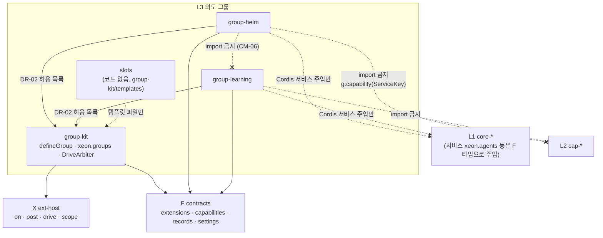
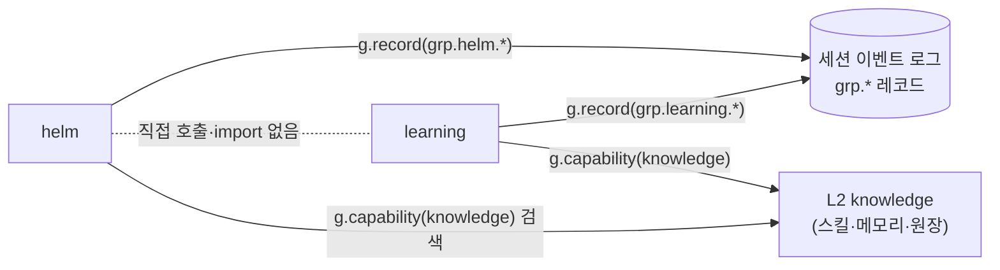

# L3 의도 그룹 층

## 1. 목적

L3는 확장 지점 4연산(`on`, `post`, `drive`, `scope`)과 L2 능력을 묶어 하나의 사상(의도)을 코드 수준으로 루프에 적용하는 그룹 플러그인 층이다. 그룹 하나는 `scope` 하나이고, 루프를 직접 구동하려면 `drive` 임대를 받는다(`_research/layer-plan-v2.json` L3 intro).

그룹이 필요한 이유:

- [결정] Helm(탐구, 새 관점, 모르는 분야 지식을 현재 작업에 적용하는 발견 지원)을 스킬이나 일반 플러그인으로 두면 모델에 강제력이 없다. 스킬은 프롬프트에 들어가는 지시문이라 모델이 따르지 않아도 막을 수단이 없다. 그래서 코드 수준에서 루프를 제어한다. 제2의 Helm 같은 사상도 루프에 붙였다 뗄 수 있어야 한다(`_research/decisions-log.md` 2026-10-21 사용자 의중, `product.vision.spec` §7.1).
- [결정] 기능 중심 층(실행, 통합, 멀티에이전트, 지식)은 거의 바뀌지 않는 코어 플러그인으로 두고, Helm 같은 커스텀 기능과 사상은 그 위에 의도 중심 그룹 플러그인으로 얹는다(`_research/decisions-log.md` 2026-10-21 구상 변경).
- 그룹이 루프를 제어하는 방식은 셋이다. `on`(fold first)으로 도구 호출을 거부하고, `on`(fold chain)으로 모델 요청을 형성하고, `drive`로 턴을 직접 구동한다(`product.vision.spec` §7.1).
- 스킬이나 일반 플러그인으로 충분한 기능은 그룹으로 만들지 않는다. 모델의 행동을 코드로 막거나 구동해야 할 때만 그룹을 쓴다(`product.vision.spec` §5).

이 층이 제공하는 것:

| 제공물 | 내용 |
|---|---|
| 그룹 기반 | `group-kit`. `defineGroup`, 그룹 서비스 `xeon.groups`, drive 임대 정책(`DriveArbiter`), 전환 명령, 재생 검사 도구(`replayDrive`) |
| 기본 그룹 둘 | Helm(`group-helm`, drive 사용), 학습 그룹(`group-learning`, drive 미사용). 함께 켤 수 있다. 학습 그룹은 내장 그룹이고, Helm은 같은 L3 그룹 코드를 기본 플러그인으로 배포한다 [결정: review.m3-design-inputs D-M3-01] |
| 추가 그룹 슬롯 | `slots`. 코드 없음. 제2의 의도 그룹 기준, 정책 플러그인 정식 예, 그룹 템플릿을 문서로 정한다 |

이 문서의 표는 공통 확정 이름과 네 도메인 spec(`L3.group-kit.spec`, `L3.helm.spec`, `L3.learning.spec`, `L3.slots.spec`)의 현재 본문을 기준으로 맞췄다. 도메인 spec이 바뀌면 이 표를 함께 고친다.

## 2. 도메인

계획 v2의 L3 하위 층 4개(`_research/layer-plan-v2.json` L3-a~L3-d)가 도메인 4개에 1:1로 대응한다(`_routing/routes.yaml` layout L3).

| 도메인 | 이름 | 계획 v2 | 패키지 경로 | 문서 | 마일스톤 | drive |
|---|---|---|---|---|---|---|
| group-kit | 그룹 기반 | L3-a | `xeon/packages/group-kit` | `L3.group-kit.spec`, `L3.group-kit.plan` | M1 테스트 그룹(on·post·drive), M2 본체, 2차 재생 검사·승격·계측 | 제공(임대 정책). 자신은 쓰지 않는다. M1 테스트 그룹은 쓴다 |
| helm | Helm (기본 플러그인) | L3-b | `xeon/packages/group-helm` | `L3.helm.spec`, `L3.helm.plan` | M2 | 쓴다 |
| learning | 학습 그룹 (기본 그룹) | L3-c | `xeon/packages/group-learning` | `L3.learning.spec`, `L3.learning.plan` | M3(Helm과 공존), 2차 큐레이터·학습 이력·스크립트 제안 | 쓰지 않는다 [결정] |
| slots | 추가 그룹 슬롯 | L3-d | 없음(코드 없음, 템플릿 문서만) | `L3.slots.spec`, `L3.slots.plan` | 2차(세 항목 모두) | 템플릿 종류에 따른다(drive 템플릿만 쓴다) |

- [결정] 마일스톤 M1은 테스트용 그룹이 on/post/drive를 쓰는 것까지다(`_research/foundation-plan.md` §5 P4). M2·M3 배치는 `product.scope.spec` §4.3의 [제안]을 따른다.
- [결정] 학습 그룹은 drive를 쓰지 않는다. 검토 포크는 L1 백그라운드 위임으로 돌린다(`_research/decisions-log.md` 2026-10-21 계획 v2, `F.extensions.spec` §4.6).

도메인별 요약(각 spec §1 기준):

- group-kit: `defineGroup`으로 그룹을 선언하고(매니페스트, 선택 상태 스키마, 설정 스키마), `GroupApi<S>`(= F `ScopeApi<S>` + `settings()`, `delegate(spec)`, `metrics`, `registerTool`, `registerCommand`)를 그룹에 준다. `GroupService`(`xeon.groups`, 타입은 F `services/groups.ts`)가 그룹 목록, 켜기·끄기 요청, 상태(`GroupStatus`), drive 임대 정책(`DriveArbiter`를 F `LeaseArbiterPort`로 제공)을 맡는다. 임대 메커니즘(부여, 반납, 상한 집행, 재호출, 임대 이벤트)은 `X.primitives.spec`이 맡는다. 2차에 재생 규율 검사(`replayDrive` 확장, `scanDriveSource`), 승격, 계측을 더한다.
- helm: 탐구 신호 감지(tap), 관점·방법 주입(chain, post), 탐구 구동(drive, 병렬 서브에이전트), 지식 소비(L2 능력과 학습 그룹 레코드 읽기), 발견 기록과 작업 연결이다.
- learning: 학습 트리거(카운터 관찰), 검토 포크(`GroupApi.delegate`로 L1 백그라운드 위임), 승인 대기열, 2차의 큐레이터·학습 이력·스크립트 제안이다. 저장은 L2 knowledge가 소유한다.
- slots: 제2의 의도 그룹 판정 기준과 추가 체크리스트, 정책 플러그인(drive 없이 on과 post만 쓰는 작은 그룹)의 정식 예 3종, 그룹 템플릿 3종이다.

## 3. 패키지 배치

의존 규칙:

| 간선 | 판정 | 근거 |
|---|---|---|
| `group-helm`, `group-learning` → `group-kit` | 허용 [결정: review.decisions-2 U-15]. 허용 목록 `DR-02/group-kit`(`from`은 `packages/group-*`) | `eng.dependency-rules.guide` DR-02 (b), 4절, `architecture.layers.spec` §3.2 |
| `group-kit` → 다른 그룹 | 금지 | DR-02 (b) "group-kit은 다른 그룹을 import하지 않는다" |
| 그룹 ↔ 그룹 (`group-helm` ↔ `group-learning`, 외부 그룹 포함) | 금지 [결정] | `F.extensions.spec` §4.8, `eng.context-map.design` CM-06 |
| L3 → `cap-*`(L2) | 금지 [결정: 계획 v2 규칙 2, DR-14]. 능력은 F3 정의와 `g.capability(ServiceKey)`로 쓴다 | `architecture.layers.spec` §3.1 2행, §4.2.1 표 |
| L3 → F `contracts` | 허용. `extensions`, `capabilities`, `records`, `settings` 서브패스 | DR-01 |
| L3 → X `ext-host` | `group-kit`만 허용. DR-14 ext-host 예외(서비스 등록·주입 API만)에 든다 [결정: review.decisions-2 U-17]. 그룹 패키지는 X 타입을 F에서 가져오고, 연산은 `GroupApi`로 받는다 | DR-01, DR-14 |
| L3 → L0 `platform-*` | 순위상 허용이나 DR-14로 구현 import 금지. 그룹은 저장소를 직접 열지 않는다 | `eng.dependency-rules.guide` DR-14 나쁜 예 |
| L3 → L1 `core-*` | 순위상 허용이나 DR-14로 구현 import 금지. `xeon.agents` 등은 F 타입으로 주입받는다 | DR-14, `eng.context-map.design` §4.1 helm·learning 행 |
| 테스트 파일 → 다른 패키지 `testing` 서브패스 | 테스트 파일만 허용 [결정: review.decisions-2 U-17] | DR-08, DR-14 예외 3 |

각 패키지 `package.json`의 `xeon` 필드(현재 값):

| 패키지 | `xeon.layer` | `xeon.domain` | routes.yaml 도메인 | 상태 |
|---|---|---|---|---|
| `@xeon/group-kit` | `L3` | `kit` | `group-kit` | 불일치 [미결] |
| `@xeon/group-helm` | `L3` | `helm` | `helm` | 일치 |
| `@xeon/group-learning` | `L3` | `learning` | `learning` | 일치 |

- [미결] `group-kit`의 `xeon.domain` 값 `kit`과 routes.yaml 도메인 `group-kit`의 불일치(`architecture.layers.spec` §10). [제안] `group-kit`으로 맞춘다. 설정 네임스페이스 `l3.group-kit.*`과 문서 id `L3.group-kit.*`이 모두 `group-kit`을 쓰기 때문이다. 코드 수정은 이 트랙 밖이다.

## 4. 이름 규칙 모음

| 대상 | 규칙 | 정본 |
|---|---|---|
| 그룹 이름(확장 이름) | 기본 그룹 `helm`, `learning`. 그룹 이름은 확장 id 규칙 `^[a-z][a-z0-9-]{1,31}$`(소문자, 숫자, 하이픈. 밑줄 없음)을 따른다 [결정: review.decisions-2 U-18]. 밑줄을 금지하므로 테이블 접두의 경계를 하나로 읽는다 | `L3.group-kit.spec` §3.2 `GROUP_NAME_PATTERN`, `L3.slots.spec` §3.3 |
| 예약 이름 | 정본은 `RESERVED_GROUP_NAMES`(`L3.group-kit.spec` §3.2): `core`, `cap`, `xh`, `sys`, `p`, `ext`, `grp`, `x`, `xeon`, L2 도메인 이름(`workspace`, `mcp`, `web`, `knowledge`, `work`, `dialog`, `artifacts`, `schedule`), `auto`, `all`, `none`, `group`, `groups`, `kit`. 설치된 확장 이름과의 충돌은 `name_conflict`로 따로 거부한다 | `L3.group-kit.spec` §3.2, `eng.context-map.design` §5.2, `F.extensions.spec` §4.7 `name_reserved` |
| scope id | 주 scope id는 그룹 이름. 하위 scope는 `<그룹>/<하위>`(`SCOPE_ID_PATTERN`) | `F.extensions.spec` §3.2 |
| 그룹 레코드 kind | `grp.<그룹>.<영역>.<이름>`(`RecordKind`, 4마디) | `F.extensions.spec` §3.6 |
| 커스텀 메시지 `customType` | 레코드 kind와 같은 형식 | `F.extensions.spec` §3.2 `PostItem` |
| 비공개 기록 kind | `grp.<그룹>.<영역>.<이름>`. X `ScopeApi.recordPrivate(kind, payload)`로 쓰고 다른 그룹은 조회하지 못한다. 상태 이벤트는 `grp.<그룹>.state.committed`(X 소유) [결정: review.decisions-2 T-21] | `X.primitives.spec` §4.6.1, `L3.group-kit.spec` §3.2 |
| 비공개 테이블 | `x_<그룹의 하이픈을 밑줄로>_<지역 이름>`. 지역 이름에는 밑줄을 쓰지 않는다 [결정: review.decisions-2 U-18] | `eng.context-map.design` §5.2, `X.operations.spec` |
| 설정 키(기본 그룹·group-kit) | `l3.<도메인>.<이름>` | `F.wire-settings.spec` §3.8.1, §3.8.3 규칙 3 |
| 설정 키(외부 그룹) | `ext.<id>.<이름>`. `ext.<id>.enabled`, `ext.<id>.isolation`은 X 로더 예약 키. 켜기 키 `ext.<id>.enabled`는 내장 그룹도 쓴다(`ext.helm.enabled`, `ext.learning.enabled`) | `F.wire-settings.spec` §3.8.3, `F.extensions.spec` §6 |
| 명령 | `/group …`(group-kit), `/<그룹 이름> …`(각 그룹) | `L3.group-kit.spec`, 각 그룹 spec |
| 서비스 이름 | `xeon.groups`(`GroupService`, group-kit 제공). 인터페이스 타입은 F `@xeon/contracts/services`의 `services/groups.ts`에 두고 X `LeaseArbiterPort`를 확장한다 [결정: review.decisions-2 D-04]. 그룹은 서비스를 제공하지 않는다 | `F.capabilities.spec` §3.12, `eng.context-map.design` §5.3, CM-06 |
| 지점 이름 | 자체 규칙 `<종류>.<대상>[.<시점>]`(`tool.call.before`, `boundary.settle.before`, `tool.result`, `input.user.before`, `boundary.step.after`, `boundary.settle.after` 등) | `F.extensions.spec` §3.4, §4.10 |

공통 확정 이름(L3 네 문서가 같은 문자열을 쓴다):

| 분류 | 이름 |
|---|---|
| 패키지 | `xeon/packages/group-kit`, `xeon/packages/group-helm`, `xeon/packages/group-learning` |
| group-kit 공개 이름 | `defineGroup`, `GroupDef<S>`, `GroupApi<S>`, `GroupModule`, `GroupService`(`xeon.groups`)·`GroupStatus`(F `services/groups.ts` 정의를 다시 내보냄), `DriveArbiter`, `replayDrive`, `scanDriveSource`, `PromotionReport`, `GroupMetrics` |
| helm 레코드(작성) | `grp.helm.signal.detected`, `grp.helm.discovery.recorded`, `grp.helm.inquiry.finished` |
| learning 레코드(작성) | `grp.learning.skill.proposed`, `grp.learning.skill.approved`, `grp.learning.skill.rejected`, `grp.learning.skill.applied`, `grp.learning.memory.proposed`, `grp.learning.feedback.proposed`, `grp.learning.review.finished`, (2차) `grp.learning.script.proposed` |
| 레코드 읽기 | helm과 learning은 서로의 레코드를 읽지 않는다. 두 매니페스트의 `readsRecordKinds`는 빈 목록이다 [결정: review.decisions-2 D-10] |
| group-kit 설정 | `l3.group-kit.instrumentation`, `l3.group-kit.statusLine`. 구동 그룹 선택은 X 키 `x.primitives.activeDriveGroup`(`null`은 auto) 하나다 [결정: review.decisions-2 S-15] |
| helm 설정 | `l3.helm.autoStart`, `l3.helm.driveLimits`, `l3.helm.maxLenses`, `l3.helm.writeGuard` |
| learning 설정 | `l3.learning.trigger.userTurns`, `l3.learning.trigger.toolIterations`, `l3.learning.review.maxIterations`, `l3.learning.review.tokenBudget`, `l3.learning.review.model`, `l3.learning.approval.required`, `l3.learning.scan.enabled`, `l3.learning.queue.expiryDays`, `l3.learning.curator.enabled`, `l3.learning.curator.intervalHours`, `l3.learning.curator.minIdleHours`, `l3.learning.curator.llmConsolidate` |
| 명령 | `/group status`, `/group on <id>`, `/group off <id>`, `/group drive <id\|auto>`; `/helm start`, `/helm stop`, `/helm status`; `/learning queue`, `/learning review`, `/learning history` |

- 설정 키는 모두 설정 화면 `plugins` 탭에 둔다(`F.wire-settings.spec` §3.8.2 `SettingsTab`).
- 단계 경계 용어 [결정: review.decisions-2 U-01]: 켜기·끄기와 drive 임대 교대는 단계 경계(step 종료 직후, 도구 결과 커밋 뒤)에 적용한다. 계획 v2 원문의 경계 표현도 이 뜻으로 읽는다(`F.conversation.spec` §2.1, `F.extensions.spec` §4.5). 실행 중인 turn이 없을 때의 적용 시점은 `X.primitives.spec`이 정한다.

## 5. 소비 지도

그룹이 소비하는 것(각 그룹 spec의 매니페스트 `points`, `requires`, `optional`, `readsRecordKinds` 기준):

| 그룹 | F 타입 | X 연산 | L1 서비스 | L2 능력 | 다른 그룹 레코드 |
|---|---|---|---|---|---|
| group-kit | `ExtensionManifest`, `validateManifest`, `ScopeApi`, `DriveFn`, `LoopHandle`, `DriveLease`, `DriveLimits`, `SettingDef`, `defineSettings` | `scope`(그룹 등록), `drive` 등록 전달, `LeaseArbiterPort` 제공, `hostOf(g).registerTool`·`registerCommand` 전달 | `xeon.ext`, `xeon.agents`(`delegate` 구현) | 없음 | 없음 |
| helm | `ScopeApi`, `LoopHandle`, `SpawnSpec`, `GroupRecord`, `RecordKindDecl`, `ServiceKey`, `ToolCallDecision`, `PostItem` | `on`(collect `input.agent.before`, first `tool.call.before`, tap `tool.execution.after`·`boundary.settle.after`·`session.start`), `post`, `drive`, `scope` | `xeon.agents`(`loop.spawn` 경유) | 모두 선택(`optional`): `web.search`, `web.fetch`, `knowledge.search`, `knowledge.skills`, `knowledge.memory`(읽기), `work.tasks` | 없음 |
| learning | `ScopeApi`, `GroupRecord`, `RecordKindDecl`, `PostItem`(`kind: "context"`) | `on`(tap 4개: `boundary.turn.before`, `tool.execution.after`, `boundary.settle.after`, `session.start`), `post` 선언, `scope`. chain·first·drive 없음 | `xeon.agents`(`GroupApi.delegate`로 백그라운드 위임) | 필수(`requires`): `knowledge.skills`, `knowledge.memory`, `knowledge.search`, `knowledge.ledger`(읽기, 승인 뒤 쓰기, 원장, 스캔) | 없음 |
| slots 템플릿 | 위와 같은 F 타입 | 템플릿 종류에 따른다 | 선택 | 선택 | 선택 |

그룹 사이 통신:

| 쓰는 그룹 | 레코드 kind | 읽는 그룹 | 읽는 방법 | 표지 |
|---|---|---|---|---|
| learning | `grp.learning.*` 8종 | 없음(L4 표시, 이력) | 이벤트 피드 | [결정: review.decisions-2 D-10] |
| helm | `grp.helm.signal.detected`, `grp.helm.discovery.recorded`, `grp.helm.inquiry.finished` | 없음(L4 표시, 이력) | 이벤트 피드 | [결정: review.decisions-2 D-10] |

그룹 사이에는 직접 호출이 없고 레코드 읽기도 없다 [결정: review.decisions-2 D-10]. 학습 그룹이 적용한 스킬과 메모리는 L2 지식 능력을 거쳐 helm에 전달된다.

- [결정] 그룹끼리 직접 참조하지 않는다(`F.extensions.spec` §4.8). 다른 그룹의 레코드도 읽지 않는다 [결정: review.decisions-2 D-10].
- [제안] 그룹은 다른 그룹을 서비스로도 부르지 않는다. 두 그룹이 같은 능력을 필요로 하면 그 능력을 L2로 옮긴다(`eng.context-map.design` CM-06, 3절 협력 규칙 6·7).

## 6. 층 경계

계획 v2 층 사이 규칙 7개(`_research/layer-plan-v2-notes.md` "층 사이 규칙") 가운데 L3에 걸리는 것과 강제 수단이다. 규칙 1(의존 방향)은 3절 표가 다룬다.

| # | 규칙 | L3 적용 | 표지 | 강제 수단 |
|---|---|---|---|---|
| 2 | L3 그룹은 L2 능력의 정의(F3)만 참조하고 provider 구현은 모른다 | 그룹은 `cap-*`를 import하지 않고 `g.capability(ServiceKey)`로 쓴다. 쓰는 능력은 매니페스트 `requires`, `optional`에 선언한다 | [결정] 원칙과 `cap-*` import 금지(계획 v2 규칙 2, DR-14) | depcruise `group-*` → `cap-*` 금지 [제안](`architecture.layers.spec` §9), `validateUsage` `capability_undeclared` |
| 3 | 그룹끼리 직접 참조하지 않는다. 통신은 F4 스키마가 있는 이벤트와 레코드로만 한다 | `g.record`, `g.readRecords`만 쓴다. `recordKinds`, `readsRecordKinds` 선언 | [결정] | check-layers DR-02(같은 층 import), depcruise, `validateUsage` `record_kind_undeclared`·`read_kind_undeclared`, X 쓰기 시 `validateGroupRecord` |
| 4 | drive 임대는 한 번에 그룹 하나만 가진다. on, post, 백그라운드 위임은 여러 그룹이 함께 쓴다 | Helm만 기본 drive 그룹이다. 정책은 `DriveArbiter`(group-kit), 메커니즘은 X | [결정] | ext-host 테스트, `validateManifestSet` `drive_conflict`, group-kit 단위 테스트 |
| 5 | 켜기와 끄기는 경계에서 적용되고, 정리는 Cordis dispose로 실행된다 | 적용 시점은 단계 경계. 비활성화 순서는 on 제외 → 임대 반납 → `onDispose` | [결정] 원칙, 단계 경계 해석은 [결정: review.decisions-2 U-01] | ext-host 테스트, M1 스모크(drive 그룹 토글) |
| 6 | 모든 설정은 F5 설정 스키마 하나에서 화면, 파일, 명령을 함께 만든다 | 기본 그룹은 `defineSettings("l3.<도메인>", …)`, 외부 그룹은 `ext.<id>` | [결정] | `buildCatalog`의 `foreignNamespace`·`duplicateKey`, `F.wire-settings.spec` 생성 검사 |
| 7 | 이미 있는 패키지는 그대로 쓰고, 부족하면 포크한다 | L3 구성요소 21개(`_research/layer-plan-v2.json` L3-a 7, L3-b 5, L3-c 6, L3-d 3)에서 채택하는 코드는 없다. L3-c 학습 그룹의 4개(학습 트리거, 검토 포크, 큐레이터, 학습 이력 보기)는 Hermes 자기 개선 루프의 설계를 차용하고(출처 표기 '설계', `L3.learning.plan` §4), 나머지 17개는 선례가 없어 자체 구현이다. 템플릿은 `create-cordis` 스캐폴딩 방식을 참고만 한다. `_research/packages.md` §4.6의 "17개 모두 자체"는 학습 그룹 분리 전 집계라 갱신이 필요하다 | [결정] 원칙(`_research/decisions-log.md` 2026-10-21 결정 2차) | 리뷰, `_research/packages.md` §4.6 |

drive 재생 규율(규칙 4의 부속):

- [결정] drive 함수는 경계마다 마지막 커밋 상태로 다시 호출되고 효과는 `loop.turn`, `loop.spawn`, `post`로만 낸다(`F.extensions.spec` §4.6).
- 강제: `replayDrive`(모든 커밋 지점에서 끊고 재개해 같은 효과 열이 나오는지 확인)와 `scanDriveSource`(drive 본문의 `Date.now`, `Math.random`, 직접 I/O 탐지). 단계는 2차다(`_research/layer-plan-v2.json` L3-a). M2의 Helm drive는 `replayDrive` 테스트를 먼저 갖춘다 [제안].

L3가 정하지 않는 것:

| 대상 | 정하는 곳 |
|---|---|
| 4연산 타입, 지점 표, 매니페스트, 그룹 레코드 스키마 | `F.extensions.spec` |
| 4연산 실행, 임대 메커니즘, 유휴 시 토글 시점 | `X.primitives.spec` |
| 디스패치 순서와 tier 정의 | `X.operations.spec` |
| 확장 로딩, 신뢰 등급, 예약 키 `ext.<id>.enabled`·`ext.<id>.isolation` | `X.loading-trust.spec` |
| 서브에이전트 실행과 백그라운드 위임 | `L1.agents.spec` |
| 스킬·메모리 저장, 쓰기 승인과 스캔, 원장 | `L2.knowledge.spec` |
| 설정 화면, 명령 해석, 상태줄 렌더 | `L4.settings-ui.spec`, `L4.cli.spec`, `L4.desktop.spec` |

## 7. 공존 규칙

Helm과 학습 그룹을 동시에 켰을 때:

| 항목 | 동작 | 근거 |
|---|---|---|
| drive 보유 그룹 | Helm만 drive를 쓴다. 학습 그룹은 drive를 등록하지 않으므로 임대 경쟁이 없다 | [결정] `F.extensions.spec` §4.6 |
| on 핸들러 동시 실행 | 두 그룹의 핸들러가 같은 지점에 함께 걸린다. tap은 모두 실행, first는 먼저 결정한 쪽, chain은 순서대로 합성 | `F.extensions.spec` §4.1 |
| 핸들러 순서 | tier, 확장 로드 순서, 등록 순서의 사전식 순서. tier 정의는 L3가 정하지 않는다 | `X.operations.spec`으로 위임, `F.extensions.spec` §4.2 |
| delegate 동시 실행 | Helm의 `loop.spawn`(임대 안)과 학습 그룹의 `delegate`(임대 밖 백그라운드 위임)가 함께 돈다. 학습 쪽 상한은 `l3.learning.review.*` 설정이 건다 | [결정] 층 사이 규칙 4 "백그라운드 위임은 여러 그룹이 함께 쓴다", 상한 귀속은 [미결](`_research/notes/L3-2.md` §6 8) |
| 레코드 읽기 | 서로의 레코드를 선택적으로 읽는다(5절). 한쪽이 꺼져 있어도 다른 쪽은 빈 결과로 동작한다 | [제안] |
| 제3의 drive 그룹 | `x.primitives.activeDriveGroup`이 `null`(auto)이면 `DriveArbiter`가 요청 순서로 정한다. 대기 또는 거부 기본값은 [미결] | `L3.group-kit.spec`, `product.vision.spec` §5 |

기본 켬 상태 요약:

| 그룹 | 기본 상태 | 설정 키 |
|---|---|---|
| helm | 켬 [제안]. 탐구 구동 자동 시작은 `l3.helm.autoStart`가 정한다 | `ext.helm.enabled`(X 예약 키). 기본값은 매니페스트 `defaultEnabled` |
| learning | 켬 [제안]. 승인 대기열 기본 켬 [결정: 계획 v2 L3-c "기본은 켜 둡니다"]. 큐레이터는 2차이고 기본 꺼짐 [제안] | `ext.learning.enabled`(X 예약 키. 기본값은 매니페스트 `defaultEnabled`), `l3.learning.approval.required` |
| 외부 그룹, 정책 플러그인 | 매니페스트 `defaultEnabled`. 템플릿 기본값은 꺼짐 [제안] | `ext.<id>.enabled` |

## 8. L4 노출 요약

| 노출 | 내용 | 소유 문서 |
|---|---|---|
| 설정 화면 `plugins` 탭 | 그룹 목록과 토글, 그룹별 설정(4절 키), drive 보유 그룹 선택(`x.primitives.activeDriveGroup`), drive 임대 상한(`x.primitives.driveDefaultLimits`, `x.primitives.driveLimits`, `l3.helm.driveLimits`) | `L4.settings-ui.spec`, `F.wire-settings.spec` §4.9 |
| `/group` 명령 | `status`, `on <id>`, `off <id>`, `drive <id\|auto>` | `L3.group-kit.spec`(동작), `L4.cli.spec`(해석) |
| `/helm` 명령 | `start`, `stop`, `status` | `L3.helm.spec`, `L4.cli.spec` |
| `/learning` 명령 | `queue`, `review`, `history`(`history`는 2차) | `L3.learning.spec`, `L4.cli.spec` |
| 상태줄 | 활성 그룹, drive 보유 그룹, 임대 남은 예산, Helm 단계. `l3.group-kit.statusLine`로 끈다 | `L3.group-kit.spec`, `L4.cli.spec`, `L4.desktop.spec` |
| 학습 승인 화면 | 대기열의 후보(diff 포함) 승인·수정·거절 | `L3.learning.spec`, `L4.desktop.spec` |

## 9. 층 수용 기준

1. M1: 테스트 그룹 하나가 `on`(tap, first, chain), `post`, `drive`를 쓰는 테이프 세션에서 `xeon chat` 한 턴이 실행되고, 그 그룹을 켜고 끄는 요청이 단계 경계에서 적용된다(`_research/foundation-plan.md` §5 P4, §6 M1).
2. M2(UC-2): Helm이 확산 단계일 때 쓰기 도구 호출은 실행되지 않고 거부 사유가 모델에 돌아가며, 같은 호출은 Helm을 끈 다음 턴에서 실행된다. 렌즈 N개로 탐구하면 서브에이전트 N개가 시작되고, 결과 커밋 이벤트 뒤에 적용 턴이 정확히 한 번 실행된다(`product.usecases.spec` UC-2).
3. M3(UC-3): 카운터 임계를 넘는 테이프 세션을 실행하면 검토 포크가 백그라운드로 한 번 실행되고 후보가 대기열에 들어가며, 승인 전에는 스킬 디렉터리와 메모리 파일의 내용이 바뀌지 않는다. Helm이 drive 임대를 가진 상태에서도 학습 그룹의 트리거와 검토 포크가 동작한다(`product.usecases.spec` UC-3).
4. M3: `group-learning`을 추가하는 변경에서 `contracts`, `ext-host`, `platform-*`, `core-*` 경로의 diff가 0이다(`product.scope.spec` §4.4, `product.vision.spec` S1).
5. 그룹(테스트 그룹, Helm, 학습 그룹, 템플릿 그룹)을 추가하는 변경에서 `contracts`와 `ext-host`의 diff가 0이다(`product.vision.spec` S1).
6. `group-helm`, `group-learning`, 템플릿 그룹 사이 import가 0이다. 하나라도 넣으면 `just verify`가 `DR-02`로 실패한다.
7. `group-*`의 `package.json` `xeon.layer`가 모두 `L3`이고, 허용 목록 밖의 같은 층 import가 0이다.

## 10. 결정 근거와 미결 사항

### 10.1 결정 근거

| 결정 | 근거 |
|---|---|
| [결정] 확장 지점은 on(fold tap/first/chain), post, drive(배타 임대), scope 4연산이다 | `_research/decisions-log.md` 2026-10-21 계획 v2, adr.0007 |
| [결정] Helm과 학습 그룹은 L3 기본 그룹이다. 학습 그룹은 drive를 쓰지 않고 Helm과 공존한다. Helm은 내장 등록 대신 기본 플러그인(별도 패키지, 설치하면 켬)으로 배포하고 자체 확장 API만 쓴다 [결정: review.m3-design-inputs D-M3-01, D-M3-11] | `_research/decisions-log.md` 2026-10-21 계획 v2, `_research/layer-plan-v2-notes.md` "Hermes 학습 루프를 별도 그룹으로", `review.m3-design-inputs` §3 |
| [결정] 그룹이 필요한 이유는 스킬·일반 플러그인에 모델 강제력이 없기 때문이다. 제2의 Helm도 붙였다 뗄 수 있어야 한다 | `_research/decisions-log.md` 2026-10-21 사용자 의중 |
| [결정] 학습 저장은 L2 knowledge, 정책은 L3 학습 그룹 | `_research/layer-plan-v2-notes.md` "Hermes 학습 루프를 별도 그룹으로" |
| [결정] 세션 저장은 SQLite 이벤트 소싱 + 투영, 단일 DB, 확장 접두사 테이블. 그룹 비공개 상태는 `x_<그룹>_*` | `_research/decisions-log.md` 2026-10-21 결정 2차, adr.0004 |
| [결정] DI는 Cordis 하나. 같은 층 협력은 F 정의와 Cordis 서비스로만 | `_research/decisions-log.md` 2026-10-21 결정 3차, `_research/foundation-plan.md` §3 |
| [결정] 예산은 pi 방식. 기본 상한 없음, 상한은 drive 임대에만. drive 임대 상한 기본값(`l3.helm.driveLimits`)과 학습 검토 상한(`l3.learning.review.maxIterations`)은 pi 방식의 예외로 둔다 [결정: review.decisions-2 U-12, U-22] | `_research/decisions-log.md` 2026-10-21 계획 v2 |
| [결정] 입출력 가드레일은 내장 검사를 두지 않는다. F·X가 fail-closed 가드 지점 셋(모델 요청 직전, 도구 호출 직전, 출력 표시·실행 직전)을 두고 검사는 플러그인이 한다 [결정: review.m3-design-inputs D-M3-30, adr.0017] | `_research/layer-plan-v2-notes.md` "입출력 가드레일은 필요한가", `review.m3-design-inputs` D-M3-30 |

### 10.2 미결 사항

공통 모순(L3 네 문서에 걸린다):

1. [결정: review.decisions-2 T-21] 그룹 레코드 이름 접두: 공개 레코드와 비공개 기록 모두 F 형식 `grp.<그룹>.<영역>.<이름>`을 쓴다. 비공개 기록은 X `ScopeApi.recordPrivate(kind, payload)`로 쓰고 다른 그룹의 `readRecords`로 조회되지 않는다. 상태 이벤트는 `grp.<그룹>.state.committed`(X 소유)다.
2. (닫힘) [결정: adr.0015] on 핸들러 외부 효과와 `GroupApi.delegate`·`loop.spawn`의 관계. C안(선언형 허용)으로 on 핸들러의 결정적 `requestId` `delegate`를 허용한다. L3 group-kit·Helm·학습·slots 문서에 반영했다.
3. [미결] `package.json` `xeon.domain`의 `kit` 대 routes.yaml `group-kit`(3절, `architecture.layers.spec` §10).
4. [결정: review.decisions-2 U-15] 같은 층 예외: DR-02 방법 (b), `group-*` → `group-kit` 한 방향 허용 목록(`DR-02/group-kit`)이다(`eng.dependency-rules.guide` DR-02, `architecture.layers.spec` §3.2, `eng.context-map.design` C-5).

도메인 문서에서 모은 것:

5. (닫힘) [결정: review.m3-design-inputs D-M3-05] drive 임대 충돌 때는 대기가 기본이고 대기 상한을 넘으면 거부한다. 정책(`DriveArbiter`)과 메커니즘(X)의 분담은 REQ-X-08과 `L3.group-kit.spec` §3.5가 정한다.
6. (닫힘) [결정: review.m3-design-inputs D-M3-06] 유휴 상태에서 임대를 받은 drive 그룹은 임대 상한 안에서 자율 turn을 시작할 수 있다. 토글 적용 시점은 `X.primitives.spec` §4.5.5다.
7. [미결] 학습 검토 포크 spawn의 상한 귀속(임대 밖 위임)(`_research/notes/L3-2.md` §6 8).
8. [결정: 계획 v2 규칙 2, DR-14] L3 → `cap-*` import 금지는 기본 규칙이다(`architecture.layers.spec` 3.1절 판정). depcruise 규칙 추가는 `architecture.layers.spec` §9가 다룬다.
9. [미결] Helm 내부 설계(단계·신호 식별자와 전이표의 확정, 렌즈 목록, 종료 판정, 부분 결과 허용)(`L3.helm.spec` §10 미결 1·2·3·16, `product.usecases.spec` 미결 1). 단계 순서(발산, 다른 분야 탐색, 수렴, 현재 작업 적용)와 신호 종류 셋(막힘, 반복, 새 분야 진입)은 계획 v2로 정해졌다 [결정]. `L3.helm.spec`은 식별자(`diverge` 등, `stuck` 등)와 전이표를 [제안]으로 둔다.
10. (닫힘) 제안 대기열 소유는 대기열 둘 유지다 [결정: review.m3-design-inputs D-M3-32]. 학습 그룹 소유와 L2 knowledge 소유를 L4가 한 목록으로 보인다. 병합 규칙은 `L3.learning.spec` §4.5 규칙 4([제안]: 같은 이름 거부, 자동 병합 없음)로 닫았다.
11. [결정: 오케스트레이터 기본값] `slots` 템플릿 파일 위치는 `group-kit/templates/`다(`L3.slots.spec` §3.3.1). `eng.context-map.design` C-2의 문서 쪽 반영은 남는다.
12. [미결] 정책 플러그인을 `kind: "group"`으로 둘지 `kind: "plugin"`으로 둘지의 최종 기준(`L3.slots.spec` §4.2).
13. (닫힘) [결정: review.m3-design-inputs D-M3-30] 입출력 가드레일 보류는 내장 검사 없음과 fail-closed 가드 지점 셋으로 바꿨다(adr.0017, `L3.slots.spec` §3.2.4).
14. [결정: review.decisions-2 U-18] 새 그룹 이름 규칙: 확장 id 규칙 `^[a-z][a-z0-9-]{1,31}$`(밑줄 없음)을 따른다. 테이블 접두는 이름의 하이픈을 밑줄로 바꿔 만든다.
