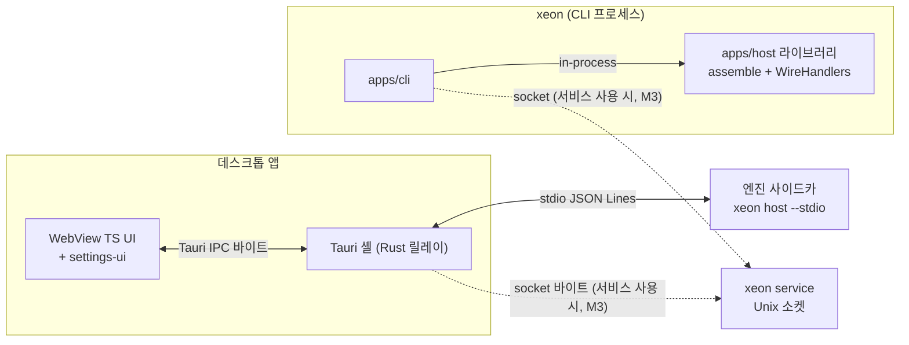

# L4 배포 런타임 층

## 1. 목적

L4는 층 F~L3를 하나의 실행 가능한 런타임으로 조립하고 사용자에게 배포하는 최상위 층이다(층 순위 6, `architecture.layers.spec` §4.1).

- 제공: `xeon` CLI, 데스크톱 앱, `xeon service`, 설정 화면(`architecture.layers.spec` §4.4 L4 항목).
- 요구: 호스트 계약과 설정 스키마(F5, `F.wire-settings.spec`), 모든 층의 플러그인(조립).
- Cordis 서비스: 없다. 호스트(`apps/host`)가 ext-host를 거쳐 Cordis 루트 컨텍스트를 만든다(`architecture.layers.spec` §4.4, DR-11).
- [결정] 엔진은 프로세스 정책을 포함하지 않는 라이브러리이고, 호스트 계약은 하나이며, 전송만 바꾼다(ADR-0006 §3.1~§3.3). UI(CLI, 데스크톱, 설정 화면)는 엔진 객체를 직접 다루지 않고 호스트 계약만 쓴다.
- [결정] 호스트 계약과 DB 스키마는 단계(데몬 없음, 자식 엔진, 서비스 모드)가 바뀌어도 같다. 단계 전환은 엔진 프로세스의 소유자만 바꾼다(ADR-0006 §3.5).

## 2. 도메인

`_routing/routes.yaml` layout L4의 도메인 4개다.

| 도메인 | 한 줄 요약 | 코드 경로 | 문서 | 첫 마일스톤 |
|---|---|---|---|---|
| cli | `xeon` 명령 체계, 대화형·print·JSON 모드, TUI, 비밀·설정·세션·서비스 명령. 기본 in-process | `xeon/apps/cli/**` | `L4.cli.spec`, `L4.cli.plan` | M1 |
| desktop | Tauri 2 셸, Rust 바이트 릴레이, WebView TS UI, 엔진 사이드카 수명 | `xeon/apps/desktop/**` | `L4.desktop.spec`, `L4.desktop.plan` | M1(스캐폴드와 TS 쪽 stdio 적합성), 본체 M2 |
| host-service | 엔진 조립 루트(`assemble`), 호스트 계약의 서버 쪽 처리기, 전송 3종, 서비스 모드 수명 | `xeon/apps/host/**` | `L4.host-service.spec`, `L4.host-service.plan` | M1 |
| settings-ui | `SettingDefWire`·`EffectiveSetting`에서 12탭 화면을 만드는 view-model과 렌더러 | `xeon/apps/desktop/src/settings/**` | `L4.settings-ui.spec`, `L4.settings-ui.plan` | M2(얇은 화면), 전체 M3 |

- settings-ui의 코드 경로는 desktop의 binds(`xeon/apps/desktop/**`)에 포함된다. 그래서 `xeon/apps/desktop/src/settings/**`를 고치는 작업은 두 문서를 함께 받는다. 경계는 "화면 생성·검증·표시는 settings-ui, 셸·수명·전송·패키징은 desktop"이다(`L4.settings-ui.spec` §1.2).
- 패키지 디렉터리 `apps/host`와 routes.yaml 도메인 `host-service`는 이름이 다르다(`architecture.layers.spec` §10 첫 항목, `L4.host-service.spec` §10 미결 18).

### 2.1 마일스톤

`product.scope.spec` §4.3을 L4로 좁혀 옮긴다. M1은 [결정: `_research/foundation-plan.md` §5 P4], M2·M3는 [제안: `product.scope.spec` §4.3].

| 마일스톤 | cli | desktop | host-service | settings-ui |
|---|---|---|---|---|
| M1 | `xeon chat` in-process(print 우선, 최소 대화형), `--json`, `--continue`/`--resume`, `config get`, `config schema`(로컬 명령), 저장소 유일의 scenario 테스트 | 스캐폴드, TS `StdioTransportFactory`·`HostConnection`이 엔진 프로세스에 대해 `WIRE_CONFORMANCE_CASES` 통과(Rust 툴체인 없음) | in-process 전송, 처리기 5개(`host.hello`, `thread.create`, `turn.start`, `events.subscribe`, `settings.get`), stdio 전송과 적합성 통과, `assemble` 최소형(테스트용 그룹 포함), `xeon config schema` | 없음 |
| M2 | `sessions`, `config set/reset/list`, 비밀 관리 명령(`secret *`, UC-6, 값 열람 `secret reveal` 포함), `doctor`(검색 provider 상태 포함), 승인·잠금 프롬프트, 컴파일 바이너리의 `host --stdio` 서브커맨드 | Tauri 데스크톱과 엔진 사이드카, 정상 종료 시 사이드카 없음, CLI와 메시지 열 동일 | 나머지 처리기(`thread.*`(`thread.rename` 포함), `turn.interrupt`, `turn.resume`, `events.unsubscribe`, `approval.respond`, `settings.set/reset/list`와 알림 `settings.invalidated`, `command.list/run`, `trust.get/decide`, `secret.references`, `host.status`), `thread.open` 잠금과 `thread.locked`, stdio 종료 절차, 첫 입력 제목, 외부 바이너리 점검(`Engine.diagnose`) | 얇은 화면(view-model, 일반 렌더러, 키 단위 편집기) |
| M3 | `service start/status/stop/ensure/launch-mode/run` | 서비스 소켓 릴레이, OS 알림 | 서비스 모드 전부(등록 파일, `ensure`, 유휴 종료, 인증), 예약 틱, 알림 라우팅 | 12탭 전체, 전용 편집기, 비밀 탭(값 보기 포함), 레이트 리밋·계정 회전 항목, 첫 실행 권장 화면, 게이지 자리 |

- M1의 stdio 진입은 개발 진입 `bun xeon/apps/host/src/main.ts host --stdio`(`L4.host-service.plan` H5)이고, 컴파일 바이너리의 `xeon host --stdio` 서브커맨드는 M2다.
- `_research/foundation-plan.md` §1 결정 2의 "공유 서비스 모드를 1차로 올린다"에서 '1차'는 구성요소 단계(첫 사용 버전에 포함)를 뜻한다. 서비스 모드는 M3(첫 공개 릴리즈 후보)에 들어가므로 '1차' 표기와 어긋나지 않는다(`product.scope.spec` §4.5).
- 원격 사용은 M3이고 로컬 서비스 소켓을 SSH 터널이나 사설망으로 연결한다. 내장 TLS + 토큰 WebSocket은 2차다 [결정: review.decisions-2 U-11](`L4.host-service.spec` §4.11).

## 3. 패키지 배치

| 패키지 | 디렉터리 | `xeon.domain` | 진입점 |
|---|---|---|---|
| `@xeon/cli` | `xeon/apps/cli` | `cli` | `src/main.ts`(배포 바이너리 `xeon`의 진입 [제안]) |
| `@xeon/host` | `xeon/apps/host` | `host` | `.`(조립, 호스트 시작, 서비스), `./client`(`createHostConnection`, `connectServiceTransport`) |
| `@xeon/desktop` | `xeon/apps/desktop` | `desktop` | WebView `src/main.ts`(M2). `src-tauri/`는 층 규칙 밖 |
| (settings-ui) | `xeon/apps/desktop/src/settings` | 패키지 없음. `@xeon/desktop` 안의 디렉터리 | - |

엔진 바이너리 [제안]: 단일 `xeon`(`bun build --compile`)에 서브커맨드 `chat`, `host --stdio`(데스크톱 사이드카), `service start|status|stop|ensure|launch-mode|run`, `config`, `secret`을 둔다. 근거와 별도 사이드카안과의 비교는 `L4.host-service.spec` §3.2다. 다른 문서는 "엔진 바이너리"라고 쓰고 이 이름을 병기한다.

### 3.1 배치 그림

### 3.2 전송 종류와 소비자

값은 `F.wire-settings.spec` §3.1 `TransportKind`와 같다. ADR-0006 §3.3의 `"service"` 전송은 F의 `"socket"`으로 읽고, `"service"`는 `host.status`의 `mode` 값으로만 쓴다.

| `TransportKind` | 매체 | 소비자 | 서버 쪽 | 마일스톤 |
|---|---|---|---|---|
| `in-process` | 메모리 채널. 직렬화 없음(개발 빌드는 JSON 왕복 검사) | cli | CLI 프로세스 안의 `@xeon/host` | M1 |
| `stdio` | 자식 프로세스 stdin/stdout, JSON Lines | desktop(셸이 바이트 릴레이, WebView가 프레이밍) | 엔진 사이드카 `xeon host --stdio` | M1(계약·적합성), M2(사이드카) |
| `socket` | Unix 도메인 소켓 위 JSON Lines | cli, desktop(셸 릴레이) | `xeon service` | M3 |

## 4. 이름 규칙과 공통 규칙

코드 식별자는 F 문서와 같은 문자열을 쓴다: `Transport`, `TransportKind`, `HostConnection`, `WireHandlers`, `WireRequestContext`, `SettingDefWire`, `EffectiveSetting`, `SettingsTab`(12값), `checkSettingWrite`. 새 공용 이름이 필요하면 F 변경 요청으로 올린다(§8).

| 대상 | 규칙 | 정본 |
|---|---|---|
| 설정 키 | `l4.<cli\|desktop\|host-service\|settings-ui>.<이름>`. 각 도메인 spec §6이 F §6 열 형식(키, 타입, 기본값, range, runtimeChange, allowedScopes, ui.tab, secret)으로 소유한다. settings-ui는 키를 정의하지 않는다 | `F.wire-settings.spec` §3.8.1, §6 |
| 서비스 설정 | `l4.host-service.maxReplayEvents`, `maxSubscriptionsPerConnection`. `ui.tab`은 `execution`. 서비스 수명 키(`l0.process.service.enabled`, `l0.process.service.idleGraceMs`, `l0.process.service.startTimeoutMs`, `l0.process.shutdown.timeoutMs`, 단위 ms)는 L0.process가, 자동 재개 키(`l1.persistence.autoResume`, `l1.persistence.maxResumeAttempts`)는 L1.persistence가 소유하고 L4는 읽기만 한다. 같은 동작을 가리키는 키는 한 층만 정의한다 [결정: review.decisions-2 S-03] | `L4.host-service.spec` §6.1, `L0.process.spec` §6, `L1.persistence.spec` §6 |
| 비밀 | 설정, `settings.get`·`EffectiveSetting`, JSON Schema 출력, 로그, 이벤트에는 해석한 비밀 값을 싣지 않고 `secret://<name>` 참조만 싣는다(F §4.9 비밀 값 비표시 규칙 1~4). [제안] L4는 값을 싣는 wire 메서드를 두지 않고 값 없는 `secret.*`(§8.1)만 쓴다. 셸 로그와 릴레이는 프레임 내용을 기록하지 않는다 | `F.wire-settings.spec` §4.9, `L0.secrets.spec` §8.3 R4, `L4.desktop.spec` E11 |
| 승인 | [결정: review.decisions-2 U-02] `approval.requested`/`approval.resolved` 내구 이벤트 + `approval.respond` 메서드(A안). 서버 → 클라이언트 요청은 쓰지 않는다 | `F.wire-settings.spec` §4.6 |
| 설정 변경 | 엔진 설정 쓰기는 `settings.set`(지우기는 `settings.reset`) 한 경로다. 검사는 `checkSettingWrite`이고 CLI `xeon config set`도 같은 메서드를 부른다 | `F.wire-settings.spec` §4.11 |
| 경로 | 데이터·상태·런타임·로그 디렉터리와 소켓 경로는 `L0.os` 서비스가 정한다. 앱 코드에 OS 분기를 두지 않는다(DR-13) | `L0.os.spec` |
| 프로세스 | spawn·신호·잠금은 `L0.process`를 거친다. 테스트의 자식 프로세스 spawn 예외는 `L4.desktop.plan` R10의 결정 하나를 host·cli·desktop 테스트가 함께 따른다 | `L0.process.spec`, DR-07 |
| 호스트 규칙 번호 | `HS-NN`(연결·처리·소유), `SV-NN`(서비스 체크리스트 8항) | `L4.host-service.spec` §4 |

## 5. 소비 지도

L4 각 문서가 아래 층 문서의 무엇을 쓰는지 적는다. 실제로 내용을 가져다 쓰는 문서는 각 L4 문서의 `depends_on`에도 적는다.

| L4 문서 | F | L0 | L1 | L2 |
|---|---|---|---|---|
| `L4.host-service.spec` | `F.wire-settings.spec`: `Transport`, 팩토리 3종, `WireHandlers`, `WireRequestContext`, `WIRE_METHODS`, `WIRE_ERRORS`, `checkEnvelope`, `isCompatible`, `toEventWire`, 재전송 알고리즘, `WIRE_CONFORMANCE_CASES`, `buildCatalog`, `resolveSetting`, `checkSettingWrite`, `settingsJsonSchema`. `F.records.spec`: 이벤트 envelope, seq 규칙. `F.extensions.spec`: 매니페스트 설정 | `L0.process.spec`: 세션 OS 잠금, 활성화 잠금, detached spawn, 신호. `L0.os.spec`: 경로, OS 알림 전달, 타이머. `L0.store.spec`: `StoreId`, `headSeq`, 구간 읽기, 커밋 후 알림, `LeaseService`(`sys_leases` epoch 펜싱과 소유 표시) | `L1.persistence.spec`: thread 연산, 열 때 복구, 자동 재개 상한, `LeaseToken` 대조 쓰기, 설정 범위 읽기·쓰기. `L1.tasks.spec`·`L1.loop.spec`: 제출, 중단, 안전 경계 정지. `L1.tools.spec`: 승인 응답 | `L2.schedule.spec`: 틱, 대기 예약 수, 놓친 예약 정책 |
| `L4.cli.spec` | `F.wire-settings.spec`: `HostConnection`, 알림 타입, `WIRE_LIMITS`, `defineSettings`, 오류 kind. `F.conversation.spec`: ID, `ItemRecord`, 도구 결과 3채널. `F.records.spec`: kind 카탈로그, `redactions` | `L0.secrets.spec`: 비밀 명령 의미, 값 비노출 | `L1.tools.spec`: 승인 payload. `L1.models.spec`: `/model` 별칭 키 | `L2.web.spec`: 검색 provider 설정 키(`doctor`) |
| `L4.desktop.spec` | `F.wire-settings.spec`: `StdioTransportFactory`, `HostConnection`, `WIRE_CONFORMANCE_CASES`, `StreamPosition`. `F.records.spec`: 승인 kind. `F.conversation.spec`: `ThreadSummary` 재개 표시 | `L0.os.spec`: 데이터 디렉터리 공유(E8), 소켓 경로. `L0.process.spec`: 손자 프로세스 그룹(E9) | `L1.tools.spec`: 승인 payload | - |
| `L4.settings-ui.spec` | `F.wire-settings.spec`: `SettingDefWire`, `EffectiveSetting`, `SettingsTab`, `SettingWidget`, `SettingScope`, `RuntimeChange`, `SecretRef`, 오류 3101~3105, §4.10 병합 규칙. `F.records.spec`: `settings.changed` | `L0.secrets.spec`: 비밀 목록·등록·열람 흐름 | `L1.models.spec`: 사용량 투영, 라우팅·폴백 키 모양, `rateLimit`·`accounts` | `L2.web.spec`: 첫 실행 권장 화면의 provider 키. `L2.dialog.spec`: `l2.dialog.notify.*` 탭 배치 |

## 6. 층 경계

의존 규칙 요약(`eng.dependency-rules.guide`, `architecture.layers.spec` §3.2):

- DR-10: 앱(`apps/*`)끼리 import하지 않는다. 예외 하나를 둔다 [결정: review.decisions-2 U-15]: `apps/cli` → `@xeon/host`(진입점 `.`, `./client`)의 한 방향 간선. 허용 목록 항목 `DR-10/cli-host`로 연다. 이는 `architecture.layers.spec` §3.2의 "층 기반 패키지"(L4는 `host`)를 L4에 적용한 결과다. `apps/host`는 다른 앱을 import하지 않는다. `apps/desktop`은 `@xeon/host`를 import하지 않고 엔진 바이너리를 실행한다(`L4.host-service.spec` §3.1).
- DR-14: 조립 루트는 `apps/host` 하나다. 플러그인을 등록하려고 모든 패키지를 import한다. `apps/cli`는 조립 루트가 아니며 F와 `@xeon/host` 공개 진입점 외의 워크스페이스 패키지를 import하지 않는다(같은 절 수정안).
- 조립 위치 결정의 근거: 조립 코드는 L3 그룹까지 모두 import하므로 L4 아래 어느 순위에도 둘 수 없다(DR-01·DR-02). CLI가 항상 서비스를 거치는 안은 in-process 결정과 충돌한다(`L4.host-service.spec` §3.1 비교표).
- `@tauri-apps/*`는 `apps/desktop`만 import한다. WebView 코드 안에서도 셸 경계 모듈로 제한한다(`L4.desktop.spec` §4.9 W2).
- UI(CLI 화면, 데스크톱 WebView, 설정 화면)는 F의 `@xeon/contracts/wire`·`@xeon/contracts/settings` 서브패스와 `HostConnection`으로만 엔진에 접근한다. 엔진 내부 패키지를 import하지 않는다(ADR-0006 §3.2).
- 처리기와 연결 코드는 엔진 포트(`EnginePorts`)만 쓰고, 아래 층 서비스 어댑터는 `apps/host/src/assemble.ts` 한 곳에 둔다(`L4.host-service.plan` §2).

L4가 정하지 않는 것:

| 대상 | 정하는 곳 |
|---|---|
| 메시지·메서드·오류·커서·설정 정의 형식 | `F.wire-settings.spec` |
| 세션 잠금 구현, 프로세스 spawn·신호 | `L0.process.spec`(`eng.transactions.design` T-4) |
| 경로, OS 알림 | `L0.os.spec` |
| 이벤트 저장, 복구, 재개 상한 | `L1.persistence.spec` |
| 승인 프로토콜 | `L1.tools.spec` |
| 예약 테이블과 놓친 예약 | `L2.schedule.spec` |
| 각 층 설정 키 | 각 층 spec §6 |

## 7. 결정 근거

| 결정 | 근거 |
|---|---|
| [결정] 첫 지원 OS는 macOS, Linux(WSL 포함). Windows 네이티브는 나중 | `_research/decisions-log.md` 2026-10-19 |
| [결정] 프로세스는 엔진 라이브러리 + 단일 호스트 계약 + 전송 교체(CLI in-process, 데스크톱 자식 엔진) | `_research/decisions-log.md` 2026-10-21 계획 v2, ADR-0006 §3.1~§3.3 |
| [결정] 예약·원격·알림을 범위에 넣고 데몬을 허용한다. 데스크톱은 메모리 우선 3플랫폼(Tauri 2) | `_research/decisions-log.md` 2026-10-21 결정(3차) |
| [결정] 공유 서비스 모드 `xeon service`(자동 기동, 유휴 종료)는 1차, OS 서비스 등록은 2차 | `_research/foundation-plan.md` §1 결정 2, ADR-0006 §1 |
| [결정] 데스크톱은 Tauri 2 + `bun build --compile` 엔진 사이드카, stdio JSON-RPC | `_research/foundation-plan.md` §1 결정 3, ADR-0008 §3 |
| [결정] 단계가 바뀌어도 호스트 계약과 DB 스키마는 같다 | ADR-0006 §3.5 |
| [결정] 단일 소유: 세션 id 키 잠금, 잠금 실패 시 위임·관찰·분기 | ADR-0006 §3.6 |
| [결정] 서비스 체크리스트 8항 | ADR-0006 §3.7, `L4.host-service.spec` SV-01~SV-08 |
| [결정] 모든 설정은 F5 스키마 하나에서 화면·파일·명령을 만든다 | `_research/layer-plan-v2-notes.md` 층 사이 규칙 6, `F.wire-settings.spec` §4.9 |

## 8. 미결 사항

네 도메인 spec §10의 [미결] 가운데 닫지 않은 항목을 한 표로 모은다. F 변경 요청은 빠짐없이 넣는다. 세부와 선택지는 소유 문서에 있다. "결정 필요"는 사용자 확인, 작성자 결정, F 변경 요청 중 하나다.

| # | 항목 | 소유 문서 | 결정 필요 |
|---|---|---|---|
| 1 | 닫음: 조립 위치(DR-10)는 안 1로 결정(review.decisions-2 U-15). CLI 상태 파일 경로는 `@xeon/host` `resolveHostStatePaths`가 준다(review.decisions-2 B-07) | `L4.host-service.spec` §3.1, §10-1, `L4.cli.spec` §10-1 | - |
| 2 | 단일 바이너리 `xeon` 대 `apps/host` 단독 사이드카. 확정 뒤 `eng.toolchain.guide` TC-10과 `xeon/apps/desktop/README.md` 문구 수정 | `L4.host-service.spec` §3.2, §10-2·3, `L4.desktop.spec` §10-1, `L4.cli.spec` §10-1 | 사용자 확인 |
| 3 | `createHostConnection`·`StdioTransportFactory` 구현의 위치. host는 `@xeon/host/client`(desktop import는 DR-10 예외 추가), desktop은 F에 런타임 중립 구현 요청 | `L4.host-service.spec` §10-5, `L4.desktop.spec` §10-3 | 사용자 확인(DR-10 예외) 또는 F 변경 요청 |
| 4 | TUI 선택(pi-tui 채택, 스택 표에 행 없음) | `L4.cli.spec` §10-6 | 사용자 확인 |
| 5 | 닫음: 데스크톱 프런트엔드는 React 19 + Zustand 5(adr.0010, 2026-10-24). 상태 모델은 `L4.desktop.design`, 규칙은 `eng.frontend-state.guide`. `L4.settings-ui.spec` §10-16의 부품 형식과 `ui`·`visual` 시험 도입은 남는다 | `L4.desktop.spec` §10-11, `L4.settings-ui.spec` §10-16 | - |
| 6 | Linux/WSL 데스크톱 지원 수준, 최소 macOS·WebKitGTK 버전 | `L4.desktop.spec` §10-9·10 | 사용자 확인 |
| 7 | 비밀 입력·관리 wire 경로. 값 없는 `secret.*` 일곱(`list`, `meta`, `remove`, `test`, `references`, `beginEntry`, `beginReveal`)이 F에 M2로 있고 호스트가 처리한다(`L4.host-service.spec` §4.12, 오류는 `secret.*` 전용 kind 3201~3212). 열람은 M2 CLI `secret reveal`과 M3 화면(review.decisions-2 U-20). 남은 것: C안 불가 OS의 대체, `SecretEntryOffer`의 `add`용 메타 일부 필드(M3) | `L4.cli.spec` §10-3, `L4.settings-ui.spec` §10-2, `L0.secrets.spec` §8.3 R4 | M3 |
| 8 | 닫음: 원격은 M3에 로컬 소켓 터널로, 내장 TLS + 토큰 WebSocket은 2차(review.decisions-2 U-11) | `L4.host-service.spec` §4.11, §10-4 | - |
| 9 | 서비스 인증: Unix 소켓 + 파일 권한으로 충분한지, 토큰을 `host.hello`에 실을지 | `L4.host-service.spec` §10-10, `F.wire-settings.spec` §10-4 | 사용자 확인 |
| 10 | 닫음: `host.shutdown`은 F 메서드 표에 M2로 있다. M2 전까지 stdin 닫기로 대신 | `L4.host-service.spec` §10-9, `L4.desktop.spec` §10-2 | - |
| 11 | 닫음: 비정상 종료 표식의 "이어서 실행" 후보는 `ThreadSummary.resumable`이 알리고, 사용자 확인 뒤 `turn.resume`이 이어 실행한다(m2c G1-02, `L4.host-service.spec` HS-74) | `L4.host-service.spec` §10-8·21, `L4.desktop.spec` §10-4 | - |
| 12 | 닫음: 클라이언트 알림 `$/connectionReset`은 F에 M2로 있다 | `L4.desktop.spec` §10-2 | - |
| 13 | 사용자 알림용 wire 알림 또는 표시 힌트. 알림 설정 자체는 `l2.dialog.notify.*`(review.decisions-2 S-04). 판정: 보류(M3). M2는 내구 이벤트 kind로 알림 대상을 고른다(`F.wire-settings.spec` §3.3.4) | `L4.host-service.spec` §10-13, `L4.desktop.spec` §10-5 | M3 계획 |
| 14 | 닫음: 파일 범위 설정 변경 통지는 서버 알림 `settings.invalidated`로 정했고 호스트가 보낸다(m2c G1-08, `L4.host-service.spec` HS-71). 호스트 밖에서 직접 고친 파일의 변경은 파일 감시(M3) 전에는 알리지 못한다 | `L4.host-service.spec` §10-17, `L4.settings-ui.spec` §10-1 | - |
| 15 | `settings.list`의 `type`에 `range` 병합 또는 F 공통 병합 함수. 판정: 보류(M3)(`F.wire-settings.spec` §3.3.4) | `L4.host-service.spec` §10-11, `L4.settings-ui.spec` §10-7, `L4.cli.spec` §10-4 | M3 계획 |
| 16 | 승인 대기 세션을 유휴 종료에서 live로 볼지(제안 live) | `L4.host-service.spec` §10-6, ADR-0006 §6 | 사용자 확인 |
| 17 | 닫음: 세션 잠금은 OS 잠금 + `sys_leases.epoch` 펜싱, 소유 표시는 `sys_leases` 행(review.decisions-2 U-09) | `L4.host-service.spec` §4.7, §10-14 | - |
| 18 | `l4.desktop.*` 값의 저장 위치(데스크톱 로컬 파일 제안)와 관리 잠금 읽기 | `L4.desktop.spec` §10-6, `L4.settings-ui.spec` §10-18 | 작성자 결정 |
| 19 | 닫음: F에 `./testing` 서브패스를 두지 않으므로(review.decisions-2 U-03) 적합성 실행기는 `apps/host/test/contract/`에 둔다 | `L4.host-service.spec` §10-16 | - |
| 20 | 등록 파일 스키마 정본 위치(host-service 또는 L0.process) | `L4.host-service.spec` §10-7 | 작성자 결정 |
| 21 | 닫음: `xeon service ensure --json` 출력 형식. `L4.desktop.spec` §4.8이 HS-38을 그대로 인용하고, 진입 판정은 `xeon service launch-mode --json`으로 맞췄다 | `L4.host-service.spec` §10-12, `L4.desktop.spec` §4.2, §4.8 | - |
| 22 | 닫음: `architecture.runtime-flow.design` §4.6 service 전송 표기는 로컬 소켓으로 고쳐졌다(review.consistency-1 S-16) | `L4.host-service.spec` §10-15 | - |
| 23 | 패키지 도메인 이름 `host`와 routes 도메인 `host-service`의 불일치, 설정 화면 코드 위치 | `L4.host-service.spec` §10-18, `L4.settings-ui.spec` §10-11, `architecture.layers.spec` §10 | 작성자 결정 |
| 24 | 릴리즈 형태(단일 파일, `native/` 사이드카 디렉터리), 사이드카 크기 상한, Windows 크래시 시 엔진 잔존 | `L4.cli.spec` §10-7, `L4.desktop.spec` §10-7, ADR-0008 §6 | 사용자 확인 |
| 25 | M1에서 turn만 멈추는 동작이 필요하면 `turn.interrupt`를 M1으로 당기기 | `L4.cli.spec` §10-2 | F 변경 요청 |
| 26 | 닫음: `doctor`는 `@xeon/host`의 진단 함수 `Engine.diagnose`(외부 바이너리 점검)를 직접 부른다. F `host.diagnose`는 반려됐다(m2c G2-07, `L4.host-service.spec` HS-69). 데스크톱이 같은 결과를 받는 경로는 `L4.host-service.spec` §10-28 | `L4.cli.spec` §10-5 | 데스크톱 경로는 F 변경 또는 T7 결정 |
| 27 | print 모드의 승인 요청 기본 거부, 비대화 자동 승인 플래그 | `L4.cli.spec` §10-8 | 사용자 확인 |
| 28 | 닫음: 승인 A안(review.decisions-2 U-02). `approval.requested`/`approval.resolved` kind는 `F.records.spec` 카탈로그에 있다 | `L4.cli.spec` §10-9 | - |
| 29 | TUI 설정 화면과 view-model 공유 위치(DR-10) | `L4.cli.spec` §10-10, `L4.settings-ui.spec` §10-12 | 사용자 확인 |
| 30 | stdout EPIPE 종료 코드(0 제안)와 129·143 추가 | `L4.cli.spec` §10-11 | 작성자 결정 |
| 31 | 데스크톱 메모리 예산 수치(B1~B4) | `L4.desktop.spec` §10-8 | 사용자 확인(S5 측정 뒤) |
| 32 | 데스크톱 자동 업데이트 채택(M3 이후) | `L4.desktop.spec` §10-12 | 사용자 확인 |
| 33 | 장수명 엔진의 stdio 유지와 로컬 소켓 전환 | `L4.desktop.spec` §10-13, ADR-0008 §6 | 작성자 결정(S3 spike 뒤) |
| 34 | secrets 탭(M3)과 비밀 관리 명령(M2)의 순서 | `L4.settings-ui.spec` §10-4 | 작성자 결정 |
| 35 | 사용량 wire 메서드와 게이지 채우기 시점. 레이트 리밋·계정 회전 설정은 M3 화면에 넣는다(review.decisions-2 U-21). 판정: 보류(M3) | `L4.settings-ui.spec` §10-5 | M3 계획 |
| 36 | 파일 단위 편집기의 `settings.readFile`·`settings.writeFile`, 모르는 키 목록, "파일 열기". 판정: 보류(M3) | `L4.settings-ui.spec` §10-6 | M3 계획 |
| 37 | `SettingsTab` enum과 `SettingUi` 편집기 힌트 필드. 판정: 보류(M3). 노출 단계 필드 `SettingDef.stage`만 M2에 받았다 | `L4.settings-ui.spec` §10-8 | M3 계획 |
| 38 | i18n 방침(`ui.label`·`ui.help` 언어, 메시지 카탈로그) | `L4.settings-ui.spec` §10-9 | 사용자 확인 |
| 39 | 관리 잠금 사유 문구 필드를 `EffectiveSetting`에 싣기. 판정: 보류(M3). 관리 잠금은 `locked` 표시만으로 M2 화면이 동작한다 | `L4.settings-ui.spec` §10-10 | M3 계획 |
| 40 | 확장의 맞춤 설정 패널 허용 여부와 시점 | `L4.settings-ui.spec` §10-13 | 사용자 확인 |
| 41 | 닫음: TypeBox 버전은 1.3.27이다(review.decisions-2 U-24). 클라이언트 `Check`와 서버 검사가 catalog의 같은 사본을 쓴다 | `L4.settings-ui.spec` §10-15, `F.wire-settings.spec` §10-6 | - |
| 42 | desktop 모듈 규칙 W3 허용 목록에 F 서브패스와 `typebox/schema` 더하기 | `L4.settings-ui.spec` §10-17, `L4.desktop.spec` §4.9 | 작성자 결정(desktop) |

문서 사이 어긋남. [제안] 어긋나면 `L4.host-service.spec`을 기준으로 맞춘다. 바이너리·서브커맨드, 처리기, 서비스 수명의 소유 문서가 host-service이기 때문이다(§2 도메인 표, §3 엔진 바이너리 행). 아래 A~G는 각 문서에 반영했다.

| # | 어긋남 | host-service의 정함 | 반영한 문서 |
|---|---|---|---|
| A | `L4.cli.spec` §3.3이 `EngineConnector`, `StdioHostRunner`, `ServiceControl` 이름을 조립 진입점에 요구한다 | 세 이름을 `@xeon/host`에 두지 않는다. CLI가 `resolveLaunchMode`, `startInProcessHost`, `ensureService`, `connectServiceTransport`, `createHostConnection`, `runHostCommand`로 만든다(`L4.host-service.spec` §3.3.5) | `L4.cli.spec` §3.3, §10-1 |
| B | `L4.cli.spec` §3.1이 `xeon config schema`를 M2, F 변경 요청(`settings.schema`)으로 둔다 | wire 메서드 없이 로컬 명령 `runHostCommand({ kind: "config-schema" })`로 M1에 둔다(`L4.host-service.spec` §6.2) | `L4.cli.spec` §3.1, §10-4 |
| C | `L4.cli.spec` §4.3 [가정]: 기존 세션의 쓰기 소유를 `turn.start`가 얻는다 | 확정: `turn.start`의 암묵 획득(HS-28) | `L4.cli.spec` §4.3, §10-2 |
| D | `L4.cli.spec` §3.1이 `xeon host --stdio`를 M2로 둔다. `L4.desktop.plan` D1은 M1에 엔진 프로세스를 띄워 적합성을 돌린다 | M1의 stdio 진입은 개발 진입 `bun xeon/apps/host/src/main.ts host --stdio`(H5). 컴파일 바이너리 서브커맨드는 M2 | `L4.cli.spec` §3.1, `L4.cli.plan` §1, `L4.host-service.plan` §1.2, `L4.desktop.plan` D1(실행 명령 명시) |
| E | `L4.desktop.spec` §4.8이 `ensure` 명령 모양을 host-service에 맡긴다 | `xeon service ensure --json`(HS-38) | `L4.desktop.spec` §4.8 |
| F | `L4.desktop.spec` §4.1 E5의 EOF 뒤 종료 시한 N(가정 5초) | `l0.process.shutdown.timeoutMs` 기본 3000ms(`L0.process.spec` §6) | `L4.desktop.spec` §4.1 |
| G | `L4.settings-ui.spec` §10-14: 열린 프로젝트 없이 project·local 범위에 쓸 때의 오류 kind | 3103 `settings.scopeNotAllowed`, `details.reason: "workspaceRequired"` [제안] | `L4.settings-ui.spec` §4.4.4, §5, §10-14 |
| H | `L4.desktop.spec` §4.2가 엔진 없이 서비스 사용 설정(`l0.process.service.enabled`)을 읽는 경로를 정하지 않았다 | `xeon service launch-mode --json`(`resolveLaunchMode`) [제안] | `L4.desktop.spec` §4.2, `L4.cli.spec` §3.1 |
| I | CLI와 host의 시작 거부 종료코드(`catalog`, `missingService`) | `runHostCommand` 0·1·2 그대로, 조립 결함은 1 | `L4.cli.spec` §3.3, §3.6, §4.10 |

### 8.1 비밀 메서드 이름표

[제안] CLI와 설정 화면은 아래 단수 `secret.*` 메서드를 같은 이름으로 쓴다. 모두 값 필드가 없다. 값 입력과 열람은 호스트 쪽 L0.secrets가 OS 입력 창(서비스 접속) 또는 wire 밖 전달(in-process CLI)로 받는다(`L4.settings-ui.spec` §4.6.4 C안, `L4.cli.spec` §4.7). 일곱 메서드 모두 F 메서드 표에 M2로 있고(`F.wire-settings.spec` §3.3.1) 호스트가 처리한다(`L4.host-service.spec` §4.12). 오류는 `secret.*` 전용 kind 3201~3212다(HS-47).

| 메서드 | 주요 params | CLI 명령(`L4.cli.spec` §3.1) | 설정 화면(`L4.settings-ui.spec` §4.6.3) | L0.secrets 서비스 메서드(`L0.secrets.spec` §6.3) |
|---|---|---|---|---|
| `secret.list` | `{ meta?, usage? }` | `secret ls [--meta] [--usage]` | 목록, 사용 이력 | `ls`, `list` |
| `secret.meta` | `{ name, …메타·정책 필드 }` | `secret meta` | 메타 편집, 정책 편집 | `meta` |
| `secret.remove` | `{ name }` | `secret rm` | 삭제 | `references`, `rm` |
| `secret.test` | `{ name }` | `secret test` | 등록 상태(`registered`, `missing`), 복호화 가능 여부, 길이, SHA-256 앞 8자 | `test` |
| `secret.references` | `{ name }` | `secret rm`이 삭제 전에 부른다 | 삭제 확인에 참조(설정 키, 활성 lease, 최근 thread)를 보인다 | `references` |
| `secret.beginEntry` | `{ name, action: "add" \| "set" \| "rotate" }` | `secret add`, `secret set`, `secret rotate` | 추가, 회전 | `add`, `set`, `rotate` |
| `secret.beginReveal` | `{ name }` | `secret reveal`(M2, review.decisions-2 U-20) | 값 보기(M3) | `reveal` |

- `L0.secrets.spec` §8.3 R4의 요청 목록에는 `secret.beginReveal`이 없다. CLI `secret reveal`(M2)과 설정 화면 값 보기(M3)를 위해 R4에 더하도록 L0.secrets 작성자에게 요청한다.
