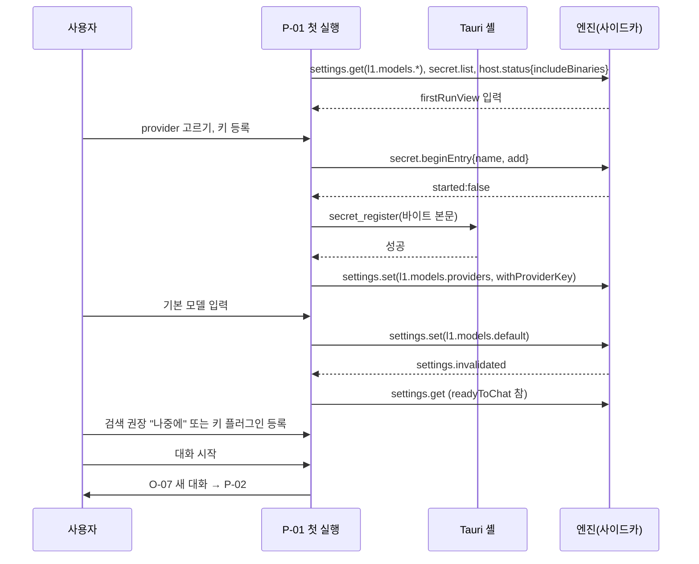
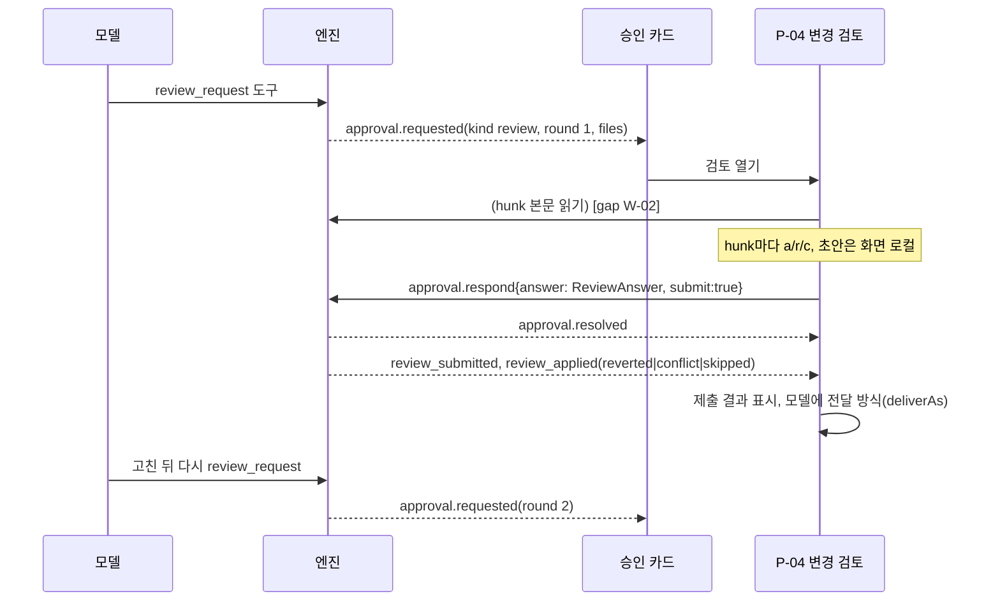
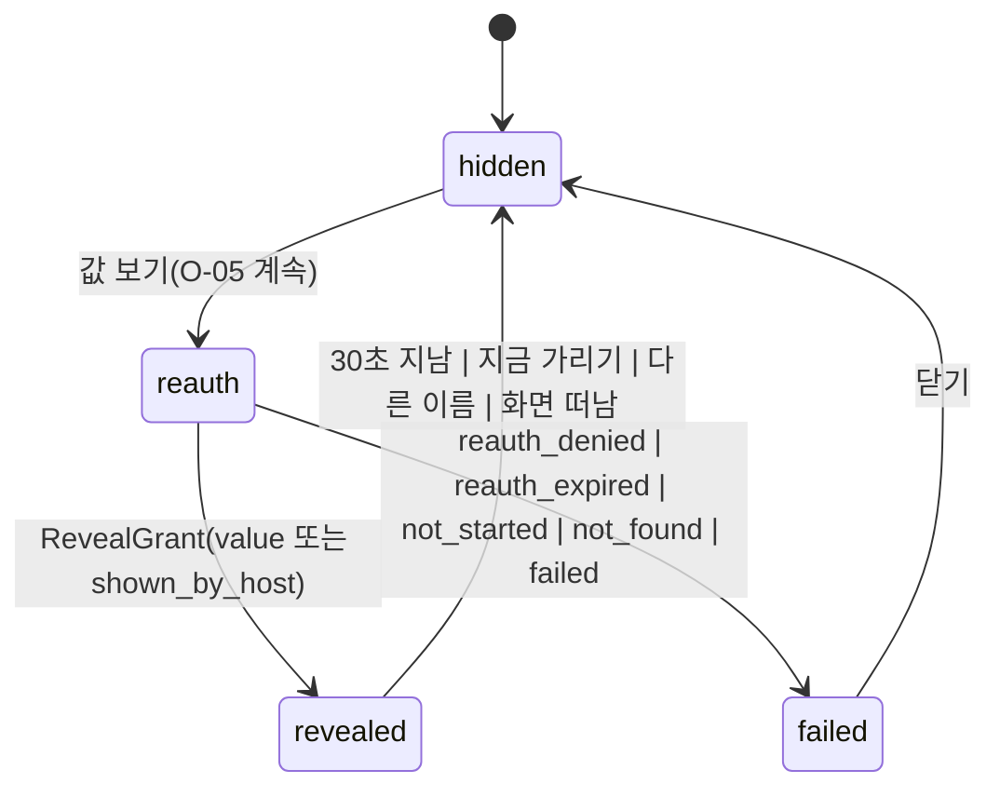
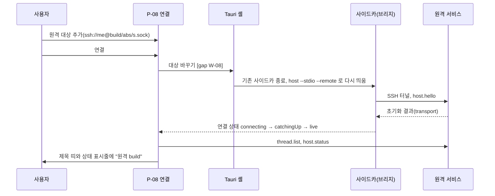
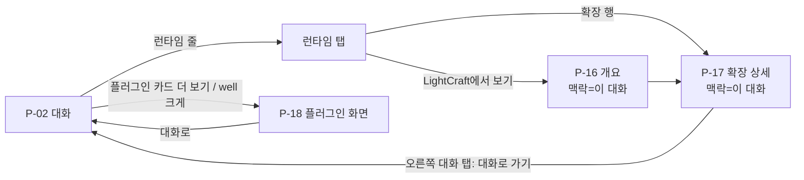
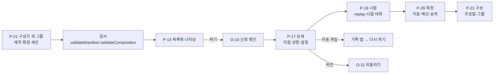

# L4 데스크톱 UX 설계 (desktop-ux)

M4 데스크톱 앱의 화면 전부를 정하는 정본입니다. 사용 시나리오에서 출발해 정보 구조, 화면 목록, 화면별 항목과 기능, 와이어프레임, 화면 사이 흐름을 적습니다. 끝에 세 모델이 같은 조건으로 만들 셸 목업 한 화면의 브리프를 둡니다. 2026-10-30부터 앱은 대화와 런타임 LightCraft 두 1급 영역을 둡니다(§4.9, ADR-0021). LightCraft 시안 브리프는 §14입니다. 2026-10-31 사용자 결정 24건(데스크톱 UX 15, 캔버스 9)을 반영했습니다(§12.3, §12.4). LightCraft 개요는 목록 + 캔버스 나눔 보기(§6.22), 구성과 만들기는 구성기 하나(§6.28)입니다. 시각 언어는 캔버스 2차 시안 뒤에 정하고, 이 문서의 캔버스 절은 동작과 데이터만 정합니다.

- 기준: `xeon/foundation` 9e1cdd9b. wire 메서드 이름은 `xeon/packages/contracts/src/wire-settings/wire/methods.ts`의 `WIRE_METHODS`를, view-model 이름은 `xeon/packages/client/src/{settings,accounts,web}`의 export를 그대로 씁니다.
- 디자인 시스템은 caustic(`@caustic/react`, `@caustic/tokens`)입니다 [결정: 2026-10-29 사용자 지시]. 부품 이름은 `external/caustic/packages/react/src/components/<id>`의 export 이름입니다.
- 표지: `[결정]` 사용자 결정, `[제안]` 이 문서의 설계 선택, `[가정]` 확인 전 전제, `[미결]` 사용자 확인 필요, `[결정: 오케스트레이터 기본값]` 사용자가 바꾸기 전까지 쓰는 기본값입니다.

## 1. 목적과 범위

### 1.1 정하는 것

- 사용 시나리오 14개와 각 시나리오가 거치는 화면(§3)
- 앱 셸 영역, 주 내비게이션, 보조 패널, 시트·대화 상자, 명령 팔레트, 전역 요소(§4)
- 화면·표면 목록과 M4 우선순위(§5)
- 화면마다 항목·기능과 그 데이터 출처(wire 메서드, view-model), 상태, 상호작용, 바로 가기 키, 접근성, caustic 부품, 와이어프레임(§6)
- 화면 사이 주요 흐름(§7)
- 셸 목업 비교용 시험 화면과 브리프(§8)
- 두 1급 영역(대화, 런타임 LightCraft)과 그 사이 이동(§4.9), 플러그인 수명 시나리오(SC-15~SC-23)와 층별 차이(§3.1)
- LightCraft 화면(P-16~P-21. P-22는 P-21 구성기에 합침), 플러그인 화면 기여의 슬롯과 두 모드(P-18, ADR-0021), LightCraft 시안 브리프(§14)
- 런타임 캔버스(§6.22), 트레이스(§6.22.5), 구성기(§6.28), 플러그인 Plugin Builder와의 연결(§6.29, `L3.authoring.spec`)
- caustic 부품 간극(§9), wire와 view-model 간극(§10), 수용 기준(§11), 미결과 기본값(§12)

### 1.2 다루지 않는 것

- 시각 디자인 값(색, 그림자, 글꼴 크기). caustic `FOUNDATION.md`와 토큰을 그대로 씁니다.
- 상태 관리와 reducer 구조: `L4.desktop.design`, `eng.frontend-state.guide`
- 설정 항목의 생성 규칙과 쓰기 흐름: `L4.settings-ui.spec`. 이 문서는 그 view-model을 어디에 어떻게 놓는지만 정합니다.
- 웹 클라이언트(N15)와 모바일. 데스크톱 레이아웃이 compact 폭(720px 이하)에서도 쓸 수 있게만 둡니다.
- 문구의 최종 번역. 문구는 예시이고 메시지 키는 adr.0016을 따릅니다.

### 1.3 근거

- 유즈케이스와 범위: `product.usecases.spec` UC-1~UC-6과 §5.1 보조 유즈케이스, `product.scope.spec` §4.2 N14·N15, §4.4 M3b 행의 "UI 화면은 M4" 재범위
- M4로 옮긴 화면: `review.m3b-plan` §1.2(설정 화면, 시크릿 탭, 승인·제안 목록, 모델 계정, 검색 provider 드래그앤드롭, 게이지, 첫 실행 권장, 접근성)
- 현재 화면: `xeon/apps/desktop/src/views/*`(M2 최소 화면). 슬래시 확인·결과·자동 완성 화면은 M4다(`L4.desktop.spec` §4.13). 원격 서비스 주소 화면 항목은 M4다(`L4.desktop.spec` §4.8).

## 2. 용어

| 용어 | 뜻 |
|---|---|
| 셸 | caustic `AppShell`로 만든 창 틀. 제목 띠, 시작 영역, 무대, 끝 영역, 상태 표시줄로 나눕니다. |
| 무대(stage) | 가운데 주 작업 영역. `AppShellStage`이고 `main` 랜드마크입니다. |
| 시작 영역 | 왼쪽 사이드바. `AppShellStart` 안의 `SidePanel side="start"`입니다. |
| 끝 영역 | 오른쪽 맥락 패널. `AppShellEnd` 안의 `SidePanel side="end"`입니다. medium 폭 이하에서는 무대 위에 시트로 뜹니다. |
| 화면(page) | 무대 하나를 채우는 단위. id는 `P-NN`입니다. |
| 표면(surface) | 화면이 아닌 UI 단위. 셸 요소 `S-NN`, 대화 상자·시트 `O-NN`입니다. |
| 받은 요청 | 사용자 응답을 기다리는 승인(tool, plan, question, review)과 제안, 알림을 모은 곳. |
| 대상(target) | 앱이 붙은 엔진. 로컬 사이드카, 로컬 서비스, 원격 서비스(SSH 터널·사설망) 셋 중 하나입니다. |
| `[gap:W-NN]` | 필요한 wire 메서드나 셸 명령이 없음. §10.1 목록 번호입니다. |
| `[gap:V-NN]` | 필요한 view-model이 없음. §10.2 목록 번호입니다. |
| `[gap:C-NN]` | 맞는 caustic 부품이 없음. §9 목록 번호입니다. |
| LightCraft | 런타임 LightCraft. 층별 플러그인과 플러그인 그룹을 만들고, 켜고, 시험하고, 재고, 묶고, 제어하는 1급 영역(§4.9) |
| 확장 | 매니페스트를 가진 플러그인이나 플러그인 그룹(`ExtensionManifest`). 화면에서는 플러그인과 그룹을 함께 "확장"이라 부릅니다 |
| 화면 기여 | 확장이 선언형 화면 트리로 앱의 슬롯(`page`, `well`, `card`, `status`, `command`, `settings`)에 더하는 화면(ADR-0021) |
| 대화 맥락 | LightCraft 화면이 볼 대화 하나 또는 전체(§4.9.3) |
| Test run | 프로필을 적용해 시험 표지로 만든 대화(SC-19) |
| 맥락 칸 | LightCraft 왼쪽 패널의 맥락 고르기 하나. 값은 전체, 대화, 프로필, 시험 중 하나이고 모든 LightCraft 화면이 따릅니다(§4.9.3) |
| 런타임 캔버스 | LightCraft 개요 오른쪽의 층 띠와 블록, 엣지 그림. 운영(켜기, 끄기, 덮어쓰기, 보기)만 합니다(§6.22) |
| 구성기 | 그룹 구조(블록, 흐름, 프로필, 코드)를 편집하는 유일한 화면(P-21, §6.28) |
| 트레이스 | 대화 턴 하나의 훅 발화와 핸들러 시간을 링 버퍼에서 읽어 캔버스에 덧그리는 보기(§6.22.5, X-15) |
| 사람 확인 관문 | drive가 사람 답을 기다리는 원시. 기다리는 동안 drive 락을 반납합니다(X-17) |
| Plugin Builder | 에이전트가 플러그인을 만들 때 쓰는 L3 그룹 `authoring`(`L3.authoring.spec`) |

## 3. 사용 시나리오

행위자는 한 사람입니다. 본인이 먼저 쓰고 공개 릴리즈합니다(`product.vision.spec` §4.2). "주 사용자"는 macOS나 Linux에서 코드 작업에 에이전트를 쓰는 개발자입니다.

| id | 시나리오 | 근거 |
|---|---|---|
| SC-01 | 첫 실행: 키 등록, 기본 모델, 검색 권장 | M2 최소 화면, settings-ui §4.10, X9 |
| SC-02 | 대화와 도구 승인 | UC-1, adr.0018 |
| SC-03 | 질문과 계획에 답하기 | §5.1 질문·계획 승인 |
| SC-04 | 변경 검토(diff 승인) | L2.artifacts reviews, 승인 kind `review` |
| SC-05 | Helm 탐구 | UC-2, L3.helm |
| SC-06 | 학습 제안 검토 | UC-3, L3.learning §3.8 |
| SC-07 | 예약 만들기와 결과 확인 | UC-4, X4 |
| SC-08 | 원격 서비스에 붙기 | UC-5, X5 |
| SC-09 | 시크릿 관리와 값 열람 | UC-6, X8 |
| SC-10 | 모델 계정, 레이트 리밋, 계정 회전 | X7, L1.models §4.8 |
| SC-11 | 목표 걸고 지켜보기 | §5.1 목표 지속, X6 |
| SC-12 | 잠긴 대화와 이어서 실행 | UC-1 대안 흐름, 재개 |
| SC-13 | 설정 바꾸기와 외부 변경 | X10, settings-ui §4.4~4.5 |
| SC-14 | 웹 검색 provider 순서 정하기 | X9, ADR-0005 |
| SC-15 | 대화에서 런타임 상태를 보고 LightCraft로 넘어가기 | [결정: 2026-10-30 사용자] 대화와 런타임 작업 둘 다 1급, ADR-0021 |
| SC-16 | 플러그인·그룹 만들기 | `fresnel group new`, `L3.group-sdk.spec`, `L3.slots.spec` |
| SC-17 | 플러그인 설계: 훅, drive 락과 상한, 설정 | `F.extensions.spec` §3.1, `X.operations.spec` §4.2 |
| SC-18 | 플러그인 적용: 켜기, 대화 범위, 신뢰 | `X.loading-trust.spec` §4.6, `L3.group-sdk.spec` §3.8 |
| SC-19 | 시험 실행: replay, 테이프, Test run | `L3.group-sdk.spec` §3.10, `just benchmark --server` |
| SC-20 | 평가와 측정: 지표, 비용, 핸들러 시간, 승격 보고, 코어 변경 검사 | `L3.group-sdk.spec` §3.12, `X.operations.spec` §4.2, `scripts/core-diff-check.ts` |
| SC-21 | 묶기: 그룹 구성과 프로필 | `L3.slots.spec`, `x.primitives.activeDriver` |
| SC-22 | 제어: 켜기·끄기, 안전 모드, 자동 끄기 복구, 버전과 되돌리기 | `X.operations.spec` §4.3, §4.6 |
| SC-23 | 플러그인 화면 쓰기(Helm 탐구 전체 화면) | ADR-0021 §3.9 |

### SC-01 첫 실행

- 누가: 앱을 처음 연 사용자
- 목표: 첫 메시지를 보낼 수 있는 상태가 됩니다.
- 단계
  1. 앱이 열리면 사이드카가 뜨고 첫 실행 화면이 무대에 나옵니다(P-01).
  2. 외부 도구 점검 결과를 봅니다. 필수 도구가 없으면 설치 안내를 봅니다.
  3. provider를 고르고 키를 등록합니다. 값은 화면 안 등록 창으로 넣습니다(`L4.desktop.spec` §4.14.1).
  4. 기본 모델을 고릅니다.
  5. 검색 권장 카드에서 Exa·Brave 키 플러그인을 고르거나 "나중에"를 누릅니다. [결정: 2026-11-04 사용자 B15] SearXNG 주소 입력은 없습니다.
  6. "대화 시작"을 누르면 새 대화 시트(O-07)가 열립니다.
- 거치는 화면: P-01, O-07, P-02
- 성공 기준: `readyToChat`이 참이 되고, 첫 대화가 열리고, 입력창 잠금이 풀립니다. "나중에"를 누르면 `l4.desktop.firstRun.searchHintDismissed`가 참으로 저장됩니다.

### SC-02 대화와 도구 승인

- 누가: 작업 폴더를 정한 사용자
- 목표: 모델이 도구를 쓰며 작업을 끝냅니다. 위험한 호출은 내용을 보고 허용합니다.
- 단계
  1. 사이드바에서 대화를 고르거나 ⌘N으로 새 대화를 만듭니다.
  2. 입력창에 쓰고 Enter로 보냅니다. 응답이 흐르고 도구 호출이 접힌 행으로 보입니다.
  3. 승인이 필요한 호출이 오면 트랜스크립트 끝과 받은 요청 패널에 카드가 뜹니다. 상태 표시줄의 승인 수가 늘어납니다.
  4. 명령 전문, 인자, 쓸 시크릿 참조을 보고 "허용", "거부" 중 하나를 고릅니다(승인 기억은 요청 단위뿐입니다).
  5. 실행 중에 입력하면 큐 모드(steer, followUp)로 들어갑니다.
  6. 필요하면 ⌘. 로 중단합니다.
- 거치는 화면: P-02, P-03, S-03
- 성공 기준: 승인 응답이 `approval.respond`로 가고 `approval.resolved`가 오면 카드가 사라집니다. 응답 실패는 이유별 문장으로 보입니다(`approval-outcome.ts`).

### SC-03 질문과 계획에 답하기

- 누가: 모델이 질문(`ask_user`)이나 계획(`submit_plan`)을 보낸 대화의 사용자
- 목표: 선택지를 고르거나 계획을 승인·수정 요청합니다.
- 단계
  1. 질문 카드에서 라디오나 체크박스로 고르고 필요하면 직접 입력합니다. 추천 선택지에 표시가 있습니다.
  2. 계획 카드는 계획 본문을 Markdown으로 보이고 "승인", "수정 요청(피드백 입력)", "거부"를 둡니다. 승인 뒤 모드(`nextModes`)를 고릅니다.
  3. 다른 기기나 다른 대화에 있어도 받은 요청 패널에서 같은 카드로 답합니다.
- 거치는 화면: P-02, P-03
- 성공 기준: 질문마다 선택이나 입력이 있어야 "답하기"가 켜집니다. 계획 거부는 `{feedback}`을 실어 보냅니다.

### SC-04 변경 검토

- 누가: 모델이 파일을 바꾼 뒤 검토를 요청받은 사용자(`review_request` 도구나 `l2.artifacts.reviews.autoRequest`)
- 목표: 바뀐 hunk마다 승인·거절하고 의견을 남긴 뒤 제출합니다. 거절한 hunk는 되돌려집니다.
- 단계
  1. 승인 kind `review` 카드가 옵니다. 카드에는 파일 수, 추가·삭제 줄 수, 라운드가 보입니다.
  2. "검토 열기"로 변경 검토 화면(P-04)을 엽니다.
  3. 왼쪽 파일 목록에서 파일을 고르고 hunk마다 `a`(승인), `r`(거절), `c`(의견)를 누릅니다.
  4. "제출"을 누르면 남은 hunk 처리 방식(남은 것 승인 또는 막기)을 확인합니다.
  5. 결과로 hunk별 되돌림 결과(reverted, conflict, skipped)를 봅니다.
- 거치는 화면: P-02, P-03, P-04
- 성공 기준: 제출이 `approval.respond { decision: "answer", answer: ReviewAnswer }`로 가고 라운드가 끝납니다. 대기 hunk가 있는데 `approveRemaining`이 거짓이면 제출 버튼이 막히고 남은 수가 보입니다.

### SC-05 Helm 탐구

- 누가: 모르는 분야 문제에 막힌 사용자
- 목표: 여러 관점(렌즈)으로 병렬 탐구한 결과를 현재 작업에 적용합니다.
- 단계
  1. 같은 오류가 세 번 나면 트랜스크립트에 Helm 제안 알림(`grp.helm.notice.suggested`)이 보이고 "탐구 시작" 버튼이 있습니다. 또는 `/helm start <주제>`나 팔레트 "탐구 시작"을 씁니다.
  2. 끝 영역의 탐구 탭(P-05)이 열리고 단계(diverge → explore → converge → apply)와 렌즈별 진행이 보입니다.
  3. explore 단계에서 쓰기 도구는 거부되고 트랜스크립트에 거부 사유가 보입니다.
  4. 발견(finding)이 쌓이면 렌즈별 주장, 출처, 신뢰도가 보입니다.
  5. apply 턴이 끝나면 결과 요약과 생긴 작업(followUp → work task)이 보입니다. 필요하면 "탐구 멈춤"을 누릅니다.
- 거치는 화면: P-02, P-05, S-03(Helm 단계 칩)
- 성공 기준: 탐구가 끝나면 `grp.helm.inquiry.finished`의 결과(applied, empty, stopped, limit, failed)가 보이고, 상한에 걸리면 어느 상한인지 보입니다.

### SC-06 학습 제안 검토

- 누가: 대화가 쌓여 학습 그룹이 제안을 만든 사용자
- 목표: 스킬·메모리·피드백 후보를 보고 승인, 수정, 거절, 되돌립니다.
- 단계
  1. 사이드바 "제안"에 배지가 붙고 알림이 옵니다.
  2. 제안 화면(P-06)에서 목록을 상태·종류·출처(학습, 지식)로 거릅니다.
  3. 행을 고르면 오른쪽에 diff, 근거 이벤트, 이유, 충돌 스킬이 보입니다. 웹·MCP를 읽은 뒤 만든 후보는 경고가 붙습니다.
  4. 스킬 후보는 승인 옆에서 범위(사용자, 프로젝트)를 고릅니다. "수정"은 본문 편집기를 엽니다.
  5. 적용된 학습 제안은 "되돌리기"가 있습니다.
- 거치는 화면: P-06, S-05
- 성공 기준: 결정이 `proposal.decide`로 가고 결과가 `decisionOutcomeOf`로 바뀝니다. `revision_mismatch`면 목록을 다시 읽고 문장을 보입니다.

### SC-07 예약 만들기와 결과 확인

- 누가: 반복 작업을 맡기려는 사용자
- 목표: 앱을 닫아도 정해진 때에 프롬프트가 실행되고, 다음에 열면 결과를 봅니다.
- 단계
  1. 예약 화면(P-07)에서 "새 예약"을 누르면 시트가 열립니다.
  2. 트리거(간격, 시각, 파일 감시, 원격, 루프)를 고르고 프롬프트, 작업 폴더, 제목을 넣습니다.
  3. 서비스 모드가 꺼져 있으면 시트 아래에 경고와 "서비스 켜기"가 보입니다. 저장 결과가 `service_mode_off` 경고를 실으면 그대로 보입니다.
  4. 목록에서 다음 실행 시각과 마지막 실행 결과를 봅니다. 마지막 실행 행을 누르면 그 실행이 만든 대화가 열립니다.
  5. 실행이 끝나면 알림(`background_completed` 또는 `error`)이 옵니다.
- 거치는 화면: P-07, P-08, S-05, P-02
- 성공 기준: `schedule.create`가 `ok: true`를 돌려주면 목록 맨 위에 새 행이 보입니다. `ok: false`면 오류 종류별 문장이 해당 입력란 아래에 보입니다.

### SC-08 원격 서비스에 붙기

- 누가: 다른 기기(서버, 다른 컴퓨터)에서 도는 서비스를 노트북에서 쓰려는 사용자
- 목표: 원격 대화 목록을 보고 입력하고 승인에 답합니다.
- 단계
  1. 연결 화면(P-08)에서 "원격 대상 추가"로 `ssh://user@host/abs/socket` 형식 주소를 넣습니다.
  2. "연결"을 누르면 엔진이 그 대상으로 다시 붙습니다. 진행 단계(터널, 초기화, 동기화)가 보입니다.
  3. 성공하면 제목 띠와 상태 표시줄에 대상 이름이 보입니다. 사이드바 대화 목록이 원격 목록으로 바뀝니다.
  4. 원격에서 실행 중인 대화는 관찰로 열립니다. "입력 위임"이 가능하면 입력창이 열립니다.
- 거치는 화면: P-08, P-02, S-03
- 성공 기준: 상태 표시줄이 "원격 · host"와 연결 상태를 보이고, 대화 목록이 원격 `thread.list` 결과입니다. 터널 실패는 `AttachError` 종류별 문장과 "다시 시도"로 보입니다.

### SC-09 시크릿 관리와 값 열람

- 누가: API 키를 등록하고 확인하려는 사용자
- 목표: 값을 화면에 남기지 않고 등록·확인·삭제하고, 필요할 때 재인증 뒤 한 번 봅니다.
- 단계
  1. 설정 > 시크릿(P-10)에서 목록을 봅니다. 값 열은 없습니다.
  2. "추가"로 이름과 메타를 넣고 값은 가린 입력란이나 OS 입력 창으로 넣습니다.
  3. 행 메뉴 "값 보기"를 누르면 재인증 대화 상자(O-05)가 뜹니다. OS 인증을 통과하면 값이 30초 동안 보이고 자동으로 가려집니다.
  4. "삭제"는 참조하는 설정 키, 활성 lease, 최근 대화를 보인 뒤 확인을 받습니다. 사용 중이면 거부됩니다.
- 거치는 화면: P-10, O-05, O-06
- 성공 기준: 값은 React 상태, 거울, 로그에 들어가지 않습니다. 열람은 감사 이벤트 `secret.revealed`로 남습니다. 사이드카 연결에서 열람을 못 하면 그 사유가 보입니다.

### SC-10 모델 계정, 레이트 리밋, 계정 회전

- 누가: provider 계정 여러 개를 쓰는 사용자
- 목표: 계정 우선순위와 예비율, provider별 레이트 리밋 정책을 정하고 회전을 켭니다.
- 단계
  1. 설정 > 계정과 제공자(P-11)에서 provider별 계정 표를 봅니다.
  2. 계정을 추가하고 자격 시크릿을 고르고 우선순위와 예비율을 넣습니다.
  3. 예산과 한도 탭에서 provider별 최소 간격, 한도 도달 시 동작(대기, 전환, 실패), 최대 대기를 넣습니다.
  4. 계정 회전 플러그인을 켜면 위험 안내가 뜨고, 확인해야 회전이 켜집니다.
  5. 사용량 게이지로 창별 사용량을 봅니다.
- 거치는 화면: P-11, P-09, S-03 사용량 팝오버
- 성공 기준: 저장 결과가 사용자 설정 파일의 `l1.models.accounts`, `l1.models.rateLimit`, `ext.account-rotation.acknowledgeRisk`에 같은 키로 들어갑니다(X7). 파일 충돌(`settings.fileConflict`)이면 다시 읽기를 권합니다.

### SC-11 목표 걸고 지켜보기

- 누가: "시험이 모두 통과할 때까지" 같은 완료 조건을 거는 사용자
- 목표: 턴마다 판정 모델이 판정하고 미충족이면 다음 턴이 이어지며, 상한에서 멈춥니다.
- 단계
  1. 입력창에서 `/goal <조건>`을 보내거나 끝 영역 작업 탭의 "목표 걸기"를 씁니다.
  2. 상태 표시줄에 목표 칩 "목표 2/3"(판정 횟수/최대)이 보입니다. 칩 `Popover` 첫 줄은 "판정 2/3"입니다(DP-25, D-17).
  3. 판정마다 트랜스크립트에 판정 행(충족 여부, 이유, 빠진 것)이 보입니다.
  4. 충족, 상한 도달, 판정 실패, 해제 중 하나로 끝나면 알림이 옵니다.
- 거치는 화면: P-02, P-14, S-03
- 성공 기준: `l1.agents.judge.maxRuns`에서 멈추고 상태 `limit_reached`가 보입니다(X6).

### SC-12 잠긴 대화와 이어서 실행

- 누가: CLI나 다른 창이 쓰고 있는 대화를 연 사용자, 또는 크래시 뒤 다시 연 사용자
- 목표: 관찰, 분기, 위임 중 하나를 고르거나 중단된 턴을 이어서 실행합니다.
- 단계
  1. 보내기가 `thread.locked`로 거절되면 잠금 대화 상자(O-01)가 뜹니다.
  2. "관찰만 하기"를 고르면 입력창이 잠기고 "쓰기 다시 시도"가 보입니다. "분기해서 이어 쓰기"는 새 대화를 엽니다.
  3. 대화 목록의 "이어서 실행" 배지가 있는 대화를 열면 트랜스크립트 끝에 "이어서 실행" 띠가 보입니다.
- 거치는 화면: P-02, O-01
- 성공 기준: `turn.resume` 결과 `resumed`, `closed`, `nothing`이 각각 다른 문장으로 보입니다.

### SC-13 설정 바꾸기와 외부 변경

- 누가: 동작을 조정하려는 사용자
- 목표: 항목을 찾아 바꾸고, 범위와 적용 시점을 압니다.
- 단계
  1. ⌘, 로 설정(P-09)을 열거나 팔레트에 키 이름이나 라벨을 칩니다.
  2. 탭을 고르고 항목을 바꿉니다. 범위 배지와 적용 시점 배지(즉시, 다음 턴부터, 재시작 필요)를 봅니다.
  3. 잠긴 항목은 정책 파일 경로를 봅니다. 가려진 범위 값이 있으면 펼쳐 봅니다.
  4. CLI가 같은 키를 바꾸면 화면이 다시 읽고 편집 중인 값에는 "다른 곳에서 바뀜" 표시가 붙습니다.
  5. 재시작이 필요한 변경이 있으면 띠에 "엔진 재시작"이 보입니다.
- 거치는 화면: P-09, S-02
- 성공 기준: 화면 항목 집합이 스키마 키 집합과 같고(X10), 저장 실패는 `FieldError` 종류별로 항목 아래에 보입니다.

### SC-14 웹 검색 provider 순서 정하기

- 누가: 무료 검색을 쓰려는 사용자
- 목표: 쓸 수 있는 provider 상태를 보고 순서를 끌어서 정합니다.
- 단계
  1. 설정 > 도구와 웹(P-12)에서 검색, 브라우저, 가져오기 구역을 봅니다.
  2. 행마다 상태(쓸 수 있음, 키 없음, 연결 안 됨)와 가격표 기준일을 봅니다.
  3. 행을 끌거나 ⌥↑/⌥↓로 순서를 바꿉니다. 저장은 `l2.web.search.order`에 갑니다.
  4. 권장 카드에서 Exa·Brave 플러그인 설치와 키 등록으로 이어집니다.
- 거치는 화면: P-12, P-10
- 성공 기준: `orderUpdateOf`가 만든 값이 `settings.set`으로 저장되고, 화면 순서와 `web.providers`의 `autoRank` 순서가 같아집니다.

### SC-15 대화에서 런타임 상태를 보고 LightCraft로 넘어가기

- 누가: 대화 중에 "지금 어떤 확장이 이 대화에 손대고 있지?"가 궁금한 사용자
- 목표: 대화를 떠나지 않고 이 대화의 런타임 상태를 보고, 필요하면 같은 대화 맥락으로 LightCraft를 엽니다.
- 단계
  1. 대화 머리 아래 런타임 줄에 drive를 쥔 그룹, 켜진 확장 수, 실패 수가 보입니다(DP-19).
  2. 트랜스크립트에는 drive 락 교대, 확장 꺼짐, 핸들러 실패 묶음이 흐린 한 줄 행으로 보입니다. 플러그인이 `card`를 기여한 레코드는 카드로 보입니다(ADR-0021 §3.2).
  3. 오른쪽 막대의 "런타임" 탭을 열면 이 대화의 확장 목록, drive 락 상한 사용량, 최근 기록이 보입니다.
  4. "LightCraft에서 보기"를 누르면 LightCraft 영역으로 바뀌고, 대화 맥락이 이 대화로 고정된 개요(P-16)나 해당 확장 상세(P-17)가 열립니다.
  5. LightCraft 왼쪽 패널의 대화 맥락 칸이나 오른쪽 막대 "대화" 탭으로 같은 대화에 돌아갑니다.
- 거치는 화면: P-02, 런타임 well(§4.9.4), P-16, P-17
- 성공 기준: LightCraft에서 대화로 돌아오면 같은 대화, 같은 스크롤 위치, 같은 오른쪽 탭입니다. 런타임 줄의 실패 수와 P-17 기록의 `scope.handler_failed` 수가 같습니다.

### SC-16 플러그인·그룹 만들기

- 누가: 제2의 Helm 같은 플러그인 그룹이나 L2 provider 플러그인을 만들려는 사용자. 실제 작업은 에이전트가 Plugin Builder(`L3.authoring.spec`)로 합니다
- 목표: 구성 초안을 만들고, 에이전트가 뼈대·검사·시험을 거쳐 설치 가능한 폴더를 냅니다.
- 단계
  1. LightCraft > 구성(P-21)의 "새 그룹"이나 확장 목록의 "새 그룹"을 누릅니다. 구성기가 빈 그룹 머리로 열립니다. 대화에서 "그룹 하나 만들어 줘"라고 해도 됩니다.
  2. 시작점을 고릅니다: Helm 복제, 또는 Plugin Builder 종류 카탈로그의 종류(`group.drive`, `group.policy`, `group.observe`, preview 종류). 카탈로그는 고정 목록이 아니고 Plugin Builder와 함께 갱신됩니다 [결정: 2026-10-31 사용자].
  3. 이름(`^[a-z][a-z0-9-]{1,31}$`, 예약 이름 23개 제외)과 폴더를 넣고, 블록을 쌓아 구성 초안을 만듭니다. 검사(`ext.validateComposition`, W-47)가 블록 안에 바로 보입니다.
  4. "제작 확장으로 만들기"를 누르면 이 대화(또는 새 대화)에서 제작 대화가 열리고 초안이 넘어갑니다. 에이전트가 뼈대를 만들고, 검사하고, 고칩니다. 화면 기여가 있으면 에이전트가 화면마다 모드를 고릅니다(ADR-0021 §3.5).
  5. 결과 단계에서 "replay 시험"(자동으로 돌지 않음 [결정: 2026-10-31 사용자]), "시험 대화에서 켜기", "편집기에서 열기", "사용자 확장 위치에 연결"(사람 확인)로 이어집니다.
- 거치는 화면: P-21, P-02(제작 대화), P-19, P-13, P-17
- 성공 기준: `group.*` 종류의 생성물이 CLI `fresnel group new`와 같은 파일이고 `core-diff-check`에서 보호 경로 변경 0줄입니다. 지금은 wire가 없어 `[gap:W-27]`, `[gap:W-47]`입니다.

### SC-17 플러그인 설계: 훅, drive 락과 상한, 설정

- 누가: 만든 그룹의 동작을 정하는 사용자
- 목표: 어느 훅에 거는지, drive 락 상한, 설정 항목을 보고 고칩니다.
- 단계
  1. 확장 상세(P-17) "훅" 탭에서 매니페스트 `plugins[].hooks`마다 fold, 예산 등급과 기본 예산(`DEFAULT_BUDGETS_MS`), tier를 봅니다.
  2. "drive 락과 상한" 탭에서 `drives`, 상한(`ext.<이름>.driveLimits` 또는 `x.primitives.driveDefaultLimits`), 최근 drive 락 기록을 봅니다.
  3. "설정" 탭에서 `userConfig`와 `defineSettings`로 선언한 항목을 P-09와 같은 부품으로 고칩니다.
  4. 훅이나 매니페스트를 바꾸는 일은 편집기에서 합니다. 저장하면 핫 리로드(`X.loading-trust.spec` §4.4.4)로 다시 실리고 정적 검사 결과(`ManifestIssue`, `scanDriveSource`)가 탭 위에 보입니다.
- 거치는 화면: P-17, P-09
- 성공 기준: 화면의 훅 목록이 매니페스트 `plugins[].hooks`와 같고, 설정 항목 집합이 스키마 키 집합과 같습니다(X10).

### SC-18 플러그인 적용: 켜기, 대화 범위, 신뢰

- 누가: 만든 플러그인이나 받은 플러그인을 쓰려는 사용자
- 목표: 전체(크래프트) 또는 대화 하나(대화 영역 런타임 탭)에서 켜고, 필요한 신뢰를 줍니다.
- 단계
  1. 크래프트(P-16 지도 선택 패널, P-13 층 패널, P-17 자세히 보기)에서 켭니다. 크래프트는 전역만 다루고 범위를 고르지 않습니다 [결정: 2026-11-03 사용자, 크래프트 8차 시안]. 이 대화만 끄는 일(`session`)은 대화 영역 오른쪽 "플러그인" 탭에서 합니다(4번). 런타임 탭(§4.9.8)은 그 결과를 보이기만 합니다. 값은 `ext.<이름>.enabled`이고 적용은 다음 단계 경계입니다. 그룹은 그룹 하나의 스위치로 켜고 끕니다(구성원 하나씩 끄기 없음, 15-1).
  2. 처음 켜는 `user`·`project` 위치 확장은 신뢰 확인(O-10)에 매니페스트 요청 등급, 설치 위치 상한, 쓰는 연산(on, post, drive, 저장)을 보입니다. `project` 위치는 프로젝트 신뢰(O-04)가 `allow`일 때만 켤 수 있습니다.
  3. drive를 등록한 플러그인이 있으면 주도 플러그인 고르기(`x.primitives.activeDriver`)를 함께 보입니다.
  4. 대화 영역 오른쪽 "플러그인" 탭에는 "이 대화에서 끄기" 스위치가 있습니다. 끄면 이 대화에만 적용되고 전역 설정은 그대로입니다. 전역에서 꺼진 플러그인은 스위치가 잠기고 크래프트로 안내합니다. 엔진은 `settings.set` 범위 launch에 `threadId`를 실어 받습니다. 행은 그룹 하나 또는 그룹 없는 플러그인 하나이고(`ext.list` 한 행) 그룹 구성원마다 스위치를 두지 않습니다. 확인 대화 상자는 없고, 경계를 기다리는 동안은 "이번 단계가 끝나면 적용돼요" 배지를 보입니다. 구현은 시안(`mockups/chat-plugin-off`)을 따릅니다 [결정: 2026-11-04 사용자: A5].
- 거치는 화면: P-13, P-17, O-10, O-04
- 성공 기준: 상태가 `enabling` → `enabled`로 바뀌는 것이 "다음 단계 경계에 적용" 배지와 함께 보입니다. 신뢰가 부족하면 진단(`trust_denied`, `trust_undecided`)이 그대로 보입니다.

### SC-19 시험 실행: replay, 테이프, Test run

- 누가: 그룹이 재생 규율을 지키는지, 실제 대화에서 어떻게 도는지 보려는 사용자
- 목표: 기록을 남기는 시험을 돌리고 결과를 비교합니다.
- 단계
  1. 시험 실행(P-19)에서 "새 시험"을 누르고 종류를 고릅니다.
     - replay: `replayDrive`로 모든 커밋 시점에서 끊어 재개하고 절단마다 digest를 비교합니다. 첫 실패에서 멈추지 않습니다. 효과 중복(`effects-doubled`)은 모든 절단의 이벤트열이 같을 때만 판정합니다. 효과 수는 `EffectCounts`(turn, spawn, delegate, post)입니다.
     - benchmark: `just benchmark --server`의 서버 묶음(확장 디스패치, drive 락 비용 등)을 돌립니다.
     - Test run: 프로필(P-21)을 적용한 새 대화를 "시험" 표지로 만들고 프롬프트를 보냅니다.
     - 켬/끔 비교: 케이스 묶음을 프로필 둘(켠 쪽, 끈 쪽)로 돌리는 Test run의 묶음 실행입니다. 배포 앱에도 열립니다. 시작 전에 예상 실행 수와 비용 범위를 보이고 사용자 확인을 한 번 받습니다 [결정: 2026-11-03 사용자, 측정 기획서].
     - replay, benchmark, 코어 변경 검사는 개발 모드에서만 실행합니다. 배포 앱은 Test run, 켬/끔 비교, 지난 결과 읽기를 합니다 [결정: 2026-10-31 사용자, 2026-11-03 사용자로 켬/끔 비교 추가].
  1a. Test run은 "멈춤"으로 다음 단계 경계에서 멈춥니다. drive 락은 쥔 채로 두고, "이어서"나 "한 경계씩"으로 다시 갑니다. 멈춤은 Test run에만 있습니다 [결정: 2026-10-31 사용자] `[gap:W-48]`.
  2. 실행 중인 시험은 왼쪽 패널 "시험 실행"에 `*`로 보입니다. Test run은 대화 목록에 "시험" 표지로 보입니다.
  3. 결과에서 replay 실패는 처음 달라진 위치(`firstDiff`)와 그 이벤트 kind를 보이고, "이벤트 비교"로 두 이벤트열을 나란히 봅니다.
- 거치는 화면: P-19, P-21, P-02
- 성공 기준: replay 결과의 커밋 수와 통과 수가 `ReplayDriveReport`와 같습니다. 지금 `replayDrive`는 시험 파일 안 하니스로만 돌아 런타임 실행 경로가 없습니다 `[gap:W-29]`.

### SC-20 평가와 측정

- 누가: 그룹이 값을 하는지, 느리거나 비싸지 않은지 판단하려는 사용자
- 목표: 비용·토큰, 핸들러 시간과 예산, 실패, 승격 후보, 코어 변경 여부를 한곳에서 봅니다.
- 단계
  1. 측정(P-20)에서 기간과 대화 맥락을 고릅니다. 첫 화면은 최근 달라진 것, 이상 신호, 읽어 볼 Turn입니다(숫자 판이 아님).
  2. 확장별 `GroupMetrics`(토큰, 비용, drive 락 시간, 거부, 패치, post, spawn, 위임)를 표로 봅니다.
  3. 핸들러 시간을 훅별 예산과 비교합니다. 예산의 50% 넘는 p95는 경고 tone입니다 [제안].
  4. 승격 보고(`PromotionReport`)에서 다른 scope가 쓰는 그룹 전용 도구를 봅니다.
  5. 코어 변경 검사(`core-diff-check <base>`)의 마지막 결과 한 줄(보호 경로 `contracts`, `ext-host`, `platform-*`, `core-*` 변경 줄 수)을 봅니다. 실행과 상세는 P-19입니다.
  6. 숫자를 누르면 그 값을 만든 Turn으로 내려가 훅 발화 시간줄, 핸들러 결과, 요청 구성, 캐시 사건을 봅니다(Turn 다시 보기).
- 거치는 화면: P-20, P-17
- 성공 기준: 표의 값이 `grp.<id>.metrics.recorded` 증가분 합과 같습니다. 핸들러 시간은 트레이스 버퍼에 기록하고 `ext.timings`로 읽습니다(W-23 해소).

### SC-21 묶기: 그룹 구성과 프로필

- 누가: 여러 플러그인을 한 작업 방식으로 묶어 쓰려는 사용자
- 목표: 확장 묶음과 설정을 이름 붙여 저장하고 대화에 한 번에 적용합니다. 묶음을 새 플러그인 그룹으로 만들 수도 있습니다.
- 단계
  1. 구성기(P-21) "프로필" 보기에서 층 띠마다 확장의 켜기·끄기·그대로를 고르고, 설정 덮어쓰기와 drive 그룹을 정해 이름을 붙입니다.
  2. "이 대화에 적용"은 엔진이 프로필의 키를 그 대화의 `session` 범위로 한 번에 씁니다(`profile.apply`, W-46). "새 시험 대화로"는 Test run을 만들며 적용합니다.
  3. "그룹" 보기는 블록을 쌓아 그룹 구조를 만듭니다. 결과는 SC-16 제작 흐름으로 이어집니다.
- 거치는 화면: P-21, P-02
- 성공 기준: 적용 뒤 이 대화의 `settings.get` 결과가 프로필 값과 같습니다. 프로필은 데스크톱 로컬이 아니라 런타임 호스트에 저장되어 데스크톱·웹·앱과 서비스가 같은 목록을 봅니다 [결정: 2026-10-31 사용자] `[gap:W-46]`.

### SC-22 제어: 켜기·끄기, 안전 모드, 자동 끄기 복구, 버전과 되돌리기

- 누가: 확장 때문에 대화가 이상해진 사용자
- 목표: 문제 확장을 찾아 끄거나 다시 켜고, 필요하면 이전 버전으로 되돌립니다.
- 단계
  1. 확장이 자동으로 꺼지면 알림과 개요(P-16) "주의" 목록에 사유(연속 5번, 또는 최근 50번 중 10번 이상이고 실패율 0.5 이상)가 보입니다.
  2. 확장 상세 "기록" 탭에서 `scope.handler_failed`(훅, 결과, 메시지, 연속 수)를 봅니다. 고친 뒤 "다시 켜기"를 누르면 실패 장부를 비우고 켭니다(`AutoDisabler.reenable`).
  3. 엔진이 연속으로 시작에 실패했거나 원인을 모르면 "안전 모드로 다시 시작"을 누릅니다. 안전 모드에서는 guard·core와 내장 L1·L2만 실리고 L3 그룹, 외부 확장, X 훅은 빠집니다 [결정: 2026-10-31 사용자].
  4. "버전" 탭에서 설치본, 앱에 든 번들 버전, 이전 버전을 보고 되돌립니다. 버전 기록과 되돌리기는 M4에 되는 만큼 넣습니다 [결정: 2026-10-31 사용자]. 기록 보관(X-8)이 없으면 탭은 설치본과 번들 버전 읽기만 하고 되돌리기는 "번들 버전으로 되돌리기" 하나만 둡니다(§6.24.1 대체 경로). 기록이 있으면 기본 플러그인은 목록의 "앱에 든 버전" 행으로도 번들 판에 되돌릴 수 있습니다.
- 거치는 화면: P-16, P-17, P-13, O-11
- 성공 기준: 다시 켠 뒤 장부가 비어 있고 같은 기준으로 다시 꺼질 수 있습니다. 지금 `/group on`은 `reenable`을 부르지 않아 손으로 켠 확장이 재시작 전까지 다시 꺼지지 않습니다(코드 `operations/auto-disable.ts`, §10.3 X-4). 버전 기록과 되돌리기는 `ext.versions`·`ext.rollback`으로 있습니다(W-31 해소).

### SC-23 플러그인 화면 쓰기(Helm 탐구 전체 화면)

- 누가: Helm 탐구를 대화 옆 좁은 탭보다 넓게 보고 싶은 사용자
- 목표: 플러그인이 기여한 전체 화면에서 탐구 흐름을 보고 조작합니다.
- 단계
  1. Helm 카드의 "탐구 화면 열기", 대화 영역 왼쪽 패널 "플러그인 화면 > Helm 탐구" [결정: 2026-11-04 사용자, 아직 안 만듦], 팔레트 "탐구 화면"으로 P-18을 엽니다.
  2. 단계, 렌즈 진행, 발견, 상한 사용량, 지난 탐구를 봅니다. "멈춤"은 플러그인 트리의 주제 줄에 있고 `/helm stop` 명령입니다(DP-42).
  3. 발견의 작업 링크는 대화의 작업 탭으로, 적용 턴 링크는 대화의 그 턴으로 갑니다.
- 거치는 화면: P-18, P-02
- 성공 기준: 화면 머리(확장 이름, 등급, 버전)는 셸이 그리고, Helm이 꺼지면 화면이 `extension_disabled` 상태로 바뀝니다(ADR-0021 §3.6).

### 3.1 플러그인 수명의 층별 차이

외부 매니페스트의 `layer`는 `L1`, `L2`, `L3`, `plugin`입니다(`F.extensions.spec` §3.1). F와 X 자체, L0 구현은 사용자가 화면에서 교체하는 대상이 아닙니다. 화면은 층마다 아래만 엽니다 [제안].

| 층 | 만들기 | 설계 | 적용 | 시험 | 측정 | 묶기 | 제어 |
|---|---|---|---|---|---|---|---|
| F 계약 | 없음 | 없음. 계약 버전만 보기(P-15) | 없음 | 없음 | 없음 | 없음 | 없음 |
| X 확장 체계 | Plugin Builder 종류 `x.hook`(외부 훅 확정 전 blocked) | 훅 매칭, `timeoutMs` | 켜기·끄기 | 훅 한 번 실행 `[미결]` | 훅 시간과 실패(`hook:<id>` 장부) | 프로필에 넣기 | 안전 모드에서 모두 꺼짐 |
| L0 플랫폼 | 없음 | 보기만(구현 이름, 상태) | 없음 | benchmark 서버 묶음 | benchmark 값 | 없음 | 없음(항상 실림) |
| L1 코어 | 외부 `layer: "L1"` 확장 [가정: 코어 대체가 아닌 추가]. Plugin Builder 카탈로그에 종류 없음 | 훅, 설정 | 켜기·끄기. 내장 core tier는 끌 수 없음 | replay(훅 핸들러), benchmark | 핸들러 시간 | 프로필 | 자동 끄기 면제(core tier), 안전 모드에서 켜짐 |
| L2 기능 | Plugin Builder 종류 `plugin.l2-provider`(preview) | `provides`, 설정(키, `secret://`) | 켜기, 기능 바인딩 확인 | Test run | 호출 수, 비용 | 프로필 | 자동 끄기, 안전 모드에서 외부 provider 꺼짐 |
| L3 플러그인 그룹 | 구성기 "새 그룹" + Plugin Builder 종류 `group.drive`·`group.policy`·`group.observe`. CLI `fresnel group new` | 훅, drive 상한, 레코드 종류, 구성 선언(`composition`), 화면 기여(두 모드) | 켜기, 대화 범위, drive 그룹 고르기, 신뢰 | replay(개발 모드), Test run, 트레이스 | `GroupMetrics`, 승격 보고 | 구성기, 프로필 | 자동 끄기, 안전 모드에서 꺼짐, 버전 |
| plugin(외부) | Plugin Builder 종류 `plugin.tool`(preview) | 훅, 도구 등록, 설정 | 켜기, 신뢰 | Test run | 핸들러 시간, 실패 | 프로필 | 자동 끄기, 안전 모드에서 꺼짐, 버전 |

## 4. 정보 구조

### 4.1 셸 영역

> 2026-10-30: 셸 모양은 §13(최상단 띠 없음, DP-05)과 §4.9가 이 절보다 앞섭니다. 아래 그림의 제목 띠는 옛 안입니다.

[제안] caustic `AppShell` 한 개로 창 전체를 만듭니다. 상태 표시줄은 caustic에 없어 셸 아래에 앱이 직접 둡니다 `[gap:C-03]`.

```text
┌────────────────────────────────────────────────────────────────────────────────────────────────┐
│ S-01a 제목 띠: [=] 사이드바, 경로, 팔레트, 받은 요청, 설정                                     │
├──────────────────────┬──────────────────────────────────────────┬──────────────────────────────┤
│S-01b 시작 영역       │ S-01c 무대                               │ S-01d 끝 영역                │
│                      │                                          │ [받은 요청][탐구][작업]      │
│ 주 내비게이션 5개    │ 화면 P-NN 하나                           │                              │
│ 대화 목록(폴더별)    │                                          │ 맥락 패널                    │
│                      │ 위: 화면 머리(제목, 동작)                │ medium 이하는 시트           │
│                      │ 가운데: 화면 본문                        │                              │
│                      │ 아래: 화면 바닥(입력창 등)               │                              │
│                      │                                          │                              │
│ 설정              ⌘, │                                          │                              │
├──────────────────────┴──────────────────────────────────────────┴──────────────────────────────┤
│ S-03 상태 표시줄: 대상 | 엔진 | 연결 | 진행 중 | 모델 | 사용량 | 목표 | Helm | 승인 | 알림     │
└────────────────────────────────────────────────────────────────────────────────────────────────┘
```

| 영역 | caustic 부품 | 폭 | 반응형 |
|---|---|---|---|
| 제목 띠 | `AppShellTitlebar`, `IconButton`, `Breadcrumb`, `Button variant="ghost"`(팔레트 열기), `Kbd` | 높이 44 | compact에서 경로는 마지막 항목만 |
| 시작 영역 | `AppShellStart` > `SidePanel side="start" preset="inspector"`, `ListNavigation` | 272(240~360), 끌어서 조절 | compact(720 이하)에서 전체 폭 시트, 토글로 엽니다 |
| 무대 | `AppShellStage stageLabel` | 나머지 | 최소 480 [제안] |
| 끝 영역 | `AppShellEnd` > `SidePanel side="end" preset="pane"`, `Tabs` | 352(320~480) | medium(1100 이하)에서 무대 위 시트 |
| 상태 표시줄 | 앱 부품 `StatusBar` `[gap:C-03]`: `Badge`, `Button size="xs" variant="ghost"`, `Popover`, `Progress` | 높이 28 [제안] | compact에서 대상·엔진·승인만 |
| 떠 있는 층 | `AppShellOverlay`, `Toaster`, `Dialog`, `Sheet` | | |

- 창 최소 크기는 720×480입니다 [제안]. 그보다 좁으면 Tauri 창 최소값으로 막습니다.
- 사이드바와 끝 영역의 열림 상태와 폭은 UI 스토어에 두고 `l4.desktop.window.*`에 저장합니다 [제안] `[gap:V-14]`.

### 4.2 주 내비게이션

> 2026-10-31: 연결은 대화 영역 주 내비에 남습니다 [결정: 2026-10-31 사용자]. 2026-11-04: 플러그인 화면이 대화 영역 내비로 와서 주 내비는 여섯입니다 [결정: 2026-11-04 사용자]. 2026-10-30에 적었던 "연결을 LightCraft 엔진으로 옮김"은 취소했습니다(§4.9.3).

시작 영역 위쪽의 `ListNavigation kind="navigation"`입니다. 항목은 여섯 개이고 ⌘1~⌘6으로 엽니다 [제안]. 여섯째는 "플러그인 화면"입니다.

| 순서 | 항목 | 화면 | 배지 | 바로 가기 키 |
|---|---|---|---|---|
| 1 | 대화 | P-02 | 실행 중 대화 수 | ⌘1 |
| 2 | 받은 요청 | P-03(무대 전체 보기) | 대기 승인 + 대기 제안 + 읽지 않은 알림 | ⌘2 |
| 3 | 제안 | P-06 | 대기 제안 수 | ⌘3 |
| 4 | 예약 | P-07 | 실패한 마지막 실행 수 | ⌘4 |
| 5 | 연결 | P-08 | 연결 실패 시 경고 점 | ⌘5 |
| 6 | 플러그인 화면 | P-18 | 없음 | ⌘6 |

- 그 아래에 대화 목록(`ListNavigation kind="sessions"`)이 항상 보입니다. 대화가 주 객체이기 때문입니다.
- 시작 영역 맨 아래에 "설정"(⌘,)이 있습니다. 설정은 무대를 채우는 화면입니다 [결정: 오케스트레이터 기본값].
- 탐구(P-05)와 목표·작업(P-14)은 대화에 딸린 정보라 주 내비게이션에 두지 않고 대화 화면의 끝 영역 탭으로 둡니다.

### 4.3 보조 패널(끝 영역)

| 탭 | 내용 | 보이는 화면 | 바로 가기 키 |
|---|---|---|---|
| 받은 요청 | 모든 대화의 대기 승인 카드, 대기 제안 요약, 알림 | 모든 화면 | ⌘⇧I |
| 탐구 | 열린 대화의 Helm 상태, 렌즈, 발견 | P-02 | ⌘⇧H |
| 작업 | 열린 대화의 목표, 계획, 작업 목록 | P-02 | ⌘⇧T |

- ⌘J가 끝 영역을 열고 닫습니다. 열면 마지막 탭이 보입니다 [제안].
- 대화 화면이 아니면 받은 요청 탭만 있습니다.

### 4.4 대화 상자와 시트

| id | 이름 | 부품 | 여는 곳 |
|---|---|---|---|
| O-01 | 잠긴 대화 | `Dialog kind="alert"` | `thread.locked` 거절 |
| O-02 | 셸 명령 확인 | `Dialog kind="alert"` | `command.run` 결과 `needs_confirmation` |
| O-03 | 명령 결과 | `Sheet side="right"` | `command.run` 결과 `done` |
| O-04 | 프로젝트 신뢰 카드 | `Card` + `Alert`(입력창 위, 대화 상자 아님) | `trust.get` 결과 |
| O-05 | 재인증 | `Dialog kind="alert"` | 시크릿 값 보기 |
| O-06 | 삭제 확인 | `Dialog kind="alert"` | 대화·시크릿·예약 삭제 |
| O-07 | 새 대화 | `Dialog` | ⌘N, "새 대화" |
| O-08 | 예약 편집 | `Sheet side="right"` | P-07 "새 예약" |
| O-09 | 바로 가기 키 도움말 | `Dialog` `[gap:C-11]` | ⌘/ |

### 4.5 명령 팔레트(S-02)

- ⌘K로 엽니다. `Dialog placement="center"` 안에 `Combobox mode="inline"`을 둡니다 `[gap:C-01]`.
- 결과 묶음 순서: 최근 대화, 명령(앱 동작), 플러그인 명령(`command` 배치, 열린 대화가 있을 때만), 슬래시 명령(`command.list`), 설정 항목(키와 라벨), 화면 이동.
- 앱 동작 목록: 새 대화, 대화 이름 바꾸기, 대화 분기, 대화 컴팩션, 중단, 이어서 실행, 탐구 시작·멈춤, 목표 걸기·해제, 받은 요청 열기, 설정 열기, 원격 대상 바꾸기, 엔진 재시작, 진단 복사, 테마 바꾸기.
- 구현 상태: 대화 이름 바꾸기, 목표 걸기, 테마 바꾸기는 아직 없습니다(§6.2 구현 노트). 나머지 동작은 같은 일을 하는 wire나 `command.run` 줄로 보냅니다.
- 행은 아이콘, 라벨, 보조 설명, 바로 가기 키(`Kbd`)를 보입니다. Enter로 실행하고 Esc로 닫습니다. 닫으면 연 곳으로 초점이 돌아갑니다.
- 데이터: 대화는 거울의 `thread.list` 결과, 슬래시 명령은 `command.list { threadId }` → `commandListView`, 설정은 `settings.list` → `buildSettingsView`의 필드 라벨입니다. 팔레트 항목 모델은 `views/palette/palette-model.ts`에 있습니다(V-01 해소).

### 4.6 전역 요소

| 요소 | 위치 | 데이터 | 동작 |
|---|---|---|---|
| 받은 요청 | 제목 띠 `IconButton`(수 배지), 주 내비 2번, 끝 영역 탭 | `ThreadSummary.pendingApprovals` 합, 열린 대화 `approval.list`, `proposal.list { status: "pending" }`, `notify.list` | 누르면 끝 영역 받은 요청 탭 |
| 알림 | 받은 요청 안 "알림" 구역, 토스트 | `notify.list { afterSeq }`, 알림 `notify.delivered` | 알림 행을 누르면 원인 대화나 화면으로 |
| 연결·서비스 상태 | 상태 표시줄 왼쪽 | 셸 IPC 엔진 상태(`EngineState`), 연결 상태 기계, `host.status` | 실패 시 "다시 연결", "엔진 다시 시작", "진단 복사" |
| 원격 대상 | 제목 띠 경로 첫 항목, 상태 표시줄 첫 칸 | 데스크톱 설정 `l0.process.service.remote` [가정], `host.hello` 결과 `transport` | 누르면 대상 팝오버(P-08 요약과 "대상 바꾸기") |
| 모델 | 상태 표시줄, 입력창 모델 칸 | `settings.get { keys: ["l1.models.default"], threadId }` | 누르면 모델 고르기 `Combobox mode="popup"`. 대화 범위 저장은 `settings.set { scope: "launch" }` |
| 사용량 | 상태 표시줄 게이지 | `usage.get { threadId }` | 누르면 `Popover`에 게이지 목록 |
| 목표 | 상태 표시줄 칩 "목표 2/3"(판정 횟수/최대, DP-25) | `[gap:W-05]` | 누르면 `Popover`(첫 줄 "판정 2/3"), 거기서 끝 영역 작업 탭 |
| Helm 단계 | 상태 표시줄 칩 | `[gap:W-04]` | 누르면 끝 영역 탐구 탭 |
| 토스트 | 오른쪽 아래 `Toaster` | 알림 `notify.delivered`, 앱 동작 결과 | 오류 토스트는 자동으로 닫히지 않습니다 |

### 4.7 사이트맵

> 2026-10-30: §4.9.6 사이트맵이 이 그림을 대체합니다.

```text
Fresnel 데스크톱
├─ S-01 앱 셸
│  ├─ S-01a 제목 띠 ── 대상 팝오버, 팔레트 열기, 받은 요청, 설정
│  ├─ S-01b 시작 영역
│  │  ├─ 주 내비: 대화 · 받은 요청 · 제안 · 예약 · 연결
│  │  ├─ 대화 목록 (작업 폴더별 묶음)
│  │  └─ 설정
│  ├─ S-01c 무대 ── P-NN
│  ├─ S-01d 끝 영역 ── 받은 요청 | 탐구(P-05) | 작업(P-14)
│  └─ S-03 상태 표시줄 ── 사용량 팝오버, 모델 팝오버, 대상 팝오버
├─ S-02 명령 팔레트
├─ S-04 토스트
├─ P-01 첫 실행
├─ P-02 대화
│  ├─ O-01 잠긴 대화 · O-02 셸 명령 확인 · O-03 명령 결과 · O-04 신뢰 카드 · O-07 새 대화
│  ├─ P-05 탐구 (끝 영역)
│  └─ P-14 목표와 작업 (끝 영역)
├─ P-03 받은 요청
│  └─ P-04 변경 검토
├─ P-06 제안
├─ P-07 예약 ── O-08 예약 편집, O-06 삭제 확인
├─ P-08 연결
├─ P-09 설정 (13탭)
│  ├─ P-10 시크릿 ── O-05 재인증, O-06 삭제 확인
│  ├─ P-11 계정과 제공자 · 예산과 한도
│  ├─ P-12 도구와 웹
│  ├─ P-13 플러그인과 그룹
│  └─ P-15 진단과 정보 (개요 탭 안)
└─ O-09 바로 가기 키 도움말
```

### 4.8 전역 바로 가기 키

[제안] 모든 바로 가기 키는 동작 id에 묶고 `l4.desktop.appearance.keybindings`(동작 id → 키)로 바꿀 수 있게 합니다. macOS는 ⌘, Linux는 Ctrl입니다.

| 동작 id | 기본 키 | 동작 |
|---|---|---|
| `palette.open` | ⌘K | 명령 팔레트 |
| `thread.new` | ⌘N | 새 대화(O-07) |
| `nav.1`~`nav.6` | ⌘1~⌘6 | 주 내비게이션 |
| `settings.open` | ⌘, | 설정 |
| `sidebar.toggle` | ⌘\ | 시작 영역 열기·닫기 |
| `panel.toggle` | ⌘J | 끝 영역 열기·닫기 |
| `panel.inbox` | ⌘⇧I | 받은 요청 탭 |
| `panel.helm` | ⌘⇧H | 탐구 탭 |
| `panel.work` | ⌘⇧T | 작업 탭 |
| `turn.interrupt` | ⌘. | 진행 중 턴 중단 |
| `composer.focus` | ⌘L | 입력창으로 초점 |
| `thread.next` / `thread.prev` | ⌥⌘↓ / ⌥⌘↑ | 다음·이전 대화 |
| `approval.next` | ⌘⇧A | 다음 대기 승인 카드로 초점 |
| `help.shortcuts` | ⌘/ | 바로 가기 키 도움말(O-09) |
| `area.toggle` | ⌘E | 대화 ↔ 크래프트(§4.9.2) [제안] |
| `area.chat` / `area.workbench` | ⌥⌘1 / ⌥⌘2 | 대화 영역 / LightCraft 영역 [제안] |

- 입력창 안에서는 Enter 보내기, ⇧Enter 줄바꿈, ↑(빈 입력) 마지막 입력 다시 불러오기 [제안], `/` 슬래시 자동 완성입니다. 한글 조합 중 Enter는 보내지 않습니다(`composer-model.ts`).
- 승인 카드에 초점이 있으면 `Y` 허용, `N` 거부입니다 [제안]. `⇧Y`는 카드 키가 아닙니다. 문자 키는 입력란 밖에서만 받습니다.

#### 구현 노트 (바로 가기 동작과 명령 팔레트, 트랙 chat3)

- `help.shortcuts`는 O-09를 연다(§6.20). 셸이 처리하지 않는 나머지 동작은 `App`의 `onAction`이 맡는다.
- `approval.next`(⌘⇧A): 대기 승인 목록(엔진 거울의 순서)에서 초점이 있는 카드의 다음 카드로 옮긴다. 초점이 없거나 목록에 없으면 첫 카드다. 마지막 카드 다음은 처음 카드다(`views/approval-focus-model.ts`의 `nextApprovalId`). 카드 머리(`[data-approval-kind]`, tabIndex -1)에 초점을 준다. 화면에 카드가 없으면 아무 일도 없다.
- `thread.next`·`thread.prev`(⌥⌘↓ / ⌥⌘↑): 사이드바 대화 목록 순서(최근 활동 먼저)로 옮긴다. 끝에서 처음으로, 처음에서 끝으로 돈다(`views/thread-step-model.ts`의 `stepThreadId`). 고르기는 대화 목록 행과 같은 `commands.selectThread`다. 영역은 바꾸지 않는다.
- `composer.focus`(⌘L): 대화가 열려 있으면 대화 영역의 대화 화면으로 바꾸고 입력창에 초점을 준다. 입력창은 `UiState.composerRequest`를 받아 지운다(`views/composer.tsx`).
- 명령 팔레트(S-02)의 구현 노트는 §6.2에 있다.

### 4.9 두 1급 영역: 대화와 런타임 LightCraft

[결정: 2026-10-30 사용자] 대화와 런타임 작업이 둘 다 1급입니다. 앱은 두 영역을 둡니다. 이 절은 §4.1~§4.7의 영역 구조보다 앞섭니다. 셸 모양은 §13(DP-01~DP-17)과 `mockups/_shell`을 따릅니다. §4.1의 제목 띠는 DP-05로 없어졌습니다.

#### 4.9.1 이름과 뜻

| 영역 | 화면 이름 | 다루는 것 | 주 객체 |
|---|---|---|---|
| 대화 | 대화 | 대화, 받은 요청, 학습 제안, 예약 | 대화(thread) |
| 런타임 LightCraft | LightCraft | 층별 플러그인과 플러그인 그룹의 만들기, 설계, 적용, 시험, 측정, 묶기, 제어, 플러그인 화면, 엔진 연결과 진단 | 확장(extension) |

- [제안] 화면에 보이는 이름은 "대화"와 "크래프트"입니다. 문서와 도움말에서는 "런타임 작업대"라고 풀어 씁니다.

#### 4.9.2 영역 바꾸기

- 왼쪽 패널 머리의 찾기 칸(DP-14) 바로 아래에 `SegmentedControl` 두 항목("대화", "작업대")을 둡니다 [제안]. 고른 항목은 DP-17c의 selected 굵기입니다.
- 바로 가기 키: `area.toggle` ⌘E, `area.chat` ⌥⌘1, `area.workbench` ⌥⌘2 [제안]. 키 칩은 그리지 않습니다(DP-06).
- 영역마다 마지막 화면, 스크롤, 오른쪽 탭을 기억합니다(UI 스토어, `l4.desktop.window.area.*` [제안] `[gap:V-14]`). 바꿔도 대화의 입력 초안은 남습니다.
- 팔레트(S-02)는 두 영역의 항목을 함께 찾습니다. 결과를 고르면 그 영역으로 바뀝니다.

#### 4.9.3 왼쪽 패널

| 영역 | 위 | 가운데 | 아래 |
|---|---|---|---|
| 대화 | 찾기, 영역 바꾸기 | 주 내비 여섯(대화, 받은 요청, 제안, 예약, 연결, 플러그인 화면)과 작업 폴더별 대화 목록. Test run은 "시험" 표지 | 설정 |
| LightCraft | 찾기, 영역 바꾸기, 맥락 칸 | LightCraft 내비 여섯(개요, 확장, 시험 실행, 측정, 구성, 엔진). 플러그인 화면은 대화 영역 내비에 있습니다 [결정: 2026-11-04 사용자]. 목록(켜진 확장의 `page` 기여, 확장별 묶음) | 설정 |

- [결정: 2026-10-31 사용자] 연결(P-08)은 대화 영역 주 내비에 남습니다. 대화 내비는 연결까지 다섯이었고 지금은 여섯입니다. [결정: 2026-11-04 사용자] 플러그인 화면(P-18)은 크래프트가 아니라 대화 영역 내비의 "플러그인 화면" 항목 하나(`nav.ts`의 `plugins`, ⌘6)에서 엽니다. 켜진 확장의 `page`·`panel` 기여를 확장별로 보입니다. 크래프트 내비는 여섯으로 그대로 두고, 크래프트의 확장 상세는 그 화면으로 링크합니다("플러그인 화면 열기"). 오른쪽 패널의 플러그인 탭은 그대로 둡니다. 아래 시안 그림과 진입 문장은 이 결정 전의 모양입니다. LightCraft "엔진"은 엔진 상태와 진단(P-15)만 담고, 연결 화면으로 가는 링크 한 줄을 둡니다.
- [결정: 2026-10-31 사용자] 구성과 만들기는 "구성" 하나로 합칩니다. 새 그룹은 구성 안의 "새 그룹" 동작입니다(§6.28, §6.29). LightCraft 내비는 개요, 확장, 시험 실행, 측정, 구성, 엔진 여섯입니다.
- 맥락 칸 [결정: 2026-10-31 사용자]: 왼쪽 패널의 맥락 칸 하나가 모든 LightCraft 화면(P-16, P-13, P-17, P-18, P-19, P-20, P-21)의 맥락을 정합니다. 값은 `Select` 묶음 넷입니다.

| 묶음 | 값 | 화면이 보이는 것 |
|---|---|---|
| 전체 | 하나 | 설치된 확장 전부, 대화 무관 지표 |
| 대화 | 대화마다 | 그 대화에서 켜진 것, 그 대화의 drive 락·지표·기록 |
| 프로필 | 프로필마다 | 프로필을 적용했다면의 상태(`profile.preview`, W-44). 쓰기 동작은 "프로필 고치기"가 됨 |
| 시험 | Test run마다 | Test run의 실제 상태와 시험이 덮어쓴 것 |

- 맥락 따라가기 [결정: 2026-10-31 사용자]: 기본값으로 맥락 칸은 대화 영역에서 지금 열린 대화를 따라갑니다. "LightCraft에서 보기"로 넘어오면 그 대화로 고정(pin)되고, 칸 옆 핀을 풀면 다시 따라갑니다.
- 크래프트 8차 시안 [결정: 2026-11-03 사용자, 승인]: 시안 내비는 크래프트·테스트·성능 측정 셋이고 맥락 칸 자리(`contextField`)가 비어 있습니다. 사용자가 내비 여섯과 맥락 칸 결정(2026-10-31)을 바꾼다고 말한 적은 없어 그대로 둡니다. 크래프트 화면(P-16, P-13, P-17의 켜기·끄기)은 전역만 보이고 맥락 칸을 쓰지 않으며, 맥락 칸은 시험 실행(P-19), 측정(P-20), 구성기(P-21)에 남깁니다 [제안: 오케스트레이터 기본값, §6.22.0, 미결 32].
- LightCraft 내비 배지: 확장은 자동 꺼진 확장 수(`!n`), 시험 실행은 실행 중 수(`n*`)입니다. `!n`은 사용자가 "다시 켜기"로 풀어야 하는 것만 셉니다. 켜진 채 실패하는 확장은 배지에 넣지 않고 상태 표시줄 "확장 실패 n"과 지도 칸 warning 점으로 보입니다. 고정 데이터에서는 review 하나라 `!1`입니다.

#### 4.9.4 오른쪽 떠 있는 막대

| 영역 | 탭(위에서 아래) | 내용 |
|---|---|---|
| 대화 | 받은 요청, 런타임, 작업, 플러그인 `well` 탭들 | 런타임(§4.9.8): 이 대화의 그룹과 확장, drive 락 보유와 대기열, drive 락 상한 사용량, 단계 경계 전환 기록, "LightCraft에서 보기". 기존 "탐구" 탭은 Helm의 `well` 기여(`helm/panel`)가 됩니다 |
| LightCraft | 받은 요청, 검사, 기록, 대화 | 검사: 개요 목록이나 캔버스에서 고른 확장의 검사기(§6.22.4). 기록: 맥락 대화의 런타임 이벤트(`scope.changed`, `scope.handler_failed`, `lease.*`) 실시간 목록. 대화: 맥락 대화의 트랜스크립트 끝 부분 읽기 전용과 "대화로 가기". 구성기(P-21)에서는 검사 자리에 "블록"(팔레트)과 "속성" 탭이 옵니다 |

- 받은 요청은 두 영역 모두 맨 위입니다. 승인은 어느 영역에서도 답할 수 있습니다.
- 플러그인 `well` 탭은 열린 대화에서 켜진 확장의 것만 보입니다. 탭 아이콘은 기여 선언의 `icon`이고, 확장 수가 많아도 막대 칸은 6개까지 보이고 나머지는 "더 보기" 메뉴입니다 [제안].

#### 4.9.5 대화와 LightCraft 잇기

| 출발 | 동작 | 도착 |
|---|---|---|
| 대화 머리 런타임 줄(DP-19) | 누름 | 오른쪽 "런타임" 탭 |
| 런타임 탭 확장 행 | 누름 | LightCraft P-17, 맥락 = 이 대화 |
| 런타임 탭 "LightCraft에서 보기" | 누름 | LightCraft P-16, 맥락 = 이 대화 |
| 트랜스크립트 런타임 행(drive 락, 꺼짐, 실패 묶음) | 누름 | LightCraft P-17 "기록" 탭, 그 이벤트 강조 |
| 플러그인 카드의 "더 보기" | 누름 | LightCraft P-18 그 플러그인 `page` |
| LightCraft 대화 맥락 칸, 오른쪽 "대화" 탭 | "대화로 가기" | 대화 P-02 그 대화 |
| LightCraft 시험 실행의 Test run 행 | 누름 | 대화 P-02 그 Test run |
| 상태 표시줄 drive 칸, 확장 실패 칸 | 누름 | 대화 영역이면 런타임 탭, 크래프트면 P-16 |

- [제안] 맥락은 영역 사이 공유 상태 하나(`workbench.context`: `{ kind: "all" } | { kind: "thread", threadId, pinned } | { kind: "profile", profileId } | { kind: "trial", threadId }`)입니다. `pinned`가 거짓이면 대화 영역에서 대화를 바꿀 때 함께 바뀝니다(기본) [결정: 2026-10-31 사용자].

#### 4.9.6 사이트맵(대체)

```text
Fresnel 데스크톱
├─ S-01 앱 셸: 왼쪽 패널(영역 바꾸기) · 투명한 가운데 · 오른쪽 떠 있는 막대 · 상태 표시줄
├─ S-02 명령 팔레트 · S-04 토스트 · O-09 바로 가기 키 도움말
├─ 대화 영역
│  ├─ P-01 첫 실행
│  ├─ P-02 대화 ── O-01 · O-02 · O-03 · O-04 · O-07
│  │  └─ 오른쪽: 받은 요청 · 런타임 · 작업(P-14) · 플러그인 well(Helm 탐구 = 옛 P-05)
│  ├─ P-03 받은 요청 ── P-04 변경 검토
│  ├─ P-06 제안
│  ├─ P-07 예약 ── O-08 · O-06
│  └─ P-08 연결
├─ LightCraft 영역 (왼쪽 맥락 칸: 전체 · 대화 · 프로필 · 시험)
│  ├─ P-16 LightCraft 개요(목록 + 캔버스, 턴 재생)
│  ├─ P-13 확장 목록 ── O-10 신뢰 확인
│  │  └─ P-17 확장 상세 ── O-11 되돌리기 확인
│  ├─ P-19 시험 실행 ── O-12 새 시험
│  ├─ P-20 측정과 평가
│  ├─ P-21 구성(그룹 · 흐름 · 프로필 · 코드, "새 그룹" = 옛 P-22)
│  ├─ 엔진: 엔진 상태 · P-15 진단 · 연결 링크
│  ├─ 플러그인 화면: P-18 플러그인 화면 호스트(page 기여마다, 선언형·프레임)
│  └─ 오른쪽: 받은 요청 · 검사 · 기록 · 대화
└─ P-09 설정(두 영역 공통) ── P-10 · P-11 · P-12
```

#### 4.9.7 와이어프레임: 대화 영역의 런타임 탭

```text
┌────────────────────────┐
│[찾기               ] «   │ 캐시 무효화 조사        [LightCraft]           ┌─ 런타임 ───────────────────┐    [받]
│ (대화)  LightCraft              │ 목표 2/3 · helm 탐색 · 실패 1          │ 이 대화의 확장             │       [런]
│                        │                                  │ L3 helm  drive · 탐색      │   [작]
│>대화                 2   │ 나                                │ L3 learning  켜짐          │   [탐]
│ 받은 요청             5    │   무효화 시험이 계속 실패해                 │ L2 web-exa   켜짐          │
│ 제안                  3  │ 어시스턴트                            │ plugin acme-notes ! 실패 2 │
│ 예약                 !1  │   > bash bun test cache  실패      │                            │
│                        │   · helm drive 임대 받음 1/4         │ 임대 턴 1/4 · spawn 3/8    │
│ ~/code/fresnel         +  │   · acme-notes 실패 2번             │ 토큰 [###-------] 120k     │
│>캐시 무효화 조사     *        │   ┌ Helm 제안 ───────────────┐        │                            │
│  테스트 정리     승인1        │   │ 같은 오류 3번 · 캐시 무효화  │       │ 최근 기록                  │
│  시험: 렌즈 5개    시험       │   └ 탐구 시작함 ─────────────┘        │ 14:02 lease.acquired helm  │
│ ~/notes             +  │   · helm 탐구 시작 · 렌즈 3         │ 14:03 handler_failed ×2    │
│  주간 회고                 │                                  │ [LightCraft에서 보기]          │
│                        │ 메시지를 입력하세요                       └────────────────────────────┘
│                        │ [+] sonnet-5-5 v       [중단]
│                        │
│ 설정                     │
└────────────────────────┘
 사이드카 · 연결됨      sonnet-5-5 · 41k · drive helm · 확장 실패 1 · 승인 2 · 알림 3
```

- 왼쪽 패널은 창 위아래 끝까지 붙고(DP-13), 가운데는 표면 없이 투명합니다(DP-01). 오른쪽은 떠 있는 막대이고 "런타임" 탭이 열려 well이 펼쳐진 상태입니다(DP-10).
- 대화 머리 둘째 줄이 런타임 줄입니다. 트랜스크립트의 `·` 행이 런타임 행, 상자가 Helm `card` 기여입니다.
- Helm `card` 기여는 ADR-0021 §3.9의 둘뿐입니다. `helm/suggested`(신호와 근거, "탐구 시작". 답한 뒤에는 "탐구 시작함"으로 닫힘)와 `helm/finished`(결과, 렌즈 수, 발견 수, "탐구 화면 열기")입니다. 탐구 시작은 카드가 아니라 런타임 행 한 줄입니다(DP-19). 진행 중 탐구를 크게 보려면 well "크게"나 팔레트 "탐구 화면"을 씁니다.

#### 4.9.8 "이 대화의 그룹" 자리

[결정: 오케스트레이터 기본값] 대화 하나에서 도는 그룹의 정본 자리는 대화 영역 오른쪽 막대의 "런타임" 탭입니다. Helm well 안에 임시로 두었던 내용(런타임 페이지 시안 `m4/pages-runtime`의 `p05-helm`)은 이 탭으로 옮깁니다. 대화 머리 런타임 줄과 상태 표시줄 drive 칸은 요약만 보이고 누르면 이 탭을 엽니다.

| 구역 | 항목 | 출처 |
|---|---|---|
| drive 락 | 보유 그룹, 상한 사용량(턴, spawn, 토큰), 대기열(대기 그룹과 순서, 거부된 그룹) | `group.list` `[gap:W-24]`의 `GroupStatus.drive`(`holder`, `waiting`, `rejected`), `lease.acquired`·`lease.released`·`lease.rejected` |
| 켜진 그룹과 확장 | 층, 이름, 상태(켜짐, 켜는 중, 끄는 중, 자동 꺼짐), 쓰는 훅 수와 펼치면 훅 목록 | `ext.list` `[gap:W-15]`, 매니페스트 `plugins[].hooks`, `GroupStatus.pendingToggle` |
| 전환 기록 | 단계 경계마다의 drive 락 교대, 켜기·끄기 적용(시각, 턴, 사유) 최근 20개 | `lease.*`, `scope.changed` 이벤트 |
| 실패 | 확장별 `scope.handler_failed` 묶음(훅, 연속 수) | 이벤트 |

- review, work 같은 다른 drive 그룹도 같은 구역에 같은 모양으로 보입니다. Helm 전용 표시가 아닙니다.
- 전환 기록은 엔진 거울이 받은 `lease.acquired`·`lease.released`·`lease.rejected`·`scope.changed`를 대화마다 최근 20개까지 둡니다. 라이브 구독으로 받은 것만 보이고 거울을 head부터 다시 맞추면 비웁니다 `[미결: 연결 전 전환은 지난 이벤트를 읽는 wire가 없어 보이지 않음, 사용자 확인]`.
- 플러그인 `well` 기여(Helm 탐구 요약 등)는 그룹 자기 내용만 담고, drive 락과 전환은 이 탭에서 봅니다.

## 5. 화면 목록

M4 우선순위: P0은 셸 목업 다음 첫 묶음이고 M4 종료에 반드시 있어야 합니다. P1은 M4 안, P2는 wire나 view-model 간극이 커서 M4 끝 또는 다음으로 미룰 수 있습니다 [제안]. [결정: 2026-10-31 사용자] LightCraft 화면 P-16~P-21(시험 실행, 측정, 구성기, 플러그인 화면 포함)은 모두 M4 범위입니다. 그래서 LightCraft 화면에는 P2가 없습니다.

| id | 이름 | 목적 | 진입점 | 우선 | 시나리오 |
|---|---|---|---|---|---|
| S-01 | 앱 셸 | 창 틀, 영역, 반응형 | 앱 시작 | P0 | 전부 |
| S-02 | 명령 팔레트 | 모든 동작과 대화·설정 찾기 | ⌘K, 제목 띠 | P0 | SC-02, SC-13 |
| S-03 | 상태 표시줄 | 대상, 엔진, 연결, 모델, 사용량, 승인 | 항상 | P0 | SC-02, SC-08, SC-10, SC-11 |
| S-04 | 토스트 | 알림과 동작 결과 | 자동 | P0 | SC-06, SC-07 |
| P-01 | 첫 실행 | 키, 기본 모델, 외부 도구, 검색 권장 | 첫 실행, 설정 안 됨 띠 | P0 | SC-01 |
| P-02 | 대화 | 트랜스크립트, 입력, 인라인 승인 | ⌘1, 대화 목록 | P0 | SC-02, SC-03, SC-05, SC-11, SC-12 |
| P-03 | 받은 요청 | 모든 대화의 승인, 제안, 알림 | ⌘2, ⌘⇧I, 제목 띠 | P0 | SC-02, SC-03, SC-04, SC-06, SC-07 |
| P-04 | 변경 검토 | 파일·hunk 단위 승인, 의견, 제출 | review 승인 카드 | P1 | SC-04 |
| P-05 | 탐구 | Helm 단계, 렌즈, 발견. Helm의 `well` 기여 `helm/panel`이 되고 전체 화면은 P-18 `helm/inquiry`(ADR-0021 §3.9) | Helm well 탭, Helm 카드, `/helm` | P1 | SC-05, SC-23 |
| P-06 | 제안 | 학습·지식 제안 대기열 | ⌘3, 알림 | P1 | SC-06 |
| P-07 | 예약 | 예약 목록, 만들기, 마지막 실행 | ⌘4 | P1 | SC-07 |
| P-08 | 연결 | 대상(로컬, 서비스, 원격), 서비스 상태. 대화 영역 주 내비 5번 | ⌘5, 대상 팝오버, LightCraft 엔진의 링크 | P1 | SC-08, SC-07 |
| P-09 | 설정 | 13탭 일반 폼, 범위·적용 배지 | ⌘, | P0 | SC-13 |
| P-10 | 시크릿 | 시크릿 목록, 추가, 값 보기, 삭제 | 설정 > 시크릿 | P0 | SC-09, SC-01 |
| P-11 | 계정과 제공자·예산 | 계정 풀, 레이트 리밋, 회전, 게이지 | 설정 > 계정과 제공자, 사용량 팝오버 | P1 | SC-10 |
| P-12 | 도구와 웹 | 검색·브라우저 provider 상태와 순서 | 설정 > 도구와 웹, 첫 실행 | P1 | SC-14, SC-01 |
| P-13 | 확장 목록 | LightCraft로 옮김. 확장 켜기·끄기, 범위, drive 그룹, 자동 꺼짐 다시 켜기 | LightCraft "확장", 설정 > 플러그인과 그룹 링크 | P0 | SC-18, SC-22 |
| P-14 | 목표와 작업 | 목표 상태, 계획, 작업 목록 | ⌘⇧T, 목표 칩 | P2 | SC-11 |
| P-15 | 진단과 정보 | 엔진 상태, 외부 도구, 버전, 안전 모드, 확장 요약, 진단 복사. LightCraft "엔진" | LightCraft 엔진, 설정 > 개요, 상태 표시줄 | P1 | SC-01, SC-22 |
| O-01 | 잠긴 대화 | 관찰, 분기, 위임 | `thread.locked` | P0 | SC-12 |
| O-02 | 셸 명령 확인 | 슬래시 명령의 셸 실행 확인 | `needs_confirmation` | P0 | SC-02 |
| O-03 | 명령 결과 | 슬래시 명령 결과 보기 | `done` | P1 | SC-05, SC-11 |
| O-04 | 신뢰 카드 | 프로젝트 자원 신뢰 | `trust.get` | P0 | SC-02 |
| O-05 | 재인증 | 시크릿 값 보기 전 인증 | P-10 | P0 | SC-09 |
| O-06 | 삭제 확인 | 파괴 동작 확인 | 각 화면 | P0 | SC-09, SC-07 |
| O-07 | 새 대화 | 작업 폴더 고르기 | ⌘N | P0 | SC-01, SC-02 |
| O-08 | 예약 편집 | 트리거, 프롬프트 입력 | P-07 | P1 | SC-07 |
| O-09 | 바로 가기 키 도움말 | 바로 가기 키 표 | ⌘/ | P2 | 전부 |
| P-16 | LightCraft 개요 | 나눔 보기: 확장 목록 + 런타임 캔버스(층 띠, 블록, 엣지), 검사기, 트레이스 | LightCraft 기본, ⌥⌘2, 런타임 탭 | P0 | SC-15, SC-22 |
| P-17 | 확장 상세 | 개요, 훅, drive 락과 상한, 설정, 측정, 기록, 버전, 화면 | P-13 행, 캔버스 블록, 검사기, 런타임 탭 행 | P0 | SC-17, SC-18, SC-20, SC-22 |
| P-18 | 플러그인 화면 호스트 | `page` 기여 그리기(선언형, 프레임)와 슬롯 규칙(ADR-0021). Helm 탐구가 기준 | 플러그인 화면 목록, 카드 "더 보기", well "크게" | P1 | SC-23, SC-05 |
| P-19 | 시험 실행 | Test run(멈춤, 한 경계씩), 지난 결과 읽기. replay·benchmark·코어 변경 검사 실행은 개발 모드만 | LightCraft 내비, P-17, 구성기 흐름 보기 | P1 | SC-19 |
| P-20 | 측정과 평가 | 지표, 비용, 핸들러 시간과 예산, 승격 보고 | LightCraft 내비, P-17 측정 탭 | P1 | SC-20 |
| P-21 | 구성(구성기) | 그룹 쌓기, 흐름, 프로필, 코드 보기. "새 그룹" | LightCraft 내비, P-13 "새 그룹", 캔버스 "구성기에서 열기" | P1 | SC-16, SC-21 |
| P-22 | (P-21에 합침) | 옛 "만들기". id는 결번으로 둡니다 [결정: 2026-10-31 사용자] | P-21 "새 그룹" | - | SC-16 |
| O-10 | 확장 신뢰 확인 | 처음 켜는 외부 확장의 등급과 연산 | 켜기 | P1 | SC-18 |
| O-11 | 되돌리기 확인 | 이전 버전으로 | P-17 버전 탭 | P1 | SC-22 |
| O-12 | 새 시험 | 시험 종류와 옵션 | P-19 | P1 | SC-19 |

합계: 화면 21개(P-01~P-21, P-22 결번), 셸 표면 4개(S-01~S-04), 대화 상자·시트 12개(O-01~O-12)입니다. 대화 영역은 P-01~P-08과 P-14, LightCraft는 P-13, P-15~P-21, 공통은 P-09~P-12입니다.

## 6. 화면별 명세

### 6.0 공통 규칙

- 격자: 와이어프레임은 폭 98열입니다. 셸 3단은 시작 22열, 무대 42열, 끝 30열이고, 2단은 시작 22열, 무대 73열입니다. 실제 픽셀 폭은 §4.1 표를 따릅니다. 와이어프레임의 `[...]`는 버튼, `[x]`·`[ ]`는 체크, `(o)`·`( )`는 라디오, `v`는 펼침, `>`는 현재 행이나 접힌 행, `*`는 실행 중, `!`는 경고입니다.
- 데이터 출처 표기: wire 메서드는 `메서드 { 인자 }`, view-model은 함수 이름, 거울 선택자는 `engine:<이름>`, 데스크톱 로컬 설정은 `l4.desktop.*`입니다. 없는 것은 `[gap:W-NN]`, `[gap:V-NN]`으로 씁니다.
- 상태 여섯 가지(빈, 읽는 중, 오류, 오프라인, 권한 필요, 긴 내용)를 화면마다 적습니다. 해당 없으면 "해당 없음"이라 씁니다.
- 오프라인 공통: 연결 상태가 `live`가 아니면 쓰기 버튼을 잠그고 "엔진에 연결되면 할 수 있어요"를 `Tooltip`으로 보입니다. 읽은 데이터는 그대로 두고 화면 머리에 `Alert tone="warning" layout="inline"`을 둡니다.
- 문구: 문장은 해요체, 라벨은 명사구입니다(`L4.settings-ui.spec` §4.8). 현재 M2 화면의 합니다체 문구도 M4에서 해요체로 맞춥니다 [결정: 오케스트레이터 기본값]. 문구는 메시지 키로 둡니다(adr.0016).
- 접근성 공통: caustic 규칙(대상 24×24 이상, 키보드 초점 고리, axe 위반 0)을 따릅니다. 실시간 영역은 `aria-live="polite"`이고 오류만 `role="alert"`입니다. 모든 아이콘 버튼은 `label`이 있습니다. 움직임은 `prefers-reduced-motion`을 따릅니다.
- 시간 표시는 상대 시각("3분 전")이고 `Tooltip`에 절대 시각을 둡니다.

### 6.1 S-01 앱 셸

와이어프레임은 §4.1(영역)과 §6.6(P-02, 채운 모습)에 있습니다.

- 항목과 데이터

| 항목 | 출처 |
|---|---|
| 경로(대상 / 작업 폴더 / 대화 제목) | 대상: 연결 설정과 `host.hello` 결과 `transport`. 폴더와 제목: `engine:threadById` (`ThreadSummary.workspace`, `title`) |
| 받은 요청 수 | §4.6 받은 요청 합 `[gap:V-02]` |
| 사이드바 대화 목록 | `thread.list { limit }` → 거울, `ThreadSummary.status`, `resumable`, `pendingApprovals`, `queuedInputs` |
| 창·패널 상태 | UI 스토어(`sidebarOpen`, 끝 영역 탭과 폭) `[gap:V-14]` |

- 기능: 사이드바·끝 영역 토글, 폭 끌기(`ResizeHandle`), 대화 고르기(`selectThread`), 새 대화(O-07), 대화 행 메뉴(이름 바꾸기 `thread.rename`, 분기 `thread.fork`, 컴팩션 `thread.compact`, 닫기 `thread.close`, 삭제 `thread.delete` + O-06).
- 상태: 대화 목록 빈 경우 "아직 대화가 없어요" + "새 대화" (`EmptyState variant="dashed"`), 읽는 중 `Skeleton` 5행, 읽기 실패 "대화 목록을 읽지 못했어요" + "다시 읽기", 오프라인은 목록 유지와 흐린 표시, 긴 목록은 폴더 묶음 접기와 50개 뒤 "더 보기"(`nextCursor`).
- 대화 행: 제목(없으면 "제목 없음"), 배지 `실행 중`(running), `이어서 실행`(resumable), `승인 N`, `잠김`(다른 소유자, 알 수 있을 때), `예약`(schedule이 만든 대화) [가정: `ThreadSummary`에 출처 필드 없음 `[gap:W-16]`].
- 접근성: 시작 영역은 `SidePanel label="대화와 이동"`(aside 랜드마크), 무대는 `main`, 건너뛰기 링크 `skipLabel="본문으로"`. 대화 목록은 `ListNavigation`의 단일 선택 목록이고 화살표로 이동합니다.
- caustic: `AppShell`, `AppShellTitlebar`, `AppShellStart`, `AppShellStage`, `AppShellEnd`, `AppShellOverlay`, `SidePanel`, `ListNavigation`(kind `navigation`, `sessions`), `ResizeHandle`, `Breadcrumb`, `IconButton`, `Badge`, `Menu`, `Tabs`, `EmptyState`, `Skeleton`.

### 6.2 S-02 명령 팔레트

구현 1단계: 묶음은 "대화"(거울의 대화, 제목과 작업 폴더)와 "명령"(새 대화, 중단, 받은 요청 열기, 설정 열기, 영역 바꾸기, 엔진 재시작, 진단 복사, 바로 가기 키 글자 표시)뿐입니다. 열린 대화가 없으면 중단은 목록에서 빠집니다. 슬래시 명령(`command.list`)과 설정 키 묶음은 뒤에 더합니다.

```text
┌────────────────────────────────────────────────────────────────────────────────────────────────┐
│ [=]  로컬 / ~/code/fresnel / 캐시 무효화 조사     [⌘K 명령 또는 대화 찾기]  [받은 요청 5]  [설정] │
├────────────────────────────────────────────────────────────────────────────────────────────────┤
│                                                                                                │
│               ┌──────────────────────────────────────────────────────────────┐                 │
│               │ > 컴팩션|                                                    │                 │
│               │                                                              │                 │
│               │ 대화                                                         │                 │
│               │   캐시 무효화 조사           ~/code/fresnel                     │                 │
│               │ 명령                                                         │                 │
│               │ > 대화 컴팩션                                   /compact     │                 │
│               │   대화 분기                                                  │                 │
│               │ 슬래시 명령                                                  │                 │
│               │   /compact [지시]   대화를 요약해 문맥을 줄여요              │                 │
│               │ 설정                                                         │                 │
│               │   자동 컴팩션 기준 (l1.context.compact.threshold)            │                 │
│               │                                                              │                 │
│               │ ^v 이동   Enter 실행   Esc 닫기                              │                 │
│               └──────────────────────────────────────────────────────────────┘                 │
│                                                                                                │
└────────────────────────────────────────────────────────────────────────────────────────────────┘
```

- 항목: 입력란, 묶음 제목, 행(라벨, 보조 설명, 바로 가기 키 또는 슬래시 이름), 아래 키 안내.
- 데이터: 앱 동작 표(정적) `[gap:V-01]`, `command.list { threadId }` → `commandListView`, 대화 `thread.list` 거울, 설정 `settings.list` → `buildSettingsView`의 `FieldVM.label`과 `key`.
- 기능: 실행(앱 동작 호출, 슬래시는 입력창에 `/이름 `을 채움, 설정은 P-09에서 그 항목으로 스크롤과 강조), 최근 사용 순 위로.
- 상태: 빈 입력은 최근 대화 5개와 자주 쓴 동작 5개, 결과 없음 "맞는 항목이 없어요", 슬래시 목록 읽기 실패는 그 묶음만 "명령 목록을 읽지 못했어요", 오프라인은 앱 동작과 화면 이동만, 긴 결과는 묶음마다 5개 뒤 "더 보기".
- 접근성: `Dialog` 안 `Combobox mode="inline"`이라 초점은 입력란에 남고 `aria-activedescendant`로 행을 가리킵니다. 닫으면 연 곳으로 초점이 돌아갑니다.
- caustic: `Dialog`, `Combobox`, `ComboboxOption`, `Kbd`, `Separator`. 팔레트 전용 부품은 없습니다 `[gap:C-01]`.

#### 구현 노트 (트랙 chat3)

- 묶음 순서는 대화, 명령, 플러그인, 슬래시 명령, 설정, 화면 이동이다(`views/palette/palette-model.ts`의 `visibleGroupsOf`). 화면 이동 행은 `screenTargetsOf`가 내비 표(`views/shell/nav.ts`)에서 만든다. 현재 영역의 화면이 먼저 오고 다른 영역의 화면이 뒤에 온다. 묶음은 `views/palette/palette.tsx`의 `PaletteBody`가 그린다.
- 묶음마다 찾는 글에 맞는 항목을 앞에서 다섯 개 보이고, 나머지는 "더 보기" 한 행 뒤에 둔다(`groupCellsOf`). 찾는 글은 라벨과 설명에서 찾는다. 빈 입력의 "자주 쓴 동작 5개"는 명령 실행 횟수가 많은 순서의 앞 다섯 개다(`availableCommands`). 횟수는 명령 id마다 셈해 로컬 설정 `l4.desktop.window.paletteUses`에 둔다. 셈은 `App`의 `runCommand`가 하므로 팔레트 밖의 바로 가기로 실행한 것도 든다. 횟수가 같으면 표 순서이고, 표에 없는 id는 셈하지 않는다. 정렬은 최근 사용 순이 아니라 횟수 순이다(실행 시각은 기록하지 않는다).
- 상태: 빈 입력은 묶음을 그대로 보인다. 맞는 항목이 없으면 "맞는 항목이 없어요"다. 슬래시 명령과 설정 항목은 읽는 중과 읽기 실패를 그 묶음의 상태 칸으로만 보인다. 오프라인(엔진에 연결되지 않음)이면 앱 동작과 화면 이동만 보이고 안내 한 줄을 둔다.
- 슬래시 명령: 입력창이 있는 대화가 열려 있을 때만 묶음이 보인다. 팔레트를 열 때 `command.list { threadId }`를 읽는다(`commands.commandList`). 고르면 입력창에 `/이름 `을 채운다. 입력창에 쓴 글이 있으면 그 글을 지우지 않고 초점만 준다. 실행은 입력창에서 Enter로 보낼 때 한다.
- 설정 항목: 탭 열세 개(고정 표)와 항목을 팔레트를 열 때 설정 목록으로 읽는다. 설정 화면의 컨트롤러를 잠깐 빌려 읽고 바로 놓는다. 고르면 설정 화면을 열고(`UiState.settingsJump`) 그 탭으로 옮기며 찾기 글을 비운 뒤 항목 자리로 스크롤한다. 항목을 강조하지는 않는다 `[미결]`. 초안이 있으면 §6.13의 묻는 대화 상자가 먼저 뜬다.
- 요청 전달: 입력창과 설정 화면은 `UiState`의 `composerRequest`와 `settingsJump`를 받아 쓰고 바로 지운다(`views/commands.ts`의 `requestComposer`, `requestSettingsJump`). 팔레트는 입력창과 설정 화면의 상태를 직접 쓰지 않고 요청만 남긴다.
- 앱 동작 실행: 대화 분기, 대화 압축(§4.5의 대화 컴팩션), 이어서 실행은 열린 대화로 `thread.fork`, `thread.compact`, `turn.resume`을 보낸다. 탐구 시작과 멈춤은 `command.run`에 `/helm start`, `/helm stop` 줄을 보내고, 목표 해제는 `/goal clear` 줄을 보낸다. 원격 대상 바꾸기는 연결 화면(P-08)을 연다. 결과가 오류이거나 명령 줄이 `done`으로 적용되지 않았으면 오류 토스트를 띄운다. 성공은 화면이 바뀐 것으로 보인다.
- 아직 없는 것: 대화 이름 바꾸기(글을 받을 대화 상자가 없다), 목표 걸기(목표 글을 받는 자리가 작업 탭의 초안 칸뿐이다), 테마 바꾸기(데스크톱에 테마 설정 키가 없다), 설정 항목 강조다.

### 6.3 S-03 상태 표시줄

```text
┌────────────────────────────────────────────────────────────────────────────────────────────────┐
│ 기본      사이드카 | 실행 중 | 연결됨                sonnet-5-5 | 41k [###-] | 승인 2 | 알림 3 │
├────────────────────────────────────────────────────────────────────────────────────────────────┤
│ 재연결     로컬 사이드카 | 엔진 실행 중 | 다시 맞추는 중 (2/3)         [다시 연결] [진단 복사] │
├────────────────────────────────────────────────────────────────────────────────────────────────┤
│ 엔진 실패   로컬 사이드카 | 엔진 시작 실패                        [엔진 다시 시작] [진단 복사] │
├────────────────────────────────────────────────────────────────────────────────────────────────┤
│ 원격      원격 build-box | 서비스 | 연결됨 | 클라이언트 2                  sonnet-5-5 | 승인 1 │
├────────────────────────────────────────────────────────────────────────────────────────────────┤
│ compact  build-box | 연결됨                                                             승인 1 │
└────────────────────────────────────────────────────────────────────────────────────────────────┘
```

| 칸 | 출처 | 누르면 |
|---|---|---|
| 대상 | 연결 설정, `host.hello`의 `transport`, `host.status.mode` | 대상 팝오버(P-08 요약, "대상 바꾸기") |
| 엔진 | 셸 IPC `EngineState`(starting, running, restarting, stopping, failed, stopped) | 실패 시 "엔진 다시 시작" |
| 연결 | 연결 상태 기계(offline, connecting, catchingUp, live, resyncing, reloading, failed) | 실패 시 "다시 연결", "진단 복사" |
| 진행 중 | `host.status.liveTurns` | 실행 중 대화로 이동 |
| 모델 | `settings.get { keys: ["l1.models.default"], threadId }` | 모델 `Combobox mode="popup"` |
| 사용량 | `usage.get { threadId }` → 게이지 `[gap:V-11]` | 사용량 `Popover`(게이지 목록, P-11 링크) |
| 목표 | "목표 2/3"(판정 횟수/최대, DP-25). `[gap:W-05]`, 임시로 `agent.judged`·`work.goal_*` 이벤트 | `Popover` 첫 줄 "판정 2/3", 끝 영역 작업 탭 링크 |
| Helm | `[gap:W-04]`, 임시로 `grp.helm.*` 이벤트 | 끝 영역 탐구 탭 |
| 승인, 알림 | §4.6 | 끝 영역 받은 요청 탭 |

- 상태: 연결 전에는 "엔진 상태 확인 중"만, 원격이면 첫 칸에 "원격 · 이름"과 경고 색 테두리 없이 `Badge tone="info"`, compact 폭에서는 대상·연결·승인만 남깁니다.
- 접근성: `role="status"` 하나이고 바뀐 칸만 읽힙니다. 개수 배지는 `aria-label="승인 대기 2개"`처럼 문장으로 둡니다.
- caustic: 상태 표시줄 부품 없음 `[gap:C-03]`. `Badge`, `Button size="xs" variant="ghost"`, `Popover`, `Progress shape="bar"`(게이지 대용 `[gap:C-05]`), `Tooltip`으로 만듭니다.

### 6.4 S-04 토스트

- 쓰는 곳: 알림 `notify.delivered`(창이 앞에 있어도 기본으로 보임, `l2.dialog.notify.<kind>`로 끔), 앱 동작 결과(저장됨, 복사됨), 오류.
- 규칙: 성공·정보는 4초 뒤 닫힘, `tone="danger"`는 닫지 않음(`role="alert"`). 같은 kind와 같은 대화는 1초 안에 하나로 합칩니다(`L2.dialog.spec` §4.7과 같은 규칙). 토스트 동작 버튼은 하나(예: "열기")입니다.
- 받은 요청과의 관계: 알림 토스트는 받은 요청의 알림 구역에도 남습니다. 토스트를 닫아도 알림은 남습니다.
- 위치 [결정: 2026-10-31 사용자]: 오른쪽 well이 열려 있으면 토스트 자리를 well 왼쪽 끝으로 옮깁니다. 토스트가 well 내용을 가리지 않게 합니다.
- caustic: `Toaster`, `toast()`, `ToastViewport label="알림"`.

### 6.5 P-01 첫 실행

```text
┌────────────────────────────────────────────────────────────────────────────────────────────────┐
│ [=]  첫 실행                                   [⌘K 명령 또는 대화 찾기]  [받은 요청 0]  [설정] │
├──────────────────────┬─────────────────────────────────────────────────────────────────────────┤
│ 시작하기             │┌─────────────────────────────────────────────────────────────────────┐  │
│                      ││ 1  외부 도구 점검                             [다시 확인]           │  │
│ [x] 1 외부 도구 점검 ││ 도구        구분   상태              쓰는 곳                        │  │
│ [ ] 2 모델 키 등록   ││ sops        필수   3.9.1             시크릿 저장                      │  │
│ [ ] 3 기본 모델      ││ bwrap       필수   사용 가능         샌드박스                       │  │
│ [ ] 4 웹 검색 (선택) ││ git         선택   없음: 설치 필요   작업 공간 도구                 │  │
│                      │└─────────────────────────────────────────────────────────────────────┘  │
│ 앱 버전 0.4.0        │┌─────────────────────────────────────────────────────────────────────┐  │
│ 엔진 사이드카        ││ 2  모델 키 등록                                                     │  │
│                      ││                                                                     │  │
│                      ││ Provider   [anthropic           v]                                  │  │
│                      ││ 시크릿 이름   anthropic-api-key       등록되지 않음                   │  │
│                      ││                                                                     │  │
│                      ││ 키 값      [****************************]   [저장] [취소]           │  │
│                      ││            값은 이 창에만 있고 저장 뒤 지워져요.                    │  │
│                      ││                                                                     │  │
│                      ││ [키 등록]  [provider에 연결]                    [다시 확인]         │  │
│                      │└─────────────────────────────────────────────────────────────────────┘  │
│                      │                                                                         │
│                      │ 3  기본 모델   (키 등록 뒤 열려요)                          [대화 시작] │
│                      │                                                                         │
├──────────────────────┴─────────────────────────────────────────────────────────────────────────┤
│ 로컬 사이드카 | 엔진 실행 중 | 연결됨                                                모델 없음 │
└────────────────────────────────────────────────────────────────────────────────────────────────┘
```

```text
┌────────────────────────────────────────────────────────────────────────────────────────────────┐
│┌────────────────────────────────────────────────────────────────────────────────────────────┐  │
││ 4  웹 검색 (선택)                                                         [나중에]         │  │
││                                                                                            │  │
││ 지금 쓰는 검색: 내장 검색(모델 provider)   비용: 검색마다 과금                             │  │
││                                                                                            │  │
││ 권장 키 플러그인                                                                           │  │
││   Exa     plugin:web-exa     키 없음       [설치]  [키 등록]                               │  │
││   Brave   plugin:web-brave   설치 안 됨    [설치]                                          │  │
│└────────────────────────────────────────────────────────────────────────────────────────────┘  │
└────────────────────────────────────────────────────────────────────────────────────────────────┘
```

- 목적: 첫 메시지를 보낼 수 있는 상태로 만듭니다(SC-01). 설정이 덜 됐으면 언제든 다시 열 수 있습니다.
- 진입: 첫 실행에서 `readyToChat`이 거짓이면 무대에 자동으로 엽니다. 자동 열기는 앱 실행마다 한 번이라서, 사용자가 다른 화면에 갔다가 돌아와도 다시 열지 않습니다(`firstRunAutoOpenDue`, `app.tsx`). 이후에는 "설정 필요" 띠의 "설정 열기"와 팔레트 "시작하기"(`firstRun.open`)입니다.

| 항목 | 출처 |
|---|---|
| 단계 목록과 완료 여부 | `firstRunView({ setup, web, searchHintDismissed })` → `steps`, `next`, `readyToChat` |
| 외부 도구 표 | `host.status { includeBinaries: true }` → `binaryViewOf` |
| provider 후보 | `PRESET_PROVIDERS`, `providersOf(settings)` |
| 시크릿 이름과 등록 여부 | `providerSecretName(id)`, `secret.list {}` → `SecretRow` |
| 기본 모델 | `settings.get { keys: ["l1.models.default", "l1.models.providers"] }`, `defaultModelOf`, `checkModelRef` |
| 검색 권장 | `web.providers {}` → `toolsWebViewOf` → `FirstRunSearch` |
| 바닥글 | 앱 버전(`package.json`의 version), 엔진 한 줄과 연결 상태(`useEngineState`, `useLinkPhase`, 상태 표시줄과 같은 문장 `engineLineOf`, `linkTextOf`) |

| 기능 | wire 또는 view-model |
|---|---|
| 다시 확인 | `SetupCommands.load({ binaries: true })` |
| 키 등록 | `secret.beginEntry { name, action }` → `started: false`면 화면 안 등록 창, 저장은 셸 IPC `secret_register`(`submitKey`) |
| provider에 연결 | `settings.set { key: "l1.models.providers", value: withProviderKey(...), scope: "user" }` |
| 기본 모델 저장 | `settings.set { key: "l1.models.default", value, scope: "user" }`. 거절(3102)은 host 문장 그대로 |
| 권장 플러그인 설치 | `[gap:W-15]` 플러그인 설치 wire가 없습니다. M4는 "설치 방법 보기" 링크로 둡니다 [제안]. CLI 명령 복사는 두지 않습니다(CLI 표면 없음, 2026-11-01) |
| 플러그인 키 등록 | 키가 없는 권장 플러그인 행의 "키 등록"은 그 행의 시크릿 이름(`secretName`)으로 `secret.beginEntry`를 보내고, 저장은 `submitKey`입니다. 제공자에 잇지 않고 `web.providers`를 다시 읽습니다 |
| 나중에 | `l4.desktop.firstRun.searchHintDismissed = true` (데스크톱 로컬 설정 `[gap:V-14]`) |
| 대화 시작 | O-07 새 대화 |

- 상태
  - 빈: 해당 없음(단계는 항상 셋 이상).
  - 읽는 중: 단계 옆 `Progress indeterminate`, 도구 표 `Skeleton`.
  - 오류: 설정을 못 읽으면 "설정을 읽지 못했어요" + "다시 시도". 키 등록 오류는 `keyErrorText` 문장(busy, timeout, rejected detail).
  - 오프라인: 모든 쓰기 잠금, 도구 표는 "엔진에 연결되면 확인해요".
  - 권한 필요: 키체인 잠김 등 SOPS 실패는 `rejected` detail을 보입니다. 터미널 명령 안내는 두지 않습니다(CLI 표면 없음, 2026-11-01).
  - 긴 내용: 도구 표가 8행을 넘으면 필수만 펼치고 선택은 접습니다.
- 상호작용: 단계는 순서대로 열리지만 끝난 단계도 다시 열 수 있습니다(`Stepper variant="checklist"`). 키 값 입력란은 제어하지 않는 password 입력이고 React 상태에 값이 없습니다(`L4.desktop.spec` §4.14.1). 키 단계가 끝나면 모델 단계가 자동으로 펼쳐집니다.
- 바로 가기 키: ⌘Enter는 현재 단계의 주 동작입니다. 도구 단계는 "다시 확인", 키 단계는 키 값 칸이 열려 있으면 저장, 아니면 등록, 기본 모델 단계는 저장, 검색 단계는 키 값 칸이 열려 있으면 저장, 아니면 "나중에"입니다(`primaryActionOf`). 잠겨 있거나 설정을 못 읽었거나 입력이 맞지 않으면 아무 일도 없습니다. 한글 조합 중 Enter는 무시합니다. 수식 키는 ⌘ 또는 Ctrl을 받습니다(`metaKey || ctrlKey`, 시크릿과 일정 화면과 같은 방식). 그래서 맥에서 Ctrl+Enter도 같은 일을 합니다.
- 접근성: 단계 목록은 `aria-current="step"`, 완료는 문장 "완료됨"을 함께 읽습니다. 키 입력란 `autocomplete="off"`, 라벨 "키 값".
- caustic: `Stepper`(checklist), `Card`, `FormLayout`, `Field`, `Input`, `Combobox mode="popup"`(provider, 모델), `Table`(도구), `Badge`, `Button`, `Alert`, `ChoiceGroup`(권장 provider 카드), `Progress`.

- 기본 그룹 단계 [결정: 2026-10-31 사용자]: 첫 실행은 검색 권장 다음에 건너뛸 수 있는 "기본 그룹" 단계를 둡니다. Helm과 학습 그룹은 켬, review는 끔이고, 안전 모드 안내 한 줄을 둡니다. Helm과 학습 그룹의 `Switch`와 한 줄 설명을 보이고 기본값은 둘 다 켬입니다(Helm `defaultEnabled: true`, `L3.helm.spec` §3.1. 학습 그룹 `defaultEnabled: true`, `L3.learning.spec` §3.1 [결정: review.m3-design-inputs D-M3-02]). 값은 `ext.helm.enabled`, `ext.learning.enabled` 사용자 범위입니다. `fresnel group new` 안내는 두지 않고 "LightCraft에서 더 보기" 링크 하나만 둡니다(새 그룹은 LightCraft 구성기 P-21 소유). 안전 모드로 시작했으면 이 단계 맨 위에 "안전 모드라 그룹이 실리지 않았어요" 한 줄을 둡니다.

- 구현 메모 [제안]: 화면 파일은 `apps/desktop/src/views/pages/first-run/`에 있습니다(`first-run-model.ts` 단계와 기본 그룹 값, `first-run-view.tsx` 그림, `first-run-screen.tsx` 명령, `first-run-key.tsx` 키 값 칸). 등록은 `desktop-registry.tsx`의 id `first-run`이고, "설정 필요" 띠의 "설정 열기"가 무대에 엽니다. 명령은 `SetupCommands`의 `loadGroups`, `setGroupEnabled`, `loadSearch`, `dismissSearchHint`입니다(`app/setup.ts`). 위 항목과 다른 점은 이렇습니다. (1) review는 켜기 키가 정해지지 않아 "꺼짐" 표시만 두고 `Switch`는 두지 않습니다 [미결]. (2) 검색 권장에는 "설치" 단추가 없고(`[gap:W-15]`), "설치 방법 보기" 링크가 설치 안 됨이나 키 없음 행에 있습니다. 링크는 설치를 이 화면에서 할 수 없다는 한 줄을 펼칩니다. 키 없는 플러그인의 "키 등록"은 행의 시크릿 이름으로 키 값 칸을 엽니다. (3) 키 등록이 끝나면 provider 연결을 이어서 합니다. "provider에 연결" 버튼은 남깁니다. 플러그인 키는 연결하지 않고 저장만 합니다. (4) 구현됨: 첫 실행 자동 열기, 팔레트 "시작하기", ⌘Enter, 바닥글의 앱 버전과 엔진 한 줄. 바닥글의 "모델 없음" 칸은 아직 없습니다.

### 6.6 P-02 대화

```text
┌────────────────────────────────────────────────────────────────────────────────────────────────┐
│ [=]  로컬 / ~/code/fresnel / 캐시 무효화 조사     [⌘K 명령 또는 대화 찾기]  [받은 요청 5]  [설정] │
├──────────────────────┬──────────────────────────────────────────┬──────────────────────────────┤
│>대화               2 │ 캐시 무효화 조사     [탐구] [작업] [...] │ [받은 요청] 탐구  작업       │
│ 받은 요청          5 │ ~/code/fresnel | 목표 2/3                   │──────────────────────────────│
│ 제안               3 │──────────────────────────────────────────│ 승인 2                       │
│ 예약              !1 │ 나                                       │ bash | 캐시 무효화      지금 │
│ 연결                 │   무효화 시험이 계속 실패해. 원인 찾아줘 │   rm -rf .cache && bun...    │
│──────────────────────│ 어시스턴트                               │   [허용] [거부]       [열기] │
│ ~/code/fresnel      [+] │   먼저 실패하는 시험을 돌려 볼게요.      │ 질문 | 테스트 정리       3분 │
│>캐시 무효화 조사   * │   > 도구 bash  bun test cache       1.2s │   어느 시험 묶음부터?        │
│  테스트 정리   승인1 │   > 도구 read  src/cache.ts         완료 │                     [답하기] │
│  빌드 실패 분석      │   v 생각                                 │ 제안 3                       │
│  예약: 매일 정리   ! │     만료 시각 비교에 단위가 섞였어요...  │   스킬: cache-debug 외 2     │
│ ~/notes          [+] │ +- 승인 필요 ---------------------------+│                  [제안 열기] │
│  주간 회고           │ | 도구 bash | 위험도 exec               |│ 알림                         │
│  CLI 세션       잠김 │ | $ rm -rf .cache && bun test           |│ o 예약 실패: 매일 정리    1h │
│                      │ | > 인자 (2)                            |│   완료: 빌드 실패 분석  어제 │
│                      │ | [허용 Y] [거부 N]            |│                              │
│                      │ +---------------------------------------+│                              │
│                      │   응답 작성 중...|                       │                              │
│                      │──────────────────────────────────────────│                              │
│                      │ 메시지를 입력하세요. Enter 보내기        │                              │
│ 설정              ⌘, │ [+]  sonnet-5-5 v  steer v     [중단 ⌘.] │                              │
├──────────────────────┴──────────────────────────────────────────┴──────────────────────────────┤
│ 사이드카 | 실행 중 | 연결됨        sonnet-5-5 | 41k [###-] | 목표 2/3 | Helm | 승인 2 | 알림 3 │
└────────────────────────────────────────────────────────────────────────────────────────────────┘
```

상태 변형:

```text
┌────────────────────────────────────────────────────────────────────────────────────────────────┐
│ ┌─ A 빈 무대 ────────────────────────────────┐  ┌─ B 빈 대화 ────────────────────────────────┐ │
│ │ 대화를 고르지 않음                         │  │ 아직 메시지가 없어요                       │ │
│ │                                            │  │                                            │ │
│ │   왼쪽에서 대화를 고르거나                 │  │ 제안                                       │ │
│ │   새로 만드세요.                           │  │  [이 저장소 구조 설명]                     │ │
│ │                                            │  │  [실패하는 시험 찾기]                      │ │
│ │   [새 대화 ⌘N]                             │  │                                            │ │
│ │   최근: 캐시 무효화 조사, 테스트 정리      │  │ 입력창 활성                                │ │
│ └────────────────────────────────────────────┘  └────────────────────────────────────────────┘ │
│ ┌─ C 오프라인 ───────────────────────────────┐  ┌─ D 설정 필요 ──────────────────────────────┐ │
│ │ ! 연결을 다시 맞추는 중이에요 (2/3)        │  │ i 모델 키와 기본 모델을 먼저 정해야        │ │
│ │   [다시 연결]                              │  │   대화를 시작할 수 있어요 [설정 열기]      │ │
│ │                                            │  │                                            │ │
│ │ 트랜스크립트는 읽기 전용으로 보여요        │  │ (트랜스크립트)                             │ │
│ │                                            │  │                                            │ │
│ │ 입력창: 엔진에 연결되면 보낼 수 있어요     │  │ 입력창 잠김: 설정이 끝나면 열려요          │ │
│ │ (입력은 지우지 않고 남겨요)                │  │                                            │ │
│ └────────────────────────────────────────────┘  └────────────────────────────────────────────┘ │
│ ┌─ E 관찰 ───────────────────────────────────┐  ┌─ F 이어서 실행, 실패 ──────────────────────┐ │
│ │ 관찰 중이에요. CLI가 쓰고 있어요.          │  │ 중단된 턴이 있어요 (14:02에 시작)          │ │
│ │   [쓰기 다시 시도]                         │  │   [이어서 실행] [그대로 두기]              │ │
│ │                                            │  │                                            │ │
│ │ (트랜스크립트가 계속 흘러요)               │  │ 실패: model_unavailable: ...               │ │
│ │                                            │  │   role=alert, 다음 턴 시작 때 지움         │ │
│ │ 입력창 잠김                                │  │                                            │ │
│ │                                            │  │                                            │ │
│ └────────────────────────────────────────────┘  └────────────────────────────────────────────┘ │
│ ┌─ G 읽는 중, 읽기 실패 ─────────────────────┐  ┌─ H 긴 내용 ────────────────────────────────┐ │
│ │ 대화를 읽는 중...                          │  │ 긴 대화: 가상 스크롤, 맨 아래 따라가기     │ │
│ │ [######--------]  skeleton 3행             │  │ 위로 올리면 따라가기 멈춤                  │ │
│ │                                            │  │ [v 새 메시지 12]  눌러 맨 아래로           │ │
│ │ 대화를 읽지 못했어요                       │  │ 긴 도구 결과: 400자 미리보기 + 펼치기      │ │
│ │   [다시 읽기]                              │  │ 긴 인자: 4000자 상한, 넘으면 생략 표시     │ │
│ │                                            │  │                                            │ │
│ │                                            │  │                                            │ │
│ └────────────────────────────────────────────┘  └────────────────────────────────────────────┘ │
└────────────────────────────────────────────────────────────────────────────────────────────────┘
```

compact 폭(720 이하)과 사이드바 시트:

```text
┌────────────────────────────────────────┐    ┌────────────────────────────────────────┐
│ [=] 캐시 무효화 조사               [5] │    │ 대화                          [닫기 x] │
├────────────────────────────────────────┤    ├────────────────────────────────────────┤
│ 나                                     │    │>대화               2                   │
│   무효화 시험이 계속 실패해            │    │ 받은 요청          5                   │
│ 어시스턴트                             │    │ 제안               3                   │
│   먼저 실패하는 시험을...              │    │ 예약              !1                   │
│ +- 승인 필요 ------------+             │    │ 연결                                   │
│ | bash rm -rf .cache     |             │    │────────────────────────────────────────│
│ | [허용] [거부]          |             │    │ ~/code/fresnel                            │
│ +------------------------+             │    │ > 캐시 무효화 조사                     │
│                                        │    │   테스트 정리                          │
├────────────────────────────────────────┤    │                                        │
│ 메시지를 입력하세요                    │    │ 설정                                   │
│ [+] sonnet v                    [중단] │    └────────────────────────────────────────┘
├────────────────────────────────────────┤                                              
│ build-box | 연결됨 | 승인 1            │                                              
└────────────────────────────────────────┘                                              
```

- 목적: 대화하고, 도구 실행을 보고, 인라인으로 승인하고, 실행 중에 입력을 큐에 넣습니다.
- 진입: 주 내비 "대화", 대화 목록, 알림 행, 팔레트, 예약 실행 결과.

| 영역 | 항목 | 출처 |
|---|---|---|
| 화면 머리 | 제목, 작업 폴더, 목표 칩, 탐구·작업 버튼, 행 메뉴 | `engine:threadById`, 목표 `[gap:W-05]` |
| 트랜스크립트 | 사용자·어시스턴트 메시지, 생각, 도구 호출·결과, 이미지, 확장 item(`display: true`만), 판정 행, Helm 알림 | `thread.open { threadId, mode: "write", includeItems }`, `events.subscribe`/`events.batch`, `stream.chunk`. 렌더 규칙은 `L4.desktop.spec` §4.13 |
| 스트리밍 행 | 작성 중 텍스트, 도구 진행 | `stream.chunk`(`item.updated` part_delta, tool_progress) |
| 인라인 승인 카드 | 이 대화의 대기 승인 | `approval.requested` 내구 이벤트, 재접속 뒤 `approval.list { threadId }` |
| 신뢰 카드 | 프로젝트 자원과 선택지 | `trust.get { workspace }` → `trustCardOf` |
| 띠 | 설정 필요, 오프라인, 관찰 중, 이어서 실행, turn 실패 | `useSetupNeeded`, 연결 상태, `observing`, `ThreadSummary.resumable`, `turnFailures` |
| 입력창 | 텍스트, 첨부, 모델, 큐 모드, 보내기·중단 | `composerDisabledReason`, `createEnterGuard`, `createSendLatch` |
| 슬래시 자동 완성 | `/`로 시작하면 명령 목록 | `command.list` → `completeSlash` |

| 기능 | wire 또는 view-model |
|---|---|
| 보내기 | `turn.start { threadId, input, requestId }`. `/이름`은 `command.run { threadId, text }` → `slashStepOf` |
| 실행 중 입력 | `turn.start`가 큐에 넣고 `input.queued`가 큐 모드를 실음. 입력창 큐 모드 선택(steer, followUp)은 기본값 `l1.tasks.queue.defaultMode` [가정: 키 이름은 F 카탈로그 확인] |
| 중단 | `turn.interrupt { threadId }` |
| 이어서 실행 | `turn.resume { threadId }` → resumed, closed, nothing |
| 첨부 | `attachments.add { threadId, source }`, 끌어 놓기와 붙여넣기 |
| 모델 바꾸기(이 대화) | `settings.set { key: "l1.models.default", scope: "launch", threadId }` |
| 승인 응답 | `approval.respond { approvalId, decision, answer?, remember? }`, 결과 `approvalFailureOf` |
| 신뢰 결정 | `trust.decide { workspace, choice }` |
| 관찰·분기 | `thread.open { mode: "observe" }`, `thread.fork { threadId }` (O-01) |
| 메시지 복사, 다시 시도 | 로컬 복사, 다시 시도는 같은 입력으로 새 `turn.start` [제안] |
| 여기서 분기 | `thread.fork { threadId, at: itemId }` |
| 되돌리기 | `thread.revert { threadId, to }` + O-06 확인 |
| Helm 제안 알림의 "탐구 시작" | `command.run { text: "/helm start" }` |

- 상태
  - 빈: 대화를 고르지 않음(A), 메시지 없음(B, `Suggestions`로 예시 프롬프트 3개 [제안]).
  - 읽는 중: 대화 여는 중 `Skeleton` 3행(G). 따라잡는 중에는 머리 아래 얇은 `Progress indeterminate`.
  - 오류: 읽기 실패 "대화를 읽지 못했어요" + "다시 읽기"(G), turn 실패는 트랜스크립트 아래 `Alert tone="danger"`(`role="alert"`), 이유 문장은 host가 준 그대로(F).
  - 오프라인: 트랜스크립트는 남기고 입력은 지우지 않음, 보내기 잠금(C).
  - 권한 필요: 설정 필요 띠와 입력창 잠금(D), 신뢰 카드(O-04), 관찰 중 잠금(E), 잠김 대화 상자(O-01).
  - 긴 내용: 가상 스크롤과 맨 아래 따라가기, "새 메시지 N" 버튼, 도구 결과 400자 미리보기, 인자 4000자 상한(H). 가상 목록은 caustic에 없습니다 `[gap:C-04]`.
- 상호작용
  - 도구 호출 행은 기본 접힘이고 실패하면 펼칩니다. 실행 중 도구는 `ToolCall status="running"`의 스펙트럼 테두리를 씁니다.
  - 승인 카드는 트랜스크립트 끝(요청한 턴 아래)과 끝 영역 받은 요청에 같은 카드로 보입니다. 한쪽에서 답하면 `approval.resolved`로 양쪽에서 사라집니다(FS-02).
  - M4의 승인 기억은 요청 단위뿐입니다. 카드는 `remember: "once"`만 보내고 "이 대화에서 항상"·"항상" 단추와 `⇧Y`를 두지 않습니다. 엔진은 `once`만 제안하고 `thread`·`always` 응답을 `answer_invalid`로 거절합니다. 그룹 단위 기억도 두지 않습니다 [결정: 2026-10-31 사용자, 점검 2026-11-04].
  - 자식 에이전트가 낸 승인은 출처를 "렌즈 실패 사례 · grp:helm"처럼 보입니다(DP-33) [결정: 2026-10-31 사용자]. 데이터는 `ApprovalOrigin.caller`(`agentName`, `extension`)입니다(`L1.tools.spec` §3).
  - 입력창 위 큐 표시: 실행 중 보낸 입력은 "다음 도구 라운드 뒤 들어가요(steer)" 칩으로 보이고, `input.placed`가 오면 사라집니다. `input.withdrawn` 철회 동작은 [미결] `[gap:W-17]`.
- 화면 가림 [결정: 2026-11-03 사용자]: 트랜스크립트는 값을 그리지 않습니다. 사용자 글, 어시스턴트 글, 생각, 도구 인자(JSON), 도구 결과, 스트리밍 행이 모두 같습니다. 호스트가 준 구간(`F.wire-settings.spec` §3.4.5a)을 F 층의 공용 적용기(`@fresnel/contracts/conversation`, DR-10)로 같은 문자열에 적용해 그리고, 가린 자리는 `[REDACTED:<표지>]`로 보입니다(표지: `known:<이름>`, 패턴 이름, `kv`). 값과 패턴의 판정은 호스트가 하고 화면은 구간만 적용합니다. 안전 트랙 S-01(2026-11-03 "화면 쪽에서")의 "화면 쪽"은 이 적용을 가리키는 것으로 읽어 코드와 맞춥니다. 판정까지 화면으로 옮기면 알려진 시크릿 값을 wire에 실어야 해서 `F.wire-settings.spec` §3.4.5a "값은 클라이언트에 따로 보내지 않는다"와 어긋나므로 옮기지 않았습니다 [미결: 사용자가 S-01을 판정의 이동까지 뜻했는지 확인]. 확정 item의 표식이 맞지 않으면 그 item은 그리지 않습니다. 스트리밍 행은 마지막 공백까지만 보이고(뒤 낱말은 확정 때까지 빠집니다), 조각을 놓쳐 길이가 맞지 않으면 그 파트를 확정 item이 올 때까지 비웁니다.
- 복사: 화면에서 복사되는 글은 그려진 글이므로 값이 없습니다. 메시지 복사([제안], 위 표)를 만들면 그려진 텍스트를 써야 합니다. 지금은 트랜스크립트에 복사 동작이 없고 진단 복사(`copyDiagnostics`)만 있으며, 진단 묶음에는 대화 내용이 들어가지 않습니다(`FS-13`).
- 범위 밖: 승인 카드(P-03)의 도구 인자와 설정 화면은 이 표식을 쓰지 않습니다 [미결]. 내보내기 `db export`는 가리지 않고 확인을 받습니다(`L4.cli.spec` §4.13).
- 바로 가기 키: Enter 보내기, ⇧Enter 줄바꿈, ⌘. 중단, ⌘L 입력창 초점, `/` 자동 완성(↑↓ 이동, Tab 채우기), ⌘⇧A 다음 승인 카드, 카드 안 Y·N·⇧Y.
- 접근성: 트랜스크립트는 `role="log"`, `aria-live="polite"`이며 스트리밍 조각은 문장 단위로만 알립니다 [제안]. 승인 카드가 생기면 "승인 요청: bash"를 한 번 알립니다. 입력창 `inputLabel="메시지"`, `sendLabel="보내기"`, `stopLabel="중단"`.
- caustic: `Message`(user 버블, agent 세리프), `MessageCode`, `Thinking`, `ToolCall`, `ActivityTree`(서브에이전트와 Helm 렌즈 진행), `AgentRequest`(kind `permission`, `review`, `proposal`), `ChoiceGroup`(질문), `Plan`(계획 단계 미리보기), `Composer`, `Suggestions`, `Alert`, `Card`, `Dialog`, `EmptyState`, `Skeleton`, `ScrollArea`. Markdown 렌더는 caustic 밖입니다 `[gap:C-06]`.

### 6.7 P-03 받은 요청과 승인 카드

```text
┌────────────────────────────────────────────────────────────────────────────────────────────────┐
│ [=]  받은 요청                                 [⌘K 명령 또는 대화 찾기]  [받은 요청 5]  [설정] │
├──────────────────────┬─────────────────────────────────────────────────────────────────────────┤
│ 대화               2 │ 받은 요청                                   [모두 | 승인 | 제안 | 알림] │
│>받은 요청          5 │ 대화 [전체 v]   정렬 [오래된 것 먼저 v]                읽음 처리 [모두] │
│ 제안               3 │─────────────────────────────────────────────────────────────────────────│
│ 예약              !1 │ 승인 대기 3                                                             │
│ 연결                 │  o 도구 bash    캐시 무효화 조사   rm -rf .cache && bun test       지금 │
│──────────────────────│  o 질문         테스트 정리         어느 시험 묶음부터?             3분 │
│ ~/code/fresnel      [+] │  o 변경 검토    캐시 무효화 조사   파일 3, hunk 7                   5분 │
│>캐시 무효화 조사   * │ 제안 대기 3                                                             │
│  테스트 정리   승인1 │  o 스킬 생성    cache-debug        학습                            어제 │
│  빌드 실패 분석      │  o 메모리 추가  user               학습                            어제 │
│  예약: 매일 정리   ! │  o 스킬 수정    bun-test           지식, 충돌 1                     2일 │
│ ~/notes          [+] │ 알림                                                                    │
│  주간 회고           │  * 오류         예약 '매일 정리' 실행 실패: rate_limited          1시간 │
│  CLI 세션       잠김 │    완료         빌드 실패 분석                                     어제 │
│                      │    백그라운드   학습 검토 끝: 후보 3                               어제 │
│                      │                                                                         │
│                      │                                                                         │
│                      │                                                                         │
│                      │                                                                         │
│ 설정              ⌘, │                                                                         │
├──────────────────────┴─────────────────────────────────────────────────────────────────────────┤
│ 사이드카 | 실행 중 | 연결됨        sonnet-5-5 | 41k [###-] | 목표 2/3 | Helm | 승인 2 | 알림 3 │
└────────────────────────────────────────────────────────────────────────────────────────────────┘
```

승인 카드 네 종류와 상태 변형(트랜스크립트, 끝 영역, P-03에서 같은 부품):

```text
┌────────────────────────────────────────────────────────────────────────────────────────────────┐
│ ┌────────────────────────────────────────────┐  ┌────────────────────────────────────────────┐ │
│ │ 도구 승인                             지금 │  │ 질문                                   3분 │ │
│ │ 대화: 캐시 무효화 조사 | main              │  │ 대화: 테스트 정리                          │ │
│ │ 도구 bash | 위험도 exec                    │  │ 범위  어느 시험 묶음부터 볼까요?           │ │
│ │ 실행할 명령                                │  │  (o) unit (추천) - 빠르고 격리됨           │ │
│ │   $ rm -rf .cache && bun test              │  │  ( ) integration                           │ │
│ │ 이 호출이 쓸 시크릿                          │  │  ( ) e2e                                   │ │
│ │   GH_TOKEN <- secret://github-token        │  │  직접 입력 [                        ]      │ │
│ │ > 인자 (접힘, 4000자 상한)                 │  │                                            │ │
│ │                                            │  │                                            │ │
│ │ [허용 Y] [거부 N]                 │  │ [답하기] [거부]                            │ │
│ └────────────────────────────────────────────┘  └────────────────────────────────────────────┘ │
│ ┌────────────────────────────────────────────┐  ┌────────────────────────────────────────────┐ │
│ │ 계획 승인 v2                           1분 │  │ 변경 검토 라운드 1                    지금 │ │
│ │ 대화: 캐시 무효화 조사                     │  │ 대화: 캐시 무효화 조사                     │ │
│ │ ## 캐시 만료 수정                          │  │ 캐시 만료 수정                             │ │
│ │ 1. 만료 단위를 ms로 통일                   │  │ 파일 3 | hunk 7 | +42 -18                  │ │
│ │ 2. 시험 3개 추가                           │  │   M src/cache.ts        hunk 4             │ │
│ │ > 전체 보기 (Markdown)                     │  │   A test/expiry.test.ts hunk 2             │ │
│ │ 승인 뒤 모드 [default v]                   │  │   M docs/cache.md       hunk 1             │ │
│ │ 피드백 [                            ]      │  │                                            │ │
│ │                                            │  │                                            │ │
│ │ [승인] [수정 요청] [거부]                  │  │ [검토 열기] [모두 승인] [모두 거절]             │ │
│ └────────────────────────────────────────────┘  └────────────────────────────────────────────┘ │
│ ┌────────────────────────────────────────────┐                                                 │
│ │ 상태 변형                                  │                                                 │
│ │ 보내는 중: 버튼 잠금, '보내는 중...'       │                                                 │
│ │ 실패 invalid: '답이 맞지 않아요' + detail  │                                                 │
│ │ 실패 closed: '이미 처리된 요청이에요'      │                                                 │
│ │ 실패 failed: '보내지 못했어요. 다시'       │                                                 │
│ │ 원격 출처: 'build-box에서 온 요청' 표시    │                                                 │
│ │ 만료 있음: '12:40에 자동 거부' 표시        │                                                 │
│ │ 백그라운드 출처: caller 배지               │                                                 │
│ └────────────────────────────────────────────┘                                                 │
└────────────────────────────────────────────────────────────────────────────────────────────────┘
```

- 목적: 모든 대화의 응답 대기를 한곳에서 처리합니다. 다른 기기에서 온 요청(원격)도 같은 곳에 옵니다.
- 진입: 주 내비 ⌘2(무대 전체), ⌘⇧I(끝 영역 탭), 제목 띠 버튼, 상태 표시줄 승인·알림 칸, OS 알림 누르기.

| 묶음 | 항목 | 출처 |
|---|---|---|
| 승인 대기 | kind, 대화, 요약(title), 요청 시각, 만료, 출처(`origin.caller`, 원격 여부) | 열린 대화는 거울 `approvals`, 나머지는 `ThreadSummary.pendingApprovals` 수만. 전 대화 목록은 `[gap:W-01]` |
| 제안 대기 | 종류, 대상, 출처(학습, 지식), 충돌 | `proposal.list { status: "pending", limit: 20 }` → `proposalListView` |
| 알림 | kind, 제목, 본문, 시각, 원인 대화 | `notify.list { afterSeq, limit: 100 }`, `notify.delivered` `[gap:V-03]` |
| 개수 | 탭 배지 | 위 셋 합 `[gap:V-02]` |

| 기능 | wire 또는 view-model |
|---|---|
| 도구 승인 | `approval.respond { decision: "allow" | "deny", remember }`, 보기 `toolApprovalView` |
| 질문 답 | `approval.respond { decision: "answer", answer: QuestionAnswer }`, `togglePick`, `setPickText`, `answerOf` |
| 계획 승인 | `approval.respond { decision: "allow", answer: { mode } }`, 수정 요청과 거부는 `{ decision: "deny", answer: { feedback } }` [가정: 수정 요청과 거부의 구분 값은 L1.tools §3.6 확인] `[gap:V-12]` |
| 변경 검토 | "검토 열기" → P-04, "모두 승인"은 `ReviewAnswer { decisions: [], comments: [], submit: true, approveRemaining: true }` |
| 제안 열기 | P-06에서 그 행 선택 |
| 알림 열기 | 알림 원인 대화(`threadId`)나 화면으로 |
| 읽음 처리 | 로컬 커서(`afterSeq`)를 데스크톱 로컬 설정에 저장 [제안] `[gap:W-09]` |
| 거르기 | 종류(모두, 승인, 제안, 알림), 대화, 정렬(오래된 것 먼저가 기본) |

- 승인 카드 규칙
  - 공통 머리: kind 라벨, 대화 이름(누르면 그 대화), 상대 시각, caller 배지(`background`, `subagent:<이름>`, `ext:<이름>`), 원격에서 온 요청이면 "원격" 배지, `expiresAt`이 있으면 "HH:MM에 자동 거부/답"(`onExpire`).
  - 도구: 도구 이름, 위험도(`risk`), `command` 전문(`MessageCode`), `secretEnv` 핸들 목록, 인자 접힘(4000자), BlobRef면 "별도 저장소에 있어요". `ruleId`가 있으면 "규칙 <id> 때문에 물어요".
  - 내장 도구 대체(도구 이름 `tool_replace`, 규칙 `tools.replace`, L1.tools §4.13): 일반 도구 카드의 머리에 "기본 도구를 대체하려는 요청이에요"와 확장 이름, 대체할 기본 도구, 확장 신뢰 등급(기본 제공·사용자·프로젝트·신뢰하지 않음), 위험도(원본 → 실제, 같으면 한 값)를 `args`에서 읽어 보이고, `Alert tone="warning"`으로 "기본 도구에 들어 있는 파일 경로 보호는 대체 도구에 적용되지 않아요. 대체 도구가 경로 보호를 직접 지켜야 해요."를 항상 보입니다(본문 `notice`와 무관). 허용은 이 대화 안에서만 효력이 있고(`remember`는 `once`뿐) 거부하면 기본 도구가 그대로입니다. 확장 이름이나 대체 도구 이름이 `args`에 없으면 일반 도구 카드로 그립니다 [결정: 2026-11-03 사용자: 같은 이름 대체 지원].
  - 요청한 곳(U-7): `origin.caller`가 `main`이 아니면 "요청한 곳: 백그라운드 | 앱 | 보조 에이전트 <이름> | 그룹 <이름>" 한 줄을 제목 아래에 보입니다(`ext:<이름>`은 그룹 이름으로 보임).
  - 질문: 1~4문항, 문항마다 `header`, `text`, 선택지(`recommended`는 "(추천)"), `multiSelect`면 체크박스, `allowFreeText`면 직접 입력. 모든 문항에 답이 있어야 "답하기"가 켜집니다.
  - 계획: 본문 Markdown(접힘 12줄), `nextModes` 고르기, 피드백 입력, "승인", "수정 요청", "거부".
  - 변경 검토: 제목, 라운드, 파일 목록(경로, 변경 종류, hunk 수), "검토 열기", "모두 승인", "모두 거절" [결정: 2026-11-04 사용자 Q8]. 검토 화면(P-04)의 "거부(검토 닫기)"는 그대로입니다.
- 상태
  - 빈: "기다리는 요청이 없어요"(`EmptyState`), 묶음별 빈 줄은 묶음을 숨깁니다.
  - 읽는 중: 묶음별 `Skeleton` 2행.
  - 오류: 제안 읽기 실패는 `unavailableTexts`를 그 묶음에, 알림 읽기 실패는 "알림을 읽지 못했어요" + "다시".
  - 오프라인: 목록 유지, 응답 버튼 잠금.
  - 권한 필요: 원격 연결에서 `l2.schedule.remote.allowRespond`가 꺼져 있으면 "이 연결에서는 답할 수 없어요" [가정: 서비스가 거절을 오류로 줌].
  - 긴 내용: 승인은 오래된 것 먼저 20개, 알림은 100개 뒤 "더 보기"(`nextSeq`).
- 바로 가기 키: ↑↓ 행 이동, Enter 카드 펼치기, Y·N·⇧Y 응답, `o` 원인 대화 열기, ⌘⇧A 다음 대기 승인.
- 접근성: 묶음은 `section`과 제목, 행은 `List`의 단일 선택. 새 승인이 오면 한 번 알리고 초점은 옮기지 않습니다.
- caustic: `AgentRequest`(kind `permission`, `review`, `proposal`; status `pending`, `answered`, `allowed`, `denied`), `ChoiceGroup`, `Textarea`, `MessageCode`, `Plan`, `List`, `ListGroup`, `SegmentedControl`(거르기), `Select`, `Badge`, `EmptyState`, `Skeleton`. 알림함 전용 부품은 없습니다 `[gap:C-02]`.

- 승인 카드 화면 가림 [결정: 2026-11-03 사용자]: 카드의 제목과 도구 인자(JSON)는 호스트가 준 표식(`F.wire-settings.spec` §3.4.5a, `approval.requested`의 `mask`와 `approval.list`의 `masks`)을 `@fresnel/contracts/records`의 `maskApprovalRequest`로 적용한 뒤에만 상태에 들어갑니다. 대화(P-02)와 같은 값 판정을 쓰므로 카드가 트랜스크립트가 가린 값을 보이지 않습니다. 계획, 질문, 검토 본문도 같은 방식으로 가립니다. 질문과 검토의 문자열 필드(질문 본문, 선택지 이름과 설명, 검토 제목과 파일 경로)는 필드마다 같은 자리의 표식을 적용합니다. 요청 키와 식별자는 화면 글이 아니므로 가리지 않습니다. 표식이 맞지 않는 승인은 목록에 넣지 않습니다(카드를 읽을 수 없는 것으로 둡니다).

- 구현 노트 [구현: 2026-11-04, 카드 재구성 트랙]: 카드는 `apps/desktop/src/views/approval-card/`에 있습니다(`approval-card.tsx` 셸·상태·단추·Y/N/⇧Y, `bodies.tsx` 종류별 본문, `card-model.ts` 시간·만료·키·계획 접기·검토 합계 순수 값, `clock.ts` 30초 시계). 트랜스크립트 끝(`ApprovalQueue`)과 끝 영역 받은 요청(`InboxApprovals`)은 같은 `ApprovalCardList`를 씁니다. 판정과 답 조립(`approval-form.ts`)과 `respondApproval` 명령은 그대로입니다. caustic 부품: `AgentRequest`(머리, 종류 아이콘; `actions`는 쓰지 않고 단추 줄을 따로 그립니다), `ChoiceGroup`(질문과 승인 뒤 모드), `Input`(질문 직접 입력), `Textarea`(계획 피드백), `MessageCode`(명령, 인자, 계획 본문), `Alert`(내장 도구 대체 경고), `Badge`(요청한 곳), `Button`(단추). 검토 승인은 `allow`를 계약이 거절하므로 `ReviewAnswer`(`submit`, `approveRemaining`)를 답으로 보냅니다. 계획의 "수정 요청"과 "거부"는 둘 다 `deny`이고 수정 요청만 `{ feedback }`을 싣습니다 [가정, `[gap:V-12]`]. 대화 이름 링크: 카드 머리의 대화 이름은 트랜스크립트 밖(끝 영역 받은 요청)에서 누르면 그 대화를 엽니다. 셸이 받은 `onGoToThread`를 `views/thread-link.ts`의 `GoToThreadContext`로 내리고, 트랜스크립트 끝(`ApprovalQueue`)은 열린 대화를 `within`으로 넘겨 그 대화 안에서는 이름을 글로 둡니다(`threadLinkVisibleOf`). 거울에 없는 대화와 이동 문맥이 없는 자리에서는 링크를 그리지 않습니다. 부품은 `Button size="xs" variant="ghost"`입니다. 위 공통 머리의 "누르면 그 대화"는 트랜스크립트 밖에 한정합니다. 시험: `test/views/approval-card-mounts.test.tsx`의 `approval-card.same-in-three-places`와 `approval-card.thread-link-needs-a-target`, `test/views/approval-card-model.test.ts`의 `thread link in the card head`. 빠진 것: 원격 배지, 검토 열기(P-04 없음), P-03 목록(화면 없음; 세 번째 자리는 `ApprovalCardList`가 맡음). 원격 배지는 원천이 없어 달지 않았습니다. `approval.requested`의 `origin`에는 `caller`(main, background, host, subagent:<이름>, ext:<이름>)만 있고 원격 클라이언트를 가리는 필드가 없습니다. 턴 출처 `remote`는 엔진이 만들지 않으며(`originOfSource`는 user, delegation, scheduled, other만 냅니다), 데스크톱 거울도 턴 출처를 읽지 않습니다. 연결 대상(`EngineTarget` remote, `host.hello`의 transport)은 요청마다 달라지는 값이 아니어서 모든 카드에 찍지 않습니다. 빠진 wire: 승인 요청 `origin`의 원격 출처 표식 [gap]. caustic 빈틈: `AgentRequest`의 `actions`가 단추별 `disabled`를 받지 못해 보내는 중·답 미완성 잠금을 단추 줄로 옮겼습니다. `Plan`은 단계 진행 체크리스트라 Markdown 원문 계획에 맞지 않아 쓰지 않았습니다(`[gap:C-06]`).

### 6.8 P-04 변경 검토

```text
┌────────────────────────────────────────────────────────────────────────────────────────────────┐
│ [<] 받은 요청 / 변경 검토: 캐시 만료 수정                                [받은 요청 5]  [설정] │
├──────────────────────┬─────────────────────────────────────────────────────────────────────────┤
│ 파일 3     승인 2/7  │ src/cache.ts  M  +12 -5                         [파일 승인] [파일 거절] │
│──────────────────────│─────────────────────────────────────────────────────────────────────────│
│>M src/cache.ts   2/4 │ f0h0 @@ -10,6 +10,8 @@ isExpired                       승인됨 [a][r][c] │
│ A test/expiry... 0/2 │  10   const now = Date.now()                                            │
│ M docs/cache.md  0/1 │  11 - return entry.at + ttl < now                                       │
│                      │  11 + return entry.atMs + ttlMs < now                                   │
│ 의견 1               │ f0h1 @@ -40,4 +42,9 @@ set                               대기 [a][r][c] │
│  cache.ts h2:        │  42 + const ttlMs = ttl * 1000                                          │
│  ms 단위 주석 필요   │     | 의견: ms 단위 주석 필요            [고치기] [지우기]              │
│                      │ f0h2 @@ -88,3 +95,3 @@                                 거절됨 [a][r][c] │
│ 라운드 1             │  88 - log(entry)                                                        │
│ 출처: 캐시 무효화    │  95 + debug(entry)                                                      │
│                      │                                                                         │
│                      │                                                                         │
├──────────────────────┼─────────────────────────────────────────────────────────────────────────┤
│ j/k 파일             │ 대기 5 | 승인 2 | 거절 1     [ ] 남은 것 모두 승인   [검토 닫기] [제출] │
├──────────────────────┴─────────────────────────────────────────────────────────────────────────┤
│ 사이드카 | 실행 중 | 연결됨        sonnet-5-5 | 41k [###-] | 목표 2/3 | Helm | 승인 2 | 알림 3 │
└────────────────────────────────────────────────────────────────────────────────────────────────┘
```

제출 결과:

```text
┌────────────────────────────────────────────────────────────────────────────────────────────┐
│ 제출 결과                                                                   [닫기]         │
│ src/cache.ts       f0h2   reverted   workspace_files                                       │
│ docs/cache.md      f2h0   conflict   새 줄이 맞지 않아요: 직접 고쳐 주세요                 │
│ 모델에 전달: followUp (requestId rv-01J...)                                                │
└────────────────────────────────────────────────────────────────────────────────────────────┘
```

- 목적: 모델이 만든 changeset을 hunk 단위로 승인·거절하고 의견을 남겨 한 라운드를 제출합니다(SC-04).
- 진입: 승인 kind `review` 카드의 "검토 열기". 무대를 채우고 제목 띠에 "받은 요청 / 변경 검토"를 보입니다.

| 항목 | 출처 |
|---|---|
| 리뷰 머리(제목, 라운드, 출처 대화) | `approval.requested` 페이로드 `review`(`reviewId`, `artifactId`, `title`, `round`) |
| 파일 목록(경로, 변경 종류, binary, hunk 수) | 같은 페이로드 `files[]` |
| hunk 본문(헤더, 줄) | `[gap:W-02]` 승인 페이로드에는 hunk 본문이 없습니다. L2 `artifacts.reviews.get`의 `HunkView`가 필요합니다 |
| hunk 결정(대기, 승인, 거절)과 의견 | 화면 로컬 초안 `[gap:V-06]` |
| 제출 결과(reverted, conflict, skipped) | `review_submitted`·`review_applied` 이벤트 [가정: 이벤트 페이로드에 hunk별 결과가 있음] |

| 기능 | wire 또는 view-model |
|---|---|
| hunk 승인·거절 | 초안에 기록(`a`, `r`). 파일 단위 일괄 |
| 의견 | hunk, 줄, 파일, 리뷰 전체 대상. 초안 |
| 제출 | `approval.respond { decision: "answer", answer: ReviewAnswer { decisions, comments, submit: true, approveRemaining } }` |
| 검토 닫기 | `approval.respond { decision: "deny" }` [가정] |
| 다음 라운드 | 같은 리뷰의 새 `approval.requested`(round+1)가 오면 초안을 비우고 다시 엽니다 |

- 규칙: 대기 hunk가 있고 "남은 것 모두 승인"이 꺼져 있으면 "제출"이 잠기고 "대기 hunk 5개를 먼저 정해요"를 보입니다(L2 `decisions_pending`과 같은 규칙). binary 파일은 본문 대신 "바이너리 파일"과 파일 단위 결정만 둡니다.
- 상태
  - 빈: `no_changes`면 "바뀐 내용이 없어요".
  - 읽는 중: hunk 본문 `Skeleton`.
  - 오류: hunk 읽기 실패는 파일 단위로 "본문을 읽지 못했어요"와 파일 단위 결정만 남김. 제출 실패는 `approvalFailureOf` 문장.
  - 오프라인: 초안은 화면 로컬에 남기고 제출 잠금.
  - 권한 필요: 해당 없음.
  - 긴 내용: 파일 256개, hunk 4096개 상한(L2). 파일 목록 가상 스크롤 `[gap:C-04]`, hunk 30개 넘는 파일은 접어 두고 펼칩니다.
- 바로 가기 키: j·k 파일 이동, n·p hunk 이동, a 승인, r 거절, c 의견, ⇧A 파일 전체 승인, ⌘Enter 제출, Esc 의견 취소.
- 접근성: 파일 목록은 `List` 단일 선택, hunk는 `article`과 제목(헤더 줄), 줄 앞 기호는 시각용이고 `aria-label`에 "추가된 줄 11" 같은 문장을 둡니다. 결정 상태는 색과 문자 둘 다로 보입니다.
- caustic: `CodeDiff`, `CodeDiffLine`, `CodeDiffToken`, `ChangeDetail`, `List`, `ListRowIndicator`, `Textarea`(의견), `Checkbox`, `Button`, `Badge`, `ResizeHandle`. `CodeDiff`는 diff 하나에 수락·거절 하나라 hunk 단위 결정과 줄 의견이 없습니다 `[gap:C-08]`.
- 구현 노트 [구현: 2026-11-04, P-04 트랙]: 화면은 `apps/desktop/src/views/pages/review/`(`review-screen.tsx` 동작, `review-view.tsx` 그림, `review-text.ts` 문장), 순수 값은 `apps/desktop/src/views/review-model.ts`(V-06)입니다. 승인 카드의 "검토 열기"(검토 승인에만 있음)는 UI 스토어의 `reviewTarget`(승인 id, 리뷰 id)을 두고, `App`이 무대를 내비 없는 `review` 화면(영역 `both`)으로 옮깁니다. 화면은 연 승인이 대기열에서 빠지면 같은 리뷰의 가장 높은 라운드 승인을 따라가고(초안은 비우고 다시 엽니다), 없으면 "이미 처리된 요청이에요"를 보입니다. 본문은 `review.get`(W-02, 계약과 host에 이미 있음)으로 읽고, 파일의 종류와 이진 여부는 승인 요청의 `files` 요약에서 옵니다(본문 wire는 이 둘을 싣지 않습니다). 결정과 의견과 "남은 것 모두 승인"은 화면 로컬 초안입니다(W-03은 [미결] 그대로). 제출은 `ReviewAnswer { decisions(결정한 hunk만), comments(hunk 대상, 줄 의견은 `line`을 더함), submit: true, approveRemaining }`이고, "모두 승인"은 `decisions: []`에 `approveRemaining: true`, "거부(검토 닫기)"는 `{ decision: "deny" }`입니다. 거부는 서버가 되돌릴 수 있는 hunk를 모두 거절하고 제출합니다. 대기 hunk가 있고 "남은 것 모두 승인"이 꺼져 있으면 제출이 잠기고 개수를 보입니다. 오프라인이면 결정은 남기고 제출·모두 승인·거부를 잠급니다. hunk 30개를 넘는 파일은 접어 둡니다. 단추는 caustic `CodeDiffHunk`·`CodeDiff`의 승인·거절 글자가 영어로 고정되어 있어 같은 자리에 현지화한 단추를 둡니다(`[gap:C-08]`의 글자 빈틈). 키 바로 가기는 `reviewKeyOf(event, reviewKeyContextOf(…))`가 정합니다(순수 값, `review-model.ts`). 화면 상태의 집중한 hunk(`focusedHunkId`)가 커서입니다. j·k는 파일을, n·p는 보이는 hunk를 파일 경계를 넘어 옮기고, 끝에서는 멈춥니다(돌지 않습니다). 집중한 hunk가 없으면 n은 첫 hunk, p는 마지막 hunk를 고릅니다. a·r은 집중한 hunk를 단추와 같은 토글로 정하고, ⇧A는 고른 파일의 hunk 전체(접혀 있는 것 포함)를 승인합니다. 응답을 보내는 중에는 결정·의견·파일 승인 키가 먹지 않습니다. 의견 입력 칸에서는 ⌘Enter와 Esc만 받고, IME 조합 중과 열거되지 않은 수식 조합은 무시합니다. ⌘Enter는 제출 규칙이 열려 있을 때만 제출합니다. 키는 루트 `section`이 받고, 처리한 키는 셸의 창 바로 가기로 넘기지 않습니다. 힌트는 바닥글 줄에 보입니다. 검토 화면의 키는 고정이라 `l4.desktop.appearance.keybindings`에 들어가지 않습니다.

제출 결과 표는 엔진 거울이 받은 `artifact.review_applied`·`artifact.review_submitted`를 리뷰마다 가장 최근 라운드 하나로 모읍니다(`state/engine`의 decode·input·reduce·state·hooks, `reviewResults`, 최대 64개). 구현 전 가정 `[가정: 이벤트 페이로드에 hunk별 결과가 있음]`은 확인되었습니다. `review_applied.outcomes[]`는 `path`, `hunkIds[]`, `result`(reverted·conflict·skipped), `method`, `detail?`을 싣고, `review_submitted.delivery`는 `requestId`, `when`, `commentIds`를 싣거나 null입니다. 되돌릴 것이 없으면 `review_applied`는 오지 않습니다. 화면은 이 리뷰의 승인이 대기열에서 빠지고 그 라운드 결과가 제출됐으면(`submitted`) `reviewResultViewOf`로 표를 만들어 보이고, [닫기]는 뒤로 가기와 같이 화면을 떠납니다. 표의 줄은 hunk마다 하나이고, hunk가 없는 결과는 hunk 칸을 비웁니다.

줄 의견은 `ReviewAnswer`의 hunk 대상에 `line { side, number }`를 실어 보냅니다(wire에 있음). 줄 머리의 추가 단추는 caustic `CodeDiffLine`의 `onComment`를 씁니다. 지운 줄은 옛 파일 번호, 나머지 줄은 새 파일 번호입니다. 줄 의견은 hunk의 의견과 함께 hunk 끝에 `줄 N`을 앞세워 보입니다(줄 바로 아래에 끼우지는 않습니다). 키로는 줄을 고르지 않고 hunk 의견만 씁니다. 입력 칸은 열리면 초점을 받습니다.

[미결] ⌘Enter는 입력 칸에 쓰던 글을 저장하지 않고 제출하므로 그 글은 답에 들지 않습니다. 저장한 뒤 제출할지는 정하지 않았습니다.

시험: `test/views/review-model.test.ts`(순수 값, 답의 정확한 모양, 줄 의견, 키 판정의 상태별 값, 제출 결과 줄), `test/views/review-view.test.tsx`(여섯 상태, 제출 결과 표, 바닥글 힌트, 줄 의견 단추, 집중한 hunk), `test/app/review-commands.test.ts`(wire params 정확 비교), `test/state/review-results.test.ts`(결과 이벤트의 디코드와 거울의 기록).
  빠진 것: 파일 단위와 리뷰 전체 의견(hunk와 줄 의견만 있음), 지난 라운드 의견 "전달됨" 접기, 이진 파일의 파일 단위 결정(wire에 hunk id가 없어 답으로 보낼 수 없으므로 읽기 전용), 파일 목록 가상 스크롤(`[gap:C-04]`), 파일 단위 읽기 실패(본문 전체 실패로 합침), 원격의 "권한 필요"(해당 없음), 검토 키를 도움말 대화상자(`shortcut-help-model`)에 올리는 일(검토 화면의 키는 고정이라 사용자 설정에 넣지 않았습니다), 입력 칸에 쓰던 글을 ⌘Enter가 저장하지 않고 제출하는 문제 [미결].

### 6.9 P-05 탐구(Helm, 끝 영역)

> 2026-10-30: 이 화면은 Helm의 화면 기여(ADR-0021 §3.9)로 바뀝니다. 아래 A~D는 `well` 기여 `helm/panel`의 상태이고, 임대·대기열·전환은 런타임 탭(§4.9.8)으로 옮깁니다. well 머리 "크게"는 P-18 `helm/inquiry`를 엽니다(DP-24). 데이터 출처 `[gap:W-04]`는 `ext.helm.status`(`[gap:W-33]`, §10.3 X-9)로 닫힙니다.

```text
┌─ A 대기 ─────────────────────┐┌─ B 실행 중 ──────────────────┐┌─ C 끝 ───────────────────────┐
│ 탐구                         ││ 탐구 h3k...           [멈춤] ││ 탐구 끝: applied             │
│ Helm 켜짐 | 대기             ││ 주제: 캐시 무효화            ││ 렌즈 3 (실패 1) | 발견 4     │
│                              ││ 신호: stuck (같은 오류 3번)  ││ 적용 턴으로 이동 >           │
│ 막혔다는 신호가 없어요.      ││ 단계 [x]확산 [>]탐색 [ ]수렴 ││ 발견                         │
│ [탐구 시작...]               ││      [ ]적용                 ││  [high] 기본 원리            │
│                              ││ 임대 held | 턴 1/4 spawn 3/8 ││   만료 비교 단위가 섞임      │
│ 최근 탐구                    ││ 토큰 [###-------] 120k/400k  ││   출처 2: web, session       │
│  캐시 무효화  applied        ││ 렌즈                         ││  [med] 실패 사례             │
│  어제 14:10   발견 4         ││  * 실패 사례        실행 중  ││   TTL 캐시 경계 시각 버그    │
└──────────────────────────────┘│  v 기본 원리        완료 2   ││   작업 생성됨 #12            │
                                │  x 다른 분야 유사   실패     ││                              │
                                │ 쓰기 도구 거부 중            ││                              │
                                └──────────────────────────────┘└──────────────────────────────┘
┌─ D 대기열, 상한, 꺼짐 ───────┐
│ 대기열에 있어요              │
│ 임대는 지금 다른 그룹        │
│ (review)에 있어요.           │
│ [요청 취소]                  │
│                              │
│ 상한 도달: spawns            │
│ 남은 단계: 수렴              │
│                              │
│ Helm 꺼짐                    │
│ [플러그인과 그룹에서 켜기]   │
│                              │
│                              │
└──────────────────────────────┘
```

- 목적: Helm 탐구의 단계와 렌즈별 진행, 발견을 대화 옆에서 봅니다(SC-05).
- 진입: 끝 영역 "탐구" 탭(⌘⇧H), Helm 제안 알림, `/helm start`, 상태 표시줄 Helm 칩.

| 항목 | 출처 |
|---|---|
| 켜짐, 단계, inquiryId, 주제, 렌즈(id, 제목, 상태), 발견 수, drive 락(held, waiting, none), 상한 | `HelmStatusView` `[gap:W-04]`. 임시 경로는 `command.run { text: "/helm status" }`의 `done.result` [제안] `[gap:V-07]` |
| 신호(stuck, repeat, newDomain)와 근거 | `grp.helm.signal.detected` 이벤트 |
| 발견(렌즈, 주장, 출처, 신뢰도, 작업 id) | `grp.helm.discovery.recorded` 이벤트 |
| 결과(applied, empty, stopped, limit, failed), 상한 종류 | `grp.helm.inquiry.finished` 이벤트 |
| 토큰 사용 | `HelmStatusView.budget` [가정] |

| 기능 | wire |
|---|---|
| 탐구 시작(주제 입력) | `command.run { threadId, text: "/helm start <주제>" }` |
| 멈춤 | `command.run { text: "/helm stop" }`. 다음 drive 경계에서 적용됨을 문장으로 보입니다 |
| 적용 턴으로 이동 | `appliedTurnId`로 트랜스크립트 스크롤 |
| 발견의 작업 열기 | P-14 작업 탭에서 그 작업 강조 |
| Helm 켜기 | P-13으로 이동 |

- 상태
  - 빈: 대기(A), 최근 탐구 없음은 "아직 탐구한 적이 없어요".
  - 읽는 중: 렌즈 행 `Skeleton`.
  - 오류: 명령 오류 kind(`usage`, `already_running`, `no_topic`, `disabled`, `state_write`)를 한 줄 문장으로.
  - 오프라인: 마지막 상태를 흐리게 보이고 시작·멈춤 잠금.
  - 권한 필요: Helm 꺼짐 또는 안전 모드(D) "안전 모드에서는 그룹을 불러오지 않아요".
  - 긴 내용: 발견 24개 상한, 렌즈별로 접기, 출처는 4개까지.
- 상호작용: 단계 표시는 `Stepper` 4단계, 렌즈 진행은 `ActivityTree`(렌즈 = 노드, 상태 pending, running, done, failed, skipped). explore 동안 탭 머리에 "쓰기 도구 거부 중" `Badge tone="warning"`. 상한에 걸리면 어느 상한(turns, spawns, tokens)인지와 남은 단계를 문장으로 보입니다.
- 접근성: 단계 바뀜과 탐구 끝을 `aria-live="polite"`로 한 번씩 알립니다.
- caustic: `Stepper`, `ActivityTree`, `ToolCall`(렌즈 실행 행 대용), `Card`, `Badge`, `Progress`, `Button`, `Input`, `EmptyState`, `AgentWorkArea`는 쓰지 않습니다(캔버스 전용).

### 6.10 P-06 제안

```text
┌────────────────────────────────────────────────────────────────────────────────────────────────┐
│ [=]  제안                                      [⌘K 명령 또는 대화 찾기]  [받은 요청 5]  [설정] │
├──────────────────────┬───────────────────────────────────┬─────────────────────────────────────┤
│ 대화               2 │ 제안       [대기 | 적용됨 | 모두] │ 스킬 생성: cache-debug        rev 2 │
│ 받은 요청          5 │ 종류 [모두 v] 출처 [모두 v]       │ ! 웹 결과를 읽은 뒤 만든 후보       │
│>제안               3 │───────────────────────────────────│ 이유                                │
│ 예약              !1 │>스킬 생성 cache-debug        학습 │  캐시 만료 디버깅을 3번 반복함      │
│ 연결                 │   대기 | 근거 4 | 1일             │ 변경 (diff)                         │
│──────────────────────│ 메모리 추가 user             학습 │  + # cache-debug                    │
│ ~/code/fresnel      [+] │   대기 | 근거 2 | 1일             │  + 1. 단위를 확인한다               │
│>캐시 무효화 조사   * │ 스킬 수정 bun-test           지식 │  + 2. 경계 시각 시험                │
│  테스트 정리   승인1 │   대기 | 충돌 1 | 2일             │ 근거 이벤트 4  [보기]               │
│  빌드 실패 분석      │ 피드백 style                 학습 │ 범위 (o)사용자 ( )프로젝트          │
│  예약: 매일 정리   ! │   적용됨 | 3일                    │                                     │
│ ~/notes          [+] │                                   │ [승인] [수정] [거절]                │
│  주간 회고           │ [더 보기]                         │                                     │
│  CLI 세션       잠김 │                                   │                                     │
│                      │                                   │                                     │
│                      │                                   │                                     │
│                      │                                   │                                     │
│                      │                                   │                                     │
│                      │                                   │                                     │
│ 설정              ⌘, │                                   │                                     │
├──────────────────────┴───────────────────────────────────┴─────────────────────────────────────┤
│ 사이드카 | 실행 중 | 연결됨        sonnet-5-5 | 41k [###-] | 목표 2/3 | Helm | 승인 2 | 알림 3 │
└────────────────────────────────────────────────────────────────────────────────────────────────┘
```

- 목적: 학습 그룹과 지식 기능의 쓰기 제안을 한 목록에서 검토합니다(SC-06).
- 진입: 주 내비 ⌘3, 받은 요청의 제안 묶음, 알림.

| 항목 | 출처 |
|---|---|
| 행: 종류, op, 대상, 출처, 상태, 근거 수, 충돌, 시각 | `proposal.list { source?, status?, limit, cursor }` → `proposalListView` → `ProposalRowVM` |
| 상세: diff, 이유, 근거 이벤트, 충돌 스킬, 범위 선택, untrusted 경고, revision | 같은 `ProposalRowVM`(`diff`, `rationale`, `evidenceCount`, `conflictsWith`, `scopeChoice`, `afterUntrusted`, `revision`) |
| 근거 이벤트 본문 | `[gap:W-16]` 이벤트 id로 item을 읽는 wire가 없습니다. M4는 대화 열기와 스크롤로 대신합니다 [제안] |
| 충돌 스킬 본문(나란히 보기) | `[gap:W-14]` 스킬 본문 읽기 wire가 없습니다 |

| 기능 | wire 또는 view-model |
|---|---|
| 승인(범위 선택) | `decisionParams(row, "approve", { scope })` → `proposal.decide` → `decisionOutcomeOf` |
| 수정 | 편집기(`Textarea`, 200000자) → `decisionParams(row, "edit", { body })` |
| 거절(메모) | `decisionParams(row, "reject", { note })`(500자) |
| 되돌리기 | `decisionParams(row, "revert")`, O-06 확인 |
| 거르기 | 상태(대기, 적용됨, 모두), 종류, 출처 |
| 더 보기 | `nextCursor` |

- 상태
  - 빈: `emptyText` "대기 중인 제안이 없어요".
  - 읽는 중: 목록 `Skeleton` 5행.
  - 오류: `unavailableTexts`(학습 또는 지식 쪽만 못 읽음)를 목록 위 `Alert`로, 결정 실패는 `FAILURE_TEXTS` 문장과 `reload`가 참이면 목록 다시 읽기.
  - 오프라인: 결정 버튼 잠금.
  - 권한 필요: `approval_required`, `scope_not_allowed` 문장.
  - 긴 내용: diff 200000자 상한, 상세 패널 `ScrollArea`, 500줄 넘으면 접기.
- 바로 가기 키: ↑↓ 행, Enter 상세 초점, `a` 승인, `e` 수정, `x` 거절, `u` 되돌리기.
- 접근성: 목록과 상세는 `role="listbox"`와 `region` 랜드마크, 파괴 동작(`destructive`)은 버튼 `tone="danger"`와 확인.
- caustic: `List`, `ListRow`, `SegmentedControl`, `Select`, `CodeDiff`(읽기 전용), `CompareView`(충돌 나란히, 텍스트용으로는 맞지 않아 `[gap:C-08]`), `RadioGroup`(범위), `Textarea`, `Alert`, `Badge`, `Button`, `EmptyState`.

#### 구현 노트 (P-06, 트랙 chat3)

- 파일: `xeon/apps/desktop/src/views/pages/proposals/`(모델 `proposals-model.ts`: 거르기, 목록 리듀서, 편집기·확인 상태, 바로 가기 키 뜻, 변경 줄 나누기 `diffLinesOf`. 문장 `proposals-text.ts`. 그림 `proposals-view.tsx`. 동작 `proposals-screen.tsx`). 내비 id `proposals`는 `registerScreen`으로 붙는다(`desktop-registry.tsx`).
- 명령: `commands.proposals.list(params)`(`proposal.list`, `proposalListView`), `commands.proposals.decide(params)`(`proposal.decide`, `decisionOutcomeOf`). 결정 params는 `decisionParams`가 만든다. 결정은 쓰기라 엔진 대상을 바꾸는 중이면 `switching`으로 거절한다. 시험 `test/app/proposal-commands.test.ts`가 wire params를 고정한다.
- 거르기: 상태(대기, 적용됨, 모두)와 출처는 wire로 보낸다. 종류는 wire에 거름이 없어 읽은 행에서 거른다. 거르기를 바꾸면 목록을 다시 읽고 선택과 열린 입력을 비운다. 더 보기는 `nextCursor`다.
- 상세: `ProposalRowVM`에 종류 원래 값(`kind`)과 근거 대화 id(`evidenceThreadIds`, 중복 없이)를 더했다(`packages/client/src/settings/proposals.ts`). "대화 열기"는 근거 대화가 대화 목록에 있을 때만 보인다. 근거 이벤트 본문과 충돌 스킬 본문은 여전히 읽지 않는다([gap:W-16], [gap:W-14]).
- 파괴 동작: 되돌리기는 늘, 지우거나 덮어쓰는 제안(`destructive`)의 승인은 확인 대화 상자(`Dialog kind="alert"`)를 먼저 연다. 버튼은 `tone`을 쓰지 않는다(caustic `Button`의 `tone`은 옛 값이 섞여 lint가 막는다). 위험 색은 확인의 `DialogAction`이 낸다.
- 바로 가기 키: ↑↓(행), `a` 승인, `e` 수정, `x` 거절, `u` 되돌리기. 입력 칸에 초점이 있으면 받지 않는다. Enter로 상세에 초점을 옮기는 동작은 아직 없다.
- 상태 여섯 가지는 `proposals-view.test.tsx`가 서버 렌더로 본다(빈, 읽는 중, 오류, 오프라인, 권한 필요, 긴 내용). 긴 내용은 줄 500개를 넘으면 나머지를 접는다(`DIFF_FOLD_LINES`).
- 빠진 것 [gap]: 상세의 적용 범위 라디오는 `scopeChoice`가 있는 스킬 승인에만 보인다. 상대 시각은 목록을 마지막으로 읽은 시각 기준이다(화면을 다시 그리지 않는다).

### 6.11 P-07 예약

```text
┌────────────────────────────────────────────────────────────────────────────────────────────────┐
│ [=]  예약                                      [⌘K 명령 또는 대화 찾기]  [받은 요청 5]  [설정] │
├──────────────────────┬─────────────────────────────────────────────────────────────────────────┤
│ 대화               2 │ 예약                                        [켜진 것 | 모두]  [새 예약] │
│ 받은 요청          5 │ ! 서비스 모드가 꺼져 있어 앱을 닫으면 예약이 멈춰요 [서비스 켜기]       │
│ 제안               3 │─────────────────────────────────────────────────────────────────────────│
│>예약              !1 │ 제목            트리거         다음 실행       마지막 실행              │
│ 연결                 │ 매일 정리       매일 09:00     내일 09:00      실패 rate_limited  [...] │
│──────────────────────│ 빌드 감시       파일 src/**    변경 시         완료 3분 전        [...] │
│ ~/code/fresnel      [+] │ 원격 점검       원격           수동            완료 어제         [실행] │
│>캐시 무효화 조사   * │ 리팩터 루프     루프 600s 4/10 14:20           진행 중            [...] │
│  테스트 정리   승인1 │ 주간 보고       매주 월 08:00  -               취소됨             [...] │
│  빌드 실패 분석      │                                                                         │
│  예약: 매일 정리   ! │ 행 메뉴: 마지막 실행 대화 열기 | 지금 실행(원격만) | 취소 | 복제        │
│ ~/notes          [+] │                                                                         │
│  주간 회고           │                                                                         │
│  CLI 세션       잠김 │                                                                         │
│                      │                                                                         │
│                      │                                                                         │
│                      │                                                                         │
│ 설정              ⌘, │                                                                         │
├──────────────────────┴─────────────────────────────────────────────────────────────────────────┤
│ 사이드카 | 실행 중 | 연결됨        sonnet-5-5 | 41k [###-] | 목표 2/3 | Helm | 승인 2 | 알림 3 │
└────────────────────────────────────────────────────────────────────────────────────────────────┘
```

예약 편집 시트(O-08):

```text
┌────────────────────────────────────────────────┐
│ 새 예약                                    [x] │
│                                                │
│ 제목      [매일 정리                    ]      │
│ 트리거    [간격|시각|파일|원격|루프]           │
│           매  [86400] 초  (최소 300초)         │
│ 프롬프트  [오래된 브랜치를 정리하고     ]      │
│           [결과를 요약해 줘            ]       │
│ 작업 폴더 [~/code/fresnel             v]          │
│ [x] 만들고 바로 켜기                           │
│                                                │
│ ! 서비스 모드 꺼짐: 저장하면 서비스를          │
│   켜려고 해요 (whenServiceOff=autoStart)       │
│                                                │
│                            [취소] [저장]       │
└────────────────────────────────────────────────┘
```

- 목적: 예약을 만들고, 다음 실행과 마지막 결과를 봅니다(SC-07).

| 항목 | 출처 |
|---|---|
| 행: 제목, 트리거, 다음 실행, 마지막 실행(상태, 결과, 이유), 켜짐, 반복 수, 멈춘 이유 | `schedule.list { enabled? }` → `{ entry, lastRun }` `[gap:V-04]` |
| 서비스 모드 경고 | `settings.get { keys: ["l0.process.service.enabled", "l2.schedule.timers.whenServiceOff"] }`, `host.status.mode` |
| 실행 기록 | `[gap:W-07]` `lastRun`만 있습니다 |

| 기능 | wire |
|---|---|
| 새 예약 | `schedule.create { trigger, prompt, workspace?, title?, enabled? }` → `ok: true { entry, warnings }` 또는 `ok: false { error }` |
| 취소 | `schedule.cancel { scheduleId }` + O-06 확인. 다시 켜기는 없습니다 `[gap:W-07]` |
| 지금 실행 | `schedule.fire { scheduleId }`(원격 트리거만) |
| 마지막 실행 대화 열기 | `lastRun.threadId` → P-02 |
| 복제 | 시트를 같은 값으로 열기(로컬) |
| 서비스 켜기 | P-08 또는 `settings.set { key: "l0.process.service.enabled", value: true }` |

- 시트 입력: 트리거 종류 `SegmentedControl`(간격, 시각, 파일 감시, 원격, 루프). 간격은 초(1~31536000), 시각은 `DatePicker`와 시간, 파일 감시는 경로 목록(1~16)과 debounce, 루프는 간격·최대 반복·만료. 오류 값 문장: `interval_too_short`("최소 {minSeconds}초예요"), `at_in_past`, `invalid_trigger`, `limit_reached`, `store_failed`.
- 상태
  - 빈: "예약이 없어요" + "새 예약".
  - 읽는 중: 표 `Skeleton`.
  - 오류: `ok: false`는 입력란 아래, 목록 읽기 실패는 표 위 `Alert`.
  - 오프라인: 목록 유지, 동작 잠금.
  - 권한 필요: 서비스 모드 꺼짐 경고와 "서비스 켜기", `not_remote`(지금 실행 불가).
  - 긴 내용: 200개 상한, 프롬프트는 2줄 뒤 접기.
- 바로 가기 키: ⌘N(이 화면에서는 새 예약), ↑↓ 행, Enter 마지막 실행 대화, ⌫ 취소(확인).
- 접근성: 표는 `Table` 머리와 정렬, 상태는 문자와 색 둘 다.
- caustic: `Table`, `Sheet`, `FormLayout`, `Field`, `Input`, `NumberField`, `SegmentedControl`, `DatePicker`, `TagInput`(감시 경로), `Textarea`, `Switch`, `Alert`, `Menu`, `Badge`, `EmptyState`. 트리거 편집 부품은 조합으로 만듭니다 `[gap:C-13]`.

#### 구현 노트 (P-07, 트랙 chat3)

- 파일: `xeon/apps/desktop/src/views/pages/schedules/`(모델 `schedule-model.ts`: 거르기, 목록 시각, 행 메뉴 `rowMenuOf`, 상태 기계. 문장 `schedule-text.ts`. 표 `schedule-table.tsx`. 그림 `schedules-view.tsx`. 동작 `schedules-screen.tsx`. 시트와 복제는 `schedule-sheet.tsx`, `schedule-draft.ts`가 맡는다). 명령은 `app/schedule.ts`(`list(params)`). 상대 시각은 `views/pages/shared/relative-age.ts`(앞으로의 시각 `dueAgeOf`, 지난 시각 `relativeAgeOf`).
- 거르기: `[켜진 것 | 모두]`는 wire 인자다. 켜진 것은 `schedule.list { enabled: true }`, 모두는 `schedule.list {}`다(CLI §4.14와 같다). 기본은 켜진 것이다. 거르기를 바꾸면 선택, 열린 프롬프트, 취소 확인을 비우고 목록을 다시 읽는다.
- 행 메뉴: 행 끝의 `[...]`(`IconButton`, `Menu`)에 네 항목을 둔다. 항목과 잠금은 `rowMenuOf`가 정한다: 마지막 실행 대화 열기(대화 id가 있을 때만, 목록에 없으면 잠금), 지금 실행(원격 트리거 행만, `schedule.fire { scheduleId }`), 취소(켜진 행만, 기존 O-06 확인), 복제(늘, O-08 시트를 같은 값으로 연다). 표의 "대화 열기" 단추는 메뉴로 옮겼다. Enter로 대화를 여는 키는 그대로다.
- 상대 시각: 다음 실행은 `dueAgeOf`가 "곧", "N분 뒤", "14:20", "내일 09:00"을 만들고, 그 밖은 절대 시각이다. 마지막 실행은 끝난 때(없으면 시작한 때, 그도 없으면 잡은 때)를 "N분 전"으로 쓴다. 절대 시각은 `Tooltip`에 둔다. 기준 시각은 목록을 마지막으로 읽은 때(`state.nowMs`)다. "완료 어제"의 "어제"는 아직 없어 "1일 전"으로 쓴다 [미결].
- 경고: 서비스 모드 꺼짐 띠와 "서비스 켜기"는 이미 있던 그대로다. 행의 멈춘 이유는 `stoppedReason` 칸이다. `l2.schedule.timers.whenServiceOff`와 `host.status.mode`는 읽지 않는다(L2 schedule §4.4.6에서 자동 기동은 M4에 구현하지 않기로 했다).
- 시험: `test/views/schedule-model.test.ts`(거르기 인자, 정렬과 갱신, 행 메뉴 항목과 잠금, 다음 실행과 마지막 실행 문장, 카탈로그 키), `test/views/relative-age.test.ts`(`dueAgeOf`), `test/views/schedules-screen.test.tsx`(서버 렌더: 거르기 칸, 상대 시각, 메뉴 단추), `test/app/schedule-commands.test.ts`(가짜 엔진: list 인자, fire 인자와 결과, 복제한 시트의 create 인자).
- 빠진 것: 메뉴 항목은 열어야 그려지므로 서버 렌더에서는 보이지 않는다(뜻은 모델 시험이 본다). 실행 기록은 `lastRun`만 있다 [gap:W-07]. `schedule.list`의 `before` 쪽 나누기는 쓰지 않는다(200개 상한).

### 6.12 P-08 연결

```text
┌────────────────────────────────────────────────────────────────────────────────────────────────┐
│ [=]  연결                                      [⌘K 명령 또는 대화 찾기]  [받은 요청 5]  [설정] │
├──────────────────────┬──────────────────────────────┬──────────────────────────────────────────┤
│ 대화               2 │ 대상        [원격 대상 추가] │ 이 컴퓨터: 서비스                        │
│ 받은 요청          5 │──────────────────────────────│ 상태     연결됨 (service)                │
│ 제안               3 │ ( ) 이 컴퓨터: 사이드카      │ pid      4211, 3시간 전 시작             │
│ 예약              !1 │ (o) 이 컴퓨터: 서비스        │ 연결 수  2                               │
│>연결                 │ ( ) build-box           원격 │ 진행 중  1 turn                          │
│──────────────────────│     ssh://me@build/.../s.sock│ 유휴 종료 연결 0, live 0, 예약 0일 때    │
│ ~/code/fresnel      [+] │ ( ) mac-mini            원격 │ 대기 예약 2                              │
│>캐시 무효화 조사   * │                              │ 안전 모드 꺼짐                           │
│  테스트 정리   승인1 │ [연결]                       │                                          │
│  빌드 실패 분석      │                              │ 서비스 모드  [켜짐]  재시작 필요         │
│  예약: 매일 정리   ! │                              │ 원격 응답 허용 [켜짐]                    │
│ ~/notes          [+] │                              │                                          │
│  주간 회고           │                              │ [서비스 멈추기] [엔진 다시 시작]         │
│  CLI 세션       잠김 │                              │                                          │
│                      │                              │ 원격 연결 단계                           │
│                      │                              │  [x] SSH 터널  [x] 초기화                │
│                      │                              │  [>] 동기화 (events 1200/1840)           │
│                      │                              │                                          │
│ 설정              ⌘, │                              │                                          │
├──────────────────────┴──────────────────────────────┴──────────────────────────────────────────┤
│ 서비스 | 엔진 실행 중 | 연결됨 | 진행 중 1                                     승인 2 | 알림 3 │
└────────────────────────────────────────────────────────────────────────────────────────────────┘
```

- 목적: 앱이 붙을 엔진(대상)을 고르고 서비스 상태를 봅니다(SC-08, SC-07).

| 항목 | 출처 |
|---|---|
| 대상 목록(이 컴퓨터 사이드카, 이 컴퓨터 서비스, 원격 주소들) | 데스크톱 로컬 설정 [제안: `l4.desktop.targets`, F 이름 아님 `[gap:V-05]`]. 현재 원격 키는 `l0.process.service.remote` 하나입니다 |
| 현재 대상 상태 | `host.status`(`mode`, `pid`, `startedAt`, `connections`, `liveTurns`, `idleShutdownAt`, `safeMode`) |
| 서비스 설정 | `settings.get { keys: ["l0.process.service.enabled", "l2.schedule.remote.enabled", "l2.schedule.remote.allowRespond"] }` |
| 원격 연결 단계 | 셸 IPC 진행 이벤트 `[gap:W-08]` |
| 연결된 클라이언트 목록 | `[gap:W-12]` 수만 있습니다 |

| 기능 | 경로 |
|---|---|
| 원격 대상 추가 | 주소 형식 검사(`unix:/abs`, `ssh://[user@]host[:port]/abs/socket`, `tcp://host:port`), 로컬 저장 |
| 연결(대상 바꾸기) | 셸이 사이드카를 `host --stdio --remote <주소>`로 다시 띄움(`bridgeStdioToService`) [가정] `[gap:W-08]` |
| 서비스 모드 켜기·끄기 | `settings.set { key: "l0.process.service.enabled" }`(재시작 필요 배지) |
| 서비스 멈추기 | `host.shutdown { reason, deadlineMs }`(서비스 연결일 때) + O-06 확인 |
| 엔진 다시 시작 | 셸 IPC `engine_restart` |

- 상태
  - 빈: 원격 대상 없음 "원격 대상이 없어요. SSH로 접속할 수 있는 기기의 서비스 소켓 주소를 넣어요".
  - 읽는 중: 연결 단계 표시(터널, 초기화, 동기화).
  - 오류: `AttachError` 종류별 문장(터널 실패, 인증 실패 `host.authFailed`, 프로토콜 불일치) + "다시 시도", "진단 복사".
  - 오프라인: 원격 대상 실패 시 마지막 로컬 대상으로 돌아갈지 묻습니다 [제안].
  - 권한 필요: 비루프백 주소는 저장을 거부하고 "SSH 터널이나 사설망을 써요" 안내.
  - 긴 내용: 대상 20개 넘으면 검색 입력.
- 접근성: 대상 목록은 `RadioGroup`, 연결 단계는 `Stepper` 문장.
- caustic: `RadioGroup`, `List`, `ListDescription`(상태 키-값), `Stepper`, `Switch`, `Input`, `Button`, `Alert`, `Badge`, `Dialog`.

- 확장 요약은 P-08에 두지 않습니다. 연결(P-08)은 대화 영역 주 내비에 남고 [결정: 2026-10-31 사용자], 확장 상태는 LightCraft 엔진(P-15)과 개요(P-16)가 보입니다(DP-23). P-08 엔진 상태 행 아래에 "LightCraft 엔진에서 확장 상태 보기" 링크 한 줄만 둡니다.

#### 구현 노트 (P-08, 트랙 chat3)

- 파일: `xeon/apps/desktop/src/views/pages/connection/`(상태 `connection-model.ts`와 잠금 `canSetRemoteRespond`, 상태 카드 `connection-status.tsx`, 동작 `connection-screen.tsx`). 명령은 `app/connection.ts`(`load`, `setRemoteRespond`)다.
- 원격 응답 허용: 상태 카드에서 서비스 모드 줄 아래에 둔다. 켜고 끄는 것은 `settings.set { key: "l2.schedule.remote.allowRespond", value, scope: "user" }`이고 재시작 없이 바로 적용된다(L2 schedule §6은 `live`). 값은 `ConnectionSnapshot.remoteAllowRespond`로 읽는다. 줄 아래에 한 줄 설명을 둔다: "꺼져 있으면 원격 연결에서는 승인 요청에 답할 수 없어요."
- 읽기는 spec과 다르게 두 번 나눴다. spec은 서비스 키와 원격 응답 키를 한 `settings.get`으로 읽는다. 그런데 지금 엔진 카탈로그에는 `l2.schedule.remote.allowRespond`가 없어(cap-schedule 설정 정의는 `l2.schedule.entries.directCreate` 하나다) 한 키라도 모르면 `settings.get` 전체가 `settings.unknownKey`로 거절되고, 상태 카드가 통째로 실패한다. 그래서 원격 응답 키는 따로 읽고, 그 키를 모른다는 거절만 값 모름(`null`)으로 받는다. 다른 실패는 `load` 전체 실패다. 값이 `null`이면 줄은 잠기고 "이 엔진은 이 설정을 아직 알리지 않아서 바꿀 수 없어요."를 보인다.
- 잠금: `canSetRemoteRespond`는 상태를 읽었고, 값을 알고, 다른 명령이나 연결 진행이 없을 때만 참이다. 오프라인이면 값을 보이고 잠근다.
- 시험: `test/views/connection-model.test.ts`(잠금 규칙, 값 반영, 재시작 필요 표시가 없음), `test/views/connection-screen.test.tsx`(줄 문장과 알 수 없음 문장), `test/app/connection-commands.test.ts`(두 번의 `settings.get` 인자, 모르는 키의 처리, 다른 실패, `settings.set` 인자).
- 빠진 것: `l2.schedule.remote.enabled`는 읽지 않는다(이 줄에 필요 없다). 원격 연결 단계는 `[gap:W-08]` 그대로다. `l2.schedule.remote.allowRespond` 정의가 cap-schedule에 생기기 전까지 이 줄은 "알리지 않음" 상태다 [gap: L2 schedule §6 정의 없음].

### 6.13 P-09 설정

```text
┌────────────────────────────────────────────────────────────────────────────────────────────────┐
│ [=]  설정 / 모델                               [⌘K 명령 또는 대화 찾기]  [받은 요청 5]  [설정] │
├──────────────────────┬──────────────────────┬──────────────────────────────────────────────────┤
│ 대화               2 │ 설정                 │ 모델                               [파일로 보기] │
│ 받은 요청          5 │ [키 찾기...     ]    │ ! 재시작해야 적용되는 변경이 1개 있어요          │
│ 제안               3 │                      │   [엔진 재시작]                                  │
│ 예약              !1 │ 개요                 │──────────────────────────────────────────────────│
│ 연결                 │>모델                 │ 기본 모델                        [사용자] [즉시] │
│──────────────────────│ 예산과 한도          │   [anthropic/claude-sonnet-5-5   v]              │
│ ~/code/fresnel      [+] │ 계정과 제공자        │ 추론 레벨                   [프로젝트] [다음 턴] │
│>캐시 무효화 조사   * │ 시크릿                 │   (o)low (o)medium ( )high                       │
│  테스트 정리   승인1 │ 권한                 │   > 다른 범위 값이 가려져 있어요: 사용자         │
│  빌드 실패 분석      │ 샌드박스             │   [이 범위 값 지우기]                            │
│  예약: 매일 정리   ! │ 대화와 컨텍스트      │ 판정 최대 횟수                [기본값] [다음 턴] │
│ ~/notes          [+] │ 도구와 웹            │   [  3 ] 회  1~20                                │
│  주간 회고           │ 플러그인과 그룹      │   ! 1에서 20 사이여야 해요                       │
│  CLI 세션       잠김 │ 실행과 서비스        │ 라우팅 표                            [관리] 잠김 │
│                      │ 외관                 │   관리 정책으로 잠겨 있어요                      │
│                      │ 고급                 │   정책 파일: /etc/fresnel/managed.json              │
│                      │                      │ 폴백 체인                                 [저장] │
│                      │ [대화로 ⌘[]          │   1 sonnet-5-5  2 haiku-5-5  [+]                 │
│                      │                      │   [ ] 이번 대화에만 적용                         │
│ 설정              ⌘, │                      │                                                  │
├──────────────────────┴──────────────────────┴──────────────────────────────────────────────────┤
│ 사이드카 | 실행 중 | 연결됨        sonnet-5-5 | 41k [###-] | 목표 2/3 | Helm | 승인 2 | 알림 3 │
└────────────────────────────────────────────────────────────────────────────────────────────────┘
```

- 목적: F5 스키마의 모든 화면 항목을 탭별로 보이고 바꿉니다(SC-13, X10).
- 구성: 시작 영역은 그대로 두고 무대를 탭 목록(왼쪽 열)과 폼(오른쪽 열)으로 나눕니다. 탭은 13개(`TAB_SPECS`, `permissions`와 `sandbox` 분리)입니다 [결정: 오케스트레이터 기본값 — 코드와 계약이 13개라 spec의 12개 대신 코드를 따릅니다. `L4.settings-ui.spec` 갱신은 R14로 정했습니다].

| 항목 | 출처 |
|---|---|
| 탭, 필드, 위젯, 배지, 잠금, 가려진 범위, 폐기 예정, 재시작 띠, 개요 | `settings.list` + `settings.get { threadId }` → `buildSettingsView({ defs, values, hasThread })` → `SettingsView`, `TabVM`, `FieldVM` |
| 범위 배지, 적용 시점 배지 | `scopeBadge`, `runtimeBadge` |
| 쓰기 범위 후보와 기본 | `writableScopes`, `defaultWriteScope` |
| 잠금 문장 | `lockInfo` |
| 파일 전용 항목 | `SettingsView.fileOnly`, 파일 편집 `settings.readFile`·`settings.writeFile` |
| 편집 중 값, 저장 중, 오류, 다른 곳에서 바뀜 | `createSettingsController`(`packages/client/src/settings/controller.ts`)와 `settingsViewOf`(`state.ts`). 변경 알림 `settings.invalidated`는 `invalidationConcerns`로 거른다(`L4.settings-ui` §4.5.4, V-09 구현됨) |
| 게이지 자리 | budgets, providers 탭 `GaugeSlotVM` → P-11 게이지 |

| 기능 | wire |
|---|---|
| 값 저장 | `settings.set { key, value, scope, threadId? }`. 저장 시점은 위젯별(`L4.settings-ui.spec` §4.4.1) |
| 범위 값 지우기 | `settings.reset { key, scope, threadId? }` |
| 파일로 보기·고치기 | `settings.readFile { scope }` → 편집 → `settings.writeFile { scope, text, baseSha256 }`, 충돌 3107은 "다른 곳에서 바뀌었어요" + 다시 읽기 |
| 외부 변경 반영 | 알림 `settings.invalidated` → `settings.get` 다시 읽기 |
| 엔진 재시작 | 셸 IPC `engine_restart` |
| 키 찾기 | 탭 목록 위 입력란, 라벨·키·도움말 검색(로컬) |

- 위젯 대응: toggle → `Switch`, select(8개 이하) → `RadioGroup`, select(9개 이상) → `Select`, number → `NumberField`, text → `Input`, list → `TagInput`(원시값) 또는 `List`, table(rows, record, fixed) → 행마다 칸을 나열하는 편집 모드(caustic `Table`은 첫 실행 화면의 읽기 표에만 쓰여서 여기서는 쓰지 않습니다), secret → 시크릿 고르기 `Select`(P-10 목록의 이름. 팝업 모드 `Combobox`는 데스크톱에 쓰인 곳이 없습니다), readonly → 객체와 배열은 JSON 접힘 보기(`Accordion`), 나머지는 글. 전용 편집기 6종(modelRoles, fallbackChain, permissionRules, sandboxLists, searchOrder, accountPool)은 P-11, P-12와 이 화면에 둡니다. 권한 규칙, 샌드박스 목록, 표, 시크릿 참조의 그림은 `settings-editors-screen.tsx`가 맡고, 모델 역할, 대체 사슬, 계정 풀, 레이트 리밋은 P-11이 `providers-screen.tsx`로 붙였습니다. 검색 순서는 P-12 패널이 맡습니다.
- 상태
  - 빈: `TabVM.emptyText`.
  - 읽는 중: 탭 목록은 바로, 폼 `Skeleton`.
  - 오류: `FieldError` 7종(`invalidValue`, `scopeNotAllowed`, `locked`, `secretValue`, `unknownKey`, `transient`, `internal`)을 필드 아래 `Field error`로. `ViewDiagnostic`은 개요 탭 아래 "화면 진단"에 모읍니다.
  - 오프라인: 읽은 값을 보이고 모든 편집 잠금.
  - 권한 필요: 잠금(`managed`) 문장과 정책 파일 경로, 대화 범위는 열린 대화가 있을 때만.
  - 긴 내용: 탭 하나에 40개 넘으면 `FormLayoutSection` 묶음과 묶음 머리 고정, 표 위젯은 20행 뒤 스크롤.
- 상호작용: 바꾸면 그 항목 옆 "저장됨" 표시가 2초 보이고 사라집니다. 저장 버튼이 있는 위젯(list, table, 전용 편집기, 파일)은 바꾼 동안 `FormLayoutFooter`가 "저장", "되돌리기"를 보입니다. 다른 탭으로 옮기면 저장하지 않은 초안을 묻습니다.
- 바로 가기 키: ⌘F 키 찾기, ↑↓ 탭(탭 목록 초점), ⌘S 현재 초안 저장, Esc 초안 버리기.
- 접근성: 탭 목록은 WAI-ARIA 탭 패턴(세로), 배지는 문장으로 읽힘("사용자 범위, 즉시 적용"), 잠긴 항목은 `aria-disabled`와 설명 연결.
- caustic: `Tabs`(세로 배치는 앱 스타일 [가정]) 또는 `ListNavigation kind="pages"`, `FormLayout`, `FormLayoutSection`, `FormLayoutFooter`, `Field`, `Switch`, `RadioGroup`, `Select`, `NumberField`, `Input`, `TagInput`, `Table`, `Checkbox`("이번 대화에만 적용"), `Badge`, `Alert`, `Accordion`(가려진 범위), `Textarea`(파일 편집, 코드 편집기는 없음 `[gap:C-06]`).

- 구현 메모(데스크톱 설정 트랙, 2026-11-04)
  - 파일: 화면은 `xeon/apps/desktop/src/views/pages/settings/`에 있다. `settings-model.ts`(탭, 찾기, 초안 묻기, 칸 고르기, 바로 가기 키의 순수 함수), `settings-file-model.ts`(파일 편집기의 상태와 전이, 저장 기준 해시, 번호가 맞지 않는 응답 버리기), `settings-screen.tsx`(컨트롤러의 수명, 저장됨 2초, 열린 대화가 바뀔 때의 다시 읽기, 파일 편집기의 읽기와 쓰기), `settings-view.tsx`와 `settings-field.tsx`(그림), `settings-file-view.tsx`(파일 편집기 그림), `settings-text.ts`(문장과 배지 색 토큰). 연결은 `xeon/apps/desktop/src/app/settings.ts`가 맡고, 명령은 `commands.settings.open()`과 `readFile`·`writeFile`(`views/commands.ts`)이다. 셸의 설정 슬롯(`views/app.tsx`)이 이 화면을 연다.
  - 시험: `test/views/settings-model.test.ts`, `test/views/settings-page.test.tsx`(서버 렌더), `test/views/settings-file-model.test.ts`(편집기 전이), `test/views/settings-file-view.test.tsx`(편집기 상태의 서버 렌더), 전용 편집기는 `test/views/settings-rules-model.test.ts`, `settings-sandbox-model.test.ts`, `settings-table-model.test.ts`, `settings-secret-model.test.ts`(순수 모델)와 `settings-editors-view.test.tsx`(그림의 빈 상태, 채운 상태, 오류, 잠김), `test/app/settings-commands.test.ts`(가짜 엔진의 `settings.set` 인자와 대화 범위 알림 판정, `settings.readFile`·`writeFile`의 정확한 인자와 오류 종류).
  - 탭 목록은 `ListNavigation kind="pages"`다. 720 이하 폭(셸의 compact 단계)에서는 `Select`다. 시크릿 탭은 P-10 `SecretsPanel`을 그대로 넣는다. 옛 최소 설정 화면은 P-01 첫 실행 화면이 맡고, `views/settings.tsx`에는 두 화면이 쓰는 `errorText`만 남았다.
  - 파일 편집기("파일로 보기"): 탭을 고른 자리의 "파일로 보기" 단추가 항목 목록 위에 편집기를 연다. 범위는 사용자이고, 열린 대화가 있으면 프로젝트와 로컬도 고른다(두 범위는 대화의 작업 폴더를 쓴다). 원문은 caustic `Textarea`로 고치고, 열 때 `settings.readFile { scope }`로 읽는다. "저장"은 `settings.writeFile { scope, text, baseSha256 }`이고, `baseSha256`은 마지막으로 읽거나 쓴 원문의 해시다(파일이 없었으면 null). 3107은 "다른 곳에서 바뀌었어요"와 "다시 읽기"로 맞춘다. 초안은 남고, 다시 읽으면 지금 파일 내용으로 바뀐다(고친 내용은 사라진다). 검사에 걸린 저장(`settings.fileInvalid`, 3108)은 호스트가 준 첫 문장을 보이고, 그 밖의 오류는 설정 화면의 공통 오류 문장을 쓴다. 오프라인이면 읽은 원문만 보이고 편집과 저장이 잠긴다. ⌘S는 저장, Esc는 되돌리기이고 편집기에 초점이 있을 때만 그렇다. "닫기"는 저장하지 않은 초안이 없을 때만 된다. 와이어 호출은 `packages/client/src/accounts/file.ts`의 `readSettingsFile`·`writeSettingsFile`을 쓰고, 모델 계정 저장(`saveModelAccounts`)도 같은 함수를 거친다.
  - 두 원천(L4.settings-ui §4.1.3): 화면은 엔진 `settings.*` 항목과 데스크톱 로컬 설정(`l4.desktop.*`)을 한 목록으로 그린다. 로컬 원천은 `xeon/apps/desktop/src/settings-store/port.ts`의 `createLocalSettingsPort`가 `LocalSettingsPort`로 맞춘다. 정의는 `settings-store/defs.ts`의 `DESKTOP_SETTING_DEFS` 세 키다. 창 닫기 동작은 외관 탭, 재기동 횟수는 실행 탭, 엔진 종료 대기는 고급 탭에 든다. 창 자리, 검색 안내 키, 원격 대상 목록은 상태 값이라 정의가 없어 화면에 나오지 않는다. 키 바인딩(`l4.desktop.appearance.keybindings`)은 표 위젯의 정의가 아직 없어서 나오지 않는다 [gap]. 엔진이 없어도 `commands.settings.open()`이 컨트롤러를 주므로 로컬 항목은 바꿀 수 있고, 엔진 항목은 읽기 전용이며 "엔진과 연결되면 바꿀 수 있어요"를 보인다. 화면은 엔진 연결 상태가 바뀌어도 컨트롤러를 버리지 않는다. 연결이 살아날 때만 새로 만든다. 초안이 있을 때 연결이 끊기면 엔진 항목의 초안은 그대로 남고 저장만 막힌다. 첫 실행 검색 안내의 "다시 보지 않음" 기억(`l4.desktop.firstRun.searchHintDismissed`)은 정의로 두지 않았다. 설정 항목이 아니라 안내 상태라서다 [제안].
  - 데이터 복원 [결정: 2026-11-04 사용자, 앱 화면도 둔다]: 고급 탭에 "데이터 복원" 구역이 있습니다(`settings-restore-*`). 사용자가 `db export` 폴더 경로를 직접 적거나 경로 칸 옆의 "폴더 고르기…"(셸 명령 `pick_folder`, W-19)로 고르고 "복원…"을 누르면 확인 대화 상자(기본 초점 취소)가 뜹니다. 본문은 현재 DB가 `restore-previous/`에 최근 3개까지 남는다는 것, 엔진이 다시 시작되고 열린 대화가 끊긴다는 것, 시크릿(age 키, 설정 파일)은 사본에 없고 건드리지 않는다는 것을 말합니다. 확인하면 셸 명령 `db_restore { backupDir }`(결과 `{ exitCode, stdout, stderr }`)을 부릅니다. 셸이 엔진을 내리고(재시작 횟수에 세지 않음), 사이드카를 `db restore <폴더> --json`으로 한 번 실행하고(L4.cli §4.13.1, `L0.store` §4.10.1), 엔진을 다시 띄웁니다. 종료코드 0이면 보고서(추가 블롭 수, 빠진 블롭, 옮겨 둔 이전 DB 폴더, 이어 끝낸 복원)를 토스트와 결과 블록으로, 2·3이면 문장과 해결 줄을 경고로 보입니다. 원격 대상이면 셸이 `remote-target`으로 거절하고 화면도 단추를 막습니다. 엔진 대상을 앱이 모르면(보낸 적 없음) 셸 기본값 로컬로 보고 셸에 맡깁니다. 상대 경로는 화면이 거절해 단추를 막고 "절대 경로로 적어 달라"는 줄을 보입니다(작업 폴더 입력과 같은 검사, 사용자 확인 전 기본값). 복원이 도는 동안 앱 종료(⌘Q, 신호)는 막고, 복원이 끝나면 같은 종료를 다시 요청합니다(`L4.desktop.spec` §4.3).
  - 뒤로 미룬 것: 고급 탭의 파일 전용 항목(`SettingsView.fileOnly`)은 아직 목록에 그리지 않는다. 그 항목을 편집기로 가리키는 자리는 L4.settings-ui §4.2.3의 M2 단계가 맡는다 [gap]. 검색 순서 편집기의 그림은 P-12 트랙이 붙인다. 모델 역할, 대체 사슬, 계정 풀, 레이트 리밋은 P-11이 붙였다. 목록 원소가 객체인 `list`(`List` 행)는 아직 그리지 않는다. 클라이언트가 그런 정의를 `widgetMismatch`로 읽기 전용에 두기 때문이다(L4.settings-ui §4.2.1). 로컬 원천의 "기본값으로 되돌리기"는 파일에서 키를 지우지 못해 기본값을 쓴다. 출처 배지는 사용자 범위로 남는다 [미결].

### 6.14 P-10 시크릿

```text
┌────────────────────────────────────────────────────────────────────────────────────────────────┐
│ [=]  설정 / 시크릿                               [⌘K 명령 또는 대화 찾기]  [받은 요청 5]  [설정] │
├──────────────────────┬──────────────────────┬──────────────────────────────────────────────────┤
│ 대화               2 │ 설정                 │ 시크릿                                      [추가] │
│ 받은 요청          5 │ [키 찾기...     ]    │ 값은 여기 보이지 않아요. 값 보기는 재인증 뒤     │
│ 제안               3 │                      │──────────────────────────────────────────────────│
│ 예약              !1 │ 개요                 │ 이름              provider 마지막 사용  상태     │
│ 연결                 │ 모델                 │ anthropic-api-key sops     2분 전           정상 │
│──────────────────────│ 예산과 한도          │ github-token      sops     어제         만료 3일 │
│ ~/code/fresnel      [+] │ 계정과 제공자        │ brave-api-key     sops     -                정상 │
│>캐시 무효화 조사   * │>시크릿                 │                                                  │
│  테스트 정리   승인1 │ 권한                 │ > anthropic-api-key                              │
│  빌드 실패 분석      │ 샌드박스             │   설명   기본 모델 키                            │
│  예약: 매일 정리   ! │ 대화와 컨텍스트      │   허용 호스트 api.anthropic.com                  │
│ ~/notes          [+] │ 도구와 웹            │   참조   l1.models.providers[0]                  │
│  주간 회고           │ 플러그인과 그룹      │   값     ************  [값 보기]                 │
│  CLI 세션       잠김 │ 실행과 서비스        │   [메타 고치기] [값 바꾸기] [시험] [삭제]        │
│                      │ 외관                 │                                                  │
│                      │ 고급                 │ 시험 결과: 복호화 됨, 길이 108, sha256 1f3a9c0e  │
│                      │                      │                                                  │
│                      │                      │                                                  │
│ 설정              ⌘, │                      │                                                  │
├──────────────────────┴──────────────────────┴──────────────────────────────────────────────────┤
│ 사이드카 | 실행 중 | 연결됨        sonnet-5-5 | 41k [###-] | 목표 2/3 | Helm | 승인 2 | 알림 3 │
└────────────────────────────────────────────────────────────────────────────────────────────────┘
```

재인증과 값 보기:

```text
┌────────────────────────────────────────────────────────────────────────────────────────────────┐
│ ┌─ O-05 재인증 ──────────────────────────────┐  ┌─ 값 보기 상태 ─────────────────────────────┐ │
│ │ 다시 인증해 주세요                         │  │ 값      sk-ant-api03-Xk2...(전문)          │ │
│ │                                            │  │         [복사] [지금 가리기]               │ │
│ │ anthropic-api-key 값을 한 번 보여요.       │  │         [##########----] 18초 뒤 가려요    │ │
│ │ 30초 뒤 자동으로 가려지고 기록이 남아요.   │  │                                            │ │
│ │                                            │  │ 값을 못 보는 연결                          │ │
│ │       [취소]  [OS 인증으로 계속]           │  │   '이 연결에서는 값을 볼 수 없어요.        │ │
│ │                                            │  │    터미널에서 fresnel secret reveal'          │ │
│ └────────────────────────────────────────────┘  └────────────────────────────────────────────┘ │
└────────────────────────────────────────────────────────────────────────────────────────────────┘
```

- 목적: 시크릿을 값 없이 관리하고, 재인증 뒤 한 번 봅니다(SC-09, X8, UC-6).

| 항목 | 출처 |
|---|---|
| 행: 이름, provider, 설명, 허용 호스트, 마지막 사용, 만료, 상태 | `secret.list { meta: true, usage: true }` `[gap:V-10]` |
| 참조(설정 키, 활성 lease, 대화) | `secret.references { name }` |
| 시험 결과 | `secret.test { name }` → 상태, 복호화, 길이, sha256 앞부분 |
| 값 보기 상태 | `createSecretReveal({ port, scheduler })` → hidden, reauth, revealed, failed |
| 사용 기록 | `[gap:W-13]` 감사 기록 읽기 wire가 없습니다 |

| 기능 | wire 또는 경로 |
|---|---|
| 추가 | `secret.beginEntry { name, action: "add", meta }` → `started: false`면 화면 안 등록 창과 셸 IPC `secret_register`(`L4.desktop.spec` §4.14.1). 메타는 `secret.meta` |
| 값 바꾸기 | 같은 경로, `action: "set"`. 회전(`rotate`)은 TTY 전용이라 화면에 두지 않습니다 |
| 메타 고치기 | `secret.meta { name, desc, scope, expiresAt, use, approval, ttlSeconds, maxUses }` |
| 시험 | `secret.test { name }` |
| 값 보기 | O-05 → `revealViaWire`(`secret.beginReveal { name }`) → `shown_by_host` 또는 `not_started` `[gap:W-10]` |
| 삭제 | `secret.references` → O-06 → `secret.remove { name }`. 사용 중이면 거부 문장 |

- 값 보기 규칙: 값은 30초(`REVEAL_VISIBLE_MS`) 보인 뒤 가려집니다. 다른 이름을 열거나 "지금 가리기"를 누르면 즉시 0으로 덮습니다. 창이 뒤로 가거나 화면을 떠나도 가립니다 [제안]. 복사는 클립보드에 넣고 30초 뒤 비우기를 시도합니다 [제안, 미결: OS 지원].
- 현재 제약: 사이드카(stdio)와 서비스 연결의 `secret.beginReveal`은 `started: false`라 데스크톱에서 값을 볼 수 없습니다. M4는 이 경우 `not_started` 문장을 보입니다. 값 보기 경로(셸 쪽 OS 인증과 표시)는 [결정: 2026-11-04 사용자, B8 2안] 재인증을 먼저 만들고 그 위에 엽니다 `[gap:W-10]`. 재인증 명령은 셸에 있습니다(`os_reauth`, `L4.desktop.spec` §4.17). 값 보기 화면은 macOS에서 값 경로보다 먼저 이 명령을 부릅니다(`createOsReauthGate`). 재인증을 통과해도 stdio·서비스 연결은 `secret.beginReveal`이 `started: false`라 값은 열리지 않고 `not_started` 문장을 보입니다. 다른 OS와 웹은 값 보기가 잠깁니다.
- 상태
  - 빈: "등록된 시크릿이 없어요" + "추가".
  - 읽는 중: 표 `Skeleton`.
  - 오류: `secret.reauthRequired`, `reauth_denied`, `reauth_expired`, `not_found`, `failed`를 각각 문장으로.
  - 오프라인: 목록 유지, 동작 잠금.
  - 권한 필요: 재인증(O-05), 관리 정책 잠금.
  - 긴 내용: 50개 넘으면 검색 입력과 정렬.
- 바로 가기 키: ↑↓ 행, Enter 상세, ⌘C(값이 보일 때만 복사), Esc 값 가리기.
- 접근성: 값은 화면 낭독기에도 "값 가려짐"으로 읽히고, 보일 때만 값을 읽습니다. 자동 가림 남은 시간은 `Progress`와 문장 "18초 뒤 가려요"(10초마다 갱신).
- caustic: `Table`, `ListDescription`(상세), `Dialog kind="alert"`(O-05), `Input`(password), `Progress`, `Button`, `Menu`, `Badge`, `Alert`. 가린 값 표시와 남은 시간은 조합으로 만듭니다 `[gap:C-12]`.

### 6.15 P-11 계정과 제공자, 예산과 한도

```text
┌────────────────────────────────────────────────────────────────────────────────────────────────┐
│ [=]  설정 / 계정과 제공자                      [⌘K 명령 또는 대화 찾기]  [받은 요청 5]  [설정] │
├──────────────────────┬──────────────────────┬──────────────────────────────────────────────────┤
│ 대화               2 │ 설정                 │ 계정과 제공자                             [저장] │
│ 받은 요청          5 │ [키 찾기...     ]    │ 사용량 (이 대화)                                 │
│ 제안               3 │                      │  anthropic 토큰 [######----] 41k                 │
│ 예약              !1 │ 개요                 │  anthropic 비용 [##--------] $0.82               │
│ 연결                 │ 모델                 │  한도와 재설정 시각은 아직 몰라요                │
│──────────────────────│ 예산과 한도          │──────────────────────────────────────────────────│
│ ~/code/fresnel      [+] │>계정과 제공자        │ anthropic                            [계정 추가] │
│>캐시 무효화 조사   * │ 시크릿                 │ 계정     자격(시크릿)          우선 예비%          │
│  테스트 정리   승인1 │ 권한                 │ work     secret://ant-work    0    10  [...]     │
│  빌드 실패 분석      │ 샌드박스             │ personal secret://ant-me     10    30  [...]     │
│  예약: 매일 정리   ! │ 대화와 컨텍스트      │ openai                               [계정 추가] │
│ ~/notes          [+] │ 도구와 웹            │  계정 없음: 기본 키를 써요                       │
│  주간 회고           │ 플러그인과 그룹      │──────────────────────────────────────────────────│
│  CLI 세션       잠김 │ 실행과 서비스        │ 계정 회전  플러그인 [켜짐]                       │
│                      │ 외관                 │ ! 구독 계정 회전은 약관 위험이 있어요            │
│                      │ 고급                 │   [위험을 알고 켜기]   상태: needsNotice         │
│                      │                      │                                                  │
│                      │                      │ 파일 충돌: 다른 곳에서 바뀌었어요 [다시 읽기]    │
│                      │                      │                                                  │
│ 설정              ⌘, │                      │                                                  │
├──────────────────────┴──────────────────────┴──────────────────────────────────────────────────┤
│ 사이드카 | 실행 중 | 연결됨        sonnet-5-5 | 41k [###-] | 목표 2/3 | Helm | 승인 2 | 알림 3 │
└────────────────────────────────────────────────────────────────────────────────────────────────┘
```

예산과 한도 탭의 레이트 리밋 표:

```text
┌────────────────────────────────────────────────────────────────────┐
│ 레이트 리밋 (예산과 한도 탭)                           [정책 추가] │
│ provider   최소 간격   한도 도달 시      최대 대기                 │
│ anthropic  [  500] ms  [전환 v]           [ 30000] ms   [x]        │
│ openai     [    0] ms  [대기 v]           [ 60000] ms   [x]        │
│ 정책 없는 provider: 간격 0, 전환, 대기 0                           │
└────────────────────────────────────────────────────────────────────┘
```

- 목적: provider 계정 풀, 레이트 리밋 정책, 계정 회전, 사용량을 다룹니다(SC-10, X7).

| 항목 | 출처 |
|---|---|
| provider별 계정(계정 id, 자격 시크릿, 우선순위, 예비%) | `settings.readFile { scope: "user" }` 또는 `settings.get` → `accountsOf` → `modelAccountsView` |
| 레이트 리밋 정책 | `rateLimitOf` |
| 회전 상태(off, needsNotice, on)와 안내 | `modelAccountsView().rotation`, `ROTATION_RISK_NOTICE` |
| 사용량 게이지 | `usage.get { providerId?, threadId? }` → `UsageGauge[]` `[gap:V-11]`. 지금은 `session` 게이지만 있고 한도·재설정 시각이 비어 있습니다 `[gap:W-11]` |

| 기능 | view-model 또는 wire |
|---|---|
| 계정 추가·고치기·지우기 | `checkAccount` → `withAccount`, `withoutAccount` |
| 레이트 리밋 고치기 | `checkRateLimit` → `withRateLimit`, `withoutRateLimit` |
| 회전 위험 확인 | `acknowledged: true` |
| 저장 | `saveModelAccounts(connection, edits)` = `settings.readFile` → `settingsFileWith` → `settings.writeFile { baseSha256 }` |
| 충돌 처리 | `conflict` → "다른 곳에서 바뀌었어요" + 다시 읽기 |

- 상태
  - 빈: "계정이 없어요. 기본 키를 써요"(provider 행 안).
  - 읽는 중: 표 `Skeleton`.
  - 오류: `checkAccount`의 첫 잘못된 필드를 그 칸 아래에, 저장 오류 `not_object`, `host`, `transport` 문장.
  - 오프라인: 편집 잠금.
  - 권한 필요: 회전 `needsNotice`(위험 안내와 확인), 관리 잠금.
  - 긴 내용: 계정 20개 넘는 provider는 접기.
- 상호작용: 이 탭은 키 단위 저장 대신 "저장" 한 번으로 세 키를 함께 씁니다(파일 쓰기). 계정 순서는 우선순위 값이고 끌기로 바꾸면 우선순위를 10 간격으로 다시 매깁니다 [제안].
- 접근성: 게이지는 `role="meter"` 문장 대용으로 "anthropic 토큰 41천, 한도 모름" `[gap:C-05]`.
- caustic: `Table`, `List reorderable`, `NumberField`, `Select`, `Combobox`(시크릿 고르기), `Switch`, `Alert tone="warning"`, `Dialog kind="alert"`(위험 확인), `CardStat`, `Progress`, `FormLayoutFooter`.

#### 구현 노트 (P-11, 트랙 chat3)

- 파일: `xeon/apps/desktop/src/views/pages/providers/`(모델 `providers-model.ts`, 문장 `providers-text.ts`, 그림 `providers-view.tsx`, 편집기 `providers-screen.tsx`). 설정 항목 줄은 `settings/settings-field.tsx`의 `editors`로 종류마다 그림을 받는다(`PROVIDER_EDITORS`).
- 편집기 네 종류와 고르는 법(§4.2.4, 편집기 힌트가 먼저, 없으면 키 이름): 계정 풀 `l1.models.accounts`(힌트 `accountPool`), 레이트 리밋 표 `l1.models.rateLimit`(키 이름), 대체 사슬 `l1.models.fallbackChains`(힌트 `fallbackChain`), 모델 역할(힌트 `modelRoles`).
- 저장: 편집기는 초안만 바꾸고(`handlers.edit`), 저장과 되돌리기는 항목 아래 줄이 한다(`settings.set` 한 번, P-09 흐름). [구현 차이] 이 탭은 `saveModelAccounts`(파일 세 키 한 번 쓰기)를 쓰지 않는다. 초안, 바깥 변경 안내, "저장됨" 표시를 한 경로로 모으려는 이유다. 파일 충돌 문구와 "다시 읽기"는 이 화면에 없다(파일 편집기 소관).
- 계정 순서: 끌기나 행 초점의 ↑·↓로 바꾸면 같은 provider 안에서 우선순위를 10 간격으로 다시 매긴다(§6.15 [제안] 그대로). 계정 20개를 넘는 provider는 접는다.
- 사용량 (이 대화) 패널 [구현: 2026-11-04, chat4 트랙]: `UsagePanelView`(`providers-view.tsx`)가 탭의 게이지 자리에 들어간다(예산과 한도, 계정과 제공자). 읽기는 `commands.usage.get`이 `usage.get { threadId }`를 부르고(`app/usage.ts`), 대화를 고르지 않았으면 읽지 않고 안내만 보인다. 게이지마다 caustic `Progress`와 글을 함께 둔다. 한도를 모르면 막대는 indeterminate이고 숫자를 지어내지 않는다. 막대의 이름은 "anthropic 토큰 41천, 한도 모름"이다. 한도와 재설정 시각은 wire가 줄 때만 보이고, 둘 다 없으면 "한도와 재설정 시각은 아직 몰라요"를 보인다. 탭의 `GaugeSlotVM`은 바꾸지 않았다.
- 계정 회전 행 [구현: 2026-11-04, chat4 트랙]: `RotationPanel`이 계정과 제공자 탭의 사용량 패널 아래, 계정 풀 위에 "계정 회전" 행을 그린다. 상태는 `modelAccountsView().rotation`(off, needsNotice, on)이고, 스위치는 on에서만 켜져 있다. 고지에 동의하지 않은 채 켜면 `Dialog kind="alert"`가 `ROTATION_RISK_NOTICE`(client 메시지 `client.accounts.rotationRiskNotice`)를 보이고 먼저 묻는다. "위험을 알고 켜기"는 `ext.account-rotation.acknowledgeRisk`를 `settings.set`으로 쓰고, 플러그인이 꺼져 있었으면 `ext.account-rotation.enabled`도 이어 쓴다. 끄기는 `enabled`만 `false`로 쓴다. 두 키는 엔진 카탈로그에 있다(`group-account-rotation`의 예약 키와 설정 묶음). 오프라인이거나 관리 잠금이면 스위치가 잠기고 이유를 문장으로 보인다. 키를 찾지 못하면 상태 없이 잠긴 행과 "이 엔진에는 계정 회전 설정이 없어요"를 보인다.
- 빠진 것 [gap]: `l1.models.fallbackChains`는 2차 키라 호스트가 정의를 실을 때까지 이 편집기는 나타나지 않는다. `l1.models.routing.<역할>`은 역할마다 키가 따로 있어 맵으로 묶는 키가 없다(모델 역할 편집기는 힌트 `modelRoles`가 붙은 항목에서만 그린다). 호스트 카탈로그는 아직 `ui.editor`를 싣지 않는다. 사용량의 한도와 재설정 시각은 host가 `session` 게이지에 싣지 않아 비어 있고(`apps/host/src/assembly/usage.ts`), 계정(`account`)도 null이다 [gap:W-11]. P-09 플러그인 탭의 `ext.account-rotation.acknowledgeRisk` 토글은 이 행과 같은 키를 위험 확인 없이 쓴다. 그 토글을 이 행으로 옮길지는 P-09 소관이다 [미결]. 표의 고정(핀) 표시는 이 절에 정의가 없어 구현하지 않았다 [미결].

### 6.16 P-12 도구와 웹

```text
┌────────────────────────────────────────────────────────────────────────────────────────────────┐
│ [=]  설정 / 도구와 웹                          [⌘K 명령 또는 대화 찾기]  [받은 요청 5]  [설정] │
├──────────────────────┬──────────────────────┬──────────────────────────────────────────────────┤
│ 대화               2 │ 설정                 │ 도구와 웹 / 검색                          [저장] │
│ 받은 요청          5 │ [키 찾기...     ]    │ provider [자동 v]  병렬 [1 v]  robots [안 따름 v]│
│ 제안               3 │                      │ 순서 (끌거나 ⌥^ ⌥v)                              │
│ 예약              !1 │ 개요                 │ 1 :: 내장 검색   쓸 수 있음  유료    현재        │
│ 연결                 │ 모델                 │ 2 :: Exa         키 없음     2026-08             │
│──────────────────────│ 예산과 한도          │ 3 :: Brave       연결 안 됨  가격 오래됨         │
│ ~/code/fresnel      [+] │ 계정과 제공자        │                                                  │
│>캐시 무효화 조사   * │ 시크릿                 │                                                  │
│  테스트 정리   승인1 │ 권한                 │──────────────────────────────────────────────────│
│  빌드 실패 분석      │ 샌드박스             │ 브라우저                                         │
│  예약: 매일 정리   ! │ 대화와 컨텍스트      │ 1 :: playwright-mcp  쓸 수 있음   현재           │
│ ~/notes          [+] │>도구와 웹            │ 가져오기                                         │
│  주간 회고           │ 플러그인과 그룹      │    local             쓸 수 있음                  │
│  CLI 세션       잠김 │ 실행과 서비스        │──────────────────────────────────────────────────│
│                      │ 외관                 │ 권장: Exa, Brave  [설치] [키 등록]               │
│                      │ 고급                 │ MCP 서버 3  [관리]                               │
│                      │                      │                                                  │
│                      │                      │                                                  │
│ 설정              ⌘, │                      │                                                  │
├──────────────────────┴──────────────────────┴──────────────────────────────────────────────────┤
│ 사이드카 | 실행 중 | 연결됨        sonnet-5-5 | 41k [###-] | 목표 2/3 | Helm | 승인 2 | 알림 3 │
└────────────────────────────────────────────────────────────────────────────────────────────────┘
```

- 목적: 검색, 브라우저, 가져오기 provider의 상태와 순서, 웹 정책을 정합니다(SC-14, X9).

| 항목 | 출처 |
|---|---|
| 구역별 행(이름, 출처, 인증, 상태, 이유, 순위, 현재, 고정, 가격 기준일, 오래됨) | `web.providers {}` → `toolsWebViewOf` → `ToolsWebView`, `WebSection`, `WebToolRow` |
| 권장 | `WebRecommendation`(Exa, Brave, 상태 not-installed, needs-key, ready, unavailable) |
| 병렬, robots | `ToolsWebView.parallel`, `robots` |
| 나머지 항목(정책, 캐시, 한도, MCP) | `buildSettingsView`의 `tools` 탭 필드 |
| MCP 서버 목록과 상태 | `[gap:W-15]` |

| 기능 | view-model 또는 wire |
|---|---|
| 순서 바꾸기 | `moveInOrder(ids, from, to)` → `orderUpdateOf(capability, ids, known)` → `settings.set { key: "l2.web.search.order" | "l2.web.browse.order" }` |
| provider 고정 | `settings.set { key: "l2.web.search.provider" }` |
| 키 등록 | P-10 추가(이름 `exa-api-key`, `brave-api-key`)로 이동 |

- 상태
  - 빈: 브라우저 provider 없음 "브라우저 도구가 없어요".
  - 읽는 중: 행 `Skeleton`.
  - 오류: `OrderUpdateError`(`unknown_id`, `duplicate_id`) 문장, `web.providers` 실패는 구역 위 `Alert`.
  - 오프라인: 순서 바꾸기 잠금.
  - 권한 필요: `noticePending`(첫 사용 안내 남음) 배지.
  - 긴 내용: `detail` 200자 자르기와 `Tooltip`.
- 바로 가기 키: 행 초점에서 ⌥↑·⌥↓ 순서 이동, Space 잡기와 놓기(끌기 대체).
- 접근성: 끌기에는 키보드 대체가 반드시 있고 이동 결과를 "Exa를 3번째로 옮겼어요"로 알립니다.
- caustic: `List reorderable`(`useListReorder`, `ListRowHandle`), `Badge`, `Select`, `Input`, `Switch`, `Card`, `Tooltip`, `Alert`.

#### 구현 노트 (P-12, 트랙 chat3)

- 파일: `xeon/apps/desktop/src/views/pages/tools-web/`(모델 `tools-web-model.ts`, 문장 `tools-web-text.ts`, 그림 `tools-web-view.tsx`, 상태 훅과 패널 `tools-web-screen.tsx`). 순서 부품과 키 뜻은 `pages/shared/ordered-list.tsx`, `pages/shared/order-keys.ts`다. 패널은 설정 도구 탭의 항목 위에 보이고, `l2.web.search.order` 항목은 패널이 맡는다(`panelOwnedOf`).
- 명령: `commands.web.providers()`(`web.providers` → `toolsWebViewOf`), `commands.web.setOrder(update)`(`settings.set { key, value, scope: "user" }`). 순서는 `orderUpdateOf`가 먼저 검사한다. 쓴 뒤 다시 읽는다.
- 키: 행에 초점이 있을 때 ↑·↓ 또는 Alt+↑·↓가 한 칸 옮긴다(`keyboardMoveOf`, Alt 여부는 가르지 않는다). 손잡이의 Space 잡기와 끌기는 caustic `List reorderable`이 맡는다.
- SearXNG 제거 [결정: 2026-11-04 사용자 B15]: P-12 화면은 SearXNG 행, 순서, 고정, 고지를 그리지 않는다(`visibleWebViewOf`, 시험 `tools-web-model.test.ts`). 이 결정의 범위는 P-12 화면뿐이다. 엔진과 클라이언트 패키지에는 SearXNG 코드가 없고(`packages/cap-web`, `packages/client`, `packages/contracts`에 0건), `apps/host/test/assembly/settings-engine.test.ts`가 `l2.web.search.searxng.url`이 카탈로그에 없음을 확인한다. 화면의 걸러내기는 방어용이다.
- 상태: 쓸 수 있음, 키 필요, 설치 안 됨(권장 목록), 쓸 수 없음. 가져오기 행과 브라우저 순서는 읽기만 한다(wire에 설정이 없다, §10 19).
- 빠진 것 [gap]: 권장 목록의 "키 등록" 바로 가기는 P-10 시크릿 화면으로 옮기는 명령이 없어 문장 힌트만 보인다. MCP 서버 목록은 [gap:W-15] 그대로다.

### 6.17 P-13 플러그인과 그룹

> 2026-10-30: LightCraft "확장"으로 옮기고 넓혔습니다. 정본은 §6.23입니다. 아래는 옛 안이고, 설정 P-09 plugins 탭에는 스키마 필드와 "LightCraft에서 관리" 링크만 남습니다.

```text
┌────────────────────────────────────────────────────────────────────────────────────────────────┐
│ [=]  설정 / 플러그인과 그룹                    [⌘K 명령 또는 대화 찾기]  [받은 요청 5]  [설정] │
├──────────────────────┬──────────────────────┬──────────────────────────────────────────────────┤
│ 대화               2 │ 설정                 │ 플러그인과 그룹                   안전 모드 꺼짐 │
│ 받은 요청          5 │ [키 찾기...     ]    │ drive 그룹 [자동 v]                              │
│ 제안               3 │                      │──────────────────────────────────────────────────│
│ 예약              !1 │ 개요                 │ Helm  group-helm                          [켜짐] │
│ 연결                 │ 모델                 │   다음 단계 경계에 적용 | drive 사용             │
│──────────────────────│ 예산과 한도          │   자동 시작 [제안 v]  렌즈 수 [3]                │
│ ~/code/fresnel      [+] │ 계정과 제공자        │   쓰기 거부 [켜짐]  임대 상한 턴4 spawn8         │
│>캐시 무효화 조사   * │ 시크릿                 │ 학습  group-learning                      [켜짐] │
│  테스트 정리   승인1 │ 권한                 │   리뷰 기준 사용자 턴 [10] 도구 [10]             │
│  빌드 실패 분석      │ 샌드박스             │   승인 필요 [켜짐]  스캔 [켜짐]                  │
│  예약: 매일 정리   ! │ 대화와 컨텍스트      │ 계정 회전  group-account-rotation         [꺼짐] │
│ ~/notes          [+] │ 도구와 웹            │ review  ~/.fresnel/groups/review             [꺼짐] │
│  주간 회고           │>플러그인과 그룹      │   외부 확장 | 신뢰 필요                          │
│  CLI 세션       잠김 │ 실행과 서비스        │                                                  │
│                      │ 외관                 │ 핸들러 실패 1: helm tool.call.before             │
│                      │ 고급                 │   [자세히]                                       │
│                      │                      │                                                  │
│                      │                      │                                                  │
│ 설정              ⌘, │                      │                                                  │
├──────────────────────┴──────────────────────┴──────────────────────────────────────────────────┤
│ 사이드카 | 실행 중 | 연결됨        sonnet-5-5 | 41k [###-] | 목표 2/3 | Helm | 승인 2 | 알림 3 │
└────────────────────────────────────────────────────────────────────────────────────────────────┘
```

- 목적: 그룹(Helm, 학습, 계정 회전, 사용자 그룹)과 확장을 켜고 끄고 그룹 설정을 바꿉니다.

| 항목 | 출처 |
|---|---|
| 그룹·확장 목록(이름, 패키지, 켜짐, drive 사용, 외부 여부, 신뢰) | 켜짐은 설정 키 `ext.<id>.enabled`, 나머지 메타는 `[gap:W-15]` |
| 주도 플러그인 | `x.primitives.activeDriver`(빈 값 = 자동) |
| drive는 플러그인 그룹만 | `x.primitives.driveRequiresGroup`(기본 켜짐. 끄기 전에 "그룹이 아닌 플러그인도 대화를 주도할 수 있게 됩니다"를 보인다) |
| 그룹 설정 | `ext.helm.*`, `l3.learning.*`, `ext.account-rotation.acknowledgeRisk` 필드(`buildSettingsView` plugins 탭) |
| 안전 모드 | `host.status.safeMode` |
| 핸들러 실패 | `scope.handler_failed` 이벤트(휘발, 내구) |

- 기능: 켜기·끄기(`settings.set`, "다음 단계 경계에 적용" 배지), 그룹 설정 편집(P-09 규칙), 실패 자세히(`Popover`).
- 상태: 빈(사용자 그룹 없음 "그룹을 만들려면 [새 그룹]"), 읽는 중 `Skeleton`, 오류 저장 실패 `FieldError`, 오프라인 잠금, 권한 필요(안전 모드에서는 외부 확장 꺼짐 안내, 신뢰 필요), 긴 내용(그룹 설정은 그룹 행 아래 `Accordion`).
- caustic: `List`, `Accordion`, `Switch`, `Select`, `NumberField`, `Badge`, `Popover`, `Alert`.

### 6.18 P-14 목표와 작업(끝 영역)

```text
┌─ A 목표 있음 ────────────────┐  ┌─ B 비었음, 끝남 ─────────────┐
│ 목표                  [해제] │  │ 목표가 없어요                │
│ 시험이 모두 통과한다         │  │ [목표 걸기...]               │
│ 상태 active | 판정 2/3       │  │  조건 [               ]      │
│ 마지막 판정: 미충족          │  │  판정 [모델 v]               │
│  빠진 것: e2e 2개 실패       │  │                              │
│                              │  │ 끝난 상태                    │
│ 계획 v2  승인됨              │  │  met: 충족했어요             │
│  캐시 만료 수정 [보기]       │  │  limit_reached: 3번 판정     │
│                              │  │   뒤 멈췄어요                │
│ 작업 4 (완료 2)              │  │  judge_failed: 판정 실패     │
│  [x] 단위 통일               │  │                              │
│  [>] 시험 추가               │  │ 작업 목록은 아직 못 읽어요   │
│  [ ] 문서 고치기 (막힘)      │  │  [gap: work.tasks wire]      │
│  [x] 회귀 확인               │  │                              │
└──────────────────────────────┘  └──────────────────────────────┘
```

- 목적: 열린 대화의 목표, 계획, 작업 목록을 봅니다(SC-11).

| 항목 | 출처 |
|---|---|
| 목표(조건, 상태, "판정 2/3", 마지막 판정). 상태 표시줄 칩은 "목표 2/3", 칩 `Popover`와 이 탭은 "판정 2/3"으로 같은 숫자를 씁니다(DP-25, D-17) | `[gap:W-05]`. 임시로 `command.run { text: "/goal status" }`와 `work.goal_set`, `work.goal_judged`, `work.goal_settled`, `agent.judged` 이벤트 `[gap:V-08]` |
| 계획(버전, 상태, 제목) | `work.plan_*` 이벤트, 버전 목록 `[gap:W-18]` |
| 작업(내용, 상태, 막힘) | `work.task_*` 이벤트로 재구성 [제안], 목록 읽기 `[gap:W-06]` |

- 기능: 목표 걸기(`command.run { text: "/goal <조건>" }`), 해제(`/goal clear`), 계획 보기(트랜스크립트의 계획 카드로 스크롤), 작업 행 누르기(만든 턴으로 스크롤).
- 상태: 빈(B), 읽는 중 `Skeleton`, 오류 명령 오류 문장, 오프라인 잠금, 권한 필요 해당 없음, 긴 내용(작업 100개 넘으면 완료 접기).
- caustic: `Card`, `Plan`(작업 체크리스트. well 안에서는 테두리 없는 변형이 필요하고 행을 누를 수 없음 `[gap:C-19]`), `Stepper variant="checklist"`, `Badge`, `Button`, `Input`, `EmptyState`.

#### 구현 노트 (P-14, 트랙 chat3)

- 파일: `xeon/apps/desktop/src/views/pages/work/`(모델 `work-model.ts`: 목표 값 `goalVMOf`, 작업 목록 접기 `taskListOf`, 목표 명령 줄 `goalCommandTextOf`, 읽기 리듀서. 문장 `work-text.ts`. 그림 `work-view.tsx`. 동작 `work-screen.tsx`). 끝 영역 탭 id `work`(`desktop-registry.tsx`, ⌘⇧T는 `panel.work`).
- 읽기는 wire 두 개다: `goal.status { threadId }`, `work.tasks.list { threadId }`(`contracts/wire-settings/wire/dialog-area.ts`, host `handlers/m4/dialog-area.ts`에 이미 있다). 그래서 위 표의 [gap:W-05], [gap:W-06]과 `/goal status` 임시 경로는 쓰지 않는다. 읽기는 대화가 바뀔 때, 연결이 살아날 때, 턴이 끝났을 때 한다.
- 목표 걸기와 해제는 `command.run { threadId, text }`에 `/goal <조건>`과 `/goal clear` 줄을 그대로 보낸다(`commands.work.goalCommand`, 쓰기). 조건은 앞뒤 빈칸을 떼고 4000자 이하만 보낸다. `done`이 아니면 "목표 명령을 실행하지 못했어요"다. 시험 `test/app/work-commands.test.ts`가 wire params를 고정한다.
- 끝난 상태: 호스트는 `limit_reached`와 `judge_failed`를 둘 다 `exhausted`로 준다(`goalViewOf`). 판정 횟수가 최대에 닿았으면 "N번 판정 뒤 멈췄어요", 아니면 "판정에 실패해 멈췄어요"로 문장만 가른다. 상태 값은 그대로 둔다.
- 계획 [gap:W-18]: 계획 버전 목록 wire가 없어 계획 카드 자리와 "계획 보기"는 이번 변경에 없다. 작업 행 누르기(만든 턴으로 스크롤)도 `TaskView`에 턴 id가 없어 빠졌다. 작업 행은 누를 수 없다(`clickable: false`).
- 작업 목록: `Plan`을 `bare`로 써서 well 안에 테두리 없이 그린다(caustic C-19). 작업이 100개를 넘으면 완료 작업을 접는다(`DONE_FOLD_LIMIT`). 취소된 작업은 대기 칸에 "취소됨"으로 보인다.
- 판정 2/3 자리: 목표 줄의 숫자와 "판정 2/3"은 `goal.status`의 `judged`와 `maxJudgments`다. 판정 모델을 고르는 select는 `/goal` 줄에 그 입력이 없어 넣지 않았다.
- 빈 상태: 열린 대화가 없으면 "열린 대화가 없어요"만 보인다. 목표 칸은 진행 중인 목표가 있을 때 걸기 입력을 숨긴다. 권한 필요는 이 탭에 해당하지 않는다(목표와 작업은 승인을 묻지 않는다).
- 탭 보임 범위: 끝 영역 탭은 `area`와 선택 필드 `screens`(화면 id 목록)로 거른다(`registry.endTabs(area, screen)`, `shell/README.md`). 이 탭은 `screens: ["chat"]`이라 대화 화면에서만 보인다. 다른 탭의 화면별 표시는 각 화면 트랙이 `screens`를 주면 된다.

### 6.19 P-15 진단과 정보

```text
┌────────────────────────────────────────────────────────────────────────────────────────────┐
│ 진단과 정보 (설정 > 개요 아래)                                     [진단 복사] [다시 확인] │
│ 앱 0.4.0 | 엔진 0.4.0 | 계약 3 | Bun 1.3 | macOS 15 arm64                                  │
│ 연결 sidecar(stdio) | storeId st_01J... | 안전 모드 꺼짐                                   │
│ 설정 개요: 사용자 12 | 프로젝트 3 | 잠김 1 | 재시작 대기 1 | 폐기 예정 사용 0              │
│                                                                                            │
│ 외부 도구   구분  상태                  못 쓸 때 영향                                      │
│ sops        필수  3.9.1                 시크릿을 쓸 수 없음                                  │
│ bwrap       필수  사용 가능             샌드박스 없이 실행 안 함                           │
│ git         선택  없음: brew install git 작업 공간 도구 일부                               │
│                                                                                            │
│ 웹 provider 요약 (fresnel doctor와 같은 내용) [도구와 웹 열기]                                │
└────────────────────────────────────────────────────────────────────────────────────────────┘
```

- 목적: 문제 보고에 필요한 정보를 한곳에 둡니다. 설정 개요 탭 아래 구역입니다.
- 항목: 앱·엔진·계약 버전(`host.hello`), 연결 종류와 `storeId`, 안전 모드, 설정 개요(`OverviewVM`), 외부 도구(`binaryViewOf`), 웹 provider 요약(`toolsWebViewOf`), 화면 진단(`ViewDiagnostic`).
- 기능: 진단 복사(`copyDiagnostics`, 값과 대화 내용 없음), 다시 확인(`host.status { includeBinaries: true }`).
- 상태: 읽는 중 `Skeleton`, 오프라인은 마지막 값과 시각, 나머지 해당 없음.
- caustic: `ListDescription`, `Table`, `Button`, `CardStat`.

- 크래프트 8차 시안 [결정: 2026-11-03 사용자]: 시안 내비(크래프트, 테스트, 성능 측정)에 엔진 화면이 없고 P-15는 그려지지 않았습니다. P-15의 내용(엔진 상태, 외부 도구, 버전, 안전 모드, 진단 복사)은 바뀌지 않습니다. 진입은 설정 > 개요, 상태 표시줄, 시안의 실패·주도 서랍입니다. LightCraft 내비의 "엔진" 항목을 둘지는 [미결 32]입니다. 시안의 실패 서랍과 이 화면의 자동 꺼짐 `Alert`가 같은 것을 보이므로 한 곳에만 둡니다(DP-23).
- 확장 요약과 LightCraft [결정: 오케스트레이터 기본값]: P-15는 LightCraft "엔진"의 본문입니다. 맨 위에 엔진 상태(`EngineState`, 대상, 안전 모드)와 "연결 화면 열기"(P-08) 한 줄을 둡니다. 층별 확장 수(층 mono 열, 실림·꺼짐·자동 꺼짐 수)와, 자동 꺼짐·핸들러 실패가 있으면 그 표 바로 위 `Alert tone="danger"`(확장 이름, 오류 한 줄, 진단 `file:line`)만 둡니다. 행과 Alert의 확장 이름은 LightCraft P-17로 갑니다. "파일 열기", "다시 켜기", "다시 읽기"는 P-17 기록 탭의 동작이고 P-15에는 "확장 상세 열기"만 둡니다. 데이터는 `ext.list` `[gap:W-15]`, `ext.health` `[gap:W-22]`, 진단 위치 `[gap:W-38]`입니다.
- 안전 모드 들어가기 [결정: 오케스트레이터 기본값]: 두 길을 모두 둡니다. 앱 안에서는 P-16·P-13·P-15의 "안전 모드로 다시 시작"(셸 `engine_restart { safeMode: true }` `[gap:W-35]`). 시작 때는 연속 시작 실패가 `x.operations.safeMode.suggestAfter`(기본 3) 이상이면 첫 화면에 제안 카드를 보입니다 `[gap:W-39]`. 앱을 켤 때 누르는 키(예: ⌥)로 들어가는 길은 [제안]이고 셸 쪽 확인이 필요합니다.

### 6.20 대화 상자와 시트(O-01~O-09)

```text
┌────────────────────────────────────────────────────────────────────────────────────────────────┐
│ ┌─ O-01 잠긴 대화 ───────────────────────────┐  ┌─ O-02 셸 명령 확인 ────────────────────────┐ │
│ │ 이 대화는 터미널(fresnel CLI)이               │  │ /deploy 명령이 셸을 실행해요               │ │
│ │ 쓰고 있어요                                │  │   $ git push origin main                   │ │
│ │                                            │  │   $ ./scripts/release.sh                   │ │
│ │ [관찰만 하기] [분기해서 이어 쓰기]         │  │                                            │ │
│ │ [입력 위임] (서비스 연결일 때)             │  │          [취소]  [실행]                    │ │
│ │                          [닫기]            │  │                                            │ │
│ └────────────────────────────────────────────┘  └────────────────────────────────────────────┘ │
│ ┌─ O-06 삭제 확인 ───────────────────────────┐  ┌─ O-07 새 대화 ─────────────────────────────┐ │
│ │ github-token을 지울까요?                   │  │ 작업 폴더 (선택)                           │ │
│ │ 참조: l2.web.policy (설정 1)               │  │ [~/code/fresnel                    v]         │ │
│ │ 활성 lease 0 | 최근 세션 2                 │  │  최근: ~/code/fresnel, ~/notes                │ │
│ │ 되돌릴 수 없어요.                          │  │  [폴더 고르기…]                            │ │
│ │          [취소]  [삭제]                    │  │ ! 절대 경로여야 해요                       │ │
│ │ 사용 중이면: 지울 수 없어요(사용 중)       │  │          [취소]  [만들기]                  │ │
│ └────────────────────────────────────────────┘  └────────────────────────────────────────────┘ │
│ ┌─ O-03 명령 결과 ───────────────────────────┐  ┌─ O-04 신뢰 카드 ───────────────────────────┐ │
│ │ /helm status                           [x] │  │ 이 프로젝트의 설정을 신뢰할까요?           │ │
│ │ 단계 explore | 렌즈 3 | 발견 0             │  │ ~/code/fresnel                                │ │
│ │ 임대 held | 턴 1/4                         │  │ 불러오려는 자원: .mcp.json, 스킬 2         │ │
│ │                                            │  │ [이 폴더 신뢰] [상위 폴더 전체]            │ │
│ │ 결과(JSON) > 펼치기                        │  │ [이번 실행만] [신뢰하지 않음]              │ │
│ │                [복사] [닫기]               │  │                                            │ │
│ └────────────────────────────────────────────┘  └────────────────────────────────────────────┘ │
└────────────────────────────────────────────────────────────────────────────────────────────────┘
```

| id | 데이터 | 동작 | 규칙 |
|---|---|---|---|
| O-01 | `thread.locked` 오류 `details.ownerKind`, `options` | 관찰 `thread.open { mode: "observe" }`, 분기 `thread.fork`, 위임(서비스일 때만) `[가정]` | 초점은 첫 버튼, Esc는 닫기 |
| O-02 | `needs_confirmation`의 명령 목록 | 실행 `command.run { confirmShell: true }`, 취소 | 기본 초점은 "취소" |
| O-03 | `done { message, result }` | 복사, 닫기 | `Sheet side="right"`, 결과 JSON 접기 |
| O-04 | `trust.get` → `trustCardOf` | `trust.decide { choice }` | 입력창 위 카드, 대화 상자 아님 |
| O-05 | 시크릿 이름 | `SecretRevealPort.reveal` | 기본 초점 "취소", 실패 사유 문장 |
| O-06 | 참조와 영향 | 삭제 동작 | `tone="danger"`, 기본 초점 "취소" |
| O-07 | 최근 작업 폴더 `selectRecentWorkspaces` | `thread.create { workspace? }`, 검사 `checkWorkspaceInput` | OS 폴더 고르기는 `pick_folder`(W-19). 입력란은 경로를 직접 적는 길로 남는다 |
| O-08 | §6.11 | `schedule.create` | 닫을 때 초안 확인 |
| O-09 | §4.8 표 | 없음 | `[gap:C-11]` |

caustic: `Dialog`(`kind="alert"`, `DialogHeader`, `DialogBody`, `DialogFooter`, `DialogAction`), `Sheet`, `Combobox`, `Kbd`, `Table`.

#### 구현 노트 (O-03과 O-09, 트랙 chat3)

- O-03 명령 결과 시트(`views/command-output-sheet.tsx`, 모델 `views/command-output-model.ts`): 동작 슬래시 명령의 `command.run` `done { message, result }`가 `UiState.commandOutput`에 들어가면 `Sheet side="right"`가 연다. 결과 JSON은 접혀 있다. 복사는 `commands.copyText`(클립보드)로 메시지와 JSON을 한 글로 쓰고, 닫기는 `dismissCommandOutput`이다. 파싱은 바꾸지 않았다(`app/commands.ts`의 `runSlash`는 `show`에서 그대로 연다). 시트는 `App`에 한 번 붙는다.
- O-09 바로 가기 키 도움말(`views/shortcut-help-dialog.tsx`, 모델 `views/shortcut-help-model.ts`): 표는 `ACTION_IDS` 순서의 22행이고 키는 `resolveKeymap`(사용자 덮어쓰기 반영)과 `formatKey`(macOS 기호)로 쓴다. 동작 이름은 `desktop.shortcuts.action.*` 문장이다. `help.shortcuts`는 셸이 처리하지 않아 `App`의 `onAction`이 `helpOpen` 상태를 켠다(이번 변경에서 연결했다). 열린 동안은 `Shell`의 `modalOpen`으로 Esc가 끝 영역을 닫지 않게 한다.
- C-11은 앱 조합(`Dialog` + `Table` + `Kbd`)으로 해결했다. 빠진 것: `thread.new`와 `turn.interrupt`를 뺀 나머지 셸 밖 동작(`composer.focus`, `thread.next|prev`, `approval.next`)은 이번 변경에서 연결하지 않았다(§4.8 구현 노트에서 연결했다). 키를 고치는 화면은 이 표에 없다.

### 6.21 LightCraft 공통 규칙

- LightCraft 화면은 §6.0 공통 규칙과 §13을 따릅니다. 가운데는 표면 없이 투명하고, 표와 목록은 `List`·`Table`의 ghost 변형으로 둡니다(DP-01, DP-03).
- 맥락의 정본은 왼쪽 패널의 맥락 칸 하나입니다(§4.9.3). 값은 전체, 대화, 프로필, 시험이고 모든 LightCraft 화면이 같은 값을 씁니다 [결정: 2026-10-31 사용자]. 화면 머리에는 맥락 고르기를 두지 않습니다. 왼쪽 패널이 닫혀 있을 때만 화면 머리 오른쪽에 "맥락 <이름>"이 연한 글자로 보이고, 누르면 패널이 열리며 맥락 칸에 초점이 갑니다. 아래 와이어프레임은 패널이 열린 모습이라 머리에 맥락이 없습니다.
- 맥락이 프로필이면 화면은 "적용했다면"의 상태(`profile.preview`, W-44)를 보이고, 켜기·끄기 같은 쓰기 동작은 대화 설정이 아니라 프로필 고치기가 됩니다. 맥락이 시험이면 쓰기 동작은 그 Test run의 `session` 범위에만 씁니다.
- 확장을 가리키는 행은 모두 같은 부품(확장 행: 표시 이름, id mono tertiary, 층 mono 열(DP-31), 종류, 등급, 상태 점 + 글(`[gap:C-23]`), 버전)입니다 [제안] `[gap:V-16]`. 표시 이름은 매니페스트 `displayName`(`F.extensions.spec` §3.1)이고 없으면 id만 씁니다 [결정: 2026-10-31 사용자]. 누르면 P-17입니다.
- 쓰기 동작(켜기, 끄기, 다시 켜기, 되돌리기, 시험 시작)은 오프라인이면 잠급니다. 결과는 `Toast`와 해당 행의 상태 변화로 보입니다.
- LightCraft 화면의 지표는 모두 "언제 기준인가"(`throughSeq` 또는 시각)를 머리 아래 연한 글자로 보입니다.
- 이 절 아래 와이어프레임의 왼쪽 내비는 옛 일곱 항목("만들기" 포함)입니다. 지금 내비는 여섯입니다(§4.9.3).

### 6.22 P-16 LightCraft 개요(목록 + 캔버스)

[결정: 2026-10-31 사용자] 런타임 개요는 나눔 보기입니다. 가운데 왼쪽은 확장 목록 옆 패널, 오른쪽은 런타임 캔버스이고 두 쪽의 고름이 같이 움직입니다. 오른쪽 well은 검사기입니다(§12.4 C-1). 캔버스는 운영만 하고 구조 편집은 구성기(P-21)에서만 합니다(C-2). 이 절은 캔버스 라운드 제안(옛 시안 `wb-canvas/SPEC.md`는 삭제했고 이력 커밋 `b726e9a9`에 있다, 브랜치 `m4/canvas`) [결정: 2026-11-04 사용자, C1]을 합친 것이고, 시각 언어(색 단계, 선 굵기, 간격 값)는 캔버스 2차 시안 뒤에 정합니다.

[결정: 2026-11-03 사용자] 크래프트 8차 시안(`apps/desktop/mockups/wb-v5/SPEC.md`, 브랜치 `m4/mock3`)을 승인했습니다. 세부 디자인은 구현 뒤 다듬습니다. 아래 §6.22.0이 시안과 겹치는 곳에서는 이 절의 옛 설계(와이어프레임, 나눔 보기, 층 띠 표, 포트와 엣지, 미니맵)보다 앞섭니다. 시안이 그리지 않은 것(맥락별 보기 데이터, 설정 바인딩, 트레이스 데이터)은 폐기가 아니라 모양을 다시 정할 대상입니다. 이 승인은 2026-11-01 (4) 10번("지도 보기는 쓰지 않는다")과 그 뒤 계획의 "층 × 단계 선 격자 표" 방향을 대체합니다. 2026-11-02 (15)로 디자인 언어를 되돌린 뒤의 결정이고, 시안의 CSS 값은 시안 쪽 정본이며 이 문서에 값을 옮기지 않습니다.

#### 6.22.0 크래프트 8차 시안 반영

크래프트는 전역 상태만 다룹니다: 플러그인은 켜져 있거나 꺼져 있습니다. 범위(이 대화, 이 프로젝트)와 맥락 칸은 크래프트 화면 어디에도 없습니다(시안 `contextField`가 비어 있음). 한 대화에서만 끄는 일(ADR-0022 §3.3 대화 덧씌우기)은 대화 영역 오른쪽 "플러그인" 탭의 몫입니다(SC-18 4번, 결정 A5). [결정: 2026-11-04 사용자] 지금은 전역만 보이지만 코드는 프로젝트·대화 범위를 나중에 더할 수 있게 짭니다. 범위 값 하나(`CraftScope`, 지금은 `global`만)가 크래프트 상태 한 곳(`WorkbenchStore.scope` → `CraftSource.scope`)에 있고 목록 읽기와 켜기·끄기 쓰기가 `scopeArg`(`views/craft/craft-scope.ts`) 하나를 거칩니다. 화면에는 범위 선택이 없습니다. 훅 순서와 트레이스 wire에는 범위 인자가 없어 전역만 됩니다.

| 시안 | 스펙에서의 처리 |
|---|---|
| 캔버스가 페이지 전체를 채우고 나머지는 모두 그 위에 뜬 반투명 면(블러 12px, 사방 같은 가는 선, 이름표 칩은 블러 없음) | 나눔 보기(§6.22.1 목록 옆 패널 + 캔버스)를 대체합니다. 목록 옆 패널은 없고, 찾기(캔버스 왼쪽 아래)와 선택 패널·층 패널이 뜹니다. 두 쪽 고름 동기화는 "지도와 순서가 고른 것을 함께 읽는다"로 바뀝니다 |
| 보기 셋: 지도(Orbit, 기본) · 순서(Strata) · 링크(Link). 왼쪽 위 도구 막대에서 바꾸고, 종류 전환과 "구성 요소" 필터(훅·스킬·명령·도구·MCP·보조 에이전트·UI)가 같은 막대에 있음 | §6.22.2의 층 띠 여섯과 이 보기 셋이 겹치는 곳은 시안이 앞섭니다. 지도는 가운데 코어(`core.loop`), 층마다 원 고리(L1, L2, L3, 외부), 점 = 플러그인, 고리 바깥 굵은 호 = 플러그인 그룹입니다. L0·X·F 띠는 그리지 않습니다(X 훅은 순서 보기가 보입니다) |
| 점 모양은 층: L1 네모, L2 동그라미, L3 마름모, 외부 세모. 상태는 모양과 무관: 꺼짐 = 속 빈 어두움, 실패 = 붉음, 올림 = 후광, 고름 = 얇은 색 고리 | 층 구분은 mono 층 열(DP-31)과 함께 쓰는 지도 표식입니다. 점 색은 그룹 구성원 info 파랑, 단일 플러그인 얼음빛. 색만으로 상태를 전하지 않도록 상태 글은 선택 패널과 `aria-label`에 둡니다(§6.22.7) |
| 줌·이동: 휠·모으기·끌기, 왼쪽 아래 확대 막대(단계 확대, 전체 보기). 이름표 글자는 확대에 따라 1~1.3배로 커지고 작아지지 않음 | §6.22.6 의미 줌(이름을 숨긴 막대로 바꿈)을 대체합니다. 줌 범위(35~160%)는 시안이 정하지 않아 그대로 둡니다 [제안]. 미니맵은 시안에 없어 개요에서 그리지 않습니다(`[gap:C-37]`은 구성기 한정) |
| 코어 구체: 조각 셰이더 진주빛 유리 구체, 말소리 같은 에너지로 움직임(2026-11-03 (2)), 움직임 줄이기는 한 장, WebGL 없음·컨텍스트 손실은 CSS 행성 | 코어의 표현입니다. 데이터에 영향이 없고 구현 세부는 시안 SPEC을 따릅니다 |
| 배경: 깊은 우주 WebGL 셰이더(어두운 판), 옅은 대기(밝은 판), 지도·순서·링크 뒤에만. 어두운 판 가장 밝은 곳은 본문 글자와 4.5:1, 초당 30번, 탭이 숨겨지면 멈춤, 움직임 줄이기는 한 장, 실패하면 CSS 그라디언트 | DP-01(투명한 가운데)의 크래프트 예외입니다. 자세히 보기에는 배경 셰이더가 없습니다 |
| 순서(Strata): 시작·생각·행동·마무리 네 묶음, 줄 = 한 순간. 코어 내장 단계(대화 압축, 컨텍스트 조립, 모델 호출, 도구 실행)는 채운 네모, 훅 줄은 속 빈 동그라미. 줄의 규칙 이름표: 관찰(tap), 수정(chain), 차단(first), 합치기(collect). 나머지 훅 33개는 아래에 둠 | §6.22.2의 X 훅 레일을 대체합니다. 훅 이름과 fold는 F `HOOKS`(`F.extensions` §4.1)를 그대로 읽습니다. 코어 단계를 줄로 보이는 것은 스펙 밖의 표현이라 "스펙과 다른 것"에 올립니다(아래). 대체할 수 있는 단계는 `thread.compact.before` 결정과 기능 제공자(`provides`)뿐입니다 |
| 링크(Link): 고른 플러그인(그룹이면 대표, 없으면 Helm)이 왼쪽 카드, 엮인 플러그인이 오른쪽 줄. 관계 종류별 실 묶음. 종류 다섯: hook(같은 시점), cap(기능 제공·사용), group, drive(보유·경합), record(기록 남김·읽음). 선택 패널은 이 보기에서 숨음 | §6.22.2의 엣지 종류를 대체합니다. 근거는 매니페스트(`plugins[].hooks`, `requires`·`optional`·`provides`, `group.members`, `drives`, `recordKinds`·`readsRecordKinds`)와 정적 검사(`capability_unprovided`, `drive_conflict`)입니다. 이벤트 구독 그래프, 도구 호출 관계, post 큐, provider 등록, 발화 엣지는 스펙이 읽을 근거가 없어 그리지 않습니다. 실제 훅 순서는 읽는 API가 없어 엔진 작업이 필요합니다 |
| 선택 패널(오른쪽): 이름·표식, 켜짐 스위치 하나, 중요한 것(실패 알림, 구성), 하는 일. "자세히 보기"는 캔버스 전체를 그 플러그인(또는 그룹) 하나로 바꿈 | §6.22.4 검사기의 첫 화면입니다. 훅·drive 락·설정 바인딩·최근 실패 구역은 "자세히 보기"가 맡습니다. 오른쪽 well의 "검사" 탭(§4.9.4)을 따로 둘지는 구현 때 정합니다 [제안: 선택 패널로 합침] |
| 자세히 보기: 가운데는 한 턴의 흐름(생명선 위 순간 14개 중 이 플러그인이 끼어드는 순간만 펼침, 받는 값·하는 일·넘기는 값), "예시 흐름 / 최근 실행"(순간마다 몇 초째, 걸린 시간, 결과: 지나감·고침·막음·실패·건너뜀), 옆에 상태·구성·설정·버전·코드(접힘). 그룹은 구성원마다 열 하나 | P-17(§6.24)의 본문 모양입니다. 최근 실행은 §6.22.5 트레이스(`trace.turn`, W-43)가 같은 데이터를 읽고 재생 막대는 두지 않습니다 [결정: 2026-11-04 사용자, 시안 Q3 A]. 최근 실행 카드 하나는 제목이 왼쪽 위, 걸린 시간이 오른쪽 위, 설명이 가운데(제목과의 간격은 구역 머리의 제목·설명과 같음), 결과 칩이 맨 아래(칩 위 간격이 본문 줄 간격보다 눈에 띄게 넓음)입니다(`TraceCard`) |
| 층 패널: 고리를 누르면 그 층의 플러그인이 불리는 순서로 이음선 흐름이 나옴. 카드는 이름과 한 줄 설명, 켜기·끄기는 올릴 때. 카드 순서는 보기 전용입니다 | [결정: 2026-11-04 사용자, 시안 Q2 A] 층 패널의 순서는 불러오는 순서를 보여 주기만 하고 바꿀 수 없습니다(끌기·Alt+←·→ 없음). 순서를 바꾸는 곳은 순서 보기의 훅 줄 안 핸들러 순서뿐입니다(아래 행). 이 줄은 안내 문장을 정보 아이콘 뒤에 둡니다(DP-58) |
| 훅 줄 안 핸들러 순서 끌기 [결정: 2026-11-03 사용자, 15-2 · (3)] | 티어와 상관없이 자유롭게 바꿉니다. 가드(guard)까지 풀 수 있고 기본값은 가드 맨 앞입니다. 훅 사이 이동은 없습니다. 차단 줄에서 새 순서 때문에 건너뛰어질 수 있는 핸들러가 생기면 저장 전에 이름을 보이고 "취소"와 "그대로 저장"을 묻는 경고 모달(caustic `Dialog`)을 둡니다. [결정: 2026-11-04 사용자] 경고는 권한 확인과 샌드박스가 순서 때문에 건너뛰어진다고 말하지 않습니다. 그것들은 도구 파이프라인의 고정 단계라 순서와 무관하게 항상 돌고(`X.operations` §4.1.3 예 1, §4.1.4), 건너뛰어질 수 있는 것은 이름이 있는 플러그인(가드 tier 포함)입니다. 모달은 그 이름을 보입니다. 엔진은 어떤 순서든 받습니다 |
| 훅 줄 끌기 손잡이와 경고 한 줄 [결정: 2026-11-04 사용자, 시안 Q5 A] | 끌기 손잡이(와 Alt+←·→)는 순서가 승자나 값을 바꾸는 훅에서, 핸들러가 둘 이상일 때만 보입니다. `first` 가운데 고를 값이 있는 훅(`thread.compact.before`, `input.bash.before`, `thread.trust.before`, `thread.fork.before`, `thread.tree.before`)과 `chain` 훅 전부입니다(`hookOrderMatters`, `canvas/hooks.ts`). 막기만 하는 `first`(`tool.call.before` 등), `tap`, `collect`와 핸들러 하나인 줄은 순서를 읽기 전용으로 보입니다. 사용자가 저장한 순서가 무언가를 건너뛰게 할 때만 줄 끝 `추가` 옆에 경고 한 줄(`role="status"`)을 보입니다. 기본 순서에는 없습니다. 저장 전 경고 모달은 그대로입니다 |
| 훅 줄 끝의 `추가` [결정: 2026-11-03 사용자, 15-3] | 그 훅을 고른 채로 만들기(빌더)를 엽니다. 선언을 바로 고치지 않습니다. §3.1 `hooks[]`는 정적 선언이라 빌더가 만든 플러그인이 선언을 갖습니다 |
| 켜기·끄기: 선택 패널·자세히 보기의 스위치, 순서 항목의 점, 층 패널 카드 단추. 모두 전역 | [결정: 2026-11-03 사용자, 15-1] 그룹 단위 끄기를 유지합니다(`F.extensions` §4.5). 시안의 그룹 구성원 하나씩 끄기와 "하나씩 끄고 테스트"는 뺍니다. 구현은 그룹 하나의 스위치만 둡니다 |
| 구성 요소 필터 [결정: 2026-11-04 사용자, 시안 Q6 A] | 구성 요소로 거를 때 대표 플러그인이 없는 그룹도 목록에 남고, 맞는 조각만 보입니다. 대표가 없으면 첫 구성원이 조각을 맡습니다(`snapshot.ts` `piecesCarrierOf`) | 거르기가 구성원의 조각으로 판정하는데 대표 없는 그룹은 조각이 모두 비어 그룹이 사라졌습니다 |
| 끌까요 질문 [결정: 2026-11-04 사용자, 시안 Q4 B+C] | "끌까요?"는 플러그인 카드 안(선택 패널, 자세히 보기)과 오른쪽 패널 "플러그인" 탭 맨 위에 보입니다. 화면 맨 위 띠는 없앴습니다. 탭 글자 옆에 알릴 것의 수가 붙습니다(`플러그인 2`) | 질문이나 자동 꺼짐이 있는 플러그인 수입니다 |
| 안내 문장은 정보 아이콘 뒤 [결정: 2026-11-04 사용자, DP-58] | 규칙 이름표(차단·수정 …)의 설명, 내장 칩 설명, 층 패널 힌트, 동작 칩 설명은 정보 아이콘(`InfoTip`)에 두고 올리기·키보드 초점·터치로 엽니다. 경고와 실패는 그대로 보입니다 | 열림 동작은 이 문서 쓸 때 앱에서 확인하지 못했습니다 |
| 실패: 지도 점과 순서 항목에서 그 자리에 보이고 눌러 서랍을 엽니다. 실패·주도 서랍은 상태 표시줄에서도 엶 | S-03(§6.3) 칸과 같은 서랍입니다. 자동 꺼짐 `Alert`(§6.22 머리)는 이 서랍과 겹치지 않게 서랍 안으로 옮깁니다 [제안] |
| 만들기(빌더): 에이전트 대화가 화면을 채우고 접힌 줄 둘("템플릿", "플러그인 정보 plugin.json"), "대화에서 만들기"(지난 대화 요약이 대화에 채워짐). 범위·저장 위치·스킬 고르기·실행 테스트 없음. "+"는 설치한 플러그인에서 고르기, 명령 하나 연결, 새로 만들기 | SC-16의 제작 대화(`L3.authoring`)로 들어가는 화면입니다. 템플릿은 고정하지 않습니다(결정 8, 템플릿 목록은 구현과 안전 항목이 들어오는 대로 갱신). 구성기(P-21)의 그룹·흐름·프로필·코드 보기는 시안에 없습니다. 이 보기들을 어디서 여는지(도구 막대 "플러그인 수정") [미결] |
| 내비: 크래프트 · 테스트 · 성능 측정 | §4.9.3의 여섯 항목과 다릅니다. 크래프트가 개요·확장·구성을 합친 모양이고 엔진(P-15)과 맥락 칸의 자리는 시안에 없습니다 [미결: 사용자 확인]. 확인 전까지 §4.9.3을 유지하고 시안 내비는 크래프트 한 화면의 모양으로만 씁니다 |

시안에 없고 이 절에 남는 것(모양을 다시 정함): 맥락별 보기·비교(§6.22.3)는 대화 영역 런타임 탭과 프로필·시험 화면으로 옮기고 크래프트는 전역만 보입니다. 오프라인·안전 모드·읽는 중·오류 상태(§6.22.8)는 시안이 그리지 않았으니 구현 때 같은 규칙으로 만듭니다. 데이터 출처(§6.22.9)는 그대로입니다.

시안에만 있는 것(아직 모형): 층 패널의 순서 값(불러오는 순서), 최근 실행의 숫자와 순간별 설명(Helm 외 플러그인 흐름 문장은 손으로 쓴 값), 설정 편집, 코드 저장, 플러그인 추가의 가져오기, 플러그인 지우기, 그룹에서 제거, 그룹 해제, 에이전트 대화(정해진 답), 대화에서 만들기의 요약(손으로 쓴 값), 대체·추가가 확장 정보 파일을 고치는 일(알림만), 명령 훅 실행, 나머지 훅 33개의 한국어 이름, 프로필 적용, 테스트·성능 측정 내비(옆 시안으로 감). 이 항목마다 wire나 엔진 작업이 있어야 실제가 됩니다.

시안이 스펙과 다르다고 적은 것의 처리: (1) 그룹 구성원 하나씩 끄기는 15-1로 뺍니다. (2) 사용자 훅 핸들러 순서는 15-2로 승인되어 엔진이 사용자 순서 값을 갖습니다(`m4/order`). (3) 줄에 플러그인 더하기는 15-3으로 빌더를 여는 동작이 됩니다. (4) 코어 단계를 줄로 보이는 것은 표현이고, 통째로 대체하거나 새 단계를 루프에 끼우는 것은 스펙에 없습니다(코어 단계 대체 범위는 사용자 질문 14번이 열려 있음). (5) 대화마다 끄기는 크래프트가 다루지 않습니다.

```text
┌────────────────────────┐
│[찾기               ] «   │ 개요  확장 21 · 켜짐 18 · 자동 꺼짐 1                 [턴 재생] [비교 v]  [검]
│  대화  (LightCraft)             │ 캐시 무효화 조사 · 실시간 · 14:03 기준 seq 9120                          [받]
│ 맥락 [대화] 캐시 무효화 조사 v  │ ! review 자동 꺼짐 · 연속 5번 실패                  [다시 켜기]       [기]
│                        │ ┌ 목록 ─────────┐  L3  [helm *drive]  [plan-first]  [review !]        [대]
│>개요                     │ │L3 helm   drive  │  ── group-sdk 레일 ───────────────────────
│ 확장                 !1  │ │L3 plan-first    │  L2  [web] [knowledge] [work] [dialog] | 외부 [acme-notes !]
│ 시험 실행              1*  │ │L3 review    !   │  L1  [core-loop] [tools] [models] [agents] [context]
│ 측정                     │ │L2 web           │  L0  [sqlite] [exec] [sandbox] [secrets]
│ 구성                     │ │plugin acme  !2  │  X   지점 레일 · post 큐 · drive 임대 · scope · 운영 · 훅
│ 엔진                     │ │...              │  F   계약(읽기 전용)
│                        │ │주의 2 · 최근 시험 │                                   [− 90% + 전체]
│ 플러그인 화면                │ └────────────────┘
│ 설정                     │
└────────────────────────┘
 사이드카 · 연결됨      sonnet-5-5 · 41k · drive helm · 확장 실패 1 · 승인 2 · 알림 3
```

- 목적: 층별 확장과 그 사이 연결(기능, on, post, drive), 맥락별 켜짐 상태와 건강을 한 화면에서 보고, 켜기·끄기·다시 켜기·덮어쓰기 같은 운영을 합니다(SC-15, SC-22).
- 진입: LightCraft 기본 화면(⌥⌘2), 런타임 탭 "LightCraft에서 보기", 상태 표시줄 drive 칸·확장 실패 칸.
- 머리: 첫 줄은 제목 "개요"와 확장·켜짐·자동 꺼짐 수(뜻은 옛 규칙과 같음: "확장"은 실린 확장 전부, "켜짐"은 `enabled`, "자동 꺼짐"은 `auto_disabled`. LightCraft 내비 `!n`과 같은 수). 둘째 줄은 맥락의 한 줄(실시간 표시, "언제 기준"). 오른쪽 동작은 "턴 재생"(맥락이 대화·시험일 때만), 비교 `Select`입니다.
- 실패: 자동 꺼진 확장이 있으면 나눔 보기 바로 위에 `Alert tone="danger"` 하나와 "다시 켜기"를 둡니다(DP-28). 안전 모드면 같은 자리에 `Alert tone="warning"` "안전 모드라 L3 그룹, 외부 확장, X 훅이 빠졌어요".

**구현 연결 [결정: 2026-11-04 사용자, T-LAND8]** 개요(`overview`)는 화면 하나입니다. 지도·순서·링크·자세히 보기·선택 패널·층 패널은 모두 같은 공유 상태(`@fresnel/client/workbench`의 `WorkbenchState` 하나)를 읽고 씁니다. 보기(`view`), 고른 것(`sel`·`panel`), 종류 거름(`kind`), 구성 요소 필터(`contrib`), 자세히 보기(`detail`), 찾기(`query`)가 그 상태이고 화면마다 따로 갖지 않습니다. 켜기·끄기는 §6.21·§6.23의 `settings.set { key: "ext.<이름>.enabled", scope: "user" }` 하나이며, 꺼져 있던 `user`·`project` 위치 확장을 켤 때는 처음 켠 기록이 없으므로 켤 때마다 O-10을 묻습니다 [제안: 기본값, 사용자 확인 전]. 목록 읽는 중·오류·오프라인·자동 꺼짐 띠는 캔버스 위에 얇게 얹습니다.

| 캔버스가 읽는 것 | 출처 |
|---|---|
| 플러그인·그룹(층, 출처, 버전, 켜짐) | `ext.list`의 확장 행과 `plugins[]`(Registration 하나가 점 하나). 켜기 요청이 반영되기 전에는 목표 값을 먼저 보입니다 |
| 훅, 기능 제공·요구·선택, 주도, 기록, 넣어 주는 것(스킬·명령·보조 에이전트·MCP·화면) | `ext.get`의 매니페스트와 `bindings`. 도구는 매니페스트에 선언이 없어 점에 싣지 않습니다 |
| 실패와 자동 꺼짐 | `ext.health`. 이 응답에는 실패한 훅과 자동 꺼짐 기준이 없어서 선택 패널·자세히 보기는 "연속 n번 실패" 글만 보입니다 [미결: 호스트가 훅과 기준을 싣도록 W-22를 넓힐지] |
| 훅 줄 핸들러 순서 | `hooks.list`의 `order`(디스패치 순서)를 바탕으로 `hooks.order.get`의 `applied`가 덮습니다. 저장·되돌리기·미리보기는 `hooks.order.set`·`reset`·`preview`이며 타입은 `@fresnel/contracts/wire`의 것을 씁니다 |
| 최근 실행 | 열린 대화의 마지막 `turn.started`의 턴 id로 `trace.turn`을 읽습니다. 응답에 시각이 없어 "몇 초째" 표시는 두지 않고 걸린 시간과 결과만 보입니다. 앱을 다시 켠 뒤에도 대화 목록 읽기(`ThreadSummary.lastTurnId`)로 마지막 턴 id를 알아 잠기지 않습니다. 분기해 아직 자기 턴이 없는 대화는 첫 턴까지 잠깁니다 |

확장(`extensions`) 화면은 같은 `ext.list`의 층별 목록이며 선택 패널과 확장 상세(P-17, 버전 탭과 되돌리기 §6.24.1)를 맡습니다. 캔버스 자세히 보기와 P-17은 같은 `detail` 값을 공유합니다. 설정 키 이름은 `x.ui.*`입니다 [결정: 2026-11-04 사용자].

#### 6.22.1 목록 옆 패널

- 층 묶음 목록입니다. 묶음 제목은 mono 층 + 이름 + 켜짐/전체 수, 행은 확장 행 부품(§6.21)에 연결 요약("on 6 · post · drive")을 더한 것입니다.
- 패널 아래 묶음 둘: "주의"(자동 꺼짐, 연속 실패, 예산 넘음. 옛 P-16 주의 목록)와 "최근"(최근 시험 한 줄, 승격 후보 한 줄. 누르면 P-19, P-20).
- 행을 고르면 캔버스의 같은 블록이 고름 상태가 되고 보이는 자리로 옮겨지며, 오른쪽 well이 검사 탭으로 열립니다. 캔버스에서 고르면 목록 행이 고름 상태가 되고 보이게 스크롤됩니다.
- 720px 이하(compact)와 사용자가 캔버스를 접은 경우 목록만 보입니다. 이때 엣지는 그리지 않고, 같은 정보는 검사기와 연결 요약 글로 있습니다.

#### 6.22.2 캔버스: 층 띠, 블록, 포트, 엣지

- 층 띠는 위에서 아래로 L3, L2, L1, L0, X, F입니다. 위층이 아래층에 기대어 쌓이는 순서입니다. L2 띠 끝에 외부 plugin 칸(`layer: "plugin"`)을 둡니다. L3 띠 아래에 group-sdk 레일(라이브러리라 고를 수 없음)을 둡니다.
- X 띠 첫 줄은 훅 레일입니다. 훅 종류 일곱 칸(input 3, request 9, guard 3, tool 5, boundary 9, thread 15, lifecycle 2, 합 46)에서 이 맥락에 핸들러가 걸린 훅만 이름, fold, 건 확장 수를 보입니다. 둘째 줄은 post 큐, drive 락, scope, 운영, X 훅 블록입니다. F 띠는 계약 칸이고 읽기 전용입니다.
- 블록 하나는 확장 하나입니다. 내용: 표시 이름과 mono id(DP-39), 둘째 줄(등급·버전, 제공 기능, 또는 "drive 보유 · 턴 1/4"), 상태 면(자동 꺼짐, 실패 수, drive 보유). 이 맥락에서 꺼진 블록은 윤곽만 그립니다.
- 포트: 받는 기능(`requires` 꽉 참, `optional` 빔), 연산 on·post·drive. 매니페스트 `plugins[]`의 `hooks`, `usesPost`, `drives`, `requires`, `optional`이 있는 것만 그립니다.
- 엣지 종류: 기능(L2 `provides` → 받는 포트, optional 구분), 제공자 없음(받는 포트 → 끝 표시), on(블록 → 훅 레일), post(블록 → post 큐), drive(블록 → drive 락, 보유 중이면 흐름 표시), provider 등록(예: web-exa → web), 발화(loop → 훅 레일). 엣지는 tone 색이 아니라 선 모양으로 구분합니다(DP-48).
- 그룹 구성 선언이 있으면(`composition`, X-16) 그룹 블록을 펼쳐 슬롯 조각을 보일 수 있습니다. 선언이 없는 그룹은 블록 하나와 "구성 정보 없음"으로 보입니다 [결정: 2026-10-31 사용자, §12.4 C-7].
- 캔버스는 운영만 합니다. 엣지를 끌어 잇거나 블록을 그룹에 넣는 편집은 없습니다. 검사기의 "구성기에서 열기"가 P-21로 갑니다.

#### 6.22.3 맥락별 보기와 비교

| 맥락 | 캔버스가 보이는 것 |
|---|---|
| 전체 | 설치된 확장 전부. drive 락은 대화마다라 drive 락 블록은 "보유 중 n개 대화" 요약만 |
| 대화 | 그 대화에서 켜진 그룹·확장, drive 락 보유와 대기열, post 큐 수, 다음 단계 경계에 적용될 켜기·끄기(`GroupStatus.pendingToggle`). 실시간 덧그림 |
| 프로필 | 프로필이 켜는 것(+), 끄는 것(−), 설정 덮어쓰기(~)와 덮어쓴 값 꼬리표(`ext.helm.maxLenses = 4`), 예상 drive 보유 |
| 시험 | Test run의 실제 상태(실시간)와 시험이 덮어쓴 설정·끈 확장 |

- 실시간 덧그림(대화·시험): 보유 drive 락 엣지의 흐름, 가장 최근 단계 경계 교대 한 번, drive 락 블록 아래 꼬리표("턴 7 · 단계 경계 14:02:41 · helm 임대 받음") 하나입니다. 전환 기록 전체는 오른쪽 "기록" 탭에만 있습니다(DP-23, DP-51).
- 비교: 머리 `Select`로 다른 맥락 하나를 고르면 한 캔버스 위에 차이를 그립니다. 지금 맥락에만 켜진 블록 −, 비교 맥락에만 켜진 블록 +, 같은 블록은 물러납니다. drive 락 블록은 "helm → 없음"처럼 보유 변화를 씁니다. 나란히 두 캔버스는 두지 않습니다.
- 맥락을 바꾸면 비교와 트레이스는 닫힙니다.

#### 6.22.4 검사기(오른쪽 well "검사" 탭)

- LightCraft 오른쪽 탭 맨 위가 "검사"입니다(§4.9.4). 블록이나 목록 행을 고르면 이 탭이 열리고, 바탕을 누르면 고름이 풀립니다.
- 구역:
  - 머리: 표시 이름 + mono id, 층·종류·등급·버전·상태, 동작 둘(맥락에 따라 "다시 켜기"·"프로필에서 끄기", "확장 상세" → P-17). 면제 tier는 끄기 잠금. 그룹이면 "구성기에서 열기".
  - 훅 n: 이름, fold, p95/예산, 예산 대비 막대(50% warning, 100% danger), 실패 수.
  - drive 락(`drives`만): 역할(보유·차수, 대기와 대기 계수, 후보 아님), 턴·spawn·토큰 사용량.
  - 기능: provides, requires·optional과 묶인 제공자(`← web`). 없으면 "없음 · 저하 동작" 또는 "없음 · 켜지지 못함".
  - 설정 바인딩: 행마다 설정 제목, 값 + mono 키, 이긴 범위와 그 값을 쓴 쪽(session · 이 대화, user · 프로필 탐구 중심, 기본값)(`settings.explain`, W-45). 끝 행 "<맥락>에서 덮어쓰기". 기본값 행은 풀기 잠금.
  - 구성(그룹만): `composition`의 슬롯 조각. 선언이 없으면 "구성 정보 없음".
  - 최근 실패: 시각, 훅, 사유.
- 자동 꺼짐 설명은 나눔 보기 위 `Alert` 하나에만 둡니다. 검사기에 같은 Alert를 다시 두지 않습니다(DP-23).

검사기의 쓰기(켜기·끄기)는 확인 대화 상자를 거치고 적용은 다음 단계 경계입니다. "이 대화의 프로필" 구역과 "이 대화에서 끄기" 스위치는 검사기에 없고 대화 영역 오른쪽 "플러그인" 탭에 있습니다(SC-18 4번) [결정: 2026-11-04 사용자: A5, 크래프트는 전역만]. 프로필 구역은 고른 프로필을 `profile.apply`(층 `thread`)로 이 대화에 씁니다(`views/workbench/thread-profile.tsx`). 그 탭(`plugin-pages`)은 대화 영역에만 등록합니다. 작업 영역(크래프트) 오른쪽에는 없습니다. [미결: 대화 값 `true`를 쓰면 덮어쓰기가 남아 전역을 나중에 꺼도 이 대화는 켜진 채일 수 있음, 상속으로 되돌리기는 `settings.reset` 필요. 이 대화에 적용된 프로필을 읽는 wire는 없음 [근거: packages/contracts/src/wire-settings/wire/methods.ts]]

#### 6.22.5 트레이스

- [결정: 2026-11-04 사용자, 시안 Q3 A] 크래프트 개요·자세히 보기의 트레이스에는 재생 막대를 두지 않습니다. 턴을 고르면 그 턴이 멈춘 화면으로 보입니다. 아래 막대 설명은 구성기 흐름 보기와 시험 실행에 한해 남는 옛 설계입니다.
- 머리 "턴 재생"이 캔버스 아래에 재생 막대를 엽니다. 맥락이 대화나 시험일 때만 있습니다. 시험 실행(P-19)과 구성기 흐름 보기(§6.28.4)도 같은 막대를 씁니다.
- 막대: 재생·멈춤, 앞·다음 발화, 눈금 줄(눈금 하나 = 훅 하나의 발화, 높이 = 돈 핸들러 수, 실패 표지, 단계 경계 표지), 시각·seq·step, 닫기. 아래 줄은 지금 훅 이름과 핸들러마다 확장 이름 + 시간(`3ms / 30s`)과 결과입니다.
- 캔버스: 지금 훅의 레일 포트와, 그 훅에 핸들러를 건 블록의 on 엣지만 강조합니다. 핸들러를 돌린 블록 옆에 같은 시간 꼬리표가 붙습니다. 단계 경계 눈금에서는 drive 락 엣지에 교대를 표시합니다.
- 예: seq 214 `tool.call.before`(first, 실패 closed). helm 3ms 허용, acme-notes 8.1s 예외 → 거부로 처리. closed 훅의 예외는 거부값이 된다는 F 규칙을 화면이 그대로 보입니다.
- 데이터: 핸들러 계측 링 버퍼(X-15)를 `trace.turn { threadId, turnId }`(W-43)로 읽습니다. 계측은 설정으로 켜고 끄며 기본 켬이고, 대화마다 작은 버퍼만 둡니다 [결정: 2026-10-31 사용자, §12.4 C-5]. 버퍼에서 밀려난 턴은 "이 턴의 기록은 남아 있지 않아요"로 보입니다. 계측 비용은 T-PERF 트랙이 잽니다(`review.m4-plan`).
- 키보드: 눈금 줄은 `role="slider"`이고 화살표로 눈금을 옮깁니다. 재생은 1.1초마다 다음 발화입니다 [제안].

#### 6.22.6 배치

- [결정: 2026-10-31 사용자, §12.4 C-4] 층 띠 안 배치는 자동입니다. 사용자는 같은 층 안에서만 블록 순서를 바꿀 수 있고, 바꾼 순서는 기기마다 기억합니다(UI 스토어, `l4.desktop.workbench.canvasOrder` [제안] `[gap:V-14]`). 머리 메뉴의 "배치 초기화"가 자동 배치로 돌립니다.
- 자동 배치 규칙 [제안]: L3·L2는 켜짐 → 실패 → 꺼짐 순, 같은 무리 안은 연결 엣지가 많은 블록을 가운데로. L1·L0·X는 고정 순서.
- 층 사이 이동, 자유 좌표 배치는 없습니다. [결정: 2026-11-04 사용자] 층 패널의 카드 순서는 불러오는 순서를 보여 주는 보기 전용이고 바꿀 수 없습니다.
- 의미 줌: 블록 글자가 읽을 수 없을 만큼 작아지는 줌에서는 이름을 숨긴 막대로 바꾸고, 자동 꺼짐·실패·drive 락 보유만 화면 크기 이름표를 답니다(DP-50).

#### 6.22.7 상호작용

| 동작 | 결과 |
|---|---|
| 바탕 끌기, 휠 | 이동 |
| ⌘·Ctrl + 휠, 줌 막대 −/+ | 확대·축소(35~160%), 포인터 기준 |
| 줌 막대 "전체 보기" | 폭과 높이에 맞춤 |
| 미니맵 누르기 | 그곳을 가운데로 |
| 블록·목록 행 누르기 | 두 쪽 고름, 닿는 엣지 강조, 관계없는 블록 물러남, 검사 탭 열기 |
| 블록 끌기(같은 층 안) | 순서 바꾸기(기기에 기억) |
| 바탕 누르기 | 고름 풀기 |
| 맥락 칸 | 캔버스 다시 그리기, 비교·재생 닫기 |
| 비교 `Select` | 차이 그리기 |
| "턴 재생" | 재생 막대 |
| Alert·검사기 "다시 켜기" | `settings.set { key: "ext.<이름>.enabled", value: true, scope: "user" }` [제안] 뒤 `ext.reenable`(W-21) → "다음 단계 경계에 적용" 토스트 |
| 끌까요 질문 "켜 두기" | `settings.set { key: "ext.<이름>.enabled", value: true, scope: "user" }` [제안], 그다음 `ext.reenable`(W-21), 목록 다시 읽기, "다음 단계 경계에 적용" 토스트 [제안] |
| 끌까요 질문 "끄기" | `settings.set { key: "ext.<이름>.enabled", value: false, scope: "user" }` [제안], 그다음 `ext.disableConfirm { name }`, 목록 다시 읽기 [제안]. 설정 쓰기가 거절되면 `ext.disableConfirm`을 보내지 않고 "바꾸지 못했어요"를 띄웁니다. 쓰기는 됐는데 `ext.disableConfirm`이 거절되면 설정을 `true`로 되돌리고 같은 문장을 띄웁니다 |
| 플러그인 탭 "이 대화에서 끄기" (SC-18 4번) | `settings.set { key: "ext.<이름>.enabled", scope: "launch", threadId }`. 목록은 `ext.list { threadId }` |
| 검사기 "<맥락>에서 덮어쓰기" | 대화·시험: `settings.set { scope: "launch" }`. 프로필: `profile.put`(W-46) |

- 블록은 버튼이고 `aria-label`에 이름, id, 층, 상태, 실패 수를 씁니다. 캔버스는 `role="application"` + `aria-roledescription="캔버스"`이고, 엣지와 띠 이름은 `aria-hidden`입니다. 같은 정보는 목록과 검사기에 글로 있습니다.
- 움직임(흐름, 교대 표시)은 `prefers-reduced-motion`에서 멈춥니다.
- 오프라인이면 쓰기 동작을 잠급니다(§6.21).

#### 6.22.8 상태

| id | 상태 | 보이는 것 |
|---|---|---|
| S1 | 기본, 맥락 전체 | 목록, 띠 여섯, 실패 Alert, 미니맵 |
| S2 | 대화 맥락, 실시간 | drive 락 보유와 대기열, 다음 경계 적용 대기, 교대 꼬리표 |
| S3 | 검사기 | 고른 블록, 닿는 엣지만 강조, 검사 탭 |
| S4 | 프로필 맥락 | +/−/~ 표지와 덮어쓴 값 꼬리표 |
| S5 | 비교 | 두 맥락 차이, drive 락 보유 변화 |
| S6 | 트레이스 | 훅 하나의 핸들러 시간과 결과 |
| S7 | 실패 강조 | 실패 블록 고름, 검사기 실패 수와 예산 막대 |
| S8 | 안전 모드 | warning Alert, L3·외부·X 훅 블록 윤곽만, drive 락 "보유 없음" |
| S9 | 빈(내장만) | "그룹을 만들어 보세요 [새 그룹]" → P-21 |
| S10 | 오프라인 | "14:03 기준" Alert, 캔버스 흐림, 쓰기 잠금 |
| S11 | 밀집 | 확장 70개 이상, 의미 줌, 띠 이름에 "주의 n" |
| S12 | 시험 맥락 | 시험 덮어쓰기 표지, drive 락 사용량 |
| S13 | 목록만 | compact 폭 또는 캔버스 접음 |

- 읽는 중: 블록 자리와 목록 행에 `Skeleton`. 오류: `ext.list` 실패면 Alert 한 줄과 "다시 읽기".

#### 6.22.9 데이터 출처

| 요소 | 출처 | 상태 |
|---|---|---|
| 블록(층, 종류, 등급, 버전, 상태, 실패, 표시 이름) | `ext.list { threadId? }` | `[gap:W-15]`, 대화별 scope 상태 `[gap:W-41]` |
| 포트 | 매니페스트 → `ext.get` | `[gap:W-20]` |
| 기능 엣지의 실제 바인딩 | `ext.bindings { threadId? }` | `[gap:W-40]` |
| 맥락별 켜짐·대기 | `group.list`(`GroupStatus.scope`, `pendingToggle`, `drive`) | `[gap:W-24]` |
| drive 락(보유, 차수, 사용량, 후보별 대기 계수) | `group.lease { threadId }`, `lease.*` 이벤트 | `[gap:W-42]` |
| 훅 레일 | F `HOOKS` 상수 | 정적(앱이 contracts를 읽음) |
| 트레이스 | `trace.turn { threadId, turnId }` | `[gap:W-43]`, X-15 |
| 프로필 맥락 | `profile.preview { id }` | `[gap:W-44]` |
| 시험 맥락 | `thread.list`의 시험 표지 | `[gap:W-34]` |
| 설정 바인딩과 출처 | `settings.explain { key, threadId }` | `[gap:W-45]` |
| 그룹 구성 | 매니페스트 `composition` | X-16 |
| X 훅 | `hooks.list` | `[gap:W-36]` |
| 안전 모드 | `host.status.safeMode`, 원인 | `[gap:W-35]` |
| 배치 순서 | 데스크톱 로컬 | `[gap:V-14]` |

#### 6.22.10 고정 데이터 정정

캔버스 라운드에서 찾은 §14.5 고정 데이터의 오류입니다. 구현 고정 데이터(`packages/client/src/workbench` 시험)는 고친 값을 씁니다.

- 대기열: work는 L2 plugin이라 drive를 쓰지 못하고(`F.extensions.spec` §2, §4.6), review는 자동 꺼짐이라 drive 락 후보가 아닙니다(`X.primitives.spec` §4.4.1 4번). 둘째 drive 그룹 `plan-first`(user, drive)를 대기열에 둡니다.
- drive 락 교대: 반납 주체는 core가 아니라 drive 락을 가진 Registration입니다. "plan-first가 턴 6 끝에 상한(4/4)으로 반납 → 사용자가 helm 제안 카드에서 탐구 시작 → `x.primitives.activeDriver = helm`(session) → 턴 7 첫 단계 경계에서 helm 임대"입니다.
- acme-notes `tool.call.before` 실패는 first·closed 훅이라 예외가 거부로 처리됩니다. 런타임 행과 기록 문구는 "예외 → 거부로 처리"입니다.
- helm의 `knowledge.search`는 제공자가 없습니다. knowledge 블록은 `knowledge.skills`·`memory`만 제공합니다.
- 프로필 "조용히"는 `disable: [helm, plan-first]`를 가집니다.

- caustic: `InspectorPanel`·`InspectorSection`, `InspectorBindings`, `CanvasSelection`, `ZoomControl`, `Alert`, `Select`, `SegmentedControl`, `ListDescription`, `EmptyState`, `Skeleton`. 없는 것: 캔버스 뷰포트 `[gap:C-34]`, 블록 `[gap:C-35]`, 엣지 `[gap:C-36]`, 미니맵 `[gap:C-37]`, 재생 눈금 `[gap:C-38]`, 바인딩 두 단 행 `[gap:C-39]`.

### 6.23 P-13 확장 목록(LightCraft로 옮김)

기존 §6.17 P-13 "플러그인과 그룹"을 LightCraft "확장"으로 옮기고 넓힙니다. 설정 P-09의 "플러그인과 그룹" 탭은 스키마 필드(X10)를 그대로 두고, 탭 머리에 "LightCraft에서 관리" 링크를 둡니다 [제안].

[결정: 2026-11-03 사용자] 크래프트 8차 시안에는 확장 목록 표 화면이 없습니다. 이 화면의 기능은 지도의 층 패널(고리를 누르면 그 층의 플러그인, 카드의 켜기·끄기 단추, 순서)과 선택 패널의 켜짐 스위치 하나, 도구 막대의 "구성 요소" 필터와 찾기로 옮겨집니다(§6.22.0). 아래 표 화면은 같은 데이터(`ext.list`)의 목록 모양으로 남기고, 따로 화면을 둘지는 구현 때 정합니다 [제안]. 켜기·끄기는 전역뿐입니다: 범위 고르기(사용자·프로젝트·이 대화만)는 크래프트에서 빼고 사용자 범위(`user`) 값만 씁니다 [제안]. 이 대화만 끄기는 대화 영역 런타임 탭(§4.9.8)이 합니다. 그룹은 그룹 하나의 스위치로 끕니다(구성원 하나씩 끄기와 "하나씩 끄고 테스트"는 없음, 15-1). 아래 wire 표의 "범위 고르기"와 `scope: "launch"` 행은 대화 영역 쪽 동작으로 읽습니다.

```text
┌────────────────────────┐
│[찾기               ] «   │ 확장                                      [만들기] [가져오기]            [받]
│  대화  (LightCraft)             │ [찾기          ]  층 전체 v  종류 전체 v  상태 전체 v                        [기]
│ 맥락 캐시 무효화 조사 v         │                                                                 [대]
│                        │ 이름          층      종류   등급     상태          버전
│ 개요                     │ helm          L3      group  user     켜짐 drive   0.1.0
│>확장                 !1  │ learning      L3      group  builtin  켜짐         0.4.0
│ 시험 실행              1*  │ review        L3      group  user     ! 자동 꺼짐   0.2.1
│ 측정                     │ web-exa       L2      plugin user     켜짐         1.0.3
│ 구성                     │ acme-notes    plugin  plugin project  켜짐 ! 실패2  0.0.9
│ 만들기                    │ core-loop     L1      core   builtin  켜짐(면제)   0.4.0
│ 엔진                     │ pre-commit    X 훅    hook   user     켜짐         -
│                        │
│ 플러그인 화면                │ 안전 모드 꺼짐   [안전 모드로 다시 시작]
│  Helm 탐구               │ drive 그룹 [자동 v]
│  review 대기열            │
│                        │
│ 설정                     │
└────────────────────────┘
 사이드카 · 연결됨      sonnet-5-5 · 41k · drive helm · 확장 실패 1 · 승인 2 · 알림 3
```

| 항목 | 출처 |
|---|---|
| 이름, 표시 이름, 층, 종류, 버전, 설치 위치, 유효 등급, tier, 상태(`ScopeStatus`), 진단, 자동 꺼짐 여부, 안전 모드 제외 사유 | `ext.list` `[gap:W-15]` |
| 켜짐 값과 범위 | `settings.get { keys: ["ext.<이름>.enabled"] }` |
| 주도 플러그인 | `x.primitives.activeDriver`(빈 값 = 자동) |
| drive는 플러그인 그룹만 | `x.primitives.driveRequiresGroup`(기본 켜짐. 끄기 전에 "그룹이 아닌 플러그인도 대화를 주도할 수 있게 됩니다"를 보인다) |
| 실패 수 | `scope.handler_failed` 이벤트 묶음, 장부 `[gap:W-22]` |

| 기능 | wire |
|---|---|
| 켜기·끄기(범위 고르기) | `settings.set { key: "ext.<이름>.enabled", scope }`. 이 대화만은 `scope: "launch"` |
| 다시 켜기(자동 꺼짐) | `settings.set { key: "ext.<이름>.enabled", value: true, scope: "user" }` [제안] 뒤 `ext.reenable { name }` `[gap:W-21]` |
| 주도 플러그인 바꾸기 | `settings.set { key: "x.primitives.activeDriver" }` |
| drive는 플러그인 그룹만 바꾸기 | `settings.set { key: "x.primitives.driveRequiresGroup" }`. 끄기 전에 위 문장을 보인다 |
| 새 그룹, 가져오기 | P-21 "새 그룹", 설치(W-32. 확장 목록 머리의 "플러그인 가져오기", 아래 W-32 줄) |

- 설정 시안 반영 [결정: 오케스트레이터 기본값]: 설정 시안(`m4/pages-settings`의 `p13-plugins`)이 P-13을 런타임 화면으로 다시 그렸습니다. 그 내용은 LightCraft에 이렇게 나눠 둡니다. P-13은 LightCraft의 최상위 내비 "확장"이고, 시안이 제안한 최상위 "그룹/런타임" 내비는 LightCraft 영역 자체가 맡습니다.
  - P-13에 둡니다: 층별 묶음(L3 그룹은 내장·사용자·프로젝트로, L2·L1·L0 플러그인), 행마다 쓰는 연산 수(on, post, drive, scope), "다음 단계 경계에 적용" 대기 표시, 자동 꺼짐과 "다시 켜기", 프로젝트 그룹의 "신뢰 필요", L0 "항상 켜짐", managed 위치 잠김, 필요한 기능이 없어 켜지지 못한 "기능 대기"(`requires` 미충족, `X.loading-trust.spec` §4.8), 행 메뉴 "다시 읽기"(`[gap:W-38]`), 머리 "새 그룹"(P-21 구성기로 감, 대화 상자로 두지 않음).
  - 끌까요 질문 [결정: 2026-11-04 사용자, "자동꺼짐은 5회 및 끄기 전에 사용자에게 끌까요 물어보고 꺼". 앞선 B5의 시작 3회 질문을 대체. 문구, 자리, 단추 이름은 [제안]]: 연속 5회 실패(또는 실패율 규칙)에서 호스트는 끄지 않고 `ext.list`의 `keepOffQuestion { rule, consecutive, windowFailures }`로 묻습니다. 답이 올 때까지 확장은 켜 둔 채입니다. 자리는 세 곳입니다. 선택 패널(플러그인 카드)의 "다시 켜기" 단추 자리, 자세히 보기(P-17) 머리 아래, 오른쪽 "플러그인" 탭 맨 위입니다. 목록 위 띠는 두지 않고(묻는 확장이어도 목록 위에는 글이 없습니다), 목록 행에도 두지 않습니다. 경고이므로 아이콘 뒤에 숨기지 않고 글로 보입니다(DP-58). 새 질문은 휘발 `scope.handler_failed`의 `asksDisable`이 알리면 목록을 다시 읽어 나타납니다(열린 대화가 없으면 이 조각이 가지 않으므로 다음에 목록을 읽을 때 나타납니다). 글은 "{확장} · {n}번 연달아 실패했어요"(실패율 규칙은 "{확장} · 최근 호출 중 {n}번 실패했어요"), 질문은 "끌까요?", 두 단추는 "끄기"와 "켜 두기"입니다. "끄기"는 설정에 `ext.<이름>.enabled` 꺼짐을 user 범위로 쓴 뒤 `ext.disableConfirm`을 보냅니다(다음 시작에도 꺼진 채로 둡니다) [제안]. "켜 두기"와 "다시 켜기"는 설정에 켜짐을 user 범위로 쓴 뒤 `ext.reenable`을 보냅니다(장부를 비웁니다. 아니오 뒤에 다시 5번 실패하면 또 묻습니다) [제안]. 두 단추는 연결이 끊기거나 확장이 잠겼으면(관리 위치, 안전 모드 제외) 누를 수 없습니다. 답하면 목록을 다시 읽고 질문 자리에 결과 한 줄을 남깁니다. 끈 뒤에는 "껐어요. 다시 켜려면 '다시 켜기'를 누르세요.", 켠 채 두었으면 "켜 두었어요. 다시 5번 실패하면 또 물어요."입니다(영어: "Turned off. Press 'Turn back on' to turn it on again.", "Kept on. It asks again after 5 more failures."). 설정 쓰기가 거절되면 끄기를 보내지 않고 "바꾸지 못했어요" 토스트를 띄웁니다. 설정 쓰기는 됐는데 `ext.disableConfirm`이 거절되면 설정만 꺼진 채 남습니다(되돌리지 않음) [미결] [근거: `apps/desktop/src/app/workbench-commands.ts`의 `keepOff`, `apps/host/src/assembly/m4/ext-read-port.ts`의 `disableConfirm`].
  - 런타임 탭(§4.9.8)과 맥락이 대화 하나인 P-16에 둡니다: 시안의 "이 대화" 구역(켜진 그룹, drive 락 보유와 epoch·턴·spawn·렌즈, `x.primitives.activeDriver` 고르기). P-13 머리에는 맥락이 대화 하나일 때 한 줄 요약과 런타임 탭 링크만 둡니다(DP-23).
  - P-17 기록 탭과 LightCraft 오른쪽 "기록" 탭에 둡니다: `scope.handler_failed` 기록.
  - 데이터: 메타·훅·등급 `[gap:W-15]`, 대화별 켜진 그룹과 drive 락 읽기 모델 `[gap:W-24]`, 다시 읽기 `[gap:W-38]`.
- 상태: 빈(사용자 확장 없음 "그룹을 만들려면 [새 그룹]"), 읽는 중 `Skeleton` 행, 오류 저장 실패 `FieldError`, 오프라인 잠금, 권한 필요(안전 모드에서 외부 확장 행은 "안전 모드라 빠짐", `project` 위치는 "프로젝트 신뢰 필요"), 긴 내용(가상 목록 `[gap:C-04]`, 거르기 유지).
- 상호작용: 열 정렬, 층·종류·상태 거르기(`Select`), 행의 켜짐 `Switch`. 면제 tier(guard, core)의 `Switch`는 잠그고 이유 `Tooltip` "보안·기본 동작이라 끌 수 없어요".
- caustic: `Table`, `Switch`, `Select`, `Badge`, `Input`(찾기), `Menu`(행 메뉴), `Alert`.

### 6.24 P-17 확장 상세

```text
┌────────────────────────┐
│[찾기               ] «   │ helm  L3 group · user · 0.1.0 · 켜짐       [끄기] [...]             [받]
│  대화  (LightCraft)             │ 개요  (훅)  drive 락과 상한  설정  측정  기록  버전  화면                            [기]
│ 맥락 캐시 무효화 조사 v         │                                                                 [대]
│                        │ 지점                  fold     예산    p50    p95   실패
│ 개요                     │ input.agent.before    collect  10s     12ms   40ms  0
│>확장                 !1  │ tool.call.before      first    30s     3ms    9ms   0
│ 시험 실행              1*  │ tool.execution.after  tap      5s      1ms    4ms   0
│ 측정                     │ boundary.settle.after tap      5s      20ms   1.2s  1
│ 구성                     │ session.start         tap      5s      8ms    8ms   0
│ 만들기                    │ lifecycle.lease.rej.  tap      5s      -      -     0
│ 엔진                     │
│                        │ 기능  선택 web.search 연결됨 · knowledge.search 없음
│ 플러그인 화면                │ post 사용 · drive 사용 · 레코드 grp.helm.* 3종
│  Helm 탐구               │
│  review 대기열            │ 실패 장부  연속 0 · 최근 50번 중 1
│                        │
│ 설정                     │
└────────────────────────┘
 사이드카 · 연결됨      sonnet-5-5 · 41k · drive helm · 확장 실패 1 · 승인 2 · 알림 3
```

- 목적: 확장 하나의 설계와 상태를 탭 여덟으로 봅니다(SC-17, SC-18, SC-20, SC-22).
- 머리: 이름, 층, 종류, 등급(요청과 유효), 버전, 상태, "켜기·끄기", 더보기(`Menu`: 폴더 열기, 매니페스트 복사, 지우기 [제안: 앱 안 지우기는 이번 범위 밖, `ext.remove`는 wire에 있음]).

| 탭 | 항목 | 출처 |
|---|---|---|
| 개요 | 설명, 저자, 설치 위치, `provides`·`requires`·`optional`과 바인딩 상태, `recordKinds`, `components`, 진단 | `ext.get { name }` `[gap:W-20]` |
| 훅 | 이름, fold, 예산 등급과 값, tier, p50·p95·최대, 실패 수 | 매니페스트 `plugins[].hooks`, `DEFAULT_BUDGETS_MS`와 `x.operations.budget.*`, 시간 `[gap:W-23]` |
| drive 락과 상한 | `drives`, 상한 설정, 최근 drive 락(시작, 끝, 사유, 사용 턴·spawn·토큰) | `settings.get`, `lease.*` 이벤트 |
| 설정 | 확장 설정 필드 | `settings.list` → `buildSettingsView`(plugins 탭에서 이 확장 키만) |
| 측정 | `GroupMetrics` | `group.metrics { id, threadId? }` `[gap:W-25]`. 임시로 `/group status` 결과 |
| 기록 | `scope.handler_failed`, `scope.changed`, 로더 진단, 운영 로그 줄 | 이벤트 구독, 진단 `[gap:W-20]` |
| 버전 | 설치본, 번들 버전, 이전 버전, 바뀐 날(§6.24.1) | `ext.versions` `[gap:W-31]` |
| 화면 | 기여한 화면(slot, id, 상태), 화면 장부 | `ext.view.list` `[gap:W-33]`, 클라이언트 화면 장부 |

| 기능 | wire |
|---|---|
| 켜기·끄기 | `settings.set { key: "ext.<이름>.enabled" }` |
| 다시 켜기 | `settings.set { key: "ext.<이름>.enabled", value: true, scope: "user" }` [제안] 뒤 `ext.reenable` `[gap:W-21]` |
| 끄기(끌까요 질문) | `settings.set { key: "ext.<이름>.enabled", value: false, scope: "user" }` [제안] 뒤 `ext.disableConfirm { name }` [제안] |
| 설정 저장 | `settings.set`(P-09 규칙) |
| 되돌리기 | `ext.rollback { name, version }` `[gap:W-31]`, 확인 O-11 |
| 화면 다시 켜기 | 클라이언트 화면 장부 비우기 |
| 다시 읽기(작성 중 확장) | `ext.reload { name }` `[gap:W-38]`. 진단은 `file:line`과 "파일 열기"(OS 기본 편집기, 셸 명령) |
| 시험 시작 | P-19 새 시험(대상 = 이 확장) |

- 상태: 빈(해당 탭 자료 없음 문장), 읽는 중 탭별 `Skeleton`, 오류 탭별 한 줄, 오프라인 마지막 값, 권한 필요(면제 tier는 끄기 잠금, 안전 모드 제외는 머리 `Alert`), 긴 내용(기록 500행 상한과 "더 읽기").
- 상호작용: 탭은 `Tabs`, 마지막 탭을 확장별로 기억합니다. 연결 훅 표의 p95가 예산 50%를 넘으면 warning, 100%면 danger tone [제안].
- caustic: `Tabs`, `Table`, `ListDescription`, `Badge`, `Meter` `[gap:C-05]`, `Switch`, `Menu`, `Dialog`.

#### 6.24.1 버전 탭과 되돌리기

[결정: 2026-10-31 사용자] 버전 기록과 되돌리기는 M4에서 되는 만큼 넣습니다. 두 단계로 둡니다.

| 단계 | 조건 | 탭이 보이는 것 | 되돌리기 |
|---|---|---|---|
| 전체 | 로더가 버전 기록을 보관(X-8)하고 `ext.versions`·`ext.rollback`(W-31)이 있음 | 설치 이력(버전, 설치 시각, 출처: 번들·사용자 연결·Plugin Builder 묶음, 매니페스트 해시), 상태 스키마 버전. 기본 플러그인은 앱에 든 번들 판이 설치본과 다르고 기록에 없으면 맨 뒤에 "앱에 든 버전" 행(설치 시각 대신 이 글)을 더한다 | 이력의 아무 버전으로. O-11이 상태 스키마 버전 차이와 마이그레이션 훅 유무를 보이고, 내려가는 마이그레이션이 없으면 "상태를 비우고 되돌리기"만 허용. "앱에 든 버전" 행은 확인 뒤 번들 판을 기록하고 되돌린다 |
| 대체 | 기록 보관이 없거나 비어 있음 | 설치본 버전과 앱에 든 번들 버전(기본 플러그인만) | 기본 플러그인만 "번들 버전으로 되돌리기" 하나(번들 판이 설치본과 다를 때, 호스트가 번들 판을 기록한 뒤 되돌린다). 사용자가 만든 확장은 되돌리기 없음과 "폴더 열기" |

- 되돌리기는 확장을 끄고, 파일을 바꾸고, 다시 켜는 순서이며 적용은 다음 단계 경계입니다. 실패하면 이전 파일로 돌립니다.
- 보관 개수는 확장마다 5개 [제안]이고 그 밖은 지웁니다. 보관 위치는 사용자 데이터 폴더 `extensions/.history/<이름>/<버전>/` [제안]입니다.
- 기본 플러그인의 번들 판 되돌리기: 번들 판(`bundledVersion`)이 설치본과 다르고 기록에 없으면 목록 맨 뒤에 "앱에 든 버전" 행을 더하고 그 행에 되돌리기 단추를 둡니다. 설치 시각 칸에는 날짜 대신 이 글을 보입니다. 번들 판이 설치본과 같거나 기록에 이미 있으면 행을 더하지 않습니다. 되돌리기는 번들 판을 먼저 기록한 뒤 바꿉니다(host-service HS-108 (4)). 번들 판의 상태 스키마 버전은 모르므로 스키마 검사와 "상태를 비우고 되돌리기" 제안을 하지 않습니다. 되돌린 기본 플러그인은 다음 시작에 번들 판이 설치본보다 높으면 번들 판으로 다시 바뀝니다. 이 한계는 host-service §10 57 [미결]이고, 단추는 그 한계를 안고 둡니다.
- [결정: 사용자 수락, M4 T-XV] M4는 "전체" 단계를 냈습니다. 로더가 버전 기록을 보관하고(X-8, `X.loading-trust.spec` §3.11, §4.4.8) 되돌리기 왕복 시험이 있습니다(`ext-host/test/loading-trust/version-history.test.ts`, Y11의 근거). 대상 버전의 상태 스키마가 지금보다 높으면 되돌리기는 `state_schema_mismatch`로 멈추고, O-11이 "상태를 비우고 되돌리기"만 제안합니다. 되돌리기 순서는 끄기, 지금 설치본 기록, 파일 교체, 상태 비우기(요청 시), 켜기이고 교체가 실패하면 이전 파일로 돌린 뒤 다시 켭니다. `ext.versions`·`ext.rollback` 처리기(W-31)는 호스트에 연결됐습니다. 되돌린 판은 로더에 다시 읽기 길이 없어 다음 시작에 적용되므로 `ext.rollback`은 `appliesAt: "restart"`를 돌려줍니다(HS-108).

### 6.25 P-18 플러그인 화면 호스트

```text
┌────────────────────────┐
│[찾기               ] «   │ Helm 탐구   helm · user · 0.1.0                  [대화로]           [받]
│  대화  (LightCraft)             │ 주제 캐시 무효화 · 신호 stuck(같은 오류 3번)          [멈춤]                  [기]
│ 맥락 캐시 무효화 조사 v         │                                                                 [대]
│                        │ (확산)──(탐색)──( 수렴 )──( 적용 )
│ 개요                     │
│ 확장                 !1  │ 렌즈                         발견
│ 시험 실행              1*  │ * 실패 사례     실행 중       [high] 만료 비교 단위가 섞임
│ 측정                     │ v 기본 원리     완료 2          출처 web, session
│ 구성                     │ x 다른 분야     실패          [med] TTL 경계 시각 버그
│ 만들기                    │                                 작업 #12
│ 엔진                     │ 임대 턴 1/4 · spawn 3/8
│                        │ 토큰 [###-------] 120k/400k
│ 플러그인 화면                │
│  Helm 탐구               │ 지난 탐구
│  review 대기열            │ 캐시 무효화    applied   어제 14:10   발견 4
│                        │ 빌드 실패      limit     월 09:12     발견 1
│ 설정                     │
└────────────────────────┘
 사이드카 · 연결됨      sonnet-5-5 · 41k · drive helm · 확장 실패 1 · 승인 2 · 알림 3
```

- 목적: 확장이 기여한 `page` 화면을 그립니다(ADR-0021). 위 그림은 기준 사례 Helm `helm/inquiry`입니다(SC-23).
- 두 모드 [결정: 2026-10-31 사용자]: 기여마다 `mode`가 `declarative`(앱이 caustic으로 그림) 또는 `frame`(격리 iframe, 다리 API)입니다. `frame`은 `page`와 `well`에만 허용됩니다. 두 모드 모두 셸이 머리 첫 줄, 등급 배지, 상태 자리표시를 그리고, 승인은 표준 카드로만 받습니다(ADR-0021 §3.6). 프레임 화면에는 셸 머리 끝에 "자체 화면" 표지와 `frame.reason` 툴팁을 둡니다 [제안]. 프레임이 금지된 환경(`x.ui.apps = false`, `project` 등급)은 `frame_blocked` 상태로 `fallback` 트리나 자리표시를 보입니다.
- 진입 [결정: 2026-11-04 사용자, 아직 안 만듦]: 대화 영역 내비의 플러그인 화면(시안 그림의 LightCraft 왼쪽 패널 "플러그인 화면"은 옮겨짐), 카드 "더 보기", 팔레트 `command` 기여, P-17 "화면" 탭.
- 셸이 그리는 것: 화면 머리 첫 줄(제목, 확장 이름, 등급, 버전, "대화로"), `project` 등급 배지, 상태 자리표시(ADR-0021 §3.6), 오류 경계. 플러그인 트리는 그 아래 가운데에 그려집니다.
- 셸 머리와 플러그인 트리의 경계는 간격과 제목 단계(셸 `h1`, 트리 `h2`부터)로만 드러냅니다. 선을 긋지 않습니다. 셸 머리의 동작은 "대화로" 하나이고, "멈춤" 같은 플러그인 동작은 트리 안 그 내용 옆(Helm은 주제 줄)에 둡니다(DP-22, DP-42).
- 슬롯 규칙

| slot | 그리는 곳 | 셸 틀 |
|---|---|---|
| `page` | 이 화면 가운데 | 머리 첫 줄, 오류 경계 |
| `well` | 대화 영역 오른쪽 막대 탭 | well 머리(제목, 확장 이름), 폭 320~480 |
| `card` | 트랜스크립트 안 | 카드 테두리 하나, 확장 이름 연한 글자, 높이 320 상한과 "더 보기" |
| `status` | 상태 표시줄 칸 | `Button size="xs" variant="ghost"`, 24자, `Popover` |
| `command` | 팔레트 "플러그인" 묶음 | 팔레트 행 |
| `settings` | P-09 plugins 탭과 P-17 설정 탭의 확장 구역 아래 | 스키마 필드 다음 읽기 전용 부품 |

| 항목 | 출처 |
|---|---|
| 기여 목록과 트리 | `ext.view.list` `[gap:W-33]`(엔진이 검사한 트리와 진단, 모드, 프레임 선언) |
| 프레임 파일 | 셸 전용 스킴 `fresnel-view://`(ADR-0021 §3.6.2) `[gap:W-33]` |
| 트리 데이터 | ADR-0021 §3.4 `query`(`ext.<id>.<verb>`), `events`, `settings`, `host` |
| Helm 예 | `ext.helm.status`, `ext.helm.inquiries`, `ext.helm.findings`, `grp.helm.*` 이벤트 |

| 기능 | wire |
|---|---|
| 트리의 `call`, `command`, `post`, `requestApproval`, `navigate` | ADR-0021 §3.4 표. `post`·`requestApproval`은 `[gap:W-33]` |

- 상태: 빈(기여 없음 "이 확장은 화면을 내지 않아요"), 읽는 중 `loading`, 오류 `invalid`(진단 한 줄, 모르는 위젯만 자리표시), 오프라인 `offline`, 권한 필요 `extension_disabled`·안전 모드, 긴 내용(ADR-0021 §3.4 크기 상한에서 자름). 화면만 꺼진 `view_disabled`는 "다시 켜기".
- 접근성: 셸이 머리에 `h1`, 트리의 `Heading`은 `h2`부터입니다. 트리 위젯은 caustic 부품의 접근성을 그대로 갖습니다. 플러그인은 `aria-*`를 직접 주지 않고 `label` prop만 줍니다.
- caustic: 위젯 카탈로그 v1(ADR-0021 §3.4)이 쓰는 부품 전부. 없는 것 `Meter` `[gap:C-05]`, `Timeline`·`Sparkline` `[gap:C-17]`.
- Native UI 순수 핵심(`packages/client/src/views/native`, 구현됨 [결정: 2026-11-03 M4 T-VIEW]). React와 DOM이 없고 데스크톱과 웹이 같이 쓴다.
  - 카탈로그 v1(`WIDGET_CATALOG_VERSION` `1.0.0`)은 이름 34개와 위젯별 허용 prop·bind 키를 정한다. prop은 글자, 숫자, 불리언, 고정 선택값만 받고 `style`, `class`, `color`, `width`, `href`, 처리기 이름은 모든 위젯에서 `forbidden_prop`이다.
  - `checkTree`는 던지지 않고 `unknown_widget`, `prop_not_allowed`, `prop_type`, `bind_not_allowed`, `children_not_allowed`, `forbidden_prop`, `each_scope` 이슈를 위치(JSON Pointer)와 함께 돌려준다. 모르는 위젯은 그 노드만 자리표시이고 트리 전체를 막지 않는다.
  - `resolveTree`는 `when`을 평가하고 `each`를 항목 수만큼 펼치고(최대 500) `bind`를 값으로 바꾼다. 데이터 경로의 첫 마디는 `each.as` 이름이면 그 항목을, 아니면 문서를 가리킨다. 경로가 없으면 그 prop을 뺀다. 객체와 배열은 prop이 되지 않는다(목록 위젯의 배열 바인딩은 렌더러 몫이며 [미결] 구현 때 정한다). 노드 2000개, 깊이 24를 넘으면 `too_long` 자리표시 하나와 `truncated`다. 바인딩 문자열은 4096자에서 자른다.
  - 서식 이름 여섯(`duration`, `bytes`, `relativeTime`, `number`, `percent`, `dateTime`)은 값이 맞지 않으면 prop을 뺀다. `dateTime`은 UTC로 그린다.
  - 조건 `eq`는 경로가 없을 때 거짓이다(`null`과 같지 않다). `exists`는 값이 `null`이 아닐 때 참이다.
- 화면 장부(`packages/client/src/views/ledger.ts`, 구현됨 [결정: 2026-11-03 M4 T-VIEW]). 화면 키 `<확장이름>/<화면 id>`마다 연속 실패를 세고 5번째에 그 화면만 `view_disabled`로 두며, 성공 하나가 횟수를 0으로 되돌린다. 실패 이름은 `query_failed`, `result_invalid`, `render_exception`, `ready_timeout`, `bridge_format`, `limit_exceeded`, `liveness_lost`, `frame_navigated`다. 값은 담지 않는다. 꺼진 화면은 `reenable`로만 돌아온다.
- Plugin App 다리 셸 쪽(`packages/client/src/views/app`, 구현됨 [결정: 2026-11-03 M4 T-VIEW]). DOM 타입 없이 구조 인터페이스로 받아 시험이 대역을 넣는다.
  - 프레임 속성은 `sandbox="allow-scripts"`, `referrerpolicy="no-referrer"`, `allow=""`, 마지막에 `src`다. 프레임 호스트는 `ready`를 5초 기다리고, 프레임 창에서 온 `ready`에만 포트 하나를 한 번 넘긴다(대상 origin `*`는 불투명 origin 때문이며 source 창을 먼저 확인한다). `ready.bridge`가 매니페스트 `app.bridge`와 다르면 닫는다. 셸은 프레임 주소에 넘겨받기 nonce를 조각(`#n=<nonce>`)으로 싣고(`buildAppUrl`의 `nonce`, 조각은 스킴 처리기에 실리지 않는다), `attachFrame`의 `readyNonce`가 있으면 `ready.nonce`가 같아야 포트를 넘긴다. 없거나 다르면 `bridge_format`으로 닫는다 [결정: 2026-11-03 M4 T-VIEW]. 운영은 늘 nonce를 내고, `readyNonce`를 생략하는 길은 시험(`frame-isolation.e2e`)뿐이다. 프레임이 두 번째로 문서를 불러오면(스스로 이동) `frame_navigated`로 포트를 거둔다.
  - 요청 판정 순서는 크기 1 MiB, 초당 50개(고정 1초 창), 모양, `decide`(op 허용 목록, 확장 상태, 인자 스키마, 매니페스트 선언, 열린 대화)다. 인자 오류 문장은 위치와 키워드만 담는다. 크기·속도·모양 위반은 장부에 세고 `args`가 마지막 5번이면 포트를 닫는다. 정책 거부는 세지 않는다.
  - `query`는 `readOnly: true` 선언만, `call`은 `readOnly: false` 선언만, `command`는 확장이 등록한 이름만, `settings`는 `ext.<이름>.`·`l3.<이름>.` 키만, `events`는 `x.<이름>.`·`grp.<이름>.`, `readsRecordKinds`, `turn.`·`lease.` 접두와 `scope.changed`·`scope.handler_failed`만, `post`·`requestApproval`은 지금 열린 대화에만 받는다. `post`는 신뢰 등급이 허용할 때만 받는다. `navigate`의 외부 링크는 `http(s)`에 계정 정보 없이만 받고 셸이 먼저 확인한다.
  - 시크릿 설정 키는 값 대신 `status: "set" | "unset"`만 건넨다. `host`는 필드를 하나씩 옮긴다. `log`는 op와 크기만 진단에 남긴다. `query` 결과 256 KiB, `events` 500행, 응답 1 MiB를 넘으면 `too_large`와 장부 계수다.
  - 확인 줄: `call`과 `command`는 사용자가 확인 줄에서 허용하기 전에 실행되지 않는다(`command`까지 확인하는 것은 §3.4 표보다 엄격한 [제안]이다). 줄의 글은 매니페스트의 확장 이름과 동사로만 만들고 프레임이 준 글은 받지 않는다(알 수 없는 인자는 `args_invalid`). 한 번에 하나만 열 수 있고 두 번째는 즉시 거부되며 60초 뒤 자동 거부다. 허용 뒤 확장이 꺼지거나 안전 모드가 되면 `extension_off`·`safe_mode`로 멈춘다. 확인 줄은 끌 수 없고 호출마다 뜬다. 허용한 뒤에도 같은 확장의 다음 `call`·`command`는 다시 묻는다. "이 화면에서 묻지 않기"와 확장별 허용 기억은 없다(B2 1안) [결정: 2026-11-04 사용자]. 표준 승인 카드(`approval: true`)는 이 줄과 따로 엔진이 낸다. 선언형 화면의 버튼(`runCommand`)과 데이터 읽기 폴링도 같은 실행기(`createActionRunner`: 판정 `decide`, 확인 줄, 연속 거부 쿨다운, 예산, `queryResultBytes` 상한, 장부)를 거치고 다른 길로 백엔드를 부르지 않는다. `ConfirmRequest`는 `command`의 `args`를 보이고, 라벨 옆에 실제 동사를 함께 보인다.
  - 생존 확인: 5초마다 `ping` 푸시 `{ n }`을 보내고 프레임은 `pong` 요청 `{ n }`으로 답한다(`pong`에는 응답이 없다). 번호가 다른 `pong`은 답이 아니다. 2번 연속 답이 없으면 `liveness_lost`로 닫는다.
  - 전용 스킴 주소는 `fresnel-view://<확장이름>/<버전>/<경로>`이고 확장 이름과 버전 마디는 문자 집합을 좁혀 조립·해석한다. `%2e%2e`는 URL 규칙이 점 마디로 접으므로 해석에서 거부되고, `%252e%252e`는 그대로 넘어가 `resolveAppFile`이 한 번만 풀어 글자로 다룬다. 응답 헤더는 프레임 문서 CSP(ADR-0021 §3.6.3의 목록이되 `'self'` 자리에 그 확장 버전의 주소 접두 `fresnel-view://<확장이름>/<버전>/`를 쓴다. WebKit은 sandbox 프레임(불투명 origin)에서 `'self'`를 같은 출처로 풀지 않아 프레임 자기 스크립트가 막힌다. 시험 `frame-isolation.e2e`가 WKWebView에서 확인했고 접두 소스는 WebKit과 Chrome 둘 다 된다. ADR-0021 §3.6.3에 반영했다, 2026-11-04), `X-Content-Type-Options: nosniff`, `Cache-Control: no-store`, `Referrer-Policy: no-referrer`, 권한 정책 비움이다. 앱 문서 CSP는 `frame-src fresnel-view:`만 더한다.
  - 설정 키 `x.ui.apps`, `x.ui.allowProjectApps`는 X가 소유한다(B2) [결정: 2026-11-04 사용자]. 이 절은 키 값을 읽기만 하고, 키의 정의와 소유 문서는 X 트랙에 둔다.
  - 테마 push는 토큰 이름 `--[a-z][a-z0-9-]*`와 CSS 선언 값 하나(`;`, 중괄호, 꺾쇠, 역슬래시, 줄바꿈, `url(`, `@import`, 주석 제외)만 싣는다.
  - 전용 스킴 파일 제공(`apps/desktop/src-tauri/src/view_scheme.rs`, 구현됨 [결정: 2026-11-03 M4 T-VIEW]). Tauri `register_uri_scheme_protocol("fresnel-view")`가 GET·HEAD만 받고 `(확장 이름, 버전)` → app root 목록에서 파일을 낸다. 경로 규칙은 `resolveAppFile`과 같다(한 번 디코딩, 빈 마디·`.`·`..`·백슬래시·NUL·앞 `/`·드라이브 문자 거부, 실제 경로가 app root 안, 폴더 거부, 확장자 허용 목록, 파일 16 MiB 상한). 거부는 상태 코드만 내고 이유 글은 내지 않는다(400 모양, 403 밖·형식 금지, 404 없음·폴더, 405 메서드, 413 크기). app root 목록은 메인 창이 `app_roots_set`(capability `allow-app-roots-set`)으로 통째로 바꾼다. 등록 때 절대 경로, 폴더, 이름·버전 모양을 보고 실제 경로로 푼다. 항목 하나가 나빠도(설치 폴더 밖, 너무 넓은 폴더 등) 그 항목만 건너뛰고 나머지는 등록한다. 건너뛴 항목은 목록 자리(`index`)와 이유 이름(`kind`)으로 돌려주고 항목의 글(이름, 경로)은 옮기지 않는다. 항목 수가 한도(256)를 넘으면 목록 전체를 거부하고 지난 목록을 그대로 둔다. 엔진이 이 목록을 직접 주는 길은 후속이다. `ext.ui.list`가 확장 버전, 설치 등급, 앱 root를 싣는다 [결정: 2026-11-04 사용자]. 등록은 확장 설치 폴더 안만 받고(`…/extensions/<이름>`, 프로젝트는 `…/.fresnel/extensions/<이름>`), `/`·홈·홈을 품은 폴더를 거부하며, 같은 이름·버전이 여러 등급이면 높은 등급이 이긴다. `_caustic/tokens.css`는 두지 않는다(ADR-0021 §3.6.8). 응답에 `Access-Control-Allow-Origin: *`을 붙여 모듈 스크립트를 허용한다. Windows(`http://fresnel-view.localhost`)는 대상이 아니다. TS와 Rust의 CSP·헤더 글자는 `apps/desktop/test/view-scheme-parity.test.ts`가 맞춰 본다.
  - 격리 e2e(`apps/desktop/test/e2e/frame-isolation.e2e.test.ts`, Y5 Linux, 구현됨 [결정: 2026-11-03 M4 T-VIEW]): 운영 `attachFrame`과 다리 호스트를 실제 WebView(`Bun.WebView`, 기본은 기기 엔진, `FRESNEL_E2E_WEBVIEW_BACKEND`로 `chrome`·`webkit`)에서 돌리고 적대적 프레임이 시도한 것을 값으로 비교한다. Tauri 전역 없음, 부모·최상위 DOM·저장소·쿠키 접근 `SecurityError`, `eval` `EvalError`, 팝업 `null`, 네트워크(fetch, XHR, WebSocket, 이미지, 스타일)가 모두 막히고 CSP 위반 기록이 남으며 카나리아 서버 접속 0, 프레임 안 승인 버튼은 승인 0, 쓰기 `call`은 확인 줄만 열리고 실행 0, 시크릿 표지 값이 다리 어디에도 없다. 전용 스킴 자체와 Tauri IPC 주입 여부는 이 시험이 보지 못하고 macOS·Linux 데스크톱 빌드 실기가 확인한다(ADR-0021 §6 미결 1). WebView를 띄울 수 없으면 건너뛴다.
  - React 부품(`apps/desktop/src/views/plugin`, 구현됨 [결정: 2026-11-03 M4 T-VIEW]). `native-tree.tsx`는 `ResolvedNode`를 caustic 부품으로 그린다(위젯 34개. `Badge`는 `tone`이 caustic에서 deprecated라 `Chip soft`, `Sparkline`은 caustic 부품이 없어 `currentColor` SVG 폴리라인이고 `Meter`·`Timeline`은 caustic 부품이다). prop 값은 `className`, `style`, `href`, HTML 어디에도 들어가지 않고 `Markdown`은 글 문단으로만 그린다. 위젯 하나가 예외를 내면 그 노드만 `renderFailed` 자리표시이고 `onRenderError`로 알린다. `Button.command`, `Form.command`는 슬래시 없는 명령 이름과 입력값으로, 링크 위젯은 `NativeLink`로 셸에 넘긴다. `confirm-host.tsx`는 확인 줄을 셸이 그리는 모달로 한 번에 하나씩 보이고(`createConfirmQueue`), 처음 초점은 거부, 나타난 뒤 `CONFIRM_CLICK_GUARD_MS` 안의 누름은 두 버튼 모두 무시하며 Esc는 거부다. `plugin-frame.tsx`는 `attachFrame`을 묶은 iframe 부품으로 `sandbox`는 `FRAME_SANDBOX` 하나만(oxlint `iframe-missing-sandbox` 때문에 JSX에도 같은 값을 적는다), 높이는 80~800px로 자르고, 장부가 꺼진 화면이나 닫힌 프레임은 "다시 켜기" 자리표시를 그린다. 확인 줄의 라벨은 제어·방향 제어 글자를 지운다.
  - 연결(구현됨 [결정: 2026-11-03 M4 T-VIEW]). `plugin-ui/runtime.ts`가 화면 장부 하나와 항목 목록을 들고(`refresh`: `ext.ui.list`, `ext.list`, 설정 `x.ui.apps`·`x.ui.allowProjectApps`, 앱 root `app_roots_set` 한 번. 겹친 읽기는 하나로 묶고 끝난 뒤 한 번 더 읽는다. `ext.list`에서 꺼졌거나 안전 모드로 빠진 확장은 `inactive`로 두고 그 확장의 앱 root는 셸에 알리지 않으며 프레임도 그리지 않는다), `contextFor`로 화면 하나의 다리 판정 맥락(`ext.get`, `command.list`)을 만든다. 엔진이 붙으면(`live`) 목록을 읽고, 확장·앱 정책이 바뀌는 알림(`settings.invalidated`의 `ext.`·`x.ui.` 키나 빈 키 목록, `events.batch`의 `scope.changed`)에서도 다시 읽는다. 재연결하면 새 연결로 다시 듣는다(`PluginUiHost`, `plugin-ui/watch.ts`). 꺼졌거나 안전 모드인 확장의 화면은 본문(열린 프레임, 폴링)을 거두고 "꺼져 있어요" 글만 보인다. 다리 백엔드는 요청마다 지금 연결(`commands.pluginUi.current()`)을 읽어 재연결 뒤에도 낡은 연결로 보내지 않는다. Windows는 프레임을 쓰지 않아 `x.ui.apps`가 거짓으로 덮이고 앱 root도 보내지 않는다. 화면 하나(`PluginView`)는 셸 머리(확장 이름, 버전, 등급, 프로젝트 배지)와 본문이다. 앱이면 `buildAppUrl(…, nonce)` 주소로 `PluginFrame`을, 선언형(앱 금지 때 `tree`가 있으면 그것)이면 `NativeTree`를 그린다. 선언형 데이터 문서의 뿌리 키는 읽기 전용 확장 메서드 동사(트리 경로 `/status/...`는 `ext.<확장>.status`의 결과)와 `host`이고 `{}` 인자로 읽으며 10초마다 다시 읽는다. 읽기 전부가 실패하면 장부에 `query_failed`를 센다. 선언형 `Button`·`Form`은 그 확장이 등록한 명령(`ownCommands`)만 `command.run`으로 연다(`name=값` 공백 이음). 프레임의 `command`와 같은 실행기를 거친다(`decide`, 확인 줄에 `args`, 연속 거부 쿨다운, 장부). 쓰기 직전에는 판정 맥락을 `ext.get`에서 새로 읽는다. `render_exception`은 `onRenderError`로 센다. 오른쪽 탭 `helm`(대화 영역)은 `helm` 확장의 `panel` 항목을, `plugin-pages`는 모든 `page` 항목과 Helm이 아닌 확장의 `panel` 항목을 그린다. 프레임 `navigate`는 `settings`, `thread`만 열고 나머지는 `navigate_unsupported`다. 외부 링크는 확인 줄이 아직 없어 열지 않는다 [미결]. `card`는 트랜스크립트의 `custom` 기록 가운데 종류(`customType`)가 카드의 `forKind`와 같은 것에 그립니다. 카드 화면은 기록의 `details`를 데이터 문서로 읽고(고정 문서라 읽기 폴링이 없습니다), 높이 320 상한으로 자르며, 같은 kind의 카드가 여럿이면 kind의 주인인 확장의 카드를 앞에 둡니다. 아래에 출처 줄(DP-33)을 둡니다. 출처는 실제 확장입니다. `grp:<그룹>`은 그 그룹 자신이 낸 카드일 때만이고 나머지는 `ext:<확장>`입니다(보안 검토 1번). 출처는 와이어 항목과 `forKind`로만 정하고 기록의 내용은 보지 않습니다. 기록 하나에 카드 하나이고, 꺼진 확장의 카드는 종류 이름만 보입니다. 카드의 "더 보기"는 넣지 않았습니다. 넘는 글을 펼치는 길은 정하지 않았고, 넘었는지는 그릴 때 DOM 높이를 재야 알 수 있어 시험으로 확인할 수 없습니다 [미결]. `command`는 팔레트 묶음 "플러그인"으로 그립니다. 행의 글은 `<확장> · <항목 제목>`(제목은 방향 제어 글자와 제어 문자를 뺀 것), 설명은 확장 이름이고, 실행하는 이름은 기여의 `id`입니다(`command.run`에 `/<id>`를 보냅니다). wire에는 `when`이 없어 모든 확장 명령이 열린 대화를 요구한다고 가정합니다 [미결: `when.thread`가 wire에 없음, 필수로 둠]. 장부가 `view_disabled`로 끈 화면(`<확장>/<id>`)의 명령은 팔레트 목록에서 빼고, 실행기도 판정과 전송을 하지 않습니다(보안 검토 4번). 카드와 명령 모두 화면 버튼과 같은 실행기와 확인 줄을 거칩니다. `status`와 `settings`는 같은 실행기와 확인 줄을 거쳐 그린다. 상태 표시줄 칸은 열린 대화가 있을 때만, 꺼지지 않은 확장의 `ok` 선언형 항목마다 하나씩 그리고 칸 앞에 셸이 확장 이름을 그리며(툴팁 글은 `<확장> · <제목>`이고 제목은 방향 제어 글자와 제어 문자를 뺀다, 보안 검토 2번), 칸의 트리는 `NativeTree`에 읽기 전용 모드가 없어 버튼과 입력이 그대로 대화형입니다 [미결: 칸에서 버튼을 빼는 길은 정하지 않았다], 확장 상세의 설정 구역은 이 확장의 `settings` 항목 하나를 항목 제목으로 그린다. 프레임 확인 줄 큐는 시간 초과와 프레임·화면이 닫힐 때 `cancel`로 요청을 뺀다(다리 실행기의 `cancelConfirm`).
  - 모델 층 [결정: 2026-11-04 사용자]: `apps/desktop/src/plugin-ui`(구현됨, React와 DOM 없음, 시험 `apps/desktop/test/plugin-ui`). `app-roots.ts`는 `ext.ui.list` 항목에서 앱 root 목록을 만들어 `app_roots_set`에 통째로 보내고, 거부 이유를 kind로 옮긴다(builtin 제외). 셸이 건너뛴 항목은 확장 이름·버전·이유로 `PluginUiState.rootsSkipped`에 두고, 그 확장의 앱 화면은 이유를 보인다. `backend.ts`는 화면 하나의 `BridgeBackend`를 wire로 옮긴다. `settings`는 `settings.list`(시크릿 여부)와 `settings.get`을 읽고 시크릿 값은 싣지 않는다. `events`는 열린 대화의 `thread.read` 항목 가운데 허용 종류만 준다. `command`는 `command.run`, `post`는 `ext.ui.post`다. `query`와 `call`은 `HostConnection.requestExtension`으로 `ext.<확장>.<동사>`를 부른다. params의 `threadId`는 프레임이 준 값을 버리고 열린 대화로만 채우며, 오류는 다리 오류 이름으로만 옮긴다 [결정: 2026-11-03 M4 T-VIEW]. 매니페스트 `label`은 `MethodGrant.label`로 확인 줄에 간다. `approval: true` 메서드의 `call`은 승인 뒤 실행하는 길이 정해지지 않아 `denied`(`approval_required`)로 닫고, 프레임이 글을 준 `requestApproval`은 `wire_unavailable`로 닫는다 [미결: 사용자 결정 대기]. `policy-context.ts`는 `ext.get`과 항목 등급으로 판정 맥락을 만들고 `appsAllowed`로 앱 정책을 본다. `placements.ts`는 항목을 여섯 배치 자리로 묶고 앱 정책이 막은 앱에 `frame_blocked`를 붙인다.
  - 신뢰 결정 [결정: 2026-11-04 사용자]: 확인 줄은 항상 켜져 있다. 프레임은 매니페스트가 선언한 설정 키만 본다. `post`는 `defaultAllowPost(trust)`가 참일 때만 허용한다(내장 확장). 모든 앱은 `x.ui.apps`가 참이어야 하고, 프로젝트 등급 앱은 `x.ui.allowProjectApps`도 참이어야 한다(기본은 앱 켜짐, 프로젝트 앱 꺼짐. [결정: 2026-11-04 사용자] 격리 시험이 이 Mac에서 통과해 켰고 Windows는 클라이언트가 끈다. ADR-0021 §6 1번). 두 키는 엔진 `ui-check.ts`가 보는 `x.ui.*` 이름이고 문서 표기도 `x.ui.*`로 통일했다. 다리 등급에 없는 엔진 등급 `managed`는 `user`로 본다 [미결]. [근거: 결정 2026-11-04 m4-decisions 11번]

### 6.26 P-19 시험 실행

```text
┌────────────────────────┐
│[찾기               ] «   │ 시험 실행                                       [새 시험]              [받]
│  대화  (LightCraft)             │ 전체 v  상태 전체 v                                                   [기]
│ 맥락 캐시 무효화 조사 v         │                                                                 [대]
│                        │ 종류      대상     결과        시간      소요
│ 개요                     │ * 시험 대화 helm   실행 중     지금      1:12
│ 확장                 !1  │ replay    helm     통과 41/41  3분 전    18s
│>시험 실행              1*  │ replay    review   실패 2/41   어제      9s
│ 측정                     │ benchmark     server   예산 대기   어제      2m
│ 구성                     │ diff      main..   보호 경로 0 어제      1s
│ 만들기                    │
│ 엔진                     │ replay review · 실패
│                        │ 절단 41개 중 17·18번 digest 다름  [절단 띠 41칸]
│ 플러그인 화면                │ 첫 차이 seq 212  grp.review.state.committed
│  Helm 탐구               │ 효과(17번 절단) turn 0 spawn 0 delegate 0 post 1
│  review 대기열            │ [이벤트 비교 열기] [다시 실행]
│                        │
│ 설정                     │
└────────────────────────┘
 사이드카 · 연결됨      sonnet-5-5 · 41k · drive helm · 확장 실패 1 · 승인 2 · 알림 3
```

- 목적: replay, benchmark, 코어 변경 검사, Test run을 한 목록에서 시작하고 결과를 봅니다(SC-19).
- 실행 범위 [결정: 2026-10-31 사용자]: replay, benchmark, 코어 변경 검사의 실행은 개발 모드에서만 합니다. 배포 앱은 Test run을 만들고 돌리며, 지난 결과는 읽기만 합니다. 배포 앱에서 "새 시험"의 replay·benchmark·diff 항목은 "개발 모드에서만" 배지로 잠급니다.
- replay 보고 형식 [결정: 2026-10-31 사용자]: `ReplayDriveReport` 그대로(절단 띠, `firstDiff`, `EffectCounts`)이고 "JSON 복사"를 둡니다. 새 형식을 만들지 않습니다.
- Test run 멈춤 [결정: 2026-10-31 사용자]: 실행 중 Test run 행의 "멈춤"은 다음 단계 경계에서 실제로 멈추고 drive 락을 쥔 채 둡니다. "이어서", "한 경계씩"이 있습니다(W-48). 행을 고르면 아래 상세에 트레이스 막대(§6.22.5)와 경계 기록이 보입니다.
- 맥락: 맥락 칸이 시험이면 그 Test run의 결과만, 대화면 그 대화를 대상으로 한 시험만 보입니다(§4.9.3).
- replay 결과 읽기: `replayDrive`는 첫 실패에서 멈추지 않고 모든 커밋 시점을 끊어 다시 돌립니다. 그래서 상세는 절단 띠(커밋 수만큼 칸, 다른 칸 강조)로 보입니다. 이벤트열이 하나라도 다르면 `failure` 없이 `ok: false`이고 판정 배지는 "digest 다름"입니다. `effects-doubled`·`effects-mismatch`는 모든 절단이 같을 때만 나오므로 "digest 다름"과 함께 보이지 않습니다. 절단의 효과 수는 판정 없이 참고 값으로만 보입니다. 지금 wire `ReplayReport`는 칸별 `cuts`를 싣지 않고 `passed`(같았던 수)만 줍니다. 그래서 칸은 커밋 수만큼 그리되 모든 절단이 같을 때만 칠하고, 칸별 "다름" 강조는 `cuts`가 wire에 들어온 뒤입니다 `[gap:W-29]`.
- 개발 모드 판정: 호스트와 같은 `l3.authoring.devMode` 설정을 읽습니다(`settings.get`). 이 키가 아직 카탈로그에 없어 지금은 읽히지 않고 배포 앱은 늘 개발 모드가 아닌 것으로 잠급니다 `[gap:W-29]`.
- 코어 변경 검사의 실행과 상세(보호 경로 변경 파일 목록)는 이 화면에만 둡니다. P-20은 마지막 결과 한 줄과 링크만 보입니다(DP-23).
- 측정 기획서 반영 [결정: 2026-11-03 사용자, `reports/Fresnel 테스트와 측정 기획서.md` §6, §10, §15]: 화면 라벨은 "테스트"입니다(T-TRIAL). 아래는 이 화면에 더하는 것이고 트랙은 `review.m4-plan` §2.0.1(T-TEST-*, T-VIEW-TEST)입니다.
  - 켬/끔 비교: 새 시험(O-12)의 종류 하나입니다. 같은 케이스를 프로필 둘로 돌려 케이스별로 짝지어 비교합니다. 비교 단위는 플러그인 또는 플러그인 그룹입니다(그룹 구성원 하나씩이 아님, 15-1). 기본은 플러그인 하나씩 끄기이고, 상호작용을 놓칠 수 있다는 한계를 화면에 적습니다.
  - 시작 전 확인: 예상 실행 수(기본 케이스 20 × 반복 3 × 양쪽 = 120회, 첫 변동폭 측정(A/A) 60회 추가 [제안])와 비용 범위("정가 기준 추정")를 보이고 한 번 확인합니다. 거절해도 그 비교를 막지 않고 사용자가 다시 요청할 수 있습니다. 앱과 에이전트는 플러그인을 바꿨을 때 이 비교를 적극적으로 제안해도 됩니다. 실행은 확인 뒤에만 합니다.
  - 결과 읽기: 비율보다 케이스 수를 먼저 보입니다("케이스 20개: 좋아짐 5, 나빠짐 1, 같음 14 → 구분 안 됨"). 판정은 좋아짐·나빠짐·구분 안 됨 셋이고 정확 부호 검정(양측 5%)입니다. "구분 안 됨"을 "효과 없음"으로 쓰지 않습니다. 비교 대상, 케이스 수, 반복 수를 모든 수치에 붙이고 합성 점수를 만들지 않습니다.
  - 플러그인 × 케이스 표: 칸을 누르면 양쪽 Turn이 나란히 열립니다. 모든 숫자는 Turn으로 내려갑니다.
  - 케이스: 유형 `capability`, `regression`, `quiet`(발동하면 안 됨). 채점은 최종 상태(파일, 명령 종료 코드, 정규식)가 기본이고 경로·상한이 뒤따릅니다. AI 채점은 사람 라벨이 부류별 30~50개가 될 때까지 "미검증"을 붙입니다. 사람 채점은 통과·실패와 메모입니다.
  - replay의 한계 문구: 테이프 재생은 응답이 고정되어 "결과가 나아졌나"에 답하지 못합니다. replay 상세 머리에 이 한 줄을 적습니다.
  - 격리 전제: 임시 작업 폴더와 외부 부작용 차단(T-TEST-ISO)이 들어오기 전에는 켬/끔 비교 실행을 잠그고 "작업 폴더를 격리하는 기능이 아직 없어요"를 보입니다.
  - 단계 0 실험(스크립트로 켬/끔 비교를 한 번 돌려 변동폭과 비용을 재는 일)이 단계 4의 범위를 정합니다. 진행 여부는 사용자 대기입니다(미결 33).

| 항목 | 출처 |
|---|---|
| 시험 목록(종류 `replay`·`testRun`, 대상, 결과, 시각, 소요). benchmark와 코어 변경 검사는 이 목록에 없다(W-30은 wire가 아니다) | `ext.test.list` `[gap:W-29]` [불일치: 2026-11-04 T-MEAS-TERM, `F.wire-settings.spec` §3.3의 표에는 이 메서드가 있다(M4 W-29). 이 표의 `[gap:W-29]`는 호스트 처리기가 임시(`notImplemented`)라는 뜻으로만 읽는다. 실제 구현은 `m4/auth` 몫이다] |
| replay 결과(커밋 수, 절단마다 같음·다름(`cuts[].equal`), 처음 다른 위치 `firstDiff`, 효과 수 `EffectCounts`(turn, spawn, delegate, post), 실패 종류 `effects-doubled`·`effects-mismatch`·`max-commits-exceeded`·`no-commits`) | `ReplayDriveReport`(`group-sdk/src/testing/replay/replay-drive.ts`) `[gap:W-29]` |
| benchmark 결과(지표, 값, 예산, 판정) | `scripts/benchmark-server.ts` 출력과 `benchmark-gate` 판정. 예산은 모두 미정("사용자 결정 대기") `[gap:W-30]` |
| 코어 변경 검사(보호 경로 변경 파일) | `scripts/core-diff-check.ts` 종료 코드 0·1·2와 파일 목록 `[gap:W-30]` |
| Test run | `thread.list`의 시험 표지 `[gap:W-34]` |

| 기능 | wire |
|---|---|
| 새 시험(O-12) | `ext.test.run { kind, target, options }`과 진행 이벤트 `[gap:W-29]`. 켬/끔 비교는 `kind` 값 하나를 더합니다 [제안] [불일치: 2026-11-04 T-MEAS-TERM, wire 표의 `kind`는 `replay`·`testRun` 둘뿐이고 진행 이벤트 이름도 아직 없다. 이름 `ext.test.*`는 그대로 둔다 [결정: 2026-11-03 제안 기본값 자동 승인]] |
| Test run 만들기 | `thread.create { workspace?, testRun: true, profileId? }`(`profileId`는 `testRun`이 참일 때만, 만들면서 `thread` 층에 적용) `[gap:W-34]`. 새 시험(O-12)의 Test run 종류도 이 호출로 만듭니다. 이렇게 만든 대화는 `ext.test.list`에 기록이 없어 목록에 나타나지 않습니다 [미결] |
| 이벤트 비교 열기 | 두 이벤트열을 나란히(`[gap:C-20]`) |
| 다시 실행 | 같은 인자로 `ext.test.run` |

- 상태: 빈 "아직 돌린 시험이 없어요 [새 시험]", 읽는 중 행 `Skeleton`, 오류(시험 시작 실패 사유: 환경 문제는 종료 코드 2 문장 "도구나 환경이 없어 못 돌렸어요"), 오프라인 잠금, 권한 필요(비용 드는 시험과 켬/끔 비교는 시작 전 확인 대화 상자), 긴 내용(결과 이벤트 500행씩).
- 상호작용: 실행 중 행은 `Progress`와 "멈춤"(Test run은 단계 경계 멈춤, replay·benchmark는 실행 취소). 결과 행을 고르면 아래에 상세가 펼쳐집니다(같은 화면, 나눔 창 `[gap:C-14]`).
- caustic: `Table`, `Progress`, `Badge`, `Alert`, `Dialog`, `Sheet`(O-12), `CodeDiff`(이벤트 JSON 비교 대용).

### 6.27 P-20 측정과 평가

```text
┌────────────────────────┐
│[찾기               ] «   │ 측정과 평가                     기간 7일 v                                [받]
│  대화  (LightCraft)             │                                                                 [기]
│ 맥락 캐시 무효화 조사 v         │ 확장        토큰     비용     임대시간  실패  거부                            [대]
│                        │ helm        1.2M     $3.10    41m       1     12
│ 개요                     │ learning    300k     $0.40    -         0     0
│ 확장                 !1  │ review      80k      $0.20    6m        7     3
│ 시험 실행              1*  │
│>측정                     │ 핸들러 시간 / 예산
│ 구성                     │ acme-notes tool.call.before  p95 8.1s  / 30s  [##-----]
│ 만들기                    │ helm boundary.settle.after   p95 1.2s  / 5s   [##-----]
│ 엔진                     │
│                        │ 승격 보고  throughSeq 9120 · 대화 14
│ 플러그인 화면                │ lens_search  소유 helm  소비자 review 3번   후보
│  Helm 탐구               │
│  review 대기열            │ 코어 변경 검사  어제 main..HEAD 보호 경로 0줄  [시험 실행에서 보기]
│                        │
│ 설정                     │
└────────────────────────┘
 사이드카 · 연결됨      sonnet-5-5 · 41k · drive helm · 확장 실패 1 · 승인 2 · 알림 3
```

- 목적: 확장의 비용, 시간, 실패, 승격 후보, 코어 변경을 기간과 대화 맥락으로 봅니다(SC-20).
- 측정 기획서 반영 [결정: 2026-11-03 사용자, `reports/Fresnel 테스트와 측정 기획서.md` §4, §8, §9, §11]: 화면 라벨은 "성능 측정"입니다. 새 페이지를 늘리지 않고 이 화면과 P-17 측정 탭, P-02에 넣습니다. 트랙은 `review.m4-plan` §2.0.1(T-MEAS-*, T-VIEW-PERF, T-VIEW-TURN)입니다. 위 와이어프레임의 표는 아래 "첫 화면" 아래로 내려갑니다.
  - 첫 화면: "최근 달라진 것, 이상 신호, 읽어 볼 Turn". 숫자 판(KPI 대시보드)과 합성 점수는 두지 않습니다. 그 아래가 플러그인별 토큰·비용·시간·캐시 영향 표입니다.
  - 중심 지표: 결과(통과율, 일관성), 비용(성공 작업당 비용: 실패한 실행의 비용 포함), 속도(첫 토큰 시간과 Turn 완료 시간의 p50·p95), 개입(대화당 사람 개입: 일반 승인은 따로 셈), 효율(성공 작업당 Turn·도구 호출 수, 진단용), 고유(플러그인 순효과, 플러그인 부담: Turn당 추가 토큰·추가 시간·캐시를 깬 횟수). 보조는 캐시 적중률, 컨텍스트 점유율, 압축 영향입니다. 합격 기준선은 절대값이 아니라 자기 이전 버전과의 비교입니다.
  - 토큰은 입력, 출력, 캐시 읽기, 캐시 쓰기(5분, 1시간), 추론을 겹치지 않는 칸으로 보입니다. 비용은 "정가 기준 추정"이고 구독 사용자의 실제 청구액과 다릅니다. 분류되지 않은 호출은 "미분류"로 그대로 보이고, 부분의 합과 전체의 일치는 시험으로 고정합니다(T-MEAS-FIX).
  - Turn 다시 보기: 모든 숫자에서 내려갑니다. 훅 발화 시간줄(핸들러 결과 다섯: 고침·지나감·막음·실패·건너뜀), 요청 구성 막대(소유자별 토큰), 캐시 사건(깨진 위치, 바뀐 부분, 원인 소유자)을 보입니다. 대화(P-02)에는 Turn의 통과·실패와 메모, 대화별 Turn 번호 곡선(압축·재개·프로필 변경·플러그인 변경을 세로선)을 둡니다(T-QUAL, 단계 5).
  - Turn 다시 보기 구현(T-VIEW-TURN): 성능 측정 화면(`metrics`)이 맥락 칸의 대화(없으면 열린 대화)의 최근 Turn을 골라 `measure.turn`을 읽습니다. 후보 Turn id는 거울이 본 `thread.list`의 `lastTurnId`와 `turn.started` 사실(대화마다 최근 40개)이고, 오래된 Turn을 찾는 wire는 아직 없습니다. 화면은 플러그인별 몫(훅 시간, 요청 구성의 절 토큰, 실패, 캐시 사건), 훅 발화 시간줄, 단계별 요청 구성 막대, 캐시 사건을 보입니다. 플러그인 줄을 누르면 시간줄과 막대에서 그 플러그인만 강조합니다. 핸들러 결과는 wire가 주는 다섯 이름(`modified`, `passed`, `blocked`, `failed`, `skipped`)을 글로 바꾸고(고침·지나감·막음·실패·건너뜀), 모르는 이름은 원문 그대로 보입니다. 캐시 사건의 원인은 호스트가 적은 소유자(`context-hook`, `model`, `tools`)이고 플러그인으로 좁히지 못하면 종류 이름으로 보입니다. 상태는 읽는 중, 오프라인(마지막 값), 오류, 측정 꺼짐, 기록 없음, 긴 목록(100줄까지)입니다.
  - 첫 화면 구현(T-VIEW-PERF): 성능 측정 화면 위쪽에 "최근 달라진 것", "이상 신호", "읽어 볼 Turn", 플러그인 부담 표, Turn 번호 곡선을 둡니다. 원천은 `measure.daily`(Turn당 토큰·비용, 첫 토큰 시간, 호출 시간의 일별 집계)와 맥락 대화의 최근 Turn 20개의 `measure.turn`입니다. 달라진 것은 가장 최근 날의 평균과 앞선 날들의 평균이고 20% 이상 다르면 올랐다·내렸다로 적습니다. 이상 신호는 실패·예산 초과 핸들러가 있는 Turn, 캐시 사건이 있는 Turn, 읽은 Turn의 중앙값 토큰의 2배 이상인 Turn(Turn 4개 이상일 때)입니다. 두 기준(20%, 2배)은 [제안] 기본값입니다. 부담 표는 플러그인별로 Turn당 절 토큰, Turn당 훅 시간, 캐시 사건, 실패를 칸마다 따로 보이고 합치지 않습니다. 플러그인별 비용은 wire에 없어 "-"입니다(점유율로 나누어 지어내지 않습니다). 표의 플러그인 줄, 신호 줄, 읽어 볼 Turn 줄, 곡선의 점은 모두 해당 Turn의 다시 보기로 내려갑니다. 일별 집계의 "달라진 것" 줄은 날 단위 값이라 Turn으로 내려가지 않습니다. 곡선의 세로선(압축·재개·프로필 변경·플러그인 변경)은 그 사건을 읽는 wire가 없어 아직 그리지 않습니다 [미결].
  - 자동 센서(코어가 재는 값)와 선언 센서(매니페스트 `sensors`, 단계 5)는 P-17 상세에 "플러그인 보고"와 구분해 보입니다. 실사용 관찰은 통제 실험이 아니므로 "참고"로만 표시하고 인과처럼 말하지 않습니다.
  - 보관과 본문 [결정: 2026-11-03 사용자]: 원본 측정 기록은 기본 30일 보관이고 설정에서 바꿀 수 있습니다. 일별 집계는 유지합니다. 모델로 나간 요청 본문은 기본으로 저장하지 않으며, 설정에서 누구나 켤 수 있습니다(개발 모드 전용이 아님). 켜면 마스킹 후 저장하고 보관 기간을 따르며, 켤 때 저장 내용을 안내합니다. 기간 고르기의 선택지는 보관 기간 안으로 제한합니다. 측정 켬·끔은 `x.operations.trace.enabled`로 묶습니다. 보관 기간과 본문 저장의 설정 키 이름은 [제안]이라 정하지 않았습니다(미결 34).
  - 크래프트 "부담 보기" [제안]: 지도·순서의 노드에 토큰이나 시간을 표시하는 보기 기준입니다. 시각 부담이 커서 시안으로 먼저 확인합니다(시안 없음).
  - 시각화 도구: 새 의존성은 승인 뒤에만 더합니다. 승인 전에는 caustic 부품과 SVG로 그립니다(`Sparkline`은 `[gap:C-17]`).

| 항목 | 출처 |
|---|---|
| 확장별 지표(토큰 input·output·cacheRead·cacheWrite, `costUsd`, `leaseMs`, `leases`, `denies`, `chainPatches`, `handlerErrors`, `posts`, `spawns`, `delegates`, `commits`, `records`) | `group.metrics` `[gap:W-25]`. 기간 합은 `grp.<id>.metrics.recorded` 증가분. 계측이 꺼지면(`l3.group-sdk.instrumentation = false`) "계측 꺼짐" |
| 요약 | `GroupStatus.metrics`(`GroupMetricsSummary`: denies, posts, spawns, delegates, costUsd, leaseMs) |
| 핸들러 시간과 예산 | `[gap:W-23]`. 예산 값은 `x.operations.budget.*` |
| 승격 보고(`throughSeq`, `threads`, 후보: 도구, 소유, 소비자, `userCalls`) | `group.promotion` `[gap:W-26]`. 임시로 `/group status`의 "승격 후보" 줄 |
| 코어 변경 검사 요약(마지막 결과 한 줄, 시각, "시험 실행에서 보기"). 실행과 파일 목록은 P-19만 | 개발 모드 셸 명령 `core-diff-check`의 마지막 결과. `ext.test.list`는 `replay`·`testRun`만 돌려주므로 읽는 wire가 없다 `[gap:W-30]` |
| 대화별 사용량 | `usage.get { threadId }` |

- 기능: 기간 고르기(1일, 7일, 30일), 행 누르기(P-17 측정 탭), CSV 복사 [제안]. 맥락은 왼쪽 패널 맥락 칸에서만 바꿉니다(§6.21). 머리에 맥락 `Select`를 두지 않습니다.
- 상태: 빈(계측 기록 없음), 읽는 중 `Skeleton`, 오류 한 줄, 오프라인 마지막 값, 권한 필요 해당 없음, 긴 내용(확장 50개 넘으면 가상 목록).
- 상호작용: 시간 막대는 `Meter`로 예산 대비를 보입니다. 추세는 행 끝 `Sparkline` `[gap:C-17]`.
- caustic: `Table`, `CardStat`, `Meter` `[gap:C-05]`, `SegmentedControl`(기간), `Badge`.

### 6.28 P-21 구성(구성기)

[결정: 2026-10-31 사용자] 구성과 만들기를 "구성" 하나로 합칩니다. 새 그룹은 이 화면의 "새 그룹" 동작입니다(§12.4 C-6). 구성기는 그룹 구조를 편집하는 유일한 화면입니다(C-2). 이 절은 구성기 제안(`mockups/wb-compose/SPEC.md`, 브랜치 `m4/compose`)을 합친 것이고, 시각 언어는 캔버스 2차 시안 뒤에 정합니다.

- 구성기는 설계 모델입니다. 런타임에는 블록이 없고, 블록은 매니페스트(`plugins[].hooks`, `optional`, `requires`, `recordKinds`, `drives`, `usesPost`, `composition`)와 `setup(g)` 코드로 풀립니다.
- 설치된 그룹(Helm 등)의 구성은 매니페스트 `composition`에서 읽은 읽기 전용 보기입니다. 작성자가 선언하지 않은 그룹은 블록 하나 "구성 정보 없음"으로 보입니다 [결정: 2026-10-31 사용자, C-7]. 훅 이름으로 추정하지 않습니다.
- 고치려면 "복제해서 고치기"로 새 그룹(예: `lens-review`)을 만듭니다. 구성기는 남의 설치본 코드를 다시 쓰지 않습니다.
- 화면 머리 오른쪽 `SegmentedControl`이 보기 넷을 바꿉니다: 그룹 · 흐름 · 프로필 · 코드. 머리 왼쪽은 고른 그룹(설치 그룹 목록, 작성 중 초안 목록)과 "새 그룹"입니다. 블록 팔레트("블록")와 고른 블록의 상세("속성")는 오른쪽 well 탭입니다(받은 요청 다음, 기록·대화 앞).
- 맥락 칸(§4.9.3)은 provider 열(이 맥락에서 쓸 수 있는 기능), 프로필 보기의 "지금 상태", 흐름 보기의 시험 실행 대상에 쓰입니다.

#### 6.28.1 그룹 보기(블록 쌓기)

- 세 열이 층을 나눕니다. 왼쪽 `L1·L2`: 맥락에서 기능을 주는 확장(provider)과 기능 포트. 가운데 `L3`: 그룹 머리(이름, 층·종류·신뢰·버전, 상태 스키마, drive 락 상한, 설정 키) 아래에 슬롯 블록. 오른쪽 `F`: 블록이 내는 것(공개 기록 `grp.<그룹>.*`, 입력 큐 post, 비공개 상태 문서 `x_<그룹>_state`).
- 블록 하나 = 그룹 안 코드 한 덩어리(`composition` 항목 하나). 머리에 슬롯, 이름, 연산(`on`, `post`, `drive`, `record`, `scope`). 몸에 훅 이름과 fold·실패 규칙, 한 줄 요약, 왼쪽 소비 포트(기능 id, `requires` 표시), 오른쪽 출력 포트.
- 선은 포트끼리만 잇습니다. `optional`과 `requires`를 선 모양으로 구분하고, provider가 꺼진 포트는 빈 점입니다.
- Helm 참고 구성의 블록 일곱: 신호 감지, 렌즈 주입, 단계 머신(drive), 쓰기 거부(`tool.call.before` first), 지식 소비, 발견 기록, 상태 복원. 이 분해는 Helm이 `composition`을 선언한 뒤의 모양입니다(X-9, X-16).
- 검사(인라인): 블록 마지막 줄에 문장과 검사 코드(mono). 실패 블록은 invalid 상태, 관련 선은 invalid 선. 캔버스 바로 위에 `Alert tone="danger"` 하나로 개수와 막힌 동작(DP-28). 검사는 `ext.validateComposition`(W-47)이 하고 Plugin Builder AU-003·AU-004와 같은 규칙입니다.
  - `drive_duplicate`: drive 블록이 둘. "drive는 그룹마다 하나예요. 단계 머신에 상태로 합쳐요"
  - `on_capability_call`: on 핸들러 블록이 기능 포트에 이어짐(ADR-0015). first 훅이면 예외가 거부가 됩니다
  - `capability_missing`: `requires` 기능에 이 맥락의 provider가 없음. Registration이 켜지지 않습니다(`X.primitives.spec` §3.7 규칙 5)
  - 경고 `maxLenses > maxSpawns`: 렌즈 일부가 skipped가 됩니다(`L3.helm.spec` §6)
- "새 그룹"(빈 구성기): 그룹 머리(이름 입력, 이름 규칙 한 줄)와 놓을 곳, 시작점(Helm 복제, Plugin Builder 종류 카탈로그의 종류). provider 열은 흐리게 보여 이 맥락에서 쓸 수 있는 기능을 미리 알립니다.
- 블록 쌓는 순서는 같은 훅 안 등록 순번만 뜻합니다. 놓을 때 이 사실을 한 줄로 알립니다.

#### 6.28.2 흐름 보기(단계 머신)

- drive 블록의 단계 머신을 위에서 아래로 그립니다. 노드 = 커밋된 phase 하나, 선 = 전이 이벤트와 조건. 모든 주 전이 선 앞에 단계 경계 표지를 둡니다. 캔버스 머리에 "drive 함수는 단계 하나를 처리하고 커밋한 뒤 반환하고, X가 마지막 커밋 상태로 다시 부릅니다" 한 줄을 둡니다.
- 자식 펼치기(`loop.spawn`)는 렌즈마다 자식 노드로, "모으기" 노드에서 합칩니다(모두 done·failed·skipped, 부분 결과 허용).
- 노드 메타는 그 단계의 drive 락 소모입니다. 캔버스 머리에 drive 락 상한 `{maxTurns, maxSpawns, maxTokens}`.
- 쓰기 거부 구간: 가드가 켜지는 단계를 덮는 연한 면 하나와 이름(`tool.call.before · first`, 대상).
- "끝 → idle" 노드: 결과 다섯(`applied`, `stopped`, `limit`, `failed`, `empty`)이 입력 포트이고 각 단계의 실패 포트에서 선이 옵니다.
- 편집: 팔레트의 노드 종류(단계, 모델 턴, 자식 펼치기, 모으기, 기능 읽기, 사람 확인, 기록·post, 끝)를 끌어 놓고 포트를 끌어 잇습니다. 끄는 동안 받을 수 있는 포트만 커집니다.
- 사람 확인 노드는 drive 원시 `loop.ask`(X-17)로 풀립니다. 기다리는 동안 drive 락을 반납합니다 [결정: 2026-10-31 사용자, C-8]. 원시 `loop.ask`는 병합되어 있어(`packages/ext-host/src/primitives/lease.ts`) 이 노드에 "런타임에 없음" 배지는 달지 않습니다. 병합 전 빌드를 만날 때만 배지를 답니다(DP-56).
- 일반 그룹의 흐름은 `composition.phases`(단계와 전이 선언, X-16)가 있을 때만 그립니다. 없으면 "단계 선언이 없어요"와 drive 블록 하나입니다. Helm은 `TRANSITIONS` 상수를 선언으로 옮깁니다(X-9).

#### 6.28.3 프로필 보기

- 층마다 띠 하나(X 외부 훅, L3 플러그인 그룹, plugin, L2 기능, L1 코어). 띠 안 블록마다 켜기·끄기·그대로(`SegmentedControl` xs). "그대로"는 enable·disable 어디에도 넣지 않습니다. core tier는 잠금 표시만.
- 블록 줄에 "지금 <상태> → <바뀔 상태>"를 보입니다. 지금 상태는 맥락 칸의 대화(또는 전체) 기준입니다.
- drive 락 칸: `x.primitives.activeDriver`은 한 Registration(플러그인) 또는 자동입니다. 바꾸면 적용 뒤 다음 경계에 지금 drive 락을 회수합니다(`L3.group-sdk.spec` §3.5).
- first·chain 훅 순서는 기본이 (tier, loadIndex, 등록 순번)이고 사용자가 바꿀 수 있습니다 [결정: 2026-11-03 사용자, 15-2]. 순서 입력은 `hooks.order.get`·`set`·`reset`·`preview` wire와 설정 `x.operations.hookOrder`입니다(`X.operations.spec` §4.1.5). 기본은 guard가 맨 앞이고, guard를 옮겨 안전 검사가 건너뛰어질 수 있으면 경고 모달로 알립니다. 그래서 "런타임에 순서 입력 없음" 배지는 달지 않습니다. 순서 입력 범위는 좁혀졌습니다 [결정: 2026-11-04 사용자, 시안 Q2 A·Q5 A]. 층 패널의 순서는 보기 전용이고, 훅 줄의 끌기는 승자나 값이 바뀌고 플러그인이 둘 이상일 때만 보입니다(위 6.22.0 표).
- 오른쪽 "실효 스택": 맥락 대화의 지금 값과 프로필을 합친 결과(바뀌는 확장, drive, 덮어쓰는 설정, 켜지는 훅 수)이고 `profile.preview`(W-44)의 결과입니다.
- 동작: 이 대화에 적용(`profile.apply { id, threadId }`, W-46. 엔진이 원자적으로 쓰고 하나라도 실패하면 모두 되돌림), 새 Test run으로(`thread.create { testRun: true, profileId }`), 저장(`profile.put`).
- 프로필 저장 [결정: 2026-10-31 사용자, U-5]: 프로필은 데스크톱 로컬이 아니라 런타임 호스트 설정에 둡니다. 데스크톱·웹·앱과 서비스 모드가 같은 목록을 봅니다. 모양 [제안]: `{ id, title, enable: ExtensionName[], disable: ExtensionName[], settings: { key: value }[], driveGroup: string | null, updatedAt, rev }`. 저장소는 사용자 설정 폴더의 `profiles.json`이고 `settings.writeFile`처럼 `baseRev` 비교로 충돌을 막습니다. 키 검사는 F 설정 카탈로그로 하고, `allowedScopes`에 `session`이 없는 키는 프로필에 넣을 수 없습니다(F §4.7 4번).

#### 6.28.4 흐름 보기의 시험 실행

- 흐름 머리의 "시험 대화에서 돌려 보기" → Test run을 만들고 그룹을 켠 뒤 같은 캔버스가 실행 보기로 바뀝니다.
- 캔버스 위 한 줄: Test run 이름과 경과, drive 락 사용량 막대 셋, 멈춤·이어서, 한 경계씩, replay로(개발 모드만), 시험 결과.
- 지금 단계 노드 강조, 지난 단계 흐림, 아직 안 온 단계 반투명. 돌고 있는 렌즈와 실패 렌즈를 상태로 구분. 렌즈 노드 둘째 줄은 그 자식의 마지막 도구 호출입니다.
- 가드 발화: 쓰기 거부 구간 이름 아래 "거부 1 · bash · exec" 칩. 오른쪽 "경계 기록" 열이 커밋·drive 락·거부 이벤트를 시간순으로 보입니다.
- 멈춤 [결정: 2026-10-31 사용자, C-9]: "멈춤"은 Test run을 다음 단계 경계에서 실제로 멈추고 drive 락은 쥔 채 둡니다. "이어서"는 다시 돌리고 "한 경계씩"은 경계 하나만 진행합니다(`testRun.pause`·`testRun.resume`·`testRun.step`, W-48). 일반 대화에는 이 동작이 없습니다. 멈춘 채인지는 명령 결과로만 알며, 화면을 다시 연 뒤의 표지는 `thread.list`의 `ThreadSummary.testRun.paused`를 읽어야 합니다 `[gap:W-34]`.
- 단계 표시는 Test run에 한해 `grp.<id>.state.committed`의 `phase`만 노출하는 진단 투영으로 읽습니다(`testRun.phase`, W-50). 상태 문서 본문은 비공개로 남습니다(`F.extensions.spec` §3.6).

#### 6.28.5 코드 보기(읽기 전용)

- 세 열: 블록 목록(그룹 머리 포함) · 만들 파일(종류의 템플릿 파일 목록, caustic `CodeRealization`) · 고른 파일의 생성 결과(`src/index.ts`, `plugin.json`).
- 블록을 고르면 그 블록에서 나온 파일과 줄을 강조합니다.
- "제작 확장으로 만들기": 제작 대화를 열고 초안을 넘깁니다(`L3.authoring.spec` §4.3). 엔진이 없거나 Plugin Builder가 꺼져 있으면 "제작 확장 켜기"만 보입니다(터미널 명령 복사는 두지 않습니다, CLI 표면 없음 2026-11-01).

#### 6.28.6 상태

| id | 보기 | 보이는 것 |
|---|---|---|
| S1 | 그룹 | 설치 그룹(Helm) 읽기 전용 구성, 블록 고름 |
| S2 | 그룹 | "새 그룹" 빈 구성기, well 팔레트 |
| S3 | 그룹 | 작성 중 초안 검사 실패 3 + 경고 1, 캔버스 위 Alert |
| S4 | 흐름 | Helm 단계 머신, 쓰기 거부 구간, 끝 노드 |
| S5 | 흐름 | 초안 편집, 사람 확인 노드로 잇는 중 |
| S6 | 흐름 | 시험 실행: 진행 중 단계, 렌즈 셋, 가드 발화, 경계 기록, 멈춤 |
| S7 | 프로필 | 프로필 쌓기, 실효 스택 |
| S8 | 코드 | 초안 뼈대, 블록 줄 강조 |
| S9 | 그룹 | 구성 선언 없는 설치 그룹: 블록 하나 "구성 정보 없음" |

- 폭: 1280은 캔버스를 폭에 맞추고 글자 크기 하한 아래로는 줄이지 않고 세로 스크롤합니다(DP-49). 1000(medium)은 줌 캡슐로 키워 팬합니다. 720 이하(compact)는 캔버스 대신 개요 편집기입니다: 그룹은 caustic `LayerTree`(블록 → 훅·기능·출력, 끌어 옮기면 쌓는 순서), 흐름은 단계 목록과 들여 쓴 전이. 프로필·코드는 한 열로 접힙니다.
- 읽는 중은 provider·출력 열 자리에 `Skeleton`. 오프라인이면 적용·시험·저장을 잠급니다.

#### 6.28.7 데이터 출처

| 항목 | 출처 |
|---|---|
| 설치 그룹의 블록 | 매니페스트 `composition` → `ext.get` `[gap:W-20]`, X-16 |
| 훅 fold·실패 규칙 | F `HOOKS` 상수(클라이언트) |
| 맥락의 provider | `ext.list` + `ext.bindings` `[gap:W-15]` `[gap:W-40]` |
| 단계 머신 노드·전이 | `composition.phases` X-16 |
| 구성 검사 | `ext.validateComposition` `[gap:W-47]` |
| 시험 실행 진행 | `lease.*`, `scope.changed`, `testRun.phase` `[gap:W-50]`, 자식 `agent.*`, `tool.call` 결정 이벤트, 멈춤 `[gap:W-48]` |
| 프로필 | `profile.list`·`get`·`put`·`delete`·`apply` `[gap:W-46]` |
| 실효 스택 | `profile.preview` `[gap:W-44]` |
| 뼈대 파일 | Plugin Builder 종류 카탈로그와 `fresnel.devkit.scaffold` `[gap:W-27]` |

- caustic: `NodeGraph`·`GraphNode`·`GraphPort`·`GraphEdge`·`GraphDraft`(caustic `xeon/m4-design`, `[gap:C-35]` `[gap:C-36]`), `ZoomControl`, `LayerTree`, `CodeRealization`, `SegmentedControl`, `Select`, `Button`, `Badge`, `Alert`, `Progress`, `ListDescription`, `Input`. 캔버스 호스트 `[gap:C-34]`.

### 6.29 P-22 새 그룹(P-21에 합침)

[결정: 2026-10-31 사용자] 별도 "만들기" 화면을 두지 않습니다. 옛 P-22의 내용은 다음으로 나뉩니다.

| 옛 P-22 내용 | 새 자리 |
|---|---|
| 종류 고르기(drive, 정책, 관찰, provider, X 훅) | 구성기 "새 그룹"의 시작점. 종류는 Plugin Builder 카탈로그(`L3.authoring.spec` §3.4)이고 고정 목록이 아닙니다 [결정: 2026-10-31 사용자] |
| 이름과 폴더 검사 | 구성기 그룹 머리. 이름 규칙 `GROUP_NAME_PATTERN`과 예약 이름 23개(`RESERVED_GROUP_NAMES`). 오류 문장은 "소문자로 시작하고 소문자, 숫자, 하이픈만 써서 2~32자로 지어요", "<이름>은 예약된 이름이라 쓸 수 없어요" `[gap:V-23]` |
| 만들 파일 미리 보기 | 구성기 코드 보기(§6.28.5) |
| 만들기와 검사 | Plugin Builder의 `authoring_scaffold`·`authoring_validate`, 또는 wire `ext.scaffold`(W-27)·`ext.validate`(W-28) |
| 결과의 다음 동작 | "replay 시험" 버튼(자동 replay 없음 [결정: 2026-10-31 사용자]), Test run에서 켜기, 편집기에서 열기, 사용자 확장 위치에 연결(사람 확인, W-32) |

- Plugin Builder가 꺼져 있으면 "새 그룹"은 구성기만 열고, "제작 확장으로 만들기" 자리에 "제작 확장 켜기"를 둡니다.

### 6.30 대화 영역의 런타임 표시

- 대화 머리 런타임 줄: drive 보유 그룹과 단계(플러그인 `status` 기여가 있으면 그 글자), 켜진 확장 수, 이 대화의 확장 실패 수. 누르면 런타임 탭. 데이터는 `lease.*`, `scope.changed`, `scope.handler_failed` 이벤트와 `group.list` `[gap:W-24]` `[gap:V-24]`.
- 트랜스크립트 런타임 행: `lease.acquired`·`lease.released`·`lease.rejected`, `scope.changed`, 같은 턴 안 같은 확장의 `scope.handler_failed` 묶음을 흐린 한 줄로 보입니다(DP-19). 누르면 LightCraft P-17 기록 탭입니다.
- 런타임 탭(오른쪽): §4.9.4 표.
- Test run: 머리에 "시험" `Badge`, 적용한 프로필 이름, 멈춤 상태면 "단계 경계에서 멈춤 · 임대 helm 유지"와 "이어서". 학습 그룹은 Test run을 리뷰 대상에서 뺍니다 [결정: 2026-11-04 사용자, B4 1안](§12.1 20번, X-14).
- 사람 확인 관문: drive가 `loop.ask`로 기다리는 동안 대화 머리 런타임 줄에 "helm 확인 기다림 · 임대 반납"이 보이고, 질문은 표준 승인 카드(question kind, 출처 `grp:<그룹>`)로 옵니다(X-17).

### 6.31 대화 상자와 시트(O-10~O-12)

| id | 이름 | 부품 | 데이터 | 동작 | 규칙 |
|---|---|---|---|---|---|
| O-10 | 확장 신뢰 확인 | `Dialog kind="alert"` | 요청 등급, 설치 위치 상한, 쓰는 연산(on, post, drive, 저장, 리소스 등록), 훅 목록 | 켜기, 취소 | 처음 켜는 `user`·`project` 위치 확장. 기본 초점 "취소" |
| O-11 | 되돌리기 확인 | `Dialog kind="alert"` | 지금 버전, 되돌릴 버전, 상태 스키마 버전 차이 | 되돌리기 `[gap:W-31]` | 상태 마이그레이션이 없으면 경고. 대체 단계는 §6.24.1 |
| O-12 | 새 시험 | `Sheet side="right"` | 종류(켬/끔 비교 포함), 대상, 프로필, 옵션(replay `maxCommits` 기본 200, benchmark `--runs` 1~50, 켬/끔 비교 케이스 묶음·반복 수) | `ext.test.run` `[gap:W-29]` | 비용 드는 시험과 켬/끔 비교는 예상 실행 수와 비용 범위 확인(§6.26). replay·benchmark·diff는 개발 모드만 |

## 7. 화면 사이 흐름

### 7.1 첫 실행



- 중간에 앱을 닫으면 다음 실행에서 끝나지 않은 단계부터 엽니다.
- `settings.set` 거절(3102)은 그 단계 안에 host 문장을 보이고 다음 단계로 가지 않습니다.

### 7.2 승인 처리

1. 엔진이 `approval.requested`를 기록합니다. 거울의 `approvals`에 들어가고 상태 표시줄 승인 수와 받은 요청 배지가 늘어납니다.
2. 열린 대화의 요청이면 트랜스크립트 끝에 카드가 생깁니다. 다른 대화의 요청이면 토스트("승인 필요: bash, 테스트 정리")와 OS 알림(`approval_waiting`)이 나갑니다.
3. 사용자가 트랜스크립트, 끝 영역, P-03, 원격 기기 중 한 곳에서 답합니다. UI 스토어가 `sending`이 됩니다.
4. `approval.respond` 결과가 `applied: true`면 `approval.resolved`를 기다립니다. 카드는 `resolved`가 올 때 사라집니다.
5. `applied: false`면 이유 문장을 카드에 보입니다. `already_resolved`(다른 곳에서 먼저 답함)는 "이미 처리된 요청이에요"로 보이고 2초 뒤 카드를 지웁니다 [제안].
6. 재접속 뒤에는 열린 대화마다 `approval.list { threadId }`로 대기열을 다시 채웁니다. 열지 않은 대화는 `pendingApprovals` 수만 보입니다 `[gap:W-01]`.

### 7.3 변경 검토



- 라운드 2가 오면 이전 라운드 의견은 "전달됨"으로 접어 둡니다.
- 충돌(`conflict`)이 있으면 결과 표에서 그 파일을 열어 직접 고치라는 문장을 보입니다.

### 7.4 Helm 탐구

1. 같은 오류가 세 번 나면 `grp.helm.signal.detected`가 기록되고, `ext.helm.autoStart`가 `suggest`면 트랜스크립트에 제안 알림과 "탐구 시작"이 보입니다.
2. "탐구 시작"은 `command.run { text: "/helm start" }`를 보냅니다. 주제가 없으면 마지막 신호의 근거로 정해집니다.
3. drive 락이 다른 그룹에 있으면 P-05가 "대기열"(D)을 보입니다. drive 락을 얻으면 단계 표시가 diverge로 바뀝니다.
4. explore에서 렌즈마다 서브에이전트가 뜨고 `ActivityTree` 노드가 running이 됩니다. 이 동안 쓰기 도구 거부가 트랜스크립트에 거부 사유로 보입니다.
5. converge에서 발견이 커밋되고 `grp.helm.discovery.recorded`가 발견마다 옵니다.
6. apply 턴이 트랜스크립트에 보통 턴처럼 흐릅니다. 끝나면 `grp.helm.inquiry.finished`가 오고 P-05가 결과(C)를 보입니다. 알림이 나갑니다.
7. 사용자가 "멈춤"을 누르면 다음 drive 경계에서 `stopped`로 끝납니다. 그 사이 P-05는 "멈추는 중"을 보입니다.

### 7.5 학습 제안 검토

1. 학습 검토가 끝나면 `grp.learning.review.finished`와 `grp.learning.<kind>.proposed`가 기록됩니다. 주 내비 "제안" 배지와 받은 요청 제안 묶음이 갱신됩니다(`proposal.list` 다시 읽기, 알림이 없어 이벤트를 신호로 씁니다).
2. 사용자가 P-06에서 행을 고르고 diff와 근거를 봅니다.
3. 승인: 스킬이면 범위를 고르고 `proposal.decide`(approve, revision)를 보냅니다. 결과 `done { applied }`면 행 상태가 "적용됨"이 됩니다. `revision_mismatch`면 목록을 다시 읽고 "다른 곳에서 바뀌었어요"를 보입니다. `base_stale`이면 행이 다시 "대기"로 돌아오고 diff가 다시 계산됩니다.
4. 수정: 편집기에서 본문을 고쳐 `edit`을 보냅니다. revision이 1 늘고 다시 스캔됩니다. 스캔에 막히면 `scan_failed`로 거절됩니다.
5. 되돌리기: 적용된 학습 제안에서 확인 뒤 `revert`를 보냅니다.

### 7.6 시크릿 값 열람과 재인증



- `reauth` 동안 두 번째 "값 보기"는 무시합니다(`createSecretReveal` 규칙).
- `shown_by_host`면 값은 화면에 없고 host가 OS 창에 보였다는 문장만 보입니다.
- 열람은 감사 이벤트 `secret.revealed`로 남는다는 문장을 O-05에 항상 보입니다.

### 7.7 예약 만들기

1. P-07 "새 예약" → O-08 시트.
2. 트리거와 프롬프트를 넣습니다. 클라이언트 검사(빈 프롬프트, 숫자 범위)는 바로 보입니다 `[gap:V-04]`.
3. "저장" → `schedule.create`. 서비스 모드가 꺼져 있고 `whenServiceOff=autoStart`면 엔진이 서비스를 켜려 합니다(UC-4). 그 동안 시트 버튼이 "서비스 켜는 중"입니다.
4. `ok: true`: 시트를 닫고 새 행을 강조합니다. `warnings`에 `service_mode_off`가 있으면 목록 위 경고를 유지합니다.
5. `ok: false`: 오류 kind별 문장을 해당 입력란 아래에 보이고 시트를 유지합니다.
6. 실행 시각이 되면 서비스가 새 대화를 만들어 실행합니다. 끝나면 알림이 오고 P-07 행의 마지막 실행이 갱신됩니다(`schedule.list` 다시 읽기 [제안: `schedule.run_*` 이벤트를 신호로]).

### 7.8 원격 대상 붙기



- 실패하면 `AttachError` 종류를 문장으로 보이고 "로컬로 돌아가기"를 둡니다.
- 원격에서 다른 클라이언트가 쓰는 대화를 열면 O-01의 "입력 위임"이 보입니다 [가정: delegate 옵션의 wire 동작은 `L4.host-service.spec` 확인].

### 7.9 대화와 LightCraft 오가기



### 7.10 플러그인 수명



## 8. 시험 화면과 셸 목업 브리프

### 8.1 추천: P-02 대화

[결정: 오케스트레이터 기본값] 세 모델 비교의 시험 화면은 P-02 대화입니다. 근거는 다음과 같습니다.

- 셸 전부를 씁니다. 제목 띠, 시작 영역(주 내비와 대화 목록), 무대, 끝 영역, 상태 표시줄이 한 화면에 모두 있어 고른 모델의 셸을 다른 화면에 그대로 씁니다.
- 데이터 밀도가 섞여 있습니다. 긴 텍스트(메시지), 촘촘한 목록(대화 목록, 받은 요청), 메타 정보(도구 호출, 배지), 코드(명령)가 함께 있습니다.
- 상호작용이 다양합니다. 입력창, 접기·펼치기, 승인 카드 버튼, 질문 선택, 패널 토글, 팔레트, 대화 상자가 있습니다.
- caustic 에이전트 부품(`Message`, `Thinking`, `ToolCall`, `AgentRequest`, `Composer`)과 간극(`[gap:C-03]` 상태 표시줄, `[gap:C-04]` 가상 목록)이 함께 드러나 모델 간 차이를 보기 좋습니다.
- 다른 후보와 비교: P-09 설정은 폼 위주라 에이전트 부품을 시험하지 못합니다. P-04 변경 검토는 caustic 간극(`[gap:C-08]`)이 커서 부품 사용 기능보다 직접 만들기를 비교하게 됩니다.

### 8.2 셸 목업 브리프 (세 모델에 그대로 줍니다)

> 이 절은 따로 떼어 읽어도 되도록 썼습니다. 다른 절을 참조하지 않습니다.

**과제**

Fresnel 데스크톱 앱의 "대화" 화면을 비즈니스 로직 없는 셸 목업으로 만듭니다. 엔진, wire, Tauri를 부르지 않고 고정 데이터만 씁니다. 결과물은 다른 모든 화면이 쓸 앱 셸의 기준이 됩니다.

**만들 곳과 실행**

- 위치: `xeon/apps/desktop/mockups/p02-<모델이름>/` [결정: 오케스트레이터 기본값]. 파일은 `index.html`, `main.tsx`, `fixtures.ts`, 필요한 `*.tsx`, `mockup.css`(레이아웃만)입니다.
- 실행: `xeon/apps/desktop`에서 `MOCKUP=p02-<모델이름> bun run mockup`(Vite 개발 서버, `mockups/vite.config.ts`), 정적 빌드는 `MOCKUP=p02-<모델이름> bun run mockup:build`(출력은 저장소 밖 `<tmpdir>/fresnel-mockups/<이름>` 또는 `MOCKUP_OUT`). caustic 스타일이 Tailwind 4 빌드를 거쳐야 해서 caustic 문서 앱과 같은 Vite 구성을 씁니다. React 19를 씁니다. 실행 기반 점검 예시는 `mockups/_base/`입니다.
- 디자인 시스템: `@caustic/react`의 부품과 `@caustic/tokens`의 CSS 변수만 씁니다. 다른 UI 라이브러리, 아이콘 세트 외 이미지, 직접 정한 색 값(hex, rgb)을 쓰지 않습니다. 아이콘은 `lucide-react`입니다. caustic 스타일은 `@caustic/react/styles.css`를 import합니다. caustic 소스는 `xeon/external/caustic`(submodule)에 있고, 부품 사용 예는 `packages/react/src/components/<id>/<id>.fixture.tsx`와 `apps/docs/src/showcase/samples/agent.tsx`에 있습니다 [가정: 작업 전 `git submodule update --init xeon/external/caustic`과 `just setup`이 끝나 있음].
- caustic 부품으로 표현하기 애매한 디자인은 caustic 토큰(`@caustic/tokens`의 CSS 변수)과 Tailwind 유틸리티로 목업 안에서 직접 만들어도 됩니다 [결정: 2026-10-29 사용자 지시]. 직접 만든 부품은 `mockups/p02-<모델이름>/parts/`에 두고, 어떤 caustic 빈틈을 메운 것인지 파일 머리 주석에 적습니다.
- 문구는 한국어 해요체입니다. 아래 고정 데이터의 문구를 그대로 씁니다.

**레이아웃**

- `AppShell` 하나로 창 전체를 만듭니다. 순서: `AppShellTitlebar`, `AppShellStart`, `AppShellStage`, `AppShellEnd`. 상태 표시줄은 `AppShell` 아래(같은 창 안)에 높이 28px로 직접 만듭니다(caustic에 없음).
- 시작 영역: `SidePanel side="start" preset="inspector" label="대화와 이동"`, 폭 272px, 끌어서 240~360px. 위에 `ListNavigation kind="navigation"` 여섯 항목(대화, 받은 요청, 제안, 예약, 연결, 플러그인 화면)과 배지, 아래에 `ListNavigation kind="sessions"` 대화 목록(작업 폴더 묶음), 맨 아래 "설정" 항목.
- 무대: 머리(대화 제목, 작업 폴더, 목표 칩, "탐구"·"작업" 버튼, 더보기 `Menu`), 트랜스크립트(스크롤), 입력창(`Composer`, 아래 고정).
- 끝 영역: `SidePanel side="end" preset="pane" label="맥락 패널"`, 폭 352px. `Tabs` 세 개(받은 요청, 탐구, 작업). 받은 요청 탭만 내용을 채우고, 탐구·작업 탭은 `EmptyState`("셸 목업에서는 비어 있어요")입니다.
- 제목 띠: 왼쪽 사이드바 토글 `IconButton`, `Breadcrumb`(로컬 / ~/code/fresnel / 캐시 무효화 조사). 오른쪽 "명령 또는 대화 찾기 ⌘K" 버튼, 받은 요청 `IconButton`(배지 5), 설정 `IconButton`.
- 상태 표시줄: 왼쪽 "사이드카 | 실행 중 | 연결됨", 오른쪽 "sonnet-5-5", 토큰 막대(41k, `Progress`), "목표 2/3", "Helm", "승인 2", "알림 3". 각 칸은 `Button size="xs" variant="ghost"`이고 누르면 `Popover`(내용은 한 줄 설명이면 됩니다).
- 반응형: 폭 1100px 이하에서 끝 영역은 무대 위 시트(`AppShell`이 자동 처리), 720px 이하에서 시작 영역도 시트이고 제목 띠 토글로 엽니다. 상태 표시줄은 720px 이하에서 "연결됨"과 "승인 2"만 남깁니다.

참고 와이어프레임(폭 1280px 기준):

```text
┌────────────────────────────────────────────────────────────────────────────────────────────────┐
│ [=]  로컬 / ~/code/fresnel / 캐시 무효화 조사     [⌘K 명령 또는 대화 찾기]  [받은 요청 5]  [설정] │
├──────────────────────┬──────────────────────────────────────────┬──────────────────────────────┤
│>대화               2 │ 캐시 무효화 조사     [탐구] [작업] [...] │ [받은 요청] 탐구  작업       │
│ 받은 요청          5 │ ~/code/fresnel | 목표 2/3                   │──────────────────────────────│
│ 제안               3 │──────────────────────────────────────────│ 승인 2                       │
│ 예약              !1 │ 나                                       │ bash | 캐시 무효화      지금 │
│ 연결                 │   무효화 시험이 계속 실패해. 원인 찾아줘 │   rm -rf .cache && bun...    │
│──────────────────────│ 어시스턴트                               │   [허용] [거부]       [열기] │
│ ~/code/fresnel      [+] │   먼저 실패하는 시험을 돌려 볼게요.      │ 질문 | 테스트 정리       3분 │
│>캐시 무효화 조사   * │   > 도구 bash  bun test cache       1.2s │   어느 시험 묶음부터?        │
│  테스트 정리   승인1 │   > 도구 read  src/cache.ts         완료 │                     [답하기] │
│  빌드 실패 분석      │   v 생각                                 │ 제안 3                       │
│  예약: 매일 정리   ! │     만료 시각 비교에 단위가 섞였어요...  │   스킬: cache-debug 외 2     │
│ ~/notes          [+] │ +- 승인 필요 ---------------------------+│                  [제안 열기] │
│  주간 회고           │ | 도구 bash | 위험도 exec               |│ 알림                         │
│  CLI 세션       잠김 │ | $ rm -rf .cache && bun test           |│ o 예약 실패: 매일 정리    1h │
│                      │ | > 인자 (2)                            |│   완료: 빌드 실패 분석  어제 │
│                      │ | [허용 Y] [거부 N]            |│                              │
│                      │ +---------------------------------------+│                              │
│                      │   응답 작성 중...|                       │                              │
│                      │──────────────────────────────────────────│                              │
│                      │ 메시지를 입력하세요. Enter 보내기        │                              │
│ 설정              ⌘, │ [+]  sonnet-5-5 v  steer v     [중단 ⌘.] │                              │
├──────────────────────┴──────────────────────────────────────────┴──────────────────────────────┤
│ 사이드카 | 실행 중 | 연결됨        sonnet-5-5 | 41k [###-] | 목표 2/3 | Helm | 승인 2 | 알림 3 │
└────────────────────────────────────────────────────────────────────────────────────────────────┘
```

**고정 데이터(`fixtures.ts`)**

```ts
export const threads = [
  { id: "t1", folder: "~/code/fresnel", title: "캐시 무효화 조사", status: "running", approvals: 1, current: true },
  { id: "t2", folder: "~/code/fresnel", title: "테스트 정리", status: "idle", approvals: 1 },
  { id: "t3", folder: "~/code/fresnel", title: "빌드 실패 분석", status: "idle", approvals: 0 },
  { id: "t4", folder: "~/code/fresnel", title: "예약: 매일 정리", status: "failed", approvals: 0 },
  { id: "t5", folder: "~/notes", title: "주간 회고", status: "idle", approvals: 0 },
  { id: "t6", folder: "~/notes", title: "CLI 세션", status: "locked", approvals: 0 },
  { id: "t7", folder: "~/notes", title: "", status: "resumable", approvals: 0 },
];
export const nav = [
  { id: "chat", label: "대화", badge: 2 }, { id: "inbox", label: "받은 요청", badge: 5 },
  { id: "proposals", label: "제안", badge: 3 }, { id: "schedules", label: "예약", badge: 1, tone: "danger" },
  { id: "connection", label: "연결" },
];
export const transcript = [
  { kind: "user", text: "무효화 시험이 계속 실패해. 원인 찾아줘" },
  { kind: "agent", text: "먼저 실패하는 시험을 돌려 볼게요." },
  { kind: "tool", name: "bash", detail: "bun test cache", status: "failed", duration: "1.2s",
    output: "FAIL test/cache.test.ts > expires after ttl\n  expected true, received false" },
  { kind: "tool", name: "read", detail: "src/cache.ts", status: "done", duration: "40ms" },
  { kind: "thinking", text: "만료 시각 비교에 초와 밀리초가 섞여 있어요. set은 초, isExpired는 밀리초로 비교해요." },
  { kind: "agent", text: "원인을 찾았어요. `ttl`은 초 단위인데 `isExpired`가 밀리초로 비교해요. 캐시를 지우고 시험을 다시 돌려 확인할게요." },
  { kind: "approval", id: "a1", approval: "tool" },
  { kind: "streaming", text: "승인을 기다리는 동안 수정안을 정리하고 있어요" },
];
export const approvals = {
  a1: { kind: "tool", thread: "캐시 무효화 조사", tool: "bash", risk: "exec", at: "지금",
        command: "rm -rf .cache && bun test", secrets: [{ env: "GH_TOKEN", ref: "secret://github-token" }],
        args: { command: "rm -rf .cache && bun test", cwd: "~/code/fresnel", timeoutSeconds: 120 },
        remember: ["once"] },
  a2: { kind: "question", thread: "테스트 정리", at: "3분 전",
        questions: [{ id: "q1", header: "범위", text: "어느 시험 묶음부터 볼까요?", multiSelect: false, allowFreeText: true,
          options: [{ id: "unit", label: "unit", description: "빠르고 격리됨", recommended: true },
                    { id: "integration", label: "integration" }, { id: "e2e", label: "e2e" }] }] },
};
export const inbox = {
  approvals: ["a1", "a2"],
  proposals: [{ kind: "스킬 생성", target: "cache-debug", source: "학습", extra: "외 2" }],
  notices: [
    { kind: "error", title: "예약 실패: 매일 정리", body: "rate_limited", at: "1시간 전" },
    { kind: "completed", title: "완료: 빌드 실패 분석", at: "어제" },
    { kind: "background_completed", title: "학습 검토 끝: 후보 3", at: "어제" },
  ],
};
export const status = { target: "사이드카", engine: "실행 중", link: "연결됨", model: "sonnet-5-5",
  tokens: { used: 41000, ratio: 0.4 }, goal: "2/3", helm: "탐색", approvals: 2, notices: 3 };
export const palette = [
  { group: "대화", items: ["캐시 무효화 조사", "테스트 정리"] },
  { group: "명령", items: [{ label: "새 대화", kbd: "⌘N" }, { label: "대화 컴팩션" }, { label: "중단", kbd: "⌘." }] },
  { group: "슬래시 명령", items: [{ label: "/compact", hint: "대화를 요약해 문맥을 줄여요" }, { label: "/helm start", hint: "탐구 시작" }] },
  { group: "설정", items: [{ label: "기본 모델", hint: "l1.models.default" }] },
];
```

**상태(화면 오른쪽 위 개발용 `Select`로 바꿉니다. 화면 밖 상태 표시는 목업 전용입니다)**

| id | 상태 | 보이는 것 |
|---|---|---|
| S1 | 기본 | 위 데이터 전부. 도구 승인 카드가 트랜스크립트 끝과 끝 영역에 같은 모양으로 있고, 스트리밍 행이 깜빡이는 커서와 함께 있습니다. 입력창은 "중단" 버튼을 보입니다 |
| S2 | 대화 안 고름 | 무대에 `EmptyState`("왼쪽에서 대화를 고르거나 새로 만드세요", 버튼 "새 대화 ⌘N"). 끝 영역은 받은 요청만 |
| S3 | 빈 대화 | 제목 "새 대화", 트랜스크립트 대신 `Suggestions` 세 개("이 저장소 구조 설명", "실패하는 시험 찾기", "최근 변경 요약"), 입력창 "보내기" |
| S4 | 다시 연결 중 | 무대 머리 아래 `Alert tone="warning"`("연결을 다시 맞추는 중이에요 (2/3)", 버튼 "다시 연결"), 입력창 잠김과 안내 문장, 상태 표시줄 "다시 맞추는 중 (2/3)", 승인 카드 버튼 잠김 |
| S5 | 잠긴 대화 | O-01 `Dialog kind="alert"`: 제목 "이 대화는 다른 창이나 기기가 쓰고 있어요", 버튼 "관찰만 하기", "분기해서 이어 쓰기", "닫기". "관찰만 하기"를 누르면 입력창 자리에 "관찰 중이에요" 띠와 "쓰기 다시 시도" |
| S6 | 질문 카드 | 트랜스크립트 끝 카드가 `a2` 질문. 라디오 세 개(unit에 "(추천)"), 직접 입력란, "답하기"(선택 전 잠김), "거부" |
| S7 | 팔레트 | ⌘K 또는 제목 띠 버튼으로 `Dialog` 안 `Combobox mode="inline"`. 위 `palette` 묶음, 입력하면 라벨로 거름 |

**상호작용(로컬 상태만)**

- 사이드바 토글(⌘\), 끝 영역 토글(⌘J), 끝 영역 탭 바꾸기, 대화 행 고르기(제목만 바뀜).
- 도구 호출 행 접기·펼치기(실패한 `bash`는 처음부터 펼침), 생각 접기·펼치기.
- 승인 카드: "허용" → 카드 상태 `allowed`로 바뀌고 1초 뒤 사라짐, "거부" → `denied`. 트랜스크립트와 끝 영역 카드가 함께 바뀝니다. 카드에 초점이 있을 때 Y, N도 같은 동작입니다.
- 입력창: Enter로 보내면 사용자 메시지가 트랜스크립트 끝에 붙고 입력이 비워집니다. ⇧Enter 줄바꿈. 한글 조합 중 Enter는 보내지 않습니다.
- 상태 표시줄 칸을 누르면 `Popover`.
- 테마: 라이트·다크 둘 다(`data-theme`). 개발용 `Select`에 테마도 둡니다.

**하지 않는 것**

- 실제 스크롤 가상화, Markdown 파서, 네트워크 호출, 라우팅, 다른 화면. 트랜스크립트의 Markdown은 인라인 코드(백틱)만 `MessageCode` 없이 `<code>`로 처리하면 됩니다.

**완료 기준**

1. 위 실행 명령으로 화면이 뜨고 S1~S7을 모두 보일 수 있습니다.
2. 폭 1280px, 1000px, 700px에서 레이아웃이 깨지지 않습니다(가로 스크롤 없음). 1000px에서 끝 영역은 시트, 700px에서 시작 영역도 시트입니다.
3. 라이트와 다크에서 직접 정한 색 없이 caustic 토큰만 씁니다(`grep -E '#[0-9a-fA-F]{3,6}|rgb\(' mockups/p02-*`가 비어 있음).
4. 키보드만으로 모든 동작에 갈 수 있습니다. Tab 순서: 건너뛰기 링크 → 제목 띠 → 시작 영역 → 무대 → 입력창 → 끝 영역 → 상태 표시줄. 초점 고리가 보입니다.
5. 랜드마크: `main`(무대), aside 두 개(시작, 끝, 각각 라벨), 상태 표시줄 `role="status"`. 아이콘 버튼마다 라벨이 있습니다. axe 위반이 0입니다(브라우저 확장이나 `@axe-core/react`로 확인).
6. 사용한 caustic 부품 목록과, caustic에 없어 직접 만든 부품 목록(상태 표시줄 등)을 `NOTES.md` 한 장에 적습니다. 직접 만든 부품은 caustic 토큰만 씁니다.
7. 화면 녹화 대신 상태마다 스크린숏(1280px, 라이트)을 `shots/S1.png`~`shots/S7.png`로 둡니다 [제안].

**평가 기준(사용자가 고를 때 봅니다)**

- 셸 영역과 반응형이 다른 화면으로 옮겨 쓰기 쉬운가
- caustic 부품을 맞는 곳에 썼는가, 직접 만든 것이 caustic 규칙(동심 모서리, 잉크 주 버튼, 에이전트 스펙트럼은 에이전트에만)을 따르는가
- 밀도와 읽기 쉬움: 13px UI, 촘촘한 목록과 넉넉한 트랜스크립트의 균형
- 승인 카드가 명령 전문, 시크릿 참조, 위험도를 놓치지 않고 보이는가
- 키보드와 접근성

## 9. caustic 부품 간극

| id | 필요 | 쓰는 화면 | 지금 대용 | 권장 | 상태 |
|---|---|---|---|---|---|
| C-01 | 명령 팔레트(전역 바로 가기 키, 묶음, 바로 가기 키 표시) | S-02 | `Dialog` + `Combobox mode="inline"` | caustic에 `CommandPalette` 추가 제안(z-index `palette` 토큰이 이미 있음) | caustic 반영 (caustic PR #11, `xeon/m4-p0`) |
| C-02 | 알림함(읽음 상태, 묶음, 원인 링크) | P-03, S-03 | `List` + `ListGroup` + `Badge` | 앱 조합으로 시작, 쓰임이 굳으면 caustic 제안 | 앱 조합 |
| C-03 | 상태 표시줄(창 아래 띠, 칸, 팝오버) | S-03 | `Button` ghost + `Popover` + `Badge` | caustic `AppShell`에 `AppShellStatusbar` 슬롯 추가 제안 | caustic 반영 (caustic PR #11, `xeon/m4-p0`) |
| C-04 | 가상 목록(트랜스크립트, 긴 목록) | P-02, P-04, S-01 | 지금 앱의 `virtual-list.tsx` | 앱에 유지. caustic `ScrollArea`와 맞춤 | 앱 조합 |
| C-05 | 게이지·미터(`role="meter"`), 예산 대비 시간 막대 | S-03, P-11, P-17, P-20 | `Progress`, `CardStat`, 시안 `wb2-opus/parts/budget-meter.tsx` | caustic `Meter` 제안: `value`, `max`, `low`·`high` 문턱(예산 50%는 warning, 100%는 danger), `label`. tone은 막대에만 | caustic 반영 (`Meter`, caustic PR #11) |
| C-06 | Markdown 렌더와 코드 강조, 코드 편집기 | P-02, P-03(계획), P-06, P-09(파일) | `Message` children, `MessageCode`, `Textarea` | 앱 의존성으로 해결(렌더러 선택은 사례 조사 뒤 승인, 지금은 평문 [결정: 2026-11-04 사용자, 결정 목록 R17]) | 앱 조합 |
| C-07 | 오른쪽 클릭 메뉴 | S-01 대화 행, P-02 메시지 | `Menu`(버튼으로 열기) | M4는 버튼 메뉴만 [결정: 오케스트레이터 기본값] | 앱 조합 |
| C-08 | hunk 단위 diff 검토(hunk 머리, hunk별 결정, 줄 의견), 텍스트 나란히 비교 | P-04, P-06 | `CodeDiff`(diff 하나에 수락·거절 하나), `CompareView`(이미지용), 시안 `p04-review/parts/hunk-review.tsx` | caustic `CodeDiff` 확장 제안: `<CodeDiff>` 안 `<CodeDiffHunk header decision onDecide actions>`, 줄 뒤 `<CodeDiffComment>` 슬롯, `CodeDiffLine`의 `onComment`(줄 번호 hover +) | caustic 반영 (caustic PR #11, `xeon/m4-p0`) |
| C-09 | 바뀐 파일 목록(상태 글자, 진행 수) | P-04 | `List` + `Badge` | 앱 조합 | 앱 조합 |
| C-10 | 검색 입력(`role="searchbox"`) | P-09, P-08, S-02 | `Input` + 검색 prefix | 앱 조합 | 앱 조합 |
| C-11 | 바로 가기 키 도움말 오버레이 | O-09 | `Dialog` + `Table` + `Kbd` | 앱 조합 | 앱 조합 |
| C-12 | 가린 시크릿 값 표시와 남은 시간 | P-10 | `Input` 읽기 전용 + `Progress` | 앱 조합 | 앱 조합 |
| C-13 | 예약 트리거 편집기(간격, 시각, cron) | O-08 | `SegmentedControl` + `NumberField` + `DatePicker` | 앱 조합 | 앱 조합 |
| C-14 | 나눔 창 컨테이너 | P-04, P-06, P-09 | `ResizeHandle` + flex | 앱 조합 | 앱 조합 |
| C-15 | 도구 출력·로그 보기(ANSI, 긴 출력) | P-02 도구 결과 | `MessageCode` | 앱 조합, ANSI 색은 [미결] | 앱 조합 |
| C-16 | 층 × 확장 지도(층 행, 칸 줄바꿈, 상태 tone) | P-16 | `List` + `Chip` | 앱 조합 | 앱 조합 |
| C-17 | 작은 추세 그래프(`Sparkline`), 시간 막대, 시간선(`Timeline`) | P-18, P-20, P-17 | `Progress` | caustic 제안. 위젯 카탈로그 v1에 필요 | M5 (위젯 카탈로그 v1과 함께) |
| C-18 | 매니페스트·JSON 보기(접기, 복사) | P-17 | `MessageCode` | 앱 조합 | 앱 조합 |
| C-19 | 자기 카드 테두리가 있는 부품의 테두리 없는 변형(`Plan`, `ActivityTree`, `ToolCall`)을 well 안에서. `Plan` 행 누르기 | 런타임 탭, 플러그인 well, P-14 | 겹친 테두리(`Plan`은 테두리와 진행 띠를 가진 자기 카드라 well 안에서 상자가 한 단계 더 깊어짐, DP-03·DP-20과 부딪힘). `Plan` 행은 누를 수 없어 "만든 턴으로"를 못 그림 | caustic `variant="ghost"` 제안(DP-20). `Plan`에 상자 없는 checklist 변형과 `onItemActivate` | caustic 반영 (caustic PR #11, `xeon/m4-p0`) |
| C-20 | 이벤트열 나란히 비교(처음 다른 위치 강조) | P-19 | `CodeDiff`(JSON 글) | 앱 조합 | 앱 조합 |
| C-21 | 표 행 하나 고르기와 선 없는 표 | P-13, P-19, P-20, P-21, P-07 | 시안 `wb2-opus/parts/grid-table.tsx`, `wb-opus/parts/ext-bits.tsx` `PLAIN_TABLE`(`Table`은 행 사이 선을 늘 그리고 행 활성화가 없음) | caustic `Table`에 `selectionMode="single"`, `onRowActivate`, `dividers={false}` 제안. 고른 행은 현재 항목과 같은 raised 면 하나(DP-26, DP-43) | caustic 반영 (caustic PR #11, `xeon/m4-p0`) |
| C-22 | 접고 펴는 `ActivityTree` step, step 상태 pending·skipped | P-05, P-18 | 시안 `wb-opus/parts/lens-tree.tsx`(렌즈 행 직접, 펼친 렌즈의 도구 호출만 `ActivityTree`) | caustic `ActivityTree` step에 `collapsible`·`defaultOpen`·`onOpenChange`, 상태 `pending`·`skipped` 제안 | caustic 반영 (caustic PR #11, `xeon/m4-p0`) |
| C-23 | 상태 점 + 글(확장 행 상태 칸, 지도 칸) | P-13, P-16, 런타임 탭 | 시안 `wb-opus/parts/ext-bits.tsx` | caustic 상태 점 부품 제안(`tone`, `label`. tone은 점에만, 글은 secondary. DP-29) `[제안]` | caustic 반영 (caustic PR #11, `xeon/m4-p0`) |
| C-24 | well 머리 배지 자리 | P-05 Helm well("쓰기 도구 거부 중") | 탐구 머리 줄(본문 첫 줄)에 둠 | caustic well 머리(`CardPanel` 머리)에 `badge` 슬롯 제안. 짧은 배지 하나만(DP-21) | caustic 반영 (caustic PR #11, `xeon/m4-p0`) |
| C-25 | 대화 시스템 행(Helm 신호, 그룹 전환, drive 락 교대, 목표 판정, 확장 실패 묶음) | P-02, P-05, P-14, 런타임 행 | 시안 `p05-helm/parts/chat-context.tsx` `EventRow` | caustic 대화 시스템 행 부품 제안: muted 아이콘, secondary 한 줄, 동작 0~1개(DP-19) `[제안]` | caustic 반영 (caustic PR #11, `xeon/m4-p0`) |
| C-26 | 질문 카드와 한국어 카드 머리 | P-02, P-03 | 시안 `_shell/parts/question-card.tsx`, `p03-inbox/parts/request-card.tsx`(`AgentRequest`는 질문 kind가 없고 proposal 머리가 영어 "Proposal ·") | caustic `AgentRequest`에 질문 kind와 머리 문구 prop 제안 | caustic 반영 (caustic PR #11, `xeon/m4-p0`) |
| C-27 | 도구 호출 접기·펼치기, 작성 중 커서, 입력창 "관찰 중" 잠금 | P-02 | 시안 `p02-opus/parts/tool-row.tsx`, `streaming-text.tsx`, `observe-band.tsx` | caustic `ToolCall` 접기, `Message streaming` 커서, `Composer` 잠금 상태 제안 | caustic 반영 (caustic PR #11, `xeon/m4-p0`) |
| C-28 | 여러 줄 코드 블록 | O-02, O-03 | `pre` + 토큰 클래스(`MessageCode`는 인라인) | C-06과 함께 정함 | 앱 조합 |
| C-29 | 두 줄 목록 행(투명 바탕) | P-06, P-03 | 시안 `p06-proposals` `Row`, `p03-inbox/parts/inbox-row.tsx`(`List`는 grouped 표면, `ListNavigationItem`은 한 줄) | caustic `List`에 표면 없는 변형과 두 줄 행 제안 | caustic 반영 (caustic PR #11, `xeon/m4-p0`) |
| C-30 | 라디오 행의 이름 + 연한 설명, 여러 줄 정렬 | P-08, P-21 | 시안 `wb2-opus/parts/radio-list.tsx`, P-08 원 위쪽 맞춤 클래스 | caustic `RadioGroupItem`에 `description`과 여러 줄 정렬 제안. 고름은 점 + 굵기(DP-44) | caustic 반영 (caustic PR #11, `xeon/m4-p0`) |
| C-31 | 다시 열 수 있는 단계 목록 | P-01 | `Accordion`(`Stepper checklist`는 누를 수 없음) | caustic `Stepper`에 단계 누르기 제안 | caustic 반영 (caustic PR #11, `xeon/m4-p0`) |
| C-32 | 크기 이름이 같은 입력과 버튼의 높이 | P-01, LightCraft 맥락 칸 | 입력 옆 버튼은 한 단계 큰 `size`(`Input xs` 32px, `Button xs` 24px) | caustic에서 같은 `size`의 입력·버튼 높이를 맞추는 것을 제안(DP-30) | caustic 반영 (caustic PR #11, `xeon/m4-p0`) |
| C-33 | 부품 문구 i18n과 작은 결함 | P-02, P-07, S-02 | `ListNavigationItem` 화면 리더 상태 단어가 영어("Running:"), `Field optional`의 "선택"이 라벨에 붙어 읽힘, 팔레트 listbox 높이 상한 | caustic 문구 prop과 `Field optional` 표기 위치 제안 | caustic 반영 (caustic PR #11, `xeon/m4-p0`) |
| C-34 | 캔버스 뷰포트(이동, 확대, 맞춤 배율, 투명 점 격자, 화면 좌표 덧그림 칸) | P-16, P-21 | 시안 `wb-v5/viewport.ts`·`wb-v5/canvas.tsx`(8차), `wb-compose/parts`(옛 `wb-canvas/parts`는 삭제, 이력 `b726e9a9`). `canvas-grid` 유틸은 `bg.canvas` 바탕을 같이 칠해 DP-01·DP-47과 맞지 않음 | caustic `CanvasViewport`(`view`, `onViewChange`, `minZoom`, `maxZoom`, `fit`), 점 무늬만 그리는 격자 유틸 제안 | caustic 대기 (T-CAU2) |
| C-35 | 그래프 노드와 포트(제목, 메타, 상태 면, 네 변 포트, 포트 모양·상태) | P-16, P-21 | caustic `xeon/m4-design`의 `GraphNode`·`GraphPort`(구성기 라운드에서 더함, catalog 항목·기준 스냅숏 없음). `TokenGraphNode`는 좌우 포트 하나씩이라 맞지 않음 | `GraphNode`·`GraphPort`를 catalog에 올리고 운영 캔버스 블록(상태 면, 의미 줌 막대 모양)을 변형으로 더함 | caustic 반영 (`NodeGraphNode`·`NodeGraphPort` catalog와 기준 스냅숏, caustic PR #10. 운영 캔버스 변형은 T-CAU2) |
| C-36 | 그래프 엣지(kind별 선 모양, traced·dimmed·ghost·invalid·draft, 흐름 표시, 경로를 따르는 점, 가운데 이름표) | P-16, P-21 | caustic `xeon/m4-design`의 `GraphEdge`·`GraphDraft`·`NodeGraph` | 운영 캔버스의 엣지 kind(기능, on, post, drive, 발화)를 선 모양 표로 더함(DP-48) | caustic 반영 (`NodeGraph` 엣지, caustic PR #10. 엣지 kind 선 모양 표는 T-CAU2) |
| C-37 | 캔버스 미니맵(세계 축소판, 보이는 영역, 눌러 이동) | P-16 | 옛 시안 `wb-canvas/parts`(삭제, 이력 `b726e9a9`). 8차 시안은 미니맵을 그리지 않는다 | caustic `CanvasMinimap`, `ZoomControl`과 한 덩어리 | caustic 대기 (T-CAU2) |
| C-38 | 이벤트 재생 눈금(이산 눈금, 높이, 표지, 경계 표지, 재생, `role="slider"`) | P-16, P-19, P-21 | 옛 시안 `wb-canvas/parts`(삭제, 이력 `b726e9a9`). 8차 시안에는 없다 | caustic `EventScrubber` | caustic 대기 (T-CAU2) |
| C-39 | 설정 바인딩 두 단 행(값 + 기계 키, compact 한 줄) | P-16 검사기, P-17 | `InspectorBindingsRow`(토큰 경로 한 줄 전제라 두 줄 카드가 됨) | `InspectorBindingsRow`에 값·키 두 단 칸과 compact 높이 제안 | caustic 대기 (T-CAU2) |

- caustic 문서의 "glass" 표현은 FOUNDATION 정책 1(흐림 없는 단색 떠 있는 면)로 읽습니다.
- caustic 변경은 caustic 저장소에서 합니다. Fresnel 쪽은 `just caustic-update`로 올립니다.
- 시안 라운드가 만든 caustic 변경(Solar 아이콘, 툴콜 상태 알약, 구성기의 `node-graph`)은 caustic 브랜치 `xeon/m4-design`에 있습니다. M4에서 이 브랜치를 caustic `main`에 PR로 올리고 submodule을 `main`에 맞춥니다(`review.m4-plan` 트랙 T-CAU).

## 10. wire와 view-model 간극

### 10.1 wire 간극

| id | 필요 | 쓰는 화면 | 지금 | 제안 |
|---|---|---|---|---|
| W-01 | 모든 대화의 대기 승인 목록 | P-03, S-03 | `approval.list`는 대화 하나만 | `approval.list`의 `threadId` 생략 허용 또는 `approval.pending` |
| W-02 | 리뷰 hunk 본문 읽기 | P-04 | 승인 페이로드는 파일 요약만, `artifacts.reviews.get`은 L2 기능 | `review.get { reviewId }` wire |
| W-03 | 리뷰 중간 저장(제출 없이 결정·의견) | P-04 | `approval.respond`는 한 번에 끝남 | M4는 화면 로컬 초안으로 대신 [제안]. wire는 [미결] |
| W-04 | Helm 상태 읽기 | P-05, S-03 | `/helm status` 명령 결과 | `command.run` 결과로 시작, 구조화 wire는 [미결] |
| W-05 | 목표 상태 읽기 | P-14, S-03 | `/goal status` 명령 결과 | `goal.status { threadId }` |
| W-06 | 작업 목록 읽기 | P-14 | 없음(이벤트만) | `work.tasks.list { threadId }` |
| W-07 | 예약 다시 켜기·고치기, 실행 기록 | P-07 | `cancel`은 끝, `lastRun`만 | `schedule.update`, `schedule.runs` |
| W-08 | 대상 바꾸기와 원격 연결 단계 | P-08, S-03 | 셸 명령 `engine_retarget { target }`(`target`은 `{ kind: "local" }` 또는 `{ kind: "remote", address }`)이 있음(T-SHELL). 사이드카를 `host --stdio [--remote <주소>]`로 다시 띄우고 상태는 기존 `EngineState` 전이(`restarting` → `running`)로 알림. 접속 토큰은 인자에 싣지 않고 환경 변수 `FRESNEL_REMOTE_TOKEN`으로만 줌. 연결 단계별 진행 이벤트는 없음. 바꾸는 동안 쓰기 명령(턴 시작·중단, 승인 응답, 대화 만들기·분기, 신뢰 결정)은 앱이 `switching`으로 거절한다: 옛 엔진이 `shutdownGraceMs`까지 쓰기를 받을 수 있어 새 엔진에 남지 않는 쓰기를 막는다. 상태가 running을 벗어났다 돌아오면 풀리고, `shutdownGraceMs` + 15초 안에 돌아오지 않아도 푼다. 연결 화면(P-08)의 대상 바꾸기도 같은 보류를 거치며, `shutdownGraceMs`는 `desktop-settings.json`에서 읽고 없으면 기본값 7000이다 | 단계 이벤트는 P-08(T-CHAT2)이 필요할 때 더함 |
| W-09 | 알림 읽음 상태 | P-03 | 없음 | 데스크톱 로컬 커서로 대신 [제안] |
| W-10 | 데스크톱 시크릿 값 보기 | P-10 | stdio·서비스에서 `secret.beginReveal`은 `started: false` | 셸 쪽 OS 인증과 표시 경로(§4.14.1과 같은 방식). [결정: 2026-11-04 사용자, B8 2안] 재인증 명령 `os_reauth`(`L4.desktop.spec` §4.17)는 셸에 구현됐습니다. 값 보기 화면은 macOS에서 이 명령을 먼저 부르고, 그 뒤의 보기는 stdio·서비스에서 `not_started`입니다 |
| W-11 | 사용량 한도·창·계정 게이지 | P-11, S-03 | `session` 게이지만 | L1.models 계정·창 데이터 연결(B2-MDL 이후) |
| W-12 | 연결된 클라이언트 목록 | P-08 | 수만 | `host.clients` [미결] |
| W-13 | 시크릿 사용 기록 | P-10 | 없음 | `secret.audit { name, limit }` |
| W-14 | 스킬 본문 읽기(충돌 비교) | P-06 | 없음 | `knowledge.skills.view` wire |
| W-15 | 플러그인·그룹·MCP 서버 목록과 메타(층, 종류, 버전, 설치 위치, 유효 등급, tier, `ScopeStatus`, 진단, 자동 꺼짐, 안전 모드 제외 사유), 설치 | P-12, P-13, P-16, P-01, 런타임 탭 | 설정 키만. `WIRE_METHODS` 48개에 확장·그룹 메서드 없음 | `ext.list { threadId? }`, `mcp.servers` [미결]. 설치는 W-32 |
| W-16 | 이벤트 id로 item 읽기, 대화 출처(예약, 원격) | P-06, S-01 | 없음 | `thread.read`에 `around` 인자, `ThreadSummary.origin` |
| W-17 | 큐에 넣은 입력 철회 | P-02 | `input.withdrawn` 이벤트만 | `turn.withdraw { requestId }` [미결] |
| W-18 | 계획 버전 목록 | P-14 | 없음 | `work.plans.versions` wire |
| W-19 | OS 폴더 고르기 | O-07 | 구현됨. `tauri-plugin-dialog` 2.8.4를 셸 명령 `pick_folder`로 감싸 쓴다(`L4.desktop.spec` §10 17번, [결정: 2026-11-04 사용자]). WebView에는 dialog 권한이 없다. 맥에서 창 동작은 아직 확인하지 않았다 | `pick_folder`. 입력란은 경로를 직접 적는 길로 남는다 |
| W-20 | 확장 하나의 상세(매니페스트, 유효 등급, tier, 기능 바인딩, 훅과 예산 등급, 진단) | P-17 | 없음 | `ext.get { name }` |
| W-21 | 자동 꺼짐 확장 다시 켜기(장부 비우기) | P-13, P-17, P-16 | `AutoDisabler.reenable`은 시험만 부름. `/group on`은 scope만 켬 | `ext.reenable { name }` |
| W-22 | 확장별 실패 장부(연속 수, 최근 창) | P-13, P-17 | 프로세스 메모리, 휘발 이벤트만 | `ext.health { name?, threadId? }` |
| W-23 | 훅별 핸들러 시간(p50, p95, 최대) | P-16, P-17, P-20 | 기록하는 곳 없음(예산 초과만 실패로 셈) | X 운영이 시간을 모으고 `ext.timings { name, threadId? }` [미결] |
| W-24 | 그룹 상태 목록(`GroupStatus`: drive 역할, 대기, 거부, `pendingToggle`, `lastError`, 요약 지표) | 런타임 탭, P-16 | `GroupService.list`는 엔진 안에만 | `group.list { threadId? }`, 바뀜 알림 |
| W-25 | 그룹 지표 전체와 기간 합 | P-17, P-20 | `/group status` 글 | `group.metrics { id, threadId?, since? }` |
| W-26 | 승격 보고 | P-16, P-20 | `/group status` 부가 줄 | `group.promotion { threadIds? }` |
| W-27 | 종류 목록과 뼈대 만들기 | P-21, Plugin Builder | CLI `fresnel group new`만 | `ext.kinds`(Plugin Builder 카탈로그), `ext.scaffold { kind, name, dir, composition?, views? }`. 구현은 서비스 `fresnel.devkit`(`L3.authoring.spec` §3.3) |
| W-28 | 폴더의 매니페스트와 drive 소스 검사 | P-21, P-17, Plugin Builder | `validateManifest`, `scanDriveSource`는 라이브러리 | `ext.validate { dir }`(F 검사 + AU 규칙) |
| W-29 | 시험 실행과 결과(replay, Test run 묶음) | P-19, P-16 | `replayDrive`는 시험 파일의 하니스로만 실행 | `ext.test.run`, `ext.test.list`, 진행 이벤트. replay 실행은 개발 모드만 [결정: 2026-10-31 사용자]. 런타임 하니스는 X-10. wire `ReplayReport`는 칸별 `cuts`를 싣지 않습니다(§6.26). 개발 모드 판정 키 `l3.authoring.devMode`는 카탈로그에 아직 없습니다 |
| W-30 | benchmark와 코어 변경 검사 실행 | P-19, P-20 | `just benchmark --server`, `bun scripts/core-diff-check.ts <base>`는 저장소 스크립트(배포 앱에 없음) | 개발 모드 전용 셸 명령 [결정: 2026-10-31 사용자]. 배포 앱은 결과 읽기만 |
| W-31 | 확장 버전 기록과 되돌리기 | P-17, O-11 | 기본 플러그인은 번들 버전이 높을 때 디렉터리째 교체하고 이전 설치본을 기록한다(X-8). `ext.versions`·`ext.rollback` 처리기가 연결됐다(host-service HS-108). 버전 탭은 기본 플러그인의 앱에 든 번들 판을 "앱에 든 버전" 행으로 보이고 되돌릴 수 있다(`ext.versions`의 `bundledVersion`, 되돌리기 전에 번들 판을 기록한다). 되돌린 코드는 재시작 뒤에 돈다 [미결 host-service §10 54]. 되돌린 기본 플러그인은 다음 시작에 번들 판으로 돌아갈 수 있다 [미결 host-service §10 57] | `ext.versions { name }`, `ext.rollback { name, version }`. M4에 되는 만큼, 대체 경로는 §6.24.1 [결정: 2026-10-31 사용자] |
| W-32 | 확장 설치·지우기·사용자 위치 연결(W-15의 설치 부분) | P-13, P-21, Plugin Builder | 디렉터리 복사 | `ext.installPreview { source }`, `ext.install { source, sha256 }`, `ext.remove { name }` [결정: 2026-11-04 사용자, Q9: 플러그인은 앱 안에서 설치하고 설치 전에 권한을 확인받는다] |
| W-33 | 화면 기여 목록, 확장 메서드, 화면용 post·승인 | P-18, 슬롯 전부 | `ext.ui.list` 처리기가 연결됐다(host-service HS-108). `ext.ui.post`·`ext.ui.requestApproval`은 `threadId`를 필수로 받아 M4 T-UIPOST에서 열었다(host-service §10 52, HS-108). `ext.<id>.<verb>`는 M4 T-GK에서 열었다(`F.wire-settings.spec` §4.2) | `ext.ui.list`, `ext.<id>.<verb>`, `ext.ui.post`, `ext.ui.requestApproval`(ADR-0021 §6) |
| W-34 | Test run 표지와 프로필 적용 생성 | P-19, P-21, P-02 | 없음 | `thread.create { testRun: true, profileId? }`, `ThreadSummary.testRun`(`{ profileId, target, paused }`) |
| W-35 | 안전 모드 원인과 안전 모드 재시작 | P-16, P-13, P-08 | `host.status.safeMode` 불리언만, 데스크톱 재시작 명령 없음 | `host.status.safeModeCause`, 셸 명령 `engine_restart { safeMode }` |
| W-36 | 외부 훅 목록(M4 N14) | P-16, P-13 | 없음 | `hooks.list` |
| W-37 | 런타임 이벤트만 거르는 구독 | 기록 탭, 런타임 탭 | `events.subscribe`는 thread 단위 전체 | kind 접두 거름 인자 [미결] |
| W-38 | 확장 다시 읽기(핫 리로드 요청)와 로더 진단 위치(파일:줄) | P-17, P-15 | 파일 감시 핫 리로드만(`X.loading-trust.spec` §4.4.4) | `ext.reload { name }`, 진단에 `file`, `line` |
| W-39 | 연속 시작 실패 수와 안전 모드 제안 | P-01, 시작 화면 | `StartupHealthStore`, `shouldSuggestSafeMode`는 M4 T-FIX에서 `apps/host`가 부름(필드는 선택 값으로 이미 있음) | `host.status.startupFailures`, `host.status.suggestSafeMode` |
| W-40 | 기능 바인딩(기능 id마다 제공 확장과 버전, 받는 확장과 requires·optional, 미충족) | P-16, P-21 | 없음 | `ext.bindings { threadId? }` |
| W-41 | 그룹이 아닌 확장의 대화별 scope 상태 | P-16, P-13 | `GroupStatus`는 그룹만 | `ext.list { threadId }`가 대화별 scope 상태를 실음 |
| W-42 | drive 락 읽기(holder, `leaseEpoch`, limits, used, 후보별 대기 계수) | P-16, 런타임 탭 | 대기 계수(`leaseWaitLimit` 대비)는 이벤트에 없음 | `group.lease { threadId }` |
| W-43 | 트레이스 기록(훅 발화 순서, 핸들러별 시간·결과, 단계 경계) | P-16, P-19, P-21 | `scope.handler_failed`만 내구 이벤트 | `trace.turn { threadId, turnId }` → `{ seq, point, step, handlers: { ext, ms, result }[] }[]`. 원천은 X-15. W-23(`ext.timings`)의 원천도 같음 |
| W-44 | 프로필 미리 보기(켜질 scope, 후보, 예상 holder) | P-16, P-21 | 대화 없이 "적용했다면"을 계산하는 함수 없음 | `profile.preview { id, threadId? }`(중재 규칙 `X.primitives.spec` §4.4.1 4번) |
| W-45 | 설정 값의 출처(이긴 범위, 그 값을 쓴 쪽: 프로필, 시험, 사용자) | P-16 검사기, P-17 | `settings.get`은 범위만 | `settings.explain { key, threadId }` |
| W-46 | 프로필 저장과 적용(런타임 호스트 저장, 데스크톱·웹·앱·서비스 공유) | P-21, P-16 | 없음 | `profile.list`, `profile.get`, `profile.put { profile, baseRev }`, `profile.delete`, `profile.apply { id, threadId }`(원자적 `session` 쓰기), 알림 `profile.changed` [결정: 2026-10-31 사용자] |
| W-47 | 구성 검사 | P-21, Plugin Builder | F `validateManifest`·`validateUsage`에 구성 규칙 없음 | `ext.validateComposition { composition, threadId? }` → `ManifestIssue[]`(`drive_duplicate`, `on_capability_call`, `capability_missing` 포함) |
| W-48 | Test run 단계 경계 멈춤 | P-19, P-21, P-02 | 없음 | `testRun.pause { threadId }`, `testRun.resume`, `testRun.step`. Test run만, drive 락 유지 [결정: 2026-10-31 사용자] |
| W-49 | 확장 묶음 만들기 | Plugin Builder, P-21 | 없음 | `ext.package { dir, out? }` → 경로, 파일 목록, SHA-256. 설치는 W-32 |
| W-50 | Test run의 단계 투영 | P-21 흐름 시험 | 상태 문서는 비공개(`F.extensions.spec` §3.6) | `testRun.phase { threadId }`와 이벤트. Test run에서 `grp.<id>.state.committed`의 `phase`만 |

- W-32 앱 안 설치 화면 [결정: 2026-11-04 사용자, Q9 A]. 자리는 확장 목록(P-13) 머리의 "플러그인 가져오기" 단추가 여는 대화 상자(`views/workbench/install-dialog.tsx`, 순수 부분 `install-model.ts`)다. 부품은 caustic `Dialog`, `Input`, `Alert`, `Button`이고 정보 설명은 `InfoTip`(DP-58)이다.
  - 흐름: 출처 입력 → 확인하기(`ext.installPreview`, 디스크에 쓰지 않음) → 권한 확인(이름, 버전, 출처, 바꿀 설치본 버전, 요청 권한, 들어 있는 것) → "허용하고 설치"(`ext.install`에 미리 보기의 `sha256`을 돌려줌) → 결과. 확인 화면에서 "뒤로"는 출처 입력으로 돌아간다.
  - 출처는 이 컴퓨터의 묶은 폴더 경로(절대 경로 글 입력)만 받는다. URL, 마켓플레이스, 원격 카탈로그, 자동 업데이트는 범위 밖이다. [제안] 폴더 고르기 창은 이번에 잇지 않았다(입력란만).
  - 위험 경고는 평소 보이는 `Alert`다: 명령 실행(`workspace.shell`), 인터넷(`web.*`, `mcp.*`), 프로젝트 파일(`workspace.files`, `workspace.images`), 기본 도구 바꾸기(`replaces`), 신뢰할 수 없는 등급 요청, 검사 경고. 요청한 것이 없으면 "추가로 요청하는 권한이 없어요" 한 줄이다. 섹션 설명(권한이 무엇인지, 훅이 무엇인지)과 출처 설명은 정보 아이콘 뒤에 둔다.
  - 실패 문구는 갈래마다 하나다: 안전 모드(`extension.safeModeActive`), 관리자 잠금(`managed_locked`), 확인 뒤 내용 바뀜(`source_changed`, 확인 화면에 남아 "뒤로"로 다시 확인), 설치할 수 없는 폴더(`invalid_input`), 폴더 없음(`not_found`), 거부(`denied`), 연결 없음, 엔진 미지원, 그 밖. 입력 거절의 `<종류>: ` 머리를 `errorOf`가 `issue`로 남기고 화면이 가른다.
  - 결과 문구는 `appliesAt`을 따른다: `restart`이면 "앱을 다시 시작하면 목록에 나타나요"(로더에 새 이름을 싣는 길이 없다 [근거: `packages/ext-host/src/loading-trust/index.ts` `ExtensionLoader`]), 아니면 "다음 단계부터 적용돼요". 설치 뒤 확장 목록을 다시 읽는다.

### 10.2 view-model 간극

| id | 필요 | 위치 제안 |
|---|---|---|
| V-01 | 팔레트 항목 모델(앱 동작 표, 묶음, 거르기) | `packages/client/src/palette` [제안] |
| V-02 | 받은 요청 합치기(승인, 제안, 알림, 수) | `packages/client/src/inbox` [제안] |
| V-03 | 알림 행(`Notice` → 문장, 원인 링크) | 같은 곳 |
| V-04 | 예약 행과 폼 검사, 오류 문장 | `packages/client/src/schedule` [제안] |
| V-05 | 대상 목록, 주소 검사, 연결 단계, `AttachError` 문장 | `packages/client/src/connection` [제안] |
| V-06 | 리뷰 초안과 `ReviewAnswer` 만들기 | `apps/desktop/src/views/review-model.ts` [구현됨: 2026-11-04, §6.8 구현 노트] |
| V-07 | Helm 상태 보기 모델 | `packages/client/src/groups` [제안] |
| V-08 | 목표·계획·작업 보기 모델 | 같은 곳 |
| V-09 | `SettingsController`(초안, 저장 중, 오류, 외부 변경) | `packages/client/src/settings/controller.ts`, `state.ts`, `write-flow.ts`, `invalidation.ts`(구현됨. 차이는 `L4.settings-ui` §3.2) |
| V-10 | 시크릿 탭 행과 삭제 사전 검사 | `packages/client/src/settings/secrets.ts` [제안] |
| V-11 | 사용량 게이지 행(`UsageGauge` → 막대와 문장) | `packages/client/src/settings` |
| V-12 | 계획 승인 보기와 답 만들기 | `apps/desktop/src/views/approval-form.ts`에 추가 |
| V-13 | 상태 표시줄 칸 모델 | `apps/desktop/src/views` |
| V-14 | 데스크톱 로컬 설정 저장소(창, 패널, 테마, 바로 가기 키, 첫 실행 표시) | `apps/desktop/src/settings-store/local.ts`(T-SHELL 구현: `LOCAL` 키 표, `createLocalSettings`, 셸 명령 `desktop_settings_read`·`desktop_settings_write`). 키는 `l4.desktop.window.{sidebarOpen,sidebarWidth,endOpen,endWidth,area.current,area.chat,area.workbench}`, `l4.desktop.appearance.keybindings`, `l4.desktop.firstRun.searchHintDismissed`. 테마와 캔버스 순서 키는 소유 트랙이 `LOCAL`에 더함 |
| V-15 | 바로 가기 키 표(동작 id ↔ 키) | `apps/desktop/src/views/shell/keybindings.ts`(T-SHELL 구현: §4.8의 동작 22개 `ACTION_IDS`, `DEFAULT_KEYMAP`, 사용자 덮어쓰기 `resolveKeymap`) |
| V-16 | 확장 행 모델과 거르기·정렬(층, 종류, 등급, 상태) | `packages/client/src/workbench` [제안] |
| V-17 | 층 × 확장 지도 모델(칸 tone, 경고) | 같은 곳 |
| V-18 | 확장 상세 탭 모델(훅 × 예산 비교, drive 락 기록) | 같은 곳 |
| V-19 | 화면 호스트: 트리 검사, 바인딩 해석, 표현식 평가, 화면 장부, CLI 글 렌더 | `packages/client/src/views` [제안](CLI와 데스크톱 공용, adr.0020) |
| V-20 | 시험 실행 행과 replay 결과 문장 | `packages/client/src/workbench` |
| V-21 | 지표 기간 합, 예산 대비 tone | 같은 곳 |
| V-22 | 프로필 편집 모델(켜기·끄기·그대로, 덮어쓰기, 실효 스택 표시) | 같은 곳. 저장과 적용은 엔진(W-46) [결정: 2026-10-31 사용자] |
| V-23 | 만들기 폼 검사(이름 규칙, 예약 이름) | 같은 곳. 규칙은 `apps/cli/src/group/rules.ts`와 같은 표 |
| V-24 | 런타임 줄·런타임 행·런타임 탭 모델(이벤트 → 한 줄) | `packages/client/src/workbench` |
| V-25 | 맥락 모델(`workbench.context`: 전체·대화·프로필·시험, 따라가기와 고정) | `apps/desktop/src/views/shell/model.ts`(T-SHELL 구현: 영역·영역별 자리와 같은 순수 모델. 맥락은 저장하지 않고 앱을 켜면 "전체"에서 시작). 화면 트랙은 `useShell(s => s.context)`로 읽음 |
| V-26 | 캔버스 모델(띠, 블록, 포트, 엣지, 맥락 표지, 비교 차이, 자동 배치와 층 안 순서) | `packages/client/src/workbench/canvas` [제안] |
| V-27 | 트레이스 모델(trace → 눈금, 핸들러 꼬리표) | 같은 곳 |
| V-28 | 구성기 모델(`composition` ↔ 블록, 흐름 노드, 검사 결과 붙이기, 코드 보기 매핑) | `packages/client/src/workbench/compose` [제안] |
| V-29 | 프레임 호스트(전용 스킴 URL, 다리 메시지 검사, 장부, 테마 push) | `apps/desktop/src/views/frame-host` [제안](WebView 전용이라 client 밖) |

### 10.3 F·X·L3 간극

LightCraft와 플러그인 화면에 필요하지만 wire 밖(F 타입, X 동작, 그룹 API)에 있는 항목입니다. 소유 문서를 고치는 일은 이번 작업에서 하지 않고 `[미결]`로 넘깁니다.

| id | 필요 | 소유 문서 | 지금 |
|---|---|---|---|
| X-1 | 매니페스트 `views` 필드(화면마다 `mode`: `declarative`·`frame`), `ViewContribution`, `FrameDecl`, 화면 트리 `ViewNode`, `ExtMethodDecl`, 다리 메시지 스키마 | `F.extensions.spec`(ADR-0021 §3.3, §3.4.2) | 없음 |
| X-2 | 확장 wire 메서드 열기(`ext.<id>.<verb>` 확정, params·result 스키마 검사) | `F.wire-settings.spec` §4.2 | [제안] 상태 |
| X-3 | 확장 메서드 등록 API `hostOf(g).registerMethod`, `g.registerMethod` | `X.primitives.spec`, `L3.group-sdk.spec` | M4 T-XV에서 닫음(`X.primitives.spec` §3.8, §3.9.2, §4.12): `hostOf(g).registerMethod`와 `ExtHost.methods`(목록, 호출, 결과 검사, `onMethodSettled`). `g.registerMethod`(L3 group-sdk)는 M4 T-GK에서 닫음(`L3.group-sdk.spec` §3.2). wire 디스패치 `ext.<id>.<verb>`도 T-GK에서 닫음(`F.wire-settings.spec` §4.2, `L4.host-service.spec` HS-109, `apps/host/src/handlers/m4/ext-method.ts`) |
| X-4 | 손으로 다시 켤 때 장부 비우기(`/group on`과 설정 토글이 `reenable`을 부름) | `X.operations.spec` §4.3.5, `L3.group-sdk.spec` §3.9 | `/group on`은 scope만 켬. 다시 꺼지지 않는 상태가 남음(코드 결함, `operations/auto-disable.ts`의 `reenable`은 시험만 부름) |
| X-5 | 예산 등급 `ui`(옛 이름 `view`)와 확장 메서드 실패의 장부 반영 | `X.operations.spec` §3.2, §4.3 | M4 T-XV에서 닫음(`X.operations.spec` §3.2, §4.2.2, §4.3, §6): 예산 등급 `ui`(기본 10,000ms, 설정 `x.operations.budget.uiMs`), 메서드 실행 `OperationsPolicy.runMethod`, 장부 반영 `OperationsPolicy.onMethodSettled`(실패로 셈 `threw`·`timeout`·`result_invalid`, 세지 않음 `params_invalid`·`aborted`). 조립 루트의 `ExtHostDeps.methodRun`·`onMethodSettled` 연결과 `settings-sources.ts`의 `ui` 값은 남는다 [미결] |
| X-6 | 핸들러 시간 기록(훅별 분포) | `X.operations.spec` §4.2.6 | 1초 넘는 훅 진단만 [제안]. 지금 핸들러 시간은 어디에도 기록되지 않음(코드 결함, X-15가 원천) |
| X-7 | 화면 트리 파일과 프레임 선언 검사와 진단(`view_invalid`, `view_limit`, `view_mode_not_allowed`, `widgets_unsupported`, `bridge_unsupported`), 프레임 파일 제공 경로 | `X.loading-trust.spec` §4.3 | M4 T-XV에서 닫음(`X.loading-trust.spec` §4.3.4, §3.10): 화면 검사 `checkUiDecl`, 앱 파일 풀이 `resolveAppFile`, 정책 `uiSettings`. 진단 코드는 F 이름 `ui_file_missing`, `ui_invalid`, `ui_limit`, `ui_path_invalid`, `ui_mode_not_allowed`, `widgets_unsupported`, `bridge_unsupported`이고, 이 행의 `view_*`는 옛 이름이다. 목록 wire `ext.ui.list`는 호스트에 연결됐다(HS-108) |
| X-8 | 확장 버전 기록 보관(확장마다 5개, 설치 출처, 매니페스트 해시) | `X.loading-trust.spec` §3.11, §4.4.8 | M4 T-XV에서 닫음(`X.loading-trust.spec` §3.11, §4.4.8): 보관 `createVersionHistory`(`extensions/.history`, 확장마다 5개), 기본 플러그인 교체의 기록(§4.4.7), 되돌리기 왕복(§6.24.1 "전체" 단계). 호스트의 `VersionHistoryFs` 구현과 `ext.versions`·`ext.rollback` 처리기(W-31)는 HS-108에서 연결했다 |
| X-9 | Helm 화면 메서드 `ext.helm.status`·`inquiries`·`findings`와 기여 선언 | `L3.helm.spec` §3.9a | M4 T-GK에서 닫음: 메서드 셋과 기여 일곱(Native UI), `composition`·`phases` 선언 |
| X-10 | `replayDrive`의 런타임 하니스(테스트 대역 없이 설치된 그룹을 테이프로) | `L3.group-sdk.spec` §3.10 | M4 T-GK에서 닫음: `createRuntimeReplayHarness`(`@fresnel/group-sdk/testing`)가 설치된 그룹을 실제 `ExtHost`에 올려 돈다(`fakeAgents` 테이프). 셸의 개발 모드 호출(W-29)은 T-AUTH·T-VIEW 몫 |
| X-11 | 플러그인 화면의 승인 kind | ADR-0018 | 넷(tool, plan, question, review) |
| X-12 | T-16 플러그인 화면 흉내 위협 행 | `architecture.security.spec` §4 | 없음 |
| X-13 | `managed` 설치 위치가 tier `guard`가 되는 코드(`ext-host/src/operations/tier.ts` `assignTier`의 `case "managed"`)와 주석·문서의 상한 `user` 설명의 차이. LightCraft가 tier를 보이므로 먼저 맞춰야 함 | `X.operations.spec` §3.1, `X.loading-trust.spec` §3.1 | 코드 결함 확인(2026-10-31). 주석은 "사용자 등급 상한"인데 `ok("guard")`를 돌려줌 |
| X-14 | Test run 표지(`ThreadSummary.testRun`)와 학습 리뷰 제외 여부 | `F.wire-settings.spec`, `L3.learning.spec` | 없음. 제외 [결정: 2026-11-04 사용자, B4 1안] |
| X-15 | 핸들러 계측 링 버퍼: 훅 발화 순서, 핸들러별 시간·결과, 단계 경계. 내구 이벤트가 아닌 메모리 기록. 설정 `x.operations.trace.enabled`(기본 `true`), 보관 Turn 수 상한과 그 설정 키는 없다. 대화를 닫으면 메모리에서 푼다 [결정: 2026-11-04 사용자, 기록 개수 상한을 없앰] | `X.operations.spec` §4.2 | 없음 [결정: 2026-10-31 사용자, 설정으로 켜고 끄며 기본 켬, 상한 없음은 2026-11-04 결정으로 바뀜] |
| X-16 | 매니페스트 `composition`(블록: `slot`, `points`, `op`, `consumes`, `produces`)과 선택 `phases`(단계, 전이, 사람 확인 노드), `validateComposition`, group-sdk `defineGroup({ composition })`이 채움 | `F.extensions.spec` §3.1, `L3.group-sdk.spec` §3.2 | 없음 [결정: 2026-10-31 사용자, 작성자 선언, 없으면 블록 하나] |
| X-17 | drive 사람 확인 원시 `loop.ask({ requestId, card })`: ADR-0018 승인(question kind, 출처 `grp:<그룹>`)을 만들고 drive 락을 새 사유 `waiting`으로 반납. `approval.resolved`가 오면 그 Registration을 다시 후보로 올리고, 같은 `requestId`의 재호출은 기록된 답을 돌려줌 | `X.primitives.spec` §4.4, `F.extensions.spec` §3.2 `LoopHandle`, `F.records.spec` `lease.released.reason` | 없음 [결정: 2026-10-31 사용자] |
| X-18 | 프로필 타입(`Profile`)과 호스트 저장소, `profile.*` 메서드 | `F.wire-settings.spec` §3.3·§3.9, `L4.host-service.spec` | 없음 [결정: 2026-10-31 사용자] |
| X-19 | Test run 단계 경계 멈춤: 멈춤 표지가 있으면 다음 `step_end` 경계 뒤 새 turn과 drive 재호출을 열지 않음. drive 락 유지, 사용자 입력은 큐에만 | `X.primitives.spec` §4.4.8, `L1.loop.spec` | 없음 [결정: 2026-10-31 사용자] |
| X-20 | 안전 모드에서 X 훅을 싣지 않음 | `X.operations.spec` §4.7 | 외부 훅 M4 [결정: 2026-10-31 사용자] |
| X-21 | `shouldSuggestSafeMode`를 실제 시작 경로에서 부르고 `host.status`에 싣기(W-39) | `X.operations.spec`, `L4.host-service.spec` | 호출처 없음(코드 결함) |
| X-22 | 서비스 `fresnel.devkit` 계약(Plugin Builder와 W-27·W-28·W-47·W-49의 공통 구현) | `F.extensions.spec`, `L3.authoring.spec` §3.3 | 없음 |

## 11. 다른 문서와의 인터페이스와 수용 기준

### 11.1 제공과 요구

| 문서 | 관계 |
|---|---|
| `L4.desktop.spec` | 셸 수명, IPC, 화면 구성 표(§4.13)를 이 문서의 영역 구조로 넓힙니다. §4.13 표와 다르면 이 문서를 따릅니다 [제안] |
| `L4.settings-ui.spec` | view-model과 쓰기 흐름을 받아 P-09~P-13에 놓습니다. 탭 수는 13으로 정했습니다(D-6, [결정: 2026-11-04 사용자, 결정 목록 R14]) |
| `L4.host-service.spec`, `F.wire-settings.spec` | wire 메서드를 받습니다. §10.1 간극을 요구합니다 |
| `L3.helm.spec`, `L3.learning.spec` | 기록, 명령, `ProposalView`를 받아 P-05, P-06에 놓습니다 |
| `L2.artifacts.spec` | 리뷰 상태 기계와 `ReviewAnswer`를 받습니다(P-04) |
| `L2.schedule.spec`, `L2.dialog.spec`, `L2.work.spec` | 예약, 알림 분류, 목표·계획을 받습니다 |
| `L4.desktop-ux.plan` | 이 문서의 화면 우선순위로 M4 작업 순서를 정합니다 |
| adr.0021 | 플러그인 화면 기여의 두 모드, 슬롯, 호스트 API, 프레임 보안, 실패 격리. P-18과 슬롯 규칙의 근거입니다 |
| `L3.authoring.spec` | Plugin Builder. 구성기 "새 그룹"과 시험 실행이 같은 서비스(`fresnel.devkit`)를 씁니다 |
| `review.m4-plan` | 이 문서의 화면과 간극을 트랙으로 나눈 M4 구현 계획입니다 |
| `F.extensions.spec`, `X.loading-trust.spec`, `X.operations.spec` | 매니페스트, 신뢰 등급, 예산, 자동 끄기, 안전 모드를 받아 LightCraft에 놓습니다. §10.3 간극을 요구합니다 |
| `L3.group-sdk.spec`, `L3.slots.spec` | `GroupStatus`, `GroupMetrics`, `PromotionReport`, `replayDrive`, 템플릿을 받습니다 |

### 11.2 수용 기준

- §5 표의 모든 P0·P1 화면이 M4 데스크톱에 있고 각 화면이 §6의 여섯 상태를 보입니다(화면별 상태 시험 또는 스크린숏 확인).
- 모든 화면이 caustic 부품과 토큰만으로 그려지고 직접 정한 색 값이 없습니다(grep 검사).
- 모든 화면에서 axe 위반이 0이고 키보드만으로 §4.8 동작에 갈 수 있습니다.
- 승인 카드 네 종류가 트랜스크립트, 끝 영역, P-03에서 같은 부품이며, 한 곳에서 답하면 `approval.resolved`로 세 곳 모두에서 사라집니다.
- P-09의 화면 항목 집합이 스키마 키 집합과 같습니다(X10 화면 부분).
- P-10에서 값은 React 상태, 거울, 로그에 없고 30초 뒤 가려집니다(X8 화면 부분, W-10 해결 뒤).
- P-11 저장 결과가 사용자 설정 파일에 같은 키로 들어갑니다(X7 화면 부분).
- P-12에서 순서를 바꾸면 `l2.web.search.order`가 그 순서로 저장되고 키보드로도 바꿀 수 있습니다(X9 화면 부분).
- 대화와 LightCraft를 왼쪽 패널 영역 바꾸기와 ⌘E로 오가고, 돌아오면 같은 대화·스크롤·오른쪽 탭입니다(§4.9).
- 런타임 탭의 drive 보유·대기열이 `group.list`의 `GroupStatus.drive`와 같고, review·work 같은 다른 drive 그룹도 같은 모양으로 보입니다(§4.9.8).
- 플러그인 화면은 WebView에서 플러그인 코드를 실행하지 않고, 위젯 카탈로그 밖 노드는 자리표시로 그립니다(ADR-0021). Helm 탐구 전체 화면이 위젯 카탈로그 v1만으로 그려집니다.
- 플러그인 화면 하나가 렌더 예외를 내도 셸과 다른 화면이 계속 동작하고, 연속 5번 실패한 화면만 `view_disabled`가 됩니다.
- P-13의 켜짐 토글이 `ext.<이름>.enabled`에 고른 범위로 저장되고, 면제 tier(guard, core)의 토글은 잠겨 있습니다.
- 맥락 칸 값 하나를 바꾸면 P-16, P-13, P-17, P-19, P-20, P-21이 같은 맥락으로 다시 그려지고, 따라가기가 켜져 있으면 대화 영역에서 대화를 바꿀 때 맥락이 함께 바뀝니다(§4.9.3).
- P-16에서 목록 행과 캔버스 블록의 고름이 같이 움직이고, 캔버스에는 엣지를 잇는 편집 동작이 없습니다(§6.22).
- 같은 층 안에서 바꾼 블록 순서가 재시작 뒤에도 같고, "배치 초기화"로 자동 배치가 돌아옵니다(§6.22.6). [시안으로 바뀜: 크래프트 층 패널 순서는 §6.22.0, 불러오는 순서와의 관계가 미결]
- 트레이스 막대의 핸들러 시간이 `trace.turn` 결과와 같고, 계측을 끄면 "턴 재생"이 "계측 꺼짐"으로 잠깁니다(§6.22.5).
- 구성 선언이 없는 설치 그룹은 구성기와 캔버스에서 블록 하나 "구성 정보 없음"으로 보입니다(§6.28).
- 프로필을 한 클라이언트(창, 웹)에서 저장하면 다른 클라이언트의 `profile.list`에 같은 프로필이 보입니다(W-46).
- Test run의 "멈춤" 뒤 다음 단계 경계 이후 새 turn이 열리지 않고 drive 락 보유가 그대로이며, "이어서" 뒤 계속됩니다(W-48).
- drive의 사람 확인을 기다리는 동안 그 대화의 drive 락이 반납된 상태이고, 답한 뒤 같은 그룹이 다시 drive 락을 받습니다(X-17).
- 프레임 화면은 Tauri IPC와 wire에 닿지 못하고(e2e), 프레임 안 "허용" 버튼으로 승인이 되지 않으며, 시크릿 값이 다리 메시지에 나타나지 않습니다(ADR-0021 §3.6).

## 12. 미결 사항과 기본값

### 12.1 미결 사항

| # | 항목 | 확인 대상 |
|---|---|---|
| 1 | 닫음 [결정: 2026-11-04 사용자, B8 2안] 재인증(macOS Touch ID·암호)을 M4에 구현하고, 그 위에 값 보기를 만듭니다(순서: 재인증 → 보기). 재인증 실기 확인은 Mac 점검표 M-05입니다. 옛 문장: 데스크톱 시크릿 값 보기 경로(W-10). 지금 stdio·서비스에서 볼 수 없어 X8 화면 부분을 만족하지 못합니다 | `L4.desktop.spec`, `L0.secrets.spec` |
| 2 | 모든 대화의 대기 승인 목록 wire(W-01). 없으면 받은 요청은 열린 대화만 카드로 보입니다 | `F.wire-settings.spec` |
| 3 | 리뷰 hunk 본문 wire(W-02). 없으면 P-04는 파일 요약만 보입니다 | `L2.artifacts.spec`, `F.wire-settings.spec` |
| 4 | 대상 바꾸기 셸 명령과 원격 대상 목록 저장 키(W-08, V-05) | `L4.desktop.spec` §4.8 |
| 5 | 닫음 [결정: 2026-11-04 사용자, 결정 목록 R14] 설정 탭은 13개(D-6, 코드와 계약). `L4.settings-ui.spec`을 13으로 맞춥니다 | `L4.settings-ui.spec` |
| 6 | 계획 승인의 "수정 요청"과 "거부" 구분 값 | `L1.tools.spec` §3.6 |
| 7 | [결정: 2026-11-04 사용자, 결정 목록 R17] 아직 승인하지 않습니다. 가볍고 빠른 Rust 기반 우선으로 다른 에이전트 데스크톱 앱의 사례 조사가 먼저이고, 그 전에는 `MessageCode`와 평문으로 둡니다. 조사 결과가 오면 승인합니다. Markdown 렌더러와 코드 강조 라이브러리(C-06) | 사용자(의존성 승인) |
| 8 | 플러그인 설치는 앱 안에서 권한 확인을 거쳐 한다 [결정: 2026-11-04 사용자, 시안 Q9 A, 아직 안 만듦]. 남은 것은 MCP 설치를 화면에서 할지(W-15) | 사용자 |
| 9 | Helm·목표·작업을 명령 결과로 읽을지 구조화 wire를 만들지(W-04~W-06) | `L3.helm.spec`, `L2.work.spec` |
| 10 | Helm·학습 기록을 알림 kind에 넣을지(L2 dialog 분류표에 없음) | `L2.dialog.spec`, `L3.helm.spec` §4.13 |
| 11 | 클립보드 비우기(시크릿 복사 30초 뒤) 지원 범위 | `L4.desktop.spec` |
| 12 | 큐 입력 철회(W-17) | ADR-0007, `L1.tasks.spec` |
| 13 | 닫음 [결정: 2026-11-04 사용자, 결정 목록 R10] 이름은 Fresnel로 확정, 개명 완료. 옛 문장: 제품 이름. M4 전에 바꾸므로 화면 문구의 "Fresnel"과 `fresnel` 명령 안내가 바뀝니다 | 사용자(`product.scope.spec` 미결 2) |
| 15 | 닫음 [결정: 2026-10-31 사용자] LightCraft 전부 M4. P-16·P-13·P-17 P0, 나머지 P1(§5). 옛 문장: LightCraft를 P0로 올릴지. 이 문서는 P-16·P-17·P-18을 P1, 나머지를 P2로 둡니다. "둘 다 1급"을 M4 종료 필수로 읽으면 P-16·P-13·P-17을 P0로 올리고 W-15·W-20·W-24를 먼저 만들어야 합니다 | 사용자 |
| 16 | 닫음 [결정: 2026-10-31 사용자] 두 모드(선언형, 격리 프레임), 모드는 에이전트가 고름(ADR-0021 개정) | 사용자, ADR-0021 §6 |
| 17 | 닫음 [결정: 2026-10-31 사용자] 연결은 대화 주 내비에 남음(다섯). 2026-11-04에 플러그인 화면이 더해져 여섯 | 사용자 |
| 18 | 닫음 [결정: 2026-10-31 사용자] 개발 모드에서만. 옛 문장: 배포 앱에서 replay·benchmark·코어 변경 검사를 돌릴지(W-29, W-30). 지금은 저장소 스크립트와 시험 파일 전용이라 개발 모드에서만 가능합니다 | 사용자, `L3.group-sdk.spec`, `eng.toolchain.guide` |
| 19 | 닫음 [결정: 2026-10-31 사용자] 런타임 호스트 저장, CLI·서비스와 공유(W-46, X-18) | 사용자, `F.wire-settings.spec` |
| 20 | 닫음 [결정: 2026-11-04 사용자, B4 1안] 뺍니다(Test run은 학습 리뷰에서 제외). 옛 문장: Test run을 학습 그룹 리뷰에서 뺄지(X-14) | 사용자, `L3.learning.spec` |
| 21 | 닫음 [결정: 2026-10-31 사용자] M4에 되는 만큼, 대체 경로 §6.24.1 | 사용자, `X.loading-trust.spec` |
| 22 | 닫음 [결정: 2026-10-31 사용자] 템플릿 묶음을 고정하지 않고 Plugin Builder 카탈로그로 갱신(`L3.authoring.spec`) | 사용자, `L3.group-sdk.spec` |
| 24 | 닫음 [결정: 2026-11-04 사용자, B7 1안] 키 진입은 만들지 않습니다. 이미 있는 길(시작 인자 `--safe-mode`, 설정 `x.operations.safeMode.default`, 시작 실패 뒤 안전 모드 권유)만 씁니다. 옛 문장: 앱을 켤 때 누르는 키로 안전 모드에 들어가는 길 | `L4.desktop.spec` |
| 25 | 닫음 [결정: 2026-10-31 사용자] M4는 요청 단위만, 자식 승인은 출처 표시. 옛 문장: 승인 기억을 그룹 단위로 둘지("이 그룹에서 항상"). 지금 기억 값은 `request.remember`가 주는 것뿐입니다(D-12). 자식 에이전트가 낸 승인을 부모 그룹 기억으로 묶을지도 함께 정합니다 | 사용자, adr.0018, `L1.tools.spec` |
| 26 | 프로젝트 안 그룹·훅(`.fresnel/` 아래 L3 그룹)의 신뢰 카드 표기. 이 문서는 카드의 "불러오려는 자원"에 `groups/<이름> (on·post·drive)`처럼 쓰는 연산을 함께 보이는 것을 기본값으로 둡니다(D-23). 신뢰한 폴더의 그룹도 `project` tier라 자동 끄기 대상입니다(`X.operations.spec` §4.3.3, 면제는 guard·core뿐) | `X.loading-trust.spec` §4.7.2 |
| 27 | 닫음 [결정: 2026-11-04 사용자, B2 1안] 키 소유는 `X.loading-trust.spec`, 프레임 `call` 확인 줄은 끌 수 없음(항상 보임). 옛 문장: 프레임 모드 설정 키(`x.views.frames`, `x.views.allowProjectFrames`)의 소유 문서와, 프레임 `call` 확인 줄을 끌 수 있는 범위 | 사용자, ADR-0021 §6 9번 |
| 28 | 닫음 [결정: 2026-11-04 사용자, B6 1안] M4에는 프로젝트 범위 프로필(저장소에 커밋되는 프로필)을 두지 않습니다. 저장 위치는 R13대로 호스트 쪽입니다. 옛 문장: 프로필 저장 파일(`profiles.json`)의 위치와, 프로젝트 범위 프로필을 둘지 | `F.wire-settings.spec`, `L4.host-service.spec` |
| 29 | 계측 비용 기준(얼마를 넘으면 기본을 끌지). 트레이스 버퍼 개수 상한은 없앴다 [결정: 2026-11-04 사용자]. Turn당 힙은 짧은 대화 0.1MB, 긴 응답 0.5MB쯤이고 켬이 끔보다 크지 않았다(`X.operations.spec` 미결 23) | 사용자, X-15, T-PERF 결과 |
| 30 | 닫음 [결정: 2026-11-01 사용자] 기본 꺼짐(권장 수락) | 사용자, `L3.authoring.spec` §10 |
| 31 | 닫음 [결정: 2026-11-01 사용자] 확장마다 5개, 사용자 데이터 폴더 아래. 상태 스키마가 바뀌었으면 코드만 되돌리기로 대체 | 사용자, X-8 |
| 32 | 크래프트 8차 시안과 내비·맥락 칸: 시안 내비는 크래프트·테스트·성능 측정 셋이고 맥락 칸이 비었습니다. 엔진(P-15) 항목과 구성기(P-21) 네 보기를 여는 자리, 층 패널 순서가 불러오는 순서인지, 트레이스 재생 막대는 두지 않고 [결정: 2026-11-04 사용자, 시안 Q3 A], 자동 꺼짐 질문은 플러그인 카드와 오른쪽 패널 맨 위에 둔다 [결정: 2026-11-04 사용자, 시안 Q4 B+C]. 둘 다 아직 안 만듦. 남은 것: 층 패널 순서(Q2) | 사용자, 시안 `wb-v5/SPEC.md` |
| 33 | 측정 기획서 단계 0 실험(켬/끔 비교 한 번 돌려 변동폭과 비용 재기)의 진행 여부 | 사용자, `review.m4-plan` §2.0.1 |
| 34 | 측정 보관 기간과 요청 본문 저장 설정 키 이름과 위치(결정은 났고 이름만 [제안]) | 오케스트레이터, `F.settings`·`X.operations` |

### 12.2 기본값 결정

| # | 결정 | 근거 |
|---|---|---|
| D-1 | [결정: 오케스트레이터 기본값] 시험 화면은 P-02 대화 | §8.1 |
| D-2 | [결정: 오케스트레이터 기본값] 설정은 무대를 채우는 화면 | 13탭과 파일 편집기를 담을 폭이 필요 |
| D-3 | [결정: 오케스트레이터 기본값] 받은 요청은 끝 영역 탭이 기본이고 ⌘2로 무대 전체 보기 | 대화하며 답하는 일이 대부분 |
| D-4 | [결정: 오케스트레이터 기본값] 탐구와 목표·작업은 대화 화면 끝 영역의 탭 | 대화에 딸린 정보 |
| D-5 | [결정: 오케스트레이터 기본값] UI 문구는 해요체로 통일(현재 M2 합니다체 문구 포함) | `L4.settings-ui.spec` §4.8 |
| D-6 | [결정: 오케스트레이터 기본값] 설정 탭 13개(`TAB_SPECS`) | 코드와 계약 |
| D-7 | [결정: 오케스트레이터 기본값] 오른쪽 클릭 메뉴 없이 버튼 메뉴만 | C-07 |
| D-8 | [결정: 오케스트레이터 기본값] 목업 위치 `xeon/apps/desktop/mockups/p02-<모델>/`, Bun HTML 개발 서버 | 빌드 설정을 건드리지 않음 |
| D-9 | [결정: 오케스트레이터 기본값] 창 최소 720×480, 끝 영역 1100px 이하 시트, 시작 영역 720px 이하 시트 | caustic `AppShell` 중단점 |
| D-10 | [결정: 오케스트레이터 기본값] 알림 읽음은 데스크톱 로컬 커서 | W-09 |
| D-11 | [결정: 오케스트레이터 기본값] 리뷰 결정은 화면 로컬 초안, 제출 때 한 번에 보냄 | W-03 |
| D-12 | [결정: 오케스트레이터 기본값] 승인 카드 "기억" 버튼은 `request.remember`에 있는 값만 | adr.0018 |
| D-13 | 바뀜 [결정: 2026-10-31 사용자] 플러그인 화면은 두 모드(선언형, 격리 프레임), 화면마다 선언 | ADR-0021 §3.1 |
| D-14 | [결정: 오케스트레이터 기본값] "이 대화의 그룹" 정본 자리는 대화 영역 오른쪽 "런타임" 탭. 머리 런타임 줄과 상태 표시줄 drive 칸은 요약 | §4.9.8, 런타임 페이지 시안 의견 |
| D-15 | [결정: 오케스트레이터 기본값] Helm 전체 화면은 P-18의 `helm/inquiry` 기여. well "크게", 카드 "탐구 화면 열기", 팔레트 "탐구 화면"으로 열고 "대화로"로 돌아감 | ADR-0021 §3.9, DP-24 |
| D-16 | 바뀜 [결정: 2026-10-31 사용자] 연결(P-08)은 대화 주 내비에 남음. LightCraft "엔진"은 엔진 상태와 진단(P-15). P-08의 확장 요약 구역은 없앰 | §4.9.3, §6.12 |
| D-17 | [결정: 오케스트레이터 기본값] 목표 칩 문구 "목표 2/3"(판정 횟수/최대), Popover에 "판정 2/3" | DP-25 |
| D-18 | 바뀜 [결정: 2026-10-31 사용자] 프로필은 런타임 호스트 저장(W-46) | §6.28.3 |
| D-19 | 확정 [결정: 2026-10-31 사용자] 첫 실행에 건너뛸 수 있는 "기본 그룹" 단계, Helm·학습 켬, review 끔, 안전 모드 안내 한 줄 | §6.5 |
| D-20 | [결정: 오케스트레이터 기본값] P-15는 확장 요약과 위험 Alert만, 상세 동작은 P-17 | §6.19 |
| D-21 | [결정: 오케스트레이터 기본값] 안전 모드는 앱 안 버튼과 시작 실패 뒤 제안 둘 다 | §6.19 |
| D-22 | [결정: 오케스트레이터 기본값] 그룹 작성(새 그룹, 다시 읽기, 핸들러 기록)은 LightCraft 소유(P-21 구성기, P-17). 만들기는 구성에 합침 [결정: 2026-10-31 사용자] | §4.9, §6.24 |
| D-23 | [결정: 오케스트레이터 기본값] 신뢰 카드(O-04)는 프로젝트 확장마다 쓰는 연산(on, post, drive)을 보임. 신뢰한 폴더의 그룹도 자동 끄기 대상 | §12.1 26번, `X.operations.spec` §4.3.3 |
| D-24 | [결정: 오케스트레이터 기본값] 설정 시안의 런타임형 P-13은 LightCraft "확장"(최상위 LightCraft 내비)으로 접고, "이 대화" 구역은 런타임 탭, 실패 기록은 P-17로 나눔 | §6.23 |
| D-25 | [제안: 기본값] 끌까요 질문(결정 2026-11-04 사용자, 앞선 B5 대체)의 자리는 선택 패널(플러그인 카드)의 "다시 켜기" 자리, 자세히 보기 머리 아래, 오른쪽 "플러그인" 탭 맨 위다. 목록 위 띠는 없앴다 [결정: 2026-11-04 사용자, 시안 Q4 B+C]. 두 답은 단추 두 개이고 연결이 끊기거나 잠기면 잠근다. "끄기"는 설정에 끔을 쓴 뒤 `ext.disableConfirm`을 보내고, 거절되면 설정을 켬으로 되돌린 뒤 처음 오류를 알리며(확장은 이번 실행에서 켜진 채인데 설정만 꺼져 있으면 호스트가 질문을 지우고 다음 시작에 갑자기 꺼진다. 되돌리기도 실패하면 처음 오류만 돌려준다) [제안: 기본값], 다시 켜기는 설정에 켬을 쓴 뒤 `ext.reenable`을 보낸다. 일반 켜기 스위치(`settings.set ext.<이름>.enabled true`)도 호스트가 설정 변경을 따라가 로더의 `settingChanged`(싣지 않은 확장을 싣고, 실행 중이면 켠다)와, 자동으로 꺼졌거나 질문이 떠 있던 확장이면 "다시 켜기"(장부, 질문, 꺼짐 표시 정리)를 부르므로 재시작을 기다리지 않는다(`apps/host/src/assembly/ext-enabled.ts`). 꺼짐 쪽 변경은 따라가지 않는다 | §6.22.7, §6.23, §6.24 |

### 12.3 사용자 결정(데스크톱 UX 15건)

시안 2차(2026-10-31) 뒤 사용자가 정했습니다. 번호와 질문은 그대로 두고 고른 값을 적습니다.

| # | 질문 | 결정 | 반영 |
|---|---|---|---|
| U-1 | 플러그인 화면 방식과 격리 iframe 탈출구 | [결정: 2026-10-31 사용자] 두 모드 모두. 선언형(클라이언트가 caustic으로 그림)과 격리 iframe·웹 컴포넌트. 플러그인을 만드는 에이전트가 모드를 고름 | ADR-0021 개정, §6.25, D-13 |
| U-2 | LightCraft를 M4 P0로 올릴지 | [결정: 2026-10-31 사용자] LightCraft 화면 전부(P-16~P-22, 시험 실행, 측정, 구성기, 플러그인 화면) M4. 우선순위는 P-16·P-13·P-17 P0, 나머지 P1 | §5, 12.1-15 |
| U-3 | 연결(P-08)을 LightCraft "엔진" 아래로 옮길지 | [결정: 2026-10-31 사용자] 옮기지 않음. 대화 주 내비에 남음(2026-11-04에 플러그인 화면이 더해져 여섯) | §4.2, §4.9.3, D-16 |
| U-4 | replay·benchmark·코어 변경 검사를 배포 앱에서 돌릴지 | [결정: 2026-10-31 사용자] 개발 모드에서만. 배포 앱은 Test run과 지난 결과 읽기 | §6.26, W-29, W-30 |
| U-5 | 프로필 저장 위치 | [결정: 2026-10-31 사용자] 데스크톱보다 아래, 런타임·호스트 설정(CLI·서비스와 공유) | §6.28.3, W-46, X-18, D-18 |
| U-6 | 확장 버전 기록과 되돌리기를 M4에 둘지 | [결정: 2026-10-31 사용자] 되면 M4에 넣음. 대체 경로를 함께 둠 | §6.24.1, W-31, X-8 |
| U-7 | 그룹 단위 승인 기억, 자식 에이전트 승인 묶기 | [결정: 2026-10-31 사용자] M4는 요청 단위만. 자식 승인은 출처("렌즈 · grp:helm")만 보임 | §6.6, DP-33 |
| U-8 | 템플릿 추가 | [결정: 2026-10-31 사용자] 템플릿 묶음을 고정하지 않음. 구현과 보안 항목에 맞춰 계속 갱신. 정적 템플릿보다 "플러그인을 만드는 플러그인"(Plugin Builder) | `L3.authoring.spec`, §6.29 |
| U-9 | replay 보고 형식 | [결정: 2026-10-31 사용자] `ReplayDriveReport` 그대로(절단 띠, `firstDiff`, `EffectCounts`) + JSON 복사 | §6.26 |
| U-10 | 만들기 직후 replay 자동 실행 | [결정: 2026-10-31 사용자] 자동 없음. "replay 시험" 버튼 | SC-16, §6.29 |
| U-11 | LightCraft 맥락이 대화 영역의 지금 대화를 따라갈지 | [결정: 2026-10-31 사용자] 기본 따라감. "크래프트에서 보기"는 고정 | §4.9.3, §4.9.5 |
| U-12 | 안전 모드에서 X 훅을 실을지 | [결정: 2026-10-31 사용자] 싣지 않음 | SC-22, X-20 |
| U-13 | 확장 표시 이름 | [결정: 2026-10-31 사용자] 매니페스트 표시 이름(`displayName`) + id 회색 mono | §6.21 |
| U-14 | 오른쪽 well이 열리면 토스트를 옮길지 | [결정: 2026-10-31 사용자] well 왼쪽으로 옮김 | §6.4 |
| U-15 | 첫 실행 "기본 그룹" 단계 | [결정: 2026-10-31 사용자] 건너뛸 수 있음, Helm·학습 켬, review 끔, 안전 모드 안내 한 줄 | §6.5, D-19 |

### 12.4 사용자 결정(캔버스 라운드 9건)

캔버스·구성기 시안(`m4/canvas`, `m4/compose`)의 미결을 사용자가 정했습니다.

| # | 질문 | 결정 | 반영 |
|---|---|---|---|
| C-1 | 개요를 캔버스로 바꿀지, 별도 "지도"로 둘지 | [결정: 2026-10-31 사용자] 런타임 개요 = 나눔 보기(목록 옆 패널 + 캔버스, 고름 동기화). 오른쪽 well은 검사기 | §6.22 |
| C-2 | 캔버스에서 구조(바인딩, 슬롯 조립)를 편집할지 | [결정: 2026-10-31 사용자] 캔버스는 운영만. 구조 편집은 구성기에서만 | §6.22.2, §6.28, DP-57 |
| C-3 | 프로필·시험을 맥락 칸에 넣을지 | [결정: 2026-10-31 사용자] 왼쪽 패널 맥락 칸 하나(전체·대화·프로필·시험)가 모든 LightCraft 화면을 정함 | §4.9.3, §6.21 |
| C-4 | 블록 배치 | [결정: 2026-10-31 사용자] 층마다 자동 배치. 층 안 순서 바꾸기는 기기마다 기억. 초기화 버튼 | §6.22.6 |
| C-5 | 트레이스 계측(X-15)을 늘 켤지 | [결정: 2026-10-31 사용자] 설정으로 켜고 끔, 기본 켬, 대화마다 작은 버퍼. 비용을 잼 | §6.22.5, X-15 |
| C-6 | 구성과 만들기를 둘로 둘지 | [결정: 2026-10-31 사용자] "구성" 하나로 합침. "새 그룹" 동작 | §4.9.3, §6.28, §6.29 |
| C-7 | 설치 그룹의 블록 분해를 누가 소유하는가 | [결정: 2026-10-31 사용자] 작성자가 매니페스트에 선언, group-sdk이 채움. 선언 없으면 블록 하나 "구성 정보 없음" | §6.22.2, §6.28, X-16 |
| C-8 | 사람 확인을 drive 원시로 둘지 | [결정: 2026-10-31 사용자] drive 원시(ADR-0018 승인 경유). 기다리는 동안 drive 락 반납 | §6.28.2, X-17 |
| C-9 | 시험 "멈춤"이 화면 갱신만 멈출지, 실제로 멈출지 | [결정: 2026-10-31 사용자] 다음 단계 경계에서 실제로 멈춤(시험만), drive 락 유지 | §6.26, §6.28.4, W-48, X-19 |

- 캔버스 제안의 미결 6번(L1·L0 블록을 그릴지)은 결정 목록에 없어 제안대로 그립니다 [제안]. 코어는 면제 tier라 끌 수 없지만 발화 엣지와 기능의 근원이라 남깁니다.
- 구성기 제안의 미결 3번(블록 쌓는 순서의 뜻)은 같은 훅 안 등록 순번만 뜻하는 것으로 둡니다 [제안](§6.28.1).

## 13. 시각 디자인 원칙 (누적)

시안을 고치며 사용자가 준 요청을 원칙으로 모읍니다. 이후 시안과 구현은 이 절을 따릅니다. 디자이너는 Opus 5.5 medium 시안(`mockups/p02-opus`)을 기준으로 삼습니다 [결정: 2026-10-30 사용자].

### 13.1 1차 (2026-10-30)

- DP-01 표면: 좌우 패널만 표면(surface)입니다. 대화 영역은 카드나 별도 표면으로 감싸지 않고, 패널이 차지한 곳을 뺀 가운데 전체를 투명하게 씁니다.
- DP-02 밀도: 부품과 화면의 간격을 줄입니다. 데스크톱 개발 도구의 밀도를 기준으로 합니다.
- DP-03 문구와 묶음: 꼭 필요하지 않은 안내 문구를 뺍니다. 한 부품 안에서 여러 정보를 보일 때는 간격으로 묶음을 드러내고, 선이나 상자를 더하지 않습니다. 좌우 안쪽 여백은 최소로 두거나 없앱니다.
- DP-04 레이아웃: `AppShell`을 그대로 쓰지 않아도 됩니다. 화면 목적에 맞춘 자체 레이아웃을 씁니다.
- DP-05 최상단 띠 없음: 창 최상단 헤더를 두지 않습니다. 경로(breadcrumb)는 쓰지 않습니다. 헤더에 있던 다른 기능(패널 토글, 찾기, 받은 요청, 설정)은 그 기능이 속한 영역으로 옮깁니다.
- DP-06 키 표시 없음: `Kbd` 같은 키 칩과 단축키 표기를 화면에 그리지 않습니다. 단축키는 동작만 합니다.
- DP-07 여백 중복 금지: 부모와 자식이 같은 방향 여백을 겹쳐 주지 않습니다. 여백은 한 단계에서만 줍니다.
- DP-08 스타일 prop: 직접 CSS보다 caustic 부품의 `variant`, `tone`, `size`, `radius` 같은 prop을 먼저 씁니다.
- DP-09 caustic 지침 우선: caustic의 원칙·지침(`FOUNDATION.md`, `PLAN.md`)과 쓸 수 있는 부품을 먼저 찾습니다. 목적에 필요하면 caustic 자체를 고칩니다.
- DP-10 오른쪽 패널: 접으면 아이콘만 있는 세로 떠 있는 막대(vertical floating bar)가 됩니다. 펼치면 누른 아이콘에서 표면이 두 단계로 펼쳐지는 느낌을 줍니다(바깥 well 표면 안에 내용 카드).
- DP-11 한글 타이포그래피: 한글 자간을 영문보다 좁게(기본 0 또는 음수) 둡니다. 굵기와 글자색 단계(진함·보통·연함)의 차이가 눈에 띄게 둡니다.

### 13.2 DP-11 한글 타이포 규칙 (2026-10-29)

DP-11을 caustic 토큰으로 정했습니다(caustic `27fe658`, `bbb094a`, `FOUNDATION.md` Typography). 견본은 `xeon/apps/desktop/mockups/_type-ko`입니다.

- DP-11a 자간은 언어를 따릅니다. `lang="ko"` 아래에서 ui·voice 역할은 크기별 한글 자간을 씁니다. 30px 이상 −0.02em, 18px 이상 −0.015em, 13.5px 이상 −0.01em, 12.5px 이상 −0.005em, 그보다 작으면 0입니다(SUIT 기준). `caption`은 0(대문자 자간 없음), mono는 영문 값 그대로입니다. 영문(`lang="en"` 등) 하위 영역은 영문 값으로 돌아갑니다. 앱 루트에는 `lang="ko"`를 둡니다.
- DP-11b 한글 글꼴: Geist 다음 SUIT Variable입니다 [결정: 2026-10-29 사용자]. caustic이 SUIT v2.0.5 가변 woff2(SIL OFL 1.1, 625KB, 굵기 100–900)를 직접 담고, 앱은 `@caustic/tokens/fonts.css`를 다른 스타일보다 먼저 가져옵니다. 한글·CJK 문장부호에만 쓰이고(unicode-range) 영문과 숫자는 Geist입니다. Google의 Noto Sans KR은 더 받지 않습니다. 굵기 400·500·600·700이 한글에서도 모두 다르게 보입니다.
- DP-11c 굵기 단계: 본문 400, 강조·라벨 500, 제목 600. SUIT 400·500은 Geist와 같은 무게로 보입니다. SUIT 600은 큰 제목에서 Geist 600보다 가벼워, `lang="ko"` 아래 18px 이상 600 역할(display, title-1·2 등)은 700으로 그립니다.
- DP-11d 글자색 단계: primary·secondary·tertiary·placeholder = neutral 11·10·9·8. surface.base 위 대비가 라이트 20 : 11.6 : 7.7 : 5.9, 다크 16.7 : 8.8 : 6.5 : 5.2입니다(이전 라이트 secondary 13.9, 다크 9.9 : 7.0 : 5.7). 모든 단계가 WCAG 4.5:1 이상입니다.

### 13.3 3차 (2026-10-30)

- DP-12 승인 상세는 caustic `ListDescription`(variant ghost, size xs) 한 목록으로 보입니다. 명령 전문, 위험도(`Badge tone="warning"`), 시크릿 참조(`ENV ← secret://…`), 인자를 행마다 이름표·값으로 둡니다. 따로 흩어진 줄, 이름표 문장, 접기를 두지 않습니다. 카드가 좌우 여백을 주므로 행의 좌우 여백은 0입니다(DP-07).
- DP-13 왼쪽 패널은 창의 위아래 끝까지 붙는 docked 면입니다(`SidePanel variant="outline"`: 모서리 없음, 오른쪽 헤어라인 하나, 그림자 없음). 창 여백은 그 오른쪽 열에만 줍니다. 좁은 폭에서 대화 위로 뜰 때만 floating 면(solid)과 그림자 하나입니다.
- DP-14 왼쪽 패널 머리의 찾기는 필드 모양 그대로 `Input`(size xs, variant soft, 검색 prefix, 읽기 전용, 누르거나 Enter면 팔레트)이 머리 폭을 다 쓰고, 접기 `IconButton`은 늘 보이는 자리에 둡니다. 머리에 hover 때만 보이는 버튼으로 빈 자리를 남기지 않습니다.
- DP-15 원격 글꼴은 렌더를 막지 않습니다. 스타일시트 안의 원격 `@import`(Google Fonts 등)는 호스트가 느리거나 막히면 스타일시트와 그 뒤 모듈 스크립트를 함께 멈춰 빈(다크에서는 검은) 창을 만듭니다. 원격 글꼴은 스크립트가 넣는 `<link>`나 자체 호스팅 `@font-face`로만 싣습니다. 시안은 `fonts.ts`가 `fonts.css`의 원격 `@import`를 떼어 비동기로 붙입니다. caustic `fonts.css`에서 원격 `@import`를 빼는 것을 권합니다.
- DP-16 앞 아이콘이 있는 상태 칩(`ToolCall`의 실패·소요 시간 알약)은 네 방향 안쪽 여백이 같습니다. 칩은 caustic `Chip` md처럼 높이 24px(`h-control-xs`) 고정 상자이고, 14px 아이콘과 `leading-none` 글자가 14px 내용 줄을 이루며 그 둘레에 5px씩 남습니다. 아이콘과 글자 사이는 5px입니다. 높이를 글자 줄(18px)에서 얻으면 14px 아이콘 위아래가 2px만 남아 좌우 6px보다 좁아 보입니다. 아이콘을 담는 알약은 늘 고정 높이와 같은 사방 여백으로 만듭니다(caustic `tool-call.variants.ts` `toolStatus`).

### 13.4 4차 (2026-10-30)

- DP-17 아이콘은 caustic 아이콘 어댑터 `@caustic/react/icons` 하나로만 가져옵니다(caustic 안에서는 `src/icons/index.ts`). `lucide-react`, `@solar-icons/react`를 앱 코드에서 직접 import하지 않습니다. 이름은 lucide 이름(`Check`, `ChevronRight`, `Trash2` 등)이고, prop은 lucide와 같습니다(`size`, `className`, `aria-*`, `strokeWidth`는 받되 무시).
  - DP-17a 세트는 Solar 하나입니다 [결정: 2026-10-30 사용자]. Phosphor와 빌드 때 세트를 고르는 설정(`#icon-set`, `CAUSTIC_ICON_SET`)은 없앴습니다. Solar에 맞는 글리프가 없는 이름(글자 정렬, Blend, Circle, Component, Contrast, Diamond, Octagon, Shapes, Spline, Type, Hand, LoaderCircle, CornerUpRight)은 caustic이 같은 선 굵기(1.5, 둥근 끝)로 그립니다(`src/icons/gaps.tsx`).
  - DP-17b 굵기는 `emphasis`(`muted`·`default`·`selected`) 하나로 정합니다. Solar는 muted·default = Linear, selected = Bold이고, Bold가 상자인 `Menu`는 Linear 그대로입니다. caustic이 그린 글리프는 선 굵기만 1.25·1.5·2로 바뀝니다.
  - DP-17c selected는 지금 고른 것에만 씁니다: 열린 오른쪽 떠 있는 막대 항목(`FloatingBarItem` active·pressed), `ListNavigationItem current`, 지금 화면인 주 내비게이션 항목. caustic이 `IconEmphasisProvider`로 막대 항목과 현재 행에 자동으로 겁니다.
  - DP-17d muted는 연한(tertiary) 글자색과 함께 쓰는 보조 아이콘에 씁니다: `Input` prefix, `ListNavigation` meta, 패널 안 보조 표시(제안의 반짝임, 관찰 띠 눈, 백그라운드 완료 알림). 굵기를 아이콘마다 `strokeWidth`로 따로 주지 않습니다.
  - DP-17e Solar 글리프는 CC BY 4.0입니다. 앱의 알림·정보 화면(P-15)에 caustic `packages/react/ICONS-NOTICE.md`의 표기 문장 "Icons: Solar Icons Set by 480 Design, licensed under CC BY 4.0 (https://creativecommons.org/licenses/by/4.0/). Some icons are used as-is in two styles (Linear, Bold); some are mirrored."를 그대로 싣습니다. Lucide 윤곽을 따른 caustic 글리프(Hand, LoaderCircle, CornerUpRight, CallArrow)의 ISC 고지도 같은 곳에 둡니다.

### 13.5 5차: 두 영역과 플러그인 화면 (2026-10-30)

[결정: 2026-10-30 사용자] 대화와 런타임 LightCraft가 둘 다 1급입니다(§4.9, ADR-0021). 아래는 그 결정에서 나온 원칙이고, 표지가 없는 항목은 [제안]입니다.

- DP-18 영역 바꾸기는 왼쪽 패널 머리 찾기 칸 아래 `SegmentedControl` 하나입니다. 창 최상단 띠를 다시 만들지 않습니다(DP-05). 두 영역은 같은 셸(왼쪽 패널, 투명한 가운데, 오른쪽 떠 있는 막대, 상태 표시줄)을 쓰고 왼쪽 패널 내용과 오른쪽 탭만 바뀝니다.
- DP-19 대화 안의 런타임 상태는 한 줄입니다. 그룹 전환, drive 락 교대, 신호, 판정, 확장 실패 같은 시스템 행은 muted 아이콘(DP-17d), secondary 글자색, 동작은 0~1개입니다. 같은 턴 안 같은 확장의 실패는 한 행으로 묶습니다. 카드는 플러그인이 `card`를 기여한 레코드와 승인에만 씁니다. 대화 머리 둘째 줄의 런타임 줄도 같은 글자 단계입니다.
- DP-20 well 안에서 자기 카드 모양을 가진 부품(`Plan`, `ActivityTree`, `ToolCall`, `Card`)은 테두리 없는 변형으로 둡니다. well 표면 안에 내용 카드 한 단계만 있습니다(DP-10). 테두리가 겹치면 caustic에 변형을 요청합니다 `[gap:C-19]`.
- DP-21 well 머리(폭 352px)에는 짧은 이름만 둡니다. 긴 라벨, 경로, 주제 문장은 머리 아래 본문 첫 줄로 내리고 한 줄 말줄임입니다. 머리 동작 버튼은 아이콘 둘까지입니다("크게", 닫기).
- DP-22 플러그인 화면은 앱 화면과 같은 부품, 같은 토큰, 같은 밀도로만 그려집니다. 플러그인은 색, 간격, 글꼴, CSS를 정하지 않습니다(ADR-0021 §3.4). 화면 머리 첫 줄(확장 이름, 등급, 버전)과 `project` 등급 배지는 셸이 그리고, 플러그인 트리는 그 아래에서 시작합니다. 플러그인 화면 안에 승인 버튼을 두지 않고 표준 승인 카드로 보냅니다.
- DP-23 플러그인 `well`은 그 그룹 자기 내용만 담습니다. drive 락, 대기열, 전환 기록 같은 그룹 공통 정보는 런타임 탭(§4.9.8)에만 둡니다. 같은 정보를 두 곳에 그리지 않습니다.
- DP-24 well에서 전체 화면으로: 플러그인 well 머리의 "크게" 아이콘은 [결정: 2026-11-04 사용자, 아직 안 만듦: 대화 영역의 플러그인 화면으로 연다. 아래 LightCraft 서술은 이 결정 전의 모양] 같은 확장의 `page` 기여(P-18)를 LightCraft에서 엽니다. P-18 머리의 "대화로"는 맥락 대화의 대화 화면으로 돌아가고 그 well을 다시 엽니다. 자식 에이전트를 돌리는 그룹(Helm 렌즈)은 전체 화면에서 자식마다 `ActivityTree` 노드와 그 아래 도구 호출 행을 보입니다.
- DP-25 목표 칩 문구는 "목표 2/3"입니다. 숫자는 판정 횟수/최대 판정(`l1.agents.judge.maxRuns`)이고, 칩 `Popover` 첫 줄에 "판정 2/3"으로 풀어 씁니다 [결정: 오케스트레이터 기본값]. 공용 고정 데이터(`_shell/fixtures.ts`)와 §4.6, §8.2가 이 문구를 씁니다.
- DP-26 LightCraft 표와 목록은 투명한 가운데 위에 바로 둡니다(DP-01). 표 머리는 tertiary 글자, 행 사이 선 없이 간격으로 묶습니다(DP-03). 숫자 열은 오른쪽 맞춤과 tabular 숫자입니다.
- DP-27 값이 0인 상태 표시줄 칸(승인 0, 알림 0, 확장 실패 0)은 숨깁니다. 연결·엔진·모델 칸은 늘 보입니다.
- DP-28 실패 상태는 그 실패를 설명하는 목록 바로 위에 `Alert tone="danger"` 하나로 둡니다(예: 자동 꺼짐 확장이 있으면 확장 표 위). 화면 머리나 토스트로만 알리지 않습니다.
- DP-29 tone 색은 아이콘을 감싼 작은 면(아이콘 바탕)에 줍니다. 행 전체나 글자 전체를 tone 색으로 칠하지 않습니다.
- DP-30 입력란 옆 버튼은 입력란과 같은 높이(`size`)입니다.
- DP-31 층은 짧은 mono 열(`L0`, `L1`, `L2`, `L3`, `plugin`, `X`)로, 훅 이름은 꾸밈 없는 글자(mono 아님, 배지 아님)로 둡니다.
- DP-32 팔레트 "명령" 묶음 아이콘은 키 글리프(⌘)를 쓰지 않습니다. 키 힌트처럼 읽혀 DP-06과 부딪치기 때문입니다. 실행을 뜻하는 아이콘(`Play`)을 씁니다 [결정: 오케스트레이터 기본값].
- DP-33 출처 표시: 승인, 제안, 알림, 명령 결과, 런타임 행은 만든 쪽을 tertiary 메타로 보입니다. 형식은 `grp:<그룹>`, `ext:<확장>`, `l2:<도메인>`, `core`입니다(이벤트 kind 접두 `grp.`·`x.`와 같은 출처). 자식 에이전트(Helm 렌즈 등)가 낸 승인은 "렌즈 실패 사례 · grp:helm"처럼 자식 이름과 그룹을 함께 보입니다.
- DP-34 오른쪽 탭과 같은 내용을 무대 전체로 여는 화면(P-03 받은 요청 전체 보기 등)이 열려 있으면 오른쪽 well은 닫힌 채 둡니다. 같은 내용을 두 곳에 그리지 않습니다(DP-23과 같은 이유).
- DP-35 자기 스크롤을 가진 열(나눔 창, 목록 + 상세)은 격자 열을 `minmax(0, 1fr)`로 두어 긴 내용이 열 폭을 밀어내지 않게 합니다. 긴 글은 열 안에서 줄바꿈하거나 말줄임합니다.
- DP-36 설정 행의 배지는 하나까지입니다. 범위는 중립 배지, 적용 시점은 회색 글자이고, 경고 tone은 "재시작 필요"에만 씁니다.
- DP-37 설정 탭과 폼은 투명한 가운데 위에 둡니다(DP-01). 탭 찾기 칸은 탭과 같은 머리 줄(높이 h-10)에 둡니다. 720px보다 좁으면 탭을 `Select` 하나로 바꿉니다.
- DP-38 입력 부품은 내용에 맞는 폭을 유지하고 줄 전체로 늘이지 않습니다. 기준: `NumberField` 약 9rem, `Select` 약 20rem, 목록 약 28rem.
- DP-39 기계 이름(설정 키, 시크릿 이름, 확장 id)은 한국어 라벨 옆에 mono, tertiary 글자로 둡니다. 라벨을 기계 이름으로 대신하지 않습니다.

### 13.6 시안 2차에서 나온 원칙 (2026-10-31)

설정·런타임·LightCraft 시안(`mockups/*/NOTES.md`)에서 디자이너가 낸 원칙입니다. 표지가 없는 항목은 [제안]입니다. 이미 있는 원칙과 같은 제안은 새 번호를 주지 않았습니다: 출처 표시(DP-33), 오른쪽 탭과 같은 화면이면 well 닫음(DP-34), `minmax(0, 1fr)`(DP-35), 0인 상태 칸 숨김(DP-27), 실패 Alert는 목록 바로 위(DP-28), 입력 옆 버튼 높이(DP-30), 층 mono 열과 훅 글자(DP-31), 설정 행 배지 하나(DP-36), well 안 테두리 없는 변형(DP-20), 대화 시스템 행 한 줄(DP-19), well 머리에 긴 라벨 없음(DP-21).

- DP-40 본문과 보조 글은 400 굵기 역할을 씁니다. `text-ui-sm`(500)은 라벨에만 씁니다. 설명, 메타, 표 칸 글을 500으로 두면 라벨과 본문의 단계가 사라집니다(DP-11c).
- DP-41 반응형 중단점은 caustic 이름(`compact`, `medium`, `wide`)만 씁니다. Tailwind 기본 접두(`sm:`, `lg:`)는 caustic 설정에서 아무 일도 하지 않습니다.
- DP-42 P-18에서 셸 머리와 플러그인 트리의 경계는 간격과 제목 단계(`h1`, `h2`)로만 드러내고 선을 긋지 않습니다. 플러그인 동작("멈춤" 등)은 트리 안 그 내용 옆에 두고, 셸 머리의 동작은 "대화로" 하나입니다(DP-22 보탬).
- DP-43 LightCraft 표 화면(P-13, P-19, P-20, P-21)은 오른쪽 well을 닫은 채 엽니다. 1280px에서 well(352px)이 열리면 표가 650px 밑으로 줄어듭니다. 표의 고른 행은 caustic 현재 항목과 같은 raised 면 하나로만 보이고 행 사이 선은 긋지 않습니다(DP-26, `[gap:C-21]`).
- DP-44 한 화면에 라디오 묶음이 여럿이면 고른 값을 점 + 굵기로 보입니다. 고른 행을 통째로 잉크 면으로 뒤집는 카드(`ChoiceGroup` card·answer)는 쓰지 않습니다.
- DP-45 열린 대화가 없는 화면(첫 실행, 대화를 고르지 않은 대화 영역, 맥락이 "전체"인 LightCraft)은 상태 표시줄의 문맥 사용량 칸을 뺍니다(DP-27 보탬).
- DP-46 tone 색은 아이콘을 감싼 면(`ToneIcon`, 상태 점)에만 주고, Solar 아이콘 svg 자체에 색을 주지 않습니다. 아이콘 굵기와 색은 `emphasis`가 정합니다(DP-17b, DP-29 보탬).

### 13.7 캔버스 라운드에서 나온 원칙 (2026-10-31)

런타임 캔버스(옛 `wb-canvas`, 삭제, 이력 `b726e9a9`)와 구성기(`wb-compose`) 제안을 합쳤습니다. 두 제안이 같은 번호(DP-47~51)를 따로 썼으므로 다시 매겼고 겹치는 것은 하나로 묶었습니다. 표지가 없는 항목은 [제안]입니다. 값(색 단계, 굵기, 간격)은 캔버스 2차 시안(`m4/canvas-v2-*`) 뒤에 이 절에 더합니다.

- DP-47 캔버스는 투명한 가운데 위의 점 격자 하나입니다. 캔버스 바탕색, 테두리, 캔버스 카드를 두지 않습니다(DP-01). 캔버스 위에 뜨는 것은 줌 캡슐·미니맵 한 덩어리, 재생 막대, 그 상태의 Alert뿐입니다.
- DP-48 엣지는 포트끼리만 잇고 연산마다 선 모양(실선, 점선, 굵기)으로 구분합니다. tone 색을 쓰지 않고 강조는 neutral 단계와 농도로만 합니다. 실패한 연결만 invalid 선입니다(DP-29를 선으로 넓힘).
- DP-49 편집 캔버스(구성기)의 글자는 읽을 수 있는 하한 밑으로 줄이지 않습니다. 맞춤이 더 작아야 하면 세로로 스크롤합니다. 720px 이하에서는 두 캔버스 모두 같은 데이터를 목록·개요 편집기로 보입니다.
- DP-50 의미 줌: 운영 캔버스에서 블록 글자가 읽을 수 없을 만큼 작아지면 이름을 숨긴 막대로 바꾸고, 주의할 것(자동 꺼짐, 실패, drive 락 보유)만 화면 크기 이름표를 답니다.
- DP-51 실시간 움직임은 한 화면에 둘까지입니다(보유 drive 락 흐름, 가장 최근 교대 하나). 나머지 변화는 기록 탭에 둡니다. `prefers-reduced-motion`이면 멈춥니다.
- DP-52 층은 띠(운영 캔버스)나 열(구성기)로 나누고 바탕 단계와 틈으로만 드러냅니다. 선을 긋지 않습니다. 층 이름(mono 층 열 + 짧은 이름, DP-31)은 캔버스를 옮겨도 보이는 자리에 붙습니다.
- DP-53 tone은 캔버스에서도 아이콘 면, 상태 면, 포트 점에만 줍니다. 실패 노드만 danger 면이고, 구간 표시(가드 구간 등)는 neutral 면입니다(DP-29, DP-46).
- DP-54 맥락 이름은 왼쪽 패널 맥락 칸에만 씁니다. 캔버스 덧그림은 그 맥락의 사실(턴, 실시간, 차이)만 씁니다(DP-23과 같은 이유).
- DP-55 같은 확장을 가리키는 캔버스 블록, 목록 행, 검사기 머리는 같은 상태 면(DP-29)과 같은 이름 규칙(DP-39)을 씁니다.
- DP-56 구성기는 런타임이 집행하지 않는 것을 그릴 때 그 자리에 "런타임에 없음" 배지를 답니다(병합 전 원시). 핸들러 순서는 2026-11-03에 입력이 생겨(15-2) 배지 대상이 아닙니다. 설계와 실제가 다른 곳을 숨기지 않습니다.
- DP-57 [결정: 2026-10-31 사용자] 운영 캔버스는 운영(켜기, 끄기, 다시 켜기, 덮어쓰기, 보기)만 하고, 구조 편집은 구성기에서만 합니다. 운영 캔버스에 끌어 잇는 동작을 두지 않습니다.
- DP-58 [결정: 2026-11-04 사용자] 보조 설명은 한 단계 뒤에 둡니다. 사용자가 세부 설명이나 동작 방식을 알아야 하지만 본문이나 구조상 항상 적어 두기 어려우면, 화면에 문장을 늘어놓지 않고 정보 아이콘 하나를 두어 올리거나 눌렀을 때 보입니다. 예: "차단: 처음 막은 결정이 이겨요". 아이콘은 키보드 초점과 터치로도 열립니다. 지금 행동을 막거나 위험을 알리는 문장(건너뛰기 경고, 실패, 자동 꺼짐)은 이 규칙의 대상이 아니며 화면에 바로 보입니다. DP-03을 잇습니다.

## 14. LightCraft 시안 브리프

> 이 절은 따로 떼어 읽어도 되도록 썼습니다. 디자이너는 이 절과 §13만 읽고 시안을 만듭니다.
>
> 2026-10-31: 이 브리프는 시안 2차 기록으로 남깁니다. 구현은 §4.9와 §6을 따릅니다. 바뀐 점: LightCraft 내비는 여섯(만들기 없음), W1 개요는 목록 + 캔버스(§6.22), W8·W9는 구성기 하나(§6.28), 연결은 대화 주 내비(§4.9.3), 고정 데이터 정정은 §6.22.10입니다.

### 14.1 과제

Fresnel 데스크톱 앱의 두 번째 1급 영역 "크래프트"(런타임 LightCraft) 화면들과, 대화 영역의 "런타임" 탭을 비즈니스 로직 없는 시안으로 만듭니다. 엔진, wire, Tauri를 부르지 않고 고정 데이터만 씁니다. Fresnel은 층별 플러그인(L1 코어, L2 기능, L3 플러그인 그룹, 외부 plugin, X 훅)을 조립하는 대화형 에이전트 런타임이고, LightCraft는 그 플러그인을 만들고, 켜고, 시험하고, 재고, 묶고, 제어하는 곳입니다.

### 14.2 만들 곳과 실행

- 위치: `xeon/apps/desktop/mockups/wb-<모델>/` 한 폴더에 모든 LightCraft 화면을 둡니다. 화면 바꾸기는 왼쪽 패널 LightCraft 내비로 합니다(목업 안 로컬 상태). 대화 영역 런타임 탭은 같은 폴더의 `chat-runtime` 화면입니다 [결정: 오케스트레이터 기본값].
- 셸: `mockups/_shell`을 그대로 씁니다(`Shell`, `ShellStateProvider`, `useShell`, `MockRoot`, `loadCausticFonts`, `defaultStatusCells`, `standardRightTabs`). 만드는 법은 `mockups/_shell/README.md`입니다. 셸에 영역 바꾸기(`SegmentedControl` "대화", "크래프트")와 LightCraft 왼쪽 패널 내용이 없으면 `_shell`에 더하고, 바꾼 점을 `NOTES.md`에 적습니다.
- 실행: `MOCKUP=wb-<모델> MOCKUP_PORT=<포트> mise exec -- bun run mockup`. 빌드: `MOCKUP=wb-<모델> MOCKUP_OUT=<dir> mise exec -- bun run mockup:build`. `mockups/index/pages.ts`에 한 줄 더합니다.
- 디자인 시스템: `@caustic/react` 부품과 `@caustic/tokens` 변수만 씁니다. 아이콘은 `@caustic/react/icons` 하나입니다. 직접 정한 색 값(hex, rgb)을 쓰지 않습니다. caustic에 없는 것은 `parts/`에 토큰으로 만들고 파일 머리 주석에 어떤 빈틈인지 적습니다.
- 문구는 한국어 해요체, 라벨은 명사구입니다.

### 14.3 셸 규칙(요약)

- 창 최상단 띠가 없습니다. 왼쪽 패널은 창 위아래 끝까지 붙는 docked 면입니다. 가운데는 표면 없이 투명합니다. 오른쪽은 아이콘만 있는 세로 떠 있는 막대이고, 누르면 well이 펼쳐집니다. 창 아래에 상태 표시줄이 있습니다.
- 왼쪽 패널(LightCraft): 찾기 칸(필드 모양, 누르면 팔레트), 영역 바꾸기, 대화 맥락 칸("맥락 캐시 무효화 조사"), 내비 일곱(개요, 확장 `!1`(자동 꺼진 확장 수), 시험 실행 `1*`(실행 중 수), 측정, 구성, 만들기, 엔진), "플러그인 화면" 목록(Helm 탐구, review 대기열), 맨 아래 설정.
- 오른쪽 막대(LightCraft): 받은 요청, 기록, 대화. 오른쪽 막대(대화): 받은 요청, 런타임, 작업, Helm 탐구.
- 상태 표시줄: "사이드카 · 연결됨", "sonnet-5-5", "41k", "drive helm", "확장 실패 1", "승인 2", "알림 3". 키 칩과 바로 가기 키 표기를 그리지 않습니다.
- 밀도는 데스크톱 개발 도구 수준입니다. 묶음은 간격으로 드러내고 선과 상자를 더하지 않습니다. well 안의 `Plan`, `ActivityTree`, `ToolCall`은 테두리 없는 변형입니다. well 머리에는 짧은 이름과 아이콘 둘까지만 둡니다.

### 14.4 화면 목록

| id | 화면 | 우선 | 핵심 내용 |
|---|---|---|---|
| W1 | LightCraft 개요 | 1차 | 머리 요약 줄(안전 모드, 확장 20, 켜짐 18, 자동 꺼짐 1, drive). 층 × 확장 지도(층 행 L0, L1, L2, L3, plugin, X 훅. 칸은 상태 점 + 이름 `Chip`). 주의 목록. 최근 시험과 승격 후보 |
| W2 | 확장 목록 | 1차 | 찾기와 거르기(층, 종류, 상태). 표(이름, 층, 종류, 등급, 상태, 버전, 켜짐 `Switch`). core tier는 `Switch` 잠김. 아래에 안전 모드 행과 drive 그룹 `Select` |
| W3 | 확장 상세(helm) | 1차 | 머리(이름, L3 group, user, 0.1.0, 켜짐, "끄기"). 탭 여덟: 개요, 훅(이름, fold, 예산, p50, p95, 실패), drive 락과 상한, 설정, 측정, 기록, 버전, 화면 |
| W4 | 플러그인 화면: Helm 탐구 | 1차 | 셸이 그린 머리 첫 줄(제목, helm · user · 0.1.0, "대화로"). 그 아래 플러그인 트리: 주제와 신호, 단계 `Stepper`(확산, 탐색, 수렴, 적용), 렌즈 `ActivityTree`(렌즈 = 자식 에이전트, 펼치면 그 렌즈의 도구 호출 행), 발견 목록(신뢰도 `Badge`, 출처, 작업 링크), drive 락·토큰 `Progress`, 지난 탐구. "멈춤"은 셸 머리가 아니라 트리의 주제 줄에 둡니다 |
| W5 | 대화 영역 런타임 탭 | 1차 | P-02 대화 위에 오른쪽 "런타임" well: drive 락(보유, 상한 사용량, 대기열과 거부), 켜진 그룹과 확장(펼치면 훅), 전환 기록, 실패 묶음, "LightCraft에서 보기". 대화 머리 둘째 줄 런타임 줄과 트랜스크립트 한 줄 런타임 행, Helm 카드(`helm/suggested` 또는 `helm/finished`만, ADR-0021 §3.9) |
| W6 | 시험 실행 | 2차 | 시험 표(종류, 대상, 결과, 시각, 소요)와 고른 결과 상세(replay 실패: 절단 41개 중 17·18번 digest 다름, 첫 차이 seq, 절단 효과 수 `EffectCounts`) |
| W7 | 측정과 평가 | 2차 | 기간 `SegmentedControl`, 확장별 지표 표, 핸들러 시간/예산 막대, 승격 보고, 코어 변경 검사 한 줄 요약과 "시험 실행에서 보기" |
| W8 | 구성 | 2차 | 탭(프로필, 그룹 구성). 프로필 목록과 편집(확장마다 켜기·끄기·그대로, 설정 덮어쓰기, drive 그룹, "이 대화에 적용", "새 시험 대화로") |
| W9 | 만들기 | 2차 | `Stepper` 세 단계(종류, 이름, 확인). 종류 라디오(drive, 정책, 관찰 그룹, provider, X 훅. 뒤 둘은 "준비 중" 잠김), 이름·폴더, 만들 파일 목록 |

### 14.5 고정 데이터(`fixtures.ts`)

```ts
export const extensions = [
  { name: "helm", layer: "L3", kind: "plugin-group", trust: "user", tier: "user", version: "0.1.0", status: "enabled", drive: "holder", failures: 0 },
  { name: "learning", layer: "L3", kind: "plugin-group", trust: "builtin", tier: "builtin", version: "0.4.0", status: "enabled", drive: "none", failures: 0 },
  // 자동 꺼진 그룹은 drive 대기열에 들어가지 않습니다. 대기는 work가 맡습니다
  { name: "review", layer: "L3", kind: "plugin-group", trust: "user", tier: "user", version: "0.2.1", status: "auto_disabled", drive: "none", failures: 5 },
  { name: "work", layer: "L2", kind: "plugin", trust: "builtin", tier: "builtin", version: "0.4.0", status: "enabled", drive: "waiting", failures: 0 },
  { name: "web-exa", layer: "L2", kind: "plugin", trust: "user", tier: "user", version: "1.0.3", status: "enabled", drive: "none", failures: 0 },
  { name: "acme-notes", layer: "plugin", kind: "plugin", trust: "project", tier: "project", version: "0.0.9", status: "enabled", drive: "none", failures: 2 },
  { name: "core-loop", layer: "L1", kind: "core", trust: "builtin", tier: "core", version: "0.4.0", status: "enabled", drive: "none", failures: 0, exempt: true },
  { name: "provider-oauth", layer: "plugin", kind: "plugin", trust: "user", tier: "user", version: "0.1.0", status: "disabled", drive: "none", failures: 0 },
  { name: "pre-commit-lint", layer: "X", kind: "hook", trust: "user", tier: "user", version: "-", status: "enabled", drive: "none", failures: 0 },
];
// 지도 칸 20개. P-16 머리 "확장 20 · 켜짐 18 · 자동 꺼짐 1"의 기준입니다(extensions에 없는 이름은 켜진 builtin)
export const layerMap = {
  L0: ["sqlite", "exec", "sandbox", "secrets"], L1: ["core-loop", "tools", "models", "agents", "context"],
  L2: ["web", "knowledge", "work", "dialog", "web-exa"], L3: ["helm", "learning", "review"],
  plugin: ["acme-notes", "provider-oauth"], X: ["pre-commit-lint"],
};
export const helmPoints = [
  { point: "input.agent.before", fold: "collect", budgetMs: 10000, p50: 12, p95: 40, failures: 0 },
  { point: "tool.call.before", fold: "first", budgetMs: 30000, p50: 3, p95: 9, failures: 0 },
  { point: "tool.execution.after", fold: "tap", budgetMs: 5000, p50: 1, p95: 4, failures: 0 },
  { point: "boundary.settle.after", fold: "tap", budgetMs: 5000, p50: 20, p95: 1200, failures: 1 },
  { point: "thread.start", fold: "tap", budgetMs: 5000, p50: 8, p95: 8, failures: 0 },
  { point: "lifecycle.lease.rejected", fold: "tap", budgetMs: 5000, p50: null, p95: null, failures: 0 },
];
export const lease = { holder: "helm", turns: [1, 4], spawns: [3, 8], tokens: [120000, 400000], queue: [{ group: "work", state: "waiting" }] };
export const switches = [
  { at: "14:02", turn: 7, text: "helm이 drive 임대를 받았어요", reason: "request" },
  { at: "14:03", turn: 7, text: "acme-notes 실패 2번 (tool.call.before)", reason: "handler_failed" },
  { at: "13:40", turn: 5, text: "review가 자동으로 꺼졌어요 (연속 5번)", reason: "auto_disable" },
];
export const helmInquiry = {
  topic: "캐시 무효화", signal: { kind: "stuck", text: "같은 오류 3번" }, phase: "explore",
  lenses: [
    { id: "failure-cases", title: "실패 사례", status: "running", tools: [{ name: "web_search", detail: "ttl cache boundary bug", status: "done" }] },
    { id: "first-principles", title: "기본 원리", status: "done", findings: 2, tools: [{ name: "read", detail: "src/cache.ts", status: "done" }] },
    { id: "other-domain", title: "다른 분야 유사", status: "failed", tools: [] },
  ],
  findings: [
    { confidence: "high", claim: "만료 비교 단위가 섞임", sources: ["web", "session"], task: null },
    { confidence: "med", claim: "TTL 경계 시각 버그", sources: ["web"], task: "#12" },
  ],
  past: [{ topic: "캐시 무효화", result: "applied", at: "어제 14:10", findings: 4 }, { topic: "빌드 실패", result: "limit", at: "월 09:12", findings: 1 }],
};
export const metrics = [
  { name: "helm", tokens: 1200000, costUsd: 3.1, leaseMin: 41, failures: 1, denies: 12 },
  { name: "learning", tokens: 300000, costUsd: 0.4, leaseMin: 0, failures: 0, denies: 0 },
  { name: "review", tokens: 80000, costUsd: 0.2, leaseMin: 6, failures: 7, denies: 3 },
];
export const promotion = { throughSeq: 9120, threads: 14, candidates: [{ tool: "lens_search", owner: "helm", consumers: [{ scope: "review", calls: 3 }], userCalls: 0, candidate: true }] };
export const tests = [
  { kind: "trial", target: "helm", result: "running", at: "지금", took: "1:12" },
  { kind: "replay", target: "helm", result: "passed", commits: 41, at: "3분 전", took: "18s" },
  // replayDrive는 41개 절단을 모두 돌립니다. 이벤트열이 다르면 failure 없이 ok: false입니다(effects-doubled는 모든 절단이 같을 때만)
  { kind: "replay", target: "review", result: "failed", commits: 41, diffCuts: [17, 18], failure: null, firstDiffSeq: 212, firstDiffKind: "grp.review.state.committed",
    baselineEffects: { turn: 6, spawn: 0, delegate: 1, post: 1 }, cutEffects: { turn: 0, spawn: 0, delegate: 0, post: 1 }, at: "어제", took: "9s" },
  { kind: "benchmark", target: "server", result: "budget_pending", at: "어제", took: "2m" },
  { kind: "diff", target: "main..HEAD", result: "clean", protectedLines: 0, at: "어제", took: "1s" },
];
export const profiles = [
  // enable·disable에 없는 확장은 "그대로"입니다
  { id: "explore", title: "탐구 중심", enable: ["helm", "learning", "web-exa"], disable: ["review"], settings: [{ key: "ext.helm.maxLenses", value: 4 }], driveGroup: "helm" },
  { id: "quiet", title: "조용히", enable: ["learning"], disable: ["helm"], settings: [], driveGroup: null },
  { id: "review-trial", title: "review 시험", enable: ["review", "web-exa"], disable: ["helm"], settings: [], driveGroup: "review" },
];
export const templates = [
  { id: "drive", label: "플러그인 그룹 · drive", hint: "턴을 구동하는 그룹", files: 10 },
  { id: "policy", label: "플러그인 그룹 · 정책", hint: "first 훅으로 막는 그룹", files: 8 },
  { id: "observe", label: "플러그인 그룹 · 관찰", hint: "기록만 남기는 그룹", files: 9 },
  { id: "provider", label: "플러그인 · L2 기능", hint: "준비 중", disabled: true },
  { id: "hook", label: "X 훅", hint: "준비 중", disabled: true },
];
```

### 14.6 상태(개발용 `Select`)

| id | 화면 | 상태 | 보이는 것 |
|---|---|---|---|
| S1 | W1 | 기본 | 위 데이터. review 칸 danger, acme-notes warning, helm에 drive 표시 |
| S2 | W1 | 안전 모드 | 머리 아래 `Alert tone="warning"` "안전 모드라 L3 그룹과 외부 확장이 빠졌어요" + "보통 모드로 다시 시작". L3·plugin 행 칸이 연함 |
| S3 | W2 | 기본 | 표 전체, core-loop `Switch` 잠김과 `Tooltip` |
| S4 | W2 | 오프라인 | 머리 `Alert` "엔진에 연결되면 바꿀 수 있어요", 모든 `Switch` 잠김 |
| S5 | W3 | 훅 탭 | `helmPoints` 표. boundary.settle.after p95 1.2s/5s warning 아님(24%), 실패 1 |
| S6 | W3 | 기록 탭(review) | `scope.handler_failed` 다섯 줄과 "자동으로 꺼졌어요" 행, "다시 켜기" |
| S7 | W4 | 실행 중 | `helmInquiry` 전체. 실패 사례 렌즈 펼침(도구 호출 행) |
| S8 | W4 | 확장 꺼짐 | 셸 자리표시 "Helm이 꺼져 있어요" + "확장 상세 열기". 플러그인 트리 없음 |
| S9 | W4 | 화면 오류 | 트리 일부 자리표시 "이 앱 버전에서 못 그리는 부품(Sparkline)", 나머지는 그림 |
| S10 | W5 | 기본 | 런타임 탭 열림, 대기열에 work(대기). review는 자동 꺼짐이라 대기열에 없고 켜진 그룹 목록에 "자동 꺼짐"으로 보임 |
| S11 | W5 | drive 없음 | drive 락 구역 "지금 drive를 쥔 그룹이 없어요", 전환 기록만 |
| S12 | W6 | replay 실패 상세 | review 행 고름, 아래 상세: 판정 "digest 다름", 절단 띠 41칸(17·18 강조), 첫 차이 seq 212, 절단 효과 수 |
| S13 | W7 | 기본 | 지표 표와 예산 막대 |
| S14 | W8 | 프로필 편집 | 탐구 중심 고름 |
| S15 | W9 | 이름 오류 | 이름 "Lens_Review" 입력, 아래 "소문자로 시작하고 소문자, 숫자, 하이픈만 써서 2~32자로 지어요" |

### 14.7 상호작용(로컬 상태만)

- 영역 바꾸기(대화 ↔ LightCraft), LightCraft 내비, 대화 맥락 칸(전체 ↔ 캐시 무효화 조사), 오른쪽 막대 탭.
- 확장 행·지도 칸 누르기 → W3. W5 런타임 탭 확장 행 → LightCraft W3, "LightCraft에서 보기" → W1. W4 "대화로" → W5.
- `Switch` 켜기·끄기: 행에 "다음 단계 경계에 적용" 배지가 1초 보이고 상태가 바뀝니다. "다시 켜기"는 review를 enabled로.
- W4 렌즈 노드 펼치기·접기, 발견 작업 링크 누르기(토스트 "대화 작업 탭으로 가요").
- 테마 라이트·다크(`data-theme`).

### 14.8 하지 않는 것

- 실제 wire 호출, 화면 트리 렌더러(W4는 caustic 부품으로 직접 그려 렌더러가 낼 모양을 보입니다), 차트 라이브러리, 라우팅.

### 14.9 완료 기준

1. 실행 명령으로 뜨고 S1~S15를 모두 보일 수 있습니다.
2. 폭 1280px, 1000px, 700px에서 가로 스크롤이 없습니다. 1000px에서 오른쪽 well은 시트, 700px에서 왼쪽 패널도 시트입니다.
3. `grep -E '#[0-9a-fA-F]{3,6}|rgb\(' mockups/wb-*`가 비어 있습니다.
4. 키보드만으로 모든 동작에 갑니다. 초점 고리가 보입니다. axe 위반 0입니다.
5. `NOTES.md`에 쓴 caustic 부품, 직접 만든 부품(층 지도, 시간 막대 등), `_shell`에 더한 점을 적습니다.
6. 상태마다 스크린숏(1280px, 라이트) `shots/S1.png`~`shots/S15.png`.

### 14.10 평가 기준

- 대화와 LightCraft가 같은 셸 안에서 대등한 영역으로 보이는가
- 층 × 확장 지도가 한눈에 건강 상태를 보이는가
- 플러그인 화면(W4)이 앱 화면과 같은 부품과 밀도로 보이고, 셸 머리와 플러그인 트리의 경계가 분명한가
- 런타임 탭이 drive 보유, 대기열, 전환을 놓치지 않는가
- §13 원칙(DP-01~DP-58)을 지키는가
