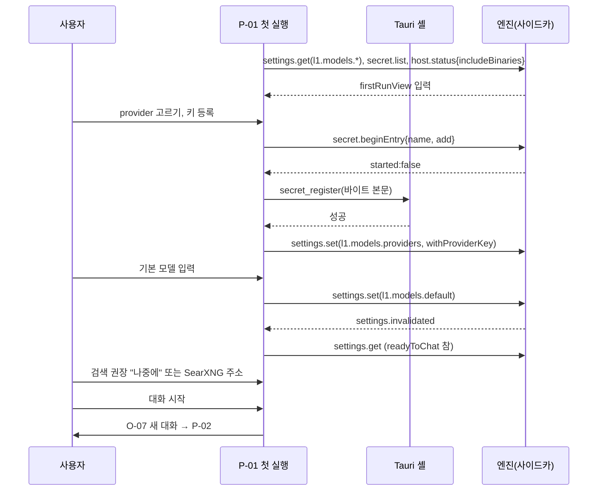
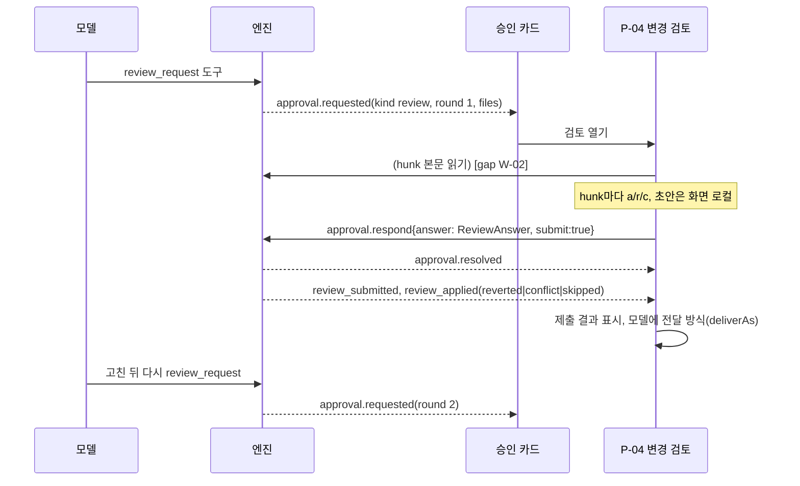
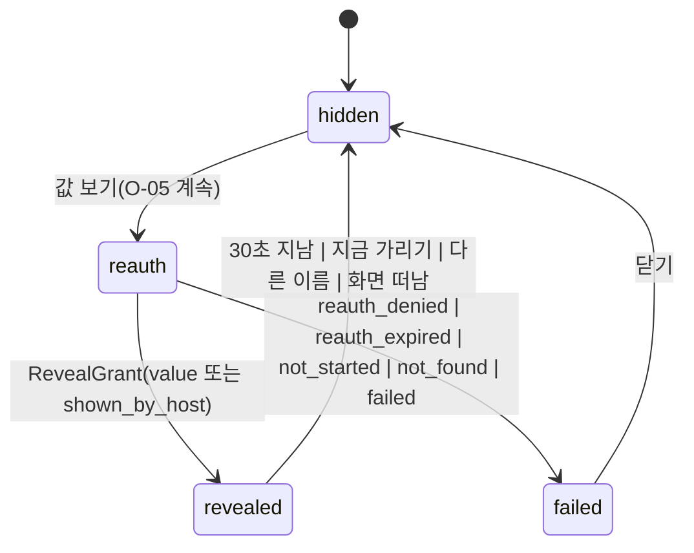
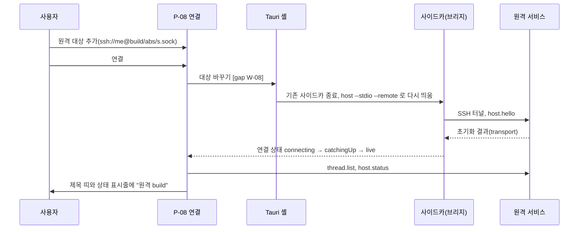

# L4 데스크톱 UX 설계 (desktop-ux)

M4 데스크톱 앱의 화면 전부를 정하는 정본입니다. 사용 시나리오에서 출발해 정보 구조, 화면 목록, 화면별 항목과 기능, 와이어프레임, 화면 사이 흐름을 적습니다. 끝에 세 모델이 같은 조건으로 만들 셸 목업 한 화면의 브리프를 둡니다.

- 기준: `xeon/foundation` 9e1cdd9b. wire 메서드 이름은 `xeon/packages/contracts/src/wire-settings/wire/methods.ts`의 `WIRE_METHODS`를, view-model 이름은 `xeon/packages/client/src/{settings,accounts,web}`의 export를 그대로 씁니다.
- 디자인 시스템은 caustic(`@caustic/react`, `@caustic/tokens`)입니다 [결정: 2026-10-29 사용자 지시]. 부품 이름은 `external/caustic/packages/react/src/components/<id>`의 export 이름입니다.
- 표지: `[결정]` 사용자 결정, `[제안]` 이 문서의 설계 선택, `[가정]` 확인 전 전제, `[미결]` 사용자 확인 필요, `[결정: 오케스트레이터 기본값]` 사용자가 바꾸기 전까지 쓰는 기본값입니다.

## 1. 목적과 범위

### 1.1 정하는 것

- 사용 시나리오 14개와 각 시나리오가 거치는 화면(§3)
- 앱 셸 영역, 주 내비게이션, 보조 패널, 시트·대화 상자, 명령 팔레트, 전역 요소(§4)
- 화면·표면 목록과 M4 우선순위(§5)
- 화면마다 항목·기능과 그 데이터 출처(wire 메서드, view-model), 상태, 상호작용, 바로 가기 키, 접근성, caustic 부품, 와이어프레임(§6)
- 화면 사이 주요 흐름(§7)
- 셸 목업 비교용 시험 화면과 브리프(§8)
- caustic 부품 간극(§9), wire와 view-model 간극(§10), 수용 기준(§11), 미결과 기본값(§12)

### 1.2 다루지 않는 것

- 시각 디자인 값(색, 그림자, 글꼴 크기). caustic `FOUNDATION.md`와 토큰을 그대로 씁니다.
- 상태 관리와 reducer 구조: `L4.desktop.design`, `eng.frontend-state.guide`
- 설정 항목의 생성 규칙과 쓰기 흐름: `L4.settings-ui.spec`. 이 문서는 그 view-model을 어디에 어떻게 놓는지만 정합니다.
- 웹 클라이언트(N15)와 모바일. 데스크톱 레이아웃이 compact 폭(720px 이하)에서도 쓸 수 있게만 둡니다.
- 문구의 최종 번역. 문구는 예시이고 메시지 키는 adr.0016을 따릅니다.

### 1.3 근거

- 유즈케이스와 범위: `product.usecases.spec` UC-1~UC-6과 §5.1 보조 유즈케이스, `product.scope.spec` §4.2 N14·N15, §4.4 M3b 행의 "UI 화면은 M4" 재범위
- M4로 옮긴 화면: `review.m3b-plan` §1.2(설정 화면, 비밀 탭, 승인·제안 목록, 모델 계정, 검색 provider 드래그앤드롭, 게이지, 첫 실행 권장, 접근성)
- 현재 화면: `xeon/apps/desktop/src/views/*`(M2 최소 화면). 슬래시 확인·결과·자동 완성 화면은 M4다(`L4.desktop.spec` §4.13). 원격 서비스 주소 화면 항목은 M4다(`L4.desktop.spec` §4.8).

## 2. 용어

| 용어 | 뜻 |
|---|---|
| 셸 | caustic `AppShell`로 만든 창 틀. 제목 띠, 시작 영역, 무대, 끝 영역, 상태 표시줄로 나눕니다. |
| 무대(stage) | 가운데 주 작업 영역. `AppShellStage`이고 `main` 랜드마크입니다. |
| 시작 영역 | 왼쪽 사이드바. `AppShellStart` 안의 `SidePanel side="start"`입니다. |
| 끝 영역 | 오른쪽 맥락 패널. `AppShellEnd` 안의 `SidePanel side="end"`입니다. medium 폭 이하에서는 무대 위에 시트로 뜹니다. |
| 화면(page) | 무대 하나를 채우는 단위. id는 `P-NN`입니다. |
| 표면(surface) | 화면이 아닌 UI 단위. 셸 요소 `S-NN`, 대화 상자·시트 `O-NN`입니다. |
| 받은 요청 | 사용자 응답을 기다리는 승인(tool, plan, question, review)과 제안, 알림을 모은 곳. |
| 대상(target) | 앱이 붙은 엔진. 로컬 사이드카, 로컬 서비스, 원격 서비스(SSH 터널·사설망) 셋 중 하나입니다. |
| `[gap:W-NN]` | 필요한 wire 메서드나 셸 명령이 없음. §10.1 목록 번호입니다. |
| `[gap:V-NN]` | 필요한 view-model이 없음. §10.2 목록 번호입니다. |
| `[gap:C-NN]` | 맞는 caustic 부품이 없음. §9 목록 번호입니다. |

## 3. 사용 시나리오

행위자는 한 사람입니다. 본인이 먼저 쓰고 공개 릴리즈합니다(`product.vision.spec` §4.2). "주 사용자"는 macOS나 Linux에서 코드 작업에 에이전트를 쓰는 개발자입니다.

| id | 시나리오 | 근거 |
|---|---|---|
| SC-01 | 첫 실행: 키 등록, 기본 모델, 검색 권장 | M2 최소 화면, settings-ui §4.10, X9 |
| SC-02 | 대화와 도구 승인 | UC-1, adr.0018 |
| SC-03 | 질문과 계획에 답하기 | §5.1 질문·계획 승인 |
| SC-04 | 변경 검토(diff 승인) | L2.artifacts reviews, 승인 kind `review` |
| SC-05 | Helm 탐구 | UC-2, L3.helm |
| SC-06 | 학습 제안 검토 | UC-3, L3.learning §3.8 |
| SC-07 | 예약 만들기와 결과 확인 | UC-4, X4 |
| SC-08 | 원격 서비스에 붙기 | UC-5, X5 |
| SC-09 | 비밀 관리와 값 열람 | UC-6, X8 |
| SC-10 | 모델 계정, 레이트 리밋, 계정 회전 | X7, L1.models §4.8 |
| SC-11 | 목표 걸고 지켜보기 | §5.1 목표 지속, X6 |
| SC-12 | 잠긴 대화와 이어서 실행 | UC-1 대안 흐름, 재개 |
| SC-13 | 설정 바꾸기와 외부 변경 | X10, settings-ui §4.4~4.5 |
| SC-14 | 웹 검색 provider 순서 정하기 | X9, ADR-0005 |

### SC-01 첫 실행

- 누가: 앱을 처음 연 사용자
- 목표: 첫 메시지를 보낼 수 있는 상태가 됩니다.
- 단계
  1. 앱이 열리면 사이드카가 뜨고 첫 실행 화면이 무대에 나옵니다(P-01).
  2. 외부 도구 점검 결과를 봅니다. 필수 도구가 없으면 설치 안내를 봅니다.
  3. provider를 고르고 키를 등록합니다. 값은 화면 안 등록 창으로 넣습니다(`L4.desktop.spec` §4.14.1).
  4. 기본 모델을 고릅니다.
  5. 검색 권장 카드에서 SearXNG 주소를 넣거나 Exa·Brave 키 플러그인을 고르거나 "나중에"를 누릅니다.
  6. "대화 시작"을 누르면 새 대화 시트(O-07)가 열립니다.
- 거치는 화면: P-01, O-07, P-02
- 성공 기준: `readyToChat`이 참이 되고, 첫 대화가 열리고, 입력창 잠금이 풀립니다. "나중에"를 누르면 `l4.desktop.firstRun.searchHintDismissed`가 참으로 저장됩니다.

### SC-02 대화와 도구 승인

- 누가: 작업 폴더를 정한 사용자
- 목표: 모델이 도구를 쓰며 작업을 끝냅니다. 위험한 호출은 내용을 보고 허용합니다.
- 단계
  1. 사이드바에서 대화를 고르거나 ⌘N으로 새 대화를 만듭니다.
  2. 입력창에 쓰고 Enter로 보냅니다. 응답이 흐르고 도구 호출이 접힌 행으로 보입니다.
  3. 승인이 필요한 호출이 오면 트랜스크립트 끝과 받은 요청 패널에 카드가 뜹니다. 상태 표시줄의 승인 수가 늘어납니다.
  4. 명령 전문, 인자, 쓸 비밀 핸들을 보고 "허용", "이 대화에서 항상", "거부" 중 하나를 고릅니다.
  5. 실행 중에 입력하면 큐 모드(steer, followUp)로 들어갑니다.
  6. 필요하면 ⌘. 로 중단합니다.
- 거치는 화면: P-02, P-03, S-03
- 성공 기준: 승인 응답이 `approval.respond`로 가고 `approval.resolved`가 오면 카드가 사라집니다. 응답 실패는 이유별 문장으로 보입니다(`approval-outcome.ts`).

### SC-03 질문과 계획에 답하기

- 누가: 모델이 질문(`ask_user`)이나 계획(`submit_plan`)을 보낸 대화의 사용자
- 목표: 선택지를 고르거나 계획을 승인·수정 요청합니다.
- 단계
  1. 질문 카드에서 라디오나 체크박스로 고르고 필요하면 직접 입력합니다. 추천 선택지에 표시가 있습니다.
  2. 계획 카드는 계획 본문을 Markdown으로 보이고 "승인", "수정 요청(피드백 입력)", "거부"를 둡니다. 승인 뒤 모드(`nextModes`)를 고릅니다.
  3. 다른 기기나 다른 대화에 있어도 받은 요청 패널에서 같은 카드로 답합니다.
- 거치는 화면: P-02, P-03
- 성공 기준: 질문마다 선택이나 입력이 있어야 "답하기"가 켜집니다. 계획 거부는 `{feedback}`을 실어 보냅니다.

### SC-04 변경 검토

- 누가: 모델이 파일을 바꾼 뒤 검토를 요청받은 사용자(`review_request` 도구나 `l2.artifacts.reviews.autoRequest`)
- 목표: 바뀐 hunk마다 승인·거절하고 의견을 남긴 뒤 제출합니다. 거절한 hunk는 되돌려집니다.
- 단계
  1. 승인 kind `review` 카드가 옵니다. 카드에는 파일 수, 추가·삭제 줄 수, 라운드가 보입니다.
  2. "검토 열기"로 변경 검토 화면(P-04)을 엽니다.
  3. 왼쪽 파일 목록에서 파일을 고르고 hunk마다 `a`(승인), `r`(거절), `c`(의견)를 누릅니다.
  4. "제출"을 누르면 남은 hunk 처리 방식(남은 것 승인 또는 막기)을 확인합니다.
  5. 결과로 hunk별 되돌림 결과(reverted, conflict, skipped)를 봅니다.
- 거치는 화면: P-02, P-03, P-04
- 성공 기준: 제출이 `approval.respond { decision: "answer", answer: ReviewAnswer }`로 가고 라운드가 끝납니다. 대기 hunk가 있는데 `approveRemaining`이 거짓이면 제출 버튼이 막히고 남은 수가 보입니다.

### SC-05 Helm 탐구

- 누가: 모르는 분야 문제에 막힌 사용자
- 목표: 여러 관점(렌즈)으로 병렬 탐구한 결과를 현재 작업에 적용합니다.
- 단계
  1. 같은 오류가 세 번 나면 트랜스크립트에 Helm 제안 알림(`grp.helm.notice.suggested`)이 보이고 "탐구 시작" 버튼이 있습니다. 또는 `/helm start <주제>`나 팔레트 "탐구 시작"을 씁니다.
  2. 끝 영역의 탐구 탭(P-05)이 열리고 단계(diverge → explore → converge → apply)와 렌즈별 진행이 보입니다.
  3. explore 단계에서 쓰기 도구는 거부되고 트랜스크립트에 거부 사유가 보입니다.
  4. 발견(finding)이 쌓이면 렌즈별 주장, 출처, 신뢰도가 보입니다.
  5. apply 턴이 끝나면 결과 요약과 생긴 작업(followUp → work task)이 보입니다. 필요하면 "탐구 멈춤"을 누릅니다.
- 거치는 화면: P-02, P-05, S-03(Helm 단계 칩)
- 성공 기준: 탐구가 끝나면 `grp.helm.inquiry.finished`의 결과(applied, empty, stopped, limit, failed)가 보이고, 상한에 걸리면 어느 상한인지 보입니다.

### SC-06 학습 제안 검토

- 누가: 세션이 쌓여 학습 그룹이 제안을 만든 사용자
- 목표: 스킬·메모리·피드백 후보를 보고 승인, 수정, 거절, 되돌립니다.
- 단계
  1. 사이드바 "제안"에 배지가 붙고 알림이 옵니다.
  2. 제안 화면(P-06)에서 목록을 상태·종류·출처(학습, 지식)로 거릅니다.
  3. 행을 고르면 오른쪽에 diff, 근거 이벤트, 이유, 충돌 스킬이 보입니다. 웹·MCP를 읽은 뒤 만든 후보는 경고가 붙습니다.
  4. 스킬 후보는 승인 옆에서 범위(사용자, 프로젝트)를 고릅니다. "수정"은 본문 편집기를 엽니다.
  5. 적용된 학습 제안은 "되돌리기"가 있습니다.
- 거치는 화면: P-06, S-05
- 성공 기준: 결정이 `proposal.decide`로 가고 결과가 `decisionOutcomeOf`로 바뀝니다. `revision_mismatch`면 목록을 다시 읽고 문장을 보입니다.

### SC-07 예약 만들기와 결과 확인

- 누가: 반복 작업을 맡기려는 사용자
- 목표: 앱을 닫아도 정해진 때에 프롬프트가 실행되고, 다음에 열면 결과를 봅니다.
- 단계
  1. 예약 화면(P-07)에서 "새 예약"을 누르면 시트가 열립니다.
  2. 트리거(간격, 시각, 파일 감시, 원격, 루프)를 고르고 프롬프트, 작업 폴더, 제목을 넣습니다.
  3. 서비스 모드가 꺼져 있으면 시트 아래에 경고와 "서비스 켜기"가 보입니다. 저장 결과가 `service_mode_off` 경고를 실으면 그대로 보입니다.
  4. 목록에서 다음 실행 시각과 마지막 실행 결과를 봅니다. 마지막 실행 행을 누르면 그 실행이 만든 대화가 열립니다.
  5. 실행이 끝나면 알림(`background_completed` 또는 `error`)이 옵니다.
- 거치는 화면: P-07, P-08, S-05, P-02
- 성공 기준: `schedule.create`가 `ok: true`를 돌려주면 목록 맨 위에 새 행이 보입니다. `ok: false`면 오류 종류별 문장이 해당 입력란 아래에 보입니다.

### SC-08 원격 서비스에 붙기

- 누가: 다른 기기(서버, 다른 컴퓨터)에서 도는 서비스를 노트북에서 쓰려는 사용자
- 목표: 원격 대화 목록을 보고 입력하고 승인에 답합니다.
- 단계
  1. 연결 화면(P-08)에서 "원격 대상 추가"로 `ssh://user@host/abs/socket` 형식 주소를 넣습니다.
  2. "연결"을 누르면 엔진이 그 대상으로 다시 붙습니다. 진행 단계(터널, 초기화, 동기화)가 보입니다.
  3. 성공하면 제목 띠와 상태 표시줄에 대상 이름이 보입니다. 사이드바 대화 목록이 원격 목록으로 바뀝니다.
  4. 원격에서 실행 중인 대화는 관찰로 열립니다. "입력 위임"이 가능하면 입력창이 열립니다.
- 거치는 화면: P-08, P-02, S-03
- 성공 기준: 상태 표시줄이 "원격 · host"와 연결 상태를 보이고, 대화 목록이 원격 `thread.list` 결과입니다. 터널 실패는 `AttachError` 종류별 문장과 "다시 시도"로 보입니다.

### SC-09 비밀 관리와 값 열람

- 누가: API 키를 등록하고 확인하려는 사용자
- 목표: 값을 화면에 남기지 않고 등록·확인·삭제하고, 필요할 때 재인증 뒤 한 번 봅니다.
- 단계
  1. 설정 > 비밀(P-10)에서 목록을 봅니다. 값 열은 없습니다.
  2. "추가"로 이름과 메타를 넣고 값은 가린 입력란이나 OS 입력 창으로 넣습니다.
  3. 행 메뉴 "값 보기"를 누르면 재인증 대화 상자(O-05)가 뜹니다. OS 인증을 통과하면 값이 30초 동안 보이고 자동으로 가려집니다.
  4. "삭제"는 참조하는 설정 키, 활성 lease, 최근 세션을 보인 뒤 확인을 받습니다. 사용 중이면 거부됩니다.
- 거치는 화면: P-10, O-05, O-06
- 성공 기준: 값은 React 상태, 거울, 로그에 들어가지 않습니다. 열람은 감사 이벤트 `secret.revealed`로 남습니다. 사이드카 연결에서 열람을 못 하면 그 사유와 CLI 대안이 보입니다.

### SC-10 모델 계정, 레이트 리밋, 계정 회전

- 누가: provider 계정 여러 개를 쓰는 사용자
- 목표: 계정 우선순위와 예비율, provider별 레이트 리밋 정책을 정하고 회전을 켭니다.
- 단계
  1. 설정 > 계정과 제공자(P-11)에서 provider별 계정 표를 봅니다.
  2. 계정을 추가하고 자격 비밀을 고르고 우선순위와 예비율을 넣습니다.
  3. 예산과 한도 탭에서 provider별 최소 간격, 한도 도달 시 동작(대기, 전환, 실패), 최대 대기를 넣습니다.
  4. 계정 회전 플러그인을 켜면 위험 안내가 뜨고, 확인해야 회전이 켜집니다.
  5. 사용량 게이지로 창별 사용량을 봅니다.
- 거치는 화면: P-11, P-09, S-03 사용량 팝오버
- 성공 기준: 저장 결과가 사용자 설정 파일의 `l1.models.accounts`, `l1.models.rateLimit`, `ext.account-rotation.acknowledgeRisk`에 같은 키로 들어갑니다(X7). 파일 충돌(`settings.fileConflict`)이면 다시 읽기를 권합니다.

### SC-11 목표 걸고 지켜보기

- 누가: "시험이 모두 통과할 때까지" 같은 완료 조건을 거는 사용자
- 목표: 턴마다 판정 모델이 판정하고 미충족이면 다음 턴이 이어지며, 상한에서 멈춥니다.
- 단계
  1. 입력창에서 `/goal <조건>`을 보내거나 끝 영역 작업 탭의 "목표 걸기"를 씁니다.
  2. 상태 표시줄에 목표 칩(판정 n/최대)이 보입니다.
  3. 판정마다 트랜스크립트에 판정 행(충족 여부, 이유, 빠진 것)이 보입니다.
  4. 충족, 상한 도달, 판정 실패, 해제 중 하나로 끝나면 알림이 옵니다.
- 거치는 화면: P-02, P-14, S-03
- 성공 기준: `l1.agents.judge.maxRuns`에서 멈추고 상태 `limit_reached`가 보입니다(X6).

### SC-12 잠긴 대화와 이어서 실행

- 누가: CLI나 다른 창이 쓰고 있는 대화를 연 사용자, 또는 크래시 뒤 다시 연 사용자
- 목표: 관찰, 분기, 위임 중 하나를 고르거나 중단된 턴을 이어서 실행합니다.
- 단계
  1. 보내기가 `thread.locked`로 거절되면 잠금 대화 상자(O-01)가 뜹니다.
  2. "관찰만 하기"를 고르면 입력창이 잠기고 "쓰기 다시 시도"가 보입니다. "분기해서 이어 쓰기"는 새 대화를 엽니다.
  3. 대화 목록의 "이어서 실행" 배지가 있는 대화를 열면 트랜스크립트 끝에 "이어서 실행" 띠가 보입니다.
- 거치는 화면: P-02, O-01
- 성공 기준: `turn.resume` 결과 `resumed`, `closed`, `nothing`이 각각 다른 문장으로 보입니다.

### SC-13 설정 바꾸기와 외부 변경

- 누가: 동작을 조정하려는 사용자
- 목표: 항목을 찾아 바꾸고, 범위와 적용 시점을 압니다.
- 단계
  1. ⌘, 로 설정(P-09)을 열거나 팔레트에 키 이름이나 라벨을 칩니다.
  2. 탭을 고르고 항목을 바꿉니다. 범위 배지와 적용 시점 배지(즉시, 다음 턴부터, 재시작 필요)를 봅니다.
  3. 잠긴 항목은 정책 파일 경로를 봅니다. 가려진 범위 값이 있으면 펼쳐 봅니다.
  4. CLI가 같은 키를 바꾸면 화면이 다시 읽고 편집 중인 값에는 "다른 곳에서 바뀜" 표시가 붙습니다.
  5. 재시작이 필요한 변경이 있으면 띠에 "엔진 재시작"이 보입니다.
- 거치는 화면: P-09, S-02
- 성공 기준: 화면 항목 집합이 스키마 키 집합과 같고(X10), 저장 실패는 `FieldError` 종류별로 항목 아래에 보입니다.

### SC-14 웹 검색 provider 순서 정하기

- 누가: 무료 검색을 쓰려는 사용자
- 목표: 쓸 수 있는 provider 상태를 보고 순서를 끌어서 정합니다.
- 단계
  1. 설정 > 도구와 웹(P-12)에서 검색, 브라우저, 가져오기 구역을 봅니다.
  2. 행마다 상태(쓸 수 있음, 키 없음, 연결 안 됨)와 가격표 기준일을 봅니다.
  3. 행을 끌거나 ⌥↑/⌥↓로 순서를 바꿉니다. 저장은 `l2.web.search.order`에 갑니다.
  4. 권장 카드에서 Exa·Brave 플러그인 설치와 키 등록으로 이어집니다.
- 거치는 화면: P-12, P-10
- 성공 기준: `orderUpdateOf`가 만든 값이 `settings.set`으로 저장되고, 화면 순서와 `web.providers`의 `autoRank` 순서가 같아집니다.

## 4. 정보 구조

### 4.1 셸 영역

[제안] caustic `AppShell` 한 개로 창 전체를 만듭니다. 상태 표시줄은 caustic에 없어 셸 아래에 앱이 직접 둡니다 `[gap:C-03]`.

```text
┌────────────────────────────────────────────────────────────────────────────────────────────────┐
│ S-01a 제목 띠: [=] 사이드바, 경로, 팔레트, 받은 요청, 설정                                     │
├──────────────────────┬──────────────────────────────────────────┬──────────────────────────────┤
│S-01b 시작 영역       │ S-01c 무대                               │ S-01d 끝 영역                │
│                      │                                          │ [받은 요청][탐구][작업]      │
│ 주 내비게이션 5개    │ 화면 P-NN 하나                           │                              │
│ 대화 목록(폴더별)    │                                          │ 맥락 패널                    │
│                      │ 위: 화면 머리(제목, 동작)                │ medium 이하는 시트           │
│                      │ 가운데: 화면 본문                        │                              │
│                      │ 아래: 화면 바닥(입력창 등)               │                              │
│                      │                                          │                              │
│ 설정              ⌘, │                                          │                              │
├──────────────────────┴──────────────────────────────────────────┴──────────────────────────────┤
│ S-03 상태 표시줄: 대상 | 엔진 | 연결 | 진행 중 | 모델 | 사용량 | 목표 | Helm | 승인 | 알림     │
└────────────────────────────────────────────────────────────────────────────────────────────────┘
```

| 영역 | caustic 부품 | 폭 | 반응형 |
|---|---|---|---|
| 제목 띠 | `AppShellTitlebar`, `IconButton`, `Breadcrumb`, `Button variant="ghost"`(팔레트 열기), `Kbd` | 높이 44 | compact에서 경로는 마지막 항목만 |
| 시작 영역 | `AppShellStart` > `SidePanel side="start" preset="inspector"`, `ListNavigation` | 272(240~360), 끌어서 조절 | compact(720 이하)에서 전체 폭 시트, 토글로 엽니다 |
| 무대 | `AppShellStage stageLabel` | 나머지 | 최소 480 [제안] |
| 끝 영역 | `AppShellEnd` > `SidePanel side="end" preset="pane"`, `Tabs` | 352(320~480) | medium(1100 이하)에서 무대 위 시트 |
| 상태 표시줄 | 앱 부품 `StatusBar` `[gap:C-03]`: `Badge`, `Button size="xs" variant="ghost"`, `Popover`, `Progress` | 높이 28 [제안] | compact에서 대상·엔진·승인만 |
| 떠 있는 층 | `AppShellOverlay`, `Toaster`, `Dialog`, `Sheet` | | |

- 창 최소 크기는 720×480입니다 [제안]. 그보다 좁으면 Tauri 창 최소값으로 막습니다.
- 사이드바와 끝 영역의 열림 상태와 폭은 UI 스토어에 두고 `l4.desktop.window.*`에 저장합니다 [제안] `[gap:V-14]`.

### 4.2 주 내비게이션

시작 영역 위쪽의 `ListNavigation kind="navigation"`입니다. 항목은 다섯 개이고 ⌘1~⌘5로 엽니다 [제안].

| 순서 | 항목 | 화면 | 배지 | 바로 가기 키 |
|---|---|---|---|---|
| 1 | 대화 | P-02 | 실행 중 대화 수 | ⌘1 |
| 2 | 받은 요청 | P-03(무대 전체 보기) | 대기 승인 + 대기 제안 + 읽지 않은 알림 | ⌘2 |
| 3 | 제안 | P-06 | 대기 제안 수 | ⌘3 |
| 4 | 예약 | P-07 | 실패한 마지막 실행 수 | ⌘4 |
| 5 | 연결 | P-08 | 연결 실패 시 경고 점 | ⌘5 |

- 그 아래에 대화 목록(`ListNavigation kind="sessions"`)이 항상 보입니다. 대화가 주 객체이기 때문입니다.
- 시작 영역 맨 아래에 "설정"(⌘,)이 있습니다. 설정은 무대를 채우는 화면입니다 [결정: 오케스트레이터 기본값].
- 탐구(P-05)와 목표·작업(P-14)은 대화에 딸린 정보라 주 내비게이션에 두지 않고 대화 화면의 끝 영역 탭으로 둡니다.

### 4.3 보조 패널(끝 영역)

| 탭 | 내용 | 보이는 화면 | 바로 가기 키 |
|---|---|---|---|
| 받은 요청 | 모든 대화의 대기 승인 카드, 대기 제안 요약, 알림 | 모든 화면 | ⌘⇧I |
| 탐구 | 열린 대화의 Helm 상태, 렌즈, 발견 | P-02 | ⌘⇧H |
| 작업 | 열린 대화의 목표, 계획, 작업 목록 | P-02 | ⌘⇧T |

- ⌘J가 끝 영역을 열고 닫습니다. 열면 마지막 탭이 보입니다 [제안].
- 대화 화면이 아니면 받은 요청 탭만 있습니다.

### 4.4 대화 상자와 시트

| id | 이름 | 부품 | 여는 곳 |
|---|---|---|---|
| O-01 | 잠긴 대화 | `Dialog kind="alert"` | `thread.locked` 거절 |
| O-02 | 셸 명령 확인 | `Dialog kind="alert"` | `command.run` 결과 `needs_confirmation` |
| O-03 | 명령 결과 | `Sheet side="right"` | `command.run` 결과 `done` |
| O-04 | 프로젝트 신뢰 카드 | `Card` + `Alert`(입력창 위, 대화 상자 아님) | `trust.get` 결과 |
| O-05 | 재인증 | `Dialog kind="alert"` | 비밀 값 보기 |
| O-06 | 삭제 확인 | `Dialog kind="alert"` | 대화·비밀·예약 삭제 |
| O-07 | 새 대화 | `Dialog` | ⌘N, "새 대화" |
| O-08 | 예약 편집 | `Sheet side="right"` | P-07 "새 예약" |
| O-09 | 바로 가기 키 도움말 | `Dialog` `[gap:C-11]` | ⌘/ |

### 4.5 명령 팔레트(S-02)

- ⌘K로 엽니다. `Dialog placement="center"` 안에 `Combobox mode="inline"`을 둡니다 `[gap:C-01]`.
- 결과 묶음 순서: 최근 대화, 명령(앱 동작), 슬래시 명령(`command.list`), 설정 항목(키와 라벨), 화면 이동.
- 앱 동작 목록: 새 대화, 대화 이름 바꾸기, 대화 분기, 대화 컴팩션, 중단, 이어서 실행, 탐구 시작·멈춤, 목표 걸기·해제, 받은 요청 열기, 설정 열기, 원격 대상 바꾸기, 엔진 재시작, 진단 복사, 테마 바꾸기.
- 행은 아이콘, 라벨, 보조 설명, 바로 가기 키(`Kbd`)를 보입니다. Enter로 실행하고 Esc로 닫습니다. 닫으면 연 곳으로 초점이 돌아갑니다.
- 데이터: 대화는 거울의 `thread.list` 결과, 슬래시 명령은 `command.list { threadId }` → `commandListView`, 설정은 `settings.list` → `buildSettingsView`의 필드 라벨입니다. 팔레트 항목 모델은 없습니다 `[gap:V-01]`.

### 4.6 전역 요소

| 요소 | 위치 | 데이터 | 동작 |
|---|---|---|---|
| 받은 요청 | 제목 띠 `IconButton`(수 배지), 주 내비 2번, 끝 영역 탭 | `ThreadSummary.pendingApprovals` 합, 열린 대화 `approval.list`, `proposal.list { status: "pending" }`, `notify.list` | 누르면 끝 영역 받은 요청 탭 |
| 알림 | 받은 요청 안 "알림" 구역, 토스트 | `notify.list { afterSeq }`, 알림 `notify.delivered` | 알림 행을 누르면 원인 대화나 화면으로 |
| 연결·서비스 상태 | 상태 표시줄 왼쪽 | 셸 IPC 엔진 상태(`EngineState`), 연결 상태 기계, `host.status` | 실패 시 "다시 연결", "엔진 다시 시작", "진단 복사" |
| 원격 대상 | 제목 띠 경로 첫 항목, 상태 표시줄 첫 칸 | 데스크톱 설정 `l0.process.service.remote` [가정], `host.hello` 결과 `transport` | 누르면 대상 팝오버(P-08 요약과 "대상 바꾸기") |
| 모델 | 상태 표시줄, 입력창 모델 칸 | `settings.get { keys: ["l1.models.default"], threadId }` | 누르면 모델 고르기 `Combobox mode="popup"`. 대화 범위 저장은 `settings.set { scope: "session" }` |
| 사용량 | 상태 표시줄 게이지 | `usage.get { threadId }` | 누르면 `Popover`에 게이지 목록 |
| 목표 | 상태 표시줄 칩 | `[gap:W-05]` | 누르면 끝 영역 작업 탭 |
| Helm 단계 | 상태 표시줄 칩 | `[gap:W-04]` | 누르면 끝 영역 탐구 탭 |
| 토스트 | 오른쪽 아래 `Toaster` | 알림 `notify.delivered`, 앱 동작 결과 | 오류 토스트는 자동으로 닫히지 않습니다 |

### 4.7 사이트맵

```text
Xeon 데스크톱
├─ S-01 앱 셸
│  ├─ S-01a 제목 띠 ── 대상 팝오버, 팔레트 열기, 받은 요청, 설정
│  ├─ S-01b 시작 영역
│  │  ├─ 주 내비: 대화 · 받은 요청 · 제안 · 예약 · 연결
│  │  ├─ 대화 목록 (작업 폴더별 묶음)
│  │  └─ 설정
│  ├─ S-01c 무대 ── P-NN
│  ├─ S-01d 끝 영역 ── 받은 요청 | 탐구(P-05) | 작업(P-14)
│  └─ S-03 상태 표시줄 ── 사용량 팝오버, 모델 팝오버, 대상 팝오버
├─ S-02 명령 팔레트
├─ S-04 토스트
├─ P-01 첫 실행
├─ P-02 대화
│  ├─ O-01 잠긴 대화 · O-02 셸 명령 확인 · O-03 명령 결과 · O-04 신뢰 카드 · O-07 새 대화
│  ├─ P-05 탐구 (끝 영역)
│  └─ P-14 목표와 작업 (끝 영역)
├─ P-03 받은 요청
│  └─ P-04 변경 검토
├─ P-06 제안
├─ P-07 예약 ── O-08 예약 편집, O-06 삭제 확인
├─ P-08 연결
├─ P-09 설정 (13탭)
│  ├─ P-10 비밀 ── O-05 재인증, O-06 삭제 확인
│  ├─ P-11 계정과 제공자 · 예산과 한도
│  ├─ P-12 도구와 웹
│  ├─ P-13 플러그인과 그룹
│  └─ P-15 진단과 정보 (개요 탭 안)
└─ O-09 바로 가기 키 도움말
```

### 4.8 전역 바로 가기 키

[제안] 모든 바로 가기 키는 동작 id에 묶고 `l4.desktop.appearance.keybindings`(동작 id → 키)로 바꿀 수 있게 합니다. macOS는 ⌘, Linux는 Ctrl입니다.

| 동작 id | 기본 키 | 동작 |
|---|---|---|
| `palette.open` | ⌘K | 명령 팔레트 |
| `thread.new` | ⌘N | 새 대화(O-07) |
| `nav.1`~`nav.5` | ⌘1~⌘5 | 주 내비게이션 |
| `settings.open` | ⌘, | 설정 |
| `sidebar.toggle` | ⌘\ | 시작 영역 열기·닫기 |
| `panel.toggle` | ⌘J | 끝 영역 열기·닫기 |
| `panel.inbox` | ⌘⇧I | 받은 요청 탭 |
| `panel.helm` | ⌘⇧H | 탐구 탭 |
| `panel.work` | ⌘⇧T | 작업 탭 |
| `turn.interrupt` | ⌘. | 진행 중 턴 중단 |
| `composer.focus` | ⌘L | 입력창으로 초점 |
| `thread.next` / `thread.prev` | ⌥⌘↓ / ⌥⌘↑ | 다음·이전 대화 |
| `approval.next` | ⌘⇧A | 다음 대기 승인 카드로 초점 |
| `help.shortcuts` | ⌘/ | 바로 가기 키 도움말(O-09) |

- 입력창 안에서는 Enter 보내기, ⇧Enter 줄바꿈, ↑(빈 입력) 마지막 입력 다시 불러오기 [제안], `/` 슬래시 자동 완성입니다. 한글 조합 중 Enter는 보내지 않습니다(`composer-model.ts`).
- 승인 카드에 초점이 있으면 `Y` 허용, `N` 거부, `⇧Y` 이 대화에서 항상입니다 [제안]. 문자 키는 입력란 밖에서만 받습니다.

## 5. 화면 목록

M4 우선순위: P0은 셸 목업 다음 첫 묶음이고 M4 종료에 반드시 있어야 합니다. P1은 M4 안, P2는 wire나 view-model 간극이 커서 M4 끝 또는 다음으로 미룰 수 있습니다 [제안].

| id | 이름 | 목적 | 진입점 | 우선 | 시나리오 |
|---|---|---|---|---|---|
| S-01 | 앱 셸 | 창 틀, 영역, 반응형 | 앱 시작 | P0 | 전부 |
| S-02 | 명령 팔레트 | 모든 동작과 대화·설정 찾기 | ⌘K, 제목 띠 | P0 | SC-02, SC-13 |
| S-03 | 상태 표시줄 | 대상, 엔진, 연결, 모델, 사용량, 승인 | 항상 | P0 | SC-02, SC-08, SC-10, SC-11 |
| S-04 | 토스트 | 알림과 동작 결과 | 자동 | P0 | SC-06, SC-07 |
| P-01 | 첫 실행 | 키, 기본 모델, 외부 도구, 검색 권장 | 첫 실행, 설정 안 됨 띠 | P0 | SC-01 |
| P-02 | 대화 | 트랜스크립트, 입력, 인라인 승인 | ⌘1, 대화 목록 | P0 | SC-02, SC-03, SC-05, SC-11, SC-12 |
| P-03 | 받은 요청 | 모든 대화의 승인, 제안, 알림 | ⌘2, ⌘⇧I, 제목 띠 | P0 | SC-02, SC-03, SC-04, SC-06, SC-07 |
| P-04 | 변경 검토 | 파일·hunk 단위 승인, 의견, 제출 | review 승인 카드 | P1 | SC-04 |
| P-05 | 탐구 | Helm 단계, 렌즈, 발견 | ⌘⇧H, Helm 알림, `/helm` | P1 | SC-05 |
| P-06 | 제안 | 학습·지식 제안 대기열 | ⌘3, 알림 | P1 | SC-06 |
| P-07 | 예약 | 예약 목록, 만들기, 마지막 실행 | ⌘4 | P1 | SC-07 |
| P-08 | 연결 | 대상(로컬, 서비스, 원격), 서비스 상태 | ⌘5, 대상 팝오버 | P1 | SC-08, SC-07 |
| P-09 | 설정 | 13탭 일반 폼, 범위·적용 배지 | ⌘, | P0 | SC-13 |
| P-10 | 비밀 | 비밀 목록, 추가, 값 보기, 삭제 | 설정 > 비밀 | P0 | SC-09, SC-01 |
| P-11 | 계정과 제공자·예산 | 계정 풀, 레이트 리밋, 회전, 게이지 | 설정 > 계정과 제공자, 사용량 팝오버 | P1 | SC-10 |
| P-12 | 도구와 웹 | 검색·브라우저 provider 상태와 순서 | 설정 > 도구와 웹, 첫 실행 | P1 | SC-14, SC-01 |
| P-13 | 플러그인과 그룹 | 그룹 켜기, drive 그룹, 그룹 설정 | 설정 > 플러그인과 그룹 | P1 | SC-05, SC-06 |
| P-14 | 목표와 작업 | 목표 상태, 계획, 작업 목록 | ⌘⇧T, 목표 칩 | P2 | SC-11 |
| P-15 | 진단과 정보 | 외부 도구, 버전, 안전 모드, 진단 복사 | 설정 > 개요, 상태 표시줄 | P2 | SC-01 |
| O-01 | 잠긴 대화 | 관찰, 분기, 위임 | `thread.locked` | P0 | SC-12 |
| O-02 | 셸 명령 확인 | 슬래시 명령의 셸 실행 확인 | `needs_confirmation` | P0 | SC-02 |
| O-03 | 명령 결과 | 슬래시 명령 결과 보기 | `done` | P1 | SC-05, SC-11 |
| O-04 | 신뢰 카드 | 프로젝트 자원 신뢰 | `trust.get` | P0 | SC-02 |
| O-05 | 재인증 | 비밀 값 보기 전 인증 | P-10 | P0 | SC-09 |
| O-06 | 삭제 확인 | 파괴 동작 확인 | 각 화면 | P0 | SC-09, SC-07 |
| O-07 | 새 대화 | 작업 폴더 고르기 | ⌘N | P0 | SC-01, SC-02 |
| O-08 | 예약 편집 | 트리거, 프롬프트 입력 | P-07 | P1 | SC-07 |
| O-09 | 바로 가기 키 도움말 | 바로 가기 키 표 | ⌘/ | P2 | 전부 |

합계: 화면 15개(P-01~P-15), 셸 표면 4개(S-01~S-04), 대화 상자·시트 9개(O-01~O-09)입니다.

## 6. 화면별 명세

### 6.0 공통 규칙

- 격자: 와이어프레임은 폭 98열입니다. 셸 3단은 시작 22열, 무대 42열, 끝 30열이고, 2단은 시작 22열, 무대 73열입니다. 실제 픽셀 폭은 §4.1 표를 따릅니다. 와이어프레임의 `[...]`는 버튼, `[x]`·`[ ]`는 체크, `(o)`·`( )`는 라디오, `v`는 펼침, `>`는 현재 행이나 접힌 행, `*`는 실행 중, `!`는 경고입니다.
- 데이터 출처 표기: wire 메서드는 `메서드 { 인자 }`, view-model은 함수 이름, 거울 선택자는 `engine:<이름>`, 데스크톱 로컬 설정은 `l4.desktop.*`입니다. 없는 것은 `[gap:W-NN]`, `[gap:V-NN]`으로 씁니다.
- 상태 여섯 가지(빈, 읽는 중, 오류, 오프라인, 권한 필요, 긴 내용)를 화면마다 적습니다. 해당 없으면 "해당 없음"이라 씁니다.
- 오프라인 공통: 연결 상태가 `live`가 아니면 쓰기 버튼을 잠그고 "엔진에 연결되면 할 수 있어요"를 `Tooltip`으로 보입니다. 읽은 데이터는 그대로 두고 화면 머리에 `Alert tone="warning" layout="inline"`을 둡니다.
- 문구: 문장은 해요체, 라벨은 명사구입니다(`L4.settings-ui.spec` §4.8). 현재 M2 화면의 합니다체 문구도 M4에서 해요체로 맞춥니다 [결정: 오케스트레이터 기본값]. 문구는 메시지 키로 둡니다(adr.0016).
- 접근성 공통: caustic 규칙(대상 24×24 이상, 키보드 초점 고리, axe 위반 0)을 따릅니다. 실시간 영역은 `aria-live="polite"`이고 오류만 `role="alert"`입니다. 모든 아이콘 버튼은 `label`이 있습니다. 움직임은 `prefers-reduced-motion`을 따릅니다.
- 시간 표시는 상대 시각("3분 전")이고 `Tooltip`에 절대 시각을 둡니다.

### 6.1 S-01 앱 셸

와이어프레임은 §4.1(영역)과 §6.6(P-02, 채운 모습)에 있습니다.

- 항목과 데이터

| 항목 | 출처 |
|---|---|
| 경로(대상 / 작업 폴더 / 대화 제목) | 대상: 연결 설정과 `host.hello` 결과 `transport`. 폴더와 제목: `engine:threadById` (`ThreadSummary.workspace`, `title`) |
| 받은 요청 수 | §4.6 받은 요청 합 `[gap:V-02]` |
| 사이드바 대화 목록 | `thread.list { limit }` → 거울, `ThreadSummary.status`, `resumable`, `pendingApprovals`, `queuedInputs` |
| 창·패널 상태 | UI 스토어(`sidebarOpen`, 끝 영역 탭과 폭) `[gap:V-14]` |

- 기능: 사이드바·끝 영역 토글, 폭 끌기(`ResizeHandle`), 대화 고르기(`selectThread`), 새 대화(O-07), 대화 행 메뉴(이름 바꾸기 `thread.rename`, 분기 `thread.fork`, 컴팩션 `thread.compact`, 닫기 `thread.close`, 삭제 `thread.delete` + O-06).
- 상태: 대화 목록 빈 경우 "아직 대화가 없어요" + "새 대화" (`EmptyState variant="dashed"`), 읽는 중 `Skeleton` 5행, 읽기 실패 "대화 목록을 읽지 못했어요" + "다시 읽기", 오프라인은 목록 유지와 흐린 표시, 긴 목록은 폴더 묶음 접기와 50개 뒤 "더 보기"(`nextCursor`).
- 대화 행: 제목(없으면 "제목 없음"), 배지 `실행 중`(running), `이어서 실행`(resumable), `승인 N`, `잠김`(다른 소유자, 알 수 있을 때), `예약`(schedule이 만든 대화) [가정: `ThreadSummary`에 출처 필드 없음 `[gap:W-16]`].
- 접근성: 시작 영역은 `SidePanel label="대화와 이동"`(aside 랜드마크), 무대는 `main`, 건너뛰기 링크 `skipLabel="본문으로"`. 대화 목록은 `ListNavigation`의 단일 선택 목록이고 화살표로 이동합니다.
- caustic: `AppShell`, `AppShellTitlebar`, `AppShellStart`, `AppShellStage`, `AppShellEnd`, `AppShellOverlay`, `SidePanel`, `ListNavigation`(kind `navigation`, `sessions`), `ResizeHandle`, `Breadcrumb`, `IconButton`, `Badge`, `Menu`, `Tabs`, `EmptyState`, `Skeleton`.

### 6.2 S-02 명령 팔레트

```text
┌────────────────────────────────────────────────────────────────────────────────────────────────┐
│ [=]  로컬 / ~/code/xeon / 캐시 무효화 조사     [⌘K 명령 또는 대화 찾기]  [받은 요청 5]  [설정] │
├────────────────────────────────────────────────────────────────────────────────────────────────┤
│                                                                                                │
│               ┌──────────────────────────────────────────────────────────────┐                 │
│               │ > 컴팩션|                                                    │                 │
│               │                                                              │                 │
│               │ 대화                                                         │                 │
│               │   캐시 무효화 조사           ~/code/xeon                     │                 │
│               │ 명령                                                         │                 │
│               │ > 대화 컴팩션                                   /compact     │                 │
│               │   대화 분기                                                  │                 │
│               │ 슬래시 명령                                                  │                 │
│               │   /compact [지시]   대화를 요약해 문맥을 줄여요              │                 │
│               │ 설정                                                         │                 │
│               │   자동 컴팩션 기준 (l1.context.compact.threshold)            │                 │
│               │                                                              │                 │
│               │ ^v 이동   Enter 실행   Esc 닫기                              │                 │
│               └──────────────────────────────────────────────────────────────┘                 │
│                                                                                                │
└────────────────────────────────────────────────────────────────────────────────────────────────┘
```

- 항목: 입력란, 묶음 제목, 행(라벨, 보조 설명, 바로 가기 키 또는 슬래시 이름), 아래 키 안내.
- 데이터: 앱 동작 표(정적) `[gap:V-01]`, `command.list { threadId }` → `commandListView`, 대화 `thread.list` 거울, 설정 `settings.list` → `buildSettingsView`의 `FieldVM.label`과 `key`.
- 기능: 실행(앱 동작 호출, 슬래시는 입력창에 `/이름 `을 채움, 설정은 P-09에서 그 항목으로 스크롤과 강조), 최근 사용 순 위로.
- 상태: 빈 입력은 최근 대화 5개와 자주 쓴 동작 5개, 결과 없음 "맞는 항목이 없어요", 슬래시 목록 읽기 실패는 그 묶음만 "명령 목록을 읽지 못했어요", 오프라인은 앱 동작과 화면 이동만, 긴 결과는 묶음마다 5개 뒤 "더 보기".
- 접근성: `Dialog` 안 `Combobox mode="inline"`이라 초점은 입력란에 남고 `aria-activedescendant`로 행을 가리킵니다. 닫으면 연 곳으로 초점이 돌아갑니다.
- caustic: `Dialog`, `Combobox`, `ComboboxOption`, `Kbd`, `Separator`. 팔레트 전용 부품은 없습니다 `[gap:C-01]`.

### 6.3 S-03 상태 표시줄

```text
┌────────────────────────────────────────────────────────────────────────────────────────────────┐
│ 기본      사이드카 | 실행 중 | 연결됨                sonnet-5-5 | 41k [###-] | 승인 2 | 알림 3 │
├────────────────────────────────────────────────────────────────────────────────────────────────┤
│ 재연결     로컬 사이드카 | 엔진 실행 중 | 다시 맞추는 중 (2/3)         [다시 연결] [진단 복사] │
├────────────────────────────────────────────────────────────────────────────────────────────────┤
│ 엔진 실패   로컬 사이드카 | 엔진 시작 실패                        [엔진 다시 시작] [진단 복사] │
├────────────────────────────────────────────────────────────────────────────────────────────────┤
│ 원격      원격 build-box | 서비스 | 연결됨 | 클라이언트 2                  sonnet-5-5 | 승인 1 │
├────────────────────────────────────────────────────────────────────────────────────────────────┤
│ compact  build-box | 연결됨                                                             승인 1 │
└────────────────────────────────────────────────────────────────────────────────────────────────┘
```

| 칸 | 출처 | 누르면 |
|---|---|---|
| 대상 | 연결 설정, `host.hello`의 `transport`, `host.status.mode` | 대상 팝오버(P-08 요약, "대상 바꾸기") |
| 엔진 | 셸 IPC `EngineState`(starting, running, restarting, stopping, failed, stopped) | 실패 시 "엔진 다시 시작" |
| 연결 | 연결 상태 기계(offline, connecting, catchingUp, live, resyncing, reloading, failed) | 실패 시 "다시 연결", "진단 복사" |
| 진행 중 | `host.status.liveTurns` | 실행 중 대화로 이동 |
| 모델 | `settings.get { keys: ["l1.models.default"], threadId }` | 모델 `Combobox mode="popup"` |
| 사용량 | `usage.get { threadId }` → 게이지 `[gap:V-11]` | 사용량 `Popover`(게이지 목록, P-11 링크) |
| 목표 | `[gap:W-05]`, 임시로 `agent.judged`·`work.goal_*` 이벤트 | 끝 영역 작업 탭 |
| Helm | `[gap:W-04]`, 임시로 `grp.helm.*` 이벤트 | 끝 영역 탐구 탭 |
| 승인, 알림 | §4.6 | 끝 영역 받은 요청 탭 |

- 상태: 연결 전에는 "엔진 상태 확인 중"만, 원격이면 첫 칸에 "원격 · 이름"과 경고 색 테두리 없이 `Badge tone="info"`, compact 폭에서는 대상·연결·승인만 남깁니다.
- 접근성: `role="status"` 하나이고 바뀐 칸만 읽힙니다. 개수 배지는 `aria-label="승인 대기 2개"`처럼 문장으로 둡니다.
- caustic: 상태 표시줄 부품 없음 `[gap:C-03]`. `Badge`, `Button size="xs" variant="ghost"`, `Popover`, `Progress shape="bar"`(게이지 대용 `[gap:C-05]`), `Tooltip`으로 만듭니다.

### 6.4 S-04 토스트

- 쓰는 곳: 알림 `notify.delivered`(창이 앞에 있어도 기본으로 보임, `l2.dialog.notify.<kind>`로 끔), 앱 동작 결과(저장됨, 복사됨), 오류.
- 규칙: 성공·정보는 4초 뒤 닫힘, `tone="danger"`는 닫지 않음(`role="alert"`). 같은 kind와 같은 대화는 1초 안에 하나로 합칩니다(`L2.dialog.spec` §4.7과 같은 규칙). 토스트 동작 버튼은 하나(예: "열기")입니다.
- 받은 요청과의 관계: 알림 토스트는 받은 요청의 알림 구역에도 남습니다. 토스트를 닫아도 알림은 남습니다.
- caustic: `Toaster`, `toast()`, `ToastViewport label="알림"`.

### 6.5 P-01 첫 실행

```text
┌────────────────────────────────────────────────────────────────────────────────────────────────┐
│ [=]  첫 실행                                   [⌘K 명령 또는 대화 찾기]  [받은 요청 0]  [설정] │
├──────────────────────┬─────────────────────────────────────────────────────────────────────────┤
│ 시작하기             │┌─────────────────────────────────────────────────────────────────────┐  │
│                      ││ 1  외부 도구 점검                             [다시 확인]           │  │
│ [x] 1 외부 도구 점검 ││ 도구        구분   상태              쓰는 곳                        │  │
│ [ ] 2 모델 키 등록   ││ sops        필수   3.9.1             비밀 저장                      │  │
│ [ ] 3 기본 모델      ││ bwrap       필수   사용 가능         샌드박스                       │  │
│ [ ] 4 웹 검색 (선택) ││ git         선택   없음: 설치 필요   작업 공간 도구                 │  │
│                      │└─────────────────────────────────────────────────────────────────────┘  │
│ 앱 버전 0.4.0        │┌─────────────────────────────────────────────────────────────────────┐  │
│ 엔진 사이드카        ││ 2  모델 키 등록                                                     │  │
│                      ││                                                                     │  │
│                      ││ Provider   [anthropic           v]                                  │  │
│                      ││ 비밀 이름   anthropic-api-key       등록되지 않음                   │  │
│                      ││                                                                     │  │
│                      ││ 키 값      [****************************]   [저장] [취소]           │  │
│                      ││            값은 이 창에만 있고 저장 뒤 지워져요.                    │  │
│                      ││                                                                     │  │
│                      ││ [키 등록]  [provider에 연결]                    [다시 확인]         │  │
│                      │└─────────────────────────────────────────────────────────────────────┘  │
│                      │                                                                         │
│                      │ 3  기본 모델   (키 등록 뒤 열려요)                          [대화 시작] │
│                      │                                                                         │
├──────────────────────┴─────────────────────────────────────────────────────────────────────────┤
│ 로컬 사이드카 | 엔진 실행 중 | 연결됨                                                모델 없음 │
└────────────────────────────────────────────────────────────────────────────────────────────────┘
```

```text
┌────────────────────────────────────────────────────────────────────────────────────────────────┐
│┌────────────────────────────────────────────────────────────────────────────────────────────┐  │
││ 4  웹 검색 (선택)                                                         [나중에]         │  │
││                                                                                            │  │
││ 지금 쓰는 검색: 내장 검색(모델 provider)   비용: 검색마다 과금                             │  │
││                                                                                            │  │
││ SearXNG 주소  [http://localhost:8888          ]  [확인]   상태: 연결 안 됨                 │  │
││                                                                                            │  │
││ 권장 키 플러그인                                                                           │  │
││   Exa     plugin:web-exa     키 없음       [설치]  [키 등록]                               │  │
││   Brave   plugin:web-brave   설치 안 됨    [설치]                                          │  │
│└────────────────────────────────────────────────────────────────────────────────────────────┘  │
└────────────────────────────────────────────────────────────────────────────────────────────────┘
```

- 목적: 첫 메시지를 보낼 수 있는 상태로 만듭니다(SC-01). 설정이 덜 됐으면 언제든 다시 열 수 있습니다.
- 진입: 첫 실행에서 `readyToChat`이 거짓이면 무대에 자동으로 엽니다. 이후에는 "설정 필요" 띠의 "설정 열기"와 팔레트 "시작하기"입니다.

| 항목 | 출처 |
|---|---|
| 단계 목록과 완료 여부 | `firstRunView({ setup, web, searchHintDismissed })` → `steps`, `next`, `readyToChat` |
| 외부 도구 표 | `host.status { includeBinaries: true }` → `binaryViewOf` |
| provider 후보 | `PRESET_PROVIDERS`, `providersOf(settings)` |
| 비밀 이름과 등록 여부 | `providerSecretName(id)`, `secret.list {}` → `SecretRow` |
| 기본 모델 | `settings.get { keys: ["l1.models.default", "l1.models.providers"] }`, `defaultModelOf`, `checkModelRef` |
| 검색 권장 | `web.providers {}` → `toolsWebViewOf` → `FirstRunSearch` |

| 기능 | wire 또는 view-model |
|---|---|
| 다시 확인 | `SetupCommands.load({ binaries: true })` |
| 키 등록 | `secret.beginEntry { name, action }` → `started: false`면 화면 안 등록 창, 저장은 셸 IPC `secret_register`(`submitKey`) |
| provider에 연결 | `settings.set { key: "l1.models.providers", value: withProviderKey(...), scope: "user" }` |
| 기본 모델 저장 | `settings.set { key: "l1.models.default", value, scope: "user" }`. 거절(3102)은 host 문장 그대로 |
| SearXNG 주소 | `settings.set { key: "l2.web.search.searxng.url" }` 뒤 `web.providers` 다시 읽기 |
| 권장 플러그인 설치 | `[gap:W-15]` 플러그인 설치 wire가 없습니다. M4는 "설치 방법 보기" 링크와 CLI 명령 복사로 둡니다 [제안] |
| 나중에 | `l4.desktop.firstRun.searchHintDismissed = true` (데스크톱 로컬 설정 `[gap:V-14]`) |
| 대화 시작 | O-07 새 대화 |

- 상태
  - 빈: 해당 없음(단계는 항상 셋 이상).
  - 읽는 중: 단계 옆 `Progress indeterminate`, 도구 표 `Skeleton`.
  - 오류: 설정을 못 읽으면 "설정을 읽지 못했어요" + "다시 시도". 키 등록 오류는 `keyErrorText` 문장(busy, timeout, rejected detail).
  - 오프라인: 모든 쓰기 잠금, 도구 표는 "엔진에 연결되면 확인해요".
  - 권한 필요: 키체인 잠김 등 SOPS 실패는 `rejected` detail을 보이고 "터미널에서 `xeon secret add <이름>`" 안내를 덧붙입니다.
  - 긴 내용: 도구 표가 8행을 넘으면 필수만 펼치고 선택은 접습니다.
- 상호작용: 단계는 순서대로 열리지만 끝난 단계도 다시 열 수 있습니다(`Stepper variant="checklist"`). 키 값 입력란은 제어하지 않는 password 입력이고 React 상태에 값이 없습니다(`L4.desktop.spec` §4.14.1). 키 단계가 끝나면 모델 단계가 자동으로 펼쳐집니다.
- 바로 가기 키: ⌘Enter 현재 단계 주 동작.
- 접근성: 단계 목록은 `aria-current="step"`, 완료는 문장 "완료됨"을 함께 읽습니다. 키 입력란 `autocomplete="off"`, 라벨 "키 값".
- caustic: `Stepper`(checklist), `Card`, `FormLayout`, `Field`, `Input`, `Combobox mode="popup"`(provider, 모델), `Table`(도구), `Badge`, `Button`, `Alert`, `ChoiceGroup`(권장 provider 카드), `Progress`.

### 6.6 P-02 대화

```text
┌────────────────────────────────────────────────────────────────────────────────────────────────┐
│ [=]  로컬 / ~/code/xeon / 캐시 무효화 조사     [⌘K 명령 또는 대화 찾기]  [받은 요청 5]  [설정] │
├──────────────────────┬──────────────────────────────────────────┬──────────────────────────────┤
│>대화               2 │ 캐시 무효화 조사     [탐구] [작업] [...] │ [받은 요청] 탐구  작업       │
│ 받은 요청          5 │ ~/code/xeon | 목표 2/3                   │──────────────────────────────│
│ 제안               3 │──────────────────────────────────────────│ 승인 2                       │
│ 예약              !1 │ 나                                       │ bash | 캐시 무효화      지금 │
│ 연결                 │   무효화 시험이 계속 실패해. 원인 찾아줘 │   rm -rf .cache && bun...    │
│──────────────────────│ 어시스턴트                               │   [허용] [거부]       [열기] │
│ ~/code/xeon      [+] │   먼저 실패하는 시험을 돌려 볼게요.      │ 질문 | 테스트 정리       3분 │
│>캐시 무효화 조사   * │   > 도구 bash  bun test cache       1.2s │   어느 시험 묶음부터?        │
│  테스트 정리   승인1 │   > 도구 read  src/cache.ts         완료 │                     [답하기] │
│  빌드 실패 분석      │   v 생각                                 │ 제안 3                       │
│  예약: 매일 정리   ! │     만료 시각 비교에 단위가 섞였어요...  │   스킬: cache-debug 외 2     │
│ ~/notes          [+] │ +- 승인 필요 ---------------------------+│                  [제안 열기] │
│  주간 회고           │ | 도구 bash | 위험도 exec               |│ 알림                         │
│  CLI 세션       잠김 │ | $ rm -rf .cache && bun test           |│ o 예약 실패: 매일 정리    1h │
│                      │ | > 인자 (2)                            |│   완료: 빌드 실패 분석  어제 │
│                      │ | [허용 Y] [이 대화에서 항상] [거부 N]  |│                              │
│                      │ +---------------------------------------+│                              │
│                      │   응답 작성 중...|                       │                              │
│                      │──────────────────────────────────────────│                              │
│                      │ 메시지를 입력하세요. Enter 보내기        │                              │
│ 설정              ⌘, │ [+]  sonnet-5-5 v  steer v     [중단 ⌘.] │                              │
├──────────────────────┴──────────────────────────────────────────┴──────────────────────────────┤
│ 사이드카 | 실행 중 | 연결됨        sonnet-5-5 | 41k [###-] | 목표 2/3 | Helm | 승인 2 | 알림 3 │
└────────────────────────────────────────────────────────────────────────────────────────────────┘
```

상태 변형:

```text
┌────────────────────────────────────────────────────────────────────────────────────────────────┐
│ ┌─ A 빈 무대 ────────────────────────────────┐  ┌─ B 빈 대화 ────────────────────────────────┐ │
│ │ 대화를 고르지 않음                         │  │ 아직 메시지가 없어요                       │ │
│ │                                            │  │                                            │ │
│ │   왼쪽에서 대화를 고르거나                 │  │ 제안                                       │ │
│ │   새로 만드세요.                           │  │  [이 저장소 구조 설명]                     │ │
│ │                                            │  │  [실패하는 시험 찾기]                      │ │
│ │   [새 대화 ⌘N]                             │  │                                            │ │
│ │   최근: 캐시 무효화 조사, 테스트 정리      │  │ 입력창 활성                                │ │
│ └────────────────────────────────────────────┘  └────────────────────────────────────────────┘ │
│ ┌─ C 오프라인 ───────────────────────────────┐  ┌─ D 설정 필요 ──────────────────────────────┐ │
│ │ ! 연결을 다시 맞추는 중이에요 (2/3)        │  │ i 모델 키와 기본 모델을 먼저 정해야        │ │
│ │   [다시 연결]                              │  │   대화를 시작할 수 있어요 [설정 열기]      │ │
│ │                                            │  │                                            │ │
│ │ 트랜스크립트는 읽기 전용으로 보여요        │  │ (트랜스크립트)                             │ │
│ │                                            │  │                                            │ │
│ │ 입력창: 엔진에 연결되면 보낼 수 있어요     │  │ 입력창 잠김: 설정이 끝나면 열려요          │ │
│ │ (입력은 지우지 않고 남겨요)                │  │                                            │ │
│ └────────────────────────────────────────────┘  └────────────────────────────────────────────┘ │
│ ┌─ E 관찰 ───────────────────────────────────┐  ┌─ F 이어서 실행, 실패 ──────────────────────┐ │
│ │ 관찰 중이에요. CLI가 쓰고 있어요.          │  │ 중단된 턴이 있어요 (14:02에 시작)          │ │
│ │   [쓰기 다시 시도]                         │  │   [이어서 실행] [그대로 두기]              │ │
│ │                                            │  │                                            │ │
│ │ (트랜스크립트가 계속 흘러요)               │  │ 실패: model_unavailable: ...               │ │
│ │                                            │  │   role=alert, 다음 턴 시작 때 지움         │ │
│ │ 입력창 잠김                                │  │                                            │ │
│ │                                            │  │                                            │ │
│ └────────────────────────────────────────────┘  └────────────────────────────────────────────┘ │
│ ┌─ G 읽는 중, 읽기 실패 ─────────────────────┐  ┌─ H 긴 내용 ────────────────────────────────┐ │
│ │ 대화를 읽는 중...                          │  │ 긴 대화: 가상 스크롤, 맨 아래 따라가기     │ │
│ │ [######--------]  skeleton 3행             │  │ 위로 올리면 따라가기 멈춤                  │ │
│ │                                            │  │ [v 새 메시지 12]  눌러 맨 아래로           │ │
│ │ 대화를 읽지 못했어요                       │  │ 긴 도구 결과: 400자 미리보기 + 펼치기      │ │
│ │   [다시 읽기]                              │  │ 긴 인자: 4000자 상한, 넘으면 생략 표시     │ │
│ │                                            │  │                                            │ │
│ │                                            │  │                                            │ │
│ └────────────────────────────────────────────┘  └────────────────────────────────────────────┘ │
└────────────────────────────────────────────────────────────────────────────────────────────────┘
```

compact 폭(720 이하)과 사이드바 시트:

```text
┌────────────────────────────────────────┐    ┌────────────────────────────────────────┐
│ [=] 캐시 무효화 조사               [5] │    │ 대화                          [닫기 x] │
├────────────────────────────────────────┤    ├────────────────────────────────────────┤
│ 나                                     │    │>대화               2                   │
│   무효화 시험이 계속 실패해            │    │ 받은 요청          5                   │
│ 어시스턴트                             │    │ 제안               3                   │
│   먼저 실패하는 시험을...              │    │ 예약              !1                   │
│ +- 승인 필요 ------------+             │    │ 연결                                   │
│ | bash rm -rf .cache     |             │    │────────────────────────────────────────│
│ | [허용] [거부]          |             │    │ ~/code/xeon                            │
│ +------------------------+             │    │ > 캐시 무효화 조사                     │
│                                        │    │   테스트 정리                          │
├────────────────────────────────────────┤    │                                        │
│ 메시지를 입력하세요                    │    │ 설정                                   │
│ [+] sonnet v                    [중단] │    └────────────────────────────────────────┘
├────────────────────────────────────────┤                                              
│ build-box | 연결됨 | 승인 1            │                                              
└────────────────────────────────────────┘                                              
```

- 목적: 대화하고, 도구 실행을 보고, 인라인으로 승인하고, 실행 중에 입력을 큐에 넣습니다.
- 진입: 주 내비 "대화", 대화 목록, 알림 행, 팔레트, 예약 실행 결과.

| 영역 | 항목 | 출처 |
|---|---|---|
| 화면 머리 | 제목, 작업 폴더, 목표 칩, 탐구·작업 버튼, 행 메뉴 | `engine:threadById`, 목표 `[gap:W-05]` |
| 트랜스크립트 | 사용자·어시스턴트 메시지, 생각, 도구 호출·결과, 이미지, 확장 item(`display: true`만), 판정 행, Helm 알림 | `thread.open { threadId, mode: "write", includeItems }`, `events.subscribe`/`events.batch`, `stream.chunk`. 렌더 규칙은 `L4.desktop.spec` §4.13 |
| 스트리밍 행 | 작성 중 텍스트, 도구 진행 | `stream.chunk`(`item.updated` part_delta, tool_progress) |
| 인라인 승인 카드 | 이 대화의 대기 승인 | `approval.requested` 내구 이벤트, 재접속 뒤 `approval.list { threadId }` |
| 신뢰 카드 | 프로젝트 자원과 선택지 | `trust.get { workspace }` → `trustCardOf` |
| 띠 | 설정 필요, 오프라인, 관찰 중, 이어서 실행, turn 실패 | `useSetupNeeded`, 연결 상태, `observing`, `ThreadSummary.resumable`, `turnFailures` |
| 입력창 | 텍스트, 첨부, 모델, 큐 모드, 보내기·중단 | `composerDisabledReason`, `createEnterGuard`, `createSendLatch` |
| 슬래시 자동 완성 | `/`로 시작하면 명령 목록 | `command.list` → `completeSlash` |

| 기능 | wire 또는 view-model |
|---|---|
| 보내기 | `turn.start { threadId, input, requestId }`. `/이름`은 `command.run { threadId, text }` → `slashStepOf` |
| 실행 중 입력 | `turn.start`가 큐에 넣고 `input.queued`가 큐 모드를 실음. 입력창 큐 모드 선택(steer, followUp)은 기본값 `l1.tasks.queue.defaultMode` [가정: 키 이름은 F 카탈로그 확인] |
| 중단 | `turn.interrupt { threadId }` |
| 이어서 실행 | `turn.resume { threadId }` → resumed, closed, nothing |
| 첨부 | `attachments.add { threadId, source }`, 끌어 놓기와 붙여넣기 |
| 모델 바꾸기(이 대화) | `settings.set { key: "l1.models.default", scope: "session", threadId }` |
| 승인 응답 | `approval.respond { approvalId, decision, answer?, remember? }`, 결과 `approvalFailureOf` |
| 신뢰 결정 | `trust.decide { workspace, choice }` |
| 관찰·분기 | `thread.open { mode: "observe" }`, `thread.fork { threadId }` (O-01) |
| 메시지 복사, 다시 시도 | 로컬 복사, 다시 시도는 같은 입력으로 새 `turn.start` [제안] |
| 여기서 분기 | `thread.fork { threadId, at: itemId }` |
| 되돌리기 | `thread.revert { threadId, to }` + O-06 확인 |
| Helm 제안 알림의 "탐구 시작" | `command.run { text: "/helm start" }` |

- 상태
  - 빈: 대화를 고르지 않음(A), 메시지 없음(B, `Suggestions`로 예시 프롬프트 3개 [제안]).
  - 읽는 중: 대화 여는 중 `Skeleton` 3행(G). 따라잡는 중에는 머리 아래 얇은 `Progress indeterminate`.
  - 오류: 읽기 실패 "대화를 읽지 못했어요" + "다시 읽기"(G), turn 실패는 트랜스크립트 아래 `Alert tone="danger"`(`role="alert"`), 이유 문장은 host가 준 그대로(F).
  - 오프라인: 트랜스크립트는 남기고 입력은 지우지 않음, 보내기 잠금(C).
  - 권한 필요: 설정 필요 띠와 입력창 잠금(D), 신뢰 카드(O-04), 관찰 중 잠금(E), 잠김 대화 상자(O-01).
  - 긴 내용: 가상 스크롤과 맨 아래 따라가기, "새 메시지 N" 버튼, 도구 결과 400자 미리보기, 인자 4000자 상한(H). 가상 목록은 caustic에 없습니다 `[gap:C-04]`.
- 상호작용
  - 도구 호출 행은 기본 접힘이고 실패하면 펼칩니다. 실행 중 도구는 `ToolCall status="running"`의 스펙트럼 테두리를 씁니다.
  - 승인 카드는 트랜스크립트 끝(요청한 턴 아래)과 끝 영역 받은 요청에 같은 카드로 보입니다. 한쪽에서 답하면 `approval.resolved`로 양쪽에서 사라집니다(FS-02).
  - "이 대화에서 항상"은 `remember: "thread"`, "항상"은 `remember: "always"`이고 `request.remember`에 있는 값만 버튼으로 둡니다 [제안]. 지금 코드는 `once`만 보냅니다.
  - 입력창 위 큐 표시: 실행 중 보낸 입력은 "다음 도구 라운드 뒤 들어가요(steer)" 칩으로 보이고, `input.placed`가 오면 사라집니다. `input.withdrawn` 철회 동작은 [미결] `[gap:W-17]`.
- 바로 가기 키: Enter 보내기, ⇧Enter 줄바꿈, ⌘. 중단, ⌘L 입력창 초점, `/` 자동 완성(↑↓ 이동, Tab 채우기), ⌘⇧A 다음 승인 카드, 카드 안 Y·N·⇧Y.
- 접근성: 트랜스크립트는 `role="log"`, `aria-live="polite"`이며 스트리밍 조각은 문장 단위로만 알립니다 [제안]. 승인 카드가 생기면 "승인 요청: bash"를 한 번 알립니다. 입력창 `inputLabel="메시지"`, `sendLabel="보내기"`, `stopLabel="중단"`.
- caustic: `Message`(user 버블, agent 세리프), `MessageCode`, `Thinking`, `ToolCall`, `ActivityTree`(서브에이전트와 Helm 렌즈 진행), `AgentRequest`(kind `permission`, `review`, `proposal`), `ChoiceGroup`(질문), `Plan`(계획 단계 미리보기), `Composer`, `Suggestions`, `Alert`, `Card`, `Dialog`, `EmptyState`, `Skeleton`, `ScrollArea`. Markdown 렌더는 caustic 밖입니다 `[gap:C-06]`.

### 6.7 P-03 받은 요청과 승인 카드

```text
┌────────────────────────────────────────────────────────────────────────────────────────────────┐
│ [=]  받은 요청                                 [⌘K 명령 또는 대화 찾기]  [받은 요청 5]  [설정] │
├──────────────────────┬─────────────────────────────────────────────────────────────────────────┤
│ 대화               2 │ 받은 요청                                   [모두 | 승인 | 제안 | 알림] │
│>받은 요청          5 │ 대화 [전체 v]   정렬 [오래된 것 먼저 v]                읽음 처리 [모두] │
│ 제안               3 │─────────────────────────────────────────────────────────────────────────│
│ 예약              !1 │ 승인 대기 3                                                             │
│ 연결                 │  o 도구 bash    캐시 무효화 조사   rm -rf .cache && bun test       지금 │
│──────────────────────│  o 질문         테스트 정리         어느 시험 묶음부터?             3분 │
│ ~/code/xeon      [+] │  o 변경 검토    캐시 무효화 조사   파일 3, hunk 7                   5분 │
│>캐시 무효화 조사   * │ 제안 대기 3                                                             │
│  테스트 정리   승인1 │  o 스킬 생성    cache-debug        학습                            어제 │
│  빌드 실패 분석      │  o 메모리 추가  user               학습                            어제 │
│  예약: 매일 정리   ! │  o 스킬 수정    bun-test           지식, 충돌 1                     2일 │
│ ~/notes          [+] │ 알림                                                                    │
│  주간 회고           │  * 오류         예약 '매일 정리' 실행 실패: rate_limited          1시간 │
│  CLI 세션       잠김 │    완료         빌드 실패 분석                                     어제 │
│                      │    백그라운드   학습 검토 끝: 후보 3                               어제 │
│                      │                                                                         │
│                      │                                                                         │
│                      │                                                                         │
│                      │                                                                         │
│ 설정              ⌘, │                                                                         │
├──────────────────────┴─────────────────────────────────────────────────────────────────────────┤
│ 사이드카 | 실행 중 | 연결됨        sonnet-5-5 | 41k [###-] | 목표 2/3 | Helm | 승인 2 | 알림 3 │
└────────────────────────────────────────────────────────────────────────────────────────────────┘
```

승인 카드 네 종류와 상태 변형(트랜스크립트, 끝 영역, P-03에서 같은 부품):

```text
┌────────────────────────────────────────────────────────────────────────────────────────────────┐
│ ┌────────────────────────────────────────────┐  ┌────────────────────────────────────────────┐ │
│ │ 도구 승인                             지금 │  │ 질문                                   3분 │ │
│ │ 대화: 캐시 무효화 조사 | main              │  │ 대화: 테스트 정리                          │ │
│ │ 도구 bash | 위험도 exec                    │  │ 범위  어느 시험 묶음부터 볼까요?           │ │
│ │ 실행할 명령                                │  │  (o) unit (추천) - 빠르고 격리됨           │ │
│ │   $ rm -rf .cache && bun test              │  │  ( ) integration                           │ │
│ │ 이 호출이 쓸 비밀                          │  │  ( ) e2e                                   │ │
│ │   GH_TOKEN <- secret://github-token        │  │  직접 입력 [                        ]      │ │
│ │ > 인자 (접힘, 4000자 상한)                 │  │                                            │ │
│ │                                            │  │                                            │ │
│ │ [허용 Y] [이 대화에서 항상] [거부 N]       │  │ [답하기] [거부]                            │ │
│ └────────────────────────────────────────────┘  └────────────────────────────────────────────┘ │
│ ┌────────────────────────────────────────────┐  ┌────────────────────────────────────────────┐ │
│ │ 계획 승인 v2                           1분 │  │ 변경 검토 라운드 1                    지금 │ │
│ │ 대화: 캐시 무효화 조사                     │  │ 대화: 캐시 무효화 조사                     │ │
│ │ ## 캐시 만료 수정                          │  │ 캐시 만료 수정                             │ │
│ │ 1. 만료 단위를 ms로 통일                   │  │ 파일 3 | hunk 7 | +42 -18                  │ │
│ │ 2. 시험 3개 추가                           │  │   M src/cache.ts        hunk 4             │ │
│ │ > 전체 보기 (Markdown)                     │  │   A test/expiry.test.ts hunk 2             │ │
│ │ 승인 뒤 모드 [default v]                   │  │   M docs/cache.md       hunk 1             │ │
│ │ 피드백 [                            ]      │  │                                            │ │
│ │                                            │  │                                            │ │
│ │ [승인] [수정 요청] [거부]                  │  │ [검토 열기] [모두 승인] [거부]             │ │
│ └────────────────────────────────────────────┘  └────────────────────────────────────────────┘ │
│ ┌────────────────────────────────────────────┐                                                 │
│ │ 상태 변형                                  │                                                 │
│ │ 보내는 중: 버튼 잠금, '보내는 중...'       │                                                 │
│ │ 실패 invalid: '답이 맞지 않아요' + detail  │                                                 │
│ │ 실패 closed: '이미 처리된 요청이에요'      │                                                 │
│ │ 실패 failed: '보내지 못했어요. 다시'       │                                                 │
│ │ 원격 출처: 'build-box에서 온 요청' 표시    │                                                 │
│ │ 만료 있음: '12:40에 자동 거부' 표시        │                                                 │
│ │ 백그라운드 출처: caller 배지               │                                                 │
│ └────────────────────────────────────────────┘                                                 │
└────────────────────────────────────────────────────────────────────────────────────────────────┘
```

- 목적: 모든 대화의 응답 대기를 한곳에서 처리합니다. 다른 기기에서 온 요청(원격)도 같은 곳에 옵니다.
- 진입: 주 내비 ⌘2(무대 전체), ⌘⇧I(끝 영역 탭), 제목 띠 버튼, 상태 표시줄 승인·알림 칸, OS 알림 누르기.

| 묶음 | 항목 | 출처 |
|---|---|---|
| 승인 대기 | kind, 대화, 요약(title), 요청 시각, 만료, 출처(`origin.caller`, 원격 여부) | 열린 대화는 거울 `approvals`, 나머지는 `ThreadSummary.pendingApprovals` 수만. 전 대화 목록은 `[gap:W-01]` |
| 제안 대기 | 종류, 대상, 출처(학습, 지식), 충돌 | `proposal.list { status: "pending", limit: 20 }` → `proposalListView` |
| 알림 | kind, 제목, 본문, 시각, 원인 대화 | `notify.list { afterSeq, limit: 100 }`, `notify.delivered` `[gap:V-03]` |
| 개수 | 탭 배지 | 위 셋 합 `[gap:V-02]` |

| 기능 | wire 또는 view-model |
|---|---|
| 도구 승인 | `approval.respond { decision: "allow" | "deny", remember }`, 보기 `toolApprovalView` |
| 질문 답 | `approval.respond { decision: "answer", answer: QuestionAnswer }`, `togglePick`, `setPickText`, `answerOf` |
| 계획 승인 | `approval.respond { decision: "allow", answer: { mode } }`, 수정 요청과 거부는 `{ decision: "deny", answer: { feedback } }` [가정: 수정 요청과 거부의 구분 값은 L1.tools §3.6 확인] `[gap:V-12]` |
| 변경 검토 | "검토 열기" → P-04, "모두 승인"은 `ReviewAnswer { decisions: [], comments: [], submit: true, approveRemaining: true }` |
| 제안 열기 | P-06에서 그 행 선택 |
| 알림 열기 | 알림 원인 대화(`threadId`)나 화면으로 |
| 읽음 처리 | 로컬 커서(`afterSeq`)를 데스크톱 로컬 설정에 저장 [제안] `[gap:W-09]` |
| 거르기 | 종류(모두, 승인, 제안, 알림), 대화, 정렬(오래된 것 먼저가 기본) |

- 승인 카드 규칙
  - 공통 머리: kind 라벨, 대화 이름(누르면 그 대화), 상대 시각, caller 배지(`background`, `subagent:<이름>`, `ext:<이름>`), 원격에서 온 요청이면 "원격" 배지, `expiresAt`이 있으면 "HH:MM에 자동 거부/답"(`onExpire`).
  - 도구: 도구 이름, 위험도(`risk`), `command` 전문(`MessageCode`), `secretEnv` 핸들 목록, 인자 접힘(4000자), BlobRef면 "별도 저장소에 있어요". `ruleId`가 있으면 "규칙 <id> 때문에 물어요".
  - 질문: 1~4문항, 문항마다 `header`, `text`, 선택지(`recommended`는 "(추천)"), `multiSelect`면 체크박스, `allowFreeText`면 직접 입력. 모든 문항에 답이 있어야 "답하기"가 켜집니다.
  - 계획: 본문 Markdown(접힘 12줄), `nextModes` 고르기, 피드백 입력, "승인", "수정 요청", "거부".
  - 변경 검토: 제목, 라운드, 파일 목록(경로, 변경 종류, hunk 수), "검토 열기", "모두 승인", "거부(검토 닫기)".
- 상태
  - 빈: "기다리는 요청이 없어요"(`EmptyState`), 묶음별 빈 줄은 묶음을 숨깁니다.
  - 읽는 중: 묶음별 `Skeleton` 2행.
  - 오류: 제안 읽기 실패는 `unavailableTexts`를 그 묶음에, 알림 읽기 실패는 "알림을 읽지 못했어요" + "다시".
  - 오프라인: 목록 유지, 응답 버튼 잠금.
  - 권한 필요: 원격 연결에서 `l2.schedule.remote.allowRespond`가 꺼져 있으면 "이 연결에서는 답할 수 없어요" [가정: 서비스가 거절을 오류로 줌].
  - 긴 내용: 승인은 오래된 것 먼저 20개, 알림은 100개 뒤 "더 보기"(`nextSeq`).
- 바로 가기 키: ↑↓ 행 이동, Enter 카드 펼치기, Y·N·⇧Y 응답, `o` 원인 대화 열기, ⌘⇧A 다음 대기 승인.
- 접근성: 묶음은 `section`과 제목, 행은 `List`의 단일 선택. 새 승인이 오면 한 번 알리고 초점은 옮기지 않습니다.
- caustic: `AgentRequest`(kind `permission`, `review`, `proposal`; status `pending`, `answered`, `allowed`, `denied`), `ChoiceGroup`, `Textarea`, `MessageCode`, `Plan`, `List`, `ListGroup`, `SegmentedControl`(거르기), `Select`, `Badge`, `EmptyState`, `Skeleton`. 알림함 전용 부품은 없습니다 `[gap:C-02]`.

### 6.8 P-04 변경 검토

```text
┌────────────────────────────────────────────────────────────────────────────────────────────────┐
│ [<] 받은 요청 / 변경 검토: 캐시 만료 수정                                [받은 요청 5]  [설정] │
├──────────────────────┬─────────────────────────────────────────────────────────────────────────┤
│ 파일 3     승인 2/7  │ src/cache.ts  M  +12 -5                         [파일 승인] [파일 거절] │
│──────────────────────│─────────────────────────────────────────────────────────────────────────│
│>M src/cache.ts   2/4 │ f0h0 @@ -10,6 +10,8 @@ isExpired                       승인됨 [a][r][c] │
│ A test/expiry... 0/2 │  10   const now = Date.now()                                            │
│ M docs/cache.md  0/1 │  11 - return entry.at + ttl < now                                       │
│                      │  11 + return entry.atMs + ttlMs < now                                   │
│ 의견 1               │ f0h1 @@ -40,4 +42,9 @@ set                               대기 [a][r][c] │
│  cache.ts h2:        │  42 + const ttlMs = ttl * 1000                                          │
│  ms 단위 주석 필요   │     | 의견: ms 단위 주석 필요            [고치기] [지우기]              │
│                      │ f0h2 @@ -88,3 +95,3 @@                                 거절됨 [a][r][c] │
│ 라운드 1             │  88 - log(entry)                                                        │
│ 출처: 캐시 무효화    │  95 + debug(entry)                                                      │
│                      │                                                                         │
│                      │                                                                         │
├──────────────────────┼─────────────────────────────────────────────────────────────────────────┤
│ j/k 파일             │ 대기 5 | 승인 2 | 거절 1     [ ] 남은 것 모두 승인   [검토 닫기] [제출] │
├──────────────────────┴─────────────────────────────────────────────────────────────────────────┤
│ 사이드카 | 실행 중 | 연결됨        sonnet-5-5 | 41k [###-] | 목표 2/3 | Helm | 승인 2 | 알림 3 │
└────────────────────────────────────────────────────────────────────────────────────────────────┘
```

제출 결과:

```text
┌────────────────────────────────────────────────────────────────────────────────────────────┐
│ 제출 결과                                                                   [닫기]         │
│ src/cache.ts       f0h2   reverted   workspace_files                                       │
│ docs/cache.md      f2h0   conflict   새 줄이 맞지 않아요: 직접 고쳐 주세요                 │
│ 모델에 전달: followUp (requestId rv-01J...)                                                │
└────────────────────────────────────────────────────────────────────────────────────────────┘
```

- 목적: 모델이 만든 changeset을 hunk 단위로 승인·거절하고 의견을 남겨 한 라운드를 제출합니다(SC-04).
- 진입: 승인 kind `review` 카드의 "검토 열기". 무대를 채우고 제목 띠에 "받은 요청 / 변경 검토"를 보입니다.

| 항목 | 출처 |
|---|---|
| 리뷰 머리(제목, 라운드, 출처 대화) | `approval.requested` 페이로드 `review`(`reviewId`, `artifactId`, `title`, `round`) |
| 파일 목록(경로, 변경 종류, binary, hunk 수) | 같은 페이로드 `files[]` |
| hunk 본문(헤더, 줄) | `[gap:W-02]` 승인 페이로드에는 hunk 본문이 없습니다. L2 `artifacts.reviews.get`의 `HunkView`가 필요합니다 |
| hunk 결정(대기, 승인, 거절)과 의견 | 화면 로컬 초안 `[gap:V-06]` |
| 제출 결과(reverted, conflict, skipped) | `review_submitted`·`review_applied` 이벤트 [가정: 이벤트 페이로드에 hunk별 결과가 있음] |

| 기능 | wire 또는 view-model |
|---|---|
| hunk 승인·거절 | 초안에 기록(`a`, `r`). 파일 단위 일괄 |
| 의견 | hunk, 줄, 파일, 리뷰 전체 대상. 초안 |
| 제출 | `approval.respond { decision: "answer", answer: ReviewAnswer { decisions, comments, submit: true, approveRemaining } }` |
| 검토 닫기 | `approval.respond { decision: "deny" }` [가정] |
| 다음 라운드 | 같은 리뷰의 새 `approval.requested`(round+1)가 오면 초안을 비우고 다시 엽니다 |

- 규칙: 대기 hunk가 있고 "남은 것 모두 승인"이 꺼져 있으면 "제출"이 잠기고 "대기 hunk 5개를 먼저 정해요"를 보입니다(L2 `decisions_pending`과 같은 규칙). binary 파일은 본문 대신 "바이너리 파일"과 파일 단위 결정만 둡니다.
- 상태
  - 빈: `no_changes`면 "바뀐 내용이 없어요".
  - 읽는 중: hunk 본문 `Skeleton`.
  - 오류: hunk 읽기 실패는 파일 단위로 "본문을 읽지 못했어요"와 파일 단위 결정만 남김. 제출 실패는 `approvalFailureOf` 문장.
  - 오프라인: 초안은 화면 로컬에 남기고 제출 잠금.
  - 권한 필요: 해당 없음.
  - 긴 내용: 파일 256개, hunk 4096개 상한(L2). 파일 목록 가상 스크롤 `[gap:C-04]`, hunk 30개 넘는 파일은 접어 두고 펼칩니다.
- 바로 가기 키: j·k 파일 이동, n·p hunk 이동, a 승인, r 거절, c 의견, ⇧A 파일 전체 승인, ⌘Enter 제출, Esc 의견 취소.
- 접근성: 파일 목록은 `List` 단일 선택, hunk는 `article`과 제목(헤더 줄), 줄 앞 기호는 시각용이고 `aria-label`에 "추가된 줄 11" 같은 문장을 둡니다. 결정 상태는 색과 문자 둘 다로 보입니다.
- caustic: `CodeDiff`, `CodeDiffLine`, `CodeDiffToken`, `ChangeDetail`, `List`, `ListRowIndicator`, `Textarea`(의견), `Checkbox`, `Button`, `Badge`, `ResizeHandle`. `CodeDiff`는 diff 하나에 수락·거절 하나라 hunk 단위 결정과 줄 의견이 없습니다 `[gap:C-08]`.

### 6.9 P-05 탐구(Helm, 끝 영역)

```text
┌─ A 대기 ─────────────────────┐┌─ B 실행 중 ──────────────────┐┌─ C 끝 ───────────────────────┐
│ 탐구                         ││ 탐구 h3k...           [멈춤] ││ 탐구 끝: applied             │
│ Helm 켜짐 | 대기             ││ 주제: 캐시 무효화            ││ 렌즈 3 (실패 1) | 발견 4     │
│                              ││ 신호: stuck (같은 오류 3번)  ││ 적용 턴으로 이동 >           │
│ 막혔다는 신호가 없어요.      ││ 단계 [x]확산 [>]탐색 [ ]수렴 ││ 발견                         │
│ [탐구 시작...]               ││      [ ]적용                 ││  [high] 기본 원리            │
│                              ││ 임대 held | 턴 1/4 spawn 3/8 ││   만료 비교 단위가 섞임      │
│ 최근 탐구                    ││ 토큰 [###-------] 120k/400k  ││   출처 2: web, session       │
│  캐시 무효화  applied        ││ 렌즈                         ││  [med] 실패 사례             │
│  어제 14:10   발견 4         ││  * 실패 사례        실행 중  ││   TTL 캐시 경계 시각 버그    │
└──────────────────────────────┘│  v 기본 원리        완료 2   ││   작업 생성됨 #12            │
                                │  x 다른 분야 유사   실패     ││                              │
                                │ 쓰기 도구 거부 중            ││                              │
                                └──────────────────────────────┘└──────────────────────────────┘
┌─ D 대기열, 상한, 꺼짐 ───────┐
│ 대기열에 있어요              │
│ 임대는 지금 다른 그룹        │
│ (review)에 있어요.           │
│ [요청 취소]                  │
│                              │
│ 상한 도달: spawns            │
│ 남은 단계: 수렴              │
│                              │
│ Helm 꺼짐                    │
│ [플러그인과 그룹에서 켜기]   │
│                              │
│                              │
└──────────────────────────────┘
```

- 목적: Helm 탐구의 단계와 렌즈별 진행, 발견을 대화 옆에서 봅니다(SC-05).
- 진입: 끝 영역 "탐구" 탭(⌘⇧H), Helm 제안 알림, `/helm start`, 상태 표시줄 Helm 칩.

| 항목 | 출처 |
|---|---|
| 켜짐, 단계, inquiryId, 주제, 렌즈(id, 제목, 상태), 발견 수, 임대(held, waiting, none), 상한 | `HelmStatusView` `[gap:W-04]`. 임시 경로는 `command.run { text: "/helm status" }`의 `done.result` [제안] `[gap:V-07]` |
| 신호(stuck, repeat, newDomain)와 근거 | `grp.helm.signal.detected` 이벤트 |
| 발견(렌즈, 주장, 출처, 신뢰도, 작업 id) | `grp.helm.discovery.recorded` 이벤트 |
| 결과(applied, empty, stopped, limit, failed), 상한 종류 | `grp.helm.inquiry.finished` 이벤트 |
| 토큰 사용 | `HelmStatusView.budget` [가정] |

| 기능 | wire |
|---|---|
| 탐구 시작(주제 입력) | `command.run { threadId, text: "/helm start <주제>" }` |
| 멈춤 | `command.run { text: "/helm stop" }`. 다음 drive 경계에서 적용됨을 문장으로 보입니다 |
| 적용 턴으로 이동 | `appliedTurnId`로 트랜스크립트 스크롤 |
| 발견의 작업 열기 | P-14 작업 탭에서 그 작업 강조 |
| Helm 켜기 | P-13으로 이동 |

- 상태
  - 빈: 대기(A), 최근 탐구 없음은 "아직 탐구한 적이 없어요".
  - 읽는 중: 렌즈 행 `Skeleton`.
  - 오류: 명령 오류 kind(`usage`, `already_running`, `no_topic`, `disabled`, `state_write`)를 한 줄 문장으로.
  - 오프라인: 마지막 상태를 흐리게 보이고 시작·멈춤 잠금.
  - 권한 필요: Helm 꺼짐 또는 안전 모드(D) "안전 모드에서는 그룹을 불러오지 않아요".
  - 긴 내용: 발견 24개 상한, 렌즈별로 접기, 출처는 4개까지.
- 상호작용: 단계 표시는 `Stepper` 4단계, 렌즈 진행은 `ActivityTree`(렌즈 = 노드, 상태 pending, running, done, failed, skipped). explore 동안 탭 머리에 "쓰기 도구 거부 중" `Badge tone="warning"`. 상한에 걸리면 어느 상한(turns, spawns, tokens)인지와 남은 단계를 문장으로 보입니다.
- 접근성: 단계 바뀜과 탐구 끝을 `aria-live="polite"`로 한 번씩 알립니다.
- caustic: `Stepper`, `ActivityTree`, `ToolCall`(렌즈 실행 행 대용), `Card`, `Badge`, `Progress`, `Button`, `Input`, `EmptyState`, `AgentWorkArea`는 쓰지 않습니다(캔버스 전용).

### 6.10 P-06 제안

```text
┌────────────────────────────────────────────────────────────────────────────────────────────────┐
│ [=]  제안                                      [⌘K 명령 또는 대화 찾기]  [받은 요청 5]  [설정] │
├──────────────────────┬───────────────────────────────────┬─────────────────────────────────────┤
│ 대화               2 │ 제안       [대기 | 적용됨 | 모두] │ 스킬 생성: cache-debug        rev 2 │
│ 받은 요청          5 │ 종류 [모두 v] 출처 [모두 v]       │ ! 웹 결과를 읽은 뒤 만든 후보       │
│>제안               3 │───────────────────────────────────│ 이유                                │
│ 예약              !1 │>스킬 생성 cache-debug        학습 │  캐시 만료 디버깅을 3번 반복함      │
│ 연결                 │   대기 | 근거 4 | 1일             │ 변경 (diff)                         │
│──────────────────────│ 메모리 추가 user             학습 │  + # cache-debug                    │
│ ~/code/xeon      [+] │   대기 | 근거 2 | 1일             │  + 1. 단위를 확인한다               │
│>캐시 무효화 조사   * │ 스킬 수정 bun-test           지식 │  + 2. 경계 시각 시험                │
│  테스트 정리   승인1 │   대기 | 충돌 1 | 2일             │ 근거 이벤트 4  [보기]               │
│  빌드 실패 분석      │ 피드백 style                 학습 │ 범위 (o)사용자 ( )프로젝트          │
│  예약: 매일 정리   ! │   적용됨 | 3일                    │                                     │
│ ~/notes          [+] │                                   │ [승인] [수정] [거절]                │
│  주간 회고           │ [더 보기]                         │                                     │
│  CLI 세션       잠김 │                                   │                                     │
│                      │                                   │                                     │
│                      │                                   │                                     │
│                      │                                   │                                     │
│                      │                                   │                                     │
│                      │                                   │                                     │
│ 설정              ⌘, │                                   │                                     │
├──────────────────────┴───────────────────────────────────┴─────────────────────────────────────┤
│ 사이드카 | 실행 중 | 연결됨        sonnet-5-5 | 41k [###-] | 목표 2/3 | Helm | 승인 2 | 알림 3 │
└────────────────────────────────────────────────────────────────────────────────────────────────┘
```

- 목적: 학습 그룹과 지식 능력의 쓰기 제안을 한 목록에서 검토합니다(SC-06).
- 진입: 주 내비 ⌘3, 받은 요청의 제안 묶음, 알림.

| 항목 | 출처 |
|---|---|
| 행: 종류, op, 대상, 출처, 상태, 근거 수, 충돌, 시각 | `proposal.list { source?, status?, limit, cursor }` → `proposalListView` → `ProposalRowVM` |
| 상세: diff, 이유, 근거 이벤트, 충돌 스킬, 범위 선택, untrusted 경고, revision | 같은 `ProposalRowVM`(`diff`, `rationale`, `evidenceCount`, `conflictsWith`, `scopeChoice`, `afterUntrusted`, `revision`) |
| 근거 이벤트 본문 | `[gap:W-16]` 이벤트 id로 item을 읽는 wire가 없습니다. M4는 대화 열기와 스크롤로 대신합니다 [제안] |
| 충돌 스킬 본문(나란히 보기) | `[gap:W-14]` 스킬 본문 읽기 wire가 없습니다 |

| 기능 | wire 또는 view-model |
|---|---|
| 승인(범위 선택) | `decisionParams(row, "approve", { scope })` → `proposal.decide` → `decisionOutcomeOf` |
| 수정 | 편집기(`Textarea`, 200000자) → `decisionParams(row, "edit", { body })` |
| 거절(메모) | `decisionParams(row, "reject", { note })`(500자) |
| 되돌리기 | `decisionParams(row, "revert")`, O-06 확인 |
| 거르기 | 상태(대기, 적용됨, 모두), 종류, 출처 |
| 더 보기 | `nextCursor` |

- 상태
  - 빈: `emptyText` "대기 중인 제안이 없어요".
  - 읽는 중: 목록 `Skeleton` 5행.
  - 오류: `unavailableTexts`(학습 또는 지식 쪽만 못 읽음)를 목록 위 `Alert`로, 결정 실패는 `FAILURE_TEXTS` 문장과 `reload`가 참이면 목록 다시 읽기.
  - 오프라인: 결정 버튼 잠금.
  - 권한 필요: `approval_required`, `scope_not_allowed` 문장.
  - 긴 내용: diff 200000자 상한, 상세 패널 `ScrollArea`, 500줄 넘으면 접기.
- 바로 가기 키: ↑↓ 행, Enter 상세 초점, `a` 승인, `e` 수정, `x` 거절, `u` 되돌리기.
- 접근성: 목록과 상세는 `role="listbox"`와 `region` 랜드마크, 파괴 동작(`destructive`)은 버튼 `tone="danger"`와 확인.
- caustic: `List`, `ListRow`, `SegmentedControl`, `Select`, `CodeDiff`(읽기 전용), `CompareView`(충돌 나란히, 텍스트용으로는 맞지 않아 `[gap:C-08]`), `RadioGroup`(범위), `Textarea`, `Alert`, `Badge`, `Button`, `EmptyState`.

### 6.11 P-07 예약

```text
┌────────────────────────────────────────────────────────────────────────────────────────────────┐
│ [=]  예약                                      [⌘K 명령 또는 대화 찾기]  [받은 요청 5]  [설정] │
├──────────────────────┬─────────────────────────────────────────────────────────────────────────┤
│ 대화               2 │ 예약                                        [켜진 것 | 모두]  [새 예약] │
│ 받은 요청          5 │ ! 서비스 모드가 꺼져 있어 앱을 닫으면 예약이 멈춰요 [서비스 켜기]       │
│ 제안               3 │─────────────────────────────────────────────────────────────────────────│
│>예약              !1 │ 제목            트리거         다음 실행       마지막 실행              │
│ 연결                 │ 매일 정리       매일 09:00     내일 09:00      실패 rate_limited  [...] │
│──────────────────────│ 빌드 감시       파일 src/**    변경 시         완료 3분 전        [...] │
│ ~/code/xeon      [+] │ 원격 점검       원격           수동            완료 어제         [실행] │
│>캐시 무효화 조사   * │ 리팩터 루프     루프 600s 4/10 14:20           진행 중            [...] │
│  테스트 정리   승인1 │ 주간 보고       매주 월 08:00  -               취소됨             [...] │
│  빌드 실패 분석      │                                                                         │
│  예약: 매일 정리   ! │ 행 메뉴: 마지막 실행 대화 열기 | 지금 실행(원격만) | 취소 | 복제        │
│ ~/notes          [+] │                                                                         │
│  주간 회고           │                                                                         │
│  CLI 세션       잠김 │                                                                         │
│                      │                                                                         │
│                      │                                                                         │
│                      │                                                                         │
│ 설정              ⌘, │                                                                         │
├──────────────────────┴─────────────────────────────────────────────────────────────────────────┤
│ 사이드카 | 실행 중 | 연결됨        sonnet-5-5 | 41k [###-] | 목표 2/3 | Helm | 승인 2 | 알림 3 │
└────────────────────────────────────────────────────────────────────────────────────────────────┘
```

예약 편집 시트(O-08):

```text
┌────────────────────────────────────────────────┐
│ 새 예약                                    [x] │
│                                                │
│ 제목      [매일 정리                    ]      │
│ 트리거    [간격|시각|파일|원격|루프]           │
│           매  [86400] 초  (최소 300초)         │
│ 프롬프트  [오래된 브랜치를 정리하고     ]      │
│           [결과를 요약해 줘            ]       │
│ 작업 폴더 [~/code/xeon             v]          │
│ [x] 만들고 바로 켜기                           │
│                                                │
│ ! 서비스 모드 꺼짐: 저장하면 서비스를          │
│   켜려고 해요 (whenServiceOff=autoStart)       │
│                                                │
│                            [취소] [저장]       │
└────────────────────────────────────────────────┘
```

- 목적: 예약을 만들고, 다음 실행과 마지막 결과를 봅니다(SC-07).

| 항목 | 출처 |
|---|---|
| 행: 제목, 트리거, 다음 실행, 마지막 실행(상태, 결과, 이유), 켜짐, 반복 수, 멈춘 이유 | `schedule.list { enabled? }` → `{ entry, lastRun }` `[gap:V-04]` |
| 서비스 모드 경고 | `settings.get { keys: ["l0.process.service.enabled", "l2.schedule.timers.whenServiceOff"] }`, `host.status.mode` |
| 실행 기록 | `[gap:W-07]` `lastRun`만 있습니다 |

| 기능 | wire |
|---|---|
| 새 예약 | `schedule.create { trigger, prompt, workspace?, title?, enabled? }` → `ok: true { entry, warnings }` 또는 `ok: false { error }` |
| 취소 | `schedule.cancel { scheduleId }` + O-06 확인. 다시 켜기는 없습니다 `[gap:W-07]` |
| 지금 실행 | `schedule.fire { scheduleId }`(원격 트리거만) |
| 마지막 실행 대화 열기 | `lastRun.threadId` → P-02 |
| 복제 | 시트를 같은 값으로 열기(로컬) |
| 서비스 켜기 | P-08 또는 `settings.set { key: "l0.process.service.enabled", value: true }` |

- 시트 입력: 트리거 종류 `SegmentedControl`(간격, 시각, 파일 감시, 원격, 루프). 간격은 초(1~31536000), 시각은 `DatePicker`와 시간, 파일 감시는 경로 목록(1~16)과 debounce, 루프는 간격·최대 반복·만료. 오류 값 문장: `interval_too_short`("최소 {minSeconds}초예요"), `at_in_past`, `invalid_trigger`, `limit_reached`, `store_failed`.
- 상태
  - 빈: "예약이 없어요" + "새 예약".
  - 읽는 중: 표 `Skeleton`.
  - 오류: `ok: false`는 입력란 아래, 목록 읽기 실패는 표 위 `Alert`.
  - 오프라인: 목록 유지, 동작 잠금.
  - 권한 필요: 서비스 모드 꺼짐 경고와 "서비스 켜기", `not_remote`(지금 실행 불가).
  - 긴 내용: 200개 상한, 프롬프트는 2줄 뒤 접기.
- 바로 가기 키: ⌘N(이 화면에서는 새 예약), ↑↓ 행, Enter 마지막 실행 대화, ⌫ 취소(확인).
- 접근성: 표는 `Table` 머리와 정렬, 상태는 문자와 색 둘 다.
- caustic: `Table`, `Sheet`, `FormLayout`, `Field`, `Input`, `NumberField`, `SegmentedControl`, `DatePicker`, `TagInput`(감시 경로), `Textarea`, `Switch`, `Alert`, `Menu`, `Badge`, `EmptyState`. 트리거 편집 부품은 조합으로 만듭니다 `[gap:C-13]`.

### 6.12 P-08 연결

```text
┌────────────────────────────────────────────────────────────────────────────────────────────────┐
│ [=]  연결                                      [⌘K 명령 또는 대화 찾기]  [받은 요청 5]  [설정] │
├──────────────────────┬──────────────────────────────┬──────────────────────────────────────────┤
│ 대화               2 │ 대상        [원격 대상 추가] │ 이 컴퓨터: 서비스                        │
│ 받은 요청          5 │──────────────────────────────│ 상태     연결됨 (service)                │
│ 제안               3 │ ( ) 이 컴퓨터: 사이드카      │ pid      4211, 3시간 전 시작             │
│ 예약              !1 │ (o) 이 컴퓨터: 서비스        │ 연결 수  2                               │
│>연결                 │ ( ) build-box           원격 │ 진행 중  1 turn                          │
│──────────────────────│     ssh://me@build/.../s.sock│ 유휴 종료 연결 0, live 0, 예약 0일 때    │
│ ~/code/xeon      [+] │ ( ) mac-mini            원격 │ 대기 예약 2                              │
│>캐시 무효화 조사   * │                              │ 안전 모드 꺼짐                           │
│  테스트 정리   승인1 │ [연결]                       │                                          │
│  빌드 실패 분석      │                              │ 서비스 모드  [켜짐]  재시작 필요         │
│  예약: 매일 정리   ! │                              │ 원격 응답 허용 [켜짐]                    │
│ ~/notes          [+] │                              │                                          │
│  주간 회고           │                              │ [서비스 멈추기] [엔진 다시 시작]         │
│  CLI 세션       잠김 │                              │                                          │
│                      │                              │ 원격 연결 단계                           │
│                      │                              │  [x] SSH 터널  [x] 초기화                │
│                      │                              │  [>] 동기화 (events 1200/1840)           │
│                      │                              │                                          │
│ 설정              ⌘, │                              │                                          │
├──────────────────────┴──────────────────────────────┴──────────────────────────────────────────┤
│ 서비스 | 엔진 실행 중 | 연결됨 | 진행 중 1                                     승인 2 | 알림 3 │
└────────────────────────────────────────────────────────────────────────────────────────────────┘
```

- 목적: 앱이 붙을 엔진(대상)을 고르고 서비스 상태를 봅니다(SC-08, SC-07).

| 항목 | 출처 |
|---|---|
| 대상 목록(이 컴퓨터 사이드카, 이 컴퓨터 서비스, 원격 주소들) | 데스크톱 로컬 설정 [제안: `l4.desktop.targets`, F 이름 아님 `[gap:V-05]`]. 현재 원격 키는 `l0.process.service.remote` 하나입니다 |
| 현재 대상 상태 | `host.status`(`mode`, `pid`, `startedAt`, `connections`, `liveTurns`, `idleShutdownAt`, `safeMode`) |
| 서비스 설정 | `settings.get { keys: ["l0.process.service.enabled", "l2.schedule.remote.enabled", "l2.schedule.remote.allowRespond"] }` |
| 원격 연결 단계 | 셸 IPC 진행 이벤트 `[gap:W-08]` |
| 연결된 클라이언트 목록 | `[gap:W-12]` 수만 있습니다 |

| 기능 | 경로 |
|---|---|
| 원격 대상 추가 | 주소 형식 검사(`unix:/abs`, `ssh://[user@]host[:port]/abs/socket`, `tcp://host:port`), 로컬 저장 |
| 연결(대상 바꾸기) | 셸이 사이드카를 `host --stdio --remote <주소>`로 다시 띄움(`bridgeStdioToService`) [가정] `[gap:W-08]` |
| 서비스 모드 켜기·끄기 | `settings.set { key: "l0.process.service.enabled" }`(재시작 필요 배지) |
| 서비스 멈추기 | `host.shutdown { reason, deadlineMs }`(서비스 연결일 때) + O-06 확인 |
| 엔진 다시 시작 | 셸 IPC `engine_restart` |

- 상태
  - 빈: 원격 대상 없음 "원격 대상이 없어요. SSH로 접속할 수 있는 기기의 서비스 소켓 주소를 넣어요".
  - 읽는 중: 연결 단계 표시(터널, 초기화, 동기화).
  - 오류: `AttachError` 종류별 문장(터널 실패, 인증 실패 `host.authFailed`, 프로토콜 불일치) + "다시 시도", "진단 복사".
  - 오프라인: 원격 대상 실패 시 마지막 로컬 대상으로 돌아갈지 묻습니다 [제안].
  - 권한 필요: 비루프백 주소는 저장을 거부하고 "SSH 터널이나 사설망을 써요" 안내.
  - 긴 내용: 대상 20개 넘으면 검색 입력.
- 접근성: 대상 목록은 `RadioGroup`, 연결 단계는 `Stepper` 문장.
- caustic: `RadioGroup`, `List`, `ListDescription`(상태 키-값), `Stepper`, `Switch`, `Input`, `Button`, `Alert`, `Badge`, `Dialog`.

### 6.13 P-09 설정

```text
┌────────────────────────────────────────────────────────────────────────────────────────────────┐
│ [=]  설정 / 모델                               [⌘K 명령 또는 대화 찾기]  [받은 요청 5]  [설정] │
├──────────────────────┬──────────────────────┬──────────────────────────────────────────────────┤
│ 대화               2 │ 설정                 │ 모델                               [파일로 보기] │
│ 받은 요청          5 │ [키 찾기...     ]    │ ! 재시작해야 적용되는 변경이 1개 있어요          │
│ 제안               3 │                      │   [엔진 재시작]                                  │
│ 예약              !1 │ 개요                 │──────────────────────────────────────────────────│
│ 연결                 │>모델                 │ 기본 모델                        [사용자] [즉시] │
│──────────────────────│ 예산과 한도          │   [anthropic/claude-sonnet-5-5   v]              │
│ ~/code/xeon      [+] │ 계정과 제공자        │ 추론 레벨                   [프로젝트] [다음 턴] │
│>캐시 무효화 조사   * │ 비밀                 │   (o)low (o)medium ( )high                       │
│  테스트 정리   승인1 │ 권한                 │   > 다른 범위 값이 가려져 있어요: 사용자         │
│  빌드 실패 분석      │ 샌드박스             │   [이 범위 값 지우기]                            │
│  예약: 매일 정리   ! │ 세션과 컨텍스트      │ 판정 최대 횟수                [기본값] [다음 턴] │
│ ~/notes          [+] │ 도구와 웹            │   [  3 ] 회  1~20                                │
│  주간 회고           │ 플러그인과 그룹      │   ! 1에서 20 사이여야 해요                       │
│  CLI 세션       잠김 │ 실행과 서비스        │ 라우팅 표                            [관리] 잠김 │
│                      │ 외관                 │   관리 정책으로 잠겨 있어요                      │
│                      │ 고급                 │   정책 파일: /etc/xeon/managed.json              │
│                      │                      │ 폴백 체인                                 [저장] │
│                      │ [대화로 ⌘[]          │   1 sonnet-5-5  2 haiku-5-5  [+]                 │
│                      │                      │   [ ] 이번 대화에만 적용                         │
│ 설정              ⌘, │                      │                                                  │
├──────────────────────┴──────────────────────┴──────────────────────────────────────────────────┤
│ 사이드카 | 실행 중 | 연결됨        sonnet-5-5 | 41k [###-] | 목표 2/3 | Helm | 승인 2 | 알림 3 │
└────────────────────────────────────────────────────────────────────────────────────────────────┘
```

- 목적: F5 스키마의 모든 화면 항목을 탭별로 보이고 바꿉니다(SC-13, X10).
- 구성: 시작 영역은 그대로 두고 무대를 탭 목록(왼쪽 열)과 폼(오른쪽 열)으로 나눕니다. 탭은 13개(`TAB_SPECS`, `permissions`와 `sandbox` 분리)입니다 [결정: 오케스트레이터 기본값 — 코드와 계약이 13개라 spec의 12개 대신 코드를 따릅니다. `L4.settings-ui.spec` 갱신은 [미결]].

| 항목 | 출처 |
|---|---|
| 탭, 필드, 위젯, 배지, 잠금, 가려진 범위, 폐기 예정, 재시작 띠, 개요 | `settings.list` + `settings.get { threadId }` → `buildSettingsView({ defs, values, hasThread })` → `SettingsView`, `TabVM`, `FieldVM` |
| 범위 배지, 적용 시점 배지 | `scopeBadge`, `runtimeBadge` |
| 쓰기 범위 후보와 기본 | `writableScopes`, `defaultWriteScope` |
| 잠금 문장 | `lockInfo` |
| 파일 전용 항목 | `SettingsView.fileOnly`, 파일 편집 `settings.readFile`·`settings.writeFile` |
| 편집 중 값, 저장 중, 오류, 다른 곳에서 바뀜 | `SettingsController` `[gap:V-09]`(spec에만 있고 코드에 없습니다) |
| 게이지 자리 | budgets, providers 탭 `GaugeSlotVM` → P-11 게이지 |

| 기능 | wire |
|---|---|
| 값 저장 | `settings.set { key, value, scope, threadId? }`. 저장 시점은 위젯별(`L4.settings-ui.spec` §4.4.1) |
| 범위 값 지우기 | `settings.reset { key, scope, threadId? }` |
| 파일로 보기·고치기 | `settings.readFile { scope }` → 편집 → `settings.writeFile { scope, text, baseSha256 }`, 충돌 3107은 "다른 곳에서 바뀌었어요" + 다시 읽기 |
| 외부 변경 반영 | 알림 `settings.invalidated` → `settings.get` 다시 읽기 |
| 엔진 재시작 | 셸 IPC `engine_restart` |
| 키 찾기 | 탭 목록 위 입력란, 라벨·키·도움말 검색(로컬) |

- 위젯 대응: toggle → `Switch`, select(8개 이하) → `RadioGroup`, select(9개 이상) → `Select`, number → `NumberField`, text → `Input`, list → `TagInput`(원시값) 또는 `List`, table(rows, record, fixed) → `Table` 편집 모드, secret → 비밀 고르기 `Combobox mode="popup"`(P-10 목록), readonly → `ListDescription` 또는 JSON 접기. 전용 편집기 6종(modelRoles, fallbackChain, permissionRules, sandboxLists, searchOrder, accountPool)은 P-11, P-12와 이 화면에 둡니다. 전용 편집기 렌더러는 지금 없습니다.
- 상태
  - 빈: `TabVM.emptyText`.
  - 읽는 중: 탭 목록은 바로, 폼 `Skeleton`.
  - 오류: `FieldError` 7종(`invalidValue`, `scopeNotAllowed`, `locked`, `secretValue`, `unknownKey`, `transient`, `internal`)을 필드 아래 `Field error`로. `ViewDiagnostic`은 개요 탭 아래 "화면 진단"에 모읍니다.
  - 오프라인: 읽은 값을 보이고 모든 편집 잠금.
  - 권한 필요: 잠금(`managed`) 문장과 정책 파일 경로, 대화 범위는 열린 대화가 있을 때만.
  - 긴 내용: 탭 하나에 40개 넘으면 `FormLayoutSection` 묶음과 묶음 머리 고정, 표 위젯은 20행 뒤 스크롤.
- 상호작용: 바꾸면 그 항목 옆 "저장됨" 표시가 2초 보이고 사라집니다. 저장 버튼이 있는 위젯(list, table, 전용 편집기, 파일)은 바꾼 동안 `FormLayoutFooter`가 "저장", "되돌리기"를 보입니다. 다른 탭으로 옮기면 저장하지 않은 초안을 묻습니다.
- 바로 가기 키: ⌘F 키 찾기, ↑↓ 탭(탭 목록 초점), ⌘S 현재 초안 저장, Esc 초안 버리기.
- 접근성: 탭 목록은 WAI-ARIA 탭 패턴(세로), 배지는 문장으로 읽힘("사용자 범위, 즉시 적용"), 잠긴 항목은 `aria-disabled`와 설명 연결.
- caustic: `Tabs`(세로 배치는 앱 스타일 [가정]) 또는 `ListNavigation kind="pages"`, `FormLayout`, `FormLayoutSection`, `FormLayoutFooter`, `Field`, `Switch`, `RadioGroup`, `Select`, `NumberField`, `Input`, `TagInput`, `Table`, `Checkbox`("이번 대화에만 적용"), `Badge`, `Alert`, `Accordion`(가려진 범위), `Textarea`(파일 편집, 코드 편집기는 없음 `[gap:C-06]`).

### 6.14 P-10 비밀

```text
┌────────────────────────────────────────────────────────────────────────────────────────────────┐
│ [=]  설정 / 비밀                               [⌘K 명령 또는 대화 찾기]  [받은 요청 5]  [설정] │
├──────────────────────┬──────────────────────┬──────────────────────────────────────────────────┤
│ 대화               2 │ 설정                 │ 비밀                                      [추가] │
│ 받은 요청          5 │ [키 찾기...     ]    │ 값은 여기 보이지 않아요. 값 보기는 재인증 뒤     │
│ 제안               3 │                      │──────────────────────────────────────────────────│
│ 예약              !1 │ 개요                 │ 이름              provider 마지막 사용  상태     │
│ 연결                 │ 모델                 │ anthropic-api-key sops     2분 전           정상 │
│──────────────────────│ 예산과 한도          │ github-token      sops     어제         만료 3일 │
│ ~/code/xeon      [+] │ 계정과 제공자        │ brave-api-key     sops     -                정상 │
│>캐시 무효화 조사   * │>비밀                 │                                                  │
│  테스트 정리   승인1 │ 권한                 │ > anthropic-api-key                              │
│  빌드 실패 분석      │ 샌드박스             │   설명   기본 모델 키                            │
│  예약: 매일 정리   ! │ 세션과 컨텍스트      │   허용 호스트 api.anthropic.com                  │
│ ~/notes          [+] │ 도구와 웹            │   참조   l1.models.providers[0]                  │
│  주간 회고           │ 플러그인과 그룹      │   값     ************  [값 보기]                 │
│  CLI 세션       잠김 │ 실행과 서비스        │   [메타 고치기] [값 바꾸기] [시험] [삭제]        │
│                      │ 외관                 │                                                  │
│                      │ 고급                 │ 시험 결과: 복호화 됨, 길이 108, sha256 1f3a9c0e  │
│                      │                      │                                                  │
│                      │                      │                                                  │
│ 설정              ⌘, │                      │                                                  │
├──────────────────────┴──────────────────────┴──────────────────────────────────────────────────┤
│ 사이드카 | 실행 중 | 연결됨        sonnet-5-5 | 41k [###-] | 목표 2/3 | Helm | 승인 2 | 알림 3 │
└────────────────────────────────────────────────────────────────────────────────────────────────┘
```

재인증과 값 보기:

```text
┌────────────────────────────────────────────────────────────────────────────────────────────────┐
│ ┌─ O-05 재인증 ──────────────────────────────┐  ┌─ 값 보기 상태 ─────────────────────────────┐ │
│ │ 다시 인증해 주세요                         │  │ 값      sk-ant-api03-Xk2...(전문)          │ │
│ │                                            │  │         [복사] [지금 가리기]               │ │
│ │ anthropic-api-key 값을 한 번 보여요.       │  │         [##########----] 18초 뒤 가려요    │ │
│ │ 30초 뒤 자동으로 가려지고 기록이 남아요.   │  │                                            │ │
│ │                                            │  │ 값을 못 보는 연결                          │ │
│ │       [취소]  [OS 인증으로 계속]           │  │   '이 연결에서는 값을 볼 수 없어요.        │ │
│ │                                            │  │    터미널에서 xeon secret reveal'          │ │
│ └────────────────────────────────────────────┘  └────────────────────────────────────────────┘ │
└────────────────────────────────────────────────────────────────────────────────────────────────┘
```

- 목적: 비밀을 값 없이 관리하고, 재인증 뒤 한 번 봅니다(SC-09, X8, UC-6).

| 항목 | 출처 |
|---|---|
| 행: 이름, provider, 설명, 허용 호스트, 마지막 사용, 만료, 상태 | `secret.list { meta: true, usage: true }` `[gap:V-10]` |
| 참조(설정 키, 활성 lease, 세션) | `secret.references { name }` |
| 시험 결과 | `secret.test { name }` → 상태, 복호화, 길이, sha256 앞부분 |
| 값 보기 상태 | `createSecretReveal({ port, scheduler })` → hidden, reauth, revealed, failed |
| 사용 기록 | `[gap:W-13]` 감사 기록 읽기 wire가 없습니다 |

| 기능 | wire 또는 경로 |
|---|---|
| 추가 | `secret.beginEntry { name, action: "add", meta }` → `started: false`면 화면 안 등록 창과 셸 IPC `secret_register`(`L4.desktop.spec` §4.14.1). 메타는 `secret.meta` |
| 값 바꾸기 | 같은 경로, `action: "set"`. 회전(`rotate`)은 TTY 전용이라 화면에 두지 않습니다 |
| 메타 고치기 | `secret.meta { name, desc, scope, expiresAt, use, approval, ttlSeconds, maxUses }` |
| 시험 | `secret.test { name }` |
| 값 보기 | O-05 → `revealViaWire`(`secret.beginReveal { name }`) → `shown_by_host` 또는 `not_started` `[gap:W-10]` |
| 삭제 | `secret.references` → O-06 → `secret.remove { name }`. 사용 중이면 거부 문장 |

- 값 보기 규칙: 값은 30초(`REVEAL_VISIBLE_MS`) 보인 뒤 가려집니다. 다른 이름을 열거나 "지금 가리기"를 누르면 즉시 0으로 덮습니다. 창이 뒤로 가거나 화면을 떠나도 가립니다 [제안]. 복사는 클립보드에 넣고 30초 뒤 비우기를 시도합니다 [제안, 미결: OS 지원].
- 현재 제약: 사이드카(stdio)와 서비스 연결의 `secret.beginReveal`은 `started: false`라 데스크톱에서 값을 볼 수 없습니다. M4는 이 경우 `not_started` 문장과 CLI 명령(`xeon secret reveal <이름>`) 복사를 보입니다. 값 보기 경로(셸 쪽 OS 인증과 표시)는 [미결] `[gap:W-10]`입니다.
- 상태
  - 빈: "등록된 비밀이 없어요" + "추가".
  - 읽는 중: 표 `Skeleton`.
  - 오류: `secret.reauthRequired`, `reauth_denied`, `reauth_expired`, `not_found`, `failed`를 각각 문장으로.
  - 오프라인: 목록 유지, 동작 잠금.
  - 권한 필요: 재인증(O-05), 관리 정책 잠금.
  - 긴 내용: 50개 넘으면 검색 입력과 정렬.
- 바로 가기 키: ↑↓ 행, Enter 상세, ⌘C(값이 보일 때만 복사), Esc 값 가리기.
- 접근성: 값은 화면 낭독기에도 "값 가려짐"으로 읽히고, 보일 때만 값을 읽습니다. 자동 가림 남은 시간은 `Progress`와 문장 "18초 뒤 가려요"(10초마다 갱신).
- caustic: `Table`, `ListDescription`(상세), `Dialog kind="alert"`(O-05), `Input`(password), `Progress`, `Button`, `Menu`, `Badge`, `Alert`. 가린 값 표시와 남은 시간은 조합으로 만듭니다 `[gap:C-12]`.

### 6.15 P-11 계정과 제공자, 예산과 한도

```text
┌────────────────────────────────────────────────────────────────────────────────────────────────┐
│ [=]  설정 / 계정과 제공자                      [⌘K 명령 또는 대화 찾기]  [받은 요청 5]  [설정] │
├──────────────────────┬──────────────────────┬──────────────────────────────────────────────────┤
│ 대화               2 │ 설정                 │ 계정과 제공자                             [저장] │
│ 받은 요청          5 │ [키 찾기...     ]    │ 사용량 (이 대화)                                 │
│ 제안               3 │                      │  anthropic 토큰 [######----] 41k                 │
│ 예약              !1 │ 개요                 │  anthropic 비용 [##--------] $0.82               │
│ 연결                 │ 모델                 │  한도와 재설정 시각은 아직 몰라요                │
│──────────────────────│ 예산과 한도          │──────────────────────────────────────────────────│
│ ~/code/xeon      [+] │>계정과 제공자        │ anthropic                            [계정 추가] │
│>캐시 무효화 조사   * │ 비밀                 │ 계정     자격(비밀)          우선 예비%          │
│  테스트 정리   승인1 │ 권한                 │ work     secret://ant-work    0    10  [...]     │
│  빌드 실패 분석      │ 샌드박스             │ personal secret://ant-me     10    30  [...]     │
│  예약: 매일 정리   ! │ 세션과 컨텍스트      │ openai                               [계정 추가] │
│ ~/notes          [+] │ 도구와 웹            │  계정 없음: 기본 키를 써요                       │
│  주간 회고           │ 플러그인과 그룹      │──────────────────────────────────────────────────│
│  CLI 세션       잠김 │ 실행과 서비스        │ 계정 회전  플러그인 [켜짐]                       │
│                      │ 외관                 │ ! 구독 계정 회전은 약관 위험이 있어요            │
│                      │ 고급                 │   [위험을 알고 켜기]   상태: needsNotice         │
│                      │                      │                                                  │
│                      │                      │ 파일 충돌: 다른 곳에서 바뀌었어요 [다시 읽기]    │
│                      │                      │                                                  │
│ 설정              ⌘, │                      │                                                  │
├──────────────────────┴──────────────────────┴──────────────────────────────────────────────────┤
│ 사이드카 | 실행 중 | 연결됨        sonnet-5-5 | 41k [###-] | 목표 2/3 | Helm | 승인 2 | 알림 3 │
└────────────────────────────────────────────────────────────────────────────────────────────────┘
```

예산과 한도 탭의 레이트 리밋 표:

```text
┌────────────────────────────────────────────────────────────────────┐
│ 레이트 리밋 (예산과 한도 탭)                           [정책 추가] │
│ provider   최소 간격   한도 도달 시      최대 대기                 │
│ anthropic  [  500] ms  [전환 v]           [ 30000] ms   [x]        │
│ openai     [    0] ms  [대기 v]           [ 60000] ms   [x]        │
│ 정책 없는 provider: 간격 0, 전환, 대기 0                           │
└────────────────────────────────────────────────────────────────────┘
```

- 목적: provider 계정 풀, 레이트 리밋 정책, 계정 회전, 사용량을 다룹니다(SC-10, X7).

| 항목 | 출처 |
|---|---|
| provider별 계정(계정 id, 자격 비밀, 우선순위, 예비%) | `settings.readFile { scope: "user" }` 또는 `settings.get` → `accountsOf` → `modelAccountsView` |
| 레이트 리밋 정책 | `rateLimitOf` |
| 회전 상태(off, needsNotice, on)와 안내 | `modelAccountsView().rotation`, `ROTATION_RISK_NOTICE` |
| 사용량 게이지 | `usage.get { providerId?, threadId? }` → `UsageGauge[]` `[gap:V-11]`. 지금은 세션 게이지만 있고 한도·재설정 시각이 비어 있습니다 `[gap:W-11]` |

| 기능 | view-model 또는 wire |
|---|---|
| 계정 추가·고치기·지우기 | `checkAccount` → `withAccount`, `withoutAccount` |
| 레이트 리밋 고치기 | `checkRateLimit` → `withRateLimit`, `withoutRateLimit` |
| 회전 위험 확인 | `acknowledged: true` |
| 저장 | `saveModelAccounts(connection, edits)` = `settings.readFile` → `settingsFileWith` → `settings.writeFile { baseSha256 }` |
| 충돌 처리 | `conflict` → "다른 곳에서 바뀌었어요" + 다시 읽기 |

- 상태
  - 빈: "계정이 없어요. 기본 키를 써요"(provider 행 안).
  - 읽는 중: 표 `Skeleton`.
  - 오류: `checkAccount`의 첫 잘못된 필드를 그 칸 아래에, 저장 오류 `not_object`, `host`, `transport` 문장.
  - 오프라인: 편집 잠금.
  - 권한 필요: 회전 `needsNotice`(위험 안내와 확인), 관리 잠금.
  - 긴 내용: 계정 20개 넘는 provider는 접기.
- 상호작용: 이 탭은 키 단위 저장 대신 "저장" 한 번으로 세 키를 함께 씁니다(파일 쓰기). 계정 순서는 우선순위 값이고 끌기로 바꾸면 우선순위를 10 간격으로 다시 매깁니다 [제안].
- 접근성: 게이지는 `role="meter"` 문장 대용으로 "anthropic 토큰 41천, 한도 모름" `[gap:C-05]`.
- caustic: `Table`, `List reorderable`, `NumberField`, `Select`, `Combobox`(비밀 고르기), `Switch`, `Alert tone="warning"`, `Dialog kind="alert"`(위험 확인), `CardStat`, `Progress`, `FormLayoutFooter`.

### 6.16 P-12 도구와 웹

```text
┌────────────────────────────────────────────────────────────────────────────────────────────────┐
│ [=]  설정 / 도구와 웹                          [⌘K 명령 또는 대화 찾기]  [받은 요청 5]  [설정] │
├──────────────────────┬──────────────────────┬──────────────────────────────────────────────────┤
│ 대화               2 │ 설정                 │ 도구와 웹 / 검색                          [저장] │
│ 받은 요청          5 │ [키 찾기...     ]    │ provider [자동 v]  병렬 [1 v]  robots [안 따름 v]│
│ 제안               3 │                      │ 순서 (끌거나 ⌥^ ⌥v)                              │
│ 예약              !1 │ 개요                 │ 1 :: SearXNG     쓸 수 있음  무료    현재        │
│ 연결                 │ 모델                 │ 2 :: 내장 검색   쓸 수 있음  유료                │
│──────────────────────│ 예산과 한도          │ 3 :: Exa         키 없음     2026-08             │
│ ~/code/xeon      [+] │ 계정과 제공자        │ 4 :: Brave       연결 안 됨  가격 오래됨         │
│>캐시 무효화 조사   * │ 비밀                 │ SearXNG 주소 [http://localhost:8888  ]           │
│  테스트 정리   승인1 │ 권한                 │──────────────────────────────────────────────────│
│  빌드 실패 분석      │ 샌드박스             │ 브라우저                                         │
│  예약: 매일 정리   ! │ 세션과 컨텍스트      │ 1 :: playwright-mcp  쓸 수 있음   현재           │
│ ~/notes          [+] │>도구와 웹            │ 가져오기                                         │
│  주간 회고           │ 플러그인과 그룹      │    local             쓸 수 있음                  │
│  CLI 세션       잠김 │ 실행과 서비스        │──────────────────────────────────────────────────│
│                      │ 외관                 │ 권장: Exa, Brave  [설치] [키 등록]               │
│                      │ 고급                 │ MCP 서버 3  [관리]                               │
│                      │                      │                                                  │
│                      │                      │                                                  │
│ 설정              ⌘, │                      │                                                  │
├──────────────────────┴──────────────────────┴──────────────────────────────────────────────────┤
│ 사이드카 | 실행 중 | 연결됨        sonnet-5-5 | 41k [###-] | 목표 2/3 | Helm | 승인 2 | 알림 3 │
└────────────────────────────────────────────────────────────────────────────────────────────────┘
```

- 목적: 검색, 브라우저, 가져오기 provider의 상태와 순서, 웹 정책을 정합니다(SC-14, X9).

| 항목 | 출처 |
|---|---|
| 구역별 행(이름, 출처, 인증, 상태, 이유, 순위, 현재, 고정, 가격 기준일, 오래됨) | `web.providers {}` → `toolsWebViewOf` → `ToolsWebView`, `WebSection`, `WebToolRow` |
| 권장 | `WebRecommendation`(Exa, Brave, 상태 not-installed, needs-key, ready, unavailable) |
| 병렬, robots | `ToolsWebView.parallel`, `robots` |
| 나머지 항목(정책, 캐시, 한도, MCP) | `buildSettingsView`의 `tools` 탭 필드 |
| MCP 서버 목록과 상태 | `[gap:W-15]` |

| 기능 | view-model 또는 wire |
|---|---|
| 순서 바꾸기 | `moveInOrder(ids, from, to)` → `orderUpdateOf(capability, ids, known)` → `settings.set { key: "l2.web.search.order" | "l2.web.browse.order" }` |
| provider 고정 | `settings.set { key: "l2.web.search.provider" }` |
| SearXNG 주소 | `settings.set { key: "l2.web.search.searxng.url" }` 뒤 `web.providers` 다시 읽기 |
| 키 등록 | P-10 추가(이름 `exa-api-key`, `brave-api-key`)로 이동 |

- 상태
  - 빈: 브라우저 provider 없음 "브라우저 도구가 없어요".
  - 읽는 중: 행 `Skeleton`.
  - 오류: `OrderUpdateError`(`unknown_id`, `duplicate_id`) 문장, `web.providers` 실패는 구역 위 `Alert`.
  - 오프라인: 순서 바꾸기 잠금.
  - 권한 필요: `noticePending`(첫 사용 안내 남음) 배지.
  - 긴 내용: `detail` 200자 자르기와 `Tooltip`.
- 바로 가기 키: 행 초점에서 ⌥↑·⌥↓ 순서 이동, Space 잡기와 놓기(끌기 대체).
- 접근성: 끌기에는 키보드 대체가 반드시 있고 이동 결과를 "Exa를 3번째로 옮겼어요"로 알립니다.
- caustic: `List reorderable`(`useListReorder`, `ListRowHandle`), `Badge`, `Select`, `Input`, `Switch`, `Card`, `Tooltip`, `Alert`.

### 6.17 P-13 플러그인과 그룹

```text
┌────────────────────────────────────────────────────────────────────────────────────────────────┐
│ [=]  설정 / 플러그인과 그룹                    [⌘K 명령 또는 대화 찾기]  [받은 요청 5]  [설정] │
├──────────────────────┬──────────────────────┬──────────────────────────────────────────────────┤
│ 대화               2 │ 설정                 │ 플러그인과 그룹                   안전 모드 꺼짐 │
│ 받은 요청          5 │ [키 찾기...     ]    │ drive 그룹 [자동 v]                              │
│ 제안               3 │                      │──────────────────────────────────────────────────│
│ 예약              !1 │ 개요                 │ Helm  group-helm                          [켜짐] │
│ 연결                 │ 모델                 │   다음 단계 경계에 적용 | drive 사용             │
│──────────────────────│ 예산과 한도          │   자동 시작 [제안 v]  렌즈 수 [3]                │
│ ~/code/xeon      [+] │ 계정과 제공자        │   쓰기 거부 [켜짐]  임대 상한 턴4 spawn8         │
│>캐시 무효화 조사   * │ 비밀                 │ 학습  group-learning                      [켜짐] │
│  테스트 정리   승인1 │ 권한                 │   리뷰 기준 사용자 턴 [10] 도구 [10]             │
│  빌드 실패 분석      │ 샌드박스             │   승인 필요 [켜짐]  스캔 [켜짐]                  │
│  예약: 매일 정리   ! │ 세션과 컨텍스트      │ 계정 회전  group-account-rotation         [꺼짐] │
│ ~/notes          [+] │ 도구와 웹            │ review  ~/.xeon/groups/review             [꺼짐] │
│  주간 회고           │>플러그인과 그룹      │   외부 확장 | 신뢰 필요                          │
│  CLI 세션       잠김 │ 실행과 서비스        │                                                  │
│                      │ 외관                 │ 핸들러 실패 1: helm tool.call.before             │
│                      │ 고급                 │   [자세히]                                       │
│                      │                      │                                                  │
│                      │                      │                                                  │
│ 설정              ⌘, │                      │                                                  │
├──────────────────────┴──────────────────────┴──────────────────────────────────────────────────┤
│ 사이드카 | 실행 중 | 연결됨        sonnet-5-5 | 41k [###-] | 목표 2/3 | Helm | 승인 2 | 알림 3 │
└────────────────────────────────────────────────────────────────────────────────────────────────┘
```

- 목적: 그룹(Helm, 학습, 계정 회전, 사용자 그룹)과 확장을 켜고 끄고 그룹 설정을 바꿉니다.

| 항목 | 출처 |
|---|---|
| 그룹·확장 목록(이름, 패키지, 켜짐, drive 사용, 외부 여부, 신뢰) | 켜짐은 설정 키 `ext.<id>.enabled`, 나머지 메타는 `[gap:W-15]` |
| drive 그룹 | `x.primitives.activeDriveGroup`(빈 값 = 자동) |
| 그룹 설정 | `ext.helm.*`, `l3.learning.*`, `ext.account-rotation.acknowledgeRisk` 필드(`buildSettingsView` plugins 탭) |
| 안전 모드 | `host.status.safeMode` |
| 핸들러 실패 | `scope.handler_failed` 이벤트(휘발, 내구) |

- 기능: 켜기·끄기(`settings.set`, "다음 단계 경계에 적용" 배지), 그룹 설정 편집(P-09 규칙), 실패 자세히(`Popover`).
- 상태: 빈(사용자 그룹 없음 "그룹을 만들려면 `xeon group new`"), 읽는 중 `Skeleton`, 오류 저장 실패 `FieldError`, 오프라인 잠금, 권한 필요(안전 모드에서는 외부 확장 꺼짐 안내, 신뢰 필요), 긴 내용(그룹 설정은 그룹 행 아래 `Accordion`).
- caustic: `List`, `Accordion`, `Switch`, `Select`, `NumberField`, `Badge`, `Popover`, `Alert`.

### 6.18 P-14 목표와 작업(끝 영역)

```text
┌─ A 목표 있음 ────────────────┐  ┌─ B 비었음, 끝남 ─────────────┐
│ 목표                  [해제] │  │ 목표가 없어요                │
│ 시험이 모두 통과한다         │  │ [목표 걸기...]               │
│ 상태 active | 판정 2/3       │  │  조건 [               ]      │
│ 마지막 판정: 미충족          │  │  판정 [모델 v]               │
│  빠진 것: e2e 2개 실패       │  │                              │
│                              │  │ 끝난 상태                    │
│ 계획 v2  승인됨              │  │  met: 충족했어요             │
│  캐시 만료 수정 [보기]       │  │  limit_reached: 3번 판정     │
│                              │  │   뒤 멈췄어요                │
│ 작업 4 (완료 2)              │  │  judge_failed: 판정 실패     │
│  [x] 단위 통일               │  │                              │
│  [>] 시험 추가               │  │ 작업 목록은 아직 못 읽어요   │
│  [ ] 문서 고치기 (막힘)      │  │  [gap: work.tasks wire]      │
│  [x] 회귀 확인               │  │                              │
└──────────────────────────────┘  └──────────────────────────────┘
```

- 목적: 열린 대화의 목표, 계획, 작업 목록을 봅니다(SC-11).

| 항목 | 출처 |
|---|---|
| 목표(조건, 상태, 판정 수/최대, 마지막 판정) | `[gap:W-05]`. 임시로 `command.run { text: "/goal status" }`와 `work.goal_set`, `work.goal_judged`, `work.goal_settled`, `agent.judged` 이벤트 `[gap:V-08]` |
| 계획(버전, 상태, 제목) | `work.plan_*` 이벤트, 버전 목록 `[gap:W-18]` |
| 작업(내용, 상태, 막힘) | `work.task_*` 이벤트로 재구성 [제안], 목록 읽기 `[gap:W-06]` |

- 기능: 목표 걸기(`command.run { text: "/goal <조건>" }`), 해제(`/goal clear`), 계획 보기(트랜스크립트의 계획 카드로 스크롤), 작업 행 누르기(만든 턴으로 스크롤).
- 상태: 빈(B), 읽는 중 `Skeleton`, 오류 명령 오류 문장, 오프라인 잠금, 권한 필요 해당 없음, 긴 내용(작업 100개 넘으면 완료 접기).
- caustic: `Card`, `Plan`(작업 체크리스트), `Stepper variant="checklist"`, `Badge`, `Button`, `Input`, `EmptyState`.

### 6.19 P-15 진단과 정보

```text
┌────────────────────────────────────────────────────────────────────────────────────────────┐
│ 진단과 정보 (설정 > 개요 아래)                                     [진단 복사] [다시 확인] │
│ 앱 0.4.0 | 엔진 0.4.0 | 계약 3 | Bun 1.3 | macOS 15 arm64                                  │
│ 연결 sidecar(stdio) | storeId st_01J... | 안전 모드 꺼짐                                   │
│ 설정 개요: 사용자 12 | 프로젝트 3 | 잠김 1 | 재시작 대기 1 | 폐기 예정 사용 0              │
│                                                                                            │
│ 외부 도구   구분  상태                  못 쓸 때 영향                                      │
│ sops        필수  3.9.1                 비밀을 쓸 수 없음                                  │
│ bwrap       필수  사용 가능             샌드박스 없이 실행 안 함                           │
│ git         선택  없음: brew install git 작업 공간 도구 일부                               │
│                                                                                            │
│ 웹 provider 요약 (xeon doctor와 같은 내용) [도구와 웹 열기]                                │
└────────────────────────────────────────────────────────────────────────────────────────────┘
```

- 목적: 문제 보고에 필요한 정보를 한곳에 둡니다. 설정 개요 탭 아래 구역입니다.
- 항목: 앱·엔진·계약 버전(`host.hello`), 연결 종류와 `storeId`, 안전 모드, 설정 개요(`OverviewVM`), 외부 도구(`binaryViewOf`), 웹 provider 요약(`toolsWebViewOf`), 화면 진단(`ViewDiagnostic`).
- 기능: 진단 복사(`copyDiagnostics`, 값과 대화 내용 없음), 다시 확인(`host.status { includeBinaries: true }`).
- 상태: 읽는 중 `Skeleton`, 오프라인은 마지막 값과 시각, 나머지 해당 없음.
- caustic: `ListDescription`, `Table`, `Button`, `CardStat`.

### 6.20 대화 상자와 시트(O-01~O-09)

```text
┌────────────────────────────────────────────────────────────────────────────────────────────────┐
│ ┌─ O-01 잠긴 대화 ───────────────────────────┐  ┌─ O-02 셸 명령 확인 ────────────────────────┐ │
│ │ 이 대화는 터미널(xeon CLI)이               │  │ /deploy 명령이 셸을 실행해요               │ │
│ │ 쓰고 있어요                                │  │   $ git push origin main                   │ │
│ │                                            │  │   $ ./scripts/release.sh                   │ │
│ │ [관찰만 하기] [분기해서 이어 쓰기]         │  │                                            │ │
│ │ [입력 위임] (서비스 연결일 때)             │  │          [취소]  [실행]                    │ │
│ │                          [닫기]            │  │                                            │ │
│ └────────────────────────────────────────────┘  └────────────────────────────────────────────┘ │
│ ┌─ O-06 삭제 확인 ───────────────────────────┐  ┌─ O-07 새 대화 ─────────────────────────────┐ │
│ │ github-token을 지울까요?                   │  │ 작업 폴더 (선택)                           │ │
│ │ 참조: l2.web.policy (설정 1)               │  │ [~/code/xeon                    v]         │ │
│ │ 활성 lease 0 | 최근 세션 2                 │  │  최근: ~/code/xeon, ~/notes                │ │
│ │ 되돌릴 수 없어요.                          │  │  [폴더 고르기...] (gap: dialog 플러그인)   │ │
│ │          [취소]  [삭제]                    │  │ ! 절대 경로여야 해요                       │ │
│ │ 사용 중이면: 지울 수 없어요(사용 중)       │  │          [취소]  [만들기]                  │ │
│ └────────────────────────────────────────────┘  └────────────────────────────────────────────┘ │
│ ┌─ O-03 명령 결과 ───────────────────────────┐  ┌─ O-04 신뢰 카드 ───────────────────────────┐ │
│ │ /helm status                           [x] │  │ 이 프로젝트의 설정을 신뢰할까요?           │ │
│ │ 단계 explore | 렌즈 3 | 발견 0             │  │ ~/code/xeon                                │ │
│ │ 임대 held | 턴 1/4                         │  │ 불러오려는 자원: .mcp.json, 스킬 2         │ │
│ │                                            │  │ [이 폴더 신뢰] [상위 폴더 전체]            │ │
│ │ 결과(JSON) > 펼치기                        │  │ [이번 실행만] [신뢰하지 않음]              │ │
│ │                [복사] [닫기]               │  │                                            │ │
│ └────────────────────────────────────────────┘  └────────────────────────────────────────────┘ │
└────────────────────────────────────────────────────────────────────────────────────────────────┘
```

| id | 데이터 | 동작 | 규칙 |
|---|---|---|---|
| O-01 | `thread.locked` 오류 `details.ownerKind`, `options` | 관찰 `thread.open { mode: "observe" }`, 분기 `thread.fork`, 위임(서비스일 때만) `[가정]` | 초점은 첫 버튼, Esc는 닫기 |
| O-02 | `needs_confirmation`의 명령 목록 | 실행 `command.run { confirmShell: true }`, 취소 | 기본 초점은 "취소" |
| O-03 | `done { message, result }` | 복사, 닫기 | `Sheet side="right"`, 결과 JSON 접기 |
| O-04 | `trust.get` → `trustCardOf` | `trust.decide { choice }` | 입력창 위 카드, 대화 상자 아님 |
| O-05 | 비밀 이름 | `SecretRevealPort.reveal` | 기본 초점 "취소", 실패 사유 문장 |
| O-06 | 참조와 영향 | 삭제 동작 | `tone="danger"`, 기본 초점 "취소" |
| O-07 | 최근 작업 폴더 `selectRecentWorkspaces` | `thread.create { workspace? }`, 검사 `checkWorkspaceInput` | OS 폴더 고르기는 `[gap:W-19]` |
| O-08 | §6.11 | `schedule.create` | 닫을 때 초안 확인 |
| O-09 | §4.8 표 | 없음 | `[gap:C-11]` |

caustic: `Dialog`(`kind="alert"`, `DialogHeader`, `DialogBody`, `DialogFooter`, `DialogAction`), `Sheet`, `Combobox`, `Kbd`, `Table`.

## 7. 화면 사이 흐름

### 7.1 첫 실행



- 중간에 앱을 닫으면 다음 실행에서 끝나지 않은 단계부터 엽니다.
- `settings.set` 거절(3102)은 그 단계 안에 host 문장을 보이고 다음 단계로 가지 않습니다.

### 7.2 승인 처리

1. 엔진이 `approval.requested`를 기록합니다. 거울의 `approvals`에 들어가고 상태 표시줄 승인 수와 받은 요청 배지가 늘어납니다.
2. 열린 대화의 요청이면 트랜스크립트 끝에 카드가 생깁니다. 다른 대화의 요청이면 토스트("승인 필요: bash, 테스트 정리")와 OS 알림(`approval_waiting`)이 나갑니다.
3. 사용자가 트랜스크립트, 끝 영역, P-03, 원격 기기 중 한 곳에서 답합니다. UI 스토어가 `sending`이 됩니다.
4. `approval.respond` 결과가 `applied: true`면 `approval.resolved`를 기다립니다. 카드는 `resolved`가 올 때 사라집니다.
5. `applied: false`면 이유 문장을 카드에 보입니다. `already_resolved`(다른 곳에서 먼저 답함)는 "이미 처리된 요청이에요"로 보이고 2초 뒤 카드를 지웁니다 [제안].
6. 재접속 뒤에는 열린 대화마다 `approval.list { threadId }`로 대기열을 다시 채웁니다. 열지 않은 대화는 `pendingApprovals` 수만 보입니다 `[gap:W-01]`.

### 7.3 변경 검토



- 라운드 2가 오면 이전 라운드 의견은 "전달됨"으로 접어 둡니다.
- 충돌(`conflict`)이 있으면 결과 표에서 그 파일을 열어 직접 고치라는 문장을 보입니다.

### 7.4 Helm 탐구

1. 같은 오류가 세 번 나면 `grp.helm.signal.detected`가 기록되고, `ext.helm.autoStart`가 `suggest`면 트랜스크립트에 제안 알림과 "탐구 시작"이 보입니다.
2. "탐구 시작"은 `command.run { text: "/helm start" }`를 보냅니다. 주제가 없으면 마지막 신호의 근거로 정해집니다.
3. 임대가 다른 그룹에 있으면 P-05가 "대기열"(D)을 보입니다. 임대를 얻으면 단계 표시가 diverge로 바뀝니다.
4. explore에서 렌즈마다 서브에이전트가 뜨고 `ActivityTree` 노드가 running이 됩니다. 이 동안 쓰기 도구 거부가 트랜스크립트에 거부 사유로 보입니다.
5. converge에서 발견이 커밋되고 `grp.helm.discovery.recorded`가 발견마다 옵니다.
6. apply 턴이 트랜스크립트에 보통 턴처럼 흐릅니다. 끝나면 `grp.helm.inquiry.finished`가 오고 P-05가 결과(C)를 보입니다. 알림이 나갑니다.
7. 사용자가 "멈춤"을 누르면 다음 drive 경계에서 `stopped`로 끝납니다. 그 사이 P-05는 "멈추는 중"을 보입니다.

### 7.5 학습 제안 검토

1. 학습 검토가 끝나면 `grp.learning.review.finished`와 `grp.learning.<kind>.proposed`가 기록됩니다. 주 내비 "제안" 배지와 받은 요청 제안 묶음이 갱신됩니다(`proposal.list` 다시 읽기, 알림이 없어 이벤트를 신호로 씁니다).
2. 사용자가 P-06에서 행을 고르고 diff와 근거를 봅니다.
3. 승인: 스킬이면 범위를 고르고 `proposal.decide`(approve, revision)를 보냅니다. 결과 `done { applied }`면 행 상태가 "적용됨"이 됩니다. `revision_mismatch`면 목록을 다시 읽고 "다른 곳에서 바뀌었어요"를 보입니다. `base_stale`이면 행이 다시 "대기"로 돌아오고 diff가 다시 계산됩니다.
4. 수정: 편집기에서 본문을 고쳐 `edit`을 보냅니다. revision이 1 늘고 다시 스캔됩니다. 스캔에 막히면 `scan_failed`로 거절됩니다.
5. 되돌리기: 적용된 학습 제안에서 확인 뒤 `revert`를 보냅니다.

### 7.6 비밀 값 열람과 재인증



- `reauth` 동안 두 번째 "값 보기"는 무시합니다(`createSecretReveal` 규칙).
- `shown_by_host`면 값은 화면에 없고 host가 OS 창에 보였다는 문장만 보입니다.
- 열람은 감사 이벤트 `secret.revealed`로 남는다는 문장을 O-05에 항상 보입니다.

### 7.7 예약 만들기

1. P-07 "새 예약" → O-08 시트.
2. 트리거와 프롬프트를 넣습니다. 클라이언트 검사(빈 프롬프트, 숫자 범위)는 바로 보입니다 `[gap:V-04]`.
3. "저장" → `schedule.create`. 서비스 모드가 꺼져 있고 `whenServiceOff=autoStart`면 엔진이 서비스를 켜려 합니다(UC-4). 그 동안 시트 버튼이 "서비스 켜는 중"입니다.
4. `ok: true`: 시트를 닫고 새 행을 강조합니다. `warnings`에 `service_mode_off`가 있으면 목록 위 경고를 유지합니다.
5. `ok: false`: 오류 kind별 문장을 해당 입력란 아래에 보이고 시트를 유지합니다.
6. 실행 시각이 되면 서비스가 새 대화를 만들어 실행합니다. 끝나면 알림이 오고 P-07 행의 마지막 실행이 갱신됩니다(`schedule.list` 다시 읽기 [제안: `schedule.run_*` 이벤트를 신호로]).

### 7.8 원격 대상 붙기



- 실패하면 `AttachError` 종류를 문장으로 보이고 "로컬로 돌아가기"를 둡니다.
- 원격에서 다른 클라이언트가 쓰는 대화를 열면 O-01의 "입력 위임"이 보입니다 [가정: delegate 옵션의 wire 동작은 `L4.host-service.spec` 확인].

## 8. 시험 화면과 셸 목업 브리프

### 8.1 추천: P-02 대화

[결정: 오케스트레이터 기본값] 세 모델 비교의 시험 화면은 P-02 대화입니다. 근거는 다음과 같습니다.

- 셸 전부를 씁니다. 제목 띠, 시작 영역(주 내비와 대화 목록), 무대, 끝 영역, 상태 표시줄이 한 화면에 모두 있어 고른 모델의 셸을 다른 화면에 그대로 씁니다.
- 데이터 밀도가 섞여 있습니다. 긴 텍스트(메시지), 촘촘한 목록(대화 목록, 받은 요청), 메타 정보(도구 호출, 배지), 코드(명령)가 함께 있습니다.
- 상호작용이 다양합니다. 입력창, 접기·펼치기, 승인 카드 버튼, 질문 선택, 패널 토글, 팔레트, 대화 상자가 있습니다.
- caustic 에이전트 부품(`Message`, `Thinking`, `ToolCall`, `AgentRequest`, `Composer`)과 간극(`[gap:C-03]` 상태 표시줄, `[gap:C-04]` 가상 목록)이 함께 드러나 모델 간 차이를 보기 좋습니다.
- 다른 후보와 비교: P-09 설정은 폼 위주라 에이전트 부품을 시험하지 못합니다. P-04 변경 검토는 caustic 간극(`[gap:C-08]`)이 커서 부품 사용 능력보다 직접 만들기를 비교하게 됩니다.

### 8.2 셸 목업 브리프 (세 모델에 그대로 줍니다)

> 이 절은 따로 떼어 읽어도 되도록 썼습니다. 다른 절을 참조하지 않습니다.

**과제**

Xeon 데스크톱 앱의 "대화" 화면을 비즈니스 로직 없는 셸 목업으로 만듭니다. 엔진, wire, Tauri를 부르지 않고 고정 데이터만 씁니다. 결과물은 다른 모든 화면이 쓸 앱 셸의 기준이 됩니다.

**만들 곳과 실행**

- 위치: `xeon/apps/desktop/mockups/p02-<모델이름>/` [결정: 오케스트레이터 기본값]. 파일은 `index.html`, `main.tsx`, `fixtures.ts`, 필요한 `*.tsx`, `mockup.css`(레이아웃만)입니다.
- 실행: `bun xeon/apps/desktop/mockups/p02-<모델이름>/index.html`(Bun 개발 서버). React 19를 씁니다.
- 디자인 시스템: `@caustic/react`의 부품과 `@caustic/tokens`의 CSS 변수만 씁니다. 다른 UI 라이브러리, 아이콘 세트 외 이미지, 직접 정한 색 값(hex, rgb)을 쓰지 않습니다. 아이콘은 `lucide-react`입니다. caustic 스타일은 `@caustic/react/styles.css`를 import합니다. caustic 소스는 `xeon/external/caustic`(submodule)에 있고, 부품 사용 예는 `packages/react/src/components/<id>/<id>.fixture.tsx`와 `apps/docs/src/showcase/samples/agent.tsx`에 있습니다 [가정: 작업 전 `git submodule update --init xeon/external/caustic`과 `just setup`이 끝나 있음].
- 문구는 한국어 해요체입니다. 아래 고정 데이터의 문구를 그대로 씁니다.

**레이아웃**

- `AppShell` 하나로 창 전체를 만듭니다. 순서: `AppShellTitlebar`, `AppShellStart`, `AppShellStage`, `AppShellEnd`. 상태 표시줄은 `AppShell` 아래(같은 창 안)에 높이 28px로 직접 만듭니다(caustic에 없음).
- 시작 영역: `SidePanel side="start" preset="inspector" label="대화와 이동"`, 폭 272px, 끌어서 240~360px. 위에 `ListNavigation kind="navigation"` 다섯 항목(대화, 받은 요청, 제안, 예약, 연결)과 배지, 아래에 `ListNavigation kind="sessions"` 대화 목록(작업 폴더 묶음), 맨 아래 "설정" 항목.
- 무대: 머리(대화 제목, 작업 폴더, 목표 칩, "탐구"·"작업" 버튼, 더보기 `Menu`), 트랜스크립트(스크롤), 입력창(`Composer`, 아래 고정).
- 끝 영역: `SidePanel side="end" preset="pane" label="맥락 패널"`, 폭 352px. `Tabs` 세 개(받은 요청, 탐구, 작업). 받은 요청 탭만 내용을 채우고, 탐구·작업 탭은 `EmptyState`("셸 목업에서는 비어 있어요")입니다.
- 제목 띠: 왼쪽 사이드바 토글 `IconButton`, `Breadcrumb`(로컬 / ~/code/xeon / 캐시 무효화 조사). 오른쪽 "명령 또는 대화 찾기 ⌘K" 버튼, 받은 요청 `IconButton`(배지 5), 설정 `IconButton`.
- 상태 표시줄: 왼쪽 "사이드카 | 실행 중 | 연결됨", 오른쪽 "sonnet-5-5", 토큰 막대(41k, `Progress`), "목표 2/3", "Helm", "승인 2", "알림 3". 각 칸은 `Button size="xs" variant="ghost"`이고 누르면 `Popover`(내용은 한 줄 설명이면 됩니다).
- 반응형: 폭 1100px 이하에서 끝 영역은 무대 위 시트(`AppShell`이 자동 처리), 720px 이하에서 시작 영역도 시트이고 제목 띠 토글로 엽니다. 상태 표시줄은 720px 이하에서 "연결됨"과 "승인 2"만 남깁니다.

참고 와이어프레임(폭 1280px 기준):

```text
┌────────────────────────────────────────────────────────────────────────────────────────────────┐
│ [=]  로컬 / ~/code/xeon / 캐시 무효화 조사     [⌘K 명령 또는 대화 찾기]  [받은 요청 5]  [설정] │
├──────────────────────┬──────────────────────────────────────────┬──────────────────────────────┤
│>대화               2 │ 캐시 무효화 조사     [탐구] [작업] [...] │ [받은 요청] 탐구  작업       │
│ 받은 요청          5 │ ~/code/xeon | 목표 2/3                   │──────────────────────────────│
│ 제안               3 │──────────────────────────────────────────│ 승인 2                       │
│ 예약              !1 │ 나                                       │ bash | 캐시 무효화      지금 │
│ 연결                 │   무효화 시험이 계속 실패해. 원인 찾아줘 │   rm -rf .cache && bun...    │
│──────────────────────│ 어시스턴트                               │   [허용] [거부]       [열기] │
│ ~/code/xeon      [+] │   먼저 실패하는 시험을 돌려 볼게요.      │ 질문 | 테스트 정리       3분 │
│>캐시 무효화 조사   * │   > 도구 bash  bun test cache       1.2s │   어느 시험 묶음부터?        │
│  테스트 정리   승인1 │   > 도구 read  src/cache.ts         완료 │                     [답하기] │
│  빌드 실패 분석      │   v 생각                                 │ 제안 3                       │
│  예약: 매일 정리   ! │     만료 시각 비교에 단위가 섞였어요...  │   스킬: cache-debug 외 2     │
│ ~/notes          [+] │ +- 승인 필요 ---------------------------+│                  [제안 열기] │
│  주간 회고           │ | 도구 bash | 위험도 exec               |│ 알림                         │
│  CLI 세션       잠김 │ | $ rm -rf .cache && bun test           |│ o 예약 실패: 매일 정리    1h │
│                      │ | > 인자 (2)                            |│   완료: 빌드 실패 분석  어제 │
│                      │ | [허용 Y] [이 대화에서 항상] [거부 N]  |│                              │
│                      │ +---------------------------------------+│                              │
│                      │   응답 작성 중...|                       │                              │
│                      │──────────────────────────────────────────│                              │
│                      │ 메시지를 입력하세요. Enter 보내기        │                              │
│ 설정              ⌘, │ [+]  sonnet-5-5 v  steer v     [중단 ⌘.] │                              │
├──────────────────────┴──────────────────────────────────────────┴──────────────────────────────┤
│ 사이드카 | 실행 중 | 연결됨        sonnet-5-5 | 41k [###-] | 목표 2/3 | Helm | 승인 2 | 알림 3 │
└────────────────────────────────────────────────────────────────────────────────────────────────┘
```

**고정 데이터(`fixtures.ts`)**

```ts
export const threads = [
  { id: "t1", folder: "~/code/xeon", title: "캐시 무효화 조사", status: "running", approvals: 1, current: true },
  { id: "t2", folder: "~/code/xeon", title: "테스트 정리", status: "idle", approvals: 1 },
  { id: "t3", folder: "~/code/xeon", title: "빌드 실패 분석", status: "idle", approvals: 0 },
  { id: "t4", folder: "~/code/xeon", title: "예약: 매일 정리", status: "failed", approvals: 0 },
  { id: "t5", folder: "~/notes", title: "주간 회고", status: "idle", approvals: 0 },
  { id: "t6", folder: "~/notes", title: "CLI 세션", status: "locked", approvals: 0 },
  { id: "t7", folder: "~/notes", title: "", status: "resumable", approvals: 0 },
];
export const nav = [
  { id: "chat", label: "대화", badge: 2 }, { id: "inbox", label: "받은 요청", badge: 5 },
  { id: "proposals", label: "제안", badge: 3 }, { id: "schedules", label: "예약", badge: 1, tone: "danger" },
  { id: "connection", label: "연결" },
];
export const transcript = [
  { kind: "user", text: "무효화 시험이 계속 실패해. 원인 찾아줘" },
  { kind: "agent", text: "먼저 실패하는 시험을 돌려 볼게요." },
  { kind: "tool", name: "bash", detail: "bun test cache", status: "failed", duration: "1.2s",
    output: "FAIL test/cache.test.ts > expires after ttl\n  expected true, received false" },
  { kind: "tool", name: "read", detail: "src/cache.ts", status: "done", duration: "40ms" },
  { kind: "thinking", text: "만료 시각 비교에 초와 밀리초가 섞여 있어요. set은 초, isExpired는 밀리초로 비교해요." },
  { kind: "agent", text: "원인을 찾았어요. `ttl`은 초 단위인데 `isExpired`가 밀리초로 비교해요. 캐시를 지우고 시험을 다시 돌려 확인할게요." },
  { kind: "approval", id: "a1", approval: "tool" },
  { kind: "streaming", text: "승인을 기다리는 동안 수정안을 정리하고 있어요" },
];
export const approvals = {
  a1: { kind: "tool", thread: "캐시 무효화 조사", tool: "bash", risk: "exec", at: "지금",
        command: "rm -rf .cache && bun test", secrets: [{ env: "GH_TOKEN", ref: "secret://github-token" }],
        args: { command: "rm -rf .cache && bun test", cwd: "~/code/xeon", timeoutSeconds: 120 },
        remember: ["once", "thread"] },
  a2: { kind: "question", thread: "테스트 정리", at: "3분 전",
        questions: [{ id: "q1", header: "범위", text: "어느 시험 묶음부터 볼까요?", multiSelect: false, allowFreeText: true,
          options: [{ id: "unit", label: "unit", description: "빠르고 격리됨", recommended: true },
                    { id: "integration", label: "integration" }, { id: "e2e", label: "e2e" }] }] },
};
export const inbox = {
  approvals: ["a1", "a2"],
  proposals: [{ kind: "스킬 생성", target: "cache-debug", source: "학습", extra: "외 2" }],
  notices: [
    { kind: "error", title: "예약 실패: 매일 정리", body: "rate_limited", at: "1시간 전" },
    { kind: "completed", title: "완료: 빌드 실패 분석", at: "어제" },
    { kind: "background_completed", title: "학습 검토 끝: 후보 3", at: "어제" },
  ],
};
export const status = { target: "사이드카", engine: "실행 중", link: "연결됨", model: "sonnet-5-5",
  tokens: { used: 41000, ratio: 0.4 }, goal: "2/3", helm: "탐색", approvals: 2, notices: 3 };
export const palette = [
  { group: "대화", items: ["캐시 무효화 조사", "테스트 정리"] },
  { group: "명령", items: [{ label: "새 대화", kbd: "⌘N" }, { label: "대화 컴팩션" }, { label: "중단", kbd: "⌘." }] },
  { group: "슬래시 명령", items: [{ label: "/compact", hint: "대화를 요약해 문맥을 줄여요" }, { label: "/helm start", hint: "탐구 시작" }] },
  { group: "설정", items: [{ label: "기본 모델", hint: "l1.models.default" }] },
];
```

**상태(화면 오른쪽 위 개발용 `Select`로 바꿉니다. 화면 밖 상태 표시는 목업 전용입니다)**

| id | 상태 | 보이는 것 |
|---|---|---|
| S1 | 기본 | 위 데이터 전부. 도구 승인 카드가 트랜스크립트 끝과 끝 영역에 같은 모양으로 있고, 스트리밍 행이 깜빡이는 커서와 함께 있습니다. 입력창은 "중단" 버튼을 보입니다 |
| S2 | 대화 안 고름 | 무대에 `EmptyState`("왼쪽에서 대화를 고르거나 새로 만드세요", 버튼 "새 대화 ⌘N"). 끝 영역은 받은 요청만 |
| S3 | 빈 대화 | 제목 "새 대화", 트랜스크립트 대신 `Suggestions` 세 개("이 저장소 구조 설명", "실패하는 시험 찾기", "최근 변경 요약"), 입력창 "보내기" |
| S4 | 다시 연결 중 | 무대 머리 아래 `Alert tone="warning"`("연결을 다시 맞추는 중이에요 (2/3)", 버튼 "다시 연결"), 입력창 잠김과 안내 문장, 상태 표시줄 "다시 맞추는 중 (2/3)", 승인 카드 버튼 잠김 |
| S5 | 잠긴 대화 | O-01 `Dialog kind="alert"`: 제목 "이 대화는 터미널(xeon CLI)이 쓰고 있어요", 버튼 "관찰만 하기", "분기해서 이어 쓰기", "닫기". "관찰만 하기"를 누르면 입력창 자리에 "관찰 중이에요" 띠와 "쓰기 다시 시도" |
| S6 | 질문 카드 | 트랜스크립트 끝 카드가 `a2` 질문. 라디오 세 개(unit에 "(추천)"), 직접 입력란, "답하기"(선택 전 잠김), "거부" |
| S7 | 팔레트 | ⌘K 또는 제목 띠 버튼으로 `Dialog` 안 `Combobox mode="inline"`. 위 `palette` 묶음, 입력하면 라벨로 거름 |

**상호작용(로컬 상태만)**

- 사이드바 토글(⌘\), 끝 영역 토글(⌘J), 끝 영역 탭 바꾸기, 대화 행 고르기(제목만 바뀜).
- 도구 호출 행 접기·펼치기(실패한 `bash`는 처음부터 펼침), 생각 접기·펼치기.
- 승인 카드: "허용" → 카드 상태 `allowed`로 바뀌고 1초 뒤 사라짐, "거부" → `denied`, "이 대화에서 항상" → `allowed`와 "이 대화에서 항상 허용" 표시. 트랜스크립트와 끝 영역 카드가 함께 바뀝니다. 카드에 초점이 있을 때 Y, N, ⇧Y도 같은 동작입니다.
- 입력창: Enter로 보내면 사용자 메시지가 트랜스크립트 끝에 붙고 입력이 비워집니다. ⇧Enter 줄바꿈. 한글 조합 중 Enter는 보내지 않습니다.
- 상태 표시줄 칸을 누르면 `Popover`.
- 테마: 라이트·다크 둘 다(`data-theme`). 개발용 `Select`에 테마도 둡니다.

**하지 않는 것**

- 실제 스크롤 가상화, Markdown 파서, 네트워크 호출, 라우팅, 다른 화면. 트랜스크립트의 Markdown은 인라인 코드(백틱)만 `MessageCode` 없이 `<code>`로 처리하면 됩니다.

**완료 기준**

1. 위 실행 명령으로 화면이 뜨고 S1~S7을 모두 보일 수 있습니다.
2. 폭 1280px, 1000px, 700px에서 레이아웃이 깨지지 않습니다(가로 스크롤 없음). 1000px에서 끝 영역은 시트, 700px에서 시작 영역도 시트입니다.
3. 라이트와 다크에서 직접 정한 색 없이 caustic 토큰만 씁니다(`grep -E '#[0-9a-fA-F]{3,6}|rgb\(' mockups/p02-*`가 비어 있음).
4. 키보드만으로 모든 동작에 갈 수 있습니다. Tab 순서: 건너뛰기 링크 → 제목 띠 → 시작 영역 → 무대 → 입력창 → 끝 영역 → 상태 표시줄. 초점 고리가 보입니다.
5. 랜드마크: `main`(무대), aside 두 개(시작, 끝, 각각 라벨), 상태 표시줄 `role="status"`. 아이콘 버튼마다 라벨이 있습니다. axe 위반이 0입니다(브라우저 확장이나 `@axe-core/react`로 확인).
6. 사용한 caustic 부품 목록과, caustic에 없어 직접 만든 부품 목록(상태 표시줄 등)을 `NOTES.md` 한 장에 적습니다. 직접 만든 부품은 caustic 토큰만 씁니다.
7. 화면 녹화 대신 상태마다 스크린숏(1280px, 라이트)을 `shots/S1.png`~`shots/S7.png`로 둡니다 [제안].

**평가 기준(사용자가 고를 때 봅니다)**

- 셸 영역과 반응형이 다른 화면으로 옮겨 쓰기 쉬운가
- caustic 부품을 맞는 곳에 썼는가, 직접 만든 것이 caustic 규칙(동심 모서리, 잉크 주 버튼, 에이전트 스펙트럼은 에이전트에만)을 따르는가
- 밀도와 읽기 쉬움: 13px UI, 촘촘한 목록과 넉넉한 트랜스크립트의 균형
- 승인 카드가 명령 전문, 비밀 핸들, 위험도를 놓치지 않고 보이는가
- 키보드와 접근성

## 9. caustic 부품 간극

| id | 필요 | 쓰는 화면 | 지금 대용 | 권장 |
|---|---|---|---|---|
| C-01 | 명령 팔레트(전역 바로 가기 키, 묶음, 바로 가기 키 표시) | S-02 | `Dialog` + `Combobox mode="inline"` | caustic에 `CommandPalette` 추가 제안(z-index `palette` 토큰이 이미 있음) |
| C-02 | 알림함(읽음 상태, 묶음, 원인 링크) | P-03, S-03 | `List` + `ListGroup` + `Badge` | 앱 조합으로 시작, 쓰임이 굳으면 caustic 제안 |
| C-03 | 상태 표시줄(창 아래 띠, 칸, 팝오버) | S-03 | `Button` ghost + `Popover` + `Badge` | caustic `AppShell`에 `AppShellStatusbar` 슬롯 추가 제안 |
| C-04 | 가상 목록(트랜스크립트, 긴 목록) | P-02, P-04, S-01 | 지금 앱의 `virtual-list.tsx` | 앱에 유지. caustic `ScrollArea`와 맞춤 |
| C-05 | 게이지·미터(`role="meter"`) | S-03, P-11 | `Progress`, `CardStat` | caustic `Meter` 제안 |
| C-06 | Markdown 렌더와 코드 강조, 코드 편집기 | P-02, P-03(계획), P-06, P-09(파일) | `Message` children, `MessageCode`, `Textarea` | 앱 의존성으로 해결(렌더러 선택은 [미결]) |
| C-07 | 오른쪽 클릭 메뉴 | S-01 대화 행, P-02 메시지 | `Menu`(버튼으로 열기) | M4는 버튼 메뉴만 [결정: 오케스트레이터 기본값] |
| C-08 | hunk 단위 diff 검토(hunk 머리, hunk별 결정, 줄 의견), 텍스트 나란히 비교 | P-04, P-06 | `CodeDiff`(diff 하나에 수락·거절 하나), `CompareView`(이미지용) | caustic `CodeDiff` 확장 제안(`CodeDiffHunk`, 줄 의견 슬롯) |
| C-09 | 바뀐 파일 목록(상태 글자, 진행 수) | P-04 | `List` + `Badge` | 앱 조합 |
| C-10 | 검색 입력(`role="searchbox"`) | P-09, P-08, S-02 | `Input` + 검색 prefix | 앱 조합 |
| C-11 | 바로 가기 키 도움말 오버레이 | O-09 | `Dialog` + `Table` + `Kbd` | 앱 조합 |
| C-12 | 가린 비밀 값 표시와 남은 시간 | P-10 | `Input` 읽기 전용 + `Progress` | 앱 조합 |
| C-13 | 예약 트리거 편집기(간격, 시각, cron) | O-08 | `SegmentedControl` + `NumberField` + `DatePicker` | 앱 조합 |
| C-14 | 나눔 창 컨테이너 | P-04, P-06, P-09 | `ResizeHandle` + flex | 앱 조합 |
| C-15 | 도구 출력·로그 보기(ANSI, 긴 출력) | P-02 도구 결과 | `MessageCode` | 앱 조합, ANSI 색은 [미결] |

- caustic 문서의 "glass" 표현은 FOUNDATION 정책 1(흐림 없는 단색 떠 있는 면)로 읽습니다.
- caustic 변경은 caustic 저장소에서 합니다. Xeon 쪽은 `just caustic-update`로 올립니다.

## 10. wire와 view-model 간극

### 10.1 wire 간극

| id | 필요 | 쓰는 화면 | 지금 | 제안 |
|---|---|---|---|---|
| W-01 | 모든 대화의 대기 승인 목록 | P-03, S-03 | `approval.list`는 대화 하나만 | `approval.list`의 `threadId` 생략 허용 또는 `approval.pending` |
| W-02 | 리뷰 hunk 본문 읽기 | P-04 | 승인 페이로드는 파일 요약만, `artifacts.reviews.get`은 L2 능력 | `review.get { reviewId }` wire |
| W-03 | 리뷰 중간 저장(제출 없이 결정·의견) | P-04 | `approval.respond`는 한 번에 끝남 | M4는 화면 로컬 초안으로 대신 [제안]. wire는 [미결] |
| W-04 | Helm 상태 읽기 | P-05, S-03 | `/helm status` 명령 결과 | `command.run` 결과로 시작, 구조화 wire는 [미결] |
| W-05 | 목표 상태 읽기 | P-14, S-03 | `/goal status` 명령 결과 | `goal.status { threadId }` |
| W-06 | 작업 목록 읽기 | P-14 | 없음(이벤트만) | `work.tasks.list { threadId }` |
| W-07 | 예약 다시 켜기·고치기, 실행 기록 | P-07 | `cancel`은 끝, `lastRun`만 | `schedule.update`, `schedule.runs` |
| W-08 | 대상 바꾸기와 원격 연결 단계 | P-08, S-03 | 셸 명령 없음 | Tauri 명령 `engine_retarget { target }`과 진행 이벤트 |
| W-09 | 알림 읽음 상태 | P-03 | 없음 | 데스크톱 로컬 커서로 대신 [제안] |
| W-10 | 데스크톱 비밀 값 보기 | P-10 | stdio·서비스에서 `secret.beginReveal`은 `started: false` | 셸 쪽 OS 인증과 표시 경로(§4.14.1과 같은 방식) [미결] |
| W-11 | 사용량 한도·창·계정 게이지 | P-11, S-03 | 세션 게이지만 | L1.models 계정·창 데이터 연결(B2-MDL 이후) |
| W-12 | 연결된 클라이언트 목록 | P-08 | 수만 | `host.clients` [미결] |
| W-13 | 비밀 사용 기록 | P-10 | 없음 | `secret.audit { name, limit }` |
| W-14 | 스킬 본문 읽기(충돌 비교) | P-06 | 없음 | `knowledge.skills.view` wire |
| W-15 | 플러그인·그룹·MCP 서버 목록과 메타, 설치 | P-12, P-13, P-01 | 설정 키만 | `ext.list`, `mcp.servers` [미결] |
| W-16 | 이벤트 id로 item 읽기, 대화 출처(예약, 원격) | P-06, S-01 | 없음 | `thread.read`에 `around` 인자, `ThreadSummary.origin` |
| W-17 | 큐에 넣은 입력 철회 | P-02 | `input.withdrawn` 이벤트만 | `turn.withdraw { requestId }` [미결] |
| W-18 | 계획 버전 목록 | P-14 | 없음 | `work.plans.versions` wire |
| W-19 | OS 폴더 고르기 | O-07 | Tauri dialog 플러그인 없음 | 셸 capability 추가(`L4.desktop.spec` §10 17번) |

### 10.2 view-model 간극

| id | 필요 | 위치 제안 |
|---|---|---|
| V-01 | 팔레트 항목 모델(앱 동작 표, 묶음, 거르기) | `packages/client/src/palette` [제안] |
| V-02 | 받은 요청 합치기(승인, 제안, 알림, 수) | `packages/client/src/inbox` [제안] |
| V-03 | 알림 행(`Notice` → 문장, 원인 링크) | 같은 곳 |
| V-04 | 예약 행과 폼 검사, 오류 문장 | `packages/client/src/schedule` [제안] |
| V-05 | 대상 목록, 주소 검사, 연결 단계, `AttachError` 문장 | `packages/client/src/connection` [제안] |
| V-06 | 리뷰 초안과 `ReviewAnswer` 만들기 | `apps/desktop/src/views/review-model.ts` [제안] |
| V-07 | Helm 상태 보기 모델 | `packages/client/src/groups` [제안] |
| V-08 | 목표·계획·작업 보기 모델 | 같은 곳 |
| V-09 | `SettingsController`(초안, 저장 중, 오류, 외부 변경) | `packages/client/src/settings`(spec §3.2에 있음, 코드 없음) |
| V-10 | 비밀 탭 행과 삭제 사전 검사 | `packages/client/src/settings/secrets.ts` [제안] |
| V-11 | 사용량 게이지 행(`UsageGauge` → 막대와 문장) | `packages/client/src/settings` |
| V-12 | 계획 승인 보기와 답 만들기 | `apps/desktop/src/views/approval-form.ts`에 추가 |
| V-13 | 상태 표시줄 칸 모델 | `apps/desktop/src/views` |
| V-14 | 데스크톱 로컬 설정 저장소(창, 패널, 테마, 바로 가기 키, 첫 실행 표시) | `apps/desktop/src/settings-store/index.ts`(spec에 있음, 코드 없음). 선언되지 않은 키 6개 |
| V-15 | 바로 가기 키 표(동작 id ↔ 키) | 같은 곳 |

## 11. 다른 문서와의 인터페이스와 수용 기준

### 11.1 제공과 요구

| 문서 | 관계 |
|---|---|
| `L4.desktop.spec` | 셸 수명, IPC, 화면 구성 표(§4.13)를 이 문서의 영역 구조로 넓힙니다. §4.13 표와 다르면 이 문서를 따릅니다 [제안] |
| `L4.settings-ui.spec` | view-model과 쓰기 흐름을 받아 P-09~P-13에 놓습니다. 탭 수(12 대 13)는 [미결] |
| `L4.host-service.spec`, `F.wire-settings.spec` | wire 메서드를 받습니다. §10.1 간극을 요구합니다 |
| `L3.helm.spec`, `L3.learning.spec` | 기록, 명령, `ProposalView`를 받아 P-05, P-06에 놓습니다 |
| `L2.artifacts.spec` | 리뷰 상태 기계와 `ReviewAnswer`를 받습니다(P-04) |
| `L2.schedule.spec`, `L2.dialog.spec`, `L2.work.spec` | 예약, 알림 분류, 목표·계획을 받습니다 |
| `L4.desktop-ux.plan` | 이 문서의 화면 우선순위로 M4 작업 순서를 정합니다 |

### 11.2 수용 기준

- §5 표의 모든 P0·P1 화면이 M4 데스크톱에 있고 각 화면이 §6의 여섯 상태를 보입니다(화면별 상태 시험 또는 스크린숏 확인).
- 모든 화면이 caustic 부품과 토큰만으로 그려지고 직접 정한 색 값이 없습니다(grep 검사).
- 모든 화면에서 axe 위반이 0이고 키보드만으로 §4.8 동작에 갈 수 있습니다.
- 승인 카드 네 종류가 트랜스크립트, 끝 영역, P-03에서 같은 부품이며, 한 곳에서 답하면 `approval.resolved`로 세 곳 모두에서 사라집니다.
- P-09의 화면 항목 집합이 스키마 키 집합과 같습니다(X10 화면 부분).
- P-10에서 값은 React 상태, 거울, 로그에 없고 30초 뒤 가려집니다(X8 화면 부분, W-10 해결 뒤).
- P-11 저장 결과가 사용자 설정 파일에 같은 키로 들어갑니다(X7 화면 부분).
- P-12에서 순서를 바꾸면 `l2.web.search.order`가 그 순서로 저장되고 키보드로도 바꿀 수 있습니다(X9 화면 부분).

## 12. 미결 사항과 기본값

### 12.1 미결 사항

| # | 항목 | 확인 대상 |
|---|---|---|
| 1 | 데스크톱 비밀 값 보기 경로(W-10). 지금 stdio·서비스에서 볼 수 없어 X8 화면 부분을 만족하지 못합니다 | 사용자, `L4.desktop.spec`, `L0.secrets.spec` |
| 2 | 모든 대화의 대기 승인 목록 wire(W-01). 없으면 받은 요청은 열린 대화만 카드로 보입니다 | `F.wire-settings.spec` |
| 3 | 리뷰 hunk 본문 wire(W-02). 없으면 P-04는 파일 요약만 보입니다 | `L2.artifacts.spec`, `F.wire-settings.spec` |
| 4 | 대상 바꾸기 셸 명령과 원격 대상 목록 저장 키(W-08, V-05) | `L4.desktop.spec` §4.8 |
| 5 | 설정 탭 수 12(spec) 대 13(코드). 이 문서는 13을 씁니다 | `L4.settings-ui.spec` |
| 6 | 계획 승인의 "수정 요청"과 "거부" 구분 값 | `L1.tools.spec` §3.6 |
| 7 | Markdown 렌더러와 코드 강조 라이브러리(C-06) | 사용자(의존성 승인) |
| 8 | 플러그인·MCP 설치를 화면에서 할지(W-15) | 사용자 |
| 9 | Helm·목표·작업을 명령 결과로 읽을지 구조화 wire를 만들지(W-04~W-06) | `L3.helm.spec`, `L2.work.spec` |
| 10 | Helm·학습 기록을 알림 kind에 넣을지(L2 dialog 분류표에 없음) | `L2.dialog.spec`, `L3.helm.spec` §4.13 |
| 11 | 클립보드 비우기(비밀 복사 30초 뒤) 지원 범위 | `L4.desktop.spec` |
| 12 | 큐 입력 철회(W-17) | ADR-0007, `L1.tasks.spec` |
| 13 | 제품 이름. M4 전에 바꾸므로 화면 문구의 "Xeon"과 `xeon` 명령 안내가 바뀝니다 | 사용자(`product.scope.spec` 미결 2) |
| 14 | 이 도메인을 `L4/README.md` 도메인 표에 더하는 일. README는 이번 작업에서 고치지 않았습니다 | 오케스트레이터 |

### 12.2 기본값 결정

| # | 결정 | 근거 |
|---|---|---|
| D-1 | [결정: 오케스트레이터 기본값] 시험 화면은 P-02 대화 | §8.1 |
| D-2 | [결정: 오케스트레이터 기본값] 설정은 무대를 채우는 화면 | 13탭과 파일 편집기를 담을 폭이 필요 |
| D-3 | [결정: 오케스트레이터 기본값] 받은 요청은 끝 영역 탭이 기본이고 ⌘2로 무대 전체 보기 | 대화하며 답하는 일이 대부분 |
| D-4 | [결정: 오케스트레이터 기본값] 탐구와 목표·작업은 대화 화면 끝 영역의 탭 | 대화에 딸린 정보 |
| D-5 | [결정: 오케스트레이터 기본값] UI 문구는 해요체로 통일(현재 M2 합니다체 문구 포함) | `L4.settings-ui.spec` §4.8 |
| D-6 | [결정: 오케스트레이터 기본값] 설정 탭 13개(`TAB_SPECS`) | 코드와 계약 |
| D-7 | [결정: 오케스트레이터 기본값] 오른쪽 클릭 메뉴 없이 버튼 메뉴만 | C-07 |
| D-8 | [결정: 오케스트레이터 기본값] 목업 위치 `xeon/apps/desktop/mockups/p02-<모델>/`, Bun HTML 개발 서버 | 빌드 설정을 건드리지 않음 |
| D-9 | [결정: 오케스트레이터 기본값] 창 최소 720×480, 끝 영역 1100px 이하 시트, 시작 영역 720px 이하 시트 | caustic `AppShell` 중단점 |
| D-10 | [결정: 오케스트레이터 기본값] 알림 읽음은 데스크톱 로컬 커서 | W-09 |
| D-11 | [결정: 오케스트레이터 기본값] 리뷰 결정은 화면 로컬 초안, 제출 때 한 번에 보냄 | W-03 |
| D-12 | [결정: 오케스트레이터 기본값] 승인 카드 "기억" 버튼은 `request.remember`에 있는 값만 | adr.0018 |
