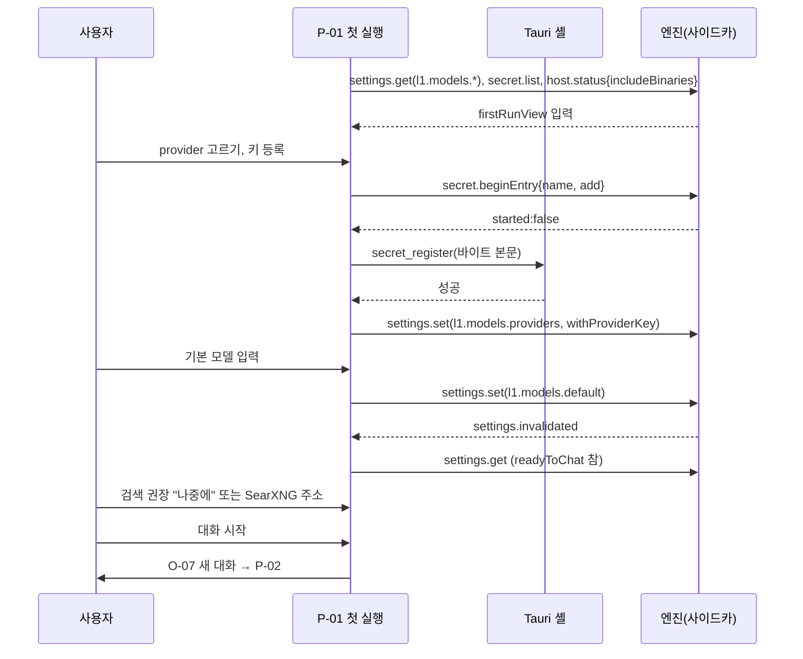
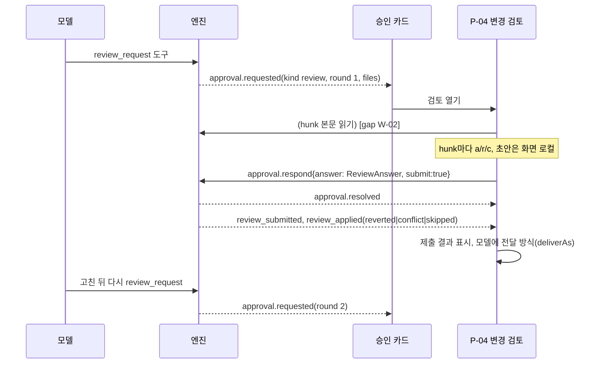
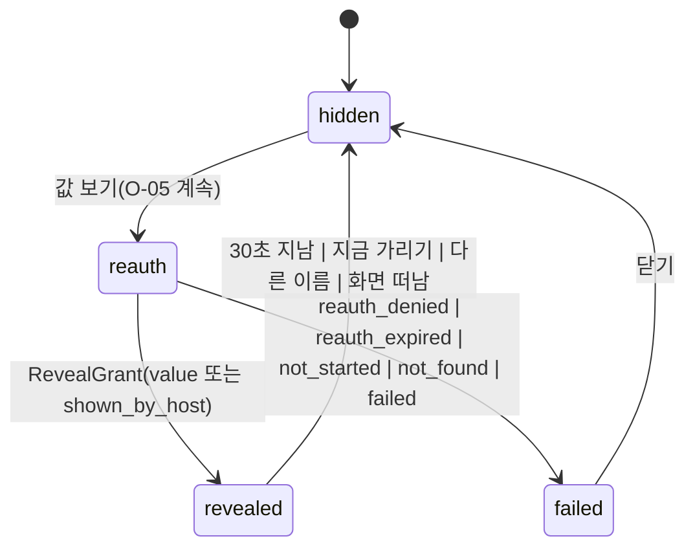
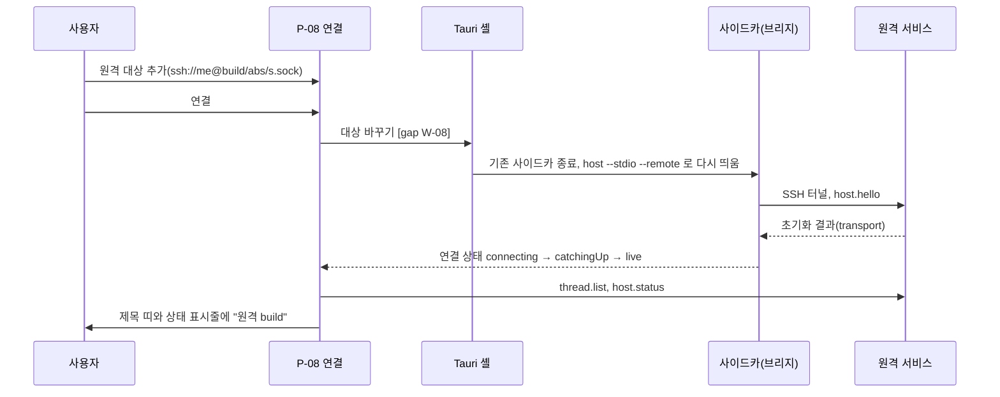
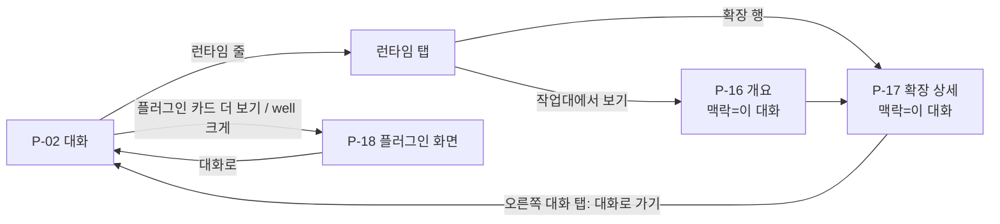
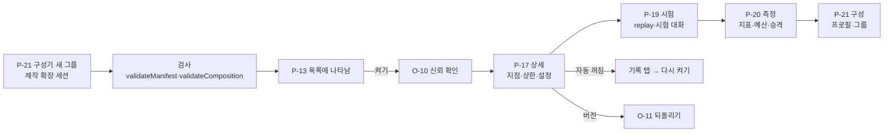

# L4 데스크톱 UX 설계 (desktop-ux)

M4 데스크톱 앱의 화면 전부를 정하는 정본입니다. 사용 시나리오에서 출발해 정보 구조, 화면 목록, 화면별 항목과 기능, 와이어프레임, 화면 사이 흐름을 적습니다. 끝에 세 모델이 같은 조건으로 만들 셸 목업 한 화면의 브리프를 둡니다. 2026-10-30부터 앱은 대화와 런타임 작업대 두 1급 영역을 둡니다(§4.9, ADR-0021). 작업대 시안 브리프는 §14입니다. 2026-10-31 사용자 결정 24건(데스크톱 UX 15, 캔버스 9)을 반영했습니다(§12.3, §12.4). 작업대 개요는 목록 + 캔버스 나눔 보기(§6.22), 구성과 만들기는 구성기 하나(§6.28)입니다. 시각 언어는 캔버스 2차 시안 뒤에 정하고, 이 문서의 캔버스 절은 동작과 데이터만 정합니다.

- 기준: `xeon/foundation` 9e1cdd9b. wire 메서드 이름은 `xeon/packages/contracts/src/wire-settings/wire/methods.ts`의 `WIRE_METHODS`를, view-model 이름은 `xeon/packages/client/src/{settings,accounts,web}`의 export를 그대로 씁니다.
- 디자인 시스템은 caustic(`@caustic/react`, `@caustic/tokens`)입니다 [결정: 2026-10-29 사용자 지시]. 부품 이름은 `external/caustic/packages/react/src/components/<id>`의 export 이름입니다.
- 표지: `[결정]` 사용자 결정, `[제안]` 이 문서의 설계 선택, `[가정]` 확인 전 전제, `[미결]` 사용자 확인 필요, `[결정: 오케스트레이터 기본값]` 사용자가 바꾸기 전까지 쓰는 기본값입니다.

## 1. 목적과 범위

### 1.1 정하는 것

- 사용 시나리오 14개와 각 시나리오가 거치는 화면(§3)
- 앱 셸 영역, 주 내비게이션, 보조 패널, 시트·대화 상자, 명령 팔레트, 전역 요소(§4)
- 화면·표면 목록과 M4 우선순위(§5)
- 화면마다 항목·기능과 그 데이터 출처(wire 메서드, view-model), 상태, 상호작용, 바로 가기 키, 접근성, caustic 부품, 와이어프레임(§6)
- 화면 사이 주요 흐름(§7)
- 셸 목업 비교용 시험 화면과 브리프(§8)
- 두 1급 영역(대화, 런타임 작업대)과 그 사이 이동(§4.9), 플러그인 수명 시나리오(SC-15~SC-23)와 층별 차이(§3.1)
- 작업대 화면(P-16~P-21. P-22는 P-21 구성기에 합침), 플러그인 화면 기여의 슬롯과 두 모드(P-18, ADR-0021), 작업대 시안 브리프(§14)
- 런타임 캔버스(§6.22), 턴 재생(§6.22.5), 구성기(§6.28), 플러그인 제작 확장과의 연결(§6.29, `L3.authoring.spec`)
- caustic 부품 간극(§9), wire와 view-model 간극(§10), 수용 기준(§11), 미결과 기본값(§12)

### 1.2 다루지 않는 것

- 시각 디자인 값(색, 그림자, 글꼴 크기). caustic `FOUNDATION.md`와 토큰을 그대로 씁니다.
- 상태 관리와 reducer 구조: `L4.desktop.design`, `eng.frontend-state.guide`
- 설정 항목의 생성 규칙과 쓰기 흐름: `L4.settings-ui.spec`. 이 문서는 그 view-model을 어디에 어떻게 놓는지만 정합니다.
- 웹 클라이언트(N15)와 모바일. 데스크톱 레이아웃이 compact 폭(720px 이하)에서도 쓸 수 있게만 둡니다.
- 문구의 최종 번역. 문구는 예시이고 메시지 키는 adr.0016을 따릅니다.

### 1.3 근거

- 유즈케이스와 범위: `product.usecases.spec` UC-1~UC-6과 §5.1 보조 유즈케이스, `product.scope.spec` §4.2 N14·N15, §4.4 M3b 행의 "UI 화면은 M4" 재범위
- M4로 옮긴 화면: `review.m3b-plan` §1.2(설정 화면, 비밀 탭, 승인·제안 목록, 모델 계정, 검색 provider 드래그앤드롭, 게이지, 첫 실행 권장, 접근성)
- 현재 화면: `xeon/apps/desktop/src/views/*`(M2 최소 화면). 슬래시 확인·결과·자동 완성 화면은 M4다(`L4.desktop.spec` §4.13). 원격 서비스 주소 화면 항목은 M4다(`L4.desktop.spec` §4.8).

## 2. 용어

| 용어 | 뜻 |
|---|---|
| 셸 | caustic `AppShell`로 만든 창 틀. 제목 띠, 시작 영역, 무대, 끝 영역, 상태 표시줄로 나눕니다. |
| 무대(stage) | 가운데 주 작업 영역. `AppShellStage`이고 `main` 랜드마크입니다. |
| 시작 영역 | 왼쪽 사이드바. `AppShellStart` 안의 `SidePanel side="start"`입니다. |
| 끝 영역 | 오른쪽 맥락 패널. `AppShellEnd` 안의 `SidePanel side="end"`입니다. medium 폭 이하에서는 무대 위에 시트로 뜹니다. |
| 화면(page) | 무대 하나를 채우는 단위. id는 `P-NN`입니다. |
| 표면(surface) | 화면이 아닌 UI 단위. 셸 요소 `S-NN`, 대화 상자·시트 `O-NN`입니다. |
| 받은 요청 | 사용자 응답을 기다리는 승인(tool, plan, question, review)과 제안, 알림을 모은 곳. |
| 대상(target) | 앱이 붙은 엔진. 로컬 사이드카, 로컬 서비스, 원격 서비스(SSH 터널·사설망) 셋 중 하나입니다. |
| `[gap:W-NN]` | 필요한 wire 메서드나 셸 명령이 없음. §10.1 목록 번호입니다. |
| `[gap:V-NN]` | 필요한 view-model이 없음. §10.2 목록 번호입니다. |
| `[gap:C-NN]` | 맞는 caustic 부품이 없음. §9 목록 번호입니다. |
| 작업대 | 런타임 작업대. 층별 플러그인과 의도 그룹을 만들고, 켜고, 시험하고, 재고, 묶고, 제어하는 1급 영역(§4.9) |
| 확장 | 매니페스트를 가진 플러그인이나 의도 그룹(`ExtensionManifest`). 화면에서는 플러그인과 그룹을 함께 "확장"이라 부릅니다 |
| 화면 기여 | 확장이 선언형 화면 트리로 앱의 슬롯(`page`, `well`, `card`, `status`, `command`, `settings`)에 더하는 화면(ADR-0021) |
| 대화 맥락 | 작업대 화면이 볼 대화 하나 또는 전체(§4.9.3) |
| 시험 대화 | 프로필을 적용해 시험 표지로 만든 대화(SC-19) |
| 맥락 칸 | 작업대 왼쪽 패널의 맥락 고르기 하나. 값은 전체, 대화, 프로필, 시험 중 하나이고 모든 작업대 화면이 따릅니다(§4.9.3) |
| 런타임 캔버스 | 작업대 개요 오른쪽의 층 띠와 블록, 엣지 그림. 운영(켜기, 끄기, 덮어쓰기, 보기)만 합니다(§6.22) |
| 구성기 | 그룹 구조(블록, 흐름, 프로필, 코드)를 편집하는 유일한 화면(P-21, §6.28) |
| 턴 재생 | 대화 턴 하나의 지점 발화와 핸들러 시간을 링 버퍼에서 읽어 캔버스에 덧그리는 보기(§6.22.5, X-15) |
| 사람 확인 관문 | drive가 사람 답을 기다리는 원시. 기다리는 동안 임대를 반납합니다(X-17) |
| 제작 확장 | 에이전트가 플러그인을 만들 때 쓰는 L3 그룹 `authoring`(`L3.authoring.spec`) |

## 3. 사용 시나리오

행위자는 한 사람입니다. 본인이 먼저 쓰고 공개 릴리즈합니다(`product.vision.spec` §4.2). "주 사용자"는 macOS나 Linux에서 코드 작업에 에이전트를 쓰는 개발자입니다.

| id | 시나리오 | 근거 |
|---|---|---|
| SC-01 | 첫 실행: 키 등록, 기본 모델, 검색 권장 | M2 최소 화면, settings-ui §4.10, X9 |
| SC-02 | 대화와 도구 승인 | UC-1, adr.0018 |
| SC-03 | 질문과 계획에 답하기 | §5.1 질문·계획 승인 |
| SC-04 | 변경 검토(diff 승인) | L2.artifacts reviews, 승인 kind `review` |
| SC-05 | Helm 탐구 | UC-2, L3.helm |
| SC-06 | 학습 제안 검토 | UC-3, L3.learning §3.8 |
| SC-07 | 예약 만들기와 결과 확인 | UC-4, X4 |
| SC-08 | 원격 서비스에 붙기 | UC-5, X5 |
| SC-09 | 비밀 관리와 값 열람 | UC-6, X8 |
| SC-10 | 모델 계정, 레이트 리밋, 계정 회전 | X7, L1.models §4.8 |
| SC-11 | 목표 걸고 지켜보기 | §5.1 목표 지속, X6 |
| SC-12 | 잠긴 대화와 이어서 실행 | UC-1 대안 흐름, 재개 |
| SC-13 | 설정 바꾸기와 외부 변경 | X10, settings-ui §4.4~4.5 |
| SC-14 | 웹 검색 provider 순서 정하기 | X9, ADR-0005 |
| SC-15 | 대화에서 런타임 상태를 보고 작업대로 넘어가기 | [결정: 2026-10-30 사용자] 대화와 런타임 작업 둘 다 1급, ADR-0021 |
| SC-16 | 플러그인·그룹 만들기 | `xeon group new`, `L3.group-sdk.spec`, `L3.slots.spec` |
| SC-17 | 플러그인 설계: 연결 지점, 임대와 상한, 설정 | `F.extensions.spec` §3.1, `X.operations.spec` §4.2 |
| SC-18 | 플러그인 적용: 켜기, 대화 범위, 신뢰 | `X.loading-trust.spec` §4.6, `L3.group-sdk.spec` §3.8 |
| SC-19 | 시험 실행: replay, 테이프, 시험 대화 | `L3.group-sdk.spec` §3.10, `just bench --server` |
| SC-20 | 평가와 측정: 지표, 비용, 핸들러 시간, 승격 보고, 코어 변경 검사 | `L3.group-sdk.spec` §3.12, `X.operations.spec` §4.2, `scripts/core-diff-check.ts` |
| SC-21 | 묶기: 그룹 구성과 프로필 | `L3.slots.spec`, `x.primitives.activeDriveGroup` |
| SC-22 | 제어: 켜기·끄기, 안전 모드, 자동 끄기 복구, 버전과 되돌리기 | `X.operations.spec` §4.3, §4.6 |
| SC-23 | 플러그인 화면 쓰기(Helm 탐구 전체 화면) | ADR-0021 §3.9 |

### SC-01 첫 실행

- 누가: 앱을 처음 연 사용자
- 목표: 첫 메시지를 보낼 수 있는 상태가 됩니다.
- 단계
  1. 앱이 열리면 사이드카가 뜨고 첫 실행 화면이 무대에 나옵니다(P-01).
  2. 외부 도구 점검 결과를 봅니다. 필수 도구가 없으면 설치 안내를 봅니다.
  3. provider를 고르고 키를 등록합니다. 값은 화면 안 등록 창으로 넣습니다(`L4.desktop.spec` §4.14.1).
  4. 기본 모델을 고릅니다.
  5. 검색 권장 카드에서 SearXNG 주소를 넣거나 Exa·Brave 키 플러그인을 고르거나 "나중에"를 누릅니다.
  6. "대화 시작"을 누르면 새 대화 시트(O-07)가 열립니다.
- 거치는 화면: P-01, O-07, P-02
- 성공 기준: `readyToChat`이 참이 되고, 첫 대화가 열리고, 입력창 잠금이 풀립니다. "나중에"를 누르면 `l4.desktop.firstRun.searchHintDismissed`가 참으로 저장됩니다.

### SC-02 대화와 도구 승인

- 누가: 작업 폴더를 정한 사용자
- 목표: 모델이 도구를 쓰며 작업을 끝냅니다. 위험한 호출은 내용을 보고 허용합니다.
- 단계
  1. 사이드바에서 대화를 고르거나 ⌘N으로 새 대화를 만듭니다.
  2. 입력창에 쓰고 Enter로 보냅니다. 응답이 흐르고 도구 호출이 접힌 행으로 보입니다.
  3. 승인이 필요한 호출이 오면 트랜스크립트 끝과 받은 요청 패널에 카드가 뜹니다. 상태 표시줄의 승인 수가 늘어납니다.
  4. 명령 전문, 인자, 쓸 비밀 핸들을 보고 "허용", "이 대화에서 항상", "거부" 중 하나를 고릅니다.
  5. 실행 중에 입력하면 큐 모드(steer, followUp)로 들어갑니다.
  6. 필요하면 ⌘. 로 중단합니다.
- 거치는 화면: P-02, P-03, S-03
- 성공 기준: 승인 응답이 `approval.respond`로 가고 `approval.resolved`가 오면 카드가 사라집니다. 응답 실패는 이유별 문장으로 보입니다(`approval-outcome.ts`).

### SC-03 질문과 계획에 답하기

- 누가: 모델이 질문(`ask_user`)이나 계획(`submit_plan`)을 보낸 대화의 사용자
- 목표: 선택지를 고르거나 계획을 승인·수정 요청합니다.
- 단계
  1. 질문 카드에서 라디오나 체크박스로 고르고 필요하면 직접 입력합니다. 추천 선택지에 표시가 있습니다.
  2. 계획 카드는 계획 본문을 Markdown으로 보이고 "승인", "수정 요청(피드백 입력)", "거부"를 둡니다. 승인 뒤 모드(`nextModes`)를 고릅니다.
  3. 다른 기기나 다른 대화에 있어도 받은 요청 패널에서 같은 카드로 답합니다.
- 거치는 화면: P-02, P-03
- 성공 기준: 질문마다 선택이나 입력이 있어야 "답하기"가 켜집니다. 계획 거부는 `{feedback}`을 실어 보냅니다.

### SC-04 변경 검토

- 누가: 모델이 파일을 바꾼 뒤 검토를 요청받은 사용자(`review_request` 도구나 `l2.artifacts.reviews.autoRequest`)
- 목표: 바뀐 hunk마다 승인·거절하고 의견을 남긴 뒤 제출합니다. 거절한 hunk는 되돌려집니다.
- 단계
  1. 승인 kind `review` 카드가 옵니다. 카드에는 파일 수, 추가·삭제 줄 수, 라운드가 보입니다.
  2. "검토 열기"로 변경 검토 화면(P-04)을 엽니다.
  3. 왼쪽 파일 목록에서 파일을 고르고 hunk마다 `a`(승인), `r`(거절), `c`(의견)를 누릅니다.
  4. "제출"을 누르면 남은 hunk 처리 방식(남은 것 승인 또는 막기)을 확인합니다.
  5. 결과로 hunk별 되돌림 결과(reverted, conflict, skipped)를 봅니다.
- 거치는 화면: P-02, P-03, P-04
- 성공 기준: 제출이 `approval.respond { decision: "answer", answer: ReviewAnswer }`로 가고 라운드가 끝납니다. 대기 hunk가 있는데 `approveRemaining`이 거짓이면 제출 버튼이 막히고 남은 수가 보입니다.

### SC-05 Helm 탐구

- 누가: 모르는 분야 문제에 막힌 사용자
- 목표: 여러 관점(렌즈)으로 병렬 탐구한 결과를 현재 작업에 적용합니다.
- 단계
  1. 같은 오류가 세 번 나면 트랜스크립트에 Helm 제안 알림(`grp.helm.notice.suggested`)이 보이고 "탐구 시작" 버튼이 있습니다. 또는 `/helm start <주제>`나 팔레트 "탐구 시작"을 씁니다.
  2. 끝 영역의 탐구 탭(P-05)이 열리고 단계(diverge → explore → converge → apply)와 렌즈별 진행이 보입니다.
  3. explore 단계에서 쓰기 도구는 거부되고 트랜스크립트에 거부 사유가 보입니다.
  4. 발견(finding)이 쌓이면 렌즈별 주장, 출처, 신뢰도가 보입니다.
  5. apply 턴이 끝나면 결과 요약과 생긴 작업(followUp → work task)이 보입니다. 필요하면 "탐구 멈춤"을 누릅니다.
- 거치는 화면: P-02, P-05, S-03(Helm 단계 칩)
- 성공 기준: 탐구가 끝나면 `grp.helm.inquiry.finished`의 결과(applied, empty, stopped, limit, failed)가 보이고, 상한에 걸리면 어느 상한인지 보입니다.

### SC-06 학습 제안 검토

- 누가: 세션이 쌓여 학습 그룹이 제안을 만든 사용자
- 목표: 스킬·메모리·피드백 후보를 보고 승인, 수정, 거절, 되돌립니다.
- 단계
  1. 사이드바 "제안"에 배지가 붙고 알림이 옵니다.
  2. 제안 화면(P-06)에서 목록을 상태·종류·출처(학습, 지식)로 거릅니다.
  3. 행을 고르면 오른쪽에 diff, 근거 이벤트, 이유, 충돌 스킬이 보입니다. 웹·MCP를 읽은 뒤 만든 후보는 경고가 붙습니다.
  4. 스킬 후보는 승인 옆에서 범위(사용자, 프로젝트)를 고릅니다. "수정"은 본문 편집기를 엽니다.
  5. 적용된 학습 제안은 "되돌리기"가 있습니다.
- 거치는 화면: P-06, S-05
- 성공 기준: 결정이 `proposal.decide`로 가고 결과가 `decisionOutcomeOf`로 바뀝니다. `revision_mismatch`면 목록을 다시 읽고 문장을 보입니다.

### SC-07 예약 만들기와 결과 확인

- 누가: 반복 작업을 맡기려는 사용자
- 목표: 앱을 닫아도 정해진 때에 프롬프트가 실행되고, 다음에 열면 결과를 봅니다.
- 단계
  1. 예약 화면(P-07)에서 "새 예약"을 누르면 시트가 열립니다.
  2. 트리거(간격, 시각, 파일 감시, 원격, 루프)를 고르고 프롬프트, 작업 폴더, 제목을 넣습니다.
  3. 서비스 모드가 꺼져 있으면 시트 아래에 경고와 "서비스 켜기"가 보입니다. 저장 결과가 `service_mode_off` 경고를 실으면 그대로 보입니다.
  4. 목록에서 다음 실행 시각과 마지막 실행 결과를 봅니다. 마지막 실행 행을 누르면 그 실행이 만든 대화가 열립니다.
  5. 실행이 끝나면 알림(`background_completed` 또는 `error`)이 옵니다.
- 거치는 화면: P-07, P-08, S-05, P-02
- 성공 기준: `schedule.create`가 `ok: true`를 돌려주면 목록 맨 위에 새 행이 보입니다. `ok: false`면 오류 종류별 문장이 해당 입력란 아래에 보입니다.

### SC-08 원격 서비스에 붙기

- 누가: 다른 기기(서버, 다른 컴퓨터)에서 도는 서비스를 노트북에서 쓰려는 사용자
- 목표: 원격 대화 목록을 보고 입력하고 승인에 답합니다.
- 단계
  1. 연결 화면(P-08)에서 "원격 대상 추가"로 `ssh://user@host/abs/socket` 형식 주소를 넣습니다.
  2. "연결"을 누르면 엔진이 그 대상으로 다시 붙습니다. 진행 단계(터널, 초기화, 동기화)가 보입니다.
  3. 성공하면 제목 띠와 상태 표시줄에 대상 이름이 보입니다. 사이드바 대화 목록이 원격 목록으로 바뀝니다.
  4. 원격에서 실행 중인 대화는 관찰로 열립니다. "입력 위임"이 가능하면 입력창이 열립니다.
- 거치는 화면: P-08, P-02, S-03
- 성공 기준: 상태 표시줄이 "원격 · host"와 연결 상태를 보이고, 대화 목록이 원격 `thread.list` 결과입니다. 터널 실패는 `AttachError` 종류별 문장과 "다시 시도"로 보입니다.

### SC-09 비밀 관리와 값 열람

- 누가: API 키를 등록하고 확인하려는 사용자
- 목표: 값을 화면에 남기지 않고 등록·확인·삭제하고, 필요할 때 재인증 뒤 한 번 봅니다.
- 단계
  1. 설정 > 비밀(P-10)에서 목록을 봅니다. 값 열은 없습니다.
  2. "추가"로 이름과 메타를 넣고 값은 가린 입력란이나 OS 입력 창으로 넣습니다.
  3. 행 메뉴 "값 보기"를 누르면 재인증 대화 상자(O-05)가 뜹니다. OS 인증을 통과하면 값이 30초 동안 보이고 자동으로 가려집니다.
  4. "삭제"는 참조하는 설정 키, 활성 lease, 최근 세션을 보인 뒤 확인을 받습니다. 사용 중이면 거부됩니다.
- 거치는 화면: P-10, O-05, O-06
- 성공 기준: 값은 React 상태, 거울, 로그에 들어가지 않습니다. 열람은 감사 이벤트 `secret.revealed`로 남습니다. 사이드카 연결에서 열람을 못 하면 그 사유와 CLI 대안이 보입니다.

### SC-10 모델 계정, 레이트 리밋, 계정 회전

- 누가: provider 계정 여러 개를 쓰는 사용자
- 목표: 계정 우선순위와 예비율, provider별 레이트 리밋 정책을 정하고 회전을 켭니다.
- 단계
  1. 설정 > 계정과 제공자(P-11)에서 provider별 계정 표를 봅니다.
  2. 계정을 추가하고 자격 비밀을 고르고 우선순위와 예비율을 넣습니다.
  3. 예산과 한도 탭에서 provider별 최소 간격, 한도 도달 시 동작(대기, 전환, 실패), 최대 대기를 넣습니다.
  4. 계정 회전 플러그인을 켜면 위험 안내가 뜨고, 확인해야 회전이 켜집니다.
  5. 사용량 게이지로 창별 사용량을 봅니다.
- 거치는 화면: P-11, P-09, S-03 사용량 팝오버
- 성공 기준: 저장 결과가 사용자 설정 파일의 `l1.models.accounts`, `l1.models.rateLimit`, `ext.account-rotation.acknowledgeRisk`에 같은 키로 들어갑니다(X7). 파일 충돌(`settings.fileConflict`)이면 다시 읽기를 권합니다.

### SC-11 목표 걸고 지켜보기

- 누가: "시험이 모두 통과할 때까지" 같은 완료 조건을 거는 사용자
- 목표: 턴마다 판정 모델이 판정하고 미충족이면 다음 턴이 이어지며, 상한에서 멈춥니다.
- 단계
  1. 입력창에서 `/goal <조건>`을 보내거나 끝 영역 작업 탭의 "목표 걸기"를 씁니다.
  2. 상태 표시줄에 목표 칩 "목표 2/3"(판정 횟수/최대)이 보입니다. 칩 `Popover` 첫 줄은 "판정 2/3"입니다(DP-25, D-17).
  3. 판정마다 트랜스크립트에 판정 행(충족 여부, 이유, 빠진 것)이 보입니다.
  4. 충족, 상한 도달, 판정 실패, 해제 중 하나로 끝나면 알림이 옵니다.
- 거치는 화면: P-02, P-14, S-03
- 성공 기준: `l1.agents.judge.maxRuns`에서 멈추고 상태 `limit_reached`가 보입니다(X6).

### SC-12 잠긴 대화와 이어서 실행

- 누가: CLI나 다른 창이 쓰고 있는 대화를 연 사용자, 또는 크래시 뒤 다시 연 사용자
- 목표: 관찰, 분기, 위임 중 하나를 고르거나 중단된 턴을 이어서 실행합니다.
- 단계
  1. 보내기가 `thread.locked`로 거절되면 잠금 대화 상자(O-01)가 뜹니다.
  2. "관찰만 하기"를 고르면 입력창이 잠기고 "쓰기 다시 시도"가 보입니다. "분기해서 이어 쓰기"는 새 대화를 엽니다.
  3. 대화 목록의 "이어서 실행" 배지가 있는 대화를 열면 트랜스크립트 끝에 "이어서 실행" 띠가 보입니다.
- 거치는 화면: P-02, O-01
- 성공 기준: `turn.resume` 결과 `resumed`, `closed`, `nothing`이 각각 다른 문장으로 보입니다.

### SC-13 설정 바꾸기와 외부 변경

- 누가: 동작을 조정하려는 사용자
- 목표: 항목을 찾아 바꾸고, 범위와 적용 시점을 압니다.
- 단계
  1. ⌘, 로 설정(P-09)을 열거나 팔레트에 키 이름이나 라벨을 칩니다.
  2. 탭을 고르고 항목을 바꿉니다. 범위 배지와 적용 시점 배지(즉시, 다음 턴부터, 재시작 필요)를 봅니다.
  3. 잠긴 항목은 정책 파일 경로를 봅니다. 가려진 범위 값이 있으면 펼쳐 봅니다.
  4. CLI가 같은 키를 바꾸면 화면이 다시 읽고 편집 중인 값에는 "다른 곳에서 바뀜" 표시가 붙습니다.
  5. 재시작이 필요한 변경이 있으면 띠에 "엔진 재시작"이 보입니다.
- 거치는 화면: P-09, S-02
- 성공 기준: 화면 항목 집합이 스키마 키 집합과 같고(X10), 저장 실패는 `FieldError` 종류별로 항목 아래에 보입니다.

### SC-14 웹 검색 provider 순서 정하기

- 누가: 무료 검색을 쓰려는 사용자
- 목표: 쓸 수 있는 provider 상태를 보고 순서를 끌어서 정합니다.
- 단계
  1. 설정 > 도구와 웹(P-12)에서 검색, 브라우저, 가져오기 구역을 봅니다.
  2. 행마다 상태(쓸 수 있음, 키 없음, 연결 안 됨)와 가격표 기준일을 봅니다.
  3. 행을 끌거나 ⌥↑/⌥↓로 순서를 바꿉니다. 저장은 `l2.web.search.order`에 갑니다.
  4. 권장 카드에서 Exa·Brave 플러그인 설치와 키 등록으로 이어집니다.
- 거치는 화면: P-12, P-10
- 성공 기준: `orderUpdateOf`가 만든 값이 `settings.set`으로 저장되고, 화면 순서와 `web.providers`의 `autoRank` 순서가 같아집니다.

### SC-15 대화에서 런타임 상태를 보고 작업대로 넘어가기

- 누가: 대화 중에 "지금 어떤 확장이 이 대화에 손대고 있지?"가 궁금한 사용자
- 목표: 대화를 떠나지 않고 이 대화의 런타임 상태를 보고, 필요하면 같은 대화 맥락으로 작업대를 엽니다.
- 단계
  1. 대화 머리 아래 런타임 줄에 drive를 쥔 그룹, 켜진 확장 수, 실패 수가 보입니다(DP-19).
  2. 트랜스크립트에는 임대 교대, 확장 꺼짐, 핸들러 실패 묶음이 흐린 한 줄 행으로 보입니다. 플러그인이 `card`를 기여한 레코드는 카드로 보입니다(ADR-0021 §3.2).
  3. 오른쪽 막대의 "런타임" 탭을 열면 이 대화의 확장 목록, 임대 상한 사용량, 최근 기록이 보입니다.
  4. "작업대에서 보기"를 누르면 작업대 영역으로 바뀌고, 대화 맥락이 이 대화로 고정된 개요(P-16)나 해당 확장 상세(P-17)가 열립니다.
  5. 작업대 왼쪽 패널의 대화 맥락 칸이나 오른쪽 막대 "대화" 탭으로 같은 대화에 돌아갑니다.
- 거치는 화면: P-02, 런타임 well(§4.9.4), P-16, P-17
- 성공 기준: 작업대에서 대화로 돌아오면 같은 대화, 같은 스크롤 위치, 같은 오른쪽 탭입니다. 런타임 줄의 실패 수와 P-17 기록의 `scope.handler_failed` 수가 같습니다.

### SC-16 플러그인·그룹 만들기

- 누가: 제2의 Helm 같은 의도 그룹이나 L2 provider 플러그인을 만들려는 사용자. 실제 작업은 에이전트가 제작 확장(`L3.authoring.spec`)으로 합니다
- 목표: 구성 초안을 만들고, 에이전트가 뼈대·검사·시험을 거쳐 설치 가능한 폴더를 냅니다.
- 단계
  1. 작업대 > 구성(P-21)의 "새 그룹"이나 확장 목록의 "새 그룹"을 누릅니다. 구성기가 빈 그룹 머리로 열립니다. 대화에서 "그룹 하나 만들어 줘"라고 해도 됩니다.
  2. 시작점을 고릅니다: Helm 복제, 또는 제작 확장 종류 카탈로그의 종류(`group.drive`, `group.policy`, `group.observe`, preview 종류). 카탈로그는 고정 목록이 아니고 제작 확장과 함께 갱신됩니다 [결정: 2026-10-31 사용자].
  3. 이름(`^[a-z][a-z0-9-]{1,31}$`, 예약 이름 23개 제외)과 폴더를 넣고, 블록을 쌓아 구성 초안을 만듭니다. 검사(`ext.validateComposition`, W-47)가 블록 안에 바로 보입니다.
  4. "제작 확장으로 만들기"를 누르면 이 대화(또는 새 대화)에서 제작 세션이 열리고 초안이 넘어갑니다. 에이전트가 뼈대를 만들고, 검사하고, 고칩니다. 화면 기여가 있으면 에이전트가 화면마다 모드를 고릅니다(ADR-0021 §3.5).
  5. 결과 단계에서 "replay 시험"(자동으로 돌지 않음 [결정: 2026-10-31 사용자]), "시험 대화에서 켜기", "편집기에서 열기", "사용자 확장 위치에 연결"(사람 확인)로 이어집니다.
- 거치는 화면: P-21, P-02(제작 세션), P-19, P-13, P-17
- 성공 기준: `group.*` 종류의 생성물이 CLI `xeon group new`와 같은 파일이고 `core-diff-check`에서 보호 경로 변경 0줄입니다. 지금은 wire가 없어 `[gap:W-27]`, `[gap:W-47]`입니다.

### SC-17 플러그인 설계: 연결 지점, 임대와 상한, 설정

- 누가: 만든 그룹의 동작을 정하는 사용자
- 목표: 어느 지점에 거는지, drive 임대 상한, 설정 항목을 보고 고칩니다.
- 단계
  1. 확장 상세(P-17) "연결 지점" 탭에서 매니페스트 `points`마다 fold, 예산 등급과 기본 예산(`DEFAULT_BUDGETS_MS`), tier를 봅니다.
  2. "임대와 상한" 탭에서 `usesDrive`, 상한(`ext.<이름>.driveLimits` 또는 `x.primitives.driveDefaultLimits`), 최근 임대 기록을 봅니다.
  3. "설정" 탭에서 `userConfig`와 `defineSettings`로 선언한 항목을 P-09와 같은 부품으로 고칩니다.
  4. 지점이나 매니페스트를 바꾸는 일은 편집기에서 합니다. 저장하면 핫 리로드(`X.loading-trust.spec` §4.4.4)로 다시 실리고 정적 검사 결과(`ManifestIssue`, `scanDriveSource`)가 탭 위에 보입니다.
- 거치는 화면: P-17, P-09
- 성공 기준: 화면의 지점 목록이 매니페스트 `points`와 같고, 설정 항목 집합이 스키마 키 집합과 같습니다(X10).

### SC-18 플러그인 적용: 켜기, 대화 범위, 신뢰

- 누가: 만든 플러그인이나 받은 플러그인을 쓰려는 사용자
- 목표: 전체 또는 대화 하나에서 켜고, 필요한 신뢰를 줍니다.
- 단계
  1. 확장 목록(P-13)이나 상세(P-17)에서 켭니다. 범위를 고릅니다: 사용자(모든 대화), 프로젝트, 이 대화만(`session`). 값은 `ext.<이름>.enabled`이고 적용은 다음 단계 경계입니다.
  2. 처음 켜는 `user`·`project` 위치 확장은 신뢰 확인(O-10)에 매니페스트 요청 등급, 설치 위치 상한, 쓰는 연산(on, post, drive, 저장)을 보입니다. `project` 위치는 프로젝트 신뢰(O-04)가 `allow`일 때만 켤 수 있습니다.
  3. drive 그룹이면 drive 그룹 고르기(`x.primitives.activeDriveGroup`)를 함께 보입니다.
- 거치는 화면: P-13, P-17, O-10, O-04
- 성공 기준: 상태가 `enabling` → `enabled`로 바뀌는 것이 "다음 단계 경계에 적용" 배지와 함께 보입니다. 신뢰가 부족하면 진단(`trust_denied`, `trust_undecided`)이 그대로 보입니다.

### SC-19 시험 실행: replay, 테이프, 시험 대화

- 누가: 그룹이 재생 규율을 지키는지, 실제 대화에서 어떻게 도는지 보려는 사용자
- 목표: 기록을 남기는 시험을 돌리고 결과를 비교합니다.
- 단계
  1. 시험 실행(P-19)에서 "새 시험"을 누르고 종류를 고릅니다.
     - replay: `replayDrive`로 모든 커밋 지점에서 끊어 재개하고 절단마다 digest를 비교합니다. 첫 실패에서 멈추지 않습니다. 효과 중복(`effects-doubled`)은 모든 절단의 이벤트열이 같을 때만 판정합니다. 효과 수는 `EffectCounts`(turn, spawn, delegate, post)입니다.
     - bench: `just bench --server`의 서버 묶음(확장 디스패치, 임대 비용 등)을 돌립니다.
     - 시험 대화: 프로필(P-21)을 적용한 새 대화를 "시험" 표지로 만들고 프롬프트를 보냅니다.
     - replay, bench, 코어 변경 검사는 개발 모드에서만 실행합니다. 배포 앱은 시험 대화와 지난 결과 읽기만 합니다 [결정: 2026-10-31 사용자].
  1a. 시험 대화는 "멈춤"으로 다음 단계 경계에서 멈춥니다. 임대는 쥔 채로 두고, "이어서"나 "한 경계씩"으로 다시 갑니다. 멈춤은 시험 대화에만 있습니다 [결정: 2026-10-31 사용자] `[gap:W-48]`.
  2. 실행 중인 시험은 왼쪽 패널 "시험 실행"에 `*`로 보입니다. 시험 대화는 대화 목록에 "시험" 표지로 보입니다.
  3. 결과에서 replay 실패는 처음 달라진 위치(`firstDiff`)와 그 이벤트 kind를 보이고, "이벤트 비교"로 두 이벤트열을 나란히 봅니다.
- 거치는 화면: P-19, P-21, P-02
- 성공 기준: replay 결과의 커밋 수와 통과 수가 `ReplayDriveReport`와 같습니다. 지금 `replayDrive`는 시험 파일 안 하니스로만 돌아 런타임 실행 경로가 없습니다 `[gap:W-29]`.

### SC-20 평가와 측정

- 누가: 그룹이 값을 하는지, 느리거나 비싸지 않은지 판단하려는 사용자
- 목표: 비용·토큰, 핸들러 시간과 예산, 실패, 승격 후보, 코어 변경 여부를 한곳에서 봅니다.
- 단계
  1. 측정(P-20)에서 기간과 대화 맥락을 고릅니다.
  2. 확장별 `GroupMetrics`(토큰, 비용, 임대 시간, 거부, 패치, post, spawn, 위임)를 표로 봅니다.
  3. 핸들러 시간을 지점별 예산과 비교합니다. 예산의 50% 넘는 p95는 경고 tone입니다 [제안].
  4. 승격 보고(`PromotionReport`)에서 다른 scope가 쓰는 그룹 전용 도구를 봅니다.
  5. 코어 변경 검사(`core-diff-check <base>`)의 마지막 결과 한 줄(보호 경로 `contracts`, `ext-host`, `platform-*`, `core-*` 변경 줄 수)을 봅니다. 실행과 상세는 P-19입니다.
- 거치는 화면: P-20, P-17
- 성공 기준: 표의 값이 `grp.<id>.metrics.recorded` 증가분 합과 같습니다. 핸들러 시간은 지금 기록하는 곳이 없습니다 `[gap:W-23]`.

### SC-21 묶기: 그룹 구성과 프로필

- 누가: 여러 플러그인을 한 작업 방식으로 묶어 쓰려는 사용자
- 목표: 확장 묶음과 설정을 이름 붙여 저장하고 대화에 한 번에 적용합니다. 묶음을 새 의도 그룹으로 만들 수도 있습니다.
- 단계
  1. 구성기(P-21) "프로필" 보기에서 층 띠마다 확장의 켜기·끄기·그대로를 고르고, 설정 덮어쓰기와 drive 그룹을 정해 이름을 붙입니다.
  2. "이 대화에 적용"은 엔진이 프로필의 키를 그 대화의 `session` 범위로 한 번에 씁니다(`profile.apply`, W-46). "새 시험 대화로"는 시험 대화를 만들며 적용합니다.
  3. "그룹" 보기는 블록을 쌓아 그룹 구조를 만듭니다. 결과는 SC-16 제작 흐름으로 이어집니다.
- 거치는 화면: P-21, P-02
- 성공 기준: 적용 뒤 이 대화의 `settings.get` 결과가 프로필 값과 같습니다. 프로필은 데스크톱 로컬이 아니라 런타임 호스트에 저장되어 CLI와 서비스가 같은 목록을 봅니다 [결정: 2026-10-31 사용자] `[gap:W-46]`.

### SC-22 제어: 켜기·끄기, 안전 모드, 자동 끄기 복구, 버전과 되돌리기

- 누가: 확장 때문에 대화가 이상해진 사용자
- 목표: 문제 확장을 찾아 끄거나 다시 켜고, 필요하면 이전 버전으로 되돌립니다.
- 단계
  1. 확장이 자동으로 꺼지면 알림과 개요(P-16) "주의" 목록에 사유(연속 5번, 또는 최근 50번 중 10번 이상이고 실패율 0.5 이상)가 보입니다.
  2. 확장 상세 "기록" 탭에서 `scope.handler_failed`(지점, 결과, 메시지, 연속 수)를 봅니다. 고친 뒤 "다시 켜기"를 누르면 실패 장부를 비우고 켭니다(`AutoDisabler.reenable`).
  3. 엔진이 연속으로 시작에 실패했거나 원인을 모르면 "안전 모드로 다시 시작"을 누릅니다. 안전 모드에서는 guard·core와 내장 L1·L2만 실리고 L3 그룹, 외부 확장, X 훅은 빠집니다 [결정: 2026-10-31 사용자].
  4. "버전" 탭에서 설치본, 앱에 든 번들 버전, 이전 버전을 보고 되돌립니다. 버전 기록과 되돌리기는 M4에 되는 만큼 넣습니다 [결정: 2026-10-31 사용자]. 기록 보관(X-8)이 없으면 탭은 설치본과 번들 버전 읽기만 하고 되돌리기는 "번들 버전으로 되돌리기" 하나만 둡니다(§6.24.1 대체 경로).
- 거치는 화면: P-16, P-17, P-13, O-11
- 성공 기준: 다시 켠 뒤 장부가 비어 있고 같은 기준으로 다시 꺼질 수 있습니다. 지금 `/group on`은 `reenable`을 부르지 않아 손으로 켠 확장이 재시작 전까지 다시 꺼지지 않습니다(코드 `operations/auto-disable.ts`, §10.3 X-4). 버전 기록과 되돌리기는 지금 없습니다 `[gap:W-31]`.

### SC-23 플러그인 화면 쓰기(Helm 탐구 전체 화면)

- 누가: Helm 탐구를 대화 옆 좁은 탭보다 넓게 보고 싶은 사용자
- 목표: 플러그인이 기여한 전체 화면에서 탐구 흐름을 보고 조작합니다.
- 단계
  1. Helm 카드의 "탐구 화면 열기", 작업대 왼쪽 패널 "플러그인 화면 > Helm 탐구", 팔레트 "탐구 화면"으로 P-18을 엽니다.
  2. 단계, 렌즈 진행, 발견, 상한 사용량, 지난 탐구를 봅니다. "멈춤"은 플러그인 트리의 주제 줄에 있고 `/helm stop` 명령입니다(DP-42).
  3. 발견의 작업 링크는 대화의 작업 탭으로, 적용 턴 링크는 대화의 그 턴으로 갑니다.
- 거치는 화면: P-18, P-02
- 성공 기준: 화면 머리(확장 이름, 등급, 버전)는 셸이 그리고, Helm이 꺼지면 화면이 `extension_disabled` 상태로 바뀝니다(ADR-0021 §3.6).

### 3.1 플러그인 수명의 층별 차이

외부 매니페스트의 `layer`는 `L1`, `L2`, `L3`, `plugin`입니다(`F.extensions.spec` §3.1). F와 X 자체, L0 구현은 사용자가 화면에서 교체하는 대상이 아닙니다. 화면은 층마다 아래만 엽니다 [제안].

| 층 | 만들기 | 설계 | 적용 | 시험 | 측정 | 묶기 | 제어 |
|---|---|---|---|---|---|---|---|
| F 계약 | 없음 | 없음. 계약 버전만 보기(P-15) | 없음 | 없음 | 없음 | 없음 | 없음 |
| X 확장 체계 | 제작 확장 종류 `x.hook`(외부 훅 확정 전 blocked) | 훅 매칭, `timeoutMs` | 켜기·끄기 | 훅 한 번 실행 `[미결]` | 훅 시간과 실패(`hook:<id>` 장부) | 프로필에 넣기 | 안전 모드에서 모두 꺼짐 |
| L0 플랫폼 | 없음 | 보기만(구현 이름, 상태) | 없음 | bench 서버 묶음 | bench 값 | 없음 | 없음(항상 실림) |
| L1 코어 | 외부 `layer: "L1"` 확장 [가정: 코어 대체가 아닌 추가]. 제작 확장 카탈로그에 종류 없음 | 지점, 설정 | 켜기·끄기. 내장 core tier는 끌 수 없음 | replay(지점 핸들러), bench | 핸들러 시간 | 프로필 | 자동 끄기 면제(core tier), 안전 모드에서 켜짐 |
| L2 능력 | 제작 확장 종류 `plugin.l2-provider`(preview) | `provides`, 설정(키, `secret://`) | 켜기, 능력 바인딩 확인 | 시험 대화 | 호출 수, 비용 | 프로필 | 자동 끄기, 안전 모드에서 외부 provider 꺼짐 |
| L3 의도 그룹 | 구성기 "새 그룹" + 제작 확장 종류 `group.drive`·`group.policy`·`group.observe`. CLI `xeon group new` | 지점, drive 상한, 레코드 종류, 구성 선언(`composition`), 화면 기여(두 모드) | 켜기, 대화 범위, drive 그룹 고르기, 신뢰 | replay(개발 모드), 시험 대화, 턴 재생 | `GroupMetrics`, 승격 보고 | 구성기, 프로필 | 자동 끄기, 안전 모드에서 꺼짐, 버전 |
| plugin(외부) | 제작 확장 종류 `plugin.tool`(preview) | 지점, 도구 등록, 설정 | 켜기, 신뢰 | 시험 대화 | 핸들러 시간, 실패 | 프로필 | 자동 끄기, 안전 모드에서 꺼짐, 버전 |

## 4. 정보 구조

### 4.1 셸 영역

> 2026-10-30: 셸 모양은 §13(최상단 띠 없음, DP-05)과 §4.9가 이 절보다 앞섭니다. 아래 그림의 제목 띠는 옛 안입니다.

[제안] caustic `AppShell` 한 개로 창 전체를 만듭니다. 상태 표시줄은 caustic에 없어 셸 아래에 앱이 직접 둡니다 `[gap:C-03]`.

```text
┌────────────────────────────────────────────────────────────────────────────────────────────────┐
│ S-01a 제목 띠: [=] 사이드바, 경로, 팔레트, 받은 요청, 설정                                     │
├──────────────────────┬──────────────────────────────────────────┬──────────────────────────────┤
│S-01b 시작 영역       │ S-01c 무대                               │ S-01d 끝 영역                │
│                      │                                          │ [받은 요청][탐구][작업]      │
│ 주 내비게이션 5개    │ 화면 P-NN 하나                           │                              │
│ 대화 목록(폴더별)    │                                          │ 맥락 패널                    │
│                      │ 위: 화면 머리(제목, 동작)                │ medium 이하는 시트           │
│                      │ 가운데: 화면 본문                        │                              │
│                      │ 아래: 화면 바닥(입력창 등)               │                              │
│                      │                                          │                              │
│ 설정              ⌘, │                                          │                              │
├──────────────────────┴──────────────────────────────────────────┴──────────────────────────────┤
│ S-03 상태 표시줄: 대상 | 엔진 | 연결 | 진행 중 | 모델 | 사용량 | 목표 | Helm | 승인 | 알림     │
└────────────────────────────────────────────────────────────────────────────────────────────────┘
```

| 영역 | caustic 부품 | 폭 | 반응형 |
|---|---|---|---|
| 제목 띠 | `AppShellTitlebar`, `IconButton`, `Breadcrumb`, `Button variant="ghost"`(팔레트 열기), `Kbd` | 높이 44 | compact에서 경로는 마지막 항목만 |
| 시작 영역 | `AppShellStart` > `SidePanel side="start" preset="inspector"`, `ListNavigation` | 272(240~360), 끌어서 조절 | compact(720 이하)에서 전체 폭 시트, 토글로 엽니다 |
| 무대 | `AppShellStage stageLabel` | 나머지 | 최소 480 [제안] |
| 끝 영역 | `AppShellEnd` > `SidePanel side="end" preset="pane"`, `Tabs` | 352(320~480) | medium(1100 이하)에서 무대 위 시트 |
| 상태 표시줄 | 앱 부품 `StatusBar` `[gap:C-03]`: `Badge`, `Button size="xs" variant="ghost"`, `Popover`, `Progress` | 높이 28 [제안] | compact에서 대상·엔진·승인만 |
| 떠 있는 층 | `AppShellOverlay`, `Toaster`, `Dialog`, `Sheet` | | |

- 창 최소 크기는 720×480입니다 [제안]. 그보다 좁으면 Tauri 창 최소값으로 막습니다.
- 사이드바와 끝 영역의 열림 상태와 폭은 UI 스토어에 두고 `l4.desktop.window.*`에 저장합니다 [제안] `[gap:V-14]`.

### 4.2 주 내비게이션

> 2026-10-31: 연결은 대화 영역 주 내비에 남고 주 내비는 다섯입니다 [결정: 2026-10-31 사용자]. 2026-10-30에 적었던 "연결을 작업대 엔진으로 옮김"은 취소했습니다(§4.9.3).

시작 영역 위쪽의 `ListNavigation kind="navigation"`입니다. 항목은 다섯 개이고 ⌘1~⌘5로 엽니다 [제안].

| 순서 | 항목 | 화면 | 배지 | 바로 가기 키 |
|---|---|---|---|---|
| 1 | 대화 | P-02 | 실행 중 대화 수 | ⌘1 |
| 2 | 받은 요청 | P-03(무대 전체 보기) | 대기 승인 + 대기 제안 + 읽지 않은 알림 | ⌘2 |
| 3 | 제안 | P-06 | 대기 제안 수 | ⌘3 |
| 4 | 예약 | P-07 | 실패한 마지막 실행 수 | ⌘4 |
| 5 | 연결 | P-08 | 연결 실패 시 경고 점 | ⌘5 |

- 그 아래에 대화 목록(`ListNavigation kind="sessions"`)이 항상 보입니다. 대화가 주 객체이기 때문입니다.
- 시작 영역 맨 아래에 "설정"(⌘,)이 있습니다. 설정은 무대를 채우는 화면입니다 [결정: 오케스트레이터 기본값].
- 탐구(P-05)와 목표·작업(P-14)은 대화에 딸린 정보라 주 내비게이션에 두지 않고 대화 화면의 끝 영역 탭으로 둡니다.

### 4.3 보조 패널(끝 영역)

| 탭 | 내용 | 보이는 화면 | 바로 가기 키 |
|---|---|---|---|
| 받은 요청 | 모든 대화의 대기 승인 카드, 대기 제안 요약, 알림 | 모든 화면 | ⌘⇧I |
| 탐구 | 열린 대화의 Helm 상태, 렌즈, 발견 | P-02 | ⌘⇧H |
| 작업 | 열린 대화의 목표, 계획, 작업 목록 | P-02 | ⌘⇧T |

- ⌘J가 끝 영역을 열고 닫습니다. 열면 마지막 탭이 보입니다 [제안].
- 대화 화면이 아니면 받은 요청 탭만 있습니다.

### 4.4 대화 상자와 시트

| id | 이름 | 부품 | 여는 곳 |
|---|---|---|---|
| O-01 | 잠긴 대화 | `Dialog kind="alert"` | `thread.locked` 거절 |
| O-02 | 셸 명령 확인 | `Dialog kind="alert"` | `command.run` 결과 `needs_confirmation` |
| O-03 | 명령 결과 | `Sheet side="right"` | `command.run` 결과 `done` |
| O-04 | 프로젝트 신뢰 카드 | `Card` + `Alert`(입력창 위, 대화 상자 아님) | `trust.get` 결과 |
| O-05 | 재인증 | `Dialog kind="alert"` | 비밀 값 보기 |
| O-06 | 삭제 확인 | `Dialog kind="alert"` | 대화·비밀·예약 삭제 |
| O-07 | 새 대화 | `Dialog` | ⌘N, "새 대화" |
| O-08 | 예약 편집 | `Sheet side="right"` | P-07 "새 예약" |
| O-09 | 바로 가기 키 도움말 | `Dialog` `[gap:C-11]` | ⌘/ |

### 4.5 명령 팔레트(S-02)

- ⌘K로 엽니다. `Dialog placement="center"` 안에 `Combobox mode="inline"`을 둡니다 `[gap:C-01]`.
- 결과 묶음 순서: 최근 대화, 명령(앱 동작), 슬래시 명령(`command.list`), 설정 항목(키와 라벨), 화면 이동.
- 앱 동작 목록: 새 대화, 대화 이름 바꾸기, 대화 분기, 대화 컴팩션, 중단, 이어서 실행, 탐구 시작·멈춤, 목표 걸기·해제, 받은 요청 열기, 설정 열기, 원격 대상 바꾸기, 엔진 재시작, 진단 복사, 테마 바꾸기.
- 행은 아이콘, 라벨, 보조 설명, 바로 가기 키(`Kbd`)를 보입니다. Enter로 실행하고 Esc로 닫습니다. 닫으면 연 곳으로 초점이 돌아갑니다.
- 데이터: 대화는 거울의 `thread.list` 결과, 슬래시 명령은 `command.list { threadId }` → `commandListView`, 설정은 `settings.list` → `buildSettingsView`의 필드 라벨입니다. 팔레트 항목 모델은 없습니다 `[gap:V-01]`.

### 4.6 전역 요소

| 요소 | 위치 | 데이터 | 동작 |
|---|---|---|---|
| 받은 요청 | 제목 띠 `IconButton`(수 배지), 주 내비 2번, 끝 영역 탭 | `ThreadSummary.pendingApprovals` 합, 열린 대화 `approval.list`, `proposal.list { status: "pending" }`, `notify.list` | 누르면 끝 영역 받은 요청 탭 |
| 알림 | 받은 요청 안 "알림" 구역, 토스트 | `notify.list { afterSeq }`, 알림 `notify.delivered` | 알림 행을 누르면 원인 대화나 화면으로 |
| 연결·서비스 상태 | 상태 표시줄 왼쪽 | 셸 IPC 엔진 상태(`EngineState`), 연결 상태 기계, `host.status` | 실패 시 "다시 연결", "엔진 다시 시작", "진단 복사" |
| 원격 대상 | 제목 띠 경로 첫 항목, 상태 표시줄 첫 칸 | 데스크톱 설정 `l0.process.service.remote` [가정], `host.hello` 결과 `transport` | 누르면 대상 팝오버(P-08 요약과 "대상 바꾸기") |
| 모델 | 상태 표시줄, 입력창 모델 칸 | `settings.get { keys: ["l1.models.default"], threadId }` | 누르면 모델 고르기 `Combobox mode="popup"`. 대화 범위 저장은 `settings.set { scope: "session" }` |
| 사용량 | 상태 표시줄 게이지 | `usage.get { threadId }` | 누르면 `Popover`에 게이지 목록 |
| 목표 | 상태 표시줄 칩 "목표 2/3"(판정 횟수/최대, DP-25) | `[gap:W-05]` | 누르면 `Popover`(첫 줄 "판정 2/3"), 거기서 끝 영역 작업 탭 |
| Helm 단계 | 상태 표시줄 칩 | `[gap:W-04]` | 누르면 끝 영역 탐구 탭 |
| 토스트 | 오른쪽 아래 `Toaster` | 알림 `notify.delivered`, 앱 동작 결과 | 오류 토스트는 자동으로 닫히지 않습니다 |

### 4.7 사이트맵

> 2026-10-30: §4.9.6 사이트맵이 이 그림을 대체합니다.

```text
Xeon 데스크톱
├─ S-01 앱 셸
│  ├─ S-01a 제목 띠 ── 대상 팝오버, 팔레트 열기, 받은 요청, 설정
│  ├─ S-01b 시작 영역
│  │  ├─ 주 내비: 대화 · 받은 요청 · 제안 · 예약 · 연결
│  │  ├─ 대화 목록 (작업 폴더별 묶음)
│  │  └─ 설정
│  ├─ S-01c 무대 ── P-NN
│  ├─ S-01d 끝 영역 ── 받은 요청 | 탐구(P-05) | 작업(P-14)
│  └─ S-03 상태 표시줄 ── 사용량 팝오버, 모델 팝오버, 대상 팝오버
├─ S-02 명령 팔레트
├─ S-04 토스트
├─ P-01 첫 실행
├─ P-02 대화
│  ├─ O-01 잠긴 대화 · O-02 셸 명령 확인 · O-03 명령 결과 · O-04 신뢰 카드 · O-07 새 대화
│  ├─ P-05 탐구 (끝 영역)
│  └─ P-14 목표와 작업 (끝 영역)
├─ P-03 받은 요청
│  └─ P-04 변경 검토
├─ P-06 제안
├─ P-07 예약 ── O-08 예약 편집, O-06 삭제 확인
├─ P-08 연결
├─ P-09 설정 (13탭)
│  ├─ P-10 비밀 ── O-05 재인증, O-06 삭제 확인
│  ├─ P-11 계정과 제공자 · 예산과 한도
│  ├─ P-12 도구와 웹
│  ├─ P-13 플러그인과 그룹
│  └─ P-15 진단과 정보 (개요 탭 안)
└─ O-09 바로 가기 키 도움말
```

### 4.8 전역 바로 가기 키

[제안] 모든 바로 가기 키는 동작 id에 묶고 `l4.desktop.appearance.keybindings`(동작 id → 키)로 바꿀 수 있게 합니다. macOS는 ⌘, Linux는 Ctrl입니다.

| 동작 id | 기본 키 | 동작 |
|---|---|---|
| `palette.open` | ⌘K | 명령 팔레트 |
| `thread.new` | ⌘N | 새 대화(O-07) |
| `nav.1`~`nav.5` | ⌘1~⌘5 | 주 내비게이션 |
| `settings.open` | ⌘, | 설정 |
| `sidebar.toggle` | ⌘\ | 시작 영역 열기·닫기 |
| `panel.toggle` | ⌘J | 끝 영역 열기·닫기 |
| `panel.inbox` | ⌘⇧I | 받은 요청 탭 |
| `panel.helm` | ⌘⇧H | 탐구 탭 |
| `panel.work` | ⌘⇧T | 작업 탭 |
| `turn.interrupt` | ⌘. | 진행 중 턴 중단 |
| `composer.focus` | ⌘L | 입력창으로 초점 |
| `thread.next` / `thread.prev` | ⌥⌘↓ / ⌥⌘↑ | 다음·이전 대화 |
| `approval.next` | ⌘⇧A | 다음 대기 승인 카드로 초점 |
| `help.shortcuts` | ⌘/ | 바로 가기 키 도움말(O-09) |
| `area.toggle` | ⌘E | 대화 ↔ 작업대(§4.9.2) [제안] |
| `area.chat` / `area.workbench` | ⌥⌘1 / ⌥⌘2 | 대화 영역 / 작업대 영역 [제안] |

- 입력창 안에서는 Enter 보내기, ⇧Enter 줄바꿈, ↑(빈 입력) 마지막 입력 다시 불러오기 [제안], `/` 슬래시 자동 완성입니다. 한글 조합 중 Enter는 보내지 않습니다(`composer-model.ts`).
- 승인 카드에 초점이 있으면 `Y` 허용, `N` 거부, `⇧Y` 이 대화에서 항상입니다 [제안]. 문자 키는 입력란 밖에서만 받습니다.

### 4.9 두 1급 영역: 대화와 런타임 작업대

[결정: 2026-10-30 사용자] 대화와 런타임 작업이 둘 다 1급입니다. 앱은 두 영역을 둡니다. 이 절은 §4.1~§4.7의 영역 구조보다 앞섭니다. 셸 모양은 §13(DP-01~DP-17)과 `mockups/_shell`을 따릅니다. §4.1의 제목 띠는 DP-05로 없어졌습니다.

#### 4.9.1 이름과 뜻

| 영역 | 화면 이름 | 다루는 것 | 주 객체 |
|---|---|---|---|
| 대화 | 대화 | 대화, 받은 요청, 학습 제안, 예약 | 대화(thread) |
| 런타임 작업대 | 작업대 | 층별 플러그인과 의도 그룹의 만들기, 설계, 적용, 시험, 측정, 묶기, 제어, 플러그인 화면, 엔진 연결과 진단 | 확장(extension) |

- [제안] 화면에 보이는 이름은 "대화"와 "작업대"입니다. 문서와 도움말에서는 "런타임 작업대"라고 풀어 씁니다.

#### 4.9.2 영역 바꾸기

- 왼쪽 패널 머리의 찾기 칸(DP-14) 바로 아래에 `SegmentedControl` 두 항목("대화", "작업대")을 둡니다 [제안]. 고른 항목은 DP-17c의 selected 굵기입니다.
- 바로 가기 키: `area.toggle` ⌘E, `area.chat` ⌥⌘1, `area.workbench` ⌥⌘2 [제안]. 키 칩은 그리지 않습니다(DP-06).
- 영역마다 마지막 화면, 스크롤, 오른쪽 탭을 기억합니다(UI 스토어, `l4.desktop.window.area.*` [제안] `[gap:V-14]`). 바꿔도 대화의 입력 초안은 남습니다.
- 팔레트(S-02)는 두 영역의 항목을 함께 찾습니다. 결과를 고르면 그 영역으로 바뀝니다.

#### 4.9.3 왼쪽 패널

| 영역 | 위 | 가운데 | 아래 |
|---|---|---|---|
| 대화 | 찾기, 영역 바꾸기 | 주 내비 다섯(대화, 받은 요청, 제안, 예약, 연결)과 작업 폴더별 대화 목록. 시험 대화는 "시험" 표지 | 설정 |
| 작업대 | 찾기, 영역 바꾸기, 맥락 칸 | 작업대 내비 여섯(개요, 확장, 시험 실행, 측정, 구성, 엔진)과 "플러그인 화면" 목록(켜진 확장의 `page` 기여, 확장별 묶음) | 설정 |

- [결정: 2026-10-31 사용자] 연결(P-08)은 대화 영역 주 내비에 남습니다. 대화 내비는 다섯입니다. 작업대 "엔진"은 엔진 상태와 진단(P-15)만 담고, 연결 화면으로 가는 링크 한 줄을 둡니다.
- [결정: 2026-10-31 사용자] 구성과 만들기는 "구성" 하나로 합칩니다. 새 그룹은 구성 안의 "새 그룹" 동작입니다(§6.28, §6.29). 작업대 내비는 개요, 확장, 시험 실행, 측정, 구성, 엔진 여섯입니다.
- 맥락 칸 [결정: 2026-10-31 사용자]: 왼쪽 패널의 맥락 칸 하나가 모든 작업대 화면(P-16, P-13, P-17, P-18, P-19, P-20, P-21)의 맥락을 정합니다. 값은 `Select` 묶음 넷입니다.

| 묶음 | 값 | 화면이 보이는 것 |
|---|---|---|
| 전체 | 하나 | 설치된 확장 전부, 대화 무관 지표 |
| 대화 | 대화마다 | 그 대화에서 켜진 것, 그 대화의 임대·지표·기록 |
| 프로필 | 프로필마다 | 프로필을 적용했다면의 상태(`profile.preview`, W-44). 쓰기 동작은 "프로필 고치기"가 됨 |
| 시험 | 시험 대화마다 | 시험 대화의 실제 상태와 시험이 덮어쓴 것 |

- 맥락 따라가기 [결정: 2026-10-31 사용자]: 기본값으로 맥락 칸은 대화 영역에서 지금 열린 대화를 따라갑니다. "작업대에서 보기"로 넘어오면 그 대화로 고정(pin)되고, 칸 옆 핀을 풀면 다시 따라갑니다.
- 작업대 내비 배지: 확장은 자동 꺼진 확장 수(`!n`), 시험 실행은 실행 중 수(`n*`)입니다. `!n`은 사용자가 "다시 켜기"로 풀어야 하는 것만 셉니다. 켜진 채 실패하는 확장은 배지에 넣지 않고 상태 표시줄 "확장 실패 n"과 지도 칸 warning 점으로 보입니다. 고정 데이터에서는 review 하나라 `!1`입니다.

#### 4.9.4 오른쪽 떠 있는 막대

| 영역 | 탭(위에서 아래) | 내용 |
|---|---|---|
| 대화 | 받은 요청, 런타임, 작업, 플러그인 `well` 탭들 | 런타임(§4.9.8): 이 대화의 그룹과 확장, drive 임대 보유와 대기열, 임대 상한 사용량, 단계 경계 전환 기록, "작업대에서 보기". 기존 "탐구" 탭은 Helm의 `well` 기여(`helm/panel`)가 됩니다 |
| 작업대 | 받은 요청, 검사, 기록, 대화 | 검사: 개요 목록이나 캔버스에서 고른 확장의 검사기(§6.22.4). 기록: 맥락 대화의 런타임 이벤트(`scope.changed`, `scope.handler_failed`, `lease.*`) 실시간 목록. 대화: 맥락 대화의 트랜스크립트 끝 부분 읽기 전용과 "대화로 가기". 구성기(P-21)에서는 검사 자리에 "블록"(팔레트)과 "속성" 탭이 옵니다 |

- 받은 요청은 두 영역 모두 맨 위입니다. 승인은 어느 영역에서도 답할 수 있습니다.
- 플러그인 `well` 탭은 열린 대화에서 켜진 확장의 것만 보입니다. 탭 아이콘은 기여 선언의 `icon`이고, 확장 수가 많아도 막대 칸은 6개까지 보이고 나머지는 "더 보기" 메뉴입니다 [제안].

#### 4.9.5 대화와 작업대 잇기

| 출발 | 동작 | 도착 |
|---|---|---|
| 대화 머리 런타임 줄(DP-19) | 누름 | 오른쪽 "런타임" 탭 |
| 런타임 탭 확장 행 | 누름 | 작업대 P-17, 맥락 = 이 대화 |
| 런타임 탭 "작업대에서 보기" | 누름 | 작업대 P-16, 맥락 = 이 대화 |
| 트랜스크립트 런타임 행(임대, 꺼짐, 실패 묶음) | 누름 | 작업대 P-17 "기록" 탭, 그 이벤트 강조 |
| 플러그인 카드의 "더 보기" | 누름 | 작업대 P-18 그 플러그인 `page` |
| 작업대 대화 맥락 칸, 오른쪽 "대화" 탭 | "대화로 가기" | 대화 P-02 그 대화 |
| 작업대 시험 실행의 시험 대화 행 | 누름 | 대화 P-02 그 시험 대화 |
| 상태 표시줄 drive 칸, 확장 실패 칸 | 누름 | 대화 영역이면 런타임 탭, 작업대면 P-16 |

- [제안] 맥락은 영역 사이 공유 상태 하나(`workbench.context`: `{ kind: "all" } | { kind: "thread", threadId, pinned } | { kind: "profile", profileId } | { kind: "trial", threadId }`)입니다. `pinned`가 거짓이면 대화 영역에서 대화를 바꿀 때 함께 바뀝니다(기본) [결정: 2026-10-31 사용자].

#### 4.9.6 사이트맵(대체)

```text
Xeon 데스크톱
├─ S-01 앱 셸: 왼쪽 패널(영역 바꾸기) · 투명한 가운데 · 오른쪽 떠 있는 막대 · 상태 표시줄
├─ S-02 명령 팔레트 · S-04 토스트 · O-09 바로 가기 키 도움말
├─ 대화 영역
│  ├─ P-01 첫 실행
│  ├─ P-02 대화 ── O-01 · O-02 · O-03 · O-04 · O-07
│  │  └─ 오른쪽: 받은 요청 · 런타임 · 작업(P-14) · 플러그인 well(Helm 탐구 = 옛 P-05)
│  ├─ P-03 받은 요청 ── P-04 변경 검토
│  ├─ P-06 제안
│  ├─ P-07 예약 ── O-08 · O-06
│  └─ P-08 연결
├─ 작업대 영역 (왼쪽 맥락 칸: 전체 · 대화 · 프로필 · 시험)
│  ├─ P-16 작업대 개요(목록 + 캔버스, 턴 재생)
│  ├─ P-13 확장 목록 ── O-10 신뢰 확인
│  │  └─ P-17 확장 상세 ── O-11 되돌리기 확인
│  ├─ P-19 시험 실행 ── O-12 새 시험
│  ├─ P-20 측정과 평가
│  ├─ P-21 구성(그룹 · 흐름 · 프로필 · 코드, "새 그룹" = 옛 P-22)
│  ├─ 엔진: 엔진 상태 · P-15 진단 · 연결 링크
│  ├─ 플러그인 화면: P-18 플러그인 화면 호스트(page 기여마다, 선언형·프레임)
│  └─ 오른쪽: 받은 요청 · 검사 · 기록 · 대화
└─ P-09 설정(두 영역 공통) ── P-10 · P-11 · P-12
```

#### 4.9.7 와이어프레임: 대화 영역의 런타임 탭

```text
┌────────────────────────┐
│[찾기               ] «   │ 캐시 무효화 조사        [작업대]           ┌─ 런타임 ───────────────────┐    [받]
│ (대화)  작업대              │ 목표 2/3 · helm 탐색 · 실패 1          │ 이 대화의 확장             │       [런]
│                        │                                  │ L3 helm  drive · 탐색      │   [작]
│>대화                 2   │ 나                                │ L3 learning  켜짐          │   [탐]
│ 받은 요청             5    │   무효화 시험이 계속 실패해                 │ L2 web-exa   켜짐          │
│ 제안                  3  │ 어시스턴트                            │ plugin acme-notes ! 실패 2 │
│ 예약                 !1  │   > bash bun test cache  실패      │                            │
│                        │   · helm drive 임대 받음 1/4         │ 임대 턴 1/4 · spawn 3/8    │
│ ~/code/xeon         +  │   · acme-notes 실패 2번             │ 토큰 [###-------] 120k     │
│>캐시 무효화 조사     *        │   ┌ Helm 제안 ───────────────┐        │                            │
│  테스트 정리     승인1        │   │ 같은 오류 3번 · 캐시 무효화  │       │ 최근 기록                  │
│  시험: 렌즈 5개    시험       │   └ 탐구 시작함 ─────────────┘        │ 14:02 lease.acquired helm  │
│ ~/notes             +  │   · helm 탐구 시작 · 렌즈 3         │ 14:03 handler_failed ×2    │
│  주간 회고                 │                                  │ [작업대에서 보기]          │
│                        │ 메시지를 입력하세요                       └────────────────────────────┘
│                        │ [+] sonnet-5-5 v       [중단]
│                        │
│ 설정                     │
└────────────────────────┘
 사이드카 · 연결됨      sonnet-5-5 · 41k · drive helm · 확장 실패 1 · 승인 2 · 알림 3
```

- 왼쪽 패널은 창 위아래 끝까지 붙고(DP-13), 가운데는 표면 없이 투명합니다(DP-01). 오른쪽은 떠 있는 막대이고 "런타임" 탭이 열려 well이 펼쳐진 상태입니다(DP-10).
- 대화 머리 둘째 줄이 런타임 줄입니다. 트랜스크립트의 `·` 행이 런타임 행, 상자가 Helm `card` 기여입니다.
- Helm `card` 기여는 ADR-0021 §3.9의 둘뿐입니다. `helm/suggested`(신호와 근거, "탐구 시작". 답한 뒤에는 "탐구 시작함"으로 닫힘)와 `helm/finished`(결과, 렌즈 수, 발견 수, "탐구 화면 열기")입니다. 탐구 시작은 카드가 아니라 런타임 행 한 줄입니다(DP-19). 진행 중 탐구를 크게 보려면 well "크게"나 팔레트 "탐구 화면"을 씁니다.

#### 4.9.8 "이 대화의 그룹" 자리

[결정: 오케스트레이터 기본값] 대화 하나에서 도는 그룹의 정본 자리는 대화 영역 오른쪽 막대의 "런타임" 탭입니다. Helm well 안에 임시로 두었던 내용(런타임 페이지 시안 `m4/pages-runtime`의 `p05-helm`)은 이 탭으로 옮깁니다. 대화 머리 런타임 줄과 상태 표시줄 drive 칸은 요약만 보이고 누르면 이 탭을 엽니다.

| 구역 | 항목 | 출처 |
|---|---|---|
| drive 임대 | 보유 그룹, 상한 사용량(턴, spawn, 토큰), 대기열(대기 그룹과 순서, 거부된 그룹) | `group.list` `[gap:W-24]`의 `GroupStatus.drive`(`holder`, `waiting`, `rejected`), `lease.acquired`·`lease.released`·`lease.rejected` |
| 켜진 그룹과 확장 | 층, 이름, 상태(켜짐, 켜는 중, 끄는 중, 자동 꺼짐), 쓰는 지점 수와 펼치면 지점 목록 | `ext.list` `[gap:W-15]`, 매니페스트 `points`, `GroupStatus.pendingToggle` |
| 전환 기록 | 단계 경계마다의 임대 교대, 켜기·끄기 적용(시각, 턴, 사유) 최근 20개 | `lease.*`, `scope.changed` 이벤트 |
| 실패 | 확장별 `scope.handler_failed` 묶음(지점, 연속 수) | 이벤트 |

- review, work 같은 다른 drive 그룹도 같은 구역에 같은 모양으로 보입니다. Helm 전용 표시가 아닙니다.
- 플러그인 `well` 기여(Helm 탐구 요약 등)는 그룹 자기 내용만 담고, 임대와 전환은 이 탭에서 봅니다.

## 5. 화면 목록

M4 우선순위: P0은 셸 목업 다음 첫 묶음이고 M4 종료에 반드시 있어야 합니다. P1은 M4 안, P2는 wire나 view-model 간극이 커서 M4 끝 또는 다음으로 미룰 수 있습니다 [제안]. [결정: 2026-10-31 사용자] 작업대 화면 P-16~P-21(시험 실행, 측정, 구성기, 플러그인 화면 포함)은 모두 M4 범위입니다. 그래서 작업대 화면에는 P2가 없습니다.

| id | 이름 | 목적 | 진입점 | 우선 | 시나리오 |
|---|---|---|---|---|---|
| S-01 | 앱 셸 | 창 틀, 영역, 반응형 | 앱 시작 | P0 | 전부 |
| S-02 | 명령 팔레트 | 모든 동작과 대화·설정 찾기 | ⌘K, 제목 띠 | P0 | SC-02, SC-13 |
| S-03 | 상태 표시줄 | 대상, 엔진, 연결, 모델, 사용량, 승인 | 항상 | P0 | SC-02, SC-08, SC-10, SC-11 |
| S-04 | 토스트 | 알림과 동작 결과 | 자동 | P0 | SC-06, SC-07 |
| P-01 | 첫 실행 | 키, 기본 모델, 외부 도구, 검색 권장 | 첫 실행, 설정 안 됨 띠 | P0 | SC-01 |
| P-02 | 대화 | 트랜스크립트, 입력, 인라인 승인 | ⌘1, 대화 목록 | P0 | SC-02, SC-03, SC-05, SC-11, SC-12 |
| P-03 | 받은 요청 | 모든 대화의 승인, 제안, 알림 | ⌘2, ⌘⇧I, 제목 띠 | P0 | SC-02, SC-03, SC-04, SC-06, SC-07 |
| P-04 | 변경 검토 | 파일·hunk 단위 승인, 의견, 제출 | review 승인 카드 | P1 | SC-04 |
| P-05 | 탐구 | Helm 단계, 렌즈, 발견. Helm의 `well` 기여 `helm/panel`이 되고 전체 화면은 P-18 `helm/inquiry`(ADR-0021 §3.9) | Helm well 탭, Helm 카드, `/helm` | P1 | SC-05, SC-23 |
| P-06 | 제안 | 학습·지식 제안 대기열 | ⌘3, 알림 | P1 | SC-06 |
| P-07 | 예약 | 예약 목록, 만들기, 마지막 실행 | ⌘4 | P1 | SC-07 |
| P-08 | 연결 | 대상(로컬, 서비스, 원격), 서비스 상태. 대화 영역 주 내비 5번 | ⌘5, 대상 팝오버, 작업대 엔진의 링크 | P1 | SC-08, SC-07 |
| P-09 | 설정 | 13탭 일반 폼, 범위·적용 배지 | ⌘, | P0 | SC-13 |
| P-10 | 비밀 | 비밀 목록, 추가, 값 보기, 삭제 | 설정 > 비밀 | P0 | SC-09, SC-01 |
| P-11 | 계정과 제공자·예산 | 계정 풀, 레이트 리밋, 회전, 게이지 | 설정 > 계정과 제공자, 사용량 팝오버 | P1 | SC-10 |
| P-12 | 도구와 웹 | 검색·브라우저 provider 상태와 순서 | 설정 > 도구와 웹, 첫 실행 | P1 | SC-14, SC-01 |
| P-13 | 확장 목록 | 작업대로 옮김. 확장 켜기·끄기, 범위, drive 그룹, 자동 꺼짐 다시 켜기 | 작업대 "확장", 설정 > 플러그인과 그룹 링크 | P0 | SC-18, SC-22 |
| P-14 | 목표와 작업 | 목표 상태, 계획, 작업 목록 | ⌘⇧T, 목표 칩 | P2 | SC-11 |
| P-15 | 진단과 정보 | 엔진 상태, 외부 도구, 버전, 안전 모드, 확장 요약, 진단 복사. 작업대 "엔진" | 작업대 엔진, 설정 > 개요, 상태 표시줄 | P1 | SC-01, SC-22 |
| O-01 | 잠긴 대화 | 관찰, 분기, 위임 | `thread.locked` | P0 | SC-12 |
| O-02 | 셸 명령 확인 | 슬래시 명령의 셸 실행 확인 | `needs_confirmation` | P0 | SC-02 |
| O-03 | 명령 결과 | 슬래시 명령 결과 보기 | `done` | P1 | SC-05, SC-11 |
| O-04 | 신뢰 카드 | 프로젝트 자원 신뢰 | `trust.get` | P0 | SC-02 |
| O-05 | 재인증 | 비밀 값 보기 전 인증 | P-10 | P0 | SC-09 |
| O-06 | 삭제 확인 | 파괴 동작 확인 | 각 화면 | P0 | SC-09, SC-07 |
| O-07 | 새 대화 | 작업 폴더 고르기 | ⌘N | P0 | SC-01, SC-02 |
| O-08 | 예약 편집 | 트리거, 프롬프트 입력 | P-07 | P1 | SC-07 |
| O-09 | 바로 가기 키 도움말 | 바로 가기 키 표 | ⌘/ | P2 | 전부 |
| P-16 | 작업대 개요 | 나눔 보기: 확장 목록 + 런타임 캔버스(층 띠, 블록, 엣지), 검사기, 턴 재생 | 작업대 기본, ⌥⌘2, 런타임 탭 | P0 | SC-15, SC-22 |
| P-17 | 확장 상세 | 개요, 연결 지점, 임대와 상한, 설정, 측정, 기록, 버전, 화면 | P-13 행, 캔버스 블록, 검사기, 런타임 탭 행 | P0 | SC-17, SC-18, SC-20, SC-22 |
| P-18 | 플러그인 화면 호스트 | `page` 기여 그리기(선언형, 프레임)와 슬롯 규칙(ADR-0021). Helm 탐구가 기준 | 플러그인 화면 목록, 카드 "더 보기", well "크게" | P1 | SC-23, SC-05 |
| P-19 | 시험 실행 | 시험 대화(멈춤, 한 경계씩), 지난 결과 읽기. replay·bench·코어 변경 검사 실행은 개발 모드만 | 작업대 내비, P-17, 구성기 흐름 보기 | P1 | SC-19 |
| P-20 | 측정과 평가 | 지표, 비용, 핸들러 시간과 예산, 승격 보고 | 작업대 내비, P-17 측정 탭 | P1 | SC-20 |
| P-21 | 구성(구성기) | 그룹 쌓기, 흐름, 프로필, 코드 보기. "새 그룹" | 작업대 내비, P-13 "새 그룹", 캔버스 "구성기에서 열기" | P1 | SC-16, SC-21 |
| P-22 | (P-21에 합침) | 옛 "만들기". id는 결번으로 둡니다 [결정: 2026-10-31 사용자] | P-21 "새 그룹" | - | SC-16 |
| O-10 | 확장 신뢰 확인 | 처음 켜는 외부 확장의 등급과 연산 | 켜기 | P1 | SC-18 |
| O-11 | 되돌리기 확인 | 이전 버전으로 | P-17 버전 탭 | P1 | SC-22 |
| O-12 | 새 시험 | 시험 종류와 옵션 | P-19 | P1 | SC-19 |

합계: 화면 21개(P-01~P-21, P-22 결번), 셸 표면 4개(S-01~S-04), 대화 상자·시트 12개(O-01~O-12)입니다. 대화 영역은 P-01~P-08과 P-14, 작업대는 P-13, P-15~P-21, 공통은 P-09~P-12입니다.

## 6. 화면별 명세

### 6.0 공통 규칙

- 격자: 와이어프레임은 폭 98열입니다. 셸 3단은 시작 22열, 무대 42열, 끝 30열이고, 2단은 시작 22열, 무대 73열입니다. 실제 픽셀 폭은 §4.1 표를 따릅니다. 와이어프레임의 `[...]`는 버튼, `[x]`·`[ ]`는 체크, `(o)`·`( )`는 라디오, `v`는 펼침, `>`는 현재 행이나 접힌 행, `*`는 실행 중, `!`는 경고입니다.
- 데이터 출처 표기: wire 메서드는 `메서드 { 인자 }`, view-model은 함수 이름, 거울 선택자는 `engine:<이름>`, 데스크톱 로컬 설정은 `l4.desktop.*`입니다. 없는 것은 `[gap:W-NN]`, `[gap:V-NN]`으로 씁니다.
- 상태 여섯 가지(빈, 읽는 중, 오류, 오프라인, 권한 필요, 긴 내용)를 화면마다 적습니다. 해당 없으면 "해당 없음"이라 씁니다.
- 오프라인 공통: 연결 상태가 `live`가 아니면 쓰기 버튼을 잠그고 "엔진에 연결되면 할 수 있어요"를 `Tooltip`으로 보입니다. 읽은 데이터는 그대로 두고 화면 머리에 `Alert tone="warning" layout="inline"`을 둡니다.
- 문구: 문장은 해요체, 라벨은 명사구입니다(`L4.settings-ui.spec` §4.8). 현재 M2 화면의 합니다체 문구도 M4에서 해요체로 맞춥니다 [결정: 오케스트레이터 기본값]. 문구는 메시지 키로 둡니다(adr.0016).
- 접근성 공통: caustic 규칙(대상 24×24 이상, 키보드 초점 고리, axe 위반 0)을 따릅니다. 실시간 영역은 `aria-live="polite"`이고 오류만 `role="alert"`입니다. 모든 아이콘 버튼은 `label`이 있습니다. 움직임은 `prefers-reduced-motion`을 따릅니다.
- 시간 표시는 상대 시각("3분 전")이고 `Tooltip`에 절대 시각을 둡니다.

### 6.1 S-01 앱 셸

와이어프레임은 §4.1(영역)과 §6.6(P-02, 채운 모습)에 있습니다.

- 항목과 데이터

| 항목 | 출처 |
|---|---|
| 경로(대상 / 작업 폴더 / 대화 제목) | 대상: 연결 설정과 `host.hello` 결과 `transport`. 폴더와 제목: `engine:threadById` (`ThreadSummary.workspace`, `title`) |
| 받은 요청 수 | §4.6 받은 요청 합 `[gap:V-02]` |
| 사이드바 대화 목록 | `thread.list { limit }` → 거울, `ThreadSummary.status`, `resumable`, `pendingApprovals`, `queuedInputs` |
| 창·패널 상태 | UI 스토어(`sidebarOpen`, 끝 영역 탭과 폭) `[gap:V-14]` |

- 기능: 사이드바·끝 영역 토글, 폭 끌기(`ResizeHandle`), 대화 고르기(`selectThread`), 새 대화(O-07), 대화 행 메뉴(이름 바꾸기 `thread.rename`, 분기 `thread.fork`, 컴팩션 `thread.compact`, 닫기 `thread.close`, 삭제 `thread.delete` + O-06).
- 상태: 대화 목록 빈 경우 "아직 대화가 없어요" + "새 대화" (`EmptyState variant="dashed"`), 읽는 중 `Skeleton` 5행, 읽기 실패 "대화 목록을 읽지 못했어요" + "다시 읽기", 오프라인은 목록 유지와 흐린 표시, 긴 목록은 폴더 묶음 접기와 50개 뒤 "더 보기"(`nextCursor`).
- 대화 행: 제목(없으면 "제목 없음"), 배지 `실행 중`(running), `이어서 실행`(resumable), `승인 N`, `잠김`(다른 소유자, 알 수 있을 때), `예약`(schedule이 만든 대화) [가정: `ThreadSummary`에 출처 필드 없음 `[gap:W-16]`].
- 접근성: 시작 영역은 `SidePanel label="대화와 이동"`(aside 랜드마크), 무대는 `main`, 건너뛰기 링크 `skipLabel="본문으로"`. 대화 목록은 `ListNavigation`의 단일 선택 목록이고 화살표로 이동합니다.
- caustic: `AppShell`, `AppShellTitlebar`, `AppShellStart`, `AppShellStage`, `AppShellEnd`, `AppShellOverlay`, `SidePanel`, `ListNavigation`(kind `navigation`, `sessions`), `ResizeHandle`, `Breadcrumb`, `IconButton`, `Badge`, `Menu`, `Tabs`, `EmptyState`, `Skeleton`.

### 6.2 S-02 명령 팔레트

```text
┌────────────────────────────────────────────────────────────────────────────────────────────────┐
│ [=]  로컬 / ~/code/xeon / 캐시 무효화 조사     [⌘K 명령 또는 대화 찾기]  [받은 요청 5]  [설정] │
├────────────────────────────────────────────────────────────────────────────────────────────────┤
│                                                                                                │
│               ┌──────────────────────────────────────────────────────────────┐                 │
│               │ > 컴팩션|                                                    │                 │
│               │                                                              │                 │
│               │ 대화                                                         │                 │
│               │   캐시 무효화 조사           ~/code/xeon                     │                 │
│               │ 명령                                                         │                 │
│               │ > 대화 컴팩션                                   /compact     │                 │
│               │   대화 분기                                                  │                 │
│               │ 슬래시 명령                                                  │                 │
│               │   /compact [지시]   대화를 요약해 문맥을 줄여요              │                 │
│               │ 설정                                                         │                 │
│               │   자동 컴팩션 기준 (l1.context.compact.threshold)            │                 │
│               │                                                              │                 │
│               │ ^v 이동   Enter 실행   Esc 닫기                              │                 │
│               └──────────────────────────────────────────────────────────────┘                 │
│                                                                                                │
└────────────────────────────────────────────────────────────────────────────────────────────────┘
```

- 항목: 입력란, 묶음 제목, 행(라벨, 보조 설명, 바로 가기 키 또는 슬래시 이름), 아래 키 안내.
- 데이터: 앱 동작 표(정적) `[gap:V-01]`, `command.list { threadId }` → `commandListView`, 대화 `thread.list` 거울, 설정 `settings.list` → `buildSettingsView`의 `FieldVM.label`과 `key`.
- 기능: 실행(앱 동작 호출, 슬래시는 입력창에 `/이름 `을 채움, 설정은 P-09에서 그 항목으로 스크롤과 강조), 최근 사용 순 위로.
- 상태: 빈 입력은 최근 대화 5개와 자주 쓴 동작 5개, 결과 없음 "맞는 항목이 없어요", 슬래시 목록 읽기 실패는 그 묶음만 "명령 목록을 읽지 못했어요", 오프라인은 앱 동작과 화면 이동만, 긴 결과는 묶음마다 5개 뒤 "더 보기".
- 접근성: `Dialog` 안 `Combobox mode="inline"`이라 초점은 입력란에 남고 `aria-activedescendant`로 행을 가리킵니다. 닫으면 연 곳으로 초점이 돌아갑니다.
- caustic: `Dialog`, `Combobox`, `ComboboxOption`, `Kbd`, `Separator`. 팔레트 전용 부품은 없습니다 `[gap:C-01]`.

### 6.3 S-03 상태 표시줄

```text
┌────────────────────────────────────────────────────────────────────────────────────────────────┐
│ 기본      사이드카 | 실행 중 | 연결됨                sonnet-5-5 | 41k [###-] | 승인 2 | 알림 3 │
├────────────────────────────────────────────────────────────────────────────────────────────────┤
│ 재연결     로컬 사이드카 | 엔진 실행 중 | 다시 맞추는 중 (2/3)         [다시 연결] [진단 복사] │
├────────────────────────────────────────────────────────────────────────────────────────────────┤
│ 엔진 실패   로컬 사이드카 | 엔진 시작 실패                        [엔진 다시 시작] [진단 복사] │
├────────────────────────────────────────────────────────────────────────────────────────────────┤
│ 원격      원격 build-box | 서비스 | 연결됨 | 클라이언트 2                  sonnet-5-5 | 승인 1 │
├────────────────────────────────────────────────────────────────────────────────────────────────┤
│ compact  build-box | 연결됨                                                             승인 1 │
└────────────────────────────────────────────────────────────────────────────────────────────────┘
```

| 칸 | 출처 | 누르면 |
|---|---|---|
| 대상 | 연결 설정, `host.hello`의 `transport`, `host.status.mode` | 대상 팝오버(P-08 요약, "대상 바꾸기") |
| 엔진 | 셸 IPC `EngineState`(starting, running, restarting, stopping, failed, stopped) | 실패 시 "엔진 다시 시작" |
| 연결 | 연결 상태 기계(offline, connecting, catchingUp, live, resyncing, reloading, failed) | 실패 시 "다시 연결", "진단 복사" |
| 진행 중 | `host.status.liveTurns` | 실행 중 대화로 이동 |
| 모델 | `settings.get { keys: ["l1.models.default"], threadId }` | 모델 `Combobox mode="popup"` |
| 사용량 | `usage.get { threadId }` → 게이지 `[gap:V-11]` | 사용량 `Popover`(게이지 목록, P-11 링크) |
| 목표 | "목표 2/3"(판정 횟수/최대, DP-25). `[gap:W-05]`, 임시로 `agent.judged`·`work.goal_*` 이벤트 | `Popover` 첫 줄 "판정 2/3", 끝 영역 작업 탭 링크 |
| Helm | `[gap:W-04]`, 임시로 `grp.helm.*` 이벤트 | 끝 영역 탐구 탭 |
| 승인, 알림 | §4.6 | 끝 영역 받은 요청 탭 |

- 상태: 연결 전에는 "엔진 상태 확인 중"만, 원격이면 첫 칸에 "원격 · 이름"과 경고 색 테두리 없이 `Badge tone="info"`, compact 폭에서는 대상·연결·승인만 남깁니다.
- 접근성: `role="status"` 하나이고 바뀐 칸만 읽힙니다. 개수 배지는 `aria-label="승인 대기 2개"`처럼 문장으로 둡니다.
- caustic: 상태 표시줄 부품 없음 `[gap:C-03]`. `Badge`, `Button size="xs" variant="ghost"`, `Popover`, `Progress shape="bar"`(게이지 대용 `[gap:C-05]`), `Tooltip`으로 만듭니다.

### 6.4 S-04 토스트

- 쓰는 곳: 알림 `notify.delivered`(창이 앞에 있어도 기본으로 보임, `l2.dialog.notify.<kind>`로 끔), 앱 동작 결과(저장됨, 복사됨), 오류.
- 규칙: 성공·정보는 4초 뒤 닫힘, `tone="danger"`는 닫지 않음(`role="alert"`). 같은 kind와 같은 대화는 1초 안에 하나로 합칩니다(`L2.dialog.spec` §4.7과 같은 규칙). 토스트 동작 버튼은 하나(예: "열기")입니다.
- 받은 요청과의 관계: 알림 토스트는 받은 요청의 알림 구역에도 남습니다. 토스트를 닫아도 알림은 남습니다.
- 위치 [결정: 2026-10-31 사용자]: 오른쪽 well이 열려 있으면 토스트 자리를 well 왼쪽 끝으로 옮깁니다. 토스트가 well 내용을 가리지 않게 합니다.
- caustic: `Toaster`, `toast()`, `ToastViewport label="알림"`.

### 6.5 P-01 첫 실행

```text
┌────────────────────────────────────────────────────────────────────────────────────────────────┐
│ [=]  첫 실행                                   [⌘K 명령 또는 대화 찾기]  [받은 요청 0]  [설정] │
├──────────────────────┬─────────────────────────────────────────────────────────────────────────┤
│ 시작하기             │┌─────────────────────────────────────────────────────────────────────┐  │
│                      ││ 1  외부 도구 점검                             [다시 확인]           │  │
│ [x] 1 외부 도구 점검 ││ 도구        구분   상태              쓰는 곳                        │  │
│ [ ] 2 모델 키 등록   ││ sops        필수   3.9.1             비밀 저장                      │  │
│ [ ] 3 기본 모델      ││ bwrap       필수   사용 가능         샌드박스                       │  │
│ [ ] 4 웹 검색 (선택) ││ git         선택   없음: 설치 필요   작업 공간 도구                 │  │
│                      │└─────────────────────────────────────────────────────────────────────┘  │
│ 앱 버전 0.4.0        │┌─────────────────────────────────────────────────────────────────────┐  │
│ 엔진 사이드카        ││ 2  모델 키 등록                                                     │  │
│                      ││                                                                     │  │
│                      ││ Provider   [anthropic           v]                                  │  │
│                      ││ 비밀 이름   anthropic-api-key       등록되지 않음                   │  │
│                      ││                                                                     │  │
│                      ││ 키 값      [****************************]   [저장] [취소]           │  │
│                      ││            값은 이 창에만 있고 저장 뒤 지워져요.                    │  │
│                      ││                                                                     │  │
│                      ││ [키 등록]  [provider에 연결]                    [다시 확인]         │  │
│                      │└─────────────────────────────────────────────────────────────────────┘  │
│                      │                                                                         │
│                      │ 3  기본 모델   (키 등록 뒤 열려요)                          [대화 시작] │
│                      │                                                                         │
├──────────────────────┴─────────────────────────────────────────────────────────────────────────┤
│ 로컬 사이드카 | 엔진 실행 중 | 연결됨                                                모델 없음 │
└────────────────────────────────────────────────────────────────────────────────────────────────┘
```

```text
┌────────────────────────────────────────────────────────────────────────────────────────────────┐
│┌────────────────────────────────────────────────────────────────────────────────────────────┐  │
││ 4  웹 검색 (선택)                                                         [나중에]         │  │
││                                                                                            │  │
││ 지금 쓰는 검색: 내장 검색(모델 provider)   비용: 검색마다 과금                             │  │
││                                                                                            │  │
││ SearXNG 주소  [http://localhost:8888          ]  [확인]   상태: 연결 안 됨                 │  │
││                                                                                            │  │
││ 권장 키 플러그인                                                                           │  │
││   Exa     plugin:web-exa     키 없음       [설치]  [키 등록]                               │  │
││   Brave   plugin:web-brave   설치 안 됨    [설치]                                          │  │
│└────────────────────────────────────────────────────────────────────────────────────────────┘  │
└────────────────────────────────────────────────────────────────────────────────────────────────┘
```

- 목적: 첫 메시지를 보낼 수 있는 상태로 만듭니다(SC-01). 설정이 덜 됐으면 언제든 다시 열 수 있습니다.
- 진입: 첫 실행에서 `readyToChat`이 거짓이면 무대에 자동으로 엽니다. 이후에는 "설정 필요" 띠의 "설정 열기"와 팔레트 "시작하기"입니다.

| 항목 | 출처 |
|---|---|
| 단계 목록과 완료 여부 | `firstRunView({ setup, web, searchHintDismissed })` → `steps`, `next`, `readyToChat` |
| 외부 도구 표 | `host.status { includeBinaries: true }` → `binaryViewOf` |
| provider 후보 | `PRESET_PROVIDERS`, `providersOf(settings)` |
| 비밀 이름과 등록 여부 | `providerSecretName(id)`, `secret.list {}` → `SecretRow` |
| 기본 모델 | `settings.get { keys: ["l1.models.default", "l1.models.providers"] }`, `defaultModelOf`, `checkModelRef` |
| 검색 권장 | `web.providers {}` → `toolsWebViewOf` → `FirstRunSearch` |

| 기능 | wire 또는 view-model |
|---|---|
| 다시 확인 | `SetupCommands.load({ binaries: true })` |
| 키 등록 | `secret.beginEntry { name, action }` → `started: false`면 화면 안 등록 창, 저장은 셸 IPC `secret_register`(`submitKey`) |
| provider에 연결 | `settings.set { key: "l1.models.providers", value: withProviderKey(...), scope: "user" }` |
| 기본 모델 저장 | `settings.set { key: "l1.models.default", value, scope: "user" }`. 거절(3102)은 host 문장 그대로 |
| SearXNG 주소 | `settings.set { key: "l2.web.search.searxng.url" }` 뒤 `web.providers` 다시 읽기 |
| 권장 플러그인 설치 | `[gap:W-15]` 플러그인 설치 wire가 없습니다. M4는 "설치 방법 보기" 링크와 CLI 명령 복사로 둡니다 [제안] |
| 나중에 | `l4.desktop.firstRun.searchHintDismissed = true` (데스크톱 로컬 설정 `[gap:V-14]`) |
| 대화 시작 | O-07 새 대화 |

- 상태
  - 빈: 해당 없음(단계는 항상 셋 이상).
  - 읽는 중: 단계 옆 `Progress indeterminate`, 도구 표 `Skeleton`.
  - 오류: 설정을 못 읽으면 "설정을 읽지 못했어요" + "다시 시도". 키 등록 오류는 `keyErrorText` 문장(busy, timeout, rejected detail).
  - 오프라인: 모든 쓰기 잠금, 도구 표는 "엔진에 연결되면 확인해요".
  - 권한 필요: 키체인 잠김 등 SOPS 실패는 `rejected` detail을 보이고 "터미널에서 `xeon secret add <이름>`" 안내를 덧붙입니다.
  - 긴 내용: 도구 표가 8행을 넘으면 필수만 펼치고 선택은 접습니다.
- 상호작용: 단계는 순서대로 열리지만 끝난 단계도 다시 열 수 있습니다(`Stepper variant="checklist"`). 키 값 입력란은 제어하지 않는 password 입력이고 React 상태에 값이 없습니다(`L4.desktop.spec` §4.14.1). 키 단계가 끝나면 모델 단계가 자동으로 펼쳐집니다.
- 바로 가기 키: ⌘Enter 현재 단계 주 동작.
- 접근성: 단계 목록은 `aria-current="step"`, 완료는 문장 "완료됨"을 함께 읽습니다. 키 입력란 `autocomplete="off"`, 라벨 "키 값".
- caustic: `Stepper`(checklist), `Card`, `FormLayout`, `Field`, `Input`, `Combobox mode="popup"`(provider, 모델), `Table`(도구), `Badge`, `Button`, `Alert`, `ChoiceGroup`(권장 provider 카드), `Progress`.

- 기본 그룹 단계 [결정: 2026-10-31 사용자]: 첫 실행은 검색 권장 다음에 건너뛸 수 있는 "기본 그룹" 단계를 둡니다. Helm과 학습 그룹은 켬, review는 끔이고, 안전 모드 안내 한 줄을 둡니다. Helm과 학습 그룹의 `Switch`와 한 줄 설명을 보이고 기본값은 둘 다 켬입니다(Helm `defaultEnabled: true`, `L3.helm.spec` §3.1. 학습 그룹 `defaultEnabled: true`, `L3.learning.spec` §3.1 [결정: review.m3-design-inputs D-M3-02]). 값은 `ext.helm.enabled`, `ext.learning.enabled` 사용자 범위입니다. `xeon group new` 안내는 두지 않고 "작업대에서 더 보기" 링크 하나만 둡니다(새 그룹은 작업대 구성기 P-21 소유). 안전 모드로 시작했으면 이 단계 맨 위에 "안전 모드라 그룹이 실리지 않았어요" 한 줄을 둡니다.

### 6.6 P-02 대화

```text
┌────────────────────────────────────────────────────────────────────────────────────────────────┐
│ [=]  로컬 / ~/code/xeon / 캐시 무효화 조사     [⌘K 명령 또는 대화 찾기]  [받은 요청 5]  [설정] │
├──────────────────────┬──────────────────────────────────────────┬──────────────────────────────┤
│>대화               2 │ 캐시 무효화 조사     [탐구] [작업] [...] │ [받은 요청] 탐구  작업       │
│ 받은 요청          5 │ ~/code/xeon | 목표 2/3                   │──────────────────────────────│
│ 제안               3 │──────────────────────────────────────────│ 승인 2                       │
│ 예약              !1 │ 나                                       │ bash | 캐시 무효화      지금 │
│ 연결                 │   무효화 시험이 계속 실패해. 원인 찾아줘 │   rm -rf .cache && bun...    │
│──────────────────────│ 어시스턴트                               │   [허용] [거부]       [열기] │
│ ~/code/xeon      [+] │   먼저 실패하는 시험을 돌려 볼게요.      │ 질문 | 테스트 정리       3분 │
│>캐시 무효화 조사   * │   > 도구 bash  bun test cache       1.2s │   어느 시험 묶음부터?        │
│  테스트 정리   승인1 │   > 도구 read  src/cache.ts         완료 │                     [답하기] │
│  빌드 실패 분석      │   v 생각                                 │ 제안 3                       │
│  예약: 매일 정리   ! │     만료 시각 비교에 단위가 섞였어요...  │   스킬: cache-debug 외 2     │
│ ~/notes          [+] │ +- 승인 필요 ---------------------------+│                  [제안 열기] │
│  주간 회고           │ | 도구 bash | 위험도 exec               |│ 알림                         │
│  CLI 세션       잠김 │ | $ rm -rf .cache && bun test           |│ o 예약 실패: 매일 정리    1h │
│                      │ | > 인자 (2)                            |│   완료: 빌드 실패 분석  어제 │
│                      │ | [허용 Y] [이 대화에서 항상] [거부 N]  |│                              │
│                      │ +---------------------------------------+│                              │
│                      │   응답 작성 중...|                       │                              │
│                      │──────────────────────────────────────────│                              │
│                      │ 메시지를 입력하세요. Enter 보내기        │                              │
│ 설정              ⌘, │ [+]  sonnet-5-5 v  steer v     [중단 ⌘.] │                              │
├──────────────────────┴──────────────────────────────────────────┴──────────────────────────────┤
│ 사이드카 | 실행 중 | 연결됨        sonnet-5-5 | 41k [###-] | 목표 2/3 | Helm | 승인 2 | 알림 3 │
└────────────────────────────────────────────────────────────────────────────────────────────────┘
```

상태 변형:

```text
┌────────────────────────────────────────────────────────────────────────────────────────────────┐
│ ┌─ A 빈 무대 ────────────────────────────────┐  ┌─ B 빈 대화 ────────────────────────────────┐ │
│ │ 대화를 고르지 않음                         │  │ 아직 메시지가 없어요                       │ │
│ │                                            │  │                                            │ │
│ │   왼쪽에서 대화를 고르거나                 │  │ 제안                                       │ │
│ │   새로 만드세요.                           │  │  [이 저장소 구조 설명]                     │ │
│ │                                            │  │  [실패하는 시험 찾기]                      │ │
│ │   [새 대화 ⌘N]                             │  │                                            │ │
│ │   최근: 캐시 무효화 조사, 테스트 정리      │  │ 입력창 활성                                │ │
│ └────────────────────────────────────────────┘  └────────────────────────────────────────────┘ │
│ ┌─ C 오프라인 ───────────────────────────────┐  ┌─ D 설정 필요 ──────────────────────────────┐ │
│ │ ! 연결을 다시 맞추는 중이에요 (2/3)        │  │ i 모델 키와 기본 모델을 먼저 정해야        │ │
│ │   [다시 연결]                              │  │   대화를 시작할 수 있어요 [설정 열기]      │ │
│ │                                            │  │                                            │ │
│ │ 트랜스크립트는 읽기 전용으로 보여요        │  │ (트랜스크립트)                             │ │
│ │                                            │  │                                            │ │
│ │ 입력창: 엔진에 연결되면 보낼 수 있어요     │  │ 입력창 잠김: 설정이 끝나면 열려요          │ │
│ │ (입력은 지우지 않고 남겨요)                │  │                                            │ │
│ └────────────────────────────────────────────┘  └────────────────────────────────────────────┘ │
│ ┌─ E 관찰 ───────────────────────────────────┐  ┌─ F 이어서 실행, 실패 ──────────────────────┐ │
│ │ 관찰 중이에요. CLI가 쓰고 있어요.          │  │ 중단된 턴이 있어요 (14:02에 시작)          │ │
│ │   [쓰기 다시 시도]                         │  │   [이어서 실행] [그대로 두기]              │ │
│ │                                            │  │                                            │ │
│ │ (트랜스크립트가 계속 흘러요)               │  │ 실패: model_unavailable: ...               │ │
│ │                                            │  │   role=alert, 다음 턴 시작 때 지움         │ │
│ │ 입력창 잠김                                │  │                                            │ │
│ │                                            │  │                                            │ │
│ └────────────────────────────────────────────┘  └────────────────────────────────────────────┘ │
│ ┌─ G 읽는 중, 읽기 실패 ─────────────────────┐  ┌─ H 긴 내용 ────────────────────────────────┐ │
│ │ 대화를 읽는 중...                          │  │ 긴 대화: 가상 스크롤, 맨 아래 따라가기     │ │
│ │ [######--------]  skeleton 3행             │  │ 위로 올리면 따라가기 멈춤                  │ │
│ │                                            │  │ [v 새 메시지 12]  눌러 맨 아래로           │ │
│ │ 대화를 읽지 못했어요                       │  │ 긴 도구 결과: 400자 미리보기 + 펼치기      │ │
│ │   [다시 읽기]                              │  │ 긴 인자: 4000자 상한, 넘으면 생략 표시     │ │
│ │                                            │  │                                            │ │
│ │                                            │  │                                            │ │
│ └────────────────────────────────────────────┘  └────────────────────────────────────────────┘ │
└────────────────────────────────────────────────────────────────────────────────────────────────┘
```

compact 폭(720 이하)과 사이드바 시트:

```text
┌────────────────────────────────────────┐    ┌────────────────────────────────────────┐
│ [=] 캐시 무효화 조사               [5] │    │ 대화                          [닫기 x] │
├────────────────────────────────────────┤    ├────────────────────────────────────────┤
│ 나                                     │    │>대화               2                   │
│   무효화 시험이 계속 실패해            │    │ 받은 요청          5                   │
│ 어시스턴트                             │    │ 제안               3                   │
│   먼저 실패하는 시험을...              │    │ 예약              !1                   │
│ +- 승인 필요 ------------+             │    │ 연결                                   │
│ | bash rm -rf .cache     |             │    │────────────────────────────────────────│
│ | [허용] [거부]          |             │    │ ~/code/xeon                            │
│ +------------------------+             │    │ > 캐시 무효화 조사                     │
│                                        │    │   테스트 정리                          │
├────────────────────────────────────────┤    │                                        │
│ 메시지를 입력하세요                    │    │ 설정                                   │
│ [+] sonnet v                    [중단] │    └────────────────────────────────────────┘
├────────────────────────────────────────┤                                              
│ build-box | 연결됨 | 승인 1            │                                              
└────────────────────────────────────────┘                                              
```

- 목적: 대화하고, 도구 실행을 보고, 인라인으로 승인하고, 실행 중에 입력을 큐에 넣습니다.
- 진입: 주 내비 "대화", 대화 목록, 알림 행, 팔레트, 예약 실행 결과.

| 영역 | 항목 | 출처 |
|---|---|---|
| 화면 머리 | 제목, 작업 폴더, 목표 칩, 탐구·작업 버튼, 행 메뉴 | `engine:threadById`, 목표 `[gap:W-05]` |
| 트랜스크립트 | 사용자·어시스턴트 메시지, 생각, 도구 호출·결과, 이미지, 확장 item(`display: true`만), 판정 행, Helm 알림 | `thread.open { threadId, mode: "write", includeItems }`, `events.subscribe`/`events.batch`, `stream.chunk`. 렌더 규칙은 `L4.desktop.spec` §4.13 |
| 스트리밍 행 | 작성 중 텍스트, 도구 진행 | `stream.chunk`(`item.updated` part_delta, tool_progress) |
| 인라인 승인 카드 | 이 대화의 대기 승인 | `approval.requested` 내구 이벤트, 재접속 뒤 `approval.list { threadId }` |
| 신뢰 카드 | 프로젝트 자원과 선택지 | `trust.get { workspace }` → `trustCardOf` |
| 띠 | 설정 필요, 오프라인, 관찰 중, 이어서 실행, turn 실패 | `useSetupNeeded`, 연결 상태, `observing`, `ThreadSummary.resumable`, `turnFailures` |
| 입력창 | 텍스트, 첨부, 모델, 큐 모드, 보내기·중단 | `composerDisabledReason`, `createEnterGuard`, `createSendLatch` |
| 슬래시 자동 완성 | `/`로 시작하면 명령 목록 | `command.list` → `completeSlash` |

| 기능 | wire 또는 view-model |
|---|---|
| 보내기 | `turn.start { threadId, input, requestId }`. `/이름`은 `command.run { threadId, text }` → `slashStepOf` |
| 실행 중 입력 | `turn.start`가 큐에 넣고 `input.queued`가 큐 모드를 실음. 입력창 큐 모드 선택(steer, followUp)은 기본값 `l1.tasks.queue.defaultMode` [가정: 키 이름은 F 카탈로그 확인] |
| 중단 | `turn.interrupt { threadId }` |
| 이어서 실행 | `turn.resume { threadId }` → resumed, closed, nothing |
| 첨부 | `attachments.add { threadId, source }`, 끌어 놓기와 붙여넣기 |
| 모델 바꾸기(이 대화) | `settings.set { key: "l1.models.default", scope: "session", threadId }` |
| 승인 응답 | `approval.respond { approvalId, decision, answer?, remember? }`, 결과 `approvalFailureOf` |
| 신뢰 결정 | `trust.decide { workspace, choice }` |
| 관찰·분기 | `thread.open { mode: "observe" }`, `thread.fork { threadId }` (O-01) |
| 메시지 복사, 다시 시도 | 로컬 복사, 다시 시도는 같은 입력으로 새 `turn.start` [제안] |
| 여기서 분기 | `thread.fork { threadId, at: itemId }` |
| 되돌리기 | `thread.revert { threadId, to }` + O-06 확인 |
| Helm 제안 알림의 "탐구 시작" | `command.run { text: "/helm start" }` |

- 상태
  - 빈: 대화를 고르지 않음(A), 메시지 없음(B, `Suggestions`로 예시 프롬프트 3개 [제안]).
  - 읽는 중: 대화 여는 중 `Skeleton` 3행(G). 따라잡는 중에는 머리 아래 얇은 `Progress indeterminate`.
  - 오류: 읽기 실패 "대화를 읽지 못했어요" + "다시 읽기"(G), turn 실패는 트랜스크립트 아래 `Alert tone="danger"`(`role="alert"`), 이유 문장은 host가 준 그대로(F).
  - 오프라인: 트랜스크립트는 남기고 입력은 지우지 않음, 보내기 잠금(C).
  - 권한 필요: 설정 필요 띠와 입력창 잠금(D), 신뢰 카드(O-04), 관찰 중 잠금(E), 잠김 대화 상자(O-01).
  - 긴 내용: 가상 스크롤과 맨 아래 따라가기, "새 메시지 N" 버튼, 도구 결과 400자 미리보기, 인자 4000자 상한(H). 가상 목록은 caustic에 없습니다 `[gap:C-04]`.
- 상호작용
  - 도구 호출 행은 기본 접힘이고 실패하면 펼칩니다. 실행 중 도구는 `ToolCall status="running"`의 스펙트럼 테두리를 씁니다.
  - 승인 카드는 트랜스크립트 끝(요청한 턴 아래)과 끝 영역 받은 요청에 같은 카드로 보입니다. 한쪽에서 답하면 `approval.resolved`로 양쪽에서 사라집니다(FS-02).
  - "이 대화에서 항상"은 `remember: "thread"`, "항상"은 `remember: "always"`이고 `request.remember`에 있는 값만 버튼으로 둡니다. M4의 승인 기억은 요청 단위뿐이고 그룹 단위 기억은 두지 않습니다 [결정: 2026-10-31 사용자]. 지금 코드는 `once`만 보냅니다.
  - 자식 에이전트가 낸 승인은 출처를 "렌즈 실패 사례 · grp:helm"처럼 보입니다(DP-33) [결정: 2026-10-31 사용자]. 데이터는 `ApprovalOrigin.caller`(`agentName`, `extension`)입니다(`L1.tools.spec` §3).
  - 입력창 위 큐 표시: 실행 중 보낸 입력은 "다음 도구 라운드 뒤 들어가요(steer)" 칩으로 보이고, `input.placed`가 오면 사라집니다. `input.withdrawn` 철회 동작은 [미결] `[gap:W-17]`.
- 바로 가기 키: Enter 보내기, ⇧Enter 줄바꿈, ⌘. 중단, ⌘L 입력창 초점, `/` 자동 완성(↑↓ 이동, Tab 채우기), ⌘⇧A 다음 승인 카드, 카드 안 Y·N·⇧Y.
- 접근성: 트랜스크립트는 `role="log"`, `aria-live="polite"`이며 스트리밍 조각은 문장 단위로만 알립니다 [제안]. 승인 카드가 생기면 "승인 요청: bash"를 한 번 알립니다. 입력창 `inputLabel="메시지"`, `sendLabel="보내기"`, `stopLabel="중단"`.
- caustic: `Message`(user 버블, agent 세리프), `MessageCode`, `Thinking`, `ToolCall`, `ActivityTree`(서브에이전트와 Helm 렌즈 진행), `AgentRequest`(kind `permission`, `review`, `proposal`), `ChoiceGroup`(질문), `Plan`(계획 단계 미리보기), `Composer`, `Suggestions`, `Alert`, `Card`, `Dialog`, `EmptyState`, `Skeleton`, `ScrollArea`. Markdown 렌더는 caustic 밖입니다 `[gap:C-06]`.

### 6.7 P-03 받은 요청과 승인 카드

```text
┌────────────────────────────────────────────────────────────────────────────────────────────────┐
│ [=]  받은 요청                                 [⌘K 명령 또는 대화 찾기]  [받은 요청 5]  [설정] │
├──────────────────────┬─────────────────────────────────────────────────────────────────────────┤
│ 대화               2 │ 받은 요청                                   [모두 | 승인 | 제안 | 알림] │
│>받은 요청          5 │ 대화 [전체 v]   정렬 [오래된 것 먼저 v]                읽음 처리 [모두] │
│ 제안               3 │─────────────────────────────────────────────────────────────────────────│
│ 예약              !1 │ 승인 대기 3                                                             │
│ 연결                 │  o 도구 bash    캐시 무효화 조사   rm -rf .cache && bun test       지금 │
│──────────────────────│  o 질문         테스트 정리         어느 시험 묶음부터?             3분 │
│ ~/code/xeon      [+] │  o 변경 검토    캐시 무효화 조사   파일 3, hunk 7                   5분 │
│>캐시 무효화 조사   * │ 제안 대기 3                                                             │
│  테스트 정리   승인1 │  o 스킬 생성    cache-debug        학습                            어제 │
│  빌드 실패 분석      │  o 메모리 추가  user               학습                            어제 │
│  예약: 매일 정리   ! │  o 스킬 수정    bun-test           지식, 충돌 1                     2일 │
│ ~/notes          [+] │ 알림                                                                    │
│  주간 회고           │  * 오류         예약 '매일 정리' 실행 실패: rate_limited          1시간 │
│  CLI 세션       잠김 │    완료         빌드 실패 분석                                     어제 │
│                      │    백그라운드   학습 검토 끝: 후보 3                               어제 │
│                      │                                                                         │
│                      │                                                                         │
│                      │                                                                         │
│                      │                                                                         │
│ 설정              ⌘, │                                                                         │
├──────────────────────┴─────────────────────────────────────────────────────────────────────────┤
│ 사이드카 | 실행 중 | 연결됨        sonnet-5-5 | 41k [###-] | 목표 2/3 | Helm | 승인 2 | 알림 3 │
└────────────────────────────────────────────────────────────────────────────────────────────────┘
```

승인 카드 네 종류와 상태 변형(트랜스크립트, 끝 영역, P-03에서 같은 부품):

```text
┌────────────────────────────────────────────────────────────────────────────────────────────────┐
│ ┌────────────────────────────────────────────┐  ┌────────────────────────────────────────────┐ │
│ │ 도구 승인                             지금 │  │ 질문                                   3분 │ │
│ │ 대화: 캐시 무효화 조사 | main              │  │ 대화: 테스트 정리                          │ │
│ │ 도구 bash | 위험도 exec                    │  │ 범위  어느 시험 묶음부터 볼까요?           │ │
│ │ 실행할 명령                                │  │  (o) unit (추천) - 빠르고 격리됨           │ │
│ │   $ rm -rf .cache && bun test              │  │  ( ) integration                           │ │
│ │ 이 호출이 쓸 비밀                          │  │  ( ) e2e                                   │ │
│ │   GH_TOKEN <- secret://github-token        │  │  직접 입력 [                        ]      │ │
│ │ > 인자 (접힘, 4000자 상한)                 │  │                                            │ │
│ │                                            │  │                                            │ │
│ │ [허용 Y] [이 대화에서 항상] [거부 N]       │  │ [답하기] [거부]                            │ │
│ └────────────────────────────────────────────┘  └────────────────────────────────────────────┘ │
│ ┌────────────────────────────────────────────┐  ┌────────────────────────────────────────────┐ │
│ │ 계획 승인 v2                           1분 │  │ 변경 검토 라운드 1                    지금 │ │
│ │ 대화: 캐시 무효화 조사                     │  │ 대화: 캐시 무효화 조사                     │ │
│ │ ## 캐시 만료 수정                          │  │ 캐시 만료 수정                             │ │
│ │ 1. 만료 단위를 ms로 통일                   │  │ 파일 3 | hunk 7 | +42 -18                  │ │
│ │ 2. 시험 3개 추가                           │  │   M src/cache.ts        hunk 4             │ │
│ │ > 전체 보기 (Markdown)                     │  │   A test/expiry.test.ts hunk 2             │ │
│ │ 승인 뒤 모드 [default v]                   │  │   M docs/cache.md       hunk 1             │ │
│ │ 피드백 [                            ]      │  │                                            │ │
│ │                                            │  │                                            │ │
│ │ [승인] [수정 요청] [거부]                  │  │ [검토 열기] [모두 승인] [거부]             │ │
│ └────────────────────────────────────────────┘  └────────────────────────────────────────────┘ │
│ ┌────────────────────────────────────────────┐                                                 │
│ │ 상태 변형                                  │                                                 │
│ │ 보내는 중: 버튼 잠금, '보내는 중...'       │                                                 │
│ │ 실패 invalid: '답이 맞지 않아요' + detail  │                                                 │
│ │ 실패 closed: '이미 처리된 요청이에요'      │                                                 │
│ │ 실패 failed: '보내지 못했어요. 다시'       │                                                 │
│ │ 원격 출처: 'build-box에서 온 요청' 표시    │                                                 │
│ │ 만료 있음: '12:40에 자동 거부' 표시        │                                                 │
│ │ 백그라운드 출처: caller 배지               │                                                 │
│ └────────────────────────────────────────────┘                                                 │
└────────────────────────────────────────────────────────────────────────────────────────────────┘
```

- 목적: 모든 대화의 응답 대기를 한곳에서 처리합니다. 다른 기기에서 온 요청(원격)도 같은 곳에 옵니다.
- 진입: 주 내비 ⌘2(무대 전체), ⌘⇧I(끝 영역 탭), 제목 띠 버튼, 상태 표시줄 승인·알림 칸, OS 알림 누르기.

| 묶음 | 항목 | 출처 |
|---|---|---|
| 승인 대기 | kind, 대화, 요약(title), 요청 시각, 만료, 출처(`origin.caller`, 원격 여부) | 열린 대화는 거울 `approvals`, 나머지는 `ThreadSummary.pendingApprovals` 수만. 전 대화 목록은 `[gap:W-01]` |
| 제안 대기 | 종류, 대상, 출처(학습, 지식), 충돌 | `proposal.list { status: "pending", limit: 20 }` → `proposalListView` |
| 알림 | kind, 제목, 본문, 시각, 원인 대화 | `notify.list { afterSeq, limit: 100 }`, `notify.delivered` `[gap:V-03]` |
| 개수 | 탭 배지 | 위 셋 합 `[gap:V-02]` |

| 기능 | wire 또는 view-model |
|---|---|
| 도구 승인 | `approval.respond { decision: "allow" | "deny", remember }`, 보기 `toolApprovalView` |
| 질문 답 | `approval.respond { decision: "answer", answer: QuestionAnswer }`, `togglePick`, `setPickText`, `answerOf` |
| 계획 승인 | `approval.respond { decision: "allow", answer: { mode } }`, 수정 요청과 거부는 `{ decision: "deny", answer: { feedback } }` [가정: 수정 요청과 거부의 구분 값은 L1.tools §3.6 확인] `[gap:V-12]` |
| 변경 검토 | "검토 열기" → P-04, "모두 승인"은 `ReviewAnswer { decisions: [], comments: [], submit: true, approveRemaining: true }` |
| 제안 열기 | P-06에서 그 행 선택 |
| 알림 열기 | 알림 원인 대화(`threadId`)나 화면으로 |
| 읽음 처리 | 로컬 커서(`afterSeq`)를 데스크톱 로컬 설정에 저장 [제안] `[gap:W-09]` |
| 거르기 | 종류(모두, 승인, 제안, 알림), 대화, 정렬(오래된 것 먼저가 기본) |

- 승인 카드 규칙
  - 공통 머리: kind 라벨, 대화 이름(누르면 그 대화), 상대 시각, caller 배지(`background`, `subagent:<이름>`, `ext:<이름>`), 원격에서 온 요청이면 "원격" 배지, `expiresAt`이 있으면 "HH:MM에 자동 거부/답"(`onExpire`).
  - 도구: 도구 이름, 위험도(`risk`), `command` 전문(`MessageCode`), `secretEnv` 핸들 목록, 인자 접힘(4000자), BlobRef면 "별도 저장소에 있어요". `ruleId`가 있으면 "규칙 <id> 때문에 물어요".
  - 질문: 1~4문항, 문항마다 `header`, `text`, 선택지(`recommended`는 "(추천)"), `multiSelect`면 체크박스, `allowFreeText`면 직접 입력. 모든 문항에 답이 있어야 "답하기"가 켜집니다.
  - 계획: 본문 Markdown(접힘 12줄), `nextModes` 고르기, 피드백 입력, "승인", "수정 요청", "거부".
  - 변경 검토: 제목, 라운드, 파일 목록(경로, 변경 종류, hunk 수), "검토 열기", "모두 승인", "거부(검토 닫기)".
- 상태
  - 빈: "기다리는 요청이 없어요"(`EmptyState`), 묶음별 빈 줄은 묶음을 숨깁니다.
  - 읽는 중: 묶음별 `Skeleton` 2행.
  - 오류: 제안 읽기 실패는 `unavailableTexts`를 그 묶음에, 알림 읽기 실패는 "알림을 읽지 못했어요" + "다시".
  - 오프라인: 목록 유지, 응답 버튼 잠금.
  - 권한 필요: 원격 연결에서 `l2.schedule.remote.allowRespond`가 꺼져 있으면 "이 연결에서는 답할 수 없어요" [가정: 서비스가 거절을 오류로 줌].
  - 긴 내용: 승인은 오래된 것 먼저 20개, 알림은 100개 뒤 "더 보기"(`nextSeq`).
- 바로 가기 키: ↑↓ 행 이동, Enter 카드 펼치기, Y·N·⇧Y 응답, `o` 원인 대화 열기, ⌘⇧A 다음 대기 승인.
- 접근성: 묶음은 `section`과 제목, 행은 `List`의 단일 선택. 새 승인이 오면 한 번 알리고 초점은 옮기지 않습니다.
- caustic: `AgentRequest`(kind `permission`, `review`, `proposal`; status `pending`, `answered`, `allowed`, `denied`), `ChoiceGroup`, `Textarea`, `MessageCode`, `Plan`, `List`, `ListGroup`, `SegmentedControl`(거르기), `Select`, `Badge`, `EmptyState`, `Skeleton`. 알림함 전용 부품은 없습니다 `[gap:C-02]`.

### 6.8 P-04 변경 검토

```text
┌────────────────────────────────────────────────────────────────────────────────────────────────┐
│ [<] 받은 요청 / 변경 검토: 캐시 만료 수정                                [받은 요청 5]  [설정] │
├──────────────────────┬─────────────────────────────────────────────────────────────────────────┤
│ 파일 3     승인 2/7  │ src/cache.ts  M  +12 -5                         [파일 승인] [파일 거절] │
│──────────────────────│─────────────────────────────────────────────────────────────────────────│
│>M src/cache.ts   2/4 │ f0h0 @@ -10,6 +10,8 @@ isExpired                       승인됨 [a][r][c] │
│ A test/expiry... 0/2 │  10   const now = Date.now()                                            │
│ M docs/cache.md  0/1 │  11 - return entry.at + ttl < now                                       │
│                      │  11 + return entry.atMs + ttlMs < now                                   │
│ 의견 1               │ f0h1 @@ -40,4 +42,9 @@ set                               대기 [a][r][c] │
│  cache.ts h2:        │  42 + const ttlMs = ttl * 1000                                          │
│  ms 단위 주석 필요   │     | 의견: ms 단위 주석 필요            [고치기] [지우기]              │
│                      │ f0h2 @@ -88,3 +95,3 @@                                 거절됨 [a][r][c] │
│ 라운드 1             │  88 - log(entry)                                                        │
│ 출처: 캐시 무효화    │  95 + debug(entry)                                                      │
│                      │                                                                         │
│                      │                                                                         │
├──────────────────────┼─────────────────────────────────────────────────────────────────────────┤
│ j/k 파일             │ 대기 5 | 승인 2 | 거절 1     [ ] 남은 것 모두 승인   [검토 닫기] [제출] │
├──────────────────────┴─────────────────────────────────────────────────────────────────────────┤
│ 사이드카 | 실행 중 | 연결됨        sonnet-5-5 | 41k [###-] | 목표 2/3 | Helm | 승인 2 | 알림 3 │
└────────────────────────────────────────────────────────────────────────────────────────────────┘
```

제출 결과:

```text
┌────────────────────────────────────────────────────────────────────────────────────────────┐
│ 제출 결과                                                                   [닫기]         │
│ src/cache.ts       f0h2   reverted   workspace_files                                       │
│ docs/cache.md      f2h0   conflict   새 줄이 맞지 않아요: 직접 고쳐 주세요                 │
│ 모델에 전달: followUp (requestId rv-01J...)                                                │
└────────────────────────────────────────────────────────────────────────────────────────────┘
```

- 목적: 모델이 만든 changeset을 hunk 단위로 승인·거절하고 의견을 남겨 한 라운드를 제출합니다(SC-04).
- 진입: 승인 kind `review` 카드의 "검토 열기". 무대를 채우고 제목 띠에 "받은 요청 / 변경 검토"를 보입니다.

| 항목 | 출처 |
|---|---|
| 리뷰 머리(제목, 라운드, 출처 대화) | `approval.requested` 페이로드 `review`(`reviewId`, `artifactId`, `title`, `round`) |
| 파일 목록(경로, 변경 종류, binary, hunk 수) | 같은 페이로드 `files[]` |
| hunk 본문(헤더, 줄) | `[gap:W-02]` 승인 페이로드에는 hunk 본문이 없습니다. L2 `artifacts.reviews.get`의 `HunkView`가 필요합니다 |
| hunk 결정(대기, 승인, 거절)과 의견 | 화면 로컬 초안 `[gap:V-06]` |
| 제출 결과(reverted, conflict, skipped) | `review_submitted`·`review_applied` 이벤트 [가정: 이벤트 페이로드에 hunk별 결과가 있음] |

| 기능 | wire 또는 view-model |
|---|---|
| hunk 승인·거절 | 초안에 기록(`a`, `r`). 파일 단위 일괄 |
| 의견 | hunk, 줄, 파일, 리뷰 전체 대상. 초안 |
| 제출 | `approval.respond { decision: "answer", answer: ReviewAnswer { decisions, comments, submit: true, approveRemaining } }` |
| 검토 닫기 | `approval.respond { decision: "deny" }` [가정] |
| 다음 라운드 | 같은 리뷰의 새 `approval.requested`(round+1)가 오면 초안을 비우고 다시 엽니다 |

- 규칙: 대기 hunk가 있고 "남은 것 모두 승인"이 꺼져 있으면 "제출"이 잠기고 "대기 hunk 5개를 먼저 정해요"를 보입니다(L2 `decisions_pending`과 같은 규칙). binary 파일은 본문 대신 "바이너리 파일"과 파일 단위 결정만 둡니다.
- 상태
  - 빈: `no_changes`면 "바뀐 내용이 없어요".
  - 읽는 중: hunk 본문 `Skeleton`.
  - 오류: hunk 읽기 실패는 파일 단위로 "본문을 읽지 못했어요"와 파일 단위 결정만 남김. 제출 실패는 `approvalFailureOf` 문장.
  - 오프라인: 초안은 화면 로컬에 남기고 제출 잠금.
  - 권한 필요: 해당 없음.
  - 긴 내용: 파일 256개, hunk 4096개 상한(L2). 파일 목록 가상 스크롤 `[gap:C-04]`, hunk 30개 넘는 파일은 접어 두고 펼칩니다.
- 바로 가기 키: j·k 파일 이동, n·p hunk 이동, a 승인, r 거절, c 의견, ⇧A 파일 전체 승인, ⌘Enter 제출, Esc 의견 취소.
- 접근성: 파일 목록은 `List` 단일 선택, hunk는 `article`과 제목(헤더 줄), 줄 앞 기호는 시각용이고 `aria-label`에 "추가된 줄 11" 같은 문장을 둡니다. 결정 상태는 색과 문자 둘 다로 보입니다.
- caustic: `CodeDiff`, `CodeDiffLine`, `CodeDiffToken`, `ChangeDetail`, `List`, `ListRowIndicator`, `Textarea`(의견), `Checkbox`, `Button`, `Badge`, `ResizeHandle`. `CodeDiff`는 diff 하나에 수락·거절 하나라 hunk 단위 결정과 줄 의견이 없습니다 `[gap:C-08]`.

### 6.9 P-05 탐구(Helm, 끝 영역)

> 2026-10-30: 이 화면은 Helm의 화면 기여(ADR-0021 §3.9)로 바뀝니다. 아래 A~D는 `well` 기여 `helm/panel`의 상태이고, 임대·대기열·전환은 런타임 탭(§4.9.8)으로 옮깁니다. well 머리 "크게"는 P-18 `helm/inquiry`를 엽니다(DP-24). 데이터 출처 `[gap:W-04]`는 `ext.helm.status`(`[gap:W-33]`, §10.3 X-9)로 닫힙니다.

```text
┌─ A 대기 ─────────────────────┐┌─ B 실행 중 ──────────────────┐┌─ C 끝 ───────────────────────┐
│ 탐구                         ││ 탐구 h3k...           [멈춤] ││ 탐구 끝: applied             │
│ Helm 켜짐 | 대기             ││ 주제: 캐시 무효화            ││ 렌즈 3 (실패 1) | 발견 4     │
│                              ││ 신호: stuck (같은 오류 3번)  ││ 적용 턴으로 이동 >           │
│ 막혔다는 신호가 없어요.      ││ 단계 [x]확산 [>]탐색 [ ]수렴 ││ 발견                         │
│ [탐구 시작...]               ││      [ ]적용                 ││  [high] 기본 원리            │
│                              ││ 임대 held | 턴 1/4 spawn 3/8 ││   만료 비교 단위가 섞임      │
│ 최근 탐구                    ││ 토큰 [###-------] 120k/400k  ││   출처 2: web, session       │
│  캐시 무효화  applied        ││ 렌즈                         ││  [med] 실패 사례             │
│  어제 14:10   발견 4         ││  * 실패 사례        실행 중  ││   TTL 캐시 경계 시각 버그    │
└──────────────────────────────┘│  v 기본 원리        완료 2   ││   작업 생성됨 #12            │
                                │  x 다른 분야 유사   실패     ││                              │
                                │ 쓰기 도구 거부 중            ││                              │
                                └──────────────────────────────┘└──────────────────────────────┘
┌─ D 대기열, 상한, 꺼짐 ───────┐
│ 대기열에 있어요              │
│ 임대는 지금 다른 그룹        │
│ (review)에 있어요.           │
│ [요청 취소]                  │
│                              │
│ 상한 도달: spawns            │
│ 남은 단계: 수렴              │
│                              │
│ Helm 꺼짐                    │
│ [플러그인과 그룹에서 켜기]   │
│                              │
│                              │
└──────────────────────────────┘
```

- 목적: Helm 탐구의 단계와 렌즈별 진행, 발견을 대화 옆에서 봅니다(SC-05).
- 진입: 끝 영역 "탐구" 탭(⌘⇧H), Helm 제안 알림, `/helm start`, 상태 표시줄 Helm 칩.

| 항목 | 출처 |
|---|---|
| 켜짐, 단계, inquiryId, 주제, 렌즈(id, 제목, 상태), 발견 수, 임대(held, waiting, none), 상한 | `HelmStatusView` `[gap:W-04]`. 임시 경로는 `command.run { text: "/helm status" }`의 `done.result` [제안] `[gap:V-07]` |
| 신호(stuck, repeat, newDomain)와 근거 | `grp.helm.signal.detected` 이벤트 |
| 발견(렌즈, 주장, 출처, 신뢰도, 작업 id) | `grp.helm.discovery.recorded` 이벤트 |
| 결과(applied, empty, stopped, limit, failed), 상한 종류 | `grp.helm.inquiry.finished` 이벤트 |
| 토큰 사용 | `HelmStatusView.budget` [가정] |

| 기능 | wire |
|---|---|
| 탐구 시작(주제 입력) | `command.run { threadId, text: "/helm start <주제>" }` |
| 멈춤 | `command.run { text: "/helm stop" }`. 다음 drive 경계에서 적용됨을 문장으로 보입니다 |
| 적용 턴으로 이동 | `appliedTurnId`로 트랜스크립트 스크롤 |
| 발견의 작업 열기 | P-14 작업 탭에서 그 작업 강조 |
| Helm 켜기 | P-13으로 이동 |

- 상태
  - 빈: 대기(A), 최근 탐구 없음은 "아직 탐구한 적이 없어요".
  - 읽는 중: 렌즈 행 `Skeleton`.
  - 오류: 명령 오류 kind(`usage`, `already_running`, `no_topic`, `disabled`, `state_write`)를 한 줄 문장으로.
  - 오프라인: 마지막 상태를 흐리게 보이고 시작·멈춤 잠금.
  - 권한 필요: Helm 꺼짐 또는 안전 모드(D) "안전 모드에서는 그룹을 불러오지 않아요".
  - 긴 내용: 발견 24개 상한, 렌즈별로 접기, 출처는 4개까지.
- 상호작용: 단계 표시는 `Stepper` 4단계, 렌즈 진행은 `ActivityTree`(렌즈 = 노드, 상태 pending, running, done, failed, skipped). explore 동안 탭 머리에 "쓰기 도구 거부 중" `Badge tone="warning"`. 상한에 걸리면 어느 상한(turns, spawns, tokens)인지와 남은 단계를 문장으로 보입니다.
- 접근성: 단계 바뀜과 탐구 끝을 `aria-live="polite"`로 한 번씩 알립니다.
- caustic: `Stepper`, `ActivityTree`, `ToolCall`(렌즈 실행 행 대용), `Card`, `Badge`, `Progress`, `Button`, `Input`, `EmptyState`, `AgentWorkArea`는 쓰지 않습니다(캔버스 전용).

### 6.10 P-06 제안

```text
┌────────────────────────────────────────────────────────────────────────────────────────────────┐
│ [=]  제안                                      [⌘K 명령 또는 대화 찾기]  [받은 요청 5]  [설정] │
├──────────────────────┬───────────────────────────────────┬─────────────────────────────────────┤
│ 대화               2 │ 제안       [대기 | 적용됨 | 모두] │ 스킬 생성: cache-debug        rev 2 │
│ 받은 요청          5 │ 종류 [모두 v] 출처 [모두 v]       │ ! 웹 결과를 읽은 뒤 만든 후보       │
│>제안               3 │───────────────────────────────────│ 이유                                │
│ 예약              !1 │>스킬 생성 cache-debug        학습 │  캐시 만료 디버깅을 3번 반복함      │
│ 연결                 │   대기 | 근거 4 | 1일             │ 변경 (diff)                         │
│──────────────────────│ 메모리 추가 user             학습 │  + # cache-debug                    │
│ ~/code/xeon      [+] │   대기 | 근거 2 | 1일             │  + 1. 단위를 확인한다               │
│>캐시 무효화 조사   * │ 스킬 수정 bun-test           지식 │  + 2. 경계 시각 시험                │
│  테스트 정리   승인1 │   대기 | 충돌 1 | 2일             │ 근거 이벤트 4  [보기]               │
│  빌드 실패 분석      │ 피드백 style                 학습 │ 범위 (o)사용자 ( )프로젝트          │
│  예약: 매일 정리   ! │   적용됨 | 3일                    │                                     │
│ ~/notes          [+] │                                   │ [승인] [수정] [거절]                │
│  주간 회고           │ [더 보기]                         │                                     │
│  CLI 세션       잠김 │                                   │                                     │
│                      │                                   │                                     │
│                      │                                   │                                     │
│                      │                                   │                                     │
│                      │                                   │                                     │
│                      │                                   │                                     │
│ 설정              ⌘, │                                   │                                     │
├──────────────────────┴───────────────────────────────────┴─────────────────────────────────────┤
│ 사이드카 | 실행 중 | 연결됨        sonnet-5-5 | 41k [###-] | 목표 2/3 | Helm | 승인 2 | 알림 3 │
└────────────────────────────────────────────────────────────────────────────────────────────────┘
```

- 목적: 학습 그룹과 지식 능력의 쓰기 제안을 한 목록에서 검토합니다(SC-06).
- 진입: 주 내비 ⌘3, 받은 요청의 제안 묶음, 알림.

| 항목 | 출처 |
|---|---|
| 행: 종류, op, 대상, 출처, 상태, 근거 수, 충돌, 시각 | `proposal.list { source?, status?, limit, cursor }` → `proposalListView` → `ProposalRowVM` |
| 상세: diff, 이유, 근거 이벤트, 충돌 스킬, 범위 선택, untrusted 경고, revision | 같은 `ProposalRowVM`(`diff`, `rationale`, `evidenceCount`, `conflictsWith`, `scopeChoice`, `afterUntrusted`, `revision`) |
| 근거 이벤트 본문 | `[gap:W-16]` 이벤트 id로 item을 읽는 wire가 없습니다. M4는 대화 열기와 스크롤로 대신합니다 [제안] |
| 충돌 스킬 본문(나란히 보기) | `[gap:W-14]` 스킬 본문 읽기 wire가 없습니다 |

| 기능 | wire 또는 view-model |
|---|---|
| 승인(범위 선택) | `decisionParams(row, "approve", { scope })` → `proposal.decide` → `decisionOutcomeOf` |
| 수정 | 편집기(`Textarea`, 200000자) → `decisionParams(row, "edit", { body })` |
| 거절(메모) | `decisionParams(row, "reject", { note })`(500자) |
| 되돌리기 | `decisionParams(row, "revert")`, O-06 확인 |
| 거르기 | 상태(대기, 적용됨, 모두), 종류, 출처 |
| 더 보기 | `nextCursor` |

- 상태
  - 빈: `emptyText` "대기 중인 제안이 없어요".
  - 읽는 중: 목록 `Skeleton` 5행.
  - 오류: `unavailableTexts`(학습 또는 지식 쪽만 못 읽음)를 목록 위 `Alert`로, 결정 실패는 `FAILURE_TEXTS` 문장과 `reload`가 참이면 목록 다시 읽기.
  - 오프라인: 결정 버튼 잠금.
  - 권한 필요: `approval_required`, `scope_not_allowed` 문장.
  - 긴 내용: diff 200000자 상한, 상세 패널 `ScrollArea`, 500줄 넘으면 접기.
- 바로 가기 키: ↑↓ 행, Enter 상세 초점, `a` 승인, `e` 수정, `x` 거절, `u` 되돌리기.
- 접근성: 목록과 상세는 `role="listbox"`와 `region` 랜드마크, 파괴 동작(`destructive`)은 버튼 `tone="danger"`와 확인.
- caustic: `List`, `ListRow`, `SegmentedControl`, `Select`, `CodeDiff`(읽기 전용), `CompareView`(충돌 나란히, 텍스트용으로는 맞지 않아 `[gap:C-08]`), `RadioGroup`(범위), `Textarea`, `Alert`, `Badge`, `Button`, `EmptyState`.

### 6.11 P-07 예약

```text
┌────────────────────────────────────────────────────────────────────────────────────────────────┐
│ [=]  예약                                      [⌘K 명령 또는 대화 찾기]  [받은 요청 5]  [설정] │
├──────────────────────┬─────────────────────────────────────────────────────────────────────────┤
│ 대화               2 │ 예약                                        [켜진 것 | 모두]  [새 예약] │
│ 받은 요청          5 │ ! 서비스 모드가 꺼져 있어 앱을 닫으면 예약이 멈춰요 [서비스 켜기]       │
│ 제안               3 │─────────────────────────────────────────────────────────────────────────│
│>예약              !1 │ 제목            트리거         다음 실행       마지막 실행              │
│ 연결                 │ 매일 정리       매일 09:00     내일 09:00      실패 rate_limited  [...] │
│──────────────────────│ 빌드 감시       파일 src/**    변경 시         완료 3분 전        [...] │
│ ~/code/xeon      [+] │ 원격 점검       원격           수동            완료 어제         [실행] │
│>캐시 무효화 조사   * │ 리팩터 루프     루프 600s 4/10 14:20           진행 중            [...] │
│  테스트 정리   승인1 │ 주간 보고       매주 월 08:00  -               취소됨             [...] │
│  빌드 실패 분석      │                                                                         │
│  예약: 매일 정리   ! │ 행 메뉴: 마지막 실행 대화 열기 | 지금 실행(원격만) | 취소 | 복제        │
│ ~/notes          [+] │                                                                         │
│  주간 회고           │                                                                         │
│  CLI 세션       잠김 │                                                                         │
│                      │                                                                         │
│                      │                                                                         │
│                      │                                                                         │
│ 설정              ⌘, │                                                                         │
├──────────────────────┴─────────────────────────────────────────────────────────────────────────┤
│ 사이드카 | 실행 중 | 연결됨        sonnet-5-5 | 41k [###-] | 목표 2/3 | Helm | 승인 2 | 알림 3 │
└────────────────────────────────────────────────────────────────────────────────────────────────┘
```

예약 편집 시트(O-08):

```text
┌────────────────────────────────────────────────┐
│ 새 예약                                    [x] │
│                                                │
│ 제목      [매일 정리                    ]      │
│ 트리거    [간격|시각|파일|원격|루프]           │
│           매  [86400] 초  (최소 300초)         │
│ 프롬프트  [오래된 브랜치를 정리하고     ]      │
│           [결과를 요약해 줘            ]       │
│ 작업 폴더 [~/code/xeon             v]          │
│ [x] 만들고 바로 켜기                           │
│                                                │
│ ! 서비스 모드 꺼짐: 저장하면 서비스를          │
│   켜려고 해요 (whenServiceOff=autoStart)       │
│                                                │
│                            [취소] [저장]       │
└────────────────────────────────────────────────┘
```

- 목적: 예약을 만들고, 다음 실행과 마지막 결과를 봅니다(SC-07).

| 항목 | 출처 |
|---|---|
| 행: 제목, 트리거, 다음 실행, 마지막 실행(상태, 결과, 이유), 켜짐, 반복 수, 멈춘 이유 | `schedule.list { enabled? }` → `{ entry, lastRun }` `[gap:V-04]` |
| 서비스 모드 경고 | `settings.get { keys: ["l0.process.service.enabled", "l2.schedule.timers.whenServiceOff"] }`, `host.status.mode` |
| 실행 기록 | `[gap:W-07]` `lastRun`만 있습니다 |

| 기능 | wire |
|---|---|
| 새 예약 | `schedule.create { trigger, prompt, workspace?, title?, enabled? }` → `ok: true { entry, warnings }` 또는 `ok: false { error }` |
| 취소 | `schedule.cancel { scheduleId }` + O-06 확인. 다시 켜기는 없습니다 `[gap:W-07]` |
| 지금 실행 | `schedule.fire { scheduleId }`(원격 트리거만) |
| 마지막 실행 대화 열기 | `lastRun.threadId` → P-02 |
| 복제 | 시트를 같은 값으로 열기(로컬) |
| 서비스 켜기 | P-08 또는 `settings.set { key: "l0.process.service.enabled", value: true }` |

- 시트 입력: 트리거 종류 `SegmentedControl`(간격, 시각, 파일 감시, 원격, 루프). 간격은 초(1~31536000), 시각은 `DatePicker`와 시간, 파일 감시는 경로 목록(1~16)과 debounce, 루프는 간격·최대 반복·만료. 오류 값 문장: `interval_too_short`("최소 {minSeconds}초예요"), `at_in_past`, `invalid_trigger`, `limit_reached`, `store_failed`.
- 상태
  - 빈: "예약이 없어요" + "새 예약".
  - 읽는 중: 표 `Skeleton`.
  - 오류: `ok: false`는 입력란 아래, 목록 읽기 실패는 표 위 `Alert`.
  - 오프라인: 목록 유지, 동작 잠금.
  - 권한 필요: 서비스 모드 꺼짐 경고와 "서비스 켜기", `not_remote`(지금 실행 불가).
  - 긴 내용: 200개 상한, 프롬프트는 2줄 뒤 접기.
- 바로 가기 키: ⌘N(이 화면에서는 새 예약), ↑↓ 행, Enter 마지막 실행 대화, ⌫ 취소(확인).
- 접근성: 표는 `Table` 머리와 정렬, 상태는 문자와 색 둘 다.
- caustic: `Table`, `Sheet`, `FormLayout`, `Field`, `Input`, `NumberField`, `SegmentedControl`, `DatePicker`, `TagInput`(감시 경로), `Textarea`, `Switch`, `Alert`, `Menu`, `Badge`, `EmptyState`. 트리거 편집 부품은 조합으로 만듭니다 `[gap:C-13]`.

### 6.12 P-08 연결

```text
┌────────────────────────────────────────────────────────────────────────────────────────────────┐
│ [=]  연결                                      [⌘K 명령 또는 대화 찾기]  [받은 요청 5]  [설정] │
├──────────────────────┬──────────────────────────────┬──────────────────────────────────────────┤
│ 대화               2 │ 대상        [원격 대상 추가] │ 이 컴퓨터: 서비스                        │
│ 받은 요청          5 │──────────────────────────────│ 상태     연결됨 (service)                │
│ 제안               3 │ ( ) 이 컴퓨터: 사이드카      │ pid      4211, 3시간 전 시작             │
│ 예약              !1 │ (o) 이 컴퓨터: 서비스        │ 연결 수  2                               │
│>연결                 │ ( ) build-box           원격 │ 진행 중  1 turn                          │
│──────────────────────│     ssh://me@build/.../s.sock│ 유휴 종료 연결 0, live 0, 예약 0일 때    │
│ ~/code/xeon      [+] │ ( ) mac-mini            원격 │ 대기 예약 2                              │
│>캐시 무효화 조사   * │                              │ 안전 모드 꺼짐                           │
│  테스트 정리   승인1 │ [연결]                       │                                          │
│  빌드 실패 분석      │                              │ 서비스 모드  [켜짐]  재시작 필요         │
│  예약: 매일 정리   ! │                              │ 원격 응답 허용 [켜짐]                    │
│ ~/notes          [+] │                              │                                          │
│  주간 회고           │                              │ [서비스 멈추기] [엔진 다시 시작]         │
│  CLI 세션       잠김 │                              │                                          │
│                      │                              │ 원격 연결 단계                           │
│                      │                              │  [x] SSH 터널  [x] 초기화                │
│                      │                              │  [>] 동기화 (events 1200/1840)           │
│                      │                              │                                          │
│ 설정              ⌘, │                              │                                          │
├──────────────────────┴──────────────────────────────┴──────────────────────────────────────────┤
│ 서비스 | 엔진 실행 중 | 연결됨 | 진행 중 1                                     승인 2 | 알림 3 │
└────────────────────────────────────────────────────────────────────────────────────────────────┘
```

- 목적: 앱이 붙을 엔진(대상)을 고르고 서비스 상태를 봅니다(SC-08, SC-07).

| 항목 | 출처 |
|---|---|
| 대상 목록(이 컴퓨터 사이드카, 이 컴퓨터 서비스, 원격 주소들) | 데스크톱 로컬 설정 [제안: `l4.desktop.targets`, F 이름 아님 `[gap:V-05]`]. 현재 원격 키는 `l0.process.service.remote` 하나입니다 |
| 현재 대상 상태 | `host.status`(`mode`, `pid`, `startedAt`, `connections`, `liveTurns`, `idleShutdownAt`, `safeMode`) |
| 서비스 설정 | `settings.get { keys: ["l0.process.service.enabled", "l2.schedule.remote.enabled", "l2.schedule.remote.allowRespond"] }` |
| 원격 연결 단계 | 셸 IPC 진행 이벤트 `[gap:W-08]` |
| 연결된 클라이언트 목록 | `[gap:W-12]` 수만 있습니다 |

| 기능 | 경로 |
|---|---|
| 원격 대상 추가 | 주소 형식 검사(`unix:/abs`, `ssh://[user@]host[:port]/abs/socket`, `tcp://host:port`), 로컬 저장 |
| 연결(대상 바꾸기) | 셸이 사이드카를 `host --stdio --remote <주소>`로 다시 띄움(`bridgeStdioToService`) [가정] `[gap:W-08]` |
| 서비스 모드 켜기·끄기 | `settings.set { key: "l0.process.service.enabled" }`(재시작 필요 배지) |
| 서비스 멈추기 | `host.shutdown { reason, deadlineMs }`(서비스 연결일 때) + O-06 확인 |
| 엔진 다시 시작 | 셸 IPC `engine_restart` |

- 상태
  - 빈: 원격 대상 없음 "원격 대상이 없어요. SSH로 접속할 수 있는 기기의 서비스 소켓 주소를 넣어요".
  - 읽는 중: 연결 단계 표시(터널, 초기화, 동기화).
  - 오류: `AttachError` 종류별 문장(터널 실패, 인증 실패 `host.authFailed`, 프로토콜 불일치) + "다시 시도", "진단 복사".
  - 오프라인: 원격 대상 실패 시 마지막 로컬 대상으로 돌아갈지 묻습니다 [제안].
  - 권한 필요: 비루프백 주소는 저장을 거부하고 "SSH 터널이나 사설망을 써요" 안내.
  - 긴 내용: 대상 20개 넘으면 검색 입력.
- 접근성: 대상 목록은 `RadioGroup`, 연결 단계는 `Stepper` 문장.
- caustic: `RadioGroup`, `List`, `ListDescription`(상태 키-값), `Stepper`, `Switch`, `Input`, `Button`, `Alert`, `Badge`, `Dialog`.

- 확장 요약은 P-08에 두지 않습니다. 연결(P-08)은 대화 영역 주 내비에 남고 [결정: 2026-10-31 사용자], 확장 상태는 작업대 엔진(P-15)과 개요(P-16)가 보입니다(DP-23). P-08 엔진 상태 행 아래에 "작업대 엔진에서 확장 상태 보기" 링크 한 줄만 둡니다.

### 6.13 P-09 설정

```text
┌────────────────────────────────────────────────────────────────────────────────────────────────┐
│ [=]  설정 / 모델                               [⌘K 명령 또는 대화 찾기]  [받은 요청 5]  [설정] │
├──────────────────────┬──────────────────────┬──────────────────────────────────────────────────┤
│ 대화               2 │ 설정                 │ 모델                               [파일로 보기] │
│ 받은 요청          5 │ [키 찾기...     ]    │ ! 재시작해야 적용되는 변경이 1개 있어요          │
│ 제안               3 │                      │   [엔진 재시작]                                  │
│ 예약              !1 │ 개요                 │──────────────────────────────────────────────────│
│ 연결                 │>모델                 │ 기본 모델                        [사용자] [즉시] │
│──────────────────────│ 예산과 한도          │   [anthropic/claude-sonnet-5-5   v]              │
│ ~/code/xeon      [+] │ 계정과 제공자        │ 추론 레벨                   [프로젝트] [다음 턴] │
│>캐시 무효화 조사   * │ 비밀                 │   (o)low (o)medium ( )high                       │
│  테스트 정리   승인1 │ 권한                 │   > 다른 범위 값이 가려져 있어요: 사용자         │
│  빌드 실패 분석      │ 샌드박스             │   [이 범위 값 지우기]                            │
│  예약: 매일 정리   ! │ 세션과 컨텍스트      │ 판정 최대 횟수                [기본값] [다음 턴] │
│ ~/notes          [+] │ 도구와 웹            │   [  3 ] 회  1~20                                │
│  주간 회고           │ 플러그인과 그룹      │   ! 1에서 20 사이여야 해요                       │
│  CLI 세션       잠김 │ 실행과 서비스        │ 라우팅 표                            [관리] 잠김 │
│                      │ 외관                 │   관리 정책으로 잠겨 있어요                      │
│                      │ 고급                 │   정책 파일: /etc/xeon/managed.json              │
│                      │                      │ 폴백 체인                                 [저장] │
│                      │ [대화로 ⌘[]          │   1 sonnet-5-5  2 haiku-5-5  [+]                 │
│                      │                      │   [ ] 이번 대화에만 적용                         │
│ 설정              ⌘, │                      │                                                  │
├──────────────────────┴──────────────────────┴──────────────────────────────────────────────────┤
│ 사이드카 | 실행 중 | 연결됨        sonnet-5-5 | 41k [###-] | 목표 2/3 | Helm | 승인 2 | 알림 3 │
└────────────────────────────────────────────────────────────────────────────────────────────────┘
```

- 목적: F5 스키마의 모든 화면 항목을 탭별로 보이고 바꿉니다(SC-13, X10).
- 구성: 시작 영역은 그대로 두고 무대를 탭 목록(왼쪽 열)과 폼(오른쪽 열)으로 나눕니다. 탭은 13개(`TAB_SPECS`, `permissions`와 `sandbox` 분리)입니다 [결정: 오케스트레이터 기본값 — 코드와 계약이 13개라 spec의 12개 대신 코드를 따릅니다. `L4.settings-ui.spec` 갱신은 [미결]].

| 항목 | 출처 |
|---|---|
| 탭, 필드, 위젯, 배지, 잠금, 가려진 범위, 폐기 예정, 재시작 띠, 개요 | `settings.list` + `settings.get { threadId }` → `buildSettingsView({ defs, values, hasThread })` → `SettingsView`, `TabVM`, `FieldVM` |
| 범위 배지, 적용 시점 배지 | `scopeBadge`, `runtimeBadge` |
| 쓰기 범위 후보와 기본 | `writableScopes`, `defaultWriteScope` |
| 잠금 문장 | `lockInfo` |
| 파일 전용 항목 | `SettingsView.fileOnly`, 파일 편집 `settings.readFile`·`settings.writeFile` |
| 편집 중 값, 저장 중, 오류, 다른 곳에서 바뀜 | `SettingsController` `[gap:V-09]`(spec에만 있고 코드에 없습니다) |
| 게이지 자리 | budgets, providers 탭 `GaugeSlotVM` → P-11 게이지 |

| 기능 | wire |
|---|---|
| 값 저장 | `settings.set { key, value, scope, threadId? }`. 저장 시점은 위젯별(`L4.settings-ui.spec` §4.4.1) |
| 범위 값 지우기 | `settings.reset { key, scope, threadId? }` |
| 파일로 보기·고치기 | `settings.readFile { scope }` → 편집 → `settings.writeFile { scope, text, baseSha256 }`, 충돌 3107은 "다른 곳에서 바뀌었어요" + 다시 읽기 |
| 외부 변경 반영 | 알림 `settings.invalidated` → `settings.get` 다시 읽기 |
| 엔진 재시작 | 셸 IPC `engine_restart` |
| 키 찾기 | 탭 목록 위 입력란, 라벨·키·도움말 검색(로컬) |

- 위젯 대응: toggle → `Switch`, select(8개 이하) → `RadioGroup`, select(9개 이상) → `Select`, number → `NumberField`, text → `Input`, list → `TagInput`(원시값) 또는 `List`, table(rows, record, fixed) → `Table` 편집 모드, secret → 비밀 고르기 `Combobox mode="popup"`(P-10 목록), readonly → `ListDescription` 또는 JSON 접기. 전용 편집기 6종(modelRoles, fallbackChain, permissionRules, sandboxLists, searchOrder, accountPool)은 P-11, P-12와 이 화면에 둡니다. 전용 편집기 렌더러는 지금 없습니다.
- 상태
  - 빈: `TabVM.emptyText`.
  - 읽는 중: 탭 목록은 바로, 폼 `Skeleton`.
  - 오류: `FieldError` 7종(`invalidValue`, `scopeNotAllowed`, `locked`, `secretValue`, `unknownKey`, `transient`, `internal`)을 필드 아래 `Field error`로. `ViewDiagnostic`은 개요 탭 아래 "화면 진단"에 모읍니다.
  - 오프라인: 읽은 값을 보이고 모든 편집 잠금.
  - 권한 필요: 잠금(`managed`) 문장과 정책 파일 경로, 대화 범위는 열린 대화가 있을 때만.
  - 긴 내용: 탭 하나에 40개 넘으면 `FormLayoutSection` 묶음과 묶음 머리 고정, 표 위젯은 20행 뒤 스크롤.
- 상호작용: 바꾸면 그 항목 옆 "저장됨" 표시가 2초 보이고 사라집니다. 저장 버튼이 있는 위젯(list, table, 전용 편집기, 파일)은 바꾼 동안 `FormLayoutFooter`가 "저장", "되돌리기"를 보입니다. 다른 탭으로 옮기면 저장하지 않은 초안을 묻습니다.
- 바로 가기 키: ⌘F 키 찾기, ↑↓ 탭(탭 목록 초점), ⌘S 현재 초안 저장, Esc 초안 버리기.
- 접근성: 탭 목록은 WAI-ARIA 탭 패턴(세로), 배지는 문장으로 읽힘("사용자 범위, 즉시 적용"), 잠긴 항목은 `aria-disabled`와 설명 연결.
- caustic: `Tabs`(세로 배치는 앱 스타일 [가정]) 또는 `ListNavigation kind="pages"`, `FormLayout`, `FormLayoutSection`, `FormLayoutFooter`, `Field`, `Switch`, `RadioGroup`, `Select`, `NumberField`, `Input`, `TagInput`, `Table`, `Checkbox`("이번 대화에만 적용"), `Badge`, `Alert`, `Accordion`(가려진 범위), `Textarea`(파일 편집, 코드 편집기는 없음 `[gap:C-06]`).

### 6.14 P-10 비밀

```text
┌────────────────────────────────────────────────────────────────────────────────────────────────┐
│ [=]  설정 / 비밀                               [⌘K 명령 또는 대화 찾기]  [받은 요청 5]  [설정] │
├──────────────────────┬──────────────────────┬──────────────────────────────────────────────────┤
│ 대화               2 │ 설정                 │ 비밀                                      [추가] │
│ 받은 요청          5 │ [키 찾기...     ]    │ 값은 여기 보이지 않아요. 값 보기는 재인증 뒤     │
│ 제안               3 │                      │──────────────────────────────────────────────────│
│ 예약              !1 │ 개요                 │ 이름              provider 마지막 사용  상태     │
│ 연결                 │ 모델                 │ anthropic-api-key sops     2분 전           정상 │
│──────────────────────│ 예산과 한도          │ github-token      sops     어제         만료 3일 │
│ ~/code/xeon      [+] │ 계정과 제공자        │ brave-api-key     sops     -                정상 │
│>캐시 무효화 조사   * │>비밀                 │                                                  │
│  테스트 정리   승인1 │ 권한                 │ > anthropic-api-key                              │
│  빌드 실패 분석      │ 샌드박스             │   설명   기본 모델 키                            │
│  예약: 매일 정리   ! │ 세션과 컨텍스트      │   허용 호스트 api.anthropic.com                  │
│ ~/notes          [+] │ 도구와 웹            │   참조   l1.models.providers[0]                  │
│  주간 회고           │ 플러그인과 그룹      │   값     ************  [값 보기]                 │
│  CLI 세션       잠김 │ 실행과 서비스        │   [메타 고치기] [값 바꾸기] [시험] [삭제]        │
│                      │ 외관                 │                                                  │
│                      │ 고급                 │ 시험 결과: 복호화 됨, 길이 108, sha256 1f3a9c0e  │
│                      │                      │                                                  │
│                      │                      │                                                  │
│ 설정              ⌘, │                      │                                                  │
├──────────────────────┴──────────────────────┴──────────────────────────────────────────────────┤
│ 사이드카 | 실행 중 | 연결됨        sonnet-5-5 | 41k [###-] | 목표 2/3 | Helm | 승인 2 | 알림 3 │
└────────────────────────────────────────────────────────────────────────────────────────────────┘
```

재인증과 값 보기:

```text
┌────────────────────────────────────────────────────────────────────────────────────────────────┐
│ ┌─ O-05 재인증 ──────────────────────────────┐  ┌─ 값 보기 상태 ─────────────────────────────┐ │
│ │ 다시 인증해 주세요                         │  │ 값      sk-ant-api03-Xk2...(전문)          │ │
│ │                                            │  │         [복사] [지금 가리기]               │ │
│ │ anthropic-api-key 값을 한 번 보여요.       │  │         [##########----] 18초 뒤 가려요    │ │
│ │ 30초 뒤 자동으로 가려지고 기록이 남아요.   │  │                                            │ │
│ │                                            │  │ 값을 못 보는 연결                          │ │
│ │       [취소]  [OS 인증으로 계속]           │  │   '이 연결에서는 값을 볼 수 없어요.        │ │
│ │                                            │  │    터미널에서 xeon secret reveal'          │ │
│ └────────────────────────────────────────────┘  └────────────────────────────────────────────┘ │
└────────────────────────────────────────────────────────────────────────────────────────────────┘
```

- 목적: 비밀을 값 없이 관리하고, 재인증 뒤 한 번 봅니다(SC-09, X8, UC-6).

| 항목 | 출처 |
|---|---|
| 행: 이름, provider, 설명, 허용 호스트, 마지막 사용, 만료, 상태 | `secret.list { meta: true, usage: true }` `[gap:V-10]` |
| 참조(설정 키, 활성 lease, 세션) | `secret.references { name }` |
| 시험 결과 | `secret.test { name }` → 상태, 복호화, 길이, sha256 앞부분 |
| 값 보기 상태 | `createSecretReveal({ port, scheduler })` → hidden, reauth, revealed, failed |
| 사용 기록 | `[gap:W-13]` 감사 기록 읽기 wire가 없습니다 |

| 기능 | wire 또는 경로 |
|---|---|
| 추가 | `secret.beginEntry { name, action: "add", meta }` → `started: false`면 화면 안 등록 창과 셸 IPC `secret_register`(`L4.desktop.spec` §4.14.1). 메타는 `secret.meta` |
| 값 바꾸기 | 같은 경로, `action: "set"`. 회전(`rotate`)은 TTY 전용이라 화면에 두지 않습니다 |
| 메타 고치기 | `secret.meta { name, desc, scope, expiresAt, use, approval, ttlSeconds, maxUses }` |
| 시험 | `secret.test { name }` |
| 값 보기 | O-05 → `revealViaWire`(`secret.beginReveal { name }`) → `shown_by_host` 또는 `not_started` `[gap:W-10]` |
| 삭제 | `secret.references` → O-06 → `secret.remove { name }`. 사용 중이면 거부 문장 |

- 값 보기 규칙: 값은 30초(`REVEAL_VISIBLE_MS`) 보인 뒤 가려집니다. 다른 이름을 열거나 "지금 가리기"를 누르면 즉시 0으로 덮습니다. 창이 뒤로 가거나 화면을 떠나도 가립니다 [제안]. 복사는 클립보드에 넣고 30초 뒤 비우기를 시도합니다 [제안, 미결: OS 지원].
- 현재 제약: 사이드카(stdio)와 서비스 연결의 `secret.beginReveal`은 `started: false`라 데스크톱에서 값을 볼 수 없습니다. M4는 이 경우 `not_started` 문장과 CLI 명령(`xeon secret reveal <이름>`) 복사를 보입니다. 값 보기 경로(셸 쪽 OS 인증과 표시)는 [미결] `[gap:W-10]`입니다.
- 상태
  - 빈: "등록된 비밀이 없어요" + "추가".
  - 읽는 중: 표 `Skeleton`.
  - 오류: `secret.reauthRequired`, `reauth_denied`, `reauth_expired`, `not_found`, `failed`를 각각 문장으로.
  - 오프라인: 목록 유지, 동작 잠금.
  - 권한 필요: 재인증(O-05), 관리 정책 잠금.
  - 긴 내용: 50개 넘으면 검색 입력과 정렬.
- 바로 가기 키: ↑↓ 행, Enter 상세, ⌘C(값이 보일 때만 복사), Esc 값 가리기.
- 접근성: 값은 화면 낭독기에도 "값 가려짐"으로 읽히고, 보일 때만 값을 읽습니다. 자동 가림 남은 시간은 `Progress`와 문장 "18초 뒤 가려요"(10초마다 갱신).
- caustic: `Table`, `ListDescription`(상세), `Dialog kind="alert"`(O-05), `Input`(password), `Progress`, `Button`, `Menu`, `Badge`, `Alert`. 가린 값 표시와 남은 시간은 조합으로 만듭니다 `[gap:C-12]`.

### 6.15 P-11 계정과 제공자, 예산과 한도

```text
┌────────────────────────────────────────────────────────────────────────────────────────────────┐
│ [=]  설정 / 계정과 제공자                      [⌘K 명령 또는 대화 찾기]  [받은 요청 5]  [설정] │
├──────────────────────┬──────────────────────┬──────────────────────────────────────────────────┤
│ 대화               2 │ 설정                 │ 계정과 제공자                             [저장] │
│ 받은 요청          5 │ [키 찾기...     ]    │ 사용량 (이 대화)                                 │
│ 제안               3 │                      │  anthropic 토큰 [######----] 41k                 │
│ 예약              !1 │ 개요                 │  anthropic 비용 [##--------] $0.82               │
│ 연결                 │ 모델                 │  한도와 재설정 시각은 아직 몰라요                │
│──────────────────────│ 예산과 한도          │──────────────────────────────────────────────────│
│ ~/code/xeon      [+] │>계정과 제공자        │ anthropic                            [계정 추가] │
│>캐시 무효화 조사   * │ 비밀                 │ 계정     자격(비밀)          우선 예비%          │
│  테스트 정리   승인1 │ 권한                 │ work     secret://ant-work    0    10  [...]     │
│  빌드 실패 분석      │ 샌드박스             │ personal secret://ant-me     10    30  [...]     │
│  예약: 매일 정리   ! │ 세션과 컨텍스트      │ openai                               [계정 추가] │
│ ~/notes          [+] │ 도구와 웹            │  계정 없음: 기본 키를 써요                       │
│  주간 회고           │ 플러그인과 그룹      │──────────────────────────────────────────────────│
│  CLI 세션       잠김 │ 실행과 서비스        │ 계정 회전  플러그인 [켜짐]                       │
│                      │ 외관                 │ ! 구독 계정 회전은 약관 위험이 있어요            │
│                      │ 고급                 │   [위험을 알고 켜기]   상태: needsNotice         │
│                      │                      │                                                  │
│                      │                      │ 파일 충돌: 다른 곳에서 바뀌었어요 [다시 읽기]    │
│                      │                      │                                                  │
│ 설정              ⌘, │                      │                                                  │
├──────────────────────┴──────────────────────┴──────────────────────────────────────────────────┤
│ 사이드카 | 실행 중 | 연결됨        sonnet-5-5 | 41k [###-] | 목표 2/3 | Helm | 승인 2 | 알림 3 │
└────────────────────────────────────────────────────────────────────────────────────────────────┘
```

예산과 한도 탭의 레이트 리밋 표:

```text
┌────────────────────────────────────────────────────────────────────┐
│ 레이트 리밋 (예산과 한도 탭)                           [정책 추가] │
│ provider   최소 간격   한도 도달 시      최대 대기                 │
│ anthropic  [  500] ms  [전환 v]           [ 30000] ms   [x]        │
│ openai     [    0] ms  [대기 v]           [ 60000] ms   [x]        │
│ 정책 없는 provider: 간격 0, 전환, 대기 0                           │
└────────────────────────────────────────────────────────────────────┘
```

- 목적: provider 계정 풀, 레이트 리밋 정책, 계정 회전, 사용량을 다룹니다(SC-10, X7).

| 항목 | 출처 |
|---|---|
| provider별 계정(계정 id, 자격 비밀, 우선순위, 예비%) | `settings.readFile { scope: "user" }` 또는 `settings.get` → `accountsOf` → `modelAccountsView` |
| 레이트 리밋 정책 | `rateLimitOf` |
| 회전 상태(off, needsNotice, on)와 안내 | `modelAccountsView().rotation`, `ROTATION_RISK_NOTICE` |
| 사용량 게이지 | `usage.get { providerId?, threadId? }` → `UsageGauge[]` `[gap:V-11]`. 지금은 세션 게이지만 있고 한도·재설정 시각이 비어 있습니다 `[gap:W-11]` |

| 기능 | view-model 또는 wire |
|---|---|
| 계정 추가·고치기·지우기 | `checkAccount` → `withAccount`, `withoutAccount` |
| 레이트 리밋 고치기 | `checkRateLimit` → `withRateLimit`, `withoutRateLimit` |
| 회전 위험 확인 | `acknowledged: true` |
| 저장 | `saveModelAccounts(connection, edits)` = `settings.readFile` → `settingsFileWith` → `settings.writeFile { baseSha256 }` |
| 충돌 처리 | `conflict` → "다른 곳에서 바뀌었어요" + 다시 읽기 |

- 상태
  - 빈: "계정이 없어요. 기본 키를 써요"(provider 행 안).
  - 읽는 중: 표 `Skeleton`.
  - 오류: `checkAccount`의 첫 잘못된 필드를 그 칸 아래에, 저장 오류 `not_object`, `host`, `transport` 문장.
  - 오프라인: 편집 잠금.
  - 권한 필요: 회전 `needsNotice`(위험 안내와 확인), 관리 잠금.
  - 긴 내용: 계정 20개 넘는 provider는 접기.
- 상호작용: 이 탭은 키 단위 저장 대신 "저장" 한 번으로 세 키를 함께 씁니다(파일 쓰기). 계정 순서는 우선순위 값이고 끌기로 바꾸면 우선순위를 10 간격으로 다시 매깁니다 [제안].
- 접근성: 게이지는 `role="meter"` 문장 대용으로 "anthropic 토큰 41천, 한도 모름" `[gap:C-05]`.
- caustic: `Table`, `List reorderable`, `NumberField`, `Select`, `Combobox`(비밀 고르기), `Switch`, `Alert tone="warning"`, `Dialog kind="alert"`(위험 확인), `CardStat`, `Progress`, `FormLayoutFooter`.

### 6.16 P-12 도구와 웹

```text
┌────────────────────────────────────────────────────────────────────────────────────────────────┐
│ [=]  설정 / 도구와 웹                          [⌘K 명령 또는 대화 찾기]  [받은 요청 5]  [설정] │
├──────────────────────┬──────────────────────┬──────────────────────────────────────────────────┤
│ 대화               2 │ 설정                 │ 도구와 웹 / 검색                          [저장] │
│ 받은 요청          5 │ [키 찾기...     ]    │ provider [자동 v]  병렬 [1 v]  robots [안 따름 v]│
│ 제안               3 │                      │ 순서 (끌거나 ⌥^ ⌥v)                              │
│ 예약              !1 │ 개요                 │ 1 :: SearXNG     쓸 수 있음  무료    현재        │
│ 연결                 │ 모델                 │ 2 :: 내장 검색   쓸 수 있음  유료                │
│──────────────────────│ 예산과 한도          │ 3 :: Exa         키 없음     2026-08             │
│ ~/code/xeon      [+] │ 계정과 제공자        │ 4 :: Brave       연결 안 됨  가격 오래됨         │
│>캐시 무효화 조사   * │ 비밀                 │ SearXNG 주소 [http://localhost:8888  ]           │
│  테스트 정리   승인1 │ 권한                 │──────────────────────────────────────────────────│
│  빌드 실패 분석      │ 샌드박스             │ 브라우저                                         │
│  예약: 매일 정리   ! │ 세션과 컨텍스트      │ 1 :: playwright-mcp  쓸 수 있음   현재           │
│ ~/notes          [+] │>도구와 웹            │ 가져오기                                         │
│  주간 회고           │ 플러그인과 그룹      │    local             쓸 수 있음                  │
│  CLI 세션       잠김 │ 실행과 서비스        │──────────────────────────────────────────────────│
│                      │ 외관                 │ 권장: Exa, Brave  [설치] [키 등록]               │
│                      │ 고급                 │ MCP 서버 3  [관리]                               │
│                      │                      │                                                  │
│                      │                      │                                                  │
│ 설정              ⌘, │                      │                                                  │
├──────────────────────┴──────────────────────┴──────────────────────────────────────────────────┤
│ 사이드카 | 실행 중 | 연결됨        sonnet-5-5 | 41k [###-] | 목표 2/3 | Helm | 승인 2 | 알림 3 │
└────────────────────────────────────────────────────────────────────────────────────────────────┘
```

- 목적: 검색, 브라우저, 가져오기 provider의 상태와 순서, 웹 정책을 정합니다(SC-14, X9).

| 항목 | 출처 |
|---|---|
| 구역별 행(이름, 출처, 인증, 상태, 이유, 순위, 현재, 고정, 가격 기준일, 오래됨) | `web.providers {}` → `toolsWebViewOf` → `ToolsWebView`, `WebSection`, `WebToolRow` |
| 권장 | `WebRecommendation`(Exa, Brave, 상태 not-installed, needs-key, ready, unavailable) |
| 병렬, robots | `ToolsWebView.parallel`, `robots` |
| 나머지 항목(정책, 캐시, 한도, MCP) | `buildSettingsView`의 `tools` 탭 필드 |
| MCP 서버 목록과 상태 | `[gap:W-15]` |

| 기능 | view-model 또는 wire |
|---|---|
| 순서 바꾸기 | `moveInOrder(ids, from, to)` → `orderUpdateOf(capability, ids, known)` → `settings.set { key: "l2.web.search.order" | "l2.web.browse.order" }` |
| provider 고정 | `settings.set { key: "l2.web.search.provider" }` |
| SearXNG 주소 | `settings.set { key: "l2.web.search.searxng.url" }` 뒤 `web.providers` 다시 읽기 |
| 키 등록 | P-10 추가(이름 `exa-api-key`, `brave-api-key`)로 이동 |

- 상태
  - 빈: 브라우저 provider 없음 "브라우저 도구가 없어요".
  - 읽는 중: 행 `Skeleton`.
  - 오류: `OrderUpdateError`(`unknown_id`, `duplicate_id`) 문장, `web.providers` 실패는 구역 위 `Alert`.
  - 오프라인: 순서 바꾸기 잠금.
  - 권한 필요: `noticePending`(첫 사용 안내 남음) 배지.
  - 긴 내용: `detail` 200자 자르기와 `Tooltip`.
- 바로 가기 키: 행 초점에서 ⌥↑·⌥↓ 순서 이동, Space 잡기와 놓기(끌기 대체).
- 접근성: 끌기에는 키보드 대체가 반드시 있고 이동 결과를 "Exa를 3번째로 옮겼어요"로 알립니다.
- caustic: `List reorderable`(`useListReorder`, `ListRowHandle`), `Badge`, `Select`, `Input`, `Switch`, `Card`, `Tooltip`, `Alert`.

### 6.17 P-13 플러그인과 그룹

> 2026-10-30: 작업대 "확장"으로 옮기고 넓혔습니다. 정본은 §6.23입니다. 아래는 옛 안이고, 설정 P-09 plugins 탭에는 스키마 필드와 "작업대에서 관리" 링크만 남습니다.

```text
┌────────────────────────────────────────────────────────────────────────────────────────────────┐
│ [=]  설정 / 플러그인과 그룹                    [⌘K 명령 또는 대화 찾기]  [받은 요청 5]  [설정] │
├──────────────────────┬──────────────────────┬──────────────────────────────────────────────────┤
│ 대화               2 │ 설정                 │ 플러그인과 그룹                   안전 모드 꺼짐 │
│ 받은 요청          5 │ [키 찾기...     ]    │ drive 그룹 [자동 v]                              │
│ 제안               3 │                      │──────────────────────────────────────────────────│
│ 예약              !1 │ 개요                 │ Helm  group-helm                          [켜짐] │
│ 연결                 │ 모델                 │   다음 단계 경계에 적용 | drive 사용             │
│──────────────────────│ 예산과 한도          │   자동 시작 [제안 v]  렌즈 수 [3]                │
│ ~/code/xeon      [+] │ 계정과 제공자        │   쓰기 거부 [켜짐]  임대 상한 턴4 spawn8         │
│>캐시 무효화 조사   * │ 비밀                 │ 학습  group-learning                      [켜짐] │
│  테스트 정리   승인1 │ 권한                 │   리뷰 기준 사용자 턴 [10] 도구 [10]             │
│  빌드 실패 분석      │ 샌드박스             │   승인 필요 [켜짐]  스캔 [켜짐]                  │
│  예약: 매일 정리   ! │ 세션과 컨텍스트      │ 계정 회전  group-account-rotation         [꺼짐] │
│ ~/notes          [+] │ 도구와 웹            │ review  ~/.xeon/groups/review             [꺼짐] │
│  주간 회고           │>플러그인과 그룹      │   외부 확장 | 신뢰 필요                          │
│  CLI 세션       잠김 │ 실행과 서비스        │                                                  │
│                      │ 외관                 │ 핸들러 실패 1: helm tool.call.before             │
│                      │ 고급                 │   [자세히]                                       │
│                      │                      │                                                  │
│                      │                      │                                                  │
│ 설정              ⌘, │                      │                                                  │
├──────────────────────┴──────────────────────┴──────────────────────────────────────────────────┤
│ 사이드카 | 실행 중 | 연결됨        sonnet-5-5 | 41k [###-] | 목표 2/3 | Helm | 승인 2 | 알림 3 │
└────────────────────────────────────────────────────────────────────────────────────────────────┘
```

- 목적: 그룹(Helm, 학습, 계정 회전, 사용자 그룹)과 확장을 켜고 끄고 그룹 설정을 바꿉니다.

| 항목 | 출처 |
|---|---|
| 그룹·확장 목록(이름, 패키지, 켜짐, drive 사용, 외부 여부, 신뢰) | 켜짐은 설정 키 `ext.<id>.enabled`, 나머지 메타는 `[gap:W-15]` |
| drive 그룹 | `x.primitives.activeDriveGroup`(빈 값 = 자동) |
| 그룹 설정 | `ext.helm.*`, `l3.learning.*`, `ext.account-rotation.acknowledgeRisk` 필드(`buildSettingsView` plugins 탭) |
| 안전 모드 | `host.status.safeMode` |
| 핸들러 실패 | `scope.handler_failed` 이벤트(휘발, 내구) |

- 기능: 켜기·끄기(`settings.set`, "다음 단계 경계에 적용" 배지), 그룹 설정 편집(P-09 규칙), 실패 자세히(`Popover`).
- 상태: 빈(사용자 그룹 없음 "그룹을 만들려면 `xeon group new`"), 읽는 중 `Skeleton`, 오류 저장 실패 `FieldError`, 오프라인 잠금, 권한 필요(안전 모드에서는 외부 확장 꺼짐 안내, 신뢰 필요), 긴 내용(그룹 설정은 그룹 행 아래 `Accordion`).
- caustic: `List`, `Accordion`, `Switch`, `Select`, `NumberField`, `Badge`, `Popover`, `Alert`.

### 6.18 P-14 목표와 작업(끝 영역)

```text
┌─ A 목표 있음 ────────────────┐  ┌─ B 비었음, 끝남 ─────────────┐
│ 목표                  [해제] │  │ 목표가 없어요                │
│ 시험이 모두 통과한다         │  │ [목표 걸기...]               │
│ 상태 active | 판정 2/3       │  │  조건 [               ]      │
│ 마지막 판정: 미충족          │  │  판정 [모델 v]               │
│  빠진 것: e2e 2개 실패       │  │                              │
│                              │  │ 끝난 상태                    │
│ 계획 v2  승인됨              │  │  met: 충족했어요             │
│  캐시 만료 수정 [보기]       │  │  limit_reached: 3번 판정     │
│                              │  │   뒤 멈췄어요                │
│ 작업 4 (완료 2)              │  │  judge_failed: 판정 실패     │
│  [x] 단위 통일               │  │                              │
│  [>] 시험 추가               │  │ 작업 목록은 아직 못 읽어요   │
│  [ ] 문서 고치기 (막힘)      │  │  [gap: work.tasks wire]      │
│  [x] 회귀 확인               │  │                              │
└──────────────────────────────┘  └──────────────────────────────┘
```

- 목적: 열린 대화의 목표, 계획, 작업 목록을 봅니다(SC-11).

| 항목 | 출처 |
|---|---|
| 목표(조건, 상태, "판정 2/3", 마지막 판정). 상태 표시줄 칩은 "목표 2/3", 칩 `Popover`와 이 탭은 "판정 2/3"으로 같은 숫자를 씁니다(DP-25, D-17) | `[gap:W-05]`. 임시로 `command.run { text: "/goal status" }`와 `work.goal_set`, `work.goal_judged`, `work.goal_settled`, `agent.judged` 이벤트 `[gap:V-08]` |
| 계획(버전, 상태, 제목) | `work.plan_*` 이벤트, 버전 목록 `[gap:W-18]` |
| 작업(내용, 상태, 막힘) | `work.task_*` 이벤트로 재구성 [제안], 목록 읽기 `[gap:W-06]` |

- 기능: 목표 걸기(`command.run { text: "/goal <조건>" }`), 해제(`/goal clear`), 계획 보기(트랜스크립트의 계획 카드로 스크롤), 작업 행 누르기(만든 턴으로 스크롤).
- 상태: 빈(B), 읽는 중 `Skeleton`, 오류 명령 오류 문장, 오프라인 잠금, 권한 필요 해당 없음, 긴 내용(작업 100개 넘으면 완료 접기).
- caustic: `Card`, `Plan`(작업 체크리스트. well 안에서는 테두리 없는 변형이 필요하고 행을 누를 수 없음 `[gap:C-19]`), `Stepper variant="checklist"`, `Badge`, `Button`, `Input`, `EmptyState`.

### 6.19 P-15 진단과 정보

```text
┌────────────────────────────────────────────────────────────────────────────────────────────┐
│ 진단과 정보 (설정 > 개요 아래)                                     [진단 복사] [다시 확인] │
│ 앱 0.4.0 | 엔진 0.4.0 | 계약 3 | Bun 1.3 | macOS 15 arm64                                  │
│ 연결 sidecar(stdio) | storeId st_01J... | 안전 모드 꺼짐                                   │
│ 설정 개요: 사용자 12 | 프로젝트 3 | 잠김 1 | 재시작 대기 1 | 폐기 예정 사용 0              │
│                                                                                            │
│ 외부 도구   구분  상태                  못 쓸 때 영향                                      │
│ sops        필수  3.9.1                 비밀을 쓸 수 없음                                  │
│ bwrap       필수  사용 가능             샌드박스 없이 실행 안 함                           │
│ git         선택  없음: brew install git 작업 공간 도구 일부                               │
│                                                                                            │
│ 웹 provider 요약 (xeon doctor와 같은 내용) [도구와 웹 열기]                                │
└────────────────────────────────────────────────────────────────────────────────────────────┘
```

- 목적: 문제 보고에 필요한 정보를 한곳에 둡니다. 설정 개요 탭 아래 구역입니다.
- 항목: 앱·엔진·계약 버전(`host.hello`), 연결 종류와 `storeId`, 안전 모드, 설정 개요(`OverviewVM`), 외부 도구(`binaryViewOf`), 웹 provider 요약(`toolsWebViewOf`), 화면 진단(`ViewDiagnostic`).
- 기능: 진단 복사(`copyDiagnostics`, 값과 대화 내용 없음), 다시 확인(`host.status { includeBinaries: true }`).
- 상태: 읽는 중 `Skeleton`, 오프라인은 마지막 값과 시각, 나머지 해당 없음.
- caustic: `ListDescription`, `Table`, `Button`, `CardStat`.

- 확장 요약과 작업대 [결정: 오케스트레이터 기본값]: P-15는 작업대 "엔진"의 본문입니다. 맨 위에 엔진 상태(`EngineState`, 대상, 안전 모드)와 "연결 화면 열기"(P-08) 한 줄을 둡니다. 층별 확장 수(층 mono 열, 실림·꺼짐·자동 꺼짐 수)와, 자동 꺼짐·핸들러 실패가 있으면 그 표 바로 위 `Alert tone="danger"`(확장 이름, 오류 한 줄, 진단 `file:line`)만 둡니다. 행과 Alert의 확장 이름은 작업대 P-17로 갑니다. "파일 열기", "다시 켜기", "다시 읽기"는 P-17 기록 탭의 동작이고 P-15에는 "확장 상세 열기"만 둡니다. 데이터는 `ext.list` `[gap:W-15]`, `ext.health` `[gap:W-22]`, 진단 위치 `[gap:W-38]`입니다.
- 안전 모드 들어가기 [결정: 오케스트레이터 기본값]: 두 길을 모두 둡니다. 앱 안에서는 P-16·P-13·P-15의 "안전 모드로 다시 시작"(셸 `engine_restart { safeMode: true }` `[gap:W-35]`). 시작 때는 연속 시작 실패가 `x.operations.safeMode.suggestAfter`(기본 3) 이상이면 첫 화면에 제안 카드를 보입니다 `[gap:W-39]`. 앱을 켤 때 누르는 키(예: ⌥)로 들어가는 길은 [제안]이고 셸 쪽 확인이 필요합니다.

### 6.20 대화 상자와 시트(O-01~O-09)

```text
┌────────────────────────────────────────────────────────────────────────────────────────────────┐
│ ┌─ O-01 잠긴 대화 ───────────────────────────┐  ┌─ O-02 셸 명령 확인 ────────────────────────┐ │
│ │ 이 대화는 터미널(xeon CLI)이               │  │ /deploy 명령이 셸을 실행해요               │ │
│ │ 쓰고 있어요                                │  │   $ git push origin main                   │ │
│ │                                            │  │   $ ./scripts/release.sh                   │ │
│ │ [관찰만 하기] [분기해서 이어 쓰기]         │  │                                            │ │
│ │ [입력 위임] (서비스 연결일 때)             │  │          [취소]  [실행]                    │ │
│ │                          [닫기]            │  │                                            │ │
│ └────────────────────────────────────────────┘  └────────────────────────────────────────────┘ │
│ ┌─ O-06 삭제 확인 ───────────────────────────┐  ┌─ O-07 새 대화 ─────────────────────────────┐ │
│ │ github-token을 지울까요?                   │  │ 작업 폴더 (선택)                           │ │
│ │ 참조: l2.web.policy (설정 1)               │  │ [~/code/xeon                    v]         │ │
│ │ 활성 lease 0 | 최근 세션 2                 │  │  최근: ~/code/xeon, ~/notes                │ │
│ │ 되돌릴 수 없어요.                          │  │  [폴더 고르기...] (gap: dialog 플러그인)   │ │
│ │          [취소]  [삭제]                    │  │ ! 절대 경로여야 해요                       │ │
│ │ 사용 중이면: 지울 수 없어요(사용 중)       │  │          [취소]  [만들기]                  │ │
│ └────────────────────────────────────────────┘  └────────────────────────────────────────────┘ │
│ ┌─ O-03 명령 결과 ───────────────────────────┐  ┌─ O-04 신뢰 카드 ───────────────────────────┐ │
│ │ /helm status                           [x] │  │ 이 프로젝트의 설정을 신뢰할까요?           │ │
│ │ 단계 explore | 렌즈 3 | 발견 0             │  │ ~/code/xeon                                │ │
│ │ 임대 held | 턴 1/4                         │  │ 불러오려는 자원: .mcp.json, 스킬 2         │ │
│ │                                            │  │ [이 폴더 신뢰] [상위 폴더 전체]            │ │
│ │ 결과(JSON) > 펼치기                        │  │ [이번 실행만] [신뢰하지 않음]              │ │
│ │                [복사] [닫기]               │  │                                            │ │
│ └────────────────────────────────────────────┘  └────────────────────────────────────────────┘ │
└────────────────────────────────────────────────────────────────────────────────────────────────┘
```

| id | 데이터 | 동작 | 규칙 |
|---|---|---|---|
| O-01 | `thread.locked` 오류 `details.ownerKind`, `options` | 관찰 `thread.open { mode: "observe" }`, 분기 `thread.fork`, 위임(서비스일 때만) `[가정]` | 초점은 첫 버튼, Esc는 닫기 |
| O-02 | `needs_confirmation`의 명령 목록 | 실행 `command.run { confirmShell: true }`, 취소 | 기본 초점은 "취소" |
| O-03 | `done { message, result }` | 복사, 닫기 | `Sheet side="right"`, 결과 JSON 접기 |
| O-04 | `trust.get` → `trustCardOf` | `trust.decide { choice }` | 입력창 위 카드, 대화 상자 아님 |
| O-05 | 비밀 이름 | `SecretRevealPort.reveal` | 기본 초점 "취소", 실패 사유 문장 |
| O-06 | 참조와 영향 | 삭제 동작 | `tone="danger"`, 기본 초점 "취소" |
| O-07 | 최근 작업 폴더 `selectRecentWorkspaces` | `thread.create { workspace? }`, 검사 `checkWorkspaceInput` | OS 폴더 고르기는 `[gap:W-19]` |
| O-08 | §6.11 | `schedule.create` | 닫을 때 초안 확인 |
| O-09 | §4.8 표 | 없음 | `[gap:C-11]` |

caustic: `Dialog`(`kind="alert"`, `DialogHeader`, `DialogBody`, `DialogFooter`, `DialogAction`), `Sheet`, `Combobox`, `Kbd`, `Table`.

### 6.21 작업대 공통 규칙

- 작업대 화면은 §6.0 공통 규칙과 §13을 따릅니다. 가운데는 표면 없이 투명하고, 표와 목록은 `List`·`Table`의 ghost 변형으로 둡니다(DP-01, DP-03).
- 맥락의 정본은 왼쪽 패널의 맥락 칸 하나입니다(§4.9.3). 값은 전체, 대화, 프로필, 시험이고 모든 작업대 화면이 같은 값을 씁니다 [결정: 2026-10-31 사용자]. 화면 머리에는 맥락 고르기를 두지 않습니다. 왼쪽 패널이 닫혀 있을 때만 화면 머리 오른쪽에 "맥락 <이름>"이 연한 글자로 보이고, 누르면 패널이 열리며 맥락 칸에 초점이 갑니다. 아래 와이어프레임은 패널이 열린 모습이라 머리에 맥락이 없습니다.
- 맥락이 프로필이면 화면은 "적용했다면"의 상태(`profile.preview`, W-44)를 보이고, 켜기·끄기 같은 쓰기 동작은 대화 설정이 아니라 프로필 고치기가 됩니다. 맥락이 시험이면 쓰기 동작은 그 시험 대화의 `session` 범위에만 씁니다.
- 확장을 가리키는 행은 모두 같은 부품(확장 행: 표시 이름, id mono tertiary, 층 mono 열(DP-31), 종류, 등급, 상태 점 + 글(`[gap:C-23]`), 버전)입니다 [제안] `[gap:V-16]`. 표시 이름은 매니페스트 `displayName`(`F.extensions.spec` §3.1)이고 없으면 id만 씁니다 [결정: 2026-10-31 사용자]. 누르면 P-17입니다.
- 쓰기 동작(켜기, 끄기, 다시 켜기, 되돌리기, 시험 시작)은 오프라인이면 잠급니다. 결과는 `Toast`와 해당 행의 상태 변화로 보입니다.
- 작업대 화면의 지표는 모두 "언제 기준인가"(`throughSeq` 또는 시각)를 머리 아래 연한 글자로 보입니다.
- 이 절 아래 와이어프레임의 왼쪽 내비는 옛 일곱 항목("만들기" 포함)입니다. 지금 내비는 여섯입니다(§4.9.3).

### 6.22 P-16 작업대 개요(목록 + 캔버스)

[결정: 2026-10-31 사용자] 런타임 개요는 나눔 보기입니다. 가운데 왼쪽은 확장 목록 옆 패널, 오른쪽은 런타임 캔버스이고 두 쪽의 고름이 같이 움직입니다. 오른쪽 well은 검사기입니다(§12.4 C-1). 캔버스는 운영만 하고 구조 편집은 구성기(P-21)에서만 합니다(C-2). 이 절은 캔버스 라운드 제안(`mockups/wb-canvas/SPEC.md`, 브랜치 `m4/canvas`)을 합친 것이고, 시각 언어(색 단계, 선 굵기, 간격 값)는 캔버스 2차 시안 뒤에 정합니다.

```text
┌────────────────────────┐
│[찾기               ] «   │ 개요  확장 21 · 켜짐 18 · 자동 꺼짐 1                 [턴 재생] [비교 v]  [검]
│  대화  (작업대)             │ 캐시 무효화 조사 · 실시간 · 14:03 기준 seq 9120                          [받]
│ 맥락 [대화] 캐시 무효화 조사 v  │ ! review 자동 꺼짐 · 연속 5번 실패                  [다시 켜기]       [기]
│                        │ ┌ 목록 ─────────┐  L3  [helm *drive]  [plan-first]  [review !]        [대]
│>개요                     │ │L3 helm   drive  │  ── group-sdk 레일 ───────────────────────
│ 확장                 !1  │ │L3 plan-first    │  L2  [web] [knowledge] [work] [dialog] | 외부 [acme-notes !]
│ 시험 실행              1*  │ │L3 review    !   │  L1  [core-loop] [tools] [models] [agents] [context]
│ 측정                     │ │L2 web           │  L0  [sqlite] [exec] [sandbox] [secrets]
│ 구성                     │ │plugin acme  !2  │  X   지점 레일 · post 큐 · drive 임대 · scope · 운영 · 훅
│ 엔진                     │ │...              │  F   계약(읽기 전용)
│                        │ │주의 2 · 최근 시험 │                                   [− 90% + 전체]
│ 플러그인 화면                │ └────────────────┘
│ 설정                     │
└────────────────────────┘
 사이드카 · 연결됨      sonnet-5-5 · 41k · drive helm · 확장 실패 1 · 승인 2 · 알림 3
```

- 목적: 층별 확장과 그 사이 연결(능력, on, post, drive), 맥락별 켜짐 상태와 건강을 한 화면에서 보고, 켜기·끄기·다시 켜기·덮어쓰기 같은 운영을 합니다(SC-15, SC-22).
- 진입: 작업대 기본 화면(⌥⌘2), 런타임 탭 "작업대에서 보기", 상태 표시줄 drive 칸·확장 실패 칸.
- 머리: 첫 줄은 제목 "개요"와 확장·켜짐·자동 꺼짐 수(뜻은 옛 규칙과 같음: "확장"은 실린 확장 전부, "켜짐"은 `enabled`, "자동 꺼짐"은 `auto_disabled`. 작업대 내비 `!n`과 같은 수). 둘째 줄은 맥락의 한 줄(실시간 표시, "언제 기준"). 오른쪽 동작은 "턴 재생"(맥락이 대화·시험일 때만), 비교 `Select`입니다.
- 실패: 자동 꺼진 확장이 있으면 나눔 보기 바로 위에 `Alert tone="danger"` 하나와 "다시 켜기"를 둡니다(DP-28). 안전 모드면 같은 자리에 `Alert tone="warning"` "안전 모드라 L3 그룹, 외부 확장, X 훅이 빠졌어요".

#### 6.22.1 목록 옆 패널

- 층 묶음 목록입니다. 묶음 제목은 mono 층 + 이름 + 켜짐/전체 수, 행은 확장 행 부품(§6.21)에 연결 요약("on 6 · post · drive")을 더한 것입니다.
- 패널 아래 묶음 둘: "주의"(자동 꺼짐, 연속 실패, 예산 넘음. 옛 P-16 주의 목록)와 "최근"(최근 시험 한 줄, 승격 후보 한 줄. 누르면 P-19, P-20).
- 행을 고르면 캔버스의 같은 블록이 고름 상태가 되고 보이는 자리로 옮겨지며, 오른쪽 well이 검사 탭으로 열립니다. 캔버스에서 고르면 목록 행이 고름 상태가 되고 보이게 스크롤됩니다.
- 720px 이하(compact)와 사용자가 캔버스를 접은 경우 목록만 보입니다. 이때 엣지는 그리지 않고, 같은 정보는 검사기와 연결 요약 글로 있습니다.

#### 6.22.2 캔버스: 층 띠, 블록, 포트, 엣지

- 층 띠는 위에서 아래로 L3, L2, L1, L0, X, F입니다. 위층이 아래층에 기대어 쌓이는 순서입니다. L2 띠 끝에 외부 plugin 칸(`layer: "plugin"`)을 둡니다. L3 띠 아래에 group-sdk 레일(라이브러리라 고를 수 없음)을 둡니다.
- X 띠 첫 줄은 지점 레일입니다. 지점 종류 일곱 칸(input 3, request 9, guard 3, tool 5, boundary 9, session 15, lifecycle 2, 합 46)에서 이 맥락에 핸들러가 걸린 지점만 이름, fold, 건 확장 수를 보입니다. 둘째 줄은 post 큐, drive 임대, scope, 운영, X 훅 블록입니다. F 띠는 계약 칸이고 읽기 전용입니다.
- 블록 하나는 확장 하나입니다. 내용: 표시 이름과 mono id(DP-39), 둘째 줄(등급·버전, 제공 능력, 또는 "drive 보유 · 턴 1/4"), 상태 면(자동 꺼짐, 실패 수, drive 보유). 이 맥락에서 꺼진 블록은 윤곽만 그립니다.
- 포트: 받는 능력(`requires` 꽉 참, `optional` 빔), 연산 on·post·drive. 매니페스트 `points`, `usesPost`, `usesDrive`, `requires`, `optional`이 있는 것만 그립니다.
- 엣지 종류: 능력(L2 `provides` → 받는 포트, optional 구분), 제공자 없음(받는 포트 → 끝 표시), on(블록 → 지점 레일), post(블록 → post 큐), drive(블록 → drive 임대, 보유 중이면 흐름 표시), provider 등록(예: web-exa → web), 발화(loop → 지점 레일). 엣지는 tone 색이 아니라 선 모양으로 구분합니다(DP-48).
- 그룹 구성 선언이 있으면(`composition`, X-16) 그룹 블록을 펼쳐 슬롯 조각을 보일 수 있습니다. 선언이 없는 그룹은 블록 하나와 "구성 정보 없음"으로 보입니다 [결정: 2026-10-31 사용자, §12.4 C-7].
- 캔버스는 운영만 합니다. 엣지를 끌어 잇거나 블록을 그룹에 넣는 편집은 없습니다. 검사기의 "구성기에서 열기"가 P-21로 갑니다.

#### 6.22.3 맥락별 보기와 비교

| 맥락 | 캔버스가 보이는 것 |
|---|---|
| 전체 | 설치된 확장 전부. 임대는 대화마다라 drive 임대 블록은 "보유 중 n개 대화" 요약만 |
| 대화 | 그 대화에서 켜진 그룹·확장, 임대 보유와 대기열, post 큐 수, 다음 단계 경계에 적용될 켜기·끄기(`GroupStatus.pendingToggle`). 실시간 덧그림 |
| 프로필 | 프로필이 켜는 것(+), 끄는 것(−), 설정 덮어쓰기(~)와 덮어쓴 값 꼬리표(`ext.helm.maxLenses = 4`), 예상 drive 보유 |
| 시험 | 시험 대화의 실제 상태(실시간)와 시험이 덮어쓴 설정·끈 확장 |

- 실시간 덧그림(대화·시험): 보유 임대 엣지의 흐름, 가장 최근 단계 경계 교대 한 번, drive 임대 블록 아래 꼬리표("턴 7 · 단계 경계 14:02:41 · helm 임대 받음") 하나입니다. 전환 기록 전체는 오른쪽 "기록" 탭에만 있습니다(DP-23, DP-51).
- 비교: 머리 `Select`로 다른 맥락 하나를 고르면 한 캔버스 위에 차이를 그립니다. 지금 맥락에만 켜진 블록 −, 비교 맥락에만 켜진 블록 +, 같은 블록은 물러납니다. drive 임대 블록은 "helm → 없음"처럼 보유 변화를 씁니다. 나란히 두 캔버스는 두지 않습니다.
- 맥락을 바꾸면 비교와 턴 재생은 닫힙니다.

#### 6.22.4 검사기(오른쪽 well "검사" 탭)

- 작업대 오른쪽 탭 맨 위가 "검사"입니다(§4.9.4). 블록이나 목록 행을 고르면 이 탭이 열리고, 바탕을 누르면 고름이 풀립니다.
- 구역:
  - 머리: 표시 이름 + mono id, 층·종류·등급·버전·상태, 동작 둘(맥락에 따라 "이 대화에서 끄기"·"다시 켜기"·"프로필에서 끄기", "확장 상세" → P-17). 면제 tier는 끄기 잠금. 그룹이면 "구성기에서 열기".
  - 연결 지점 n: 지점, fold, p95/예산, 예산 대비 막대(50% warning, 100% danger), 실패 수.
  - drive 임대(`usesDrive`만): 역할(보유·차수, 대기와 대기 계수, 후보 아님), 턴·spawn·토큰 사용량.
  - 능력: provides, requires·optional과 묶인 제공자(`← web`). 없으면 "없음 · 저하 동작" 또는 "없음 · 켜지지 못함".
  - 설정 바인딩: 행마다 설정 제목, 값 + mono 키, 이긴 범위와 그 값을 쓴 쪽(session · 이 대화, user · 프로필 탐구 중심, 기본값)(`settings.explain`, W-45). 끝 행 "<맥락>에서 덮어쓰기". 기본값 행은 풀기 잠금.
  - 구성(그룹만): `composition`의 슬롯 조각. 선언이 없으면 "구성 정보 없음".
  - 최근 실패: 시각, 지점, 사유.
- 자동 꺼짐 설명은 나눔 보기 위 `Alert` 하나에만 둡니다. 검사기에 같은 Alert를 다시 두지 않습니다(DP-23).

#### 6.22.5 턴 재생

- 머리 "턴 재생"이 캔버스 아래에 재생 막대를 엽니다. 맥락이 대화나 시험일 때만 있습니다. 시험 실행(P-19)과 구성기 흐름 보기(§6.28.4)도 같은 막대를 씁니다.
- 막대: 재생·멈춤, 앞·다음 발화, 눈금 줄(눈금 하나 = 지점 하나의 발화, 높이 = 돈 핸들러 수, 실패 표지, 단계 경계 표지), 시각·seq·step, 닫기. 아래 줄은 지금 지점 이름과 핸들러마다 확장 이름 + 시간(`3ms / 30s`)과 결과입니다.
- 캔버스: 지금 지점의 레일 포트와, 그 지점에 핸들러를 건 블록의 on 엣지만 강조합니다. 핸들러를 돌린 블록 옆에 같은 시간 꼬리표가 붙습니다. 단계 경계 눈금에서는 임대 엣지에 교대를 표시합니다.
- 예: seq 214 `tool.call.before`(first, 실패 closed). helm 3ms 허용, acme-notes 8.1s 예외 → 거부로 처리. closed 지점의 예외는 거부값이 된다는 F 규칙을 화면이 그대로 보입니다.
- 데이터: 핸들러 계측 링 버퍼(X-15)를 `trace.turn { threadId, turnId }`(W-43)로 읽습니다. 계측은 설정으로 켜고 끄며 기본 켬이고, 대화마다 작은 버퍼만 둡니다 [결정: 2026-10-31 사용자, §12.4 C-5]. 버퍼에서 밀려난 턴은 "이 턴의 기록은 남아 있지 않아요"로 보입니다. 계측 비용은 T-PERF 트랙이 잽니다(`review.m4-plan`).
- 키보드: 눈금 줄은 `role="slider"`이고 화살표로 눈금을 옮깁니다. 재생은 1.1초마다 다음 발화입니다 [제안].

#### 6.22.6 배치

- [결정: 2026-10-31 사용자, §12.4 C-4] 층 띠 안 배치는 자동입니다. 사용자는 같은 층 안에서만 블록 순서를 바꿀 수 있고, 바꾼 순서는 기기마다 기억합니다(UI 스토어, `l4.desktop.workbench.canvasOrder` [제안] `[gap:V-14]`). 머리 메뉴의 "배치 초기화"가 자동 배치로 돌립니다.
- 자동 배치 규칙 [제안]: L3·L2는 켜짐 → 실패 → 꺼짐 순, 같은 무리 안은 연결 엣지가 많은 블록을 가운데로. L1·L0·X는 고정 순서.
- 층 사이 이동, 자유 좌표 배치는 없습니다. 순서는 표시용이고 핸들러 순서(`tier`, `loadIndex`)와 무관합니다.
- 의미 줌: 블록 글자가 읽을 수 없을 만큼 작아지는 줌에서는 이름을 숨긴 막대로 바꾸고, 자동 꺼짐·실패·임대 보유만 화면 크기 이름표를 답니다(DP-50).

#### 6.22.7 상호작용

| 동작 | 결과 |
|---|---|
| 바탕 끌기, 휠 | 이동 |
| ⌘·Ctrl + 휠, 줌 막대 −/+ | 확대·축소(35~160%), 포인터 기준 |
| 줌 막대 "전체 보기" | 폭과 높이에 맞춤 |
| 미니맵 누르기 | 그곳을 가운데로 |
| 블록·목록 행 누르기 | 두 쪽 고름, 닿는 엣지 강조, 관계없는 블록 물러남, 검사 탭 열기 |
| 블록 끌기(같은 층 안) | 순서 바꾸기(기기에 기억) |
| 바탕 누르기 | 고름 풀기 |
| 맥락 칸 | 캔버스 다시 그리기, 비교·재생 닫기 |
| 비교 `Select` | 차이 그리기 |
| "턴 재생" | 재생 막대 |
| Alert·검사기 "다시 켜기" | `ext.reenable`(W-21) → "다음 단계 경계에 적용" 토스트 |
| 검사기 "이 대화에서 끄기" | `settings.set { key: "ext.<이름>.enabled", scope: "session", threadId }` |
| 검사기 "<맥락>에서 덮어쓰기" | 대화·시험: `settings.set { scope: "session" }`. 프로필: `profile.put`(W-46) |

- 블록은 버튼이고 `aria-label`에 이름, id, 층, 상태, 실패 수를 씁니다. 캔버스는 `role="application"` + `aria-roledescription="캔버스"`이고, 엣지와 띠 이름은 `aria-hidden`입니다. 같은 정보는 목록과 검사기에 글로 있습니다.
- 움직임(흐름, 교대 표시)은 `prefers-reduced-motion`에서 멈춥니다.
- 오프라인이면 쓰기 동작을 잠급니다(§6.21).

#### 6.22.8 상태

| id | 상태 | 보이는 것 |
|---|---|---|
| S1 | 기본, 맥락 전체 | 목록, 띠 여섯, 실패 Alert, 미니맵 |
| S2 | 대화 맥락, 실시간 | 임대 보유와 대기열, 다음 경계 적용 대기, 교대 꼬리표 |
| S3 | 검사기 | 고른 블록, 닿는 엣지만 강조, 검사 탭 |
| S4 | 프로필 맥락 | +/−/~ 표지와 덮어쓴 값 꼬리표 |
| S5 | 비교 | 두 맥락 차이, 임대 보유 변화 |
| S6 | 턴 재생 | 지점 하나의 핸들러 시간과 결과 |
| S7 | 실패 강조 | 실패 블록 고름, 검사기 실패 수와 예산 막대 |
| S8 | 안전 모드 | warning Alert, L3·외부·X 훅 블록 윤곽만, 임대 "보유 없음" |
| S9 | 빈(내장만) | "그룹을 만들어 보세요 [새 그룹]" → P-21 |
| S10 | 오프라인 | "14:03 기준" Alert, 캔버스 흐림, 쓰기 잠금 |
| S11 | 밀집 | 확장 70개 이상, 의미 줌, 띠 이름에 "주의 n" |
| S12 | 시험 맥락 | 시험 덮어쓰기 표지, 임대 사용량 |
| S13 | 목록만 | compact 폭 또는 캔버스 접음 |

- 읽는 중: 블록 자리와 목록 행에 `Skeleton`. 오류: `ext.list` 실패면 Alert 한 줄과 "다시 읽기".

#### 6.22.9 데이터 출처

| 요소 | 출처 | 상태 |
|---|---|---|
| 블록(층, 종류, 등급, 버전, 상태, 실패, 표시 이름) | `ext.list { threadId? }` | `[gap:W-15]`, 대화별 scope 상태 `[gap:W-41]` |
| 포트 | 매니페스트 → `ext.get` | `[gap:W-20]` |
| 능력 엣지의 실제 바인딩 | `ext.bindings { threadId? }` | `[gap:W-40]` |
| 맥락별 켜짐·대기 | `group.list`(`GroupStatus.scope`, `pendingToggle`, `drive`) | `[gap:W-24]` |
| 임대(보유, 차수, 사용량, 후보별 대기 계수) | `group.lease { threadId }`, `lease.*` 이벤트 | `[gap:W-42]` |
| 지점 레일 | F `POINTS` 상수 | 정적(앱이 contracts를 읽음) |
| 턴 재생 | `trace.turn { threadId, turnId }` | `[gap:W-43]`, X-15 |
| 프로필 맥락 | `profile.preview { id }` | `[gap:W-44]` |
| 시험 맥락 | `thread.list`의 시험 표지 | `[gap:W-34]` |
| 설정 바인딩과 출처 | `settings.explain { key, threadId }` | `[gap:W-45]` |
| 그룹 구성 | 매니페스트 `composition` | X-16 |
| X 훅 | `hooks.list` | `[gap:W-36]` |
| 안전 모드 | `host.status.safeMode`, 원인 | `[gap:W-35]` |
| 배치 순서 | 데스크톱 로컬 | `[gap:V-14]` |

#### 6.22.10 고정 데이터 정정

캔버스 라운드에서 찾은 §14.5 고정 데이터의 오류입니다. 구현 고정 데이터(`packages/client/src/workbench` 시험)는 고친 값을 씁니다.

- 대기열: work는 L2 plugin이라 drive를 쓰지 못하고(`F.extensions.spec` §2, §4.6), review는 자동 꺼짐이라 임대 후보가 아닙니다(`X.primitives.spec` §4.4.1 4번). 둘째 drive 그룹 `plan-first`(user, drive)를 대기열에 둡니다.
- 임대 교대: 반납 주체는 core가 아니라 임대를 가진 scope입니다. "plan-first가 턴 6 끝에 상한(4/4)으로 반납 → 사용자가 helm 제안 카드에서 탐구 시작 → `x.primitives.activeDriveGroup = helm`(session) → 턴 7 첫 단계 경계에서 helm 임대"입니다.
- acme-notes `tool.call.before` 실패는 first·closed 지점이라 예외가 거부로 처리됩니다. 런타임 행과 기록 문구는 "예외 → 거부로 처리"입니다.
- helm의 `knowledge.search`는 제공자가 없습니다. knowledge 블록은 `knowledge.skills`·`memory`만 제공합니다.
- 프로필 "조용히"는 `disable: [helm, plan-first]`를 가집니다.

- caustic: `InspectorPanel`·`InspectorSection`, `InspectorBindings`, `CanvasSelection`, `ZoomControl`, `Alert`, `Select`, `SegmentedControl`, `ListDescription`, `EmptyState`, `Skeleton`. 없는 것: 캔버스 뷰포트 `[gap:C-34]`, 블록 `[gap:C-35]`, 엣지 `[gap:C-36]`, 미니맵 `[gap:C-37]`, 재생 눈금 `[gap:C-38]`, 바인딩 두 단 행 `[gap:C-39]`.

### 6.23 P-13 확장 목록(작업대로 옮김)

기존 §6.17 P-13 "플러그인과 그룹"을 작업대 "확장"으로 옮기고 넓힙니다. 설정 P-09의 "플러그인과 그룹" 탭은 스키마 필드(X10)를 그대로 두고, 탭 머리에 "작업대에서 관리" 링크를 둡니다 [제안].

```text
┌────────────────────────┐
│[찾기               ] «   │ 확장                                      [만들기] [가져오기]            [받]
│  대화  (작업대)             │ [찾기          ]  층 전체 v  종류 전체 v  상태 전체 v                        [기]
│ 맥락 캐시 무효화 조사 v         │                                                                 [대]
│                        │ 이름          층      종류   등급     상태          버전
│ 개요                     │ helm          L3      group  user     켜짐 drive   0.1.0
│>확장                 !1  │ learning      L3      group  builtin  켜짐         0.4.0
│ 시험 실행              1*  │ review        L3      group  user     ! 자동 꺼짐   0.2.1
│ 측정                     │ web-exa       L2      plugin user     켜짐         1.0.3
│ 구성                     │ acme-notes    plugin  plugin project  켜짐 ! 실패2  0.0.9
│ 만들기                    │ core-loop     L1      core   builtin  켜짐(면제)   0.4.0
│ 엔진                     │ pre-commit    X 훅    hook   user     켜짐         -
│                        │
│ 플러그인 화면                │ 안전 모드 꺼짐   [안전 모드로 다시 시작]
│  Helm 탐구               │ drive 그룹 [자동 v]
│  review 대기열            │
│                        │
│ 설정                     │
└────────────────────────┘
 사이드카 · 연결됨      sonnet-5-5 · 41k · drive helm · 확장 실패 1 · 승인 2 · 알림 3
```

| 항목 | 출처 |
|---|---|
| 이름, 표시 이름, 층, 종류, 버전, 설치 위치, 유효 등급, tier, 상태(`ScopeStatus`), 진단, 자동 꺼짐 여부, 안전 모드 제외 사유 | `ext.list` `[gap:W-15]` |
| 켜짐 값과 범위 | `settings.get { keys: ["ext.<이름>.enabled"] }` |
| drive 그룹 | `x.primitives.activeDriveGroup`(빈 값 = 자동) |
| 실패 수 | `scope.handler_failed` 이벤트 묶음, 장부 `[gap:W-22]` |

| 기능 | wire |
|---|---|
| 켜기·끄기(범위 고르기) | `settings.set { key: "ext.<이름>.enabled", scope }`. 이 대화만은 `scope: "session"` |
| 다시 켜기(자동 꺼짐) | `ext.reenable { name }` `[gap:W-21]` |
| drive 그룹 바꾸기 | `settings.set { key: "x.primitives.activeDriveGroup" }` |
| 새 그룹, 가져오기 | P-21 "새 그룹", 설치 `[gap:W-32]` |

- 설정 시안 반영 [결정: 오케스트레이터 기본값]: 설정 시안(`m4/pages-settings`의 `p13-plugins`)이 P-13을 런타임 화면으로 다시 그렸습니다. 그 내용은 작업대에 이렇게 나눠 둡니다. P-13은 작업대의 최상위 내비 "확장"이고, 시안이 제안한 최상위 "그룹/런타임" 내비는 작업대 영역 자체가 맡습니다.
  - P-13에 둡니다: 층별 묶음(L3 그룹은 내장·사용자·프로젝트로, L2·L1·L0 플러그인), 행마다 쓰는 연산 수(on, post, drive, scope), "다음 단계 경계에 적용" 대기 표시, 자동 꺼짐과 "다시 켜기", 프로젝트 그룹의 "신뢰 필요", L0 "항상 켜짐", managed 위치 잠김, 필요한 능력이 없어 켜지지 못한 "능력 대기"(`requires` 미충족, `X.loading-trust.spec` §4.8), 행 메뉴 "다시 읽기"(`[gap:W-38]`), 머리 "새 그룹"(P-21 구성기로 감, 대화 상자로 두지 않음).
  - 런타임 탭(§4.9.8)과 맥락이 대화 하나인 P-16에 둡니다: 시안의 "이 대화" 구역(켜진 그룹, drive 임대 보유와 epoch·턴·spawn·렌즈, `x.primitives.activeDriveGroup` 고르기). P-13 머리에는 맥락이 대화 하나일 때 한 줄 요약과 런타임 탭 링크만 둡니다(DP-23).
  - P-17 기록 탭과 작업대 오른쪽 "기록" 탭에 둡니다: `scope.handler_failed` 기록.
  - 데이터: 메타·지점·등급 `[gap:W-15]`, 대화별 켜진 그룹과 임대 읽기 모델 `[gap:W-24]`, 다시 읽기 `[gap:W-38]`.
- 상태: 빈(사용자 확장 없음 "그룹을 만들려면 [새 그룹]"), 읽는 중 `Skeleton` 행, 오류 저장 실패 `FieldError`, 오프라인 잠금, 권한 필요(안전 모드에서 외부 확장 행은 "안전 모드라 빠짐", `project` 위치는 "프로젝트 신뢰 필요"), 긴 내용(가상 목록 `[gap:C-04]`, 거르기 유지).
- 상호작용: 열 정렬, 층·종류·상태 거르기(`Select`), 행의 켜짐 `Switch`. 면제 tier(guard, core)의 `Switch`는 잠그고 이유 `Tooltip` "보안·기본 동작이라 끌 수 없어요".
- caustic: `Table`, `Switch`, `Select`, `Badge`, `Input`(찾기), `Menu`(행 메뉴), `Alert`.

### 6.24 P-17 확장 상세

```text
┌────────────────────────┐
│[찾기               ] «   │ helm  L3 group · user · 0.1.0 · 켜짐       [끄기] [...]             [받]
│  대화  (작업대)             │ 개요  (연결 지점)  임대와 상한  설정  측정  기록  버전  화면                         [기]
│ 맥락 캐시 무효화 조사 v         │                                                                 [대]
│                        │ 지점                  fold     예산    p50    p95   실패
│ 개요                     │ input.agent.before    collect  10s     12ms   40ms  0
│>확장                 !1  │ tool.call.before      first    30s     3ms    9ms   0
│ 시험 실행              1*  │ tool.execution.after  tap      5s      1ms    4ms   0
│ 측정                     │ boundary.settle.after tap      5s      20ms   1.2s  1
│ 구성                     │ session.start         tap      5s      8ms    8ms   0
│ 만들기                    │ lifecycle.lease.rej.  tap      5s      -      -     0
│ 엔진                     │
│                        │ 능력  선택 web.search 연결됨 · knowledge.search 없음
│ 플러그인 화면                │ post 사용 · drive 사용 · 레코드 grp.helm.* 3종
│  Helm 탐구               │
│  review 대기열            │ 실패 장부  연속 0 · 최근 50번 중 1
│                        │
│ 설정                     │
└────────────────────────┘
 사이드카 · 연결됨      sonnet-5-5 · 41k · drive helm · 확장 실패 1 · 승인 2 · 알림 3
```

- 목적: 확장 하나의 설계와 상태를 탭 여덟으로 봅니다(SC-17, SC-18, SC-20, SC-22).
- 머리: 이름, 층, 종류, 등급(요청과 유효), 버전, 상태, "켜기·끄기", 더보기(`Menu`: 폴더 열기, 매니페스트 복사, 지우기 `[gap:W-32]`).

| 탭 | 항목 | 출처 |
|---|---|---|
| 개요 | 설명, 저자, 설치 위치, `provides`·`requires`·`optional`과 바인딩 상태, `recordKinds`, `components`, 진단 | `ext.get { name }` `[gap:W-20]` |
| 연결 지점 | 지점, fold, 예산 등급과 값, tier, p50·p95·최대, 실패 수 | 매니페스트 `points`, `DEFAULT_BUDGETS_MS`와 `x.operations.budget.*`, 시간 `[gap:W-23]` |
| 임대와 상한 | `usesDrive`, 상한 설정, 최근 임대(시작, 끝, 사유, 사용 턴·spawn·토큰) | `settings.get`, `lease.*` 이벤트 |
| 설정 | 확장 설정 필드 | `settings.list` → `buildSettingsView`(plugins 탭에서 이 확장 키만) |
| 측정 | `GroupMetrics` | `group.metrics { id, threadId? }` `[gap:W-25]`. 임시로 `/group status` 결과 |
| 기록 | `scope.handler_failed`, `scope.changed`, 로더 진단, 운영 로그 줄 | 이벤트 구독, 진단 `[gap:W-20]` |
| 버전 | 설치본, 번들 버전, 이전 버전, 바뀐 날(§6.24.1) | `ext.versions` `[gap:W-31]` |
| 화면 | 기여한 화면(slot, id, 상태), 화면 장부 | `ext.view.list` `[gap:W-33]`, 클라이언트 화면 장부 |

| 기능 | wire |
|---|---|
| 켜기·끄기 | `settings.set { key: "ext.<이름>.enabled" }` |
| 다시 켜기 | `ext.reenable` `[gap:W-21]` |
| 설정 저장 | `settings.set`(P-09 규칙) |
| 되돌리기 | `ext.rollback { name, version }` `[gap:W-31]`, 확인 O-11 |
| 화면 다시 켜기 | 클라이언트 화면 장부 비우기 |
| 다시 읽기(작성 중 확장) | `ext.reload { name }` `[gap:W-38]`. 진단은 `file:line`과 "파일 열기"(OS 기본 편집기, 셸 명령) |
| 시험 시작 | P-19 새 시험(대상 = 이 확장) |

- 상태: 빈(해당 탭 자료 없음 문장), 읽는 중 탭별 `Skeleton`, 오류 탭별 한 줄, 오프라인 마지막 값, 권한 필요(면제 tier는 끄기 잠금, 안전 모드 제외는 머리 `Alert`), 긴 내용(기록 500행 상한과 "더 읽기").
- 상호작용: 탭은 `Tabs`, 마지막 탭을 확장별로 기억합니다. 연결 지점 표의 p95가 예산 50%를 넘으면 warning, 100%면 danger tone [제안].
- caustic: `Tabs`, `Table`, `ListDescription`, `Badge`, `Meter` `[gap:C-05]`, `Switch`, `Menu`, `Dialog`.

#### 6.24.1 버전 탭과 되돌리기

[결정: 2026-10-31 사용자] 버전 기록과 되돌리기는 M4에서 되는 만큼 넣습니다. 두 단계로 둡니다.

| 단계 | 조건 | 탭이 보이는 것 | 되돌리기 |
|---|---|---|---|
| 전체 | 로더가 버전 기록을 보관(X-8)하고 `ext.versions`·`ext.rollback`(W-31)이 있음 | 설치 이력(버전, 설치 시각, 출처: 번들·사용자 연결·제작 확장 묶음, 매니페스트 해시), 상태 스키마 버전 | 이력의 아무 버전으로. O-11이 상태 스키마 버전 차이와 마이그레이션 훅 유무를 보이고, 내려가는 마이그레이션이 없으면 "상태를 비우고 되돌리기"만 허용 |
| 대체 | 기록 보관이 없음 | 설치본 버전과 앱에 든 번들 버전(기본 플러그인만) | 기본 플러그인만 "번들 버전으로 되돌리기"(지금의 디렉터리 교체 경로). 사용자가 만든 확장은 되돌리기 없음과 "폴더 열기" |

- 되돌리기는 확장을 끄고, 파일을 바꾸고, 다시 켜는 순서이며 적용은 다음 단계 경계입니다. 실패하면 이전 파일로 돌립니다.
- 보관 개수는 확장마다 5개 [제안]이고 그 밖은 지웁니다. 보관 위치는 사용자 데이터 폴더 `extensions/.history/<이름>/<버전>/` [제안]입니다.

### 6.25 P-18 플러그인 화면 호스트

```text
┌────────────────────────┐
│[찾기               ] «   │ Helm 탐구   helm · user · 0.1.0                  [대화로]           [받]
│  대화  (작업대)             │ 주제 캐시 무효화 · 신호 stuck(같은 오류 3번)          [멈춤]                  [기]
│ 맥락 캐시 무효화 조사 v         │                                                                 [대]
│                        │ (확산)──(탐색)──( 수렴 )──( 적용 )
│ 개요                     │
│ 확장                 !1  │ 렌즈                         발견
│ 시험 실행              1*  │ * 실패 사례     실행 중       [high] 만료 비교 단위가 섞임
│ 측정                     │ v 기본 원리     완료 2          출처 web, session
│ 구성                     │ x 다른 분야     실패          [med] TTL 경계 시각 버그
│ 만들기                    │                                 작업 #12
│ 엔진                     │ 임대 턴 1/4 · spawn 3/8
│                        │ 토큰 [###-------] 120k/400k
│ 플러그인 화면                │
│  Helm 탐구               │ 지난 탐구
│  review 대기열            │ 캐시 무효화    applied   어제 14:10   발견 4
│                        │ 빌드 실패      limit     월 09:12     발견 1
│ 설정                     │
└────────────────────────┘
 사이드카 · 연결됨      sonnet-5-5 · 41k · drive helm · 확장 실패 1 · 승인 2 · 알림 3
```

- 목적: 확장이 기여한 `page` 화면을 그립니다(ADR-0021). 위 그림은 기준 사례 Helm `helm/inquiry`입니다(SC-23).
- 두 모드 [결정: 2026-10-31 사용자]: 기여마다 `mode`가 `declarative`(앱이 caustic으로 그림) 또는 `frame`(격리 iframe, 다리 API)입니다. `frame`은 `page`와 `well`에만 허용됩니다. 두 모드 모두 셸이 머리 첫 줄, 등급 배지, 상태 자리표시를 그리고, 승인은 표준 카드로만 받습니다(ADR-0021 §3.6). 프레임 화면에는 셸 머리 끝에 "자체 화면" 표지와 `frame.reason` 툴팁을 둡니다 [제안]. 프레임이 금지된 환경(`x.views.frames = false`, `project` 등급)은 `frame_blocked` 상태로 `fallback` 트리나 자리표시를 보입니다.
- 진입: 작업대 왼쪽 패널 "플러그인 화면", 카드 "더 보기", 팔레트 `command` 기여, P-17 "화면" 탭.
- 셸이 그리는 것: 화면 머리 첫 줄(제목, 확장 이름, 등급, 버전, "대화로"), `project` 등급 배지, 상태 자리표시(ADR-0021 §3.6), 오류 경계. 플러그인 트리는 그 아래 가운데에 그려집니다.
- 셸 머리와 플러그인 트리의 경계는 간격과 제목 단계(셸 `h1`, 트리 `h2`부터)로만 드러냅니다. 선을 긋지 않습니다. 셸 머리의 동작은 "대화로" 하나이고, "멈춤" 같은 플러그인 동작은 트리 안 그 내용 옆(Helm은 주제 줄)에 둡니다(DP-22, DP-42).
- 슬롯 규칙

| slot | 그리는 곳 | 셸 틀 |
|---|---|---|
| `page` | 이 화면 가운데 | 머리 첫 줄, 오류 경계 |
| `well` | 대화 영역 오른쪽 막대 탭 | well 머리(제목, 확장 이름), 폭 320~480 |
| `card` | 트랜스크립트 안 | 카드 테두리 하나, 확장 이름 연한 글자, 높이 320 상한과 "더 보기" |
| `status` | 상태 표시줄 칸 | `Button size="xs" variant="ghost"`, 24자, `Popover` |
| `command` | 팔레트 "플러그인" 묶음 | 팔레트 행 |
| `settings` | P-09 plugins 탭과 P-17 설정 탭의 확장 구역 아래 | 스키마 필드 다음 읽기 전용 부품 |

| 항목 | 출처 |
|---|---|
| 기여 목록과 트리 | `ext.view.list` `[gap:W-33]`(엔진이 검사한 트리와 진단, 모드, 프레임 선언) |
| 프레임 파일 | 셸 전용 스킴 `xeon-view://`(ADR-0021 §3.6.2) `[gap:W-33]` |
| 트리 데이터 | ADR-0021 §3.4 `query`(`ext.<id>.<verb>`), `events`, `settings`, `host` |
| Helm 예 | `ext.helm.status`, `ext.helm.inquiries`, `ext.helm.findings`, `grp.helm.*` 이벤트 |

| 기능 | wire |
|---|---|
| 트리의 `call`, `command`, `post`, `requestApproval`, `navigate` | ADR-0021 §3.4 표. `post`·`requestApproval`은 `[gap:W-33]` |

- 상태: 빈(기여 없음 "이 확장은 화면을 내지 않아요"), 읽는 중 `loading`, 오류 `invalid`(진단 한 줄, 모르는 위젯만 자리표시), 오프라인 `offline`, 권한 필요 `extension_disabled`·안전 모드, 긴 내용(ADR-0021 §3.4 크기 상한에서 자름). 화면만 꺼진 `view_disabled`는 "다시 켜기".
- 접근성: 셸이 머리에 `h1`, 트리의 `Heading`은 `h2`부터입니다. 트리 위젯은 caustic 부품의 접근성을 그대로 갖습니다. 플러그인은 `aria-*`를 직접 주지 않고 `label` prop만 줍니다.
- caustic: 위젯 카탈로그 v1(ADR-0021 §3.4)이 쓰는 부품 전부. 없는 것 `Meter` `[gap:C-05]`, `Timeline`·`Sparkline` `[gap:C-17]`.

### 6.26 P-19 시험 실행

```text
┌────────────────────────┐
│[찾기               ] «   │ 시험 실행                                       [새 시험]              [받]
│  대화  (작업대)             │ 전체 v  상태 전체 v                                                   [기]
│ 맥락 캐시 무효화 조사 v         │                                                                 [대]
│                        │ 종류      대상     결과        시간      소요
│ 개요                     │ * 시험 대화 helm   실행 중     지금      1:12
│ 확장                 !1  │ replay    helm     통과 41/41  3분 전    18s
│>시험 실행              1*  │ replay    review   실패 2/41   어제      9s
│ 측정                     │ bench     server   예산 대기   어제      2m
│ 구성                     │ diff      main..   보호 경로 0 어제      1s
│ 만들기                    │
│ 엔진                     │ replay review · 실패
│                        │ 절단 41개 중 17·18번 digest 다름  [절단 띠 41칸]
│ 플러그인 화면                │ 첫 차이 seq 212  grp.review.state.committed
│  Helm 탐구               │ 효과(17번 절단) turn 0 spawn 0 delegate 0 post 1
│  review 대기열            │ [이벤트 비교 열기] [다시 실행]
│                        │
│ 설정                     │
└────────────────────────┘
 사이드카 · 연결됨      sonnet-5-5 · 41k · drive helm · 확장 실패 1 · 승인 2 · 알림 3
```

- 목적: replay, bench, 코어 변경 검사, 시험 대화를 한 목록에서 시작하고 결과를 봅니다(SC-19).
- 실행 범위 [결정: 2026-10-31 사용자]: replay, bench, 코어 변경 검사의 실행은 개발 모드에서만 합니다. 배포 앱은 시험 대화를 만들고 돌리며, 지난 결과는 읽기만 합니다. 배포 앱에서 "새 시험"의 replay·bench·diff 항목은 "개발 모드에서만" 배지로 잠급니다.
- replay 보고 형식 [결정: 2026-10-31 사용자]: `ReplayDriveReport` 그대로(절단 띠, `firstDiff`, `EffectCounts`)이고 "JSON 복사"를 둡니다. 새 형식을 만들지 않습니다.
- 시험 대화 멈춤 [결정: 2026-10-31 사용자]: 실행 중 시험 대화 행의 "멈춤"은 다음 단계 경계에서 실제로 멈추고 임대를 쥔 채 둡니다. "이어서", "한 경계씩"이 있습니다(W-48). 행을 고르면 아래 상세에 턴 재생 막대(§6.22.5)와 경계 기록이 보입니다.
- 맥락: 맥락 칸이 시험이면 그 시험 대화의 결과만, 대화면 그 대화를 대상으로 한 시험만 보입니다(§4.9.3).
- replay 결과 읽기: `replayDrive`는 첫 실패에서 멈추지 않고 모든 커밋 지점을 끊어 다시 돌립니다. 그래서 상세는 절단 띠(커밋 수만큼 칸, 다른 칸 강조)로 보입니다. 이벤트열이 하나라도 다르면 `failure` 없이 `ok: false`이고 판정 배지는 "digest 다름"입니다. `effects-doubled`·`effects-mismatch`는 모든 절단이 같을 때만 나오므로 "digest 다름"과 함께 보이지 않습니다. 절단의 효과 수는 판정 없이 참고 값으로만 보입니다.
- 코어 변경 검사의 실행과 상세(보호 경로 변경 파일 목록)는 이 화면에만 둡니다. P-20은 마지막 결과 한 줄과 링크만 보입니다(DP-23).

| 항목 | 출처 |
|---|---|
| 시험 목록(종류, 대상, 결과, 시각, 소요) | `ext.test.list` `[gap:W-29]` |
| replay 결과(커밋 수, 절단마다 같음·다름(`cuts[].equal`), 처음 다른 위치 `firstDiff`, 효과 수 `EffectCounts`(turn, spawn, delegate, post), 실패 종류 `effects-doubled`·`effects-mismatch`·`max-commits-exceeded`·`no-commits`) | `ReplayDriveReport`(`group-sdk/src/testing/replay/replay-drive.ts`) `[gap:W-29]` |
| bench 결과(지표, 값, 예산, 판정) | `scripts/bench-server.ts` 출력과 `bench-gate` 판정. 예산은 모두 미정("사용자 결정 대기") `[gap:W-30]` |
| 코어 변경 검사(보호 경로 변경 파일) | `scripts/core-diff-check.ts` 종료 코드 0·1·2와 파일 목록 `[gap:W-30]` |
| 시험 대화 | `thread.list`의 시험 표지 `[gap:W-34]` |

| 기능 | wire |
|---|---|
| 새 시험(O-12) | `ext.test.run { kind, target, options }`과 진행 이벤트 `[gap:W-29]` |
| 시험 대화 만들기 | `thread.create { workspace?, trial: true }` + 프로필 적용 `settings.set { scope: "session" }` `[gap:W-34]` |
| 이벤트 비교 열기 | 두 이벤트열을 나란히(`[gap:C-20]`) |
| 다시 실행 | 같은 인자로 `ext.test.run` |

- 상태: 빈 "아직 돌린 시험이 없어요 [새 시험]", 읽는 중 행 `Skeleton`, 오류(시험 시작 실패 사유: 환경 문제는 종료 코드 2 문장 "도구나 환경이 없어 못 돌렸어요"), 오프라인 잠금, 권한 필요(`--first-token` 같은 비용 드는 시험은 확인 대화 상자, CLI의 종료 코드 3과 같은 뜻), 긴 내용(결과 이벤트 500행씩).
- 상호작용: 실행 중 행은 `Progress`와 "멈춤"(시험 대화는 단계 경계 멈춤, replay·bench는 실행 취소). 결과 행을 고르면 아래에 상세가 펼쳐집니다(같은 화면, 나눔 창 `[gap:C-14]`).
- caustic: `Table`, `Progress`, `Badge`, `Alert`, `Dialog`, `Sheet`(O-12), `CodeDiff`(이벤트 JSON 비교 대용).

### 6.27 P-20 측정과 평가

```text
┌────────────────────────┐
│[찾기               ] «   │ 측정과 평가                     기간 7일 v                                [받]
│  대화  (작업대)             │                                                                 [기]
│ 맥락 캐시 무효화 조사 v         │ 확장        토큰     비용     임대시간  실패  거부                            [대]
│                        │ helm        1.2M     $3.10    41m       1     12
│ 개요                     │ learning    300k     $0.40    -         0     0
│ 확장                 !1  │ review      80k      $0.20    6m        7     3
│ 시험 실행              1*  │
│>측정                     │ 핸들러 시간 / 예산
│ 구성                     │ acme-notes tool.call.before  p95 8.1s  / 30s  [##-----]
│ 만들기                    │ helm boundary.settle.after   p95 1.2s  / 5s   [##-----]
│ 엔진                     │
│                        │ 승격 보고  throughSeq 9120 · 대화 14
│ 플러그인 화면                │ lens_search  소유 helm  소비자 review 3번   후보
│  Helm 탐구               │
│  review 대기열            │ 코어 변경 검사  어제 main..HEAD 보호 경로 0줄  [시험 실행에서 보기]
│                        │
│ 설정                     │
└────────────────────────┘
 사이드카 · 연결됨      sonnet-5-5 · 41k · drive helm · 확장 실패 1 · 승인 2 · 알림 3
```

- 목적: 확장의 비용, 시간, 실패, 승격 후보, 코어 변경을 기간과 대화 맥락으로 봅니다(SC-20).

| 항목 | 출처 |
|---|---|
| 확장별 지표(토큰 input·output·cacheRead·cacheWrite, `costUsd`, `leaseMs`, `leases`, `denies`, `chainPatches`, `handlerErrors`, `posts`, `spawns`, `delegates`, `commits`, `records`) | `group.metrics` `[gap:W-25]`. 기간 합은 `grp.<id>.metrics.recorded` 증가분. 계측이 꺼지면(`l3.group-sdk.instrumentation = false`) "계측 꺼짐" |
| 요약 | `GroupStatus.metrics`(`GroupMetricsSummary`: denies, posts, spawns, delegates, costUsd, leaseMs) |
| 핸들러 시간과 예산 | `[gap:W-23]`. 예산 값은 `x.operations.budget.*` |
| 승격 보고(`throughSeq`, `threads`, 후보: 도구, 소유, 소비자, `userCalls`) | `group.promotion` `[gap:W-26]`. 임시로 `/group status`의 "승격 후보" 줄 |
| 코어 변경 검사 요약(마지막 결과 한 줄, 시각, "시험 실행에서 보기"). 실행과 파일 목록은 P-19만 | `ext.test.list`의 마지막 `diff` 결과 `[gap:W-29]` `[gap:W-30]` |
| 대화별 사용량 | `usage.get { threadId }` |

- 기능: 기간 고르기(1일, 7일, 30일), 행 누르기(P-17 측정 탭), CSV 복사 [제안]. 맥락은 왼쪽 패널 맥락 칸에서만 바꿉니다(§6.21). 머리에 맥락 `Select`를 두지 않습니다.
- 상태: 빈(계측 기록 없음), 읽는 중 `Skeleton`, 오류 한 줄, 오프라인 마지막 값, 권한 필요 해당 없음, 긴 내용(확장 50개 넘으면 가상 목록).
- 상호작용: 시간 막대는 `Meter`로 예산 대비를 보입니다. 추세는 행 끝 `Sparkline` `[gap:C-17]`.
- caustic: `Table`, `CardStat`, `Meter` `[gap:C-05]`, `SegmentedControl`(기간), `Badge`.

### 6.28 P-21 구성(구성기)

[결정: 2026-10-31 사용자] 구성과 만들기를 "구성" 하나로 합칩니다. 새 그룹은 이 화면의 "새 그룹" 동작입니다(§12.4 C-6). 구성기는 그룹 구조를 편집하는 유일한 화면입니다(C-2). 이 절은 구성기 제안(`mockups/wb-compose/SPEC.md`, 브랜치 `m4/compose`)을 합친 것이고, 시각 언어는 캔버스 2차 시안 뒤에 정합니다.

- 구성기는 설계 모델입니다. 런타임에는 블록이 없고, 블록은 매니페스트(`points`, `optional`, `requires`, `recordKinds`, `usesDrive`, `usesPost`, `composition`)와 `setup(g)` 코드로 풀립니다.
- 설치된 그룹(Helm 등)의 구성은 매니페스트 `composition`에서 읽은 읽기 전용 보기입니다. 작성자가 선언하지 않은 그룹은 블록 하나 "구성 정보 없음"으로 보입니다 [결정: 2026-10-31 사용자, C-7]. 지점 이름으로 추정하지 않습니다.
- 고치려면 "복제해서 고치기"로 새 그룹(예: `lens-review`)을 만듭니다. 구성기는 남의 설치본 코드를 다시 쓰지 않습니다.
- 화면 머리 오른쪽 `SegmentedControl`이 보기 넷을 바꿉니다: 그룹 · 흐름 · 프로필 · 코드. 머리 왼쪽은 고른 그룹(설치 그룹 목록, 작성 중 초안 목록)과 "새 그룹"입니다. 블록 팔레트("블록")와 고른 블록의 상세("속성")는 오른쪽 well 탭입니다(받은 요청 다음, 기록·대화 앞).
- 맥락 칸(§4.9.3)은 provider 열(이 맥락에서 쓸 수 있는 능력), 프로필 보기의 "지금 상태", 흐름 보기의 시험 실행 대상에 쓰입니다.

#### 6.28.1 그룹 보기(블록 쌓기)

- 세 열이 층을 나눕니다. 왼쪽 `L1·L2`: 맥락에서 능력을 주는 확장(provider)과 능력 포트. 가운데 `L3`: 그룹 머리(이름, 층·종류·신뢰·버전, 상태 스키마, 임대 상한, 설정 키) 아래에 슬롯 블록. 오른쪽 `F`: 블록이 내는 것(공개 기록 `grp.<그룹>.*`, 입력 큐 post, 비공개 상태 문서 `x_<그룹>_state`).
- 블록 하나 = 그룹 안 코드 한 덩어리(`composition` 항목 하나). 머리에 슬롯, 이름, 연산(`on`, `post`, `drive`, `record`, `scope`). 몸에 확장 지점 이름과 fold·실패 규칙, 한 줄 요약, 왼쪽 소비 포트(능력 id, `requires` 표시), 오른쪽 출력 포트.
- 선은 포트끼리만 잇습니다. `optional`과 `requires`를 선 모양으로 구분하고, provider가 꺼진 포트는 빈 점입니다.
- Helm 참고 구성의 블록 일곱: 신호 감지, 렌즈 주입, 단계 머신(drive), 쓰기 거부(`tool.call.before` first), 지식 소비, 발견 기록, 상태 복원. 이 분해는 Helm이 `composition`을 선언한 뒤의 모양입니다(X-9, X-16).
- 검사(인라인): 블록 마지막 줄에 문장과 검사 코드(mono). 실패 블록은 invalid 상태, 관련 선은 invalid 선. 캔버스 바로 위에 `Alert tone="danger"` 하나로 개수와 막힌 동작(DP-28). 검사는 `ext.validateComposition`(W-47)이 하고 제작 확장 AU-003·AU-004와 같은 규칙입니다.
  - `drive_duplicate`: drive 블록이 둘. "drive는 그룹마다 하나예요. 단계 머신에 상태로 합쳐요"
  - `on_capability_call`: on 핸들러 블록이 능력 포트에 이어짐(ADR-0015). first 지점이면 예외가 거부가 됩니다
  - `capability_missing`: `requires` 능력에 이 맥락의 provider가 없음. scope가 켜지지 않습니다(`X.primitives.spec` §3.7 규칙 5)
  - 경고 `maxLenses > maxSpawns`: 렌즈 일부가 skipped가 됩니다(`L3.helm.spec` §6)
- "새 그룹"(빈 구성기): 그룹 머리(이름 입력, 이름 규칙 한 줄)와 놓을 곳, 시작점(Helm 복제, 제작 확장 종류 카탈로그의 종류). provider 열은 흐리게 보여 이 맥락에서 쓸 수 있는 능력을 미리 알립니다.
- 블록 쌓는 순서는 같은 지점 안 등록 순번만 뜻합니다. 놓을 때 이 사실을 한 줄로 알립니다.

#### 6.28.2 흐름 보기(단계 머신)

- drive 블록의 단계 머신을 위에서 아래로 그립니다. 노드 = 커밋된 phase 하나, 선 = 전이 이벤트와 조건. 모든 주 전이 선 앞에 단계 경계 표지를 둡니다. 캔버스 머리에 "drive 함수는 단계 하나를 처리하고 커밋한 뒤 반환하고, X가 마지막 커밋 상태로 다시 부릅니다" 한 줄을 둡니다.
- 자식 펼치기(`loop.spawn`)는 렌즈마다 자식 노드로, "모으기" 노드에서 합칩니다(모두 done·failed·skipped, 부분 결과 허용).
- 노드 메타는 그 단계의 임대 소모입니다. 캔버스 머리에 임대 상한 `{maxTurns, maxSpawns, maxTokens}`.
- 쓰기 거부 구간: 가드가 켜지는 단계를 덮는 연한 면 하나와 이름(`tool.call.before · first`, 대상).
- "끝 → idle" 노드: 결과 다섯(`applied`, `stopped`, `limit`, `failed`, `empty`)이 입력 포트이고 각 단계의 실패 포트에서 선이 옵니다.
- 편집: 팔레트의 노드 종류(단계, 모델 턴, 자식 펼치기, 모으기, 능력 읽기, 사람 확인, 기록·post, 끝)를 끌어 놓고 포트를 끌어 잇습니다. 끄는 동안 받을 수 있는 포트만 커집니다.
- 사람 확인 노드는 drive 원시 `loop.ask`(X-17)로 풀립니다. 기다리는 동안 임대를 반납합니다 [결정: 2026-10-31 사용자, C-8]. 원시가 병합되기 전 빌드에서는 노드에 "런타임에 없음" 배지를 답니다(DP-56).
- 일반 그룹의 흐름은 `composition.phases`(단계와 전이 선언, X-16)가 있을 때만 그립니다. 없으면 "단계 선언이 없어요"와 drive 블록 하나입니다. Helm은 `TRANSITIONS` 상수를 선언으로 옮깁니다(X-9).

#### 6.28.3 프로필 보기

- 층마다 띠 하나(X 외부 훅, L3 의도 그룹, plugin, L2 능력, L1 코어). 띠 안 블록마다 켜기·끄기·그대로(`SegmentedControl` xs). "그대로"는 enable·disable 어디에도 넣지 않습니다. core tier는 잠금 표시만.
- 블록 줄에 "지금 <상태> → <바뀔 상태>"를 보입니다. 지금 상태는 맥락 칸의 대화(또는 전체) 기준입니다.
- drive 임대 칸: `x.primitives.activeDriveGroup`은 한 그룹 또는 자동입니다. 바꾸면 적용 뒤 다음 경계에 지금 임대를 회수합니다(`L3.group-sdk.spec` §3.5).
- first·chain 지점 순서는 (tier, loadIndex, 등록 순번)으로 정해지고 런타임에 순서 입력이 없습니다. 그래서 보기만 하고 "런타임에 순서 입력 없음" 배지를 답니다(DP-56).
- 오른쪽 "실효 스택": 맥락 대화의 지금 값과 프로필을 합친 결과(바뀌는 확장, drive, 덮어쓰는 설정, 켜지는 지점 수)이고 `profile.preview`(W-44)의 결과입니다.
- 동작: 이 대화에 적용(`profile.apply { id, threadId }`, W-46. 엔진이 원자적으로 쓰고 하나라도 실패하면 모두 되돌림), 새 시험 대화로(`thread.create { trial: true, profileId }`), 저장(`profile.put`).
- 프로필 저장 [결정: 2026-10-31 사용자, U-5]: 프로필은 데스크톱 로컬이 아니라 런타임 호스트 설정에 둡니다. CLI(`xeon profile list|apply` [제안])와 서비스 모드가 같은 목록을 봅니다. 모양 [제안]: `{ id, title, enable: ExtensionName[], disable: ExtensionName[], settings: { key: value }[], driveGroup: string | null, updatedAt, rev }`. 저장소는 사용자 설정 폴더의 `profiles.json`이고 `settings.writeFile`처럼 `baseRev` 비교로 충돌을 막습니다. 키 검사는 F 설정 카탈로그로 하고, `allowedScopes`에 `session`이 없는 키는 프로필에 넣을 수 없습니다(F §4.7 4번).

#### 6.28.4 흐름 보기의 시험 실행

- 흐름 머리의 "시험 대화에서 돌려 보기" → 시험 대화를 만들고 그룹을 켠 뒤 같은 캔버스가 실행 보기로 바뀝니다.
- 캔버스 위 한 줄: 시험 대화 이름과 경과, 임대 사용량 막대 셋, 멈춤·이어서, 한 경계씩, replay로(개발 모드만), 시험 결과.
- 지금 단계 노드 강조, 지난 단계 흐림, 아직 안 온 단계 반투명. 돌고 있는 렌즈와 실패 렌즈를 상태로 구분. 렌즈 노드 둘째 줄은 그 자식의 마지막 도구 호출입니다.
- 가드 발화: 쓰기 거부 구간 이름 아래 "거부 1 · bash · exec" 칩. 오른쪽 "경계 기록" 열이 커밋·임대·거부 이벤트를 시간순으로 보입니다.
- 멈춤 [결정: 2026-10-31 사용자, C-9]: "멈춤"은 시험 대화를 다음 단계 경계에서 실제로 멈추고 임대는 쥔 채 둡니다. "이어서"는 다시 돌리고 "한 경계씩"은 경계 하나만 진행합니다(`trial.pause`·`trial.resume`·`trial.step`, W-48). 일반 대화에는 이 동작이 없습니다.
- 단계 표시는 시험 대화에 한해 `grp.<id>.state.committed`의 `phase`만 노출하는 진단 투영으로 읽습니다(`trial.phase`, W-50). 상태 문서 본문은 비공개로 남습니다(`F.extensions.spec` §3.6).

#### 6.28.5 코드 보기(읽기 전용)

- 세 열: 블록 목록(그룹 머리 포함) · 만들 파일(종류의 템플릿 파일 목록, caustic `CodeRealization`) · 고른 파일의 생성 결과(`src/index.ts`, `plugin.json`).
- 블록을 고르면 그 블록에서 나온 파일과 줄을 강조합니다.
- "제작 확장으로 만들기": 제작 세션을 열고 초안을 넘깁니다(`L3.authoring.spec` §4.3). 엔진이 없거나 제작 확장이 꺼져 있으면 "터미널에서 `xeon group new <이름> --drive`" 복사로 대신합니다.

#### 6.28.6 상태

| id | 보기 | 보이는 것 |
|---|---|---|
| S1 | 그룹 | 설치 그룹(Helm) 읽기 전용 구성, 블록 고름 |
| S2 | 그룹 | "새 그룹" 빈 구성기, well 팔레트 |
| S3 | 그룹 | 작성 중 초안 검사 실패 3 + 경고 1, 캔버스 위 Alert |
| S4 | 흐름 | Helm 단계 머신, 쓰기 거부 구간, 끝 노드 |
| S5 | 흐름 | 초안 편집, 사람 확인 노드로 잇는 중 |
| S6 | 흐름 | 시험 실행: 진행 중 단계, 렌즈 셋, 가드 발화, 경계 기록, 멈춤 |
| S7 | 프로필 | 프로필 쌓기, 실효 스택 |
| S8 | 코드 | 초안 뼈대, 블록 줄 강조 |
| S9 | 그룹 | 구성 선언 없는 설치 그룹: 블록 하나 "구성 정보 없음" |

- 폭: 1280은 캔버스를 폭에 맞추고 글자 크기 하한 아래로는 줄이지 않고 세로 스크롤합니다(DP-49). 1000(medium)은 줌 캡슐로 키워 팬합니다. 720 이하(compact)는 캔버스 대신 개요 편집기입니다: 그룹은 caustic `LayerTree`(블록 → 지점·능력·출력, 끌어 옮기면 쌓는 순서), 흐름은 단계 목록과 들여 쓴 전이. 프로필·코드는 한 열로 접힙니다.
- 읽는 중은 provider·출력 열 자리에 `Skeleton`. 오프라인이면 적용·시험·저장을 잠급니다.

#### 6.28.7 데이터 출처

| 항목 | 출처 |
|---|---|
| 설치 그룹의 블록 | 매니페스트 `composition` → `ext.get` `[gap:W-20]`, X-16 |
| 지점 fold·실패 규칙 | F `POINTS` 상수(클라이언트) |
| 맥락의 provider | `ext.list` + `ext.bindings` `[gap:W-15]` `[gap:W-40]` |
| 단계 머신 노드·전이 | `composition.phases` X-16 |
| 구성 검사 | `ext.validateComposition` `[gap:W-47]` |
| 시험 실행 진행 | `lease.*`, `scope.changed`, `trial.phase` `[gap:W-50]`, 자식 `agent.*`, `tool.call` 결정 이벤트, 멈춤 `[gap:W-48]` |
| 프로필 | `profile.list`·`get`·`put`·`delete`·`apply` `[gap:W-46]` |
| 실효 스택 | `profile.preview` `[gap:W-44]` |
| 뼈대 파일 | 제작 확장 종류 카탈로그와 `xeon.devkit.scaffold` `[gap:W-27]` |

- caustic: `NodeGraph`·`GraphNode`·`GraphPort`·`GraphEdge`·`GraphDraft`(caustic `xeon/m4-design`, `[gap:C-35]` `[gap:C-36]`), `ZoomControl`, `LayerTree`, `CodeRealization`, `SegmentedControl`, `Select`, `Button`, `Badge`, `Alert`, `Progress`, `ListDescription`, `Input`. 캔버스 호스트 `[gap:C-34]`.

### 6.29 P-22 새 그룹(P-21에 합침)

[결정: 2026-10-31 사용자] 별도 "만들기" 화면을 두지 않습니다. 옛 P-22의 내용은 다음으로 나뉩니다.

| 옛 P-22 내용 | 새 자리 |
|---|---|
| 종류 고르기(drive, 정책, 관찰, provider, X 훅) | 구성기 "새 그룹"의 시작점. 종류는 제작 확장 카탈로그(`L3.authoring.spec` §3.4)이고 고정 목록이 아닙니다 [결정: 2026-10-31 사용자] |
| 이름과 폴더 검사 | 구성기 그룹 머리. 이름 규칙 `GROUP_NAME_PATTERN`과 예약 이름 23개(`RESERVED_GROUP_NAMES`). 오류 문장은 "소문자로 시작하고 소문자, 숫자, 하이픈만 써서 2~32자로 지어요", "<이름>은 예약된 이름이라 쓸 수 없어요" `[gap:V-23]` |
| 만들 파일 미리 보기 | 구성기 코드 보기(§6.28.5) |
| 만들기와 검사 | 제작 확장의 `authoring_scaffold`·`authoring_validate`, 또는 wire `ext.scaffold`(W-27)·`ext.validate`(W-28) |
| 결과의 다음 동작 | "replay 시험" 버튼(자동 replay 없음 [결정: 2026-10-31 사용자]), 시험 대화에서 켜기, 편집기에서 열기, 사용자 확장 위치에 연결(사람 확인, W-32) |

- 제작 확장이 꺼져 있으면 "새 그룹"은 구성기만 열고, "제작 확장으로 만들기" 자리에 "제작 확장 켜기"와 CLI 명령 복사를 둡니다.

### 6.30 대화 영역의 런타임 표시

- 대화 머리 런타임 줄: drive 보유 그룹과 단계(플러그인 `status` 기여가 있으면 그 글자), 켜진 확장 수, 이 대화의 확장 실패 수. 누르면 런타임 탭. 데이터는 `lease.*`, `scope.changed`, `scope.handler_failed` 이벤트와 `group.list` `[gap:W-24]` `[gap:V-24]`.
- 트랜스크립트 런타임 행: `lease.acquired`·`lease.released`·`lease.rejected`, `scope.changed`, 같은 턴 안 같은 확장의 `scope.handler_failed` 묶음을 흐린 한 줄로 보입니다(DP-19). 누르면 작업대 P-17 기록 탭입니다.
- 런타임 탭(오른쪽): §4.9.4 표.
- 시험 대화: 머리에 "시험" `Badge`, 적용한 프로필 이름, 멈춤 상태면 "단계 경계에서 멈춤 · 임대 helm 유지"와 "이어서". 학습 그룹이 시험 대화를 리뷰 대상으로 볼지는 `[미결]`(§12.1 20번)이고 기본값은 뺌입니다(X-14).
- 사람 확인 관문: drive가 `loop.ask`로 기다리는 동안 대화 머리 런타임 줄에 "helm 확인 기다림 · 임대 반납"이 보이고, 질문은 표준 승인 카드(question kind, 출처 `grp:<그룹>`)로 옵니다(X-17).

### 6.31 대화 상자와 시트(O-10~O-12)

| id | 이름 | 부품 | 데이터 | 동작 | 규칙 |
|---|---|---|---|---|---|
| O-10 | 확장 신뢰 확인 | `Dialog kind="alert"` | 요청 등급, 설치 위치 상한, 쓰는 연산(on, post, drive, 저장, 리소스 등록), 지점 목록 | 켜기, 취소 | 처음 켜는 `user`·`project` 위치 확장. 기본 초점 "취소" |
| O-11 | 되돌리기 확인 | `Dialog kind="alert"` | 지금 버전, 되돌릴 버전, 상태 스키마 버전 차이 | 되돌리기 `[gap:W-31]` | 상태 마이그레이션이 없으면 경고. 대체 단계는 §6.24.1 |
| O-12 | 새 시험 | `Sheet side="right"` | 종류, 대상, 프로필, 옵션(replay `maxCommits` 기본 200, bench `--runs` 1~50) | `ext.test.run` `[gap:W-29]` | 비용 드는 시험은 확인 문장. replay·bench·diff는 개발 모드만 |

## 7. 화면 사이 흐름

### 7.1 첫 실행



- 중간에 앱을 닫으면 다음 실행에서 끝나지 않은 단계부터 엽니다.
- `settings.set` 거절(3102)은 그 단계 안에 host 문장을 보이고 다음 단계로 가지 않습니다.

### 7.2 승인 처리

1. 엔진이 `approval.requested`를 기록합니다. 거울의 `approvals`에 들어가고 상태 표시줄 승인 수와 받은 요청 배지가 늘어납니다.
2. 열린 대화의 요청이면 트랜스크립트 끝에 카드가 생깁니다. 다른 대화의 요청이면 토스트("승인 필요: bash, 테스트 정리")와 OS 알림(`approval_waiting`)이 나갑니다.
3. 사용자가 트랜스크립트, 끝 영역, P-03, 원격 기기 중 한 곳에서 답합니다. UI 스토어가 `sending`이 됩니다.
4. `approval.respond` 결과가 `applied: true`면 `approval.resolved`를 기다립니다. 카드는 `resolved`가 올 때 사라집니다.
5. `applied: false`면 이유 문장을 카드에 보입니다. `already_resolved`(다른 곳에서 먼저 답함)는 "이미 처리된 요청이에요"로 보이고 2초 뒤 카드를 지웁니다 [제안].
6. 재접속 뒤에는 열린 대화마다 `approval.list { threadId }`로 대기열을 다시 채웁니다. 열지 않은 대화는 `pendingApprovals` 수만 보입니다 `[gap:W-01]`.

### 7.3 변경 검토



- 라운드 2가 오면 이전 라운드 의견은 "전달됨"으로 접어 둡니다.
- 충돌(`conflict`)이 있으면 결과 표에서 그 파일을 열어 직접 고치라는 문장을 보입니다.

### 7.4 Helm 탐구

1. 같은 오류가 세 번 나면 `grp.helm.signal.detected`가 기록되고, `ext.helm.autoStart`가 `suggest`면 트랜스크립트에 제안 알림과 "탐구 시작"이 보입니다.
2. "탐구 시작"은 `command.run { text: "/helm start" }`를 보냅니다. 주제가 없으면 마지막 신호의 근거로 정해집니다.
3. 임대가 다른 그룹에 있으면 P-05가 "대기열"(D)을 보입니다. 임대를 얻으면 단계 표시가 diverge로 바뀝니다.
4. explore에서 렌즈마다 서브에이전트가 뜨고 `ActivityTree` 노드가 running이 됩니다. 이 동안 쓰기 도구 거부가 트랜스크립트에 거부 사유로 보입니다.
5. converge에서 발견이 커밋되고 `grp.helm.discovery.recorded`가 발견마다 옵니다.
6. apply 턴이 트랜스크립트에 보통 턴처럼 흐릅니다. 끝나면 `grp.helm.inquiry.finished`가 오고 P-05가 결과(C)를 보입니다. 알림이 나갑니다.
7. 사용자가 "멈춤"을 누르면 다음 drive 경계에서 `stopped`로 끝납니다. 그 사이 P-05는 "멈추는 중"을 보입니다.

### 7.5 학습 제안 검토

1. 학습 검토가 끝나면 `grp.learning.review.finished`와 `grp.learning.<kind>.proposed`가 기록됩니다. 주 내비 "제안" 배지와 받은 요청 제안 묶음이 갱신됩니다(`proposal.list` 다시 읽기, 알림이 없어 이벤트를 신호로 씁니다).
2. 사용자가 P-06에서 행을 고르고 diff와 근거를 봅니다.
3. 승인: 스킬이면 범위를 고르고 `proposal.decide`(approve, revision)를 보냅니다. 결과 `done { applied }`면 행 상태가 "적용됨"이 됩니다. `revision_mismatch`면 목록을 다시 읽고 "다른 곳에서 바뀌었어요"를 보입니다. `base_stale`이면 행이 다시 "대기"로 돌아오고 diff가 다시 계산됩니다.
4. 수정: 편집기에서 본문을 고쳐 `edit`을 보냅니다. revision이 1 늘고 다시 스캔됩니다. 스캔에 막히면 `scan_failed`로 거절됩니다.
5. 되돌리기: 적용된 학습 제안에서 확인 뒤 `revert`를 보냅니다.

### 7.6 비밀 값 열람과 재인증



- `reauth` 동안 두 번째 "값 보기"는 무시합니다(`createSecretReveal` 규칙).
- `shown_by_host`면 값은 화면에 없고 host가 OS 창에 보였다는 문장만 보입니다.
- 열람은 감사 이벤트 `secret.revealed`로 남는다는 문장을 O-05에 항상 보입니다.

### 7.7 예약 만들기

1. P-07 "새 예약" → O-08 시트.
2. 트리거와 프롬프트를 넣습니다. 클라이언트 검사(빈 프롬프트, 숫자 범위)는 바로 보입니다 `[gap:V-04]`.
3. "저장" → `schedule.create`. 서비스 모드가 꺼져 있고 `whenServiceOff=autoStart`면 엔진이 서비스를 켜려 합니다(UC-4). 그 동안 시트 버튼이 "서비스 켜는 중"입니다.
4. `ok: true`: 시트를 닫고 새 행을 강조합니다. `warnings`에 `service_mode_off`가 있으면 목록 위 경고를 유지합니다.
5. `ok: false`: 오류 kind별 문장을 해당 입력란 아래에 보이고 시트를 유지합니다.
6. 실행 시각이 되면 서비스가 새 대화를 만들어 실행합니다. 끝나면 알림이 오고 P-07 행의 마지막 실행이 갱신됩니다(`schedule.list` 다시 읽기 [제안: `schedule.run_*` 이벤트를 신호로]).

### 7.8 원격 대상 붙기



- 실패하면 `AttachError` 종류를 문장으로 보이고 "로컬로 돌아가기"를 둡니다.
- 원격에서 다른 클라이언트가 쓰는 대화를 열면 O-01의 "입력 위임"이 보입니다 [가정: delegate 옵션의 wire 동작은 `L4.host-service.spec` 확인].

### 7.9 대화와 작업대 오가기



### 7.10 플러그인 수명



## 8. 시험 화면과 셸 목업 브리프

### 8.1 추천: P-02 대화

[결정: 오케스트레이터 기본값] 세 모델 비교의 시험 화면은 P-02 대화입니다. 근거는 다음과 같습니다.

- 셸 전부를 씁니다. 제목 띠, 시작 영역(주 내비와 대화 목록), 무대, 끝 영역, 상태 표시줄이 한 화면에 모두 있어 고른 모델의 셸을 다른 화면에 그대로 씁니다.
- 데이터 밀도가 섞여 있습니다. 긴 텍스트(메시지), 촘촘한 목록(대화 목록, 받은 요청), 메타 정보(도구 호출, 배지), 코드(명령)가 함께 있습니다.
- 상호작용이 다양합니다. 입력창, 접기·펼치기, 승인 카드 버튼, 질문 선택, 패널 토글, 팔레트, 대화 상자가 있습니다.
- caustic 에이전트 부품(`Message`, `Thinking`, `ToolCall`, `AgentRequest`, `Composer`)과 간극(`[gap:C-03]` 상태 표시줄, `[gap:C-04]` 가상 목록)이 함께 드러나 모델 간 차이를 보기 좋습니다.
- 다른 후보와 비교: P-09 설정은 폼 위주라 에이전트 부품을 시험하지 못합니다. P-04 변경 검토는 caustic 간극(`[gap:C-08]`)이 커서 부품 사용 능력보다 직접 만들기를 비교하게 됩니다.

### 8.2 셸 목업 브리프 (세 모델에 그대로 줍니다)

> 이 절은 따로 떼어 읽어도 되도록 썼습니다. 다른 절을 참조하지 않습니다.

**과제**

Xeon 데스크톱 앱의 "대화" 화면을 비즈니스 로직 없는 셸 목업으로 만듭니다. 엔진, wire, Tauri를 부르지 않고 고정 데이터만 씁니다. 결과물은 다른 모든 화면이 쓸 앱 셸의 기준이 됩니다.

**만들 곳과 실행**

- 위치: `xeon/apps/desktop/mockups/p02-<모델이름>/` [결정: 오케스트레이터 기본값]. 파일은 `index.html`, `main.tsx`, `fixtures.ts`, 필요한 `*.tsx`, `mockup.css`(레이아웃만)입니다.
- 실행: `xeon/apps/desktop`에서 `MOCKUP=p02-<모델이름> bun run mockup`(Vite 개발 서버, `mockups/vite.config.ts`), 정적 빌드는 `MOCKUP=p02-<모델이름> bun run mockup:build`(출력은 저장소 밖 `<tmpdir>/xeon-mockups/<이름>` 또는 `MOCKUP_OUT`). caustic 스타일이 Tailwind 4 빌드를 거쳐야 해서 caustic 문서 앱과 같은 Vite 구성을 씁니다. React 19를 씁니다. 실행 기반 점검 예시는 `mockups/_base/`입니다.
- 디자인 시스템: `@caustic/react`의 부품과 `@caustic/tokens`의 CSS 변수만 씁니다. 다른 UI 라이브러리, 아이콘 세트 외 이미지, 직접 정한 색 값(hex, rgb)을 쓰지 않습니다. 아이콘은 `lucide-react`입니다. caustic 스타일은 `@caustic/react/styles.css`를 import합니다. caustic 소스는 `xeon/external/caustic`(submodule)에 있고, 부품 사용 예는 `packages/react/src/components/<id>/<id>.fixture.tsx`와 `apps/docs/src/showcase/samples/agent.tsx`에 있습니다 [가정: 작업 전 `git submodule update --init xeon/external/caustic`과 `just setup`이 끝나 있음].
- caustic 부품으로 표현하기 애매한 디자인은 caustic 토큰(`@caustic/tokens`의 CSS 변수)과 Tailwind 유틸리티로 목업 안에서 직접 만들어도 됩니다 [결정: 2026-10-29 사용자 지시]. 직접 만든 부품은 `mockups/p02-<모델이름>/parts/`에 두고, 어떤 caustic 빈틈을 메운 것인지 파일 머리 주석에 적습니다.
- 문구는 한국어 해요체입니다. 아래 고정 데이터의 문구를 그대로 씁니다.

**레이아웃**

- `AppShell` 하나로 창 전체를 만듭니다. 순서: `AppShellTitlebar`, `AppShellStart`, `AppShellStage`, `AppShellEnd`. 상태 표시줄은 `AppShell` 아래(같은 창 안)에 높이 28px로 직접 만듭니다(caustic에 없음).
- 시작 영역: `SidePanel side="start" preset="inspector" label="대화와 이동"`, 폭 272px, 끌어서 240~360px. 위에 `ListNavigation kind="navigation"` 다섯 항목(대화, 받은 요청, 제안, 예약, 연결)과 배지, 아래에 `ListNavigation kind="sessions"` 대화 목록(작업 폴더 묶음), 맨 아래 "설정" 항목.
- 무대: 머리(대화 제목, 작업 폴더, 목표 칩, "탐구"·"작업" 버튼, 더보기 `Menu`), 트랜스크립트(스크롤), 입력창(`Composer`, 아래 고정).
- 끝 영역: `SidePanel side="end" preset="pane" label="맥락 패널"`, 폭 352px. `Tabs` 세 개(받은 요청, 탐구, 작업). 받은 요청 탭만 내용을 채우고, 탐구·작업 탭은 `EmptyState`("셸 목업에서는 비어 있어요")입니다.
- 제목 띠: 왼쪽 사이드바 토글 `IconButton`, `Breadcrumb`(로컬 / ~/code/xeon / 캐시 무효화 조사). 오른쪽 "명령 또는 대화 찾기 ⌘K" 버튼, 받은 요청 `IconButton`(배지 5), 설정 `IconButton`.
- 상태 표시줄: 왼쪽 "사이드카 | 실행 중 | 연결됨", 오른쪽 "sonnet-5-5", 토큰 막대(41k, `Progress`), "목표 2/3", "Helm", "승인 2", "알림 3". 각 칸은 `Button size="xs" variant="ghost"`이고 누르면 `Popover`(내용은 한 줄 설명이면 됩니다).
- 반응형: 폭 1100px 이하에서 끝 영역은 무대 위 시트(`AppShell`이 자동 처리), 720px 이하에서 시작 영역도 시트이고 제목 띠 토글로 엽니다. 상태 표시줄은 720px 이하에서 "연결됨"과 "승인 2"만 남깁니다.

참고 와이어프레임(폭 1280px 기준):

```text
┌────────────────────────────────────────────────────────────────────────────────────────────────┐
│ [=]  로컬 / ~/code/xeon / 캐시 무효화 조사     [⌘K 명령 또는 대화 찾기]  [받은 요청 5]  [설정] │
├──────────────────────┬──────────────────────────────────────────┬──────────────────────────────┤
│>대화               2 │ 캐시 무효화 조사     [탐구] [작업] [...] │ [받은 요청] 탐구  작업       │
│ 받은 요청          5 │ ~/code/xeon | 목표 2/3                   │──────────────────────────────│
│ 제안               3 │──────────────────────────────────────────│ 승인 2                       │
│ 예약              !1 │ 나                                       │ bash | 캐시 무효화      지금 │
│ 연결                 │   무효화 시험이 계속 실패해. 원인 찾아줘 │   rm -rf .cache && bun...    │
│──────────────────────│ 어시스턴트                               │   [허용] [거부]       [열기] │
│ ~/code/xeon      [+] │   먼저 실패하는 시험을 돌려 볼게요.      │ 질문 | 테스트 정리       3분 │
│>캐시 무효화 조사   * │   > 도구 bash  bun test cache       1.2s │   어느 시험 묶음부터?        │
│  테스트 정리   승인1 │   > 도구 read  src/cache.ts         완료 │                     [답하기] │
│  빌드 실패 분석      │   v 생각                                 │ 제안 3                       │
│  예약: 매일 정리   ! │     만료 시각 비교에 단위가 섞였어요...  │   스킬: cache-debug 외 2     │
│ ~/notes          [+] │ +- 승인 필요 ---------------------------+│                  [제안 열기] │
│  주간 회고           │ | 도구 bash | 위험도 exec               |│ 알림                         │
│  CLI 세션       잠김 │ | $ rm -rf .cache && bun test           |│ o 예약 실패: 매일 정리    1h │
│                      │ | > 인자 (2)                            |│   완료: 빌드 실패 분석  어제 │
│                      │ | [허용 Y] [이 대화에서 항상] [거부 N]  |│                              │
│                      │ +---------------------------------------+│                              │
│                      │   응답 작성 중...|                       │                              │
│                      │──────────────────────────────────────────│                              │
│                      │ 메시지를 입력하세요. Enter 보내기        │                              │
│ 설정              ⌘, │ [+]  sonnet-5-5 v  steer v     [중단 ⌘.] │                              │
├──────────────────────┴──────────────────────────────────────────┴──────────────────────────────┤
│ 사이드카 | 실행 중 | 연결됨        sonnet-5-5 | 41k [###-] | 목표 2/3 | Helm | 승인 2 | 알림 3 │
└────────────────────────────────────────────────────────────────────────────────────────────────┘
```

**고정 데이터(`fixtures.ts`)**

```ts
export const threads = [
  { id: "t1", folder: "~/code/xeon", title: "캐시 무효화 조사", status: "running", approvals: 1, current: true },
  { id: "t2", folder: "~/code/xeon", title: "테스트 정리", status: "idle", approvals: 1 },
  { id: "t3", folder: "~/code/xeon", title: "빌드 실패 분석", status: "idle", approvals: 0 },
  { id: "t4", folder: "~/code/xeon", title: "예약: 매일 정리", status: "failed", approvals: 0 },
  { id: "t5", folder: "~/notes", title: "주간 회고", status: "idle", approvals: 0 },
  { id: "t6", folder: "~/notes", title: "CLI 세션", status: "locked", approvals: 0 },
  { id: "t7", folder: "~/notes", title: "", status: "resumable", approvals: 0 },
];
export const nav = [
  { id: "chat", label: "대화", badge: 2 }, { id: "inbox", label: "받은 요청", badge: 5 },
  { id: "proposals", label: "제안", badge: 3 }, { id: "schedules", label: "예약", badge: 1, tone: "danger" },
  { id: "connection", label: "연결" },
];
export const transcript = [
  { kind: "user", text: "무효화 시험이 계속 실패해. 원인 찾아줘" },
  { kind: "agent", text: "먼저 실패하는 시험을 돌려 볼게요." },
  { kind: "tool", name: "bash", detail: "bun test cache", status: "failed", duration: "1.2s",
    output: "FAIL test/cache.test.ts > expires after ttl\n  expected true, received false" },
  { kind: "tool", name: "read", detail: "src/cache.ts", status: "done", duration: "40ms" },
  { kind: "thinking", text: "만료 시각 비교에 초와 밀리초가 섞여 있어요. set은 초, isExpired는 밀리초로 비교해요." },
  { kind: "agent", text: "원인을 찾았어요. `ttl`은 초 단위인데 `isExpired`가 밀리초로 비교해요. 캐시를 지우고 시험을 다시 돌려 확인할게요." },
  { kind: "approval", id: "a1", approval: "tool" },
  { kind: "streaming", text: "승인을 기다리는 동안 수정안을 정리하고 있어요" },
];
export const approvals = {
  a1: { kind: "tool", thread: "캐시 무효화 조사", tool: "bash", risk: "exec", at: "지금",
        command: "rm -rf .cache && bun test", secrets: [{ env: "GH_TOKEN", ref: "secret://github-token" }],
        args: { command: "rm -rf .cache && bun test", cwd: "~/code/xeon", timeoutSeconds: 120 },
        remember: ["once", "thread"] },
  a2: { kind: "question", thread: "테스트 정리", at: "3분 전",
        questions: [{ id: "q1", header: "범위", text: "어느 시험 묶음부터 볼까요?", multiSelect: false, allowFreeText: true,
          options: [{ id: "unit", label: "unit", description: "빠르고 격리됨", recommended: true },
                    { id: "integration", label: "integration" }, { id: "e2e", label: "e2e" }] }] },
};
export const inbox = {
  approvals: ["a1", "a2"],
  proposals: [{ kind: "스킬 생성", target: "cache-debug", source: "학습", extra: "외 2" }],
  notices: [
    { kind: "error", title: "예약 실패: 매일 정리", body: "rate_limited", at: "1시간 전" },
    { kind: "completed", title: "완료: 빌드 실패 분석", at: "어제" },
    { kind: "background_completed", title: "학습 검토 끝: 후보 3", at: "어제" },
  ],
};
export const status = { target: "사이드카", engine: "실행 중", link: "연결됨", model: "sonnet-5-5",
  tokens: { used: 41000, ratio: 0.4 }, goal: "2/3", helm: "탐색", approvals: 2, notices: 3 };
export const palette = [
  { group: "대화", items: ["캐시 무효화 조사", "테스트 정리"] },
  { group: "명령", items: [{ label: "새 대화", kbd: "⌘N" }, { label: "대화 컴팩션" }, { label: "중단", kbd: "⌘." }] },
  { group: "슬래시 명령", items: [{ label: "/compact", hint: "대화를 요약해 문맥을 줄여요" }, { label: "/helm start", hint: "탐구 시작" }] },
  { group: "설정", items: [{ label: "기본 모델", hint: "l1.models.default" }] },
];
```

**상태(화면 오른쪽 위 개발용 `Select`로 바꿉니다. 화면 밖 상태 표시는 목업 전용입니다)**

| id | 상태 | 보이는 것 |
|---|---|---|
| S1 | 기본 | 위 데이터 전부. 도구 승인 카드가 트랜스크립트 끝과 끝 영역에 같은 모양으로 있고, 스트리밍 행이 깜빡이는 커서와 함께 있습니다. 입력창은 "중단" 버튼을 보입니다 |
| S2 | 대화 안 고름 | 무대에 `EmptyState`("왼쪽에서 대화를 고르거나 새로 만드세요", 버튼 "새 대화 ⌘N"). 끝 영역은 받은 요청만 |
| S3 | 빈 대화 | 제목 "새 대화", 트랜스크립트 대신 `Suggestions` 세 개("이 저장소 구조 설명", "실패하는 시험 찾기", "최근 변경 요약"), 입력창 "보내기" |
| S4 | 다시 연결 중 | 무대 머리 아래 `Alert tone="warning"`("연결을 다시 맞추는 중이에요 (2/3)", 버튼 "다시 연결"), 입력창 잠김과 안내 문장, 상태 표시줄 "다시 맞추는 중 (2/3)", 승인 카드 버튼 잠김 |
| S5 | 잠긴 대화 | O-01 `Dialog kind="alert"`: 제목 "이 대화는 터미널(xeon CLI)이 쓰고 있어요", 버튼 "관찰만 하기", "분기해서 이어 쓰기", "닫기". "관찰만 하기"를 누르면 입력창 자리에 "관찰 중이에요" 띠와 "쓰기 다시 시도" |
| S6 | 질문 카드 | 트랜스크립트 끝 카드가 `a2` 질문. 라디오 세 개(unit에 "(추천)"), 직접 입력란, "답하기"(선택 전 잠김), "거부" |
| S7 | 팔레트 | ⌘K 또는 제목 띠 버튼으로 `Dialog` 안 `Combobox mode="inline"`. 위 `palette` 묶음, 입력하면 라벨로 거름 |

**상호작용(로컬 상태만)**

- 사이드바 토글(⌘\), 끝 영역 토글(⌘J), 끝 영역 탭 바꾸기, 대화 행 고르기(제목만 바뀜).
- 도구 호출 행 접기·펼치기(실패한 `bash`는 처음부터 펼침), 생각 접기·펼치기.
- 승인 카드: "허용" → 카드 상태 `allowed`로 바뀌고 1초 뒤 사라짐, "거부" → `denied`, "이 대화에서 항상" → `allowed`와 "이 대화에서 항상 허용" 표시. 트랜스크립트와 끝 영역 카드가 함께 바뀝니다. 카드에 초점이 있을 때 Y, N, ⇧Y도 같은 동작입니다.
- 입력창: Enter로 보내면 사용자 메시지가 트랜스크립트 끝에 붙고 입력이 비워집니다. ⇧Enter 줄바꿈. 한글 조합 중 Enter는 보내지 않습니다.
- 상태 표시줄 칸을 누르면 `Popover`.
- 테마: 라이트·다크 둘 다(`data-theme`). 개발용 `Select`에 테마도 둡니다.

**하지 않는 것**

- 실제 스크롤 가상화, Markdown 파서, 네트워크 호출, 라우팅, 다른 화면. 트랜스크립트의 Markdown은 인라인 코드(백틱)만 `MessageCode` 없이 `<code>`로 처리하면 됩니다.

**완료 기준**

1. 위 실행 명령으로 화면이 뜨고 S1~S7을 모두 보일 수 있습니다.
2. 폭 1280px, 1000px, 700px에서 레이아웃이 깨지지 않습니다(가로 스크롤 없음). 1000px에서 끝 영역은 시트, 700px에서 시작 영역도 시트입니다.
3. 라이트와 다크에서 직접 정한 색 없이 caustic 토큰만 씁니다(`grep -E '#[0-9a-fA-F]{3,6}|rgb\(' mockups/p02-*`가 비어 있음).
4. 키보드만으로 모든 동작에 갈 수 있습니다. Tab 순서: 건너뛰기 링크 → 제목 띠 → 시작 영역 → 무대 → 입력창 → 끝 영역 → 상태 표시줄. 초점 고리가 보입니다.
5. 랜드마크: `main`(무대), aside 두 개(시작, 끝, 각각 라벨), 상태 표시줄 `role="status"`. 아이콘 버튼마다 라벨이 있습니다. axe 위반이 0입니다(브라우저 확장이나 `@axe-core/react`로 확인).
6. 사용한 caustic 부품 목록과, caustic에 없어 직접 만든 부품 목록(상태 표시줄 등)을 `NOTES.md` 한 장에 적습니다. 직접 만든 부품은 caustic 토큰만 씁니다.
7. 화면 녹화 대신 상태마다 스크린숏(1280px, 라이트)을 `shots/S1.png`~`shots/S7.png`로 둡니다 [제안].

**평가 기준(사용자가 고를 때 봅니다)**

- 셸 영역과 반응형이 다른 화면으로 옮겨 쓰기 쉬운가
- caustic 부품을 맞는 곳에 썼는가, 직접 만든 것이 caustic 규칙(동심 모서리, 잉크 주 버튼, 에이전트 스펙트럼은 에이전트에만)을 따르는가
- 밀도와 읽기 쉬움: 13px UI, 촘촘한 목록과 넉넉한 트랜스크립트의 균형
- 승인 카드가 명령 전문, 비밀 핸들, 위험도를 놓치지 않고 보이는가
- 키보드와 접근성

## 9. caustic 부품 간극

| id | 필요 | 쓰는 화면 | 지금 대용 | 권장 |
|---|---|---|---|---|
| C-01 | 명령 팔레트(전역 바로 가기 키, 묶음, 바로 가기 키 표시) | S-02 | `Dialog` + `Combobox mode="inline"` | caustic에 `CommandPalette` 추가 제안(z-index `palette` 토큰이 이미 있음) |
| C-02 | 알림함(읽음 상태, 묶음, 원인 링크) | P-03, S-03 | `List` + `ListGroup` + `Badge` | 앱 조합으로 시작, 쓰임이 굳으면 caustic 제안 |
| C-03 | 상태 표시줄(창 아래 띠, 칸, 팝오버) | S-03 | `Button` ghost + `Popover` + `Badge` | caustic `AppShell`에 `AppShellStatusbar` 슬롯 추가 제안 |
| C-04 | 가상 목록(트랜스크립트, 긴 목록) | P-02, P-04, S-01 | 지금 앱의 `virtual-list.tsx` | 앱에 유지. caustic `ScrollArea`와 맞춤 |
| C-05 | 게이지·미터(`role="meter"`), 예산 대비 시간 막대 | S-03, P-11, P-17, P-20 | `Progress`, `CardStat`, 시안 `wb2-opus/parts/budget-meter.tsx` | caustic `Meter` 제안: `value`, `max`, `low`·`high` 문턱(예산 50%는 warning, 100%는 danger), `label`. tone은 막대에만 |
| C-06 | Markdown 렌더와 코드 강조, 코드 편집기 | P-02, P-03(계획), P-06, P-09(파일) | `Message` children, `MessageCode`, `Textarea` | 앱 의존성으로 해결(렌더러 선택은 [미결]) |
| C-07 | 오른쪽 클릭 메뉴 | S-01 대화 행, P-02 메시지 | `Menu`(버튼으로 열기) | M4는 버튼 메뉴만 [결정: 오케스트레이터 기본값] |
| C-08 | hunk 단위 diff 검토(hunk 머리, hunk별 결정, 줄 의견), 텍스트 나란히 비교 | P-04, P-06 | `CodeDiff`(diff 하나에 수락·거절 하나), `CompareView`(이미지용), 시안 `p04-review/parts/hunk-review.tsx` | caustic `CodeDiff` 확장 제안: `<CodeDiff>` 안 `<CodeDiffHunk header decision onDecide actions>`, 줄 뒤 `<CodeDiffComment>` 슬롯, `CodeDiffLine`의 `onComment`(줄 번호 hover +) |
| C-09 | 바뀐 파일 목록(상태 글자, 진행 수) | P-04 | `List` + `Badge` | 앱 조합 |
| C-10 | 검색 입력(`role="searchbox"`) | P-09, P-08, S-02 | `Input` + 검색 prefix | 앱 조합 |
| C-11 | 바로 가기 키 도움말 오버레이 | O-09 | `Dialog` + `Table` + `Kbd` | 앱 조합 |
| C-12 | 가린 비밀 값 표시와 남은 시간 | P-10 | `Input` 읽기 전용 + `Progress` | 앱 조합 |
| C-13 | 예약 트리거 편집기(간격, 시각, cron) | O-08 | `SegmentedControl` + `NumberField` + `DatePicker` | 앱 조합 |
| C-14 | 나눔 창 컨테이너 | P-04, P-06, P-09 | `ResizeHandle` + flex | 앱 조합 |
| C-15 | 도구 출력·로그 보기(ANSI, 긴 출력) | P-02 도구 결과 | `MessageCode` | 앱 조합, ANSI 색은 [미결] |
| C-16 | 층 × 확장 지도(층 행, 칸 줄바꿈, 상태 tone) | P-16 | `List` + `Chip` | 앱 조합 |
| C-17 | 작은 추세 그래프(`Sparkline`), 시간 막대, 시간선(`Timeline`) | P-18, P-20, P-17 | `Progress` | caustic 제안. 위젯 카탈로그 v1에 필요 |
| C-18 | 매니페스트·JSON 보기(접기, 복사) | P-17 | `MessageCode` | 앱 조합 |
| C-19 | 자기 카드 테두리가 있는 부품의 테두리 없는 변형(`Plan`, `ActivityTree`, `ToolCall`)을 well 안에서. `Plan` 행 누르기 | 런타임 탭, 플러그인 well, P-14 | 겹친 테두리(`Plan`은 테두리와 진행 띠를 가진 자기 카드라 well 안에서 상자가 한 단계 더 깊어짐, DP-03·DP-20과 부딪힘). `Plan` 행은 누를 수 없어 "만든 턴으로"를 못 그림 | caustic `variant="ghost"` 제안(DP-20). `Plan`에 상자 없는 checklist 변형과 `onItemActivate` |
| C-20 | 이벤트열 나란히 비교(처음 다른 위치 강조) | P-19 | `CodeDiff`(JSON 글) | 앱 조합 |
| C-21 | 표 행 하나 고르기와 선 없는 표 | P-13, P-19, P-20, P-21, P-07 | 시안 `wb2-opus/parts/grid-table.tsx`, `wb-opus/parts/ext-bits.tsx` `PLAIN_TABLE`(`Table`은 행 사이 선을 늘 그리고 행 활성화가 없음) | caustic `Table`에 `selectionMode="single"`, `onRowActivate`, `dividers={false}` 제안. 고른 행은 현재 항목과 같은 raised 면 하나(DP-26, DP-43) |
| C-22 | 접고 펴는 `ActivityTree` step, step 상태 pending·skipped | P-05, P-18 | 시안 `wb-opus/parts/lens-tree.tsx`(렌즈 행 직접, 펼친 렌즈의 도구 호출만 `ActivityTree`) | caustic `ActivityTree` step에 `collapsible`·`defaultOpen`·`onOpenChange`, 상태 `pending`·`skipped` 제안 |
| C-23 | 상태 점 + 글(확장 행 상태 칸, 지도 칸) | P-13, P-16, 런타임 탭 | 시안 `wb-opus/parts/ext-bits.tsx` | caustic 상태 점 부품 제안(`tone`, `label`. tone은 점에만, 글은 secondary. DP-29) `[제안]` |
| C-24 | well 머리 배지 자리 | P-05 Helm well("쓰기 도구 거부 중") | 탐구 머리 줄(본문 첫 줄)에 둠 | caustic well 머리(`CardPanel` 머리)에 `badge` 슬롯 제안. 짧은 배지 하나만(DP-21) |
| C-25 | 대화 시스템 행(Helm 신호, 그룹 전환, 임대 교대, 목표 판정, 확장 실패 묶음) | P-02, P-05, P-14, 런타임 행 | 시안 `p05-helm/parts/chat-context.tsx` `EventRow` | caustic 대화 시스템 행 부품 제안: muted 아이콘, secondary 한 줄, 동작 0~1개(DP-19) `[제안]` |
| C-26 | 질문 카드와 한국어 카드 머리 | P-02, P-03 | 시안 `_shell/parts/question-card.tsx`, `p03-inbox/parts/request-card.tsx`(`AgentRequest`는 질문 kind가 없고 proposal 머리가 영어 "Proposal ·") | caustic `AgentRequest`에 질문 kind와 머리 문구 prop 제안 |
| C-27 | 도구 호출 접기·펼치기, 작성 중 커서, 입력창 "관찰 중" 잠금 | P-02 | 시안 `p02-opus/parts/tool-row.tsx`, `streaming-text.tsx`, `observe-band.tsx` | caustic `ToolCall` 접기, `Message streaming` 커서, `Composer` 잠금 상태 제안 |
| C-28 | 여러 줄 코드 블록 | O-02, O-03 | `pre` + 토큰 클래스(`MessageCode`는 인라인) | C-06과 함께 정함 |
| C-29 | 두 줄 목록 행(투명 바탕) | P-06, P-03 | 시안 `p06-proposals` `Row`, `p03-inbox/parts/inbox-row.tsx`(`List`는 grouped 표면, `ListNavigationItem`은 한 줄) | caustic `List`에 표면 없는 변형과 두 줄 행 제안 |
| C-30 | 라디오 행의 이름 + 연한 설명, 여러 줄 정렬 | P-08, P-21 | 시안 `wb2-opus/parts/radio-list.tsx`, P-08 원 위쪽 맞춤 클래스 | caustic `RadioGroupItem`에 `description`과 여러 줄 정렬 제안. 고름은 점 + 굵기(DP-44) |
| C-31 | 다시 열 수 있는 단계 목록 | P-01 | `Accordion`(`Stepper checklist`는 누를 수 없음) | caustic `Stepper`에 단계 누르기 제안 |
| C-32 | 크기 이름이 같은 입력과 버튼의 높이 | P-01, 작업대 맥락 칸 | 입력 옆 버튼은 한 단계 큰 `size`(`Input xs` 32px, `Button xs` 24px) | caustic에서 같은 `size`의 입력·버튼 높이를 맞추는 것을 제안(DP-30) |
| C-33 | 부품 문구 i18n과 작은 결함 | P-02, P-07, S-02 | `ListNavigationItem` 화면 리더 상태 단어가 영어("Running:"), `Field optional`의 "선택"이 라벨에 붙어 읽힘, 팔레트 listbox 높이 상한 | caustic 문구 prop과 `Field optional` 표기 위치 제안 |
| C-34 | 캔버스 뷰포트(이동, 확대, 맞춤 배율, 투명 점 격자, 화면 좌표 덧그림 칸) | P-16, P-21 | 시안 `wb-canvas/parts`, `wb-compose/parts`. `canvas-grid` 유틸은 `bg.canvas` 바탕을 같이 칠해 DP-01·DP-47과 맞지 않음 | caustic `CanvasViewport`(`view`, `onViewChange`, `minZoom`, `maxZoom`, `fit`), 점 무늬만 그리는 격자 유틸 제안 |
| C-35 | 그래프 노드와 포트(제목, 메타, 상태 면, 네 변 포트, 포트 모양·상태) | P-16, P-21 | caustic `xeon/m4-design`의 `GraphNode`·`GraphPort`(구성기 라운드에서 더함, catalog 항목·기준 스냅숏 없음). `TokenGraphNode`는 좌우 포트 하나씩이라 맞지 않음 | `GraphNode`·`GraphPort`를 catalog에 올리고 운영 캔버스 블록(상태 면, 의미 줌 막대 모양)을 변형으로 더함 |
| C-36 | 그래프 엣지(kind별 선 모양, traced·dimmed·ghost·invalid·draft, 흐름 표시, 경로를 따르는 점, 가운데 이름표) | P-16, P-21 | caustic `xeon/m4-design`의 `GraphEdge`·`GraphDraft`·`NodeGraph` | 운영 캔버스의 엣지 kind(능력, on, post, drive, 발화)를 선 모양 표로 더함(DP-48) |
| C-37 | 캔버스 미니맵(세계 축소판, 보이는 영역, 눌러 이동) | P-16 | 시안 `wb-canvas/parts` | caustic `CanvasMinimap`, `ZoomControl`과 한 덩어리 |
| C-38 | 이벤트 재생 눈금(이산 눈금, 높이, 표지, 경계 표지, 재생, `role="slider"`) | P-16, P-19, P-21 | 시안 `wb-canvas/parts` | caustic `EventScrubber` |
| C-39 | 설정 바인딩 두 단 행(값 + 기계 키, compact 한 줄) | P-16 검사기, P-17 | `InspectorBindingsRow`(토큰 경로 한 줄 전제라 두 줄 카드가 됨) | `InspectorBindingsRow`에 값·키 두 단 칸과 compact 높이 제안 |

- caustic 문서의 "glass" 표현은 FOUNDATION 정책 1(흐림 없는 단색 떠 있는 면)로 읽습니다.
- caustic 변경은 caustic 저장소에서 합니다. Xeon 쪽은 `just caustic-update`로 올립니다.
- 시안 라운드가 만든 caustic 변경(Solar 아이콘, 툴콜 상태 알약, 구성기의 `node-graph`)은 caustic 브랜치 `xeon/m4-design`에 있습니다. M4에서 이 브랜치를 caustic `main`에 PR로 올리고 submodule을 `main`에 맞춥니다(`review.m4-plan` 트랙 T-CAU).

## 10. wire와 view-model 간극

### 10.1 wire 간극

| id | 필요 | 쓰는 화면 | 지금 | 제안 |
|---|---|---|---|---|
| W-01 | 모든 대화의 대기 승인 목록 | P-03, S-03 | `approval.list`는 대화 하나만 | `approval.list`의 `threadId` 생략 허용 또는 `approval.pending` |
| W-02 | 리뷰 hunk 본문 읽기 | P-04 | 승인 페이로드는 파일 요약만, `artifacts.reviews.get`은 L2 능력 | `review.get { reviewId }` wire |
| W-03 | 리뷰 중간 저장(제출 없이 결정·의견) | P-04 | `approval.respond`는 한 번에 끝남 | M4는 화면 로컬 초안으로 대신 [제안]. wire는 [미결] |
| W-04 | Helm 상태 읽기 | P-05, S-03 | `/helm status` 명령 결과 | `command.run` 결과로 시작, 구조화 wire는 [미결] |
| W-05 | 목표 상태 읽기 | P-14, S-03 | `/goal status` 명령 결과 | `goal.status { threadId }` |
| W-06 | 작업 목록 읽기 | P-14 | 없음(이벤트만) | `work.tasks.list { threadId }` |
| W-07 | 예약 다시 켜기·고치기, 실행 기록 | P-07 | `cancel`은 끝, `lastRun`만 | `schedule.update`, `schedule.runs` |
| W-08 | 대상 바꾸기와 원격 연결 단계 | P-08, S-03 | 셸 명령 없음 | Tauri 명령 `engine_retarget { target }`과 진행 이벤트 |
| W-09 | 알림 읽음 상태 | P-03 | 없음 | 데스크톱 로컬 커서로 대신 [제안] |
| W-10 | 데스크톱 비밀 값 보기 | P-10 | stdio·서비스에서 `secret.beginReveal`은 `started: false` | 셸 쪽 OS 인증과 표시 경로(§4.14.1과 같은 방식) [미결] |
| W-11 | 사용량 한도·창·계정 게이지 | P-11, S-03 | 세션 게이지만 | L1.models 계정·창 데이터 연결(B2-MDL 이후) |
| W-12 | 연결된 클라이언트 목록 | P-08 | 수만 | `host.clients` [미결] |
| W-13 | 비밀 사용 기록 | P-10 | 없음 | `secret.audit { name, limit }` |
| W-14 | 스킬 본문 읽기(충돌 비교) | P-06 | 없음 | `knowledge.skills.view` wire |
| W-15 | 플러그인·그룹·MCP 서버 목록과 메타(층, 종류, 버전, 설치 위치, 유효 등급, tier, `ScopeStatus`, 진단, 자동 꺼짐, 안전 모드 제외 사유), 설치 | P-12, P-13, P-16, P-01, 런타임 탭 | 설정 키만. `WIRE_METHODS` 48개에 확장·그룹 메서드 없음 | `ext.list { threadId? }`, `mcp.servers` [미결]. 설치는 W-32 |
| W-16 | 이벤트 id로 item 읽기, 대화 출처(예약, 원격) | P-06, S-01 | 없음 | `thread.read`에 `around` 인자, `ThreadSummary.origin` |
| W-17 | 큐에 넣은 입력 철회 | P-02 | `input.withdrawn` 이벤트만 | `turn.withdraw { requestId }` [미결] |
| W-18 | 계획 버전 목록 | P-14 | 없음 | `work.plans.versions` wire |
| W-19 | OS 폴더 고르기 | O-07 | Tauri dialog 플러그인 없음 | 셸 capability 추가(`L4.desktop.spec` §10 17번) |
| W-20 | 확장 하나의 상세(매니페스트, 유효 등급, tier, 능력 바인딩, 지점과 예산 등급, 진단) | P-17 | 없음 | `ext.get { name }` |
| W-21 | 자동 꺼짐 확장 다시 켜기(장부 비우기) | P-13, P-17, P-16 | `AutoDisabler.reenable`은 시험만 부름. `/group on`은 scope만 켬 | `ext.reenable { name }` |
| W-22 | 확장별 실패 장부(연속 수, 최근 창) | P-13, P-17 | 프로세스 메모리, 휘발 이벤트만 | `ext.health { name?, threadId? }` |
| W-23 | 지점별 핸들러 시간(p50, p95, 최대) | P-16, P-17, P-20 | 기록하는 곳 없음(예산 초과만 실패로 셈) | X 운영이 시간을 모으고 `ext.timings { name, threadId? }` [미결] |
| W-24 | 그룹 상태 목록(`GroupStatus`: drive 역할, 대기, 거부, `pendingToggle`, `lastError`, 요약 지표) | 런타임 탭, P-16 | `GroupService.list`는 엔진 안에만 | `group.list { threadId? }`, 바뀜 알림 |
| W-25 | 그룹 지표 전체와 기간 합 | P-17, P-20 | `/group status` 글 | `group.metrics { id, threadId?, since? }` |
| W-26 | 승격 보고 | P-16, P-20 | `/group status` 부가 줄 | `group.promotion { threadIds? }` |
| W-27 | 종류 목록과 뼈대 만들기 | P-21, 제작 확장 | CLI `xeon group new`만 | `ext.kinds`(제작 확장 카탈로그), `ext.scaffold { kind, name, dir, composition?, views? }`. 구현은 서비스 `xeon.devkit`(`L3.authoring.spec` §3.3) |
| W-28 | 폴더의 매니페스트와 drive 소스 검사 | P-21, P-17, 제작 확장 | `validateManifest`, `scanDriveSource`는 라이브러리 | `ext.validate { dir }`(F 검사 + AU 규칙) |
| W-29 | 시험 실행과 결과(replay, 시험 대화 묶음) | P-19, P-16 | `replayDrive`는 시험 파일의 하니스로만 실행 | `ext.test.run`, `ext.test.list`, 진행 이벤트. replay 실행은 개발 모드만 [결정: 2026-10-31 사용자]. 런타임 하니스는 X-10 |
| W-30 | bench와 코어 변경 검사 실행 | P-19, P-20 | `just bench --server`, `bun scripts/core-diff-check.ts <base>`는 저장소 스크립트(배포 앱에 없음) | 개발 모드 전용 셸 명령 [결정: 2026-10-31 사용자]. 배포 앱은 결과 읽기만 |
| W-31 | 확장 버전 기록과 되돌리기 | P-17, O-11 | 기본 플러그인은 번들 버전이 높을 때 디렉터리째 교체, 기록 없음 | `ext.versions { name }`, `ext.rollback { name, version }`. M4에 되는 만큼, 대체 경로는 §6.24.1 [결정: 2026-10-31 사용자] |
| W-32 | 확장 설치·지우기·사용자 위치 연결(W-15의 설치 부분) | P-13, P-21, 제작 확장 | 디렉터리 복사 | `ext.install { source }`, `ext.remove { name }` [미결] |
| W-33 | 화면 기여 목록, 확장 메서드, 화면용 post·승인 | P-18, 슬롯 전부 | `ext.<id>.<verb>`는 이름만 예약 | `ext.view.list`, `ext.<id>.<verb>`, `ext.view.post`, `ext.view.requestApproval`(ADR-0021 §6) |
| W-34 | 시험 대화 표지와 프로필 적용 생성 | P-19, P-21, P-02 | 없음 | `thread.create { trial: true, profileId? }`, `ThreadSummary.trial`(`{ profileId, target, paused }`) |
| W-35 | 안전 모드 원인과 안전 모드 재시작 | P-16, P-13, P-08 | `host.status.safeMode` 불리언만, 데스크톱 재시작 명령 없음 | `host.status.safeModeCause`, 셸 명령 `engine_restart { safeMode }` |
| W-36 | 외부 훅 목록(M4 N14) | P-16, P-13 | 없음 | `hooks.list` |
| W-37 | 런타임 이벤트만 거르는 구독 | 기록 탭, 런타임 탭 | `events.subscribe`는 thread 단위 전체 | kind 접두 거름 인자 [미결] |
| W-38 | 확장 다시 읽기(핫 리로드 요청)와 로더 진단 위치(파일:줄) | P-17, P-15 | 파일 감시 핫 리로드만(`X.loading-trust.spec` §4.4.4) | `ext.reload { name }`, 진단에 `file`, `line` |
| W-39 | 연속 시작 실패 수와 안전 모드 제안 | P-01, 시작 화면 | `StartupHealthStore`, `shouldSuggestSafeMode`는 M4 T-FIX에서 `apps/host`가 부름(필드는 선택 값으로 이미 있음) | `host.status.startupFailures`, `host.status.suggestSafeMode` |
| W-40 | 능력 바인딩(능력 id마다 제공 확장과 버전, 받는 확장과 requires·optional, 미충족) | P-16, P-21 | 없음 | `ext.bindings { threadId? }` |
| W-41 | 그룹이 아닌 확장의 대화별 scope 상태 | P-16, P-13 | `GroupStatus`는 그룹만 | `ext.list { threadId }`가 대화별 scope 상태를 실음 |
| W-42 | 임대 읽기(holder, `leaseEpoch`, limits, used, 후보별 대기 계수) | P-16, 런타임 탭 | 대기 계수(`leaseWaitLimit` 대비)는 이벤트에 없음 | `group.lease { threadId }` |
| W-43 | 턴 재생 기록(지점 발화 순서, 핸들러별 시간·결과, 단계 경계) | P-16, P-19, P-21 | `scope.handler_failed`만 내구 이벤트 | `trace.turn { threadId, turnId }` → `{ seq, point, step, handlers: { ext, ms, result }[] }[]`. 원천은 X-15. W-23(`ext.timings`)의 원천도 같음 |
| W-44 | 프로필 미리 보기(켜질 scope, 후보, 예상 holder) | P-16, P-21 | 대화 없이 "적용했다면"을 계산하는 함수 없음 | `profile.preview { id, threadId? }`(중재 규칙 `X.primitives.spec` §4.4.1 4번) |
| W-45 | 설정 값의 출처(이긴 범위, 그 값을 쓴 쪽: 프로필, 시험, 사용자) | P-16 검사기, P-17 | `settings.get`은 범위만 | `settings.explain { key, threadId }` |
| W-46 | 프로필 저장과 적용(런타임 호스트 저장, CLI·서비스 공유) | P-21, P-16, CLI | 없음 | `profile.list`, `profile.get`, `profile.put { profile, baseRev }`, `profile.delete`, `profile.apply { id, threadId }`(원자적 `session` 쓰기), 알림 `profile.changed` [결정: 2026-10-31 사용자] |
| W-47 | 구성 검사 | P-21, 제작 확장 | F `validateManifest`·`validateUsage`에 구성 규칙 없음 | `ext.validateComposition { composition, threadId? }` → `ManifestIssue[]`(`drive_duplicate`, `on_capability_call`, `capability_missing` 포함) |
| W-48 | 시험 대화 단계 경계 멈춤 | P-19, P-21, P-02 | 없음 | `trial.pause { threadId }`, `trial.resume`, `trial.step`. 시험 대화만, 임대 유지 [결정: 2026-10-31 사용자] |
| W-49 | 확장 묶음 만들기 | 제작 확장, P-21 | 없음 | `ext.package { dir, out? }` → 경로, 파일 목록, SHA-256. 설치는 W-32 |
| W-50 | 시험 대화의 단계 투영 | P-21 흐름 시험 | 상태 문서는 비공개(`F.extensions.spec` §3.6) | `trial.phase { threadId }`와 이벤트. 시험 대화에서 `grp.<id>.state.committed`의 `phase`만 |

### 10.2 view-model 간극

| id | 필요 | 위치 제안 |
|---|---|---|
| V-01 | 팔레트 항목 모델(앱 동작 표, 묶음, 거르기) | `packages/client/src/palette` [제안] |
| V-02 | 받은 요청 합치기(승인, 제안, 알림, 수) | `packages/client/src/inbox` [제안] |
| V-03 | 알림 행(`Notice` → 문장, 원인 링크) | 같은 곳 |
| V-04 | 예약 행과 폼 검사, 오류 문장 | `packages/client/src/schedule` [제안] |
| V-05 | 대상 목록, 주소 검사, 연결 단계, `AttachError` 문장 | `packages/client/src/connection` [제안] |
| V-06 | 리뷰 초안과 `ReviewAnswer` 만들기 | `apps/desktop/src/views/review-model.ts` [제안] |
| V-07 | Helm 상태 보기 모델 | `packages/client/src/groups` [제안] |
| V-08 | 목표·계획·작업 보기 모델 | 같은 곳 |
| V-09 | `SettingsController`(초안, 저장 중, 오류, 외부 변경) | `packages/client/src/settings`(spec §3.2에 있음, 코드 없음) |
| V-10 | 비밀 탭 행과 삭제 사전 검사 | `packages/client/src/settings/secrets.ts` [제안] |
| V-11 | 사용량 게이지 행(`UsageGauge` → 막대와 문장) | `packages/client/src/settings` |
| V-12 | 계획 승인 보기와 답 만들기 | `apps/desktop/src/views/approval-form.ts`에 추가 |
| V-13 | 상태 표시줄 칸 모델 | `apps/desktop/src/views` |
| V-14 | 데스크톱 로컬 설정 저장소(창, 패널, 테마, 바로 가기 키, 첫 실행 표시) | `apps/desktop/src/settings-store/index.ts`(spec에 있음, 코드 없음). 선언되지 않은 키 6개 |
| V-15 | 바로 가기 키 표(동작 id ↔ 키) | 같은 곳 |
| V-16 | 확장 행 모델과 거르기·정렬(층, 종류, 등급, 상태) | `packages/client/src/workbench` [제안] |
| V-17 | 층 × 확장 지도 모델(칸 tone, 경고) | 같은 곳 |
| V-18 | 확장 상세 탭 모델(지점 × 예산 비교, 임대 기록) | 같은 곳 |
| V-19 | 화면 호스트: 트리 검사, 바인딩 해석, 표현식 평가, 화면 장부, CLI 글 렌더 | `packages/client/src/views` [제안](CLI와 데스크톱 공용, adr.0020) |
| V-20 | 시험 실행 행과 replay 결과 문장 | `packages/client/src/workbench` |
| V-21 | 지표 기간 합, 예산 대비 tone | 같은 곳 |
| V-22 | 프로필 편집 모델(켜기·끄기·그대로, 덮어쓰기, 실효 스택 표시) | 같은 곳. 저장과 적용은 엔진(W-46) [결정: 2026-10-31 사용자] |
| V-23 | 만들기 폼 검사(이름 규칙, 예약 이름) | 같은 곳. 규칙은 `apps/cli/src/group/rules.ts`와 같은 표 |
| V-24 | 런타임 줄·런타임 행·런타임 탭 모델(이벤트 → 한 줄) | `packages/client/src/workbench` |
| V-25 | 맥락 모델(`workbench.context`: 전체·대화·프로필·시험, 따라가기와 고정) | 같은 곳 |
| V-26 | 캔버스 모델(띠, 블록, 포트, 엣지, 맥락 표지, 비교 차이, 자동 배치와 층 안 순서) | `packages/client/src/workbench/canvas` [제안] |
| V-27 | 턴 재생 모델(trace → 눈금, 핸들러 꼬리표) | 같은 곳 |
| V-28 | 구성기 모델(`composition` ↔ 블록, 흐름 노드, 검사 결과 붙이기, 코드 보기 매핑) | `packages/client/src/workbench/compose` [제안] |
| V-29 | 프레임 호스트(전용 스킴 URL, 다리 메시지 검사, 장부, 테마 push) | `apps/desktop/src/views/frame-host` [제안](WebView 전용이라 client 밖) |

### 10.3 F·X·L3 간극

작업대와 플러그인 화면에 필요하지만 wire 밖(F 타입, X 동작, 그룹 API)에 있는 항목입니다. 소유 문서를 고치는 일은 이번 작업에서 하지 않고 `[미결]`로 넘깁니다.

| id | 필요 | 소유 문서 | 지금 |
|---|---|---|---|
| X-1 | 매니페스트 `views` 필드(화면마다 `mode`: `declarative`·`frame`), `ViewContribution`, `FrameDecl`, 화면 트리 `ViewNode`, `ExtMethodDecl`, 다리 메시지 스키마 | `F.extensions.spec`(ADR-0021 §3.3, §3.4.2) | 없음 |
| X-2 | 확장 wire 메서드 열기(`ext.<id>.<verb>` 확정, params·result 스키마 검사) | `F.wire-settings.spec` §4.2 | [제안] 상태 |
| X-3 | 확장 메서드 등록 API `hostOf(g).registerMethod`, `g.registerMethod` | `X.primitives.spec`, `L3.group-sdk.spec` | 없음 |
| X-4 | 손으로 다시 켤 때 장부 비우기(`/group on`과 설정 토글이 `reenable`을 부름) | `X.operations.spec` §4.3.5, `L3.group-sdk.spec` §3.9 | `/group on`은 scope만 켬. 다시 꺼지지 않는 상태가 남음(코드 결함, `operations/auto-disable.ts`의 `reenable`은 시험만 부름) |
| X-5 | 예산 등급 `view`와 확장 메서드 실패의 장부 반영 | `X.operations.spec` §3.2, §4.3 | 없음 |
| X-6 | 핸들러 시간 기록(지점별 분포) | `X.operations.spec` §4.2.6 | 1초 넘는 지점 진단만 [제안]. 지금 핸들러 시간은 어디에도 기록되지 않음(코드 결함, X-15가 원천) |
| X-7 | 화면 트리 파일과 프레임 선언 검사와 진단(`view_invalid`, `view_limit`, `view_mode_not_allowed`, `widgets_unsupported`, `bridge_unsupported`), 프레임 파일 제공 경로 | `X.loading-trust.spec` §4.3 | 없음 |
| X-8 | 확장 버전 기록 보관(확장마다 5개, 설치 출처, 매니페스트 해시) | `X.loading-trust.spec` §4.4.7 | 기록 없음. M4에 되는 만큼, 대체 경로 §6.24.1 |
| X-9 | Helm 화면 메서드 `ext.helm.status`·`inquiries`·`findings`와 기여 선언 | `L3.helm.spec` §3.9 | `/helm status` 명령만 |
| X-10 | `replayDrive`의 런타임 하니스(테스트 대역 없이 설치된 그룹을 테이프로) | `L3.group-sdk.spec` §3.10 | 시험 파일 전용 |
| X-11 | 플러그인 화면의 승인 kind | ADR-0018 | 넷(tool, plan, question, review) |
| X-12 | T-16 플러그인 화면 흉내 위협 행 | `architecture.security.spec` §4 | 없음 |
| X-13 | `managed` 설치 위치가 tier `guard`가 되는 코드(`ext-host/src/operations/tier.ts` `assignTier`의 `case "managed"`)와 주석·문서의 상한 `user` 설명의 차이. 작업대가 tier를 보이므로 먼저 맞춰야 함 | `X.operations.spec` §3.1, `X.loading-trust.spec` §3.1 | 코드 결함 확인(2026-10-31). 주석은 "사용자 등급 상한"인데 `ok("guard")`를 돌려줌 |
| X-14 | 시험 대화 표지(`ThreadSummary.trial`)와 학습 리뷰 제외 여부 | `F.wire-settings.spec`, `L3.learning.spec` | 없음. 기본값은 제외 [제안] |
| X-15 | 핸들러 계측 링 버퍼: 지점 발화 순서, 핸들러별 시간·결과, 단계 경계. 내구 이벤트가 아닌 메모리 기록. 설정 `x.operations.trace.enabled`(기본 `true`), `x.operations.trace.turnsPerThread`(기본 8) [제안] | `X.operations.spec` §4.2 | 없음 [결정: 2026-10-31 사용자, 설정으로 켜고 끄며 기본 켬, 대화마다 작은 버퍼] |
| X-16 | 매니페스트 `composition`(블록: `slot`, `points`, `op`, `consumes`, `produces`)과 선택 `phases`(단계, 전이, 사람 확인 노드), `validateComposition`, group-sdk `defineGroup({ composition })`이 채움 | `F.extensions.spec` §3.1, `L3.group-sdk.spec` §3.2 | 없음 [결정: 2026-10-31 사용자, 작성자 선언, 없으면 블록 하나] |
| X-17 | drive 사람 확인 원시 `loop.ask({ requestId, card })`: ADR-0018 승인(question kind, 출처 `grp:<그룹>`)을 만들고 임대를 새 사유 `waiting`으로 반납. `approval.resolved`가 오면 그 scope를 다시 후보로 올리고, 같은 `requestId`의 재호출은 기록된 답을 돌려줌 | `X.primitives.spec` §4.4, `F.extensions.spec` §3.2 `LoopHandle`, `F.records.spec` `lease.released.reason` | 없음 [결정: 2026-10-31 사용자] |
| X-18 | 프로필 타입(`Profile`)과 호스트 저장소, `profile.*` 메서드 | `F.wire-settings.spec` §3.3·§3.9, `L4.host-service.spec` | 없음 [결정: 2026-10-31 사용자] |
| X-19 | 시험 대화 단계 경계 멈춤: 멈춤 표지가 있으면 다음 `step_end` 경계 뒤 새 turn과 drive 재호출을 열지 않음. 임대 유지, 사용자 입력은 큐에만 | `X.primitives.spec` §4.4.3, `L1.loop.spec` | 없음 [결정: 2026-10-31 사용자] |
| X-20 | 안전 모드에서 X 훅을 싣지 않음 | `X.operations.spec` §4.7 | 외부 훅 M4 [결정: 2026-10-31 사용자] |
| X-21 | `shouldSuggestSafeMode`를 실제 시작 경로에서 부르고 `host.status`에 싣기(W-39) | `X.operations.spec`, `L4.host-service.spec` | 호출처 없음(코드 결함) |
| X-22 | 서비스 `xeon.devkit` 계약(제작 확장과 W-27·W-28·W-47·W-49의 공통 구현) | `F.extensions.spec`, `L3.authoring.spec` §3.3 | 없음 |

## 11. 다른 문서와의 인터페이스와 수용 기준

### 11.1 제공과 요구

| 문서 | 관계 |
|---|---|
| `L4.desktop.spec` | 셸 수명, IPC, 화면 구성 표(§4.13)를 이 문서의 영역 구조로 넓힙니다. §4.13 표와 다르면 이 문서를 따릅니다 [제안] |
| `L4.settings-ui.spec` | view-model과 쓰기 흐름을 받아 P-09~P-13에 놓습니다. 탭 수(12 대 13)는 [미결] |
| `L4.host-service.spec`, `F.wire-settings.spec` | wire 메서드를 받습니다. §10.1 간극을 요구합니다 |
| `L3.helm.spec`, `L3.learning.spec` | 기록, 명령, `ProposalView`를 받아 P-05, P-06에 놓습니다 |
| `L2.artifacts.spec` | 리뷰 상태 기계와 `ReviewAnswer`를 받습니다(P-04) |
| `L2.schedule.spec`, `L2.dialog.spec`, `L2.work.spec` | 예약, 알림 분류, 목표·계획을 받습니다 |
| `L4.desktop-ux.plan` | 이 문서의 화면 우선순위로 M4 작업 순서를 정합니다 |
| adr.0021 | 플러그인 화면 기여의 두 모드, 슬롯, 호스트 API, 프레임 보안, 실패 격리. P-18과 슬롯 규칙의 근거입니다 |
| `L3.authoring.spec` | 제작 확장. 구성기 "새 그룹"과 시험 실행이 같은 서비스(`xeon.devkit`)를 씁니다 |
| `review.m4-plan` | 이 문서의 화면과 간극을 트랙으로 나눈 M4 구현 계획입니다 |
| `F.extensions.spec`, `X.loading-trust.spec`, `X.operations.spec` | 매니페스트, 신뢰 등급, 예산, 자동 끄기, 안전 모드를 받아 작업대에 놓습니다. §10.3 간극을 요구합니다 |
| `L3.group-sdk.spec`, `L3.slots.spec` | `GroupStatus`, `GroupMetrics`, `PromotionReport`, `replayDrive`, 템플릿을 받습니다 |

### 11.2 수용 기준

- §5 표의 모든 P0·P1 화면이 M4 데스크톱에 있고 각 화면이 §6의 여섯 상태를 보입니다(화면별 상태 시험 또는 스크린숏 확인).
- 모든 화면이 caustic 부품과 토큰만으로 그려지고 직접 정한 색 값이 없습니다(grep 검사).
- 모든 화면에서 axe 위반이 0이고 키보드만으로 §4.8 동작에 갈 수 있습니다.
- 승인 카드 네 종류가 트랜스크립트, 끝 영역, P-03에서 같은 부품이며, 한 곳에서 답하면 `approval.resolved`로 세 곳 모두에서 사라집니다.
- P-09의 화면 항목 집합이 스키마 키 집합과 같습니다(X10 화면 부분).
- P-10에서 값은 React 상태, 거울, 로그에 없고 30초 뒤 가려집니다(X8 화면 부분, W-10 해결 뒤).
- P-11 저장 결과가 사용자 설정 파일에 같은 키로 들어갑니다(X7 화면 부분).
- P-12에서 순서를 바꾸면 `l2.web.search.order`가 그 순서로 저장되고 키보드로도 바꿀 수 있습니다(X9 화면 부분).
- 대화와 작업대를 왼쪽 패널 영역 바꾸기와 ⌘E로 오가고, 돌아오면 같은 대화·스크롤·오른쪽 탭입니다(§4.9).
- 런타임 탭의 drive 보유·대기열이 `group.list`의 `GroupStatus.drive`와 같고, review·work 같은 다른 drive 그룹도 같은 모양으로 보입니다(§4.9.8).
- 플러그인 화면은 WebView에서 플러그인 코드를 실행하지 않고, 위젯 카탈로그 밖 노드는 자리표시로 그립니다(ADR-0021). Helm 탐구 전체 화면이 위젯 카탈로그 v1만으로 그려집니다.
- 플러그인 화면 하나가 렌더 예외를 내도 셸과 다른 화면이 계속 동작하고, 연속 5번 실패한 화면만 `view_disabled`가 됩니다.
- P-13의 켜짐 토글이 `ext.<이름>.enabled`에 고른 범위로 저장되고, 면제 tier(guard, core)의 토글은 잠겨 있습니다.
- 맥락 칸 값 하나를 바꾸면 P-16, P-13, P-17, P-19, P-20, P-21이 같은 맥락으로 다시 그려지고, 따라가기가 켜져 있으면 대화 영역에서 대화를 바꿀 때 맥락이 함께 바뀝니다(§4.9.3).
- P-16에서 목록 행과 캔버스 블록의 고름이 같이 움직이고, 캔버스에는 엣지를 잇는 편집 동작이 없습니다(§6.22).
- 같은 층 안에서 바꾼 블록 순서가 재시작 뒤에도 같고, "배치 초기화"로 자동 배치가 돌아옵니다(§6.22.6).
- 턴 재생 막대의 핸들러 시간이 `trace.turn` 결과와 같고, 계측을 끄면 "턴 재생"이 "계측 꺼짐"으로 잠깁니다(§6.22.5).
- 구성 선언이 없는 설치 그룹은 구성기와 캔버스에서 블록 하나 "구성 정보 없음"으로 보입니다(§6.28).
- 프로필을 데스크톱에서 저장하면 CLI `xeon profile list`에 같은 프로필이 보입니다(W-46).
- 시험 대화의 "멈춤" 뒤 다음 단계 경계 이후 새 turn이 열리지 않고 임대 보유가 그대로이며, "이어서" 뒤 계속됩니다(W-48).
- drive의 사람 확인을 기다리는 동안 그 대화의 임대가 반납된 상태이고, 답한 뒤 같은 그룹이 다시 임대를 받습니다(X-17).
- 프레임 화면은 Tauri IPC와 wire에 닿지 못하고(e2e), 프레임 안 "허용" 버튼으로 승인이 되지 않으며, 비밀 값이 다리 메시지에 나타나지 않습니다(ADR-0021 §3.6).

## 12. 미결 사항과 기본값

### 12.1 미결 사항

| # | 항목 | 확인 대상 |
|---|---|---|
| 1 | 데스크톱 비밀 값 보기 경로(W-10). 지금 stdio·서비스에서 볼 수 없어 X8 화면 부분을 만족하지 못합니다 | 사용자, `L4.desktop.spec`, `L0.secrets.spec` |
| 2 | 모든 대화의 대기 승인 목록 wire(W-01). 없으면 받은 요청은 열린 대화만 카드로 보입니다 | `F.wire-settings.spec` |
| 3 | 리뷰 hunk 본문 wire(W-02). 없으면 P-04는 파일 요약만 보입니다 | `L2.artifacts.spec`, `F.wire-settings.spec` |
| 4 | 대상 바꾸기 셸 명령과 원격 대상 목록 저장 키(W-08, V-05) | `L4.desktop.spec` §4.8 |
| 5 | 설정 탭 수 12(spec) 대 13(코드). 이 문서는 13을 씁니다 | `L4.settings-ui.spec` |
| 6 | 계획 승인의 "수정 요청"과 "거부" 구분 값 | `L1.tools.spec` §3.6 |
| 7 | Markdown 렌더러와 코드 강조 라이브러리(C-06) | 사용자(의존성 승인) |
| 8 | 플러그인·MCP 설치를 화면에서 할지(W-15) | 사용자 |
| 9 | Helm·목표·작업을 명령 결과로 읽을지 구조화 wire를 만들지(W-04~W-06) | `L3.helm.spec`, `L2.work.spec` |
| 10 | Helm·학습 기록을 알림 kind에 넣을지(L2 dialog 분류표에 없음) | `L2.dialog.spec`, `L3.helm.spec` §4.13 |
| 11 | 클립보드 비우기(비밀 복사 30초 뒤) 지원 범위 | `L4.desktop.spec` |
| 12 | 큐 입력 철회(W-17) | ADR-0007, `L1.tasks.spec` |
| 13 | 제품 이름. M4 전에 바꾸므로 화면 문구의 "Xeon"과 `xeon` 명령 안내가 바뀝니다 | 사용자(`product.scope.spec` 미결 2) |
| 14 | 이 도메인을 `L4/README.md` 도메인 표에 더하는 일. README는 이번 작업에서 고치지 않았습니다 | 오케스트레이터 |
| 15 | 닫음 [결정: 2026-10-31 사용자] 작업대 전부 M4. P-16·P-13·P-17 P0, 나머지 P1(§5). 옛 문장: 작업대를 P0로 올릴지. 이 문서는 P-16·P-17·P-18을 P1, 나머지를 P2로 둡니다. "둘 다 1급"을 M4 종료 필수로 읽으면 P-16·P-13·P-17을 P0로 올리고 W-15·W-20·W-24를 먼저 만들어야 합니다 | 사용자 |
| 16 | 닫음 [결정: 2026-10-31 사용자] 두 모드(선언형, 격리 프레임), 모드는 에이전트가 고름(ADR-0021 개정) | 사용자, ADR-0021 §6 |
| 17 | 닫음 [결정: 2026-10-31 사용자] 연결은 대화 주 내비에 남음(다섯) | 사용자 |
| 18 | 닫음 [결정: 2026-10-31 사용자] 개발 모드에서만. 옛 문장: 배포 앱에서 replay·bench·코어 변경 검사를 돌릴지(W-29, W-30). 지금은 저장소 스크립트와 시험 파일 전용이라 개발 모드에서만 가능합니다 | 사용자, `L3.group-sdk.spec`, `eng.toolchain.guide` |
| 19 | 닫음 [결정: 2026-10-31 사용자] 런타임 호스트 저장, CLI·서비스와 공유(W-46, X-18) | 사용자, `F.wire-settings.spec` |
| 20 | 시험 대화를 학습 그룹 리뷰에서 뺄지(X-14) | 사용자, `L3.learning.spec` |
| 21 | 닫음 [결정: 2026-10-31 사용자] M4에 되는 만큼, 대체 경로 §6.24.1 | 사용자, `X.loading-trust.spec` |
| 22 | 닫음 [결정: 2026-10-31 사용자] 템플릿 묶음을 고정하지 않고 제작 확장 카탈로그로 갱신(`L3.authoring.spec`) | 사용자, `L3.group-sdk.spec` |
| 23 | 이 문서 도메인과 작업대를 `L4/README.md`에 더하는 일, ADR-0021을 `decisions/README.md` 색인에 더하는 일. README는 이번 작업에서 고치지 않았습니다 | 오케스트레이터 |
| 24 | 앱을 켤 때 누르는 키로 안전 모드에 들어가는 길(셸 쪽 확인 필요) | 사용자, `L4.desktop.spec` |
| 25 | 닫음 [결정: 2026-10-31 사용자] M4는 요청 단위만, 자식 승인은 출처 표시. 옛 문장: 승인 기억을 그룹 단위로 둘지("이 그룹에서 항상"). 지금 기억 값은 `request.remember`가 주는 것뿐입니다(D-12). 자식 에이전트가 낸 승인을 부모 그룹 기억으로 묶을지도 함께 정합니다 | 사용자, adr.0018, `L1.tools.spec` |
| 26 | 프로젝트 안 그룹·훅(`.xeon/` 아래 L3 그룹)의 신뢰 카드 표기. 이 문서는 카드의 "불러오려는 자원"에 `groups/<이름> (on·post·drive)`처럼 쓰는 연산을 함께 보이는 것을 기본값으로 둡니다(D-23). 신뢰한 폴더의 그룹도 `project` tier라 자동 끄기 대상입니다(`X.operations.spec` §4.3.3, 면제는 guard·core뿐) | `X.loading-trust.spec` §4.7.2 |
| 27 | 프레임 모드 설정 키(`x.views.frames`, `x.views.allowProjectFrames`)의 소유 문서와, 프레임 `call` 확인 줄을 끌 수 있는 범위 | 사용자, ADR-0021 §6 9번 |
| 28 | 프로필 저장 파일(`profiles.json`)의 위치와, 프로젝트 범위 프로필(저장소에 커밋되는 프로필)을 둘지 | 사용자, `F.wire-settings.spec`, `L4.host-service.spec` |
| 29 | 턴 재생 버퍼 크기 기본값(대화마다 8턴)과 계측 비용 기준(얼마를 넘으면 기본을 끌지) | 사용자, X-15, T-PERF 결과 |
| 30 | 제작 확장을 기본 켬으로 둘지(이 문서와 `L3.authoring.spec`은 꺼짐) | 사용자, `L3.authoring.spec` §10 |
| 31 | 버전 기록 보관 개수(확장마다 5)와 위치 | 사용자, X-8 |

### 12.2 기본값 결정

| # | 결정 | 근거 |
|---|---|---|
| D-1 | [결정: 오케스트레이터 기본값] 시험 화면은 P-02 대화 | §8.1 |
| D-2 | [결정: 오케스트레이터 기본값] 설정은 무대를 채우는 화면 | 13탭과 파일 편집기를 담을 폭이 필요 |
| D-3 | [결정: 오케스트레이터 기본값] 받은 요청은 끝 영역 탭이 기본이고 ⌘2로 무대 전체 보기 | 대화하며 답하는 일이 대부분 |
| D-4 | [결정: 오케스트레이터 기본값] 탐구와 목표·작업은 대화 화면 끝 영역의 탭 | 대화에 딸린 정보 |
| D-5 | [결정: 오케스트레이터 기본값] UI 문구는 해요체로 통일(현재 M2 합니다체 문구 포함) | `L4.settings-ui.spec` §4.8 |
| D-6 | [결정: 오케스트레이터 기본값] 설정 탭 13개(`TAB_SPECS`) | 코드와 계약 |
| D-7 | [결정: 오케스트레이터 기본값] 오른쪽 클릭 메뉴 없이 버튼 메뉴만 | C-07 |
| D-8 | [결정: 오케스트레이터 기본값] 목업 위치 `xeon/apps/desktop/mockups/p02-<모델>/`, Bun HTML 개발 서버 | 빌드 설정을 건드리지 않음 |
| D-9 | [결정: 오케스트레이터 기본값] 창 최소 720×480, 끝 영역 1100px 이하 시트, 시작 영역 720px 이하 시트 | caustic `AppShell` 중단점 |
| D-10 | [결정: 오케스트레이터 기본값] 알림 읽음은 데스크톱 로컬 커서 | W-09 |
| D-11 | [결정: 오케스트레이터 기본값] 리뷰 결정은 화면 로컬 초안, 제출 때 한 번에 보냄 | W-03 |
| D-12 | [결정: 오케스트레이터 기본값] 승인 카드 "기억" 버튼은 `request.remember`에 있는 값만 | adr.0018 |
| D-13 | 바뀜 [결정: 2026-10-31 사용자] 플러그인 화면은 두 모드(선언형, 격리 프레임), 화면마다 선언 | ADR-0021 §3.1 |
| D-14 | [결정: 오케스트레이터 기본값] "이 대화의 그룹" 정본 자리는 대화 영역 오른쪽 "런타임" 탭. 머리 런타임 줄과 상태 표시줄 drive 칸은 요약 | §4.9.8, 런타임 페이지 시안 의견 |
| D-15 | [결정: 오케스트레이터 기본값] Helm 전체 화면은 P-18의 `helm/inquiry` 기여. well "크게", 카드 "탐구 화면 열기", 팔레트 "탐구 화면"으로 열고 "대화로"로 돌아감 | ADR-0021 §3.9, DP-24 |
| D-16 | 바뀜 [결정: 2026-10-31 사용자] 연결(P-08)은 대화 주 내비에 남음. 작업대 "엔진"은 엔진 상태와 진단(P-15). P-08의 확장 요약 구역은 없앰 | §4.9.3, §6.12 |
| D-17 | [결정: 오케스트레이터 기본값] 목표 칩 문구 "목표 2/3"(판정 횟수/최대), Popover에 "판정 2/3" | DP-25 |
| D-18 | 바뀜 [결정: 2026-10-31 사용자] 프로필은 런타임 호스트 저장(W-46) | §6.28.3 |
| D-19 | 확정 [결정: 2026-10-31 사용자] 첫 실행에 건너뛸 수 있는 "기본 그룹" 단계, Helm·학습 켬, review 끔, 안전 모드 안내 한 줄 | §6.5 |
| D-20 | [결정: 오케스트레이터 기본값] P-15는 확장 요약과 위험 Alert만, 상세 동작은 P-17 | §6.19 |
| D-21 | [결정: 오케스트레이터 기본값] 안전 모드는 앱 안 버튼과 시작 실패 뒤 제안 둘 다 | §6.19 |
| D-22 | [결정: 오케스트레이터 기본값] 그룹 작성(새 그룹, 다시 읽기, 핸들러 기록)은 작업대 소유(P-21 구성기, P-17). 만들기는 구성에 합침 [결정: 2026-10-31 사용자] | §4.9, §6.24 |
| D-23 | [결정: 오케스트레이터 기본값] 신뢰 카드(O-04)는 프로젝트 확장마다 쓰는 연산(on, post, drive)을 보임. 신뢰한 폴더의 그룹도 자동 끄기 대상 | §12.1 26번, `X.operations.spec` §4.3.3 |
| D-24 | [결정: 오케스트레이터 기본값] 설정 시안의 런타임형 P-13은 작업대 "확장"(최상위 작업대 내비)으로 접고, "이 대화" 구역은 런타임 탭, 실패 기록은 P-17로 나눔 | §6.23 |

### 12.3 사용자 결정(데스크톱 UX 15건)

시안 2차(2026-10-31) 뒤 사용자가 정했습니다. 번호와 질문은 그대로 두고 고른 값을 적습니다.

| # | 질문 | 결정 | 반영 |
|---|---|---|---|
| U-1 | 플러그인 화면 방식과 격리 iframe 탈출구 | [결정: 2026-10-31 사용자] 두 모드 모두. 선언형(클라이언트가 caustic으로 그림)과 격리 iframe·웹 컴포넌트. 플러그인을 만드는 에이전트가 모드를 고름 | ADR-0021 개정, §6.25, D-13 |
| U-2 | 작업대를 M4 P0로 올릴지 | [결정: 2026-10-31 사용자] 작업대 화면 전부(P-16~P-22, 시험 실행, 측정, 구성기, 플러그인 화면) M4. 우선순위는 P-16·P-13·P-17 P0, 나머지 P1 | §5, 12.1-15 |
| U-3 | 연결(P-08)을 작업대 "엔진" 아래로 옮길지 | [결정: 2026-10-31 사용자] 옮기지 않음. 대화 주 내비 다섯 유지 | §4.2, §4.9.3, D-16 |
| U-4 | replay·bench·코어 변경 검사를 배포 앱에서 돌릴지 | [결정: 2026-10-31 사용자] 개발 모드에서만. 배포 앱은 시험 대화와 지난 결과 읽기 | §6.26, W-29, W-30 |
| U-5 | 프로필 저장 위치 | [결정: 2026-10-31 사용자] 데스크톱보다 아래, 런타임·호스트 설정(CLI·서비스와 공유) | §6.28.3, W-46, X-18, D-18 |
| U-6 | 확장 버전 기록과 되돌리기를 M4에 둘지 | [결정: 2026-10-31 사용자] 되면 M4에 넣음. 대체 경로를 함께 둠 | §6.24.1, W-31, X-8 |
| U-7 | 그룹 단위 승인 기억, 자식 에이전트 승인 묶기 | [결정: 2026-10-31 사용자] M4는 요청 단위만. 자식 승인은 출처("렌즈 · grp:helm")만 보임 | §6.6, DP-33 |
| U-8 | 템플릿 추가 | [결정: 2026-10-31 사용자] 템플릿 묶음을 고정하지 않음. 구현과 보안 항목에 맞춰 계속 갱신. 정적 템플릿보다 "플러그인을 만드는 플러그인"(제작 확장) | `L3.authoring.spec`, §6.29 |
| U-9 | replay 보고 형식 | [결정: 2026-10-31 사용자] `ReplayDriveReport` 그대로(절단 띠, `firstDiff`, `EffectCounts`) + JSON 복사 | §6.26 |
| U-10 | 만들기 직후 replay 자동 실행 | [결정: 2026-10-31 사용자] 자동 없음. "replay 시험" 버튼 | SC-16, §6.29 |
| U-11 | 작업대 맥락이 대화 영역의 지금 대화를 따라갈지 | [결정: 2026-10-31 사용자] 기본 따라감. "작업대에서 보기"는 고정 | §4.9.3, §4.9.5 |
| U-12 | 안전 모드에서 X 훅을 실을지 | [결정: 2026-10-31 사용자] 싣지 않음 | SC-22, X-20 |
| U-13 | 확장 표시 이름 | [결정: 2026-10-31 사용자] 매니페스트 표시 이름(`displayName`) + id 회색 mono | §6.21 |
| U-14 | 오른쪽 well이 열리면 토스트를 옮길지 | [결정: 2026-10-31 사용자] well 왼쪽으로 옮김 | §6.4 |
| U-15 | 첫 실행 "기본 그룹" 단계 | [결정: 2026-10-31 사용자] 건너뛸 수 있음, Helm·학습 켬, review 끔, 안전 모드 안내 한 줄 | §6.5, D-19 |

### 12.4 사용자 결정(캔버스 라운드 9건)

캔버스·구성기 시안(`m4/canvas`, `m4/compose`)의 미결을 사용자가 정했습니다.

| # | 질문 | 결정 | 반영 |
|---|---|---|---|
| C-1 | 개요를 캔버스로 바꿀지, 별도 "지도"로 둘지 | [결정: 2026-10-31 사용자] 런타임 개요 = 나눔 보기(목록 옆 패널 + 캔버스, 고름 동기화). 오른쪽 well은 검사기 | §6.22 |
| C-2 | 캔버스에서 구조(바인딩, 슬롯 조립)를 편집할지 | [결정: 2026-10-31 사용자] 캔버스는 운영만. 구조 편집은 구성기에서만 | §6.22.2, §6.28, DP-57 |
| C-3 | 프로필·시험을 맥락 칸에 넣을지 | [결정: 2026-10-31 사용자] 왼쪽 패널 맥락 칸 하나(전체·대화·프로필·시험)가 모든 작업대 화면을 정함 | §4.9.3, §6.21 |
| C-4 | 블록 배치 | [결정: 2026-10-31 사용자] 층마다 자동 배치. 층 안 순서 바꾸기는 기기마다 기억. 초기화 버튼 | §6.22.6 |
| C-5 | 턴 재생 계측(X-15)을 늘 켤지 | [결정: 2026-10-31 사용자] 설정으로 켜고 끔, 기본 켬, 대화마다 작은 버퍼. 비용을 잼 | §6.22.5, X-15 |
| C-6 | 구성과 만들기를 둘로 둘지 | [결정: 2026-10-31 사용자] "구성" 하나로 합침. "새 그룹" 동작 | §4.9.3, §6.28, §6.29 |
| C-7 | 설치 그룹의 블록 분해를 누가 소유하는가 | [결정: 2026-10-31 사용자] 작성자가 매니페스트에 선언, group-sdk이 채움. 선언 없으면 블록 하나 "구성 정보 없음" | §6.22.2, §6.28, X-16 |
| C-8 | 사람 확인을 drive 원시로 둘지 | [결정: 2026-10-31 사용자] drive 원시(ADR-0018 승인 경유). 기다리는 동안 임대 반납 | §6.28.2, X-17 |
| C-9 | 시험 "멈춤"이 화면 갱신만 멈출지, 실제로 멈출지 | [결정: 2026-10-31 사용자] 다음 단계 경계에서 실제로 멈춤(시험만), 임대 유지 | §6.26, §6.28.4, W-48, X-19 |

- 캔버스 제안의 미결 6번(L1·L0 블록을 그릴지)은 결정 목록에 없어 제안대로 그립니다 [제안]. 코어는 면제 tier라 끌 수 없지만 발화 엣지와 능력의 근원이라 남깁니다.
- 구성기 제안의 미결 3번(블록 쌓는 순서의 뜻)은 같은 지점 안 등록 순번만 뜻하는 것으로 둡니다 [제안](§6.28.1).

## 13. 시각 디자인 원칙 (누적)

시안을 고치며 사용자가 준 요청을 원칙으로 모읍니다. 이후 시안과 구현은 이 절을 따릅니다. 디자이너는 Opus 5.5 medium 시안(`mockups/p02-opus`)을 기준으로 삼습니다 [결정: 2026-10-30 사용자].

### 13.1 1차 (2026-10-30)

- DP-01 표면: 좌우 패널만 표면(surface)입니다. 대화 영역은 카드나 별도 표면으로 감싸지 않고, 패널이 차지한 곳을 뺀 가운데 전체를 투명하게 씁니다.
- DP-02 밀도: 부품과 화면의 간격을 줄입니다. 데스크톱 개발 도구의 밀도를 기준으로 합니다.
- DP-03 문구와 묶음: 꼭 필요하지 않은 안내 문구를 뺍니다. 한 부품 안에서 여러 정보를 보일 때는 간격으로 묶음을 드러내고, 선이나 상자를 더하지 않습니다. 좌우 안쪽 여백은 최소로 두거나 없앱니다.
- DP-04 레이아웃: `AppShell`을 그대로 쓰지 않아도 됩니다. 화면 목적에 맞춘 자체 레이아웃을 씁니다.
- DP-05 최상단 띠 없음: 창 최상단 헤더를 두지 않습니다. 경로(breadcrumb)는 쓰지 않습니다. 헤더에 있던 다른 기능(패널 토글, 찾기, 받은 요청, 설정)은 그 기능이 속한 영역으로 옮깁니다.
- DP-06 키 표시 없음: `Kbd` 같은 키 칩과 단축키 표기를 화면에 그리지 않습니다. 단축키는 동작만 합니다.
- DP-07 여백 중복 금지: 부모와 자식이 같은 방향 여백을 겹쳐 주지 않습니다. 여백은 한 단계에서만 줍니다.
- DP-08 스타일 prop: 직접 CSS보다 caustic 부품의 `variant`, `tone`, `size`, `radius` 같은 prop을 먼저 씁니다.
- DP-09 caustic 지침 우선: caustic의 원칙·지침(`FOUNDATION.md`, `PLAN.md`)과 쓸 수 있는 부품을 먼저 찾습니다. 목적에 필요하면 caustic 자체를 고칩니다.
- DP-10 오른쪽 패널: 접으면 아이콘만 있는 세로 떠 있는 막대(vertical floating bar)가 됩니다. 펼치면 누른 아이콘에서 표면이 두 단계로 펼쳐지는 느낌을 줍니다(바깥 well 표면 안에 내용 카드).
- DP-11 한글 타이포그래피: 한글 자간을 영문보다 좁게(기본 0 또는 음수) 둡니다. 굵기와 글자색 단계(진함·보통·연함)의 차이가 눈에 띄게 둡니다.

### 13.2 DP-11 한글 타이포 규칙 (2026-10-29)

DP-11을 caustic 토큰으로 정했습니다(caustic `27fe658`, `bbb094a`, `FOUNDATION.md` Typography). 견본은 `xeon/apps/desktop/mockups/_type-ko`입니다.

- DP-11a 자간은 언어를 따릅니다. `lang="ko"` 아래에서 ui·voice 역할은 크기별 한글 자간을 씁니다. 30px 이상 −0.02em, 18px 이상 −0.015em, 13.5px 이상 −0.01em, 12.5px 이상 −0.005em, 그보다 작으면 0입니다(SUIT 기준). `caption`은 0(대문자 자간 없음), mono는 영문 값 그대로입니다. 영문(`lang="en"` 등) 하위 영역은 영문 값으로 돌아갑니다. 앱 루트에는 `lang="ko"`를 둡니다.
- DP-11b 한글 글꼴: Geist 다음 SUIT Variable입니다 [결정: 2026-10-29 사용자]. caustic이 SUIT v2.0.5 가변 woff2(SIL OFL 1.1, 625KB, 굵기 100–900)를 직접 담고, 앱은 `@caustic/tokens/fonts.css`를 다른 스타일보다 먼저 가져옵니다. 한글·CJK 문장부호에만 쓰이고(unicode-range) 영문과 숫자는 Geist입니다. Google의 Noto Sans KR은 더 받지 않습니다. 굵기 400·500·600·700이 한글에서도 모두 다르게 보입니다.
- DP-11c 굵기 단계: 본문 400, 강조·라벨 500, 제목 600. SUIT 400·500은 Geist와 같은 무게로 보입니다. SUIT 600은 큰 제목에서 Geist 600보다 가벼워, `lang="ko"` 아래 18px 이상 600 역할(display, title-1·2 등)은 700으로 그립니다.
- DP-11d 글자색 단계: primary·secondary·tertiary·placeholder = neutral 11·10·9·8. surface.base 위 대비가 라이트 20 : 11.6 : 7.7 : 5.9, 다크 16.7 : 8.8 : 6.5 : 5.2입니다(이전 라이트 secondary 13.9, 다크 9.9 : 7.0 : 5.7). 모든 단계가 WCAG 4.5:1 이상입니다.

### 13.3 3차 (2026-10-30)

- DP-12 승인 상세는 caustic `ListDescription`(variant ghost, size xs) 한 목록으로 보입니다. 명령 전문, 위험도(`Badge tone="warning"`), 비밀 핸들(`ENV ← secret://…`), 인자를 행마다 이름표·값으로 둡니다. 따로 흩어진 줄, 이름표 문장, 접기를 두지 않습니다. 카드가 좌우 여백을 주므로 행의 좌우 여백은 0입니다(DP-07).
- DP-13 왼쪽 패널은 창의 위아래 끝까지 붙는 docked 면입니다(`SidePanel variant="outline"`: 모서리 없음, 오른쪽 헤어라인 하나, 그림자 없음). 창 여백은 그 오른쪽 열에만 줍니다. 좁은 폭에서 대화 위로 뜰 때만 floating 면(solid)과 그림자 하나입니다.
- DP-14 왼쪽 패널 머리의 찾기는 필드 모양 그대로 `Input`(size xs, variant soft, 검색 prefix, 읽기 전용, 누르거나 Enter면 팔레트)이 머리 폭을 다 쓰고, 접기 `IconButton`은 늘 보이는 자리에 둡니다. 머리에 hover 때만 보이는 버튼으로 빈 자리를 남기지 않습니다.
- DP-15 원격 글꼴은 렌더를 막지 않습니다. 스타일시트 안의 원격 `@import`(Google Fonts 등)는 호스트가 느리거나 막히면 스타일시트와 그 뒤 모듈 스크립트를 함께 멈춰 빈(다크에서는 검은) 창을 만듭니다. 원격 글꼴은 스크립트가 넣는 `<link>`나 자체 호스팅 `@font-face`로만 싣습니다. 시안은 `fonts.ts`가 `fonts.css`의 원격 `@import`를 떼어 비동기로 붙입니다. caustic `fonts.css`에서 원격 `@import`를 빼는 것을 권합니다.
- DP-16 앞 아이콘이 있는 상태 칩(`ToolCall`의 실패·소요 시간 알약)은 네 방향 안쪽 여백이 같습니다. 칩은 caustic `Chip` md처럼 높이 24px(`h-control-xs`) 고정 상자이고, 14px 아이콘과 `leading-none` 글자가 14px 내용 줄을 이루며 그 둘레에 5px씩 남습니다. 아이콘과 글자 사이는 5px입니다. 높이를 글자 줄(18px)에서 얻으면 14px 아이콘 위아래가 2px만 남아 좌우 6px보다 좁아 보입니다. 아이콘을 담는 알약은 늘 고정 높이와 같은 사방 여백으로 만듭니다(caustic `tool-call.variants.ts` `toolStatus`).

### 13.4 4차 (2026-10-30)

- DP-17 아이콘은 caustic 아이콘 어댑터 `@caustic/react/icons` 하나로만 가져옵니다(caustic 안에서는 `src/icons/index.ts`). `lucide-react`, `@solar-icons/react`를 앱 코드에서 직접 import하지 않습니다. 이름은 lucide 이름(`Check`, `ChevronRight`, `Trash2` 등)이고, prop은 lucide와 같습니다(`size`, `className`, `aria-*`, `strokeWidth`는 받되 무시).
  - DP-17a 세트는 Solar 하나입니다 [결정: 2026-10-30 사용자]. Phosphor와 빌드 때 세트를 고르는 설정(`#icon-set`, `CAUSTIC_ICON_SET`)은 없앴습니다. Solar에 맞는 글리프가 없는 이름(글자 정렬, Blend, Circle, Component, Contrast, Diamond, Octagon, Shapes, Spline, Type, Hand, LoaderCircle, CornerUpRight)은 caustic이 같은 선 굵기(1.5, 둥근 끝)로 그립니다(`src/icons/gaps.tsx`).
  - DP-17b 굵기는 `emphasis`(`muted`·`default`·`selected`) 하나로 정합니다. Solar는 muted·default = Linear, selected = Bold이고, Bold가 상자인 `Menu`는 Linear 그대로입니다. caustic이 그린 글리프는 선 굵기만 1.25·1.5·2로 바뀝니다.
  - DP-17c selected는 지금 고른 것에만 씁니다: 열린 오른쪽 떠 있는 막대 항목(`FloatingBarItem` active·pressed), `ListNavigationItem current`, 지금 화면인 주 내비게이션 항목. caustic이 `IconEmphasisProvider`로 막대 항목과 현재 행에 자동으로 겁니다.
  - DP-17d muted는 연한(tertiary) 글자색과 함께 쓰는 보조 아이콘에 씁니다: `Input` prefix, `ListNavigation` meta, 패널 안 보조 표시(제안의 반짝임, 관찰 띠 눈, 백그라운드 완료 알림). 굵기를 아이콘마다 `strokeWidth`로 따로 주지 않습니다.
  - DP-17e Solar 글리프는 CC BY 4.0입니다. 앱의 알림·정보 화면(P-15)에 caustic `packages/react/ICONS-NOTICE.md`의 표기 문장 "Icons: Solar Icons Set by 480 Design, licensed under CC BY 4.0 (https://creativecommons.org/licenses/by/4.0/). Some icons are used as-is in two styles (Linear, Bold); some are mirrored."를 그대로 싣습니다. Lucide 윤곽을 따른 caustic 글리프(Hand, LoaderCircle, CornerUpRight, CallArrow)의 ISC 고지도 같은 곳에 둡니다.

### 13.5 5차: 두 영역과 플러그인 화면 (2026-10-30)

[결정: 2026-10-30 사용자] 대화와 런타임 작업대가 둘 다 1급입니다(§4.9, ADR-0021). 아래는 그 결정에서 나온 원칙이고, 표지가 없는 항목은 [제안]입니다.

- DP-18 영역 바꾸기는 왼쪽 패널 머리 찾기 칸 아래 `SegmentedControl` 하나입니다. 창 최상단 띠를 다시 만들지 않습니다(DP-05). 두 영역은 같은 셸(왼쪽 패널, 투명한 가운데, 오른쪽 떠 있는 막대, 상태 표시줄)을 쓰고 왼쪽 패널 내용과 오른쪽 탭만 바뀝니다.
- DP-19 대화 안의 런타임 상태는 한 줄입니다. 그룹 전환, 임대 교대, 신호, 판정, 확장 실패 같은 시스템 행은 muted 아이콘(DP-17d), secondary 글자색, 동작은 0~1개입니다. 같은 턴 안 같은 확장의 실패는 한 행으로 묶습니다. 카드는 플러그인이 `card`를 기여한 레코드와 승인에만 씁니다. 대화 머리 둘째 줄의 런타임 줄도 같은 글자 단계입니다.
- DP-20 well 안에서 자기 카드 모양을 가진 부품(`Plan`, `ActivityTree`, `ToolCall`, `Card`)은 테두리 없는 변형으로 둡니다. well 표면 안에 내용 카드 한 단계만 있습니다(DP-10). 테두리가 겹치면 caustic에 변형을 요청합니다 `[gap:C-19]`.
- DP-21 well 머리(폭 352px)에는 짧은 이름만 둡니다. 긴 라벨, 경로, 주제 문장은 머리 아래 본문 첫 줄로 내리고 한 줄 말줄임입니다. 머리 동작 버튼은 아이콘 둘까지입니다("크게", 닫기).
- DP-22 플러그인 화면은 앱 화면과 같은 부품, 같은 토큰, 같은 밀도로만 그려집니다. 플러그인은 색, 간격, 글꼴, CSS를 정하지 않습니다(ADR-0021 §3.4). 화면 머리 첫 줄(확장 이름, 등급, 버전)과 `project` 등급 배지는 셸이 그리고, 플러그인 트리는 그 아래에서 시작합니다. 플러그인 화면 안에 승인 버튼을 두지 않고 표준 승인 카드로 보냅니다.
- DP-23 플러그인 `well`은 그 그룹 자기 내용만 담습니다. 임대, 대기열, 전환 기록 같은 그룹 공통 정보는 런타임 탭(§4.9.8)에만 둡니다. 같은 정보를 두 곳에 그리지 않습니다.
- DP-24 well에서 전체 화면으로: 플러그인 well 머리의 "크게" 아이콘은 같은 확장의 `page` 기여(P-18)를 작업대에서 엽니다. P-18 머리의 "대화로"는 맥락 대화의 대화 화면으로 돌아가고 그 well을 다시 엽니다. 자식 에이전트를 돌리는 그룹(Helm 렌즈)은 전체 화면에서 자식마다 `ActivityTree` 노드와 그 아래 도구 호출 행을 보입니다.
- DP-25 목표 칩 문구는 "목표 2/3"입니다. 숫자는 판정 횟수/최대 판정(`l1.agents.judge.maxRuns`)이고, 칩 `Popover` 첫 줄에 "판정 2/3"으로 풀어 씁니다 [결정: 오케스트레이터 기본값]. 공용 고정 데이터(`_shell/fixtures.ts`)와 §4.6, §8.2가 이 문구를 씁니다.
- DP-26 작업대 표와 목록은 투명한 가운데 위에 바로 둡니다(DP-01). 표 머리는 tertiary 글자, 행 사이 선 없이 간격으로 묶습니다(DP-03). 숫자 열은 오른쪽 맞춤과 tabular 숫자입니다.
- DP-27 값이 0인 상태 표시줄 칸(승인 0, 알림 0, 확장 실패 0)은 숨깁니다. 연결·엔진·모델 칸은 늘 보입니다.
- DP-28 실패 상태는 그 실패를 설명하는 목록 바로 위에 `Alert tone="danger"` 하나로 둡니다(예: 자동 꺼짐 확장이 있으면 확장 표 위). 화면 머리나 토스트로만 알리지 않습니다.
- DP-29 tone 색은 아이콘을 감싼 작은 면(아이콘 바탕)에 줍니다. 행 전체나 글자 전체를 tone 색으로 칠하지 않습니다.
- DP-30 입력란 옆 버튼은 입력란과 같은 높이(`size`)입니다.
- DP-31 층은 짧은 mono 열(`L0`, `L1`, `L2`, `L3`, `plugin`, `X`)로, 확장 지점 이름은 꾸밈 없는 글자(mono 아님, 배지 아님)로 둡니다.
- DP-32 팔레트 "명령" 묶음 아이콘은 키 글리프(⌘)를 쓰지 않습니다. 키 힌트처럼 읽혀 DP-06과 부딪치기 때문입니다. 실행을 뜻하는 아이콘(`Play`)을 씁니다 [결정: 오케스트레이터 기본값].
- DP-33 출처 표시: 승인, 제안, 알림, 명령 결과, 런타임 행은 만든 쪽을 tertiary 메타로 보입니다. 형식은 `grp:<그룹>`, `ext:<확장>`, `l2:<도메인>`, `core`입니다(이벤트 kind 접두 `grp.`·`x.`와 같은 출처). 자식 에이전트(Helm 렌즈 등)가 낸 승인은 "렌즈 실패 사례 · grp:helm"처럼 자식 이름과 그룹을 함께 보입니다.
- DP-34 오른쪽 탭과 같은 내용을 무대 전체로 여는 화면(P-03 받은 요청 전체 보기 등)이 열려 있으면 오른쪽 well은 닫힌 채 둡니다. 같은 내용을 두 곳에 그리지 않습니다(DP-23과 같은 이유).
- DP-35 자기 스크롤을 가진 열(나눔 창, 목록 + 상세)은 격자 열을 `minmax(0, 1fr)`로 두어 긴 내용이 열 폭을 밀어내지 않게 합니다. 긴 글은 열 안에서 줄바꿈하거나 말줄임합니다.
- DP-36 설정 행의 배지는 하나까지입니다. 범위는 중립 배지, 적용 시점은 회색 글자이고, 경고 tone은 "재시작 필요"에만 씁니다.
- DP-37 설정 탭과 폼은 투명한 가운데 위에 둡니다(DP-01). 탭 찾기 칸은 탭과 같은 머리 줄(높이 h-10)에 둡니다. 720px보다 좁으면 탭을 `Select` 하나로 바꿉니다.
- DP-38 입력 부품은 내용에 맞는 폭을 유지하고 줄 전체로 늘이지 않습니다. 기준: `NumberField` 약 9rem, `Select` 약 20rem, 목록 약 28rem.
- DP-39 기계 이름(설정 키, 비밀 이름, 확장 id)은 한국어 라벨 옆에 mono, tertiary 글자로 둡니다. 라벨을 기계 이름으로 대신하지 않습니다.

### 13.6 시안 2차에서 나온 원칙 (2026-10-31)

설정·런타임·작업대 시안(`mockups/*/NOTES.md`)에서 디자이너가 낸 원칙입니다. 표지가 없는 항목은 [제안]입니다. 이미 있는 원칙과 같은 제안은 새 번호를 주지 않았습니다: 출처 표시(DP-33), 오른쪽 탭과 같은 화면이면 well 닫음(DP-34), `minmax(0, 1fr)`(DP-35), 0인 상태 칸 숨김(DP-27), 실패 Alert는 목록 바로 위(DP-28), 입력 옆 버튼 높이(DP-30), 층 mono 열과 확장 지점 글자(DP-31), 설정 행 배지 하나(DP-36), well 안 테두리 없는 변형(DP-20), 대화 시스템 행 한 줄(DP-19), well 머리에 긴 라벨 없음(DP-21).

- DP-40 본문과 보조 글은 400 굵기 역할을 씁니다. `text-ui-sm`(500)은 라벨에만 씁니다. 설명, 메타, 표 칸 글을 500으로 두면 라벨과 본문의 단계가 사라집니다(DP-11c).
- DP-41 반응형 중단점은 caustic 이름(`compact`, `medium`, `wide`)만 씁니다. Tailwind 기본 접두(`sm:`, `lg:`)는 caustic 설정에서 아무 일도 하지 않습니다.
- DP-42 P-18에서 셸 머리와 플러그인 트리의 경계는 간격과 제목 단계(`h1`, `h2`)로만 드러내고 선을 긋지 않습니다. 플러그인 동작("멈춤" 등)은 트리 안 그 내용 옆에 두고, 셸 머리의 동작은 "대화로" 하나입니다(DP-22 보탬).
- DP-43 작업대 표 화면(P-13, P-19, P-20, P-21)은 오른쪽 well을 닫은 채 엽니다. 1280px에서 well(352px)이 열리면 표가 650px 밑으로 줄어듭니다. 표의 고른 행은 caustic 현재 항목과 같은 raised 면 하나로만 보이고 행 사이 선은 긋지 않습니다(DP-26, `[gap:C-21]`).
- DP-44 한 화면에 라디오 묶음이 여럿이면 고른 값을 점 + 굵기로 보입니다. 고른 행을 통째로 잉크 면으로 뒤집는 카드(`ChoiceGroup` card·answer)는 쓰지 않습니다.
- DP-45 열린 대화가 없는 화면(첫 실행, 대화를 고르지 않은 대화 영역, 맥락이 "전체"인 작업대)은 상태 표시줄의 문맥 사용량 칸을 뺍니다(DP-27 보탬).
- DP-46 tone 색은 아이콘을 감싼 면(`ToneIcon`, 상태 점)에만 주고, Solar 아이콘 svg 자체에 색을 주지 않습니다. 아이콘 굵기와 색은 `emphasis`가 정합니다(DP-17b, DP-29 보탬).

### 13.7 캔버스 라운드에서 나온 원칙 (2026-10-31)

런타임 캔버스(`wb-canvas`)와 구성기(`wb-compose`) 제안을 합쳤습니다. 두 제안이 같은 번호(DP-47~51)를 따로 썼으므로 다시 매겼고 겹치는 것은 하나로 묶었습니다. 표지가 없는 항목은 [제안]입니다. 값(색 단계, 굵기, 간격)은 캔버스 2차 시안(`m4/canvas-v2-*`) 뒤에 이 절에 더합니다.

- DP-47 캔버스는 투명한 가운데 위의 점 격자 하나입니다. 캔버스 바탕색, 테두리, 캔버스 카드를 두지 않습니다(DP-01). 캔버스 위에 뜨는 것은 줌 캡슐·미니맵 한 덩어리, 재생 막대, 그 상태의 Alert뿐입니다.
- DP-48 엣지는 포트끼리만 잇고 연산마다 선 모양(실선, 점선, 굵기)으로 구분합니다. tone 색을 쓰지 않고 강조는 neutral 단계와 농도로만 합니다. 실패한 연결만 invalid 선입니다(DP-29를 선으로 넓힘).
- DP-49 편집 캔버스(구성기)의 글자는 읽을 수 있는 하한 밑으로 줄이지 않습니다. 맞춤이 더 작아야 하면 세로로 스크롤합니다. 720px 이하에서는 두 캔버스 모두 같은 데이터를 목록·개요 편집기로 보입니다.
- DP-50 의미 줌: 운영 캔버스에서 블록 글자가 읽을 수 없을 만큼 작아지면 이름을 숨긴 막대로 바꾸고, 주의할 것(자동 꺼짐, 실패, 임대 보유)만 화면 크기 이름표를 답니다.
- DP-51 실시간 움직임은 한 화면에 둘까지입니다(보유 임대 흐름, 가장 최근 교대 하나). 나머지 변화는 기록 탭에 둡니다. `prefers-reduced-motion`이면 멈춥니다.
- DP-52 층은 띠(운영 캔버스)나 열(구성기)로 나누고 바탕 단계와 틈으로만 드러냅니다. 선을 긋지 않습니다. 층 이름(mono 층 열 + 짧은 이름, DP-31)은 캔버스를 옮겨도 보이는 자리에 붙습니다.
- DP-53 tone은 캔버스에서도 아이콘 면, 상태 면, 포트 점에만 줍니다. 실패 노드만 danger 면이고, 구간 표시(가드 구간 등)는 neutral 면입니다(DP-29, DP-46).
- DP-54 맥락 이름은 왼쪽 패널 맥락 칸에만 씁니다. 캔버스 덧그림은 그 맥락의 사실(턴, 실시간, 차이)만 씁니다(DP-23과 같은 이유).
- DP-55 같은 확장을 가리키는 캔버스 블록, 목록 행, 검사기 머리는 같은 상태 면(DP-29)과 같은 이름 규칙(DP-39)을 씁니다.
- DP-56 구성기는 런타임이 집행하지 않는 것을 그릴 때 그 자리에 "런타임에 없음" 배지를 답니다(핸들러 순서, 병합 전 원시). 설계와 실제가 다른 곳을 숨기지 않습니다.
- DP-57 [결정: 2026-10-31 사용자] 운영 캔버스는 운영(켜기, 끄기, 다시 켜기, 덮어쓰기, 보기)만 하고, 구조 편집은 구성기에서만 합니다. 운영 캔버스에 끌어 잇는 동작을 두지 않습니다.

## 14. 작업대 시안 브리프

> 이 절은 따로 떼어 읽어도 되도록 썼습니다. 디자이너는 이 절과 §13만 읽고 시안을 만듭니다.
>
> 2026-10-31: 이 브리프는 시안 2차 기록으로 남깁니다. 구현은 §4.9와 §6을 따릅니다. 바뀐 점: 작업대 내비는 여섯(만들기 없음), W1 개요는 목록 + 캔버스(§6.22), W8·W9는 구성기 하나(§6.28), 연결은 대화 주 내비(§4.9.3), 고정 데이터 정정은 §6.22.10입니다.

### 14.1 과제

Xeon 데스크톱 앱의 두 번째 1급 영역 "작업대"(런타임 작업대) 화면들과, 대화 영역의 "런타임" 탭을 비즈니스 로직 없는 시안으로 만듭니다. 엔진, wire, Tauri를 부르지 않고 고정 데이터만 씁니다. Xeon은 층별 플러그인(L1 코어, L2 능력, L3 의도 그룹, 외부 plugin, X 훅)을 조립하는 대화형 에이전트 런타임이고, 작업대는 그 플러그인을 만들고, 켜고, 시험하고, 재고, 묶고, 제어하는 곳입니다.

### 14.2 만들 곳과 실행

- 위치: `xeon/apps/desktop/mockups/wb-<모델>/` 한 폴더에 모든 작업대 화면을 둡니다. 화면 바꾸기는 왼쪽 패널 작업대 내비로 합니다(목업 안 로컬 상태). 대화 영역 런타임 탭은 같은 폴더의 `chat-runtime` 화면입니다 [결정: 오케스트레이터 기본값].
- 셸: `mockups/_shell`을 그대로 씁니다(`Shell`, `ShellStateProvider`, `useShell`, `MockRoot`, `loadCausticFonts`, `defaultStatusCells`, `standardRightTabs`). 만드는 법은 `mockups/_shell/README.md`입니다. 셸에 영역 바꾸기(`SegmentedControl` "대화", "작업대")와 작업대 왼쪽 패널 내용이 없으면 `_shell`에 더하고, 바꾼 점을 `NOTES.md`에 적습니다.
- 실행: `MOCKUP=wb-<모델> MOCKUP_PORT=<포트> mise exec -- bun run mockup`. 빌드: `MOCKUP=wb-<모델> MOCKUP_OUT=<dir> mise exec -- bun run mockup:build`. `mockups/index/pages.ts`에 한 줄 더합니다.
- 디자인 시스템: `@caustic/react` 부품과 `@caustic/tokens` 변수만 씁니다. 아이콘은 `@caustic/react/icons` 하나입니다. 직접 정한 색 값(hex, rgb)을 쓰지 않습니다. caustic에 없는 것은 `parts/`에 토큰으로 만들고 파일 머리 주석에 어떤 빈틈인지 적습니다.
- 문구는 한국어 해요체, 라벨은 명사구입니다.

### 14.3 셸 규칙(요약)

- 창 최상단 띠가 없습니다. 왼쪽 패널은 창 위아래 끝까지 붙는 docked 면입니다. 가운데는 표면 없이 투명합니다. 오른쪽은 아이콘만 있는 세로 떠 있는 막대이고, 누르면 well이 펼쳐집니다. 창 아래에 상태 표시줄이 있습니다.
- 왼쪽 패널(작업대): 찾기 칸(필드 모양, 누르면 팔레트), 영역 바꾸기, 대화 맥락 칸("맥락 캐시 무효화 조사"), 내비 일곱(개요, 확장 `!1`(자동 꺼진 확장 수), 시험 실행 `1*`(실행 중 수), 측정, 구성, 만들기, 엔진), "플러그인 화면" 목록(Helm 탐구, review 대기열), 맨 아래 설정.
- 오른쪽 막대(작업대): 받은 요청, 기록, 대화. 오른쪽 막대(대화): 받은 요청, 런타임, 작업, Helm 탐구.
- 상태 표시줄: "사이드카 · 연결됨", "sonnet-5-5", "41k", "drive helm", "확장 실패 1", "승인 2", "알림 3". 키 칩과 바로 가기 키 표기를 그리지 않습니다.
- 밀도는 데스크톱 개발 도구 수준입니다. 묶음은 간격으로 드러내고 선과 상자를 더하지 않습니다. well 안의 `Plan`, `ActivityTree`, `ToolCall`은 테두리 없는 변형입니다. well 머리에는 짧은 이름과 아이콘 둘까지만 둡니다.

### 14.4 화면 목록

| id | 화면 | 우선 | 핵심 내용 |
|---|---|---|---|
| W1 | 작업대 개요 | 1차 | 머리 요약 줄(안전 모드, 확장 20, 켜짐 18, 자동 꺼짐 1, drive). 층 × 확장 지도(층 행 L0, L1, L2, L3, plugin, X 훅. 칸은 상태 점 + 이름 `Chip`). 주의 목록. 최근 시험과 승격 후보 |
| W2 | 확장 목록 | 1차 | 찾기와 거르기(층, 종류, 상태). 표(이름, 층, 종류, 등급, 상태, 버전, 켜짐 `Switch`). core tier는 `Switch` 잠김. 아래에 안전 모드 행과 drive 그룹 `Select` |
| W3 | 확장 상세(helm) | 1차 | 머리(이름, L3 group, user, 0.1.0, 켜짐, "끄기"). 탭 여덟: 개요, 연결 지점(지점, fold, 예산, p50, p95, 실패), 임대와 상한, 설정, 측정, 기록, 버전, 화면 |
| W4 | 플러그인 화면: Helm 탐구 | 1차 | 셸이 그린 머리 첫 줄(제목, helm · user · 0.1.0, "대화로"). 그 아래 플러그인 트리: 주제와 신호, 단계 `Stepper`(확산, 탐색, 수렴, 적용), 렌즈 `ActivityTree`(렌즈 = 자식 에이전트, 펼치면 그 렌즈의 도구 호출 행), 발견 목록(신뢰도 `Badge`, 출처, 작업 링크), 임대·토큰 `Progress`, 지난 탐구. "멈춤"은 셸 머리가 아니라 트리의 주제 줄에 둡니다 |
| W5 | 대화 영역 런타임 탭 | 1차 | P-02 대화 위에 오른쪽 "런타임" well: drive 임대(보유, 상한 사용량, 대기열과 거부), 켜진 그룹과 확장(펼치면 지점), 전환 기록, 실패 묶음, "작업대에서 보기". 대화 머리 둘째 줄 런타임 줄과 트랜스크립트 한 줄 런타임 행, Helm 카드(`helm/suggested` 또는 `helm/finished`만, ADR-0021 §3.9) |
| W6 | 시험 실행 | 2차 | 시험 표(종류, 대상, 결과, 시각, 소요)와 고른 결과 상세(replay 실패: 절단 41개 중 17·18번 digest 다름, 첫 차이 seq, 절단 효과 수 `EffectCounts`) |
| W7 | 측정과 평가 | 2차 | 기간 `SegmentedControl`, 확장별 지표 표, 핸들러 시간/예산 막대, 승격 보고, 코어 변경 검사 한 줄 요약과 "시험 실행에서 보기" |
| W8 | 구성 | 2차 | 탭(프로필, 그룹 구성). 프로필 목록과 편집(확장마다 켜기·끄기·그대로, 설정 덮어쓰기, drive 그룹, "이 대화에 적용", "새 시험 대화로") |
| W9 | 만들기 | 2차 | `Stepper` 세 단계(종류, 이름, 확인). 종류 라디오(drive, 정책, 관찰 그룹, provider, X 훅. 뒤 둘은 "준비 중" 잠김), 이름·폴더, 만들 파일 목록 |

### 14.5 고정 데이터(`fixtures.ts`)

```ts
export const extensions = [
  { name: "helm", layer: "L3", kind: "group", trust: "user", tier: "user", version: "0.1.0", status: "enabled", drive: "holder", failures: 0 },
  { name: "learning", layer: "L3", kind: "group", trust: "builtin", tier: "builtin", version: "0.4.0", status: "enabled", drive: "none", failures: 0 },
  // 자동 꺼진 그룹은 drive 대기열에 들어가지 않습니다. 대기는 work가 맡습니다
  { name: "review", layer: "L3", kind: "group", trust: "user", tier: "user", version: "0.2.1", status: "auto_disabled", drive: "none", failures: 5 },
  { name: "work", layer: "L2", kind: "plugin", trust: "builtin", tier: "builtin", version: "0.4.0", status: "enabled", drive: "waiting", failures: 0 },
  { name: "web-exa", layer: "L2", kind: "plugin", trust: "user", tier: "user", version: "1.0.3", status: "enabled", drive: "none", failures: 0 },
  { name: "acme-notes", layer: "plugin", kind: "plugin", trust: "project", tier: "project", version: "0.0.9", status: "enabled", drive: "none", failures: 2 },
  { name: "core-loop", layer: "L1", kind: "core", trust: "builtin", tier: "core", version: "0.4.0", status: "enabled", drive: "none", failures: 0, exempt: true },
  { name: "provider-oauth", layer: "plugin", kind: "plugin", trust: "user", tier: "user", version: "0.1.0", status: "disabled", drive: "none", failures: 0 },
  { name: "pre-commit-lint", layer: "X", kind: "hook", trust: "user", tier: "user", version: "-", status: "enabled", drive: "none", failures: 0 },
];
// 지도 칸 20개. P-16 머리 "확장 20 · 켜짐 18 · 자동 꺼짐 1"의 기준입니다(extensions에 없는 이름은 켜진 builtin)
export const layerMap = {
  L0: ["sqlite", "exec", "sandbox", "secrets"], L1: ["core-loop", "tools", "models", "agents", "context"],
  L2: ["web", "knowledge", "work", "dialog", "web-exa"], L3: ["helm", "learning", "review"],
  plugin: ["acme-notes", "provider-oauth"], X: ["pre-commit-lint"],
};
export const helmPoints = [
  { point: "input.agent.before", fold: "collect", budgetMs: 10000, p50: 12, p95: 40, failures: 0 },
  { point: "tool.call.before", fold: "first", budgetMs: 30000, p50: 3, p95: 9, failures: 0 },
  { point: "tool.execution.after", fold: "tap", budgetMs: 5000, p50: 1, p95: 4, failures: 0 },
  { point: "boundary.settle.after", fold: "tap", budgetMs: 5000, p50: 20, p95: 1200, failures: 1 },
  { point: "session.start", fold: "tap", budgetMs: 5000, p50: 8, p95: 8, failures: 0 },
  { point: "lifecycle.lease.rejected", fold: "tap", budgetMs: 5000, p50: null, p95: null, failures: 0 },
];
export const lease = { holder: "helm", turns: [1, 4], spawns: [3, 8], tokens: [120000, 400000], queue: [{ group: "work", state: "waiting" }] };
export const switches = [
  { at: "14:02", turn: 7, text: "helm이 drive 임대를 받았어요", reason: "request" },
  { at: "14:03", turn: 7, text: "acme-notes 실패 2번 (tool.call.before)", reason: "handler_failed" },
  { at: "13:40", turn: 5, text: "review가 자동으로 꺼졌어요 (연속 5번)", reason: "auto_disable" },
];
export const helmInquiry = {
  topic: "캐시 무효화", signal: { kind: "stuck", text: "같은 오류 3번" }, phase: "explore",
  lenses: [
    { id: "failure-cases", title: "실패 사례", status: "running", tools: [{ name: "web_search", detail: "ttl cache boundary bug", status: "done" }] },
    { id: "first-principles", title: "기본 원리", status: "done", findings: 2, tools: [{ name: "read", detail: "src/cache.ts", status: "done" }] },
    { id: "other-domain", title: "다른 분야 유사", status: "failed", tools: [] },
  ],
  findings: [
    { confidence: "high", claim: "만료 비교 단위가 섞임", sources: ["web", "session"], task: null },
    { confidence: "med", claim: "TTL 경계 시각 버그", sources: ["web"], task: "#12" },
  ],
  past: [{ topic: "캐시 무효화", result: "applied", at: "어제 14:10", findings: 4 }, { topic: "빌드 실패", result: "limit", at: "월 09:12", findings: 1 }],
};
export const metrics = [
  { name: "helm", tokens: 1200000, costUsd: 3.1, leaseMin: 41, failures: 1, denies: 12 },
  { name: "learning", tokens: 300000, costUsd: 0.4, leaseMin: 0, failures: 0, denies: 0 },
  { name: "review", tokens: 80000, costUsd: 0.2, leaseMin: 6, failures: 7, denies: 3 },
];
export const promotion = { throughSeq: 9120, threads: 14, candidates: [{ tool: "lens_search", owner: "helm", consumers: [{ scope: "review", calls: 3 }], userCalls: 0, candidate: true }] };
export const tests = [
  { kind: "trial", target: "helm", result: "running", at: "지금", took: "1:12" },
  { kind: "replay", target: "helm", result: "passed", commits: 41, at: "3분 전", took: "18s" },
  // replayDrive는 41개 절단을 모두 돌립니다. 이벤트열이 다르면 failure 없이 ok: false입니다(effects-doubled는 모든 절단이 같을 때만)
  { kind: "replay", target: "review", result: "failed", commits: 41, diffCuts: [17, 18], failure: null, firstDiffSeq: 212, firstDiffKind: "grp.review.state.committed",
    baselineEffects: { turn: 6, spawn: 0, delegate: 1, post: 1 }, cutEffects: { turn: 0, spawn: 0, delegate: 0, post: 1 }, at: "어제", took: "9s" },
  { kind: "bench", target: "server", result: "budget_pending", at: "어제", took: "2m" },
  { kind: "diff", target: "main..HEAD", result: "clean", protectedLines: 0, at: "어제", took: "1s" },
];
export const profiles = [
  // enable·disable에 없는 확장은 "그대로"입니다
  { id: "explore", title: "탐구 중심", enable: ["helm", "learning", "web-exa"], disable: ["review"], settings: [{ key: "ext.helm.maxLenses", value: 4 }], driveGroup: "helm" },
  { id: "quiet", title: "조용히", enable: ["learning"], disable: ["helm"], settings: [], driveGroup: null },
  { id: "review-trial", title: "review 시험", enable: ["review", "web-exa"], disable: ["helm"], settings: [], driveGroup: "review" },
];
export const templates = [
  { id: "drive", label: "의도 그룹 · drive", hint: "턴을 구동하는 그룹", files: 10 },
  { id: "policy", label: "의도 그룹 · 정책", hint: "first 지점으로 막는 그룹", files: 8 },
  { id: "observe", label: "의도 그룹 · 관찰", hint: "기록만 남기는 그룹", files: 9 },
  { id: "provider", label: "플러그인 · L2 능력", hint: "준비 중", disabled: true },
  { id: "hook", label: "X 훅", hint: "준비 중", disabled: true },
];
```

### 14.6 상태(개발용 `Select`)

| id | 화면 | 상태 | 보이는 것 |
|---|---|---|---|
| S1 | W1 | 기본 | 위 데이터. review 칸 danger, acme-notes warning, helm에 drive 표시 |
| S2 | W1 | 안전 모드 | 머리 아래 `Alert tone="warning"` "안전 모드라 L3 그룹과 외부 확장이 빠졌어요" + "보통 모드로 다시 시작". L3·plugin 행 칸이 연함 |
| S3 | W2 | 기본 | 표 전체, core-loop `Switch` 잠김과 `Tooltip` |
| S4 | W2 | 오프라인 | 머리 `Alert` "엔진에 연결되면 바꿀 수 있어요", 모든 `Switch` 잠김 |
| S5 | W3 | 연결 지점 탭 | `helmPoints` 표. boundary.settle.after p95 1.2s/5s warning 아님(24%), 실패 1 |
| S6 | W3 | 기록 탭(review) | `scope.handler_failed` 다섯 줄과 "자동으로 꺼졌어요" 행, "다시 켜기" |
| S7 | W4 | 실행 중 | `helmInquiry` 전체. 실패 사례 렌즈 펼침(도구 호출 행) |
| S8 | W4 | 확장 꺼짐 | 셸 자리표시 "Helm이 꺼져 있어요" + "확장 상세 열기". 플러그인 트리 없음 |
| S9 | W4 | 화면 오류 | 트리 일부 자리표시 "이 앱 버전에서 못 그리는 부품(Sparkline)", 나머지는 그림 |
| S10 | W5 | 기본 | 런타임 탭 열림, 대기열에 work(대기). review는 자동 꺼짐이라 대기열에 없고 켜진 그룹 목록에 "자동 꺼짐"으로 보임 |
| S11 | W5 | drive 없음 | 임대 구역 "지금 drive를 쥔 그룹이 없어요", 전환 기록만 |
| S12 | W6 | replay 실패 상세 | review 행 고름, 아래 상세: 판정 "digest 다름", 절단 띠 41칸(17·18 강조), 첫 차이 seq 212, 절단 효과 수 |
| S13 | W7 | 기본 | 지표 표와 예산 막대 |
| S14 | W8 | 프로필 편집 | 탐구 중심 고름 |
| S15 | W9 | 이름 오류 | 이름 "Lens_Review" 입력, 아래 "소문자로 시작하고 소문자, 숫자, 하이픈만 써서 2~32자로 지어요" |

### 14.7 상호작용(로컬 상태만)

- 영역 바꾸기(대화 ↔ 작업대), 작업대 내비, 대화 맥락 칸(전체 ↔ 캐시 무효화 조사), 오른쪽 막대 탭.
- 확장 행·지도 칸 누르기 → W3. W5 런타임 탭 확장 행 → 작업대 W3, "작업대에서 보기" → W1. W4 "대화로" → W5.
- `Switch` 켜기·끄기: 행에 "다음 단계 경계에 적용" 배지가 1초 보이고 상태가 바뀝니다. "다시 켜기"는 review를 enabled로.
- W4 렌즈 노드 펼치기·접기, 발견 작업 링크 누르기(토스트 "대화 작업 탭으로 가요").
- 테마 라이트·다크(`data-theme`).

### 14.8 하지 않는 것

- 실제 wire 호출, 화면 트리 렌더러(W4는 caustic 부품으로 직접 그려 렌더러가 낼 모양을 보입니다), 차트 라이브러리, 라우팅.

### 14.9 완료 기준

1. 실행 명령으로 뜨고 S1~S15를 모두 보일 수 있습니다.
2. 폭 1280px, 1000px, 700px에서 가로 스크롤이 없습니다. 1000px에서 오른쪽 well은 시트, 700px에서 왼쪽 패널도 시트입니다.
3. `grep -E '#[0-9a-fA-F]{3,6}|rgb\(' mockups/wb-*`가 비어 있습니다.
4. 키보드만으로 모든 동작에 갑니다. 초점 고리가 보입니다. axe 위반 0입니다.
5. `NOTES.md`에 쓴 caustic 부품, 직접 만든 부품(층 지도, 시간 막대 등), `_shell`에 더한 점을 적습니다.
6. 상태마다 스크린숏(1280px, 라이트) `shots/S1.png`~`shots/S15.png`.

### 14.10 평가 기준

- 대화와 작업대가 같은 셸 안에서 대등한 영역으로 보이는가
- 층 × 확장 지도가 한눈에 건강 상태를 보이는가
- 플러그인 화면(W4)이 앱 화면과 같은 부품과 밀도로 보이고, 셸 머리와 플러그인 트리의 경계가 분명한가
- 런타임 탭이 drive 보유, 대기열, 전환을 놓치지 않는가
- §13 원칙(DP-01~DP-46)을 지키는가
