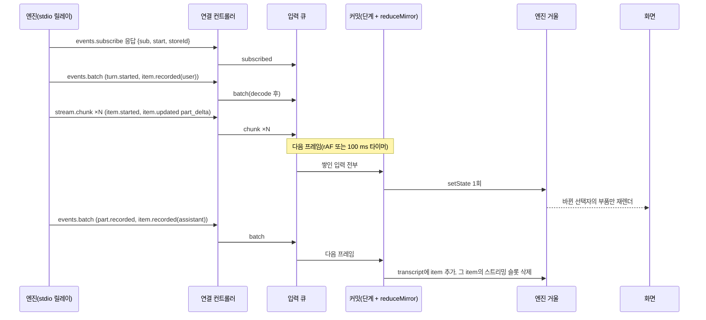
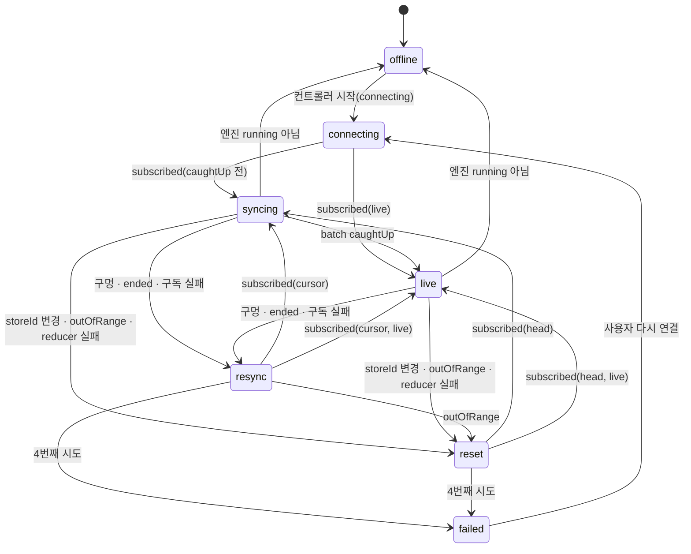
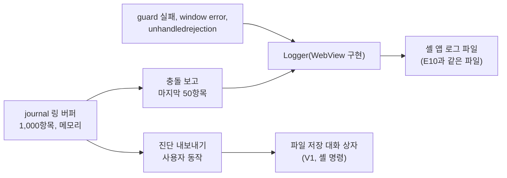

# L4 데스크톱 프런트엔드 상태 설계

데스크톱 WebView UI의 전역 상태 모델이다. 소비하는 wire 입력, 상태 모양, reducer 표, 스트리밍 슬롯, 승인 대기열, 연결·재동기화 상태 기계, 로그 경로, 코드 골격을 정한다. 지켜야 할 규칙은 `eng.frontend-state.guide`(FS-NN)에 있고, 이 문서는 그 규칙을 데스크톱에 적용한 결과다. 라이브러리 결정은 adr.0010이다.

## 1. 문제

- 엔진은 `events.batch`(내구, seq 있음)와 `stream.chunk`(휘발, 조각 번호 `n`)를 보낸다(`F.wire-settings.spec` §3.3.2). 모델 문장 하나가 `item.updated`(`part_delta`) 수백 개로 나뉘어 온다. 화면은 이 열을 순서대로, 빠짐없이, 중복 없이 옮겨야 한다.
- 화면 영역 여섯 개(`L4.desktop.spec` §4.13)가 같은 사실을 서로 다른 단위로 읽는다. 스레드 목록은 thread 요약, 트랜스크립트는 item과 진행 중 파트, 상태 표시줄은 연결 상태와 실행 중 turn 수, 승인 대기열은 대기 중 요청을 읽는다.
- 연결은 끊기고 다시 붙는다. WebView 새로고침, 엔진 재기동, 재전송 범위 초과(`replay.outOfRange`), DB 교체(`storeId` 변경)가 있다(`L4.desktop.spec` §4.4~§4.6).
- 시스템 WebView 세 종류(WKWebView, WebKitGTK, WebView2)에서 메모리와 CPU를 아껴야 한다(`L4.desktop.spec` §4.10).
- 외부 스토어 갱신은 Transition이 되지 않는다. 델타 처리 비용이 입력 반응성에 그대로 들어간다(`L4/desktop/_research/state-management.md §7.1`).

## 2. 선택지 비교

### 2.1 스트리밍 텍스트를 어디에 둘까

| 안 | 내용 | 델타 1건 비용 | 단점 |
|---|---|---|---|
| A. 확정 레코드에 바로 덧붙임 | `items[id].text += delta`를 불변 복사로 | O(N). V8 N=10,000에서 3.5 ms(조사 §7.2), JavaScriptCore N=10,000에서 585 µs [참고 측정] | 항목이 많은 thread에서 프레임 예산을 넘는다 |
| B. 분리 스트리밍 슬롯 [제안] | 진행 중 item만 `streaming`에 두고 확정 기록이 오면 지운다 | 그 item의 파트 수에 비례. JavaScriptCore N=1,000~50,000에서 0.5~1.3 µs [참고 측정] | 화면이 확정 목록과 진행 목록을 따로 그린다 |
| C. item마다 작은 스토어 | id별 vanilla 스토어 레지스트리 | O(1) | 레지스트리 수명 관리가 필요하고, 재설정 때 스토어를 하나씩 버려야 한다 |

### 2.2 쓰기 경로의 미들웨어를 어디에 둘까

| 안 | 내용 | 단언 | 단점 |
|---|---|---|---|
| A. Zustand 미들웨어 조합 | `devtools(persist(immer(...)))` + 자작 logger | 자작 `set` 래퍼에 필요(스파이크 TS2769) | `api.setState` 직접 호출이 미들웨어를 거치지 않는다. 순서에 따라 타입과 동작이 바뀐다 |
| B. reducer 단계 합성 [제안] | 모든 쓰기가 `ingest` → 커밋 하나이므로 reducer를 감싼다 | 없음 | 단계가 Zustand 밖 개념이라 이 문서와 guide가 설명해야 한다 |
| C. 구독 관찰자 | `subscribe`로 커밋 뒤 관찰 | 없음 | 리스너 인자에 입력 이름과 결과가 없다. 예외 격리가 없다 |

### 2.3 스토어 구성

| 안 | 내용 | 단점 |
|---|---|---|
| A. 화면 영역마다 스토어 | 목록, 트랜스크립트, 승인, 상태 스토어 | 같은 batch를 여러 스토어에 나눠 적용해야 하고, 재동기화 때 위치를 맞추기 어렵다 |
| B. 엔진 거울 하나 + UI 스토어 [제안] | 엔진 사실은 거울 하나, 화면 상태는 UI 스토어 | 거울 모양이 커진다. 선택자로 나눠 읽는다 |
| C. thread마다 스토어 | 열린 thread 단위 | 목록과 승인처럼 thread를 가로지르는 사실을 둘 곳이 따로 필요하다 |

## 3. 선택과 근거

- 2.1은 B안이다. 델타 비용이 thread 길이와 무관하다. jan의 `streamingContents` 분리 슬롯과 같은 방향이다(`eng.frontend-state.guide` §1.3). 휘발 조각은 재전송되지 않고 완성 내용은 `item.recorded`로 다시 오므로(`F.wire-settings.spec` §3.4.4), 슬롯은 언제 버려도 되는 값이다.
- 2.2는 B안이다. 단계 세 개(journal → guard → invariants)로 기록, 장애 격리, 개발 검사를 한다. 단언이 없고 단계마다 따로 시험한다(FS-10, FS-11).
- 2.3은 B안이다. 엔진 사실의 위치(`cursor`)가 하나라 재동기화가 한 번에 끝난다(FS-01, FS-16).
- 세 선택 모두 상태 논리를 순수 함수에 모은다. 같은 wire 메시지 열을 넣으면 같은 상태가 나오므로 CLI 테이프와 같은 열로 시험한다(`L4.desktop.spec` D-03).

## 4. 구조와 흐름



배치는 `xeon/apps/desktop/src/` 아래 다음과 같다. 전송 계층(`transport/`)과 화면(`views/`) 사이에 상태 계층(`state/`)을 둔다.

```text
src/
  transport/            # ipc.ts, tauri-stdio.ts (L4.desktop.spec §3.3, §3.4)
  state/
    shared/             # pipeline.ts, journal.ts, frame.ts, readonly-store.ts, watch.ts
    engine/             # state.ts, input.ts, decode.ts, reduce.ts, invariants.ts, describe.ts,
                        # store.ts, selectors.ts, hooks.ts, link.ts, diagnostics.ts, index.ts
    ui/                 # store.ts, hooks.ts, index.ts
  views/                # 화면 부품. state/*/index.ts만 import한다
  main.tsx              # 부트스트랩: 스토어 생성, 연결, Provider
```

## 5. 소비하는 wire 입력

연결 컨트롤러(`link.ts`)가 `HostConnection`의 알림과 응답을 `MirrorInput`으로 바꾼다. payload는 `decode.ts`가 `@xeon/contracts` 스키마로 검증한다(FS-12).

| wire | 출처 | 입력 | 비고 |
|---|---|---|---|
| `events.subscribe` 응답 | `F.wire-settings.spec` §3.4.1 | `subscribed {sub, storeId, start, live, from}` | `from`은 요청 위치가 cursor였는지 head였는지 |
| `events.subscribe` 오류 `replay.outOfRange` | §3.4.3 | `out_of_range` | 그 밖의 실패는 `subscribe_failed` |
| `events.batch` | §3.3.2 | `batch {sub, from, to, caughtUp, facts}` | `facts`는 `decodeDurable` 결과 |
| `events.ended` | §3.3.2 | `ended {sub}` | 재전송 읽기 실패 |
| `stream.chunk` | §3.4.4 | `chunk {fact}` | `fact`는 `decodeVolatile` 결과 |
| `thread.list` 결과 | §3.3.1 | `threads {threads}` | `ThreadSummary[]` |
| 열린 thread 스냅샷 | [미결] §14 1번 | `transcript {threadId, asOfSeq, items}` | 앞에 `transcript_opening {threadId}`를 넣는다 |
| 셸 `onState` | `L4.desktop.spec` §3.3 `EngineStateSchema` | `engine {state}` | |
| 컨트롤러 시작 | - | `connecting` | |
| thread 닫기 | - | `transcript_closed` | 다른 thread로 옮길 때 이전 캐시를 버린다(spec §4.10 수단 6) |

거울이 읽는 kind는 다음뿐이다. 나머지 kind는 `other`로 위치만 넘긴다.

| 종류 | kind | payload 스키마 | 사실 |
|---|---|---|---|
| 내구 | `thread.started` | `ThreadStartedPayloadSchema` | `thread.started` |
| 내구 | `thread.updated` | `ThreadUpdatedPayloadSchema` | `thread.updated` |
| 내구 | `thread.closed` | 읽지 않음 | `thread.closed` |
| 내구 | `turn.started` | 읽지 않음 | `turn.started` |
| 내구 | `turn.completed` | `TurnCompletedPayloadSchema` | `turn.completed` |
| 내구 | `item.recorded` | `ItemRecordedPayloadSchema` | `item.recorded {item}` |
| 내구 | `approval.requested` | `ApprovalRequestedPayloadSchema` | `approval.requested {request}`. 승인 id는 envelope `id` |
| 내구 | `approval.resolved` | `ApprovalResolvedPayloadSchema` | `approval.resolved {approvalId}` |
| 휘발 | `item.started` | `ItemStartedPayloadSchema` | `item.started` |
| 휘발 | `item.updated` | `ItemUpdatedPayloadSchema` | `item.updated`(`part_delta`, `part_completed`, `tool_progress`) |

- wire에는 `item.completed`가 없다. 메시지 item의 완료는 `item.recorded`, 도구 호출의 완료는 `effect.result`다(`F.conversation.spec` §3.5.3). 거울은 `item.recorded`를 완료로 본다. 도구 호출 진행은 스트리밍 슬롯의 `toolCall` item으로 보이고, 끝난 호출은 어시스턴트 item의 `toolCall` 블록과 `toolResult` item으로 보인다.
- [제안] `part.recorded`는 읽지 않는다. 같은 커밋의 `item.recorded`가 파트 내용을 함께 싣는다(`F.conversation.spec` §3.4 규칙 2).

## 6. 상태 모양

```ts
// src/state/engine/state.ts
import type {
  EventId, ItemId, ItemKind, ItemRecord, PartId, PartKind, ThreadId, TurnId,
} from "@xeon/contracts/conversation";
import type { ApprovalRequestedPayload } from "@xeon/contracts/records";
import type { StoreId, SubId, ThreadSummary } from "@xeon/contracts/wire";
import type { EngineState } from "../../transport/ipc.ts";

/** 재구독으로 고치는 어긋남. 화면 캐시는 그대로 둔다 */
export type ResyncReason = "gap" | "ended" | "subscribe_failed";
/** 캐시를 버리고 head부터 다시 읽어야 하는 어긋남 */
export type ResetReason = "store_changed" | "out_of_range" | "reducer_failed";

export type Link =
  | { readonly phase: "offline" }
  | { readonly phase: "connecting" }
  | { readonly phase: "syncing"; readonly sub: SubId }
  | { readonly phase: "live"; readonly sub: SubId }
  | { readonly phase: "resync"; readonly reason: ResyncReason; readonly attempt: number }
  | { readonly phase: "reset"; readonly reason: ResetReason; readonly attempt: number }
  | { readonly phase: "failed"; readonly reason: ResyncReason | ResetReason };

export type Cursor = { readonly storeId: StoreId; readonly seq: number };

export type Threads = {
  readonly ids: readonly ThreadId[];
  readonly byId: Readonly<Record<string, ThreadSummary>>;
};

/**
 * 열린 thread 하나의 확정 item. loading 동안 그 thread의 item.recorded를 held에 모았다가
 * 스냅샷이 오면 asOfSeq보다 뒤의 것만 적용한다(스냅샷 + 재생).
 */
export type Transcript =
  | {
      readonly status: "loading";
      readonly threadId: ThreadId;
      /** 여는 시점의 cursor.seq. 스냅샷은 이 위치 이상을 반영해야 한다 */
      readonly sinceSeq: number;
      readonly held: readonly { readonly seq: number; readonly item: ItemRecord }[];
    }
  | {
      readonly status: "ready";
      readonly threadId: ThreadId;
      /** 스냅샷이 반영한 마지막 seq. 이 seq 이하 이벤트는 이 조각에 다시 적용하지 않는다 */
      readonly asOfSeq: number;
      readonly itemIds: readonly ItemId[];
      readonly items: Readonly<Record<string, ItemRecord>>;
    };

export type StreamingPart = {
  readonly partId: PartId;
  readonly contentIndex: number;
  readonly kind: PartKind;
  readonly text: string;
  readonly done: boolean;
};

export type StreamingItem = {
  readonly itemId: ItemId;
  readonly threadId: ThreadId;
  readonly turnId: TurnId | null;
  readonly kind: ItemKind;
  readonly toolName: string | null;
  readonly parts: readonly StreamingPart[];
};

export type Streaming = {
  readonly itemIds: readonly ItemId[];
  readonly items: Readonly<Record<string, StreamingItem>>;
  /** (threadId, turnId)별 마지막으로 적용한 조각 번호 n */
  readonly lastN: Readonly<Record<string, number>>;
};

export type PendingApproval = {
  readonly approvalId: EventId;
  readonly threadId: ThreadId;
  readonly seq: number;
  readonly request: ApprovalRequestedPayload;
};

export type Approvals = {
  readonly ids: readonly EventId[];
  readonly byId: Readonly<Record<string, PendingApproval>>;
};

export type EngineMirror = {
  readonly engine: EngineState | null;
  readonly link: Link;
  readonly cursor: Cursor | null;
  readonly threads: Threads;
  readonly transcript: Transcript | null;
  readonly streaming: Streaming;
  readonly approvals: Approvals;
};

export const EMPTY_STREAMING: Streaming = { itemIds: [], items: {}, lastN: {} };

export const INITIAL_MIRROR: EngineMirror = {
  engine: null,
  link: { phase: "offline" },
  cursor: null,
  threads: { ids: [], byId: {} },
  transcript: null,
  streaming: EMPTY_STREAMING,
  approvals: { ids: [], byId: {} },
};
```

- 정규화: 모든 모음은 순서 배열(`ids`, `itemIds`)과 레코드(`byId`, `items`) 쌍이다. 레코드 키는 `string`이고 값을 넣는 쪽은 언제나 브랜드 id다(FS-08).
- `transcript`는 열린 thread 하나만 담는다. 다른 thread로 옮기면 이전 item을 버린다(`L4.desktop.spec` §4.10 수단 6).
- `streaming`은 모든 thread의 진행 중 item을 담는다. 실행 중 thread로 옮겼을 때 처음부터 이어진 텍스트를 보이기 위해서다. 크기는 진행 중 item 수로 제한되고 turn이 끝나면 빈다.
- `approvals`는 모든 thread의 대기 승인이다. 승인 대기열은 thread를 가로질러 보인다.
- UI 스토어(§12.6)가 선택 thread, 사이드바, 보낸 승인 표시를 따로 가진다.

## 7. reducer 표

`reduceMirror(state, input) → { state, note }`. `note`는 `applied | duplicate | stale | foreign | gap | reset | failed`이고 journal이 기록한다.

### 7.1 입력

| 입력 | 조건 | 상태 변화 | note |
|---|---|---|---|
| `engine` | `state.kind === "running"` | `engine` 갱신 | applied |
| `engine` | 그 밖(`starting`, `restarting`, `stopping`, `failed`, `stopped`) | `engine` 갱신, `link = offline`, `streaming` 비움 | applied |
| `connecting` | - | `link = connecting` | applied |
| `subscribed` | `from === "head"` | `INITIAL_MIRROR`에 `engine`만 남기고 `cursor = {storeId, start}`, `link = live 또는 syncing` | reset |
| `subscribed` | `from === "cursor"`, `cursor.storeId === storeId` | `cursor.seq = start`, `link = live 또는 syncing` | applied |
| `subscribed` | `from === "cursor"`, `cursor`가 없거나 `storeId`가 다름 | `link = reset(store_changed)` | reset |
| `batch` | `link`가 `syncing`·`live`가 아니거나 `sub`가 다름 | 없음 | foreign |
| `batch` | `to ≤ cursor.seq` | 없음 | duplicate |
| `batch` | `from > cursor.seq` | `link = resync(gap)` | gap |
| `batch` | 그 밖 | `seq > cursor.seq`인 사실만 7.2 표대로 적용, `cursor.seq = to`, `caughtUp`이면 `link = live` | applied |
| `batch` | `link`가 `syncing`·`live`인데 `cursor`가 없음 | `Bug` 던짐 → guard가 `reset(reducer_failed)` | failed |
| `chunk` | 7.3 표 | | |
| `ended` | `sub`가 현재 구독 | `link = resync(ended)` | gap |
| `out_of_range` | - | `link = reset(out_of_range)` | reset |
| `subscribe_failed` | - | `link = resync(subscribe_failed)` | gap |
| `threads` | - | `threads` 교체 | applied |
| `transcript_opening` | - | `transcript = loading {threadId, sinceSeq: cursor.seq ?? 0, held: []}` | applied |
| `transcript` | `transcript`가 같은 thread의 loading이 아님 | 없음 | foreign |
| `transcript` | `asOfSeq < sinceSeq` | 없음(컨트롤러가 다시 읽는다) | stale |
| `transcript` | 그 밖 | `ready {asOfSeq, itemIds, items}`로 바꾸고 `held` 중 `seq > asOfSeq`인 item 적용 | applied |
| `transcript_closed` | - | `transcript = null` | applied |

- `resync`·`reset`의 `attempt`는 같은 단계가 이어지면 1씩 오르고, `MAX_SYNC_ATTEMPTS`(3)를 넘으면 `failed`가 된다. `live`가 되면 시도 횟수는 사라진다.

### 7.2 내구 사실

| 사실 | 상태 변화 |
|---|---|
| `thread.started` | 목록에 없으면 payload와 envelope로 `ThreadSummary`를 만들어 맨 앞에 넣는다(`status: "idle"`, `headSeq: seq`, `resumable: null`, 대기 수 0) |
| `thread.updated` | 그 thread의 `title`, `status`, `updatedAt` 갱신 |
| `thread.closed` | `status = "closed"` |
| `turn.started` | `status = "running"` |
| `turn.completed` | `status = "idle"`, 그 (thread, turn)의 스트리밍 item과 `lastN` 삭제 |
| `item.recorded` | 열린 thread가 ready이고 `seq > asOfSeq`면 item 추가 또는 교체. loading이면 `held`에 넣는다. 열렸는지와 무관하게 그 item의 스트리밍 슬롯 삭제 |
| `approval.requested` | 없으면 `approvals`에 추가, 그 thread의 `pendingApprovals + 1` |
| `approval.resolved` | 있으면 삭제, 그 thread의 `pendingApprovals - 1`(0 아래로 내리지 않음) |
| `other`, `unreadable` | 없음(위치만 넘어간다) |

### 7.3 휘발 사실

| 사실 | 조건 | 상태 변화 | note |
|---|---|---|---|
| 모든 조각 | 같은 (thread, turn)의 `n ≤ lastN` | 없음 | duplicate |
| `item.started` | 그 item이 ready transcript에 이미 있음 | `lastN`만 갱신 | stale |
| `item.started` | 그 밖 | 스트리밍 item 생성(`kind`, `toolName`, 빈 파트) | applied |
| `item.updated` `part_delta` | 그 item이 이미 확정됨 | `lastN`만 갱신 | stale |
| `item.updated` `part_delta` | 그 밖 | 파트(`contentIndex`)를 찾아 `start`면 빈 텍스트, `delta`면 덧붙임, `end`면 `done`. item이 없으면 `assistant` item을 새로 만든다 | applied |
| `item.updated` `part_completed`, `tool_progress` | - | `lastN`만 갱신 | applied |
| `other` | - | `lastN`만 갱신 | applied |

- [제안] `afterSeq`로 조각 적용을 미루지 않는다. 스트리밍 슬롯은 확정 상태와 독립이고, 늦은 조각은 확정 여부(stale)와 `n`(duplicate)으로 걸러진다. `F.wire-settings.spec` §3.4.4는 미루기를 허용만 한다.
- 구독 직후처럼 `item.started`를 놓치고 `part_delta`부터 받으면 `assistant` item으로 만든다. 파트는 어시스턴트 메시지에만 있기 때문이다(`F.conversation.spec` §3.4 규칙 5).

## 8. 스트리밍 슬롯

- 쓰기: `part_delta` 1건은 `streaming.items[itemId]`와 그 `parts` 배열 하나를 새로 만든다. `transcript.items`는 건드리지 않는다(FS-14).
- 비우기: `item.recorded`(그 item), `turn.completed`(그 turn), 엔진 `running` 아님(전체), `subscribed(from: head)`(전체).
- 커밋: 델타는 입력 큐에 쌓이고 프레임마다 한 번 커밋된다. 델타 100개가 한 프레임에 오면 `setState`는 1번, 재렌더는 바뀐 파트 부품 하나다(FS-15, FS-19).
- 렌더: 확정 목록(`useTranscriptItemIds`) 뒤에 진행 목록(`useStreamingIds`)을 그린다. 진행 중 파트는 평문으로 그리고, 마크다운과 코드 하이라이트는 확정 item에서 한다(FS-21).
- 화면 전환: thread를 옮기기 전에 `flush()`로 큐를 비운다. 이전 thread의 진행 조각이 새 thread 화면의 첫 커밋과 섞이지 않게 하기 위해서다.
- 메모리: 슬롯 크기는 진행 중 item의 텍스트 합이다. 긴 도구 인자(JSON 조각)는 `toolCall` 파트로 쌓인다. [미결] 파트 텍스트 상한(예: 1 MiB를 넘으면 앞부분 생략 표시)은 S5 측정 뒤 정한다.

## 9. 승인 대기열

- 원천은 내구 이벤트다(`F.wire-settings.spec` §4.6 A안 [결정]). `approval.requested`가 들어오고 `approval.resolved`가 빠진다. 승인 id는 요청 이벤트의 envelope `id`다.
- 응답: 부품이 `respondApproval(id, decision)`을 부른다. UI 스토어에 `sending`을 두고 `approval.respond`를 보낸다. 실패하거나 `applied: false`면 `failed`로 둔다. 대기열에서 빠지는 일은 `approval.resolved`가 한다(FS-02).
- 정리: `watch(engine.read, s => s.approvals.ids, ...)`가 거울에서 사라진 id의 UI 표시를 지운다.
- 재설정 뒤 복원: head부터 다시 구독하면 이전에 요청된 승인 이벤트를 다시 받지 못한다. 대기 승인 목록을 돌려주는 메서드가 F에 필요하다([미결] §14 2번). 그 전까지는 `ThreadSummary.pendingApprovals`로 thread별 대기 수만 보이고, 대기열은 다음 `approval.requested`부터 채워진다.
- 직렬화: 대기열 항목은 payload 그대로의 데이터이고 콜백을 담지 않는다(FS-08).

## 10. 연결·재동기화 상태 기계



| 상태 | 화면 | 컨트롤러가 하는 일 |
|---|---|---|
| `offline` | 상태 표시줄 "엔진 꺼짐", 입력창 잠금 | 새 `HostConnection`이 생기면 `startLink` |
| `connecting` | "연결 중" | `events.subscribe`. 거울에 cursor가 있으면 cursor부터, 없으면 head부터 |
| `syncing` | 캐시를 보이며 "따라잡는 중" | 없음 |
| `live` | 평상시 | 없음 |
| `resync` | 캐시를 보이며 "다시 맞추는 중" | cursor부터 다시 구독 |
| `reset` | 캐시를 흐리게 보이며 "다시 읽는 중" | head부터 구독, `thread.list`, 선택 thread 스냅샷, [미결] 대기 승인 목록 |
| `failed` | "연결 복구 실패", 다시 연결 버튼, 진단 내보내기 | 사용자 동작 대기 |

규칙:

1. 전이는 reducer만 정한다. 컨트롤러는 `watch`로 `link`를 구독해 부수효과를 실행한다(FS-17).
2. 구독 요청이 진행 중일 때 도착한 batch는 컨트롤러가 모았다가 `subscribed` 입력 뒤에 넣는다. `await` 뒤 코드는 마이크로태스크라 같은 읽기 묶음의 알림 처리기보다 늦게 돌 수 있기 때문이다.
3. 이전 구독의 batch는 `foreign`으로 버린다. [제안] 재구독에 성공하면 컨트롤러가 이전 `sub`에 `events.unsubscribe`를 보낸다.
4. 새 페이지(WebView 새로고침, 창 다시 만들기)는 거울이 비어 있으므로 head부터 시작하고 스냅샷으로 채운다. 같은 페이지에서 엔진만 다시 뜬 경우(`engine` 입력이 `running`으로 돌아옴)는 거울의 cursor부터 잇는다. 같은 DB를 열므로 `storeId`가 같다(`L4.desktop.spec` §4.4).
5. 열린 thread 스냅샷은 `transcript_opening`을 먼저 넣고 요청한다. reducer는 그 시점의 `cursor.seq`를 `sinceSeq`로 두고, 스냅샷이 오기 전 그 thread의 `item.recorded`를 `held`에 모은다. 스냅샷 `asOfSeq`가 `sinceSeq`보다 작으면 `stale`로 버리고 다시 읽는다.
6. 시도 상한은 원인 종류(`resync`, `reset`)마다 3회다. 넘으면 `failed`에서 멈춘다. [가정] 재시도 사이 대기 시간은 두지 않는다. 연결이 끊긴 경우는 셸 `onState`가 `restarting`을 알려 `offline`으로 먼저 간다.

## 11. 미들웨어 단계와 로그 경로

### 11.1 단계

`pipeline(reduceMirror, [journal, guard, invariants])`. 순서와 이유는 `eng.frontend-state.guide` FS-10이다.

| 단계 | 운영 | 개발·시험 |
|---|---|---|
| journal | 켬 | 켬 |
| guard | 켬. 실패는 Logger `error` + `reset(reducer_failed)` | 켬. 시험은 `onReducerFailure: rethrow` |
| invariants | 끔 | 켬(`checks: true`) |

`checks`는 빌드 상수로 정한다. [제안] `bun build --define`으로 개발 빌드에서 `true`, 릴리스 빌드에서 `false`를 넣는다.

### 11.2 로그가 가는 곳



| 경로 | 언제 | 담는 것 | 담지 않는 것 |
|---|---|---|---|
| journal | 입력마다, 커밋마다 | 입력 이름, seq, note, 시각, 커밋 입력 수, 커밋 ms | 대화 내용, 경로, 설정 값, 도구 인자, 승인 제목 |
| Logger `error` | guard 실패, 컨트롤러 콜백 실패, 처리되지 않은 예외 | 고정 이벤트 이름(`desktop.mirror.reduce_failed` 등), 입력 이름, `Error.name` | 오류 메시지 본문, 스택의 사용자 경로 [제안] |
| 충돌 보고 | Logger `error`가 남을 때 한 번 | journal 마지막 50항목, `link`, `cursor`, 모음 크기 | 위와 같음 |
| 진단 내보내기 | 사용자가 진단 화면이나 `failed` 배너에서 고를 때 | journal 전체, `engine`, `link`, `cursor`, 모음 크기(`threads.ids.length` 등), 앱·엔진 버전 | 위와 같음 |

- WebView의 `Logger` 구현은 셸 명령으로 앱 로그 파일에 쓴다. [미결] 이 명령(가칭 `desktop_log_write`)은 `L4.desktop.spec` §3.3의 명령 네 개 밖이다(§14 3번).
- 진단 묶음 함수는 `diagnostics.ts`의 순수 함수 `buildDiagnostics(state, journal.entries(), versions)`다. 결과는 JSON 직렬화 가능한 값이다(FS-08).
- 셸 로그 규칙 E11(프레임 내용을 남기지 않음)과 같은 방향이다. 내용을 받지 않으므로 가림 단계가 없다(FS-13).

## 12. 코드 골격

아래 코드는 2026-10-24 스파이크에서 tsgo 7.0.2(저장소 `tsconfig.base.json` 옵션), 저장소 `.oxlintrc.json`(type-aware, `--deny-warnings`), oxfmt 0.74로 검사했고 오류가 없었다. `@xeon/contracts`는 이 저장소의 소스를 그대로 썼고, `EngineState`만 대역이었다. `as`, `!`, `any`가 없다.

### 12.1 입력과 decode

```ts
// src/state/engine/input.ts
import type {
  EventId, ItemRecord, ItemStartedPayload, ItemUpdatedPayload, ThreadId,
  ThreadStartedPayload, ThreadUpdatedPayload, TurnCompletedPayload, TurnId,
} from "@xeon/contracts/conversation";
import type { ApprovalRequestedPayload } from "@xeon/contracts/records";
import type { StoreId, SubId, ThreadSummary } from "@xeon/contracts/wire";
import type { EngineState } from "../../transport/ipc.ts";

type DurableBase = {
  readonly seq: number;
  readonly eventId: EventId;
  readonly threadId: ThreadId;
  readonly turnId: TurnId | null;
  readonly at: string;
};

/** 경계에서 payload를 검증한 내구 이벤트. 거울이 쓰지 않는 kind는 other로 위치만 넘긴다 */
export type DurableFact =
  | (DurableBase & { readonly type: "thread.started"; readonly payload: ThreadStartedPayload })
  | (DurableBase & { readonly type: "thread.updated"; readonly payload: ThreadUpdatedPayload })
  | (DurableBase & { readonly type: "thread.closed" })
  | (DurableBase & { readonly type: "turn.started" })
  | (DurableBase & { readonly type: "turn.completed"; readonly payload: TurnCompletedPayload })
  | (DurableBase & { readonly type: "item.recorded"; readonly item: ItemRecord })
  | (DurableBase & { readonly type: "approval.requested"; readonly request: ApprovalRequestedPayload })
  | (DurableBase & { readonly type: "approval.resolved"; readonly approvalId: EventId })
  | (DurableBase & { readonly type: "other" })
  | (DurableBase & { readonly type: "unreadable" });

type VolatileBase = { readonly n: number; readonly threadId: ThreadId; readonly turnId: TurnId | null };

export type VolatileFact =
  | (VolatileBase & { readonly type: "item.started"; readonly payload: ItemStartedPayload })
  | (VolatileBase & { readonly type: "item.updated"; readonly payload: ItemUpdatedPayload })
  | (VolatileBase & { readonly type: "other" });

/** 엔진 거울의 유일한 입력. 엔진 사실(알림, 요청 결과, 셸 상태)과 컨트롤러의 요청 표시만 담는다 */
export type MirrorInput =
  | { readonly type: "engine"; readonly state: EngineState }
  | { readonly type: "connecting" }
  | {
      readonly type: "subscribed";
      readonly sub: SubId;
      readonly storeId: StoreId;
      readonly start: number;
      readonly live: boolean;
      readonly from: "cursor" | "head";
    }
  | {
      readonly type: "batch";
      readonly sub: SubId;
      readonly from: number;
      readonly to: number;
      readonly caughtUp: boolean;
      readonly facts: readonly DurableFact[];
    }
  | { readonly type: "chunk"; readonly fact: VolatileFact }
  | { readonly type: "ended"; readonly sub: SubId }
  | { readonly type: "out_of_range" }
  | { readonly type: "subscribe_failed" }
  | { readonly type: "threads"; readonly threads: readonly ThreadSummary[] }
  | { readonly type: "transcript_opening"; readonly threadId: ThreadId }
  | {
      readonly type: "transcript";
      readonly threadId: ThreadId;
      readonly asOfSeq: number;
      readonly items: readonly ItemRecord[];
    }
  | { readonly type: "transcript_closed" };
```

```ts
// src/state/engine/decode.ts (발췌. 나머지 kind도 같은 모양이다)
import { parse } from "@xeon/contracts";
import { ItemUpdatedPayloadSchema } from "@xeon/contracts/conversation";
import { ItemRecordedPayloadSchema } from "@xeon/contracts/records";
import type { EventWire, VolatileEventWire } from "@xeon/contracts/wire";
import type { DurableFact, VolatileFact } from "./input.ts";

type DurableBase = Omit<Extract<DurableFact, { type: "other" }>, "type">;
type VolatileBase = Omit<Extract<VolatileFact, { type: "other" }>, "type">;

/** 거울이 읽는 내구 kind와 payload 검증. 표에 없는 kind는 other로 위치만 넘긴다 */
const DURABLE: Readonly<Record<string, (base: DurableBase, payload: unknown) => DurableFact>> = {
  "item.recorded": (base, payload) => {
    const p = parse(ItemRecordedPayloadSchema, payload);
    return p.ok
      ? { ...base, type: "item.recorded", item: p.value.item }
      : { ...base, type: "unreadable" };
  },
  "turn.started": (base) => ({ ...base, type: "turn.started" }),
  // thread.started, thread.updated, thread.closed, turn.completed, approval.requested, approval.resolved
};

const VOLATILE: Readonly<Record<string, (base: VolatileBase, payload: unknown) => VolatileFact>> = {
  "item.updated": (base, payload) => {
    const p = parse(ItemUpdatedPayloadSchema, payload);
    return p.ok ? { ...base, type: "item.updated", payload: p.value } : { ...base, type: "other" };
  },
  // item.started
};

/** 경계 함수(TY-10). 검증 실패는 unreadable 사실이고 위치는 넘긴다 */
export function decodeDurable(event: EventWire): DurableFact {
  const base: DurableBase = {
    seq: event.seq,
    eventId: event.id,
    threadId: event.threadId,
    turnId: event.turnId,
    at: event.recordedAt,
  };
  const decode = DURABLE[event.kind];
  return decode === undefined ? { ...base, type: "other" } : decode(base, event.payload);
}

export function decodeVolatile(event: VolatileEventWire): VolatileFact {
  const base: VolatileBase = { n: event.n, threadId: event.threadId, turnId: event.turnId };
  const decode = VOLATILE[event.kind];
  return decode === undefined ? { ...base, type: "other" } : decode(base, event.payload);
}
```

- `switch (event.kind)`를 쓰지 않는 이유: `EventKind`는 코어 kind 40종과 확장 kind 패턴의 합이라 `typescript/switch-exhaustiveness-check`가 모든 kind의 `case`를 요구한다. 거울이 읽는 kind만 표에 둔다.

### 12.2 reducer

```ts
// src/state/engine/reduce.ts (발췌. 7절 표의 나머지 분기도 같은 모양이다)
import { assertNever, Bug } from "@xeon/contracts";
import type { ItemId, PartDelta, ThreadId, TurnId } from "@xeon/contracts/conversation";
import type { Reduced as SharedReduced } from "../shared/pipeline.ts";
import type { MirrorInput, VolatileFact } from "./input.ts";
import { EMPTY_STREAMING, INITIAL_MIRROR, type EngineMirror, type Link, type ResetReason,
  type ResyncReason, type Streaming, type StreamingItem, type StreamingPart } from "./state.ts";

/** 이 입력이 거울에 한 일. journal이 기록한다 */
export type ApplyNote = "applied" | "duplicate" | "stale" | "foreign" | "gap" | "reset" | "failed";
type Reduced<S> = SharedReduced<S, ApplyNote>;

/** 같은 원인으로 이 횟수를 넘겨 다시 맞추면 failed로 둔다 */
export const MAX_SYNC_ATTEMPTS = 3;

const keep = (state: EngineMirror, note: ApplyNote): Reduced<EngineMirror> => ({ state, note });
const turnKey = (threadId: ThreadId, turnId: TurnId | null): string => `${threadId}:${turnId ?? ""}`;

export function enterResync(state: EngineMirror, reason: ResyncReason): EngineMirror {
  const attempt = state.link.phase === "resync" ? state.link.attempt + 1 : 1;
  const link: Link =
    attempt > MAX_SYNC_ATTEMPTS ? { phase: "failed", reason } : { phase: "resync", reason, attempt };
  return { ...state, link };
}

export function enterReset(state: EngineMirror, reason: ResetReason): EngineMirror {
  const attempt = state.link.phase === "reset" ? state.link.attempt + 1 : 1;
  const link: Link =
    attempt > MAX_SYNC_ATTEMPTS ? { phase: "failed", reason } : { phase: "reset", reason, attempt };
  return { ...state, link };
}

/** 순수 함수. 엔진 거울의 모든 변경은 여기서만 일어난다 */
export function reduceMirror(state: EngineMirror, input: MirrorInput): Reduced<EngineMirror> {
  switch (input.type) {
    case "engine":
      return input.state.kind === "running"
        ? keep({ ...state, engine: input.state }, "applied")
        : keep(
            { ...state, engine: input.state, link: { phase: "offline" }, streaming: EMPTY_STREAMING },
            "applied",
          );
    case "subscribed": {
      const link: Link = input.live
        ? { phase: "live", sub: input.sub }
        : { phase: "syncing", sub: input.sub };
      const cursor = { storeId: input.storeId, seq: input.start };
      if (input.from === "head") {
        return keep({ ...INITIAL_MIRROR, engine: state.engine, link, cursor }, "reset");
      }
      if (state.cursor === null || state.cursor.storeId !== input.storeId) {
        return keep(enterReset(state, "store_changed"), "reset");
      }
      return keep({ ...state, link, cursor }, "applied");
    }
    case "batch":
      return applyBatch(state, input);
    case "chunk":
      return applyChunk(state, input.fact);
    case "out_of_range":
      return keep(enterReset(state, "out_of_range"), "reset");
    case "subscribe_failed":
      return keep(enterResync(state, "subscribe_failed"), "gap");
    // connecting, ended, threads, transcript_opening, transcript, transcript_closed: 7.1 표
    default:
      return assertNever(input, "reduceMirror");
  }
}

function applyBatch(
  state: EngineMirror,
  input: Extract<MirrorInput, { type: "batch" }>,
): Reduced<EngineMirror> {
  const link = state.link;
  if ((link.phase !== "syncing" && link.phase !== "live") || link.sub !== input.sub) {
    return keep(state, "foreign");
  }
  const cursor = state.cursor;
  if (cursor === null) {
    // subscribed가 cursor를 먼저 둔다. 없으면 입력 순서 불변식이 깨진 것이다
    throw new Bug("batch before subscribed");
  }
  if (input.to <= cursor.seq) return keep(state, "duplicate");
  if (input.from > cursor.seq) return keep(enterResync(state, "gap"), "gap");
  let next = state;
  for (const fact of input.facts) {
    if (fact.seq > cursor.seq) next = applyFact(next, fact); // 7.2 표
  }
  const nextLink: Link = input.caughtUp ? { phase: "live", sub: link.sub } : link;
  return keep({ ...next, cursor: { storeId: cursor.storeId, seq: input.to }, link: nextLink }, "applied");
}

function applyChunk(state: EngineMirror, fact: VolatileFact): Reduced<EngineMirror> {
  const key = turnKey(fact.threadId, fact.turnId);
  const last = state.streaming.lastN[key];
  if (last !== undefined && fact.n <= last) return keep(state, "duplicate");
  const counted: Streaming = { ...state.streaming, lastN: { ...state.streaming.lastN, [key]: fact.n } };
  switch (fact.type) {
    case "item.started": {
      const p = fact.payload;
      if (isRecorded(state, p.itemId)) return keep({ ...state, streaming: counted }, "stale");
      const item: StreamingItem = {
        itemId: p.itemId, threadId: fact.threadId, turnId: fact.turnId,
        kind: p.kind, toolName: p.toolName, parts: [],
      };
      return keep({ ...state, streaming: putStreaming(counted, item) }, "applied");
    }
    case "item.updated": {
      const update = fact.payload.update;
      switch (update.kind) {
        case "part_delta": {
          if (isRecorded(state, update.delta.itemId)) return keep({ ...state, streaming: counted }, "stale");
          const current = counted.items[update.delta.itemId] ?? newAssistantItem(fact, update.delta);
          return keep({ ...state, streaming: putStreaming(counted, applyDelta(current, update.delta)) }, "applied");
        }
        case "part_completed":
        case "tool_progress":
          return keep({ ...state, streaming: counted }, "applied");
        default:
          return assertNever(update, "applyChunk.update");
      }
    }
    case "other":
      return keep({ ...state, streaming: counted }, "applied");
    default:
      return assertNever(fact, "applyChunk");
  }
}

function isRecorded(state: EngineMirror, itemId: ItemId): boolean {
  const t = state.transcript;
  return t?.status === "ready" && t.items[itemId] !== undefined;
}

/** 델타 하나의 비용은 그 item의 파트 수에 비례한다. 확정 item 레코드는 복사하지 않는다 */
function applyDelta(item: StreamingItem, delta: PartDelta): StreamingItem {
  const index = item.parts.findIndex((p) => p.contentIndex === delta.contentIndex);
  const before = index === -1 ? undefined : item.parts[index];
  const part: StreamingPart = {
    partId: delta.partId,
    contentIndex: delta.contentIndex,
    kind: delta.kind,
    text: delta.phase === "delta" ? (before?.text ?? "") + delta.delta : (before?.text ?? ""),
    done: delta.phase === "end",
  };
  const parts =
    index === -1
      ? [...item.parts, part].toSorted((a, b) => a.contentIndex - b.contentIndex)
      : item.parts.with(index, part);
  return { ...item, parts };
}
// applyFact, recordItem, applySnapshot, patchThread, bumpPending, putStreaming,
// newAssistantItem, dropStreamingItem, dropStreamingTurn: 7.2 표
```

### 12.3 단계와 journal

```ts
// src/state/shared/pipeline.ts
import { Bug, type Clock } from "@xeon/contracts";
import type { Journal, JournalLabel } from "./journal.ts";

export type Reduced<S, N extends string> = { readonly state: S; readonly note: N };
export type Reducer<S, I, N extends string> = (state: S, input: I) => Reduced<S, N>;
/** 미들웨어 단계. 다음 reducer를 받아 같은 모양의 reducer를 돌려준다 */
export type Stage<S, I, N extends string> = (next: Reducer<S, I, N>) => Reducer<S, I, N>;

/** stages는 바깥 단계부터 적는다. [a, b, c]는 a(b(c(base)))다 */
export function pipeline<S, I, N extends string>(
  base: Reducer<S, I, N>,
  stages: readonly Stage<S, I, N>[],
): Reducer<S, I, N> {
  return stages.reduceRight<Reducer<S, I, N>>((next, stage) => stage(next), base);
}

/** 모든 입력과 결과를 메타데이터만 기록한다. 내용은 describe가 고른 필드만 들어간다 */
export function journalStage<S, I, N extends string>(
  journal: Journal<N>,
  clock: Clock,
  describe: (input: I) => JournalLabel,
): Stage<S, I, N> {
  return (next) => (state, input) => {
    const reduced = next(state, input);
    journal.record({ kind: "input", at: clock.now(), ...describe(input), note: reduced.note });
    return reduced;
  };
}

/** reducer가 던지면 이전 상태를 recover로 바꿔 돌려주고 실패를 알린다. 화면 구독은 계속 산다 */
export function guardStage<S, I, N extends string>(
  recover: (state: S) => Reduced<S, N>,
  onFailure: (cause: unknown, input: I) => void,
): Stage<S, I, N> {
  return (next) => (state, input) => {
    try {
      return next(state, input);
    } catch (cause) {
      onFailure(cause, input);
      return recover(state);
    }
  };
}

/** 개발·시험 빌드에서만 넣는다. 결과 상태가 불변식을 어기면 Bug를 던져 guard가 받게 한다 */
export function invariantStage<S, I, N extends string>(
  check: (state: S) => readonly string[],
): Stage<S, I, N> {
  return (next) => (state, input) => {
    const reduced = next(state, input);
    const problems = check(reduced.state);
    if (problems.length > 0) {
      throw new Bug(`state invariant violated: ${problems.join("; ")}`);
    }
    return reduced;
  };
}
```

```ts
// src/state/shared/journal.ts
/** 기록에 들어가는 입력 설명. 고정 이름과 숫자만 둔다. 대화 내용, 경로, 설정 값은 넣지 않는다 */
export type JournalLabel = { readonly input: string; readonly seq: number | null };

export type JournalEntry<N extends string> =
  | ({ readonly kind: "input"; readonly at: number; readonly note: N } & JournalLabel)
  | { readonly kind: "flush"; readonly at: number; readonly count: number; readonly ms: number };

export interface Journal<N extends string> {
  record(entry: JournalEntry<N>): void;
  /** 오래된 것부터 새 배열로 돌려준다 */
  entries(): readonly JournalEntry<N>[];
}

/** 고정 크기 링 버퍼. 가득 차면 가장 오래된 기록을 덮어쓴다 */
export function createJournal<N extends string>(capacity: number): Journal<N> {
  const slots: (JournalEntry<N> | undefined)[] = Array.from({ length: capacity }, () => undefined);
  let next = 0;
  let size = 0;
  return {
    record(entry) {
      slots[next] = entry;
      next = (next + 1) % capacity;
      size = Math.min(size + 1, capacity);
    },
    entries() {
      const out: JournalEntry<N>[] = [];
      for (let i = 0; i < size; i += 1) {
        const entry = slots[(next - size + i + capacity) % capacity];
        if (entry !== undefined) out.push(entry);
      }
      return out;
    },
  };
}
```

```ts
// src/state/engine/describe.ts
import { assertNever } from "@xeon/contracts";
import type { JournalLabel } from "../shared/journal.ts";
import type { MirrorInput } from "./input.ts";

/** journal에 남길 필드를 고르는 허용 목록. 새 입력 종류는 여기서 이름과 seq만 고른다 */
export function describeInput(input: MirrorInput): JournalLabel {
  switch (input.type) {
    case "batch":
      return { input: "batch", seq: input.to };
    case "subscribed":
      return { input: `subscribed:${input.from}`, seq: input.start };
    case "chunk":
      return { input: `chunk:${input.fact.type}`, seq: null };
    case "transcript":
      return { input: "transcript", seq: input.asOfSeq };
    case "engine":
      return { input: `engine:${input.state.kind}`, seq: null };
    case "connecting":
    case "ended":
    case "out_of_range":
    case "subscribe_failed":
    case "threads":
    case "transcript_opening":
    case "transcript_closed":
      return { input: input.type, seq: null };
    default:
      return assertNever(input, "describeInput");
  }
}
```

### 12.4 프레임 시계와 스토어

```ts
// src/state/shared/frame.ts
import type { Scheduler } from "@xeon/contracts";

/** 다음 화면 프레임에 run을 한 번 부른다. 돌려준 함수는 예약을 취소한다 */
export interface FrameClock {
  request(run: () => void): () => void;
}

type AnimationFrames = {
  requestAnimationFrame(callback: () => void): number;
  cancelAnimationFrame(handle: number): void;
};

/** requestAnimationFrame과 타이머 중 먼저 오는 쪽으로 한 번 실행한다. 창이 숨겨져 rAF가 멈춰도 fallbackMs 안에 비운다 */
export function createFrameClock(frames: AnimationFrames, scheduler: Scheduler, fallbackMs: number): FrameClock {
  return {
    request(run) {
      let pending = true;
      const cancel = (): void => {
        pending = false;
        frames.cancelAnimationFrame(raf);
        scheduler.clearTimeout(timer);
      };
      const fire = (): void => {
        if (!pending) return;
        cancel();
        run();
      };
      const raf = frames.requestAnimationFrame(fire);
      const timer = scheduler.setTimeout(fire, fallbackMs);
      return cancel;
    },
  };
}

/** 시험용. flush()를 부를 때만 실행한다 */
export function manualFrameClock(): FrameClock & { flush(): void } {
  let queued: (() => void) | undefined;
  return {
    request(run) {
      queued = run;
      return () => {
        queued = undefined;
      };
    },
    flush() {
      const run = queued;
      queued = undefined;
      run?.();
    },
  };
}
```

```ts
// src/state/shared/readonly-store.ts
import type { StoreApi } from "zustand/vanilla";

/** 읽기 전용 면. setState가 없으므로 상태 모듈 밖에서 쓸 수 없다 */
export type ReadonlyStore<T> = Pick<StoreApi<T>, "getState" | "getInitialState" | "subscribe">;

export function readonlyView<T>(api: StoreApi<T>): ReadonlyStore<T> {
  return { getState: api.getState, getInitialState: api.getInitialState, subscribe: api.subscribe };
}
```

```ts
// src/state/engine/store.ts
import type { Clock, Logger } from "@xeon/contracts";
import { createStore } from "zustand/vanilla";
import type { FrameClock } from "../shared/frame.ts";
import type { Journal } from "../shared/journal.ts";
import { guardStage, invariantStage, journalStage, pipeline, type Stage } from "../shared/pipeline.ts";
import { readonlyView, type ReadonlyStore } from "../shared/readonly-store.ts";
import { describeInput } from "./describe.ts";
import type { MirrorInput } from "./input.ts";
import { checkMirror } from "./invariants.ts";
import { enterReset, reduceMirror, type ApplyNote } from "./reduce.ts";
import { INITIAL_MIRROR, type EngineMirror } from "./state.ts";

export type EngineStoreDeps = {
  readonly clock: Clock;
  readonly frames: FrameClock;
  readonly logger: Logger;
  readonly journal: Journal<ApplyNote>;
  /** 개발·시험 빌드에서 true. 불변식 검사 단계를 넣는다 */
  readonly checks: boolean;
  /** 경과 시간 측정용 단조 시계(ms). 운영은 performance.now */
  readonly monotonic: () => number;
  /** 시험은 rethrow를 넘겨 reducer 실패를 드러낸다. 운영은 기록만 한다 */
  readonly onReducerFailure?: (cause: unknown) => void;
};

export interface EngineStore {
  readonly read: ReadonlyStore<EngineMirror>;
  /** 연결 컨트롤러만 부른다. 다음 프레임에 모아서 한 번 커밋한다 */
  ingest(input: MirrorInput): void;
  /** 대기 중인 입력을 지금 커밋한다(시험, thread 전환 직전) */
  flush(): void;
}

export function createEngineStore(deps: EngineStoreDeps): EngineStore {
  const api = createStore<EngineMirror>()(() => INITIAL_MIRROR);
  const stages: Stage<EngineMirror, MirrorInput, ApplyNote>[] = [
    journalStage(deps.journal, deps.clock, describeInput),
    guardStage<EngineMirror, MirrorInput, ApplyNote>(
      (state) => ({ state: enterReset(state, "reducer_failed"), note: "failed" }),
      (cause, input) => {
        deps.logger.error("desktop.mirror.reduce_failed", {
          input: describeInput(input).input,
          error: cause instanceof Error ? cause.name : "unknown",
        });
        deps.onReducerFailure?.(cause);
      },
    ),
  ];
  if (deps.checks) stages.push(invariantStage(checkMirror));
  const reduce = pipeline(reduceMirror, stages);

  let queue: MirrorInput[] = [];
  let cancel: (() => void) | undefined;

  const commit = (): void => {
    cancel = undefined;
    const inputs = queue;
    queue = [];
    if (inputs.length === 0) return;
    const started = deps.monotonic();
    const before = api.getState();
    let state = before;
    for (const input of inputs) state = reduce(state, input).state;
    if (state !== before) api.setState(state, true);
    deps.journal.record({ kind: "flush", at: deps.clock.now(), count: inputs.length, ms: deps.monotonic() - started });
  };

  return {
    read: readonlyView(api),
    ingest(input) {
      queue.push(input);
      cancel ??= deps.frames.request(commit);
    },
    flush() {
      cancel?.();
      commit();
    },
  };
}
```

- `setState`는 이 파일의 `commit` 한 곳에서만 불린다. 상태 전체를 바꾸므로 `replace: true`다.
- `checkMirror`(`invariants.ts`)는 transcript id 중복, `itemIds`와 `items` 크기 불일치, 확정 item이 스트리밍에 남음, 스트리밍과 승인 모음의 같은 불일치를 문자열 목록으로 돌려준다.

### 12.5 선택자와 훅

```ts
// src/state/engine/selectors.ts
import type { EventId, ItemId, ItemRecord, ThreadId } from "@xeon/contracts/conversation";
import type { ThreadSummary } from "@xeon/contracts/wire";
import type { EngineMirror, Link, PendingApproval, StreamingItem } from "./state.ts";

// 빈 값은 모듈 상수다. 선택자가 [] 리터럴을 돌려주면 매번 새 참조라 재렌더가 끝나지 않는다
const NO_ITEMS: readonly ItemId[] = Object.freeze([]);

export const selectThreadIds = (s: EngineMirror): readonly ThreadId[] => s.threads.ids;
export const selectThread = (s: EngineMirror, id: ThreadId): ThreadSummary | undefined => s.threads.byId[id];
export const selectTranscriptItemIds = (s: EngineMirror): readonly ItemId[] =>
  s.transcript?.status === "ready" ? s.transcript.itemIds : NO_ITEMS;
export const selectItem = (s: EngineMirror, id: ItemId): ItemRecord | undefined =>
  s.transcript?.status === "ready" ? s.transcript.items[id] : undefined;
export const selectStreamingIds = (s: EngineMirror): readonly ItemId[] => s.streaming.itemIds;
export const selectStreamingItem = (s: EngineMirror, id: ItemId): StreamingItem | undefined =>
  s.streaming.items[id];
/** 원시값을 돌려주므로 그 파트의 글자가 바뀔 때만 재렌더한다 */
export const selectPartText = (s: EngineMirror, id: ItemId, contentIndex: number): string =>
  s.streaming.items[id]?.parts.find((p) => p.contentIndex === contentIndex)?.text ?? "";
export const selectApprovalIds = (s: EngineMirror): readonly EventId[] => s.approvals.ids;
export const selectApproval = (s: EngineMirror, id: EventId): PendingApproval | undefined => s.approvals.byId[id];
/** 원시값 집계. thread 수에 비례하지만 구독자가 상태 표시줄 하나다 */
export const selectRunningCount = (s: EngineMirror): number =>
  s.threads.ids.reduce((n, id) => (s.threads.byId[id]?.status === "running" ? n + 1 : n), 0);
/** 객체를 새로 만든다. 훅에서 useShallow로 감싼다 */
export const selectLinkBanner = (s: EngineMirror): { readonly phase: Link["phase"]; readonly attempt: number } => ({
  phase: s.link.phase,
  attempt: s.link.phase === "resync" || s.link.phase === "reset" ? s.link.attempt : 0,
});
```

```ts
// src/state/engine/hooks.ts
import { Bug } from "@xeon/contracts";
import type { EventId, ItemId, ItemRecord, ThreadId } from "@xeon/contracts/conversation";
import type { ThreadSummary } from "@xeon/contracts/wire";
import { createContext, useContext } from "react";
import { useStore } from "zustand";
import { useShallow } from "zustand/react/shallow";
import type { ReadonlyStore } from "../shared/readonly-store.ts";
import * as sel from "./selectors.ts";
import type { EngineMirror, Link, PendingApproval, StreamingItem } from "./state.ts";

export const EngineStoreContext: React.Context<ReadonlyStore<EngineMirror> | null> =
  createContext<ReadonlyStore<EngineMirror> | null>(null);

function useEngineStore(): ReadonlyStore<EngineMirror> {
  const store = useContext(EngineStoreContext);
  if (store === null) throw new Bug("EngineStoreContext provider is missing");
  return store;
}

/** 모듈 안에서만 쓴다. 화면은 아래 도메인 훅만 쓴다 */
function useEngine<U>(selector: (state: EngineMirror) => U): U {
  return useStore(useEngineStore(), selector);
}

export const useThreadIds = (): readonly ThreadId[] => useEngine(sel.selectThreadIds);
export const useThread = (id: ThreadId): ThreadSummary | undefined => useEngine((s) => sel.selectThread(s, id));
export const useTranscriptItemIds = (): readonly ItemId[] => useEngine(sel.selectTranscriptItemIds);
export const useItem = (id: ItemId): ItemRecord | undefined => useEngine((s) => sel.selectItem(s, id));
export const useStreamingIds = (): readonly ItemId[] => useEngine(sel.selectStreamingIds);
export const useStreamingItem = (id: ItemId): StreamingItem | undefined =>
  useEngine((s) => sel.selectStreamingItem(s, id));
export const usePartText = (id: ItemId, contentIndex: number): string =>
  useEngine((s) => sel.selectPartText(s, id, contentIndex));
export const useApprovalIds = (): readonly EventId[] => useEngine(sel.selectApprovalIds);
export const useApproval = (id: EventId): PendingApproval | undefined => useEngine((s) => sel.selectApproval(s, id));
export const useRunningCount = (): number => useEngine(sel.selectRunningCount);
export const useLinkBanner = (): { readonly phase: Link["phase"]; readonly attempt: number } =>
  useEngine(useShallow(sel.selectLinkBanner));
```

```tsx
// src/views/transcript.tsx (구독 단위만 보인다. 가상 스크롤은 생략)
import type { ItemId } from "@xeon/contracts/conversation";
import { memo, type ReactNode } from "react";
import {
  EngineStoreContext, useItem, usePartText, useStreamingIds, useStreamingItem, useTranscriptItemIds,
} from "../state/engine/index.ts";
import type { EngineMirror, ReadonlyStore } from "../state/engine/index.ts";

export function EngineProvider(props: {
  readonly store: ReadonlyStore<EngineMirror>;
  readonly children: ReactNode;
}): ReactNode {
  return <EngineStoreContext value={props.store}>{props.children}</EngineStoreContext>;
}

const RecordedItem = memo(function RecordedItem(props: { readonly id: ItemId }): ReactNode {
  const item = useItem(props.id);
  if (item === undefined) return null;
  return <li data-kind={item.kind}>{item.kind}</li>;
});

const StreamingPartText = memo(function StreamingPartText(props: {
  readonly id: ItemId;
  readonly index: number;
}): ReactNode {
  const text = usePartText(props.id, props.index);
  return <span>{text}</span>;
});

const StreamingRow = memo(function StreamingRow(props: { readonly id: ItemId }): ReactNode {
  const item = useStreamingItem(props.id);
  if (item === undefined) return null;
  return (
    <li>
      {item.parts.map((p) => (
        <StreamingPartText key={p.partId} id={props.id} index={p.contentIndex} />
      ))}
    </li>
  );
});

export function Transcript(): ReactNode {
  const ids = useTranscriptItemIds();
  const live = useStreamingIds();
  return (
    <ul>
      {ids.map((id) => (
        <RecordedItem key={id} id={id} />
      ))}
      {live.map((id) => (
        <StreamingRow key={id} id={id} />
      ))}
    </ul>
  );
}
```

- `StreamingRow`는 델타마다 다시 그려지지만 자식 `StreamingPartText`는 `memo`와 자기 구독 덕분에 바뀐 파트만 다시 그린다.
- 스파이크는 `hooks.ts`를 직접 import했다. 실제 코드는 `state/engine/index.ts`가 도메인 훅, `EngineStoreContext`, 타입(`EngineMirror`, `ReadonlyStore` 재노출), `createEngineStore`, `startLink`만 내보낸다(FS-07).

### 12.6 UI 스토어

```ts
// src/state/ui/store.ts
import type { EventId, ThreadId } from "@xeon/contracts/conversation";
import { createStore } from "zustand/vanilla";
import { readonlyView, type ReadonlyStore } from "../shared/readonly-store.ts";

export type ApprovalSend = "sending" | "failed";

export type UiState = {
  readonly selectedThreadId: ThreadId | null;
  /** 응답을 보냈지만 approval.resolved를 아직 받지 못한 승인. 낙관적 표시는 이 스토어에 두고 엔진 거울에는 두지 않는다 */
  readonly approvalSends: Readonly<Record<string, ApprovalSend>>;
  readonly sidebarOpen: boolean;
};

export interface UiActions {
  selectThread(id: ThreadId | null): void;
  approvalSending(id: EventId): void;
  approvalFailed(id: EventId): void;
  approvalSettled(id: EventId): void;
  toggleSidebar(): void;
}

export const INITIAL_UI: UiState = { selectedThreadId: null, approvalSends: {}, sidebarOpen: true };

export function createUiStore(): { readonly read: ReadonlyStore<UiState>; readonly actions: UiActions } {
  const api = createStore<UiState>()(() => INITIAL_UI);
  const setSend = (id: EventId, value: ApprovalSend | undefined): void =>
    api.setState((s) => {
      const { [id]: _old, ...rest } = s.approvalSends;
      return { approvalSends: value === undefined ? rest : { ...rest, [id]: value } };
    });
  const actions: UiActions = {
    selectThread: (id) => api.setState({ selectedThreadId: id }),
    approvalSending: (id) => setSend(id, "sending"),
    approvalFailed: (id) => setSend(id, "failed"),
    approvalSettled: (id) => setSend(id, undefined),
    toggleSidebar: () => api.setState((s) => ({ sidebarOpen: !s.sidebarOpen })),
  };
  return { read: readonlyView(api), actions };
}
```

- UI 스토어는 프레임 커밋을 쓰지 않는다. 사용자 동작마다 한 번 바뀌므로 `setState`를 바로 부른다. 파이프라인 단계도 없다. 재생할 이벤트 열이 아니기 때문이다.

### 12.7 연결 컨트롤러와 `watch`

```ts
// src/state/shared/watch.ts
import { attempt } from "@xeon/contracts";
import type { ReadonlyStore } from "./readonly-store.ts";

/**
 * React 밖 구독의 유일한 방법. 고른 값이 Object.is로 바뀔 때만 onChange를 부른다.
 * 콜백이 던져도 다음 리스너(React 구독 포함)가 건너뛰어지지 않도록 attempt로 받고 report로 넘긴다.
 */
export function watch<T, U>(
  store: ReadonlyStore<T>,
  select: (state: T) => U,
  onChange: (next: U, previous: U) => void,
  report: (cause: unknown) => void,
): () => void {
  let previous = select(store.getState());
  return store.subscribe((state) => {
    const next = select(state);
    if (Object.is(next, previous)) return;
    const old = previous;
    previous = next;
    const result = attempt(() => onChange(next, old));
    if (!result.ok) report(result.error.cause);
  });
}
```

```ts
// src/state/engine/link.ts
import { attemptAsync, detach, type Logger } from "@xeon/contracts";
import type { ItemRecord, ThreadId } from "@xeon/contracts/conversation";
import {
  WireError, type EventsBatchParams, type HostConnection, type StreamPosition, type SubId,
} from "@xeon/contracts/wire";
import { watch } from "../shared/watch.ts";
import { decodeDurable, decodeVolatile } from "./decode.ts";
import type { EngineStore } from "./store.ts";

/** 열린 thread를 다시 읽는 포트. 메서드는 F가 정한다(§14 1번) */
export interface TranscriptPort {
  load(threadId: ThreadId): Promise<{ readonly asOfSeq: number; readonly items: readonly ItemRecord[] }>;
}

export type LinkDeps = {
  readonly connection: HostConnection;
  readonly store: EngineStore;
  readonly transcripts: TranscriptPort;
  readonly logger: Logger;
  /** UI 스토어의 선택 thread. 재설정 뒤 다시 열 thread를 알려 준다 */
  readonly openThreadId: () => ThreadId | null;
};

export interface EngineLink {
  /** thread를 연다. 거울은 loading 동안의 item.recorded를 모았다가 스냅샷 뒤에 적용한다 */
  openThread(threadId: ThreadId): void;
  stop(): void;
}

/** 알림을 거울 입력으로 바꾸고, link 상태 변화에 따라 재구독과 다시 읽기를 실행한다 */
export function startLink(deps: LinkDeps): EngineLink {
  const report = (cause: unknown): void => {
    deps.logger.error("desktop.link.callback_failed", { error: cause instanceof Error ? cause.name : "unknown" });
  };
  // 구독 응답보다 먼저 처리된 그 구독의 batch. 응답의 continuation은 마이크로태스크라 알림 처리기보다 늦을 수 있다
  let inFlight = false;
  let held: EventsBatchParams[] = [];

  const ingestBatch = (p: EventsBatchParams): void => {
    deps.store.ingest({
      type: "batch", sub: p.sub, from: p.from, to: p.to, caughtUp: p.caughtUp,
      facts: p.events.map(decodeDurable),
    });
  };

  const subscribe = async (from: "cursor" | "head"): Promise<void> => {
    const cursor = deps.store.read.getState().cursor;
    const position: StreamPosition | "head" = from === "cursor" && cursor !== null ? cursor : "head";
    inFlight = true;
    const result = await attemptAsync(() => deps.connection.request("events.subscribe", { from: position }));
    inFlight = false;
    const waiting = held;
    held = [];
    if (!result.ok) {
      const cause = result.error.cause;
      if (cause instanceof WireError && cause.data.kind === "replay.outOfRange") {
        deps.store.ingest({ type: "out_of_range" });
        return;
      }
      deps.logger.warn("desktop.link.subscribe_failed", { error: cause instanceof Error ? cause.name : "unknown" });
      deps.store.ingest({ type: "subscribe_failed" });
      return;
    }
    const r = result.value;
    deps.store.ingest({
      type: "subscribed", sub: r.sub, storeId: r.storeId, start: r.start,
      live: r.mode === "live", from: position === "head" ? "head" : "cursor",
    });
    for (const p of waiting) if (p.sub === r.sub) ingestBatch(p);
    if (position === "head") await reload(r.sub);
  };

  const loadTranscript = async (threadId: ThreadId): Promise<void> => {
    deps.store.ingest({ type: "transcript_opening", threadId });
    const snapshot = await deps.transcripts.load(threadId);
    deps.store.ingest({ type: "transcript", threadId, ...snapshot });
  };

  const reload = async (sub: SubId): Promise<void> => {
    const threads = await deps.connection.request("thread.list", { limit: 200 });
    deps.store.ingest({ type: "threads", threads: threads.threads });
    const open = deps.openThreadId();
    deps.logger.debug("desktop.link.reloaded", { sub, transcript: open !== null });
    if (open !== null) await loadTranscript(open);
  };

  const offs = [
    deps.connection.onNotification("events.batch", (p) => {
      if (inFlight) held.push(p);
      else ingestBatch(p);
    }),
    deps.connection.onNotification("stream.chunk", (p) => {
      deps.store.ingest({ type: "chunk", fact: decodeVolatile(p.event) });
    }),
    deps.connection.onNotification("events.ended", (p) => {
      deps.store.ingest({ type: "ended", sub: p.sub });
    }),
    watch(
      deps.store.read,
      (s) => s.link,
      (link) => {
        if (link.phase === "resync") detach(subscribe("cursor"), report);
        else if (link.phase === "reset") detach(subscribe("head"), report);
      },
      report,
    ),
  ];
  // 같은 페이지에서 엔진만 다시 뜬 경우 거울의 cursor부터 잇는다. 새 페이지는 cursor가 없어 head부터 읽는다
  deps.store.ingest({ type: "connecting" });
  detach(subscribe("cursor"), report);
  return {
    openThread: (threadId) => detach(loadTranscript(threadId), report),
    stop: () => {
      for (const off of offs) off();
    },
  };
}
```

- `thread.list`나 스냅샷 요청이 던지면 `detach`의 `report`가 기록한다. [제안] 구현 때 이 두 실패를 `subscribe_failed`와 같은 입력으로 바꿔 상태 기계의 시도 상한 안에서 다시 시도하게 한다.
- 셸 `onState`는 `transport/`의 연결 코드가 `engine.ingest({ type: "engine", state })`로 넣는다.

### 12.8 부트스트랩

```ts
// src/main.tsx (모양만)
const journal = createJournal<ApplyNote>(1000);
const engine = createEngineStore({ clock, frames: createFrameClock(window, scheduler, 100), logger, journal,
  checks: BUILD_CHECKS, monotonic: () => performance.now() });
const ui = createUiStore();
const conn = await openEngineConnection(transportDeps);        // L4.desktop.spec §3.4
conn.relay.onState((state) => engine.ingest({ type: "engine", state }));
const link = startLink({ connection: conn.connection, store: engine, transcripts, logger,
  openThreadId: () => ui.read.getState().selectedThreadId });
root.render(<App engine={engine.read} ui={ui} link={link} />);
```

## 13. 결과로 생기는 제약

- 화면은 `state/*/index.ts`만 import한다. [제안] `L4.desktop.spec` §4.9에 W8 "`src/state/**`는 `src/views/**`, `src/settings/**`를 import하지 않는다", W9 "`src/views/**`는 `src/state/*/index.ts`만 import한다"를 더한다(§14 4번).
- 엔진 거울에 들어가는 kind를 늘리려면 decode 표, `DurableFact`/`VolatileFact` 유니온, 7절 표, reducer, `describeInput`을 같은 변경에서 고친다. 유니온의 `switch`가 빠진 분기를 컴파일 오류로 알린다.
- 명령 결과로 거울을 고치는 지름길이 없다. 사용자가 보는 반응은 엔진 이벤트가 돌아오는 시간만큼 늦다. 즉각 반응이 필요하면 UI 스토어에 표시를 둔다.
- 새 페이지는 head부터 시작한다. `L4.desktop.spec` §3.4 `CursorStore`(sessionStorage 위치 저장)는 이 설계에서 상태 복원에 쓰지 않는다(§14 5번).
- 시험 목록([제안] `L4.desktop.plan` §5에 더한다):

| 이름 | 파일 | 태그 | 확인하는 동작 | 규칙 |
|---|---|---|---|---|
| mirror-batch-rules | `src/state/engine/reduce.test.ts` | unit | foreign, duplicate, gap, 겹침 구간에서 `seq > cursor`만 적용 | FS-16 |
| mirror-subscribed | 같은 파일 | unit | head면 캐시 비움, storeId 다르면 reset, 시도 상한 뒤 failed | FS-16, FS-17 |
| mirror-streaming | 같은 파일 | unit | 델타 덧붙임, `n` 중복, 확정 뒤 stale, `item.recorded`·`turn.completed`·엔진 다운 때 비움 | FS-14 |
| mirror-snapshot-held | 같은 파일 | unit | loading 중 item을 held에 모으고 `asOfSeq` 뒤의 것만 적용, 오래된 스냅샷은 stale | FS-16 |
| mirror-approvals | 같은 파일 | unit | 요청 추가, 해결 삭제, 중복 요청 무시, 대기 수 증감 | §9 |
| pipeline-stages | `src/state/shared/pipeline.test.ts` | unit | journal이 guard 결과를 기록, guard가 Bug를 reset으로 바꿈, invariant 위반이 Bug | FS-10 |
| journal-ring | `src/state/shared/journal.test.ts` | unit | 용량 초과 때 오래된 것부터 덮어씀, 순서 보존 | FS-13 |
| store-frame-commit | `src/state/engine/store.test.ts` | unit | 한 프레임 입력 N개에 알림 1번, `flush` 즉시 커밋, 같은 상태면 알림 없음 | FS-15 |
| selectors-stable | `src/state/engine/selectors.test.ts` | unit | 델타 뒤 `selectTranscriptItemIds` 참조 유지, 빈 값 상수 | FS-18 |
| mirror-idempotent | `src/state/engine/reduce.prop.test.ts` | prop | 같은 batch 열에 중복·재전송을 섞어도 최종 상태가 같다(고정 시드) | FS-16 |
| link-held-batches | `src/state/engine/link.test.ts` | unit | 구독 응답 전 도착한 batch가 subscribed 뒤에 들어간다(가짜 `HostConnection`) | §10 규칙 2 |
| tape-transcript | `test/mirror-tape.contract.test.ts` | contract | CLI 테이프의 wire 메시지 열을 decode → reducer에 넣은 transcript가 CLI 결과와 같다 | D-03 |

## 14. 미결 사항

1. [미결] 열린 thread 스냅샷 메서드. `thread.open` 결과는 위치만 돌려준다(`F.wire-settings.spec` §3.3.1). item 목록과 그 목록이 반영한 seq(`asOfSeq`)를 돌려주는 메서드(가칭 `thread.read { threadId, limit?, before? } → { items: ItemRecord[], asOfSeq }`)를 F에 요청한다. 긴 thread의 앞부분을 나눠 받는 커서도 함께 정한다.
2. [미결] 대기 승인 목록 메서드(가칭 `approval.list → { approvals: { approvalId, threadId, seq, request }[], asOfSeq }`). 재설정 뒤 대기열을 복원하려면 필요하다(§9).
3. [미결] WebView `Logger`가 앱 로그 파일에 쓰는 셸 명령(가칭 `desktop_log_write`). `L4.desktop.spec` §3.3 명령 표에 더할지 정한다(§11.2).
4. [미결] 앱 내부 경계 W8, W9를 `L4.desktop.spec` §4.9와 `check-layers.ts`에 더할지(§13).
5. [미결] `L4.desktop.spec` §3.4 `CursorStore`와 §4.6 1~2번(새로고침 뒤 저장 위치부터 재구독)을 이 설계(새 페이지는 head + 스냅샷)에 맞춰 고칠지. 스냅샷 메서드(1, 2번)가 정해지면 저장 위치는 쓸 곳이 없다. 수용 기준 D-04의 "새로고침 전후 item 집합이 같다"는 이 설계로도 성립한다.
6. [미결] `checks` 빌드 상수를 넣는 방법(`bun build --define`)과 이름. `L4.desktop.plan` D6에서 정한다.
7. [가정] `HostConnection` 구현은 같은 읽기 묶음의 알림을 동기로 처리한다. 그렇지 않더라도 §10 규칙 2의 보관은 해가 없다.
8. [가정] 스파이크 측정(델타 0.5~1.3 µs)은 Bun 1.4.3의 JavaScriptCore 값이다. WKWebView, WebKitGTK에서는 S5에서 다시 잰다.
9. [미결] 스트리밍 파트 텍스트 상한(§8).
