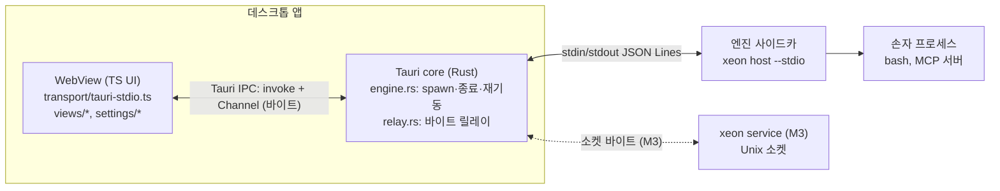

# L4 데스크톱 (desktop)

## 1. 목적과 범위

### 1.1 정하는 것

- 데스크톱 앱의 프로세스 구조: Tauri core(Rust), WebView(TS UI), 엔진 사이드카.
- UI와 엔진을 잇는 경로. Rust 릴레이와 WebView 쪽 F `Transport`(kind `"stdio"`) 구현의 경계.
- 엔진 사이드카의 수명 규칙(기동, 정상 종료, 비정상 종료, 재기동)과 장애 처리.
- 서비스 모드(M3)에서 사이드카 대신 서비스 소켓에 접속하는 경로.
- 메모리 예산의 측정 대상, 측정법, 줄이는 수단.
- 플랫폼 지원 범위와 WebView 엔진 차이로 생기는 제약.
- 프런트엔드 프레임워크(adr.0010)와 상태 모델의 위치(`L4.desktop.design`).
- 화면 구성(스레드 목록, 트랜스크립트, 입력창, 승인 대기열, 상태 표시줄, 설정 진입).
- `l4.desktop.*` 설정 키.
- 앱 내부 모듈 경계(`eng.dependency-rules.guide` R14 위임분).

### 1.2 다루지 않는 것

- 설정 화면의 생성·검증·표시: `L4.settings-ui.spec`. 이 문서는 설정 화면 진입점과 데스크톱 설정 저장소만 정한다.
- 엔진 쪽 메서드 처리기, 엔진 바이너리 이름과 서브커맨드의 확정, 서비스 등록 파일과 `ensure`: `L4.host-service.spec`.
- 호스트 계약(envelope, 메서드, 알림, 커서, 오류): `F.wire-settings.spec`.
- 사용자 데이터 디렉터리와 소켓 경로의 OS별 위치: `L0.os.spec`.
- 엔진이 띄우는 자식 프로세스(셸, MCP 서버)의 실행: `L0.process.spec`, L0 `platform-exec`.
- 서명, 공증, CI 매트릭스, 사이드카 크기 상한, 작업 순서: `L4.desktop.plan`.

### 1.3 근거

- [결정] Tauri 2.12 셸(시스템 WebView)을 쓰고, 엔진은 `bun build --compile` 사이드카이며, UI와 엔진은 stdio JSON-RPC로 연결한다(adr.0008 §3.1~§3.3, `_research/foundation-plan.md §1` 결정 3).
- [결정] 엔진을 UI 프로세스 안에 넣지 않는다. 확장의 블로킹·크래시가 UI를 멈추지 않게 하기 위해서다(adr.0008 §3.3, `_research/process.md §6.1`).
- [결정] 데스크톱은 메모리 우선 3플랫폼이다(`_research/decisions-log.md` 2026-10-21 결정(3차)).
- [결정] 데스크톱 본체는 M2다(`product.scope.spec` I2, `_research/foundation-plan.md §5` P4). 이번 실행(M1)은 스캐폴드까지다.
- [결정] 서비스 모드 연동과 알림은 M3다(`product.scope.spec` I12, I13).

## 2. 용어

| 용어 | 뜻 |
|---|---|
| 셸 | Tauri core 프로세스(Rust). 창, 트레이, 사이드카 수명, 바이트 릴레이를 맡는다 |
| WebView | 시스템 WebView(macOS WKWebView, Linux WebKitGTK, Windows WebView2)에서 도는 TS UI |
| 엔진 사이드카 | `bun build --compile`로 만든 엔진 바이너리. `bundle.externalBin`으로 앱에 들어간다 |
| 릴레이 | 셸이 엔진의 stdin/stdout(또는 서비스 소켓) 바이트를 WebView와 주고받는 경로. JSON-RPC를 해석하지 않는다 |
| 엔진 공급원 | WebView가 접속하는 엔진의 출처. `"sidecar"`(앱이 띄운 자식) 또는 `"service"`(`xeon service`, M3) |
| 릴레이 세대(epoch) | 셸이 WebView 페이지 하나에 릴레이를 붙일 때마다 1씩 올리는 번호. 새로고침과 창 재생성을 구별한다 |
| 손자 프로세스 | 엔진이 띄운 자식(도구 셸 명령, MCP 서버 등) |
| 이어서 실행 후보 | 비정상 종료 표식(`running_since`)이 남은 세션(adr.0006 §3.6 5번) |

thread, turn, item은 `F.conversation.spec`의 용어다. 화면 문구의 "대화"는 thread다.

## 3. 인터페이스

### 3.1 프로세스 구조



- 프로세스는 셋이다. 셸, WebView(플랫폼에 따라 WebView 엔진이 보조 프로세스를 더 띄운다, §3.7), 엔진 사이드카.
- [제안] 엔진 사이드카는 앱 하나에 하나다. 창이 여럿이어도 같은 엔진을 쓴다. M2는 창 하나만 연다.

### 3.2 연결 경로 비교

| 안 | 내용 | spawn 위치 | envelope 검사 | 판정 |
|---|---|---|---|---|
| (a) Rust 바이트 릴레이 + WebView TS 전송 | 셸이 사이드카를 띄우고 stdout 바이트를 그대로 WebView에 넘긴다. WebView의 TS가 F `StdioTransportFactory`로 JSON Lines 프레이밍을 하고 `HostConnection`이 envelope를 검사한다 | Rust 한 곳 | TS(F 함수) 한 곳 | [제안] 채택 |
| (b) WebView가 JS shell 플러그인으로 직접 spawn | `Command.sidecar("binaries/xeon").spawn()`을 WebView에서 부른다 | WebView | TS | 탈락 |
| (c) Rust가 JSON-RPC를 해석 | 셸이 메시지를 파싱하고 Tauri 명령·이벤트로 바꿔 WebView에 준다 | Rust | Rust와 TS 두 곳 | 탈락 |

(a)를 고르는 근거:

1. spawn 위치가 Rust 한 곳이다. adr.0008 §3.3 제안 1번(엔진 spawn은 Rust 한 곳, `CommandChild`를 앱 상태에 보관)을 그대로 만족한다. (b)는 플러그인이 정상 종료 때 SIGKILL만 보내고(`_research/notes/arch-2.md §3.2` 기본 kill 행), WebView 새로고침이나 창 재생성 때 `CommandChild` 핸들이 페이지와 함께 사라진다.
2. envelope·메서드·params 검사 로직이 F(`checkEnvelope`, `WIRE_METHODS`) 한 벌로 남는다. (c)는 같은 검사를 Rust로 다시 써야 하고, F 스키마가 바뀔 때마다 두 곳을 고쳐야 한다.
3. 데스크톱 TS는 CLI와 같은 `HostConnection`을 쓴다. 그래서 같은 테이프에서 CLI와 데스크톱의 호스트 메시지 열이 같은지 비교할 수 있다(§9 D-03).
4. DR-10과 맞는다. `apps/desktop`은 `@xeon/host`를 import하지 않고 바이너리를 실행한다(`eng.dependency-rules.guide` DR-10).
5. WebView에 `shell:allow-spawn`을 줄 필요가 없다. 셸 권한을 WebView에 열지 않는다(§3.5).

(a)의 비용:

- 바이트가 Tauri IPC를 한 번 더 지난다. 큰 프레임(최대 `WIRE_LIMITS.maxFrameBytes` 1 MiB)의 복사 비용은 S3 spike에서 잰다(`L4.desktop.plan`).
- WebView 새로고침은 같은 stdio 연결 위에서 새 클라이언트가 시작되는 일이다. 연결 재설정은 F 클라이언트 알림 `$/connectionReset`(M2)으로 한다(§4.5, `F.wire-settings.spec` §4).

### 3.3 셸과 WebView 사이 IPC

[제안] 셸은 아래 Tauri 명령 다섯 개만 WebView에 연다. 명령 이름은 Rust `#[tauri::command]` 함수 이름이다. 모두 비동기 명령이라 UI 프로세스의 메인 스레드를 막지 않는다.

| 명령 | 인자 | 결과 | 뜻 |
|---|---|---|---|
| `engine_attach` | `onBytes: Channel<ArrayBuffer>`, `onState: Channel<EngineState>` | `AttachResult` | 현재 페이지에 릴레이를 붙인다. 이전 세대 릴레이는 끊는다 |
| `engine_write` | 원시 바이트 본문(`Uint8Array`), 헤더 `x-xeon-epoch` | `null` | 엔진 stdin(또는 소켓)에 쓴다. 세대가 다르면 거부한다. 본문은 줄(프레임) 단위이고 2 MiB 이하다 |
| `engine_ack` | `epoch: number`, `bytes: number` | `null` | `onBytes`로 받은 바이트 중 처리를 끝낸 양을 알린다(신용 반환). 세대가 다르면 무시한다 |
| `engine_restart` | 없음 | `null` | `failed` 상태에서 사용자가 수동 재기동을 고를 때 부른다. `failed`가 아니면 `not-failed`로 거부한다 |
| `engine_detach` | `epoch: number` | `null` | 페이지가 내려갈 때 릴레이를 끊는다. 엔진은 끄지 않는다. `epoch`가 현재 연결일 때만 끊으므로 새로고침 뒤 늦게 온 이전 페이지의 호출이 새 연결을 끊지 못한다 |

- 오류 값은 kebab-case 문자열 코드다: `epoch-stale`, `engine-not-running`, `engine-stopping`, `not-failed`, `too-large`, `bad-request`.
- `onBytes`의 메시지는 엔진 stdout 바이트 그대로이고 완성된 줄(`\n`으로 끝나는 바이트열)만 담는다. 종류 표지나 세대 접두사는 없다. attach마다 `Channel`이 따로이므로 세대는 `AttachResult.epoch`로 안다. 셸은 줄 끝이 오지 않은 꼬리를 쥐고 있다가 줄이 완성되면 보낸다.
- 신용 기반 역압 [결정: `L4.desktop.plan` §3.1.1 S3 조건 1]: 셸은 보낸 바이트에서 `engine_ack`로 돌려받은 바이트를 뺀 값이 4 MiB를 넘으면 더 보내지 않는다. 이 동안 엔진 stdout 읽기가 멈추고 엔진의 stdout 쓰기가 막힌다. WebView는 처리한 바이트가 256 KiB 쌓일 때마다 `engine_ack(epoch, bytes)`를 부른다(창은 확인 단위의 16배라 확인이 늦어도 송신이 멎지 않는다). 미확인 바이트가 창 이하이면 다음 묶음을 보낸다(묶음 하나가 창을 넘을 수 있어 큰 프레임도 멈추지 않는다).
- 쓰기 경로 [결정: S3 조건 2]: `engine_write`는 쓰기 전용 스레드의 대기열(16개)에 넣고 돌아온다. 대기열이 차면 그 호출만 비동기로 기다리고 다른 명령은 막히지 않는다. 막힌 쓰기는 앱 상태의 락을 쥐지 않는다.

- `onState`의 값은 JSON이고 아래 스키마로 검사한다. 셸이 보낸 값도 WebView 입장에서는 프로세스 밖에서 온 값이기 때문이다.

```ts
// xeon/apps/desktop/src/transport/ipc.ts
import { Type, type Static, type TSchema } from "typebox";

const Obj = <P extends Record<string, TSchema>>(p: P) => Type.Object(p, { additionalProperties: false });

export const EngineSourceSchema = Type.Union([Type.Literal("sidecar"), Type.Literal("service")]);
export type EngineSource = Static<typeof EngineSourceSchema>;

export const EngineExitSchema = Obj({
  code: Type.Union([Type.Integer(), Type.Null()]),     // 신호로 끝나면 null
  signal: Type.Union([Type.Integer(), Type.Null()]),   // Windows는 항상 null
  at: Type.String({ format: "date-time", maxLength: 32 }),
});
export type EngineExit = Static<typeof EngineExitSchema>;

export const EngineStateSchema = Type.Union([
  Obj({ kind: Type.Literal("starting"), source: EngineSourceSchema, attempt: Type.Integer({ minimum: 0 }) }),
  Obj({ kind: Type.Literal("running"), source: EngineSourceSchema, pid: Type.Union([Type.Integer({ minimum: 1 }), Type.Null()]) }),
  Obj({
    kind: Type.Literal("restarting"),
    attempt: Type.Integer({ minimum: 1 }),
    retryAt: Type.String({ format: "date-time", maxLength: 32 }),
    lastExit: EngineExitSchema,
  }),
  Obj({ kind: Type.Literal("stopping") }),
  Obj({ kind: Type.Literal("failed"), attempts: Type.Integer({ minimum: 0 }), lastExit: EngineExitSchema }),
  Obj({ kind: Type.Literal("stopped") }),
]);
export type EngineState = Static<typeof EngineStateSchema>;

export const AttachResultSchema = Obj({
  epoch: Type.Integer({ minimum: 1 }),
  state: EngineStateSchema,
});
export type AttachResult = Static<typeof AttachResultSchema>;
```

- `running`의 `pid`는 서비스 공급원일 때 `null`이다. 서비스 pid는 `host.status`로 본다.
- 코드에서는 `isolatedDeclarations` 때문에 각 스키마 상수에 명시 타입 주석을 단다(`F.wire-settings.spec` §3.0과 같은 규칙). 위 블록은 줄여 쓴 것이다.

WebView 쪽은 Tauri API를 아래 인터페이스 뒤에 숨긴다. 테스트는 이 인터페이스의 가짜를 주입한다(`eng.testing.guide` TS-05의 주입 원칙).

```ts
// xeon/apps/desktop/src/transport/ipc.ts (계속)
export interface DesktopIpc {
  attach(onBytes: (chunk: Uint8Array) => void, onState: (state: EngineState) => void): Promise<AttachResult>;
  write(epoch: number, chunk: Uint8Array): Promise<void>;
  restart(): Promise<void>;
  detach(): Promise<void>;
}

/** @tauri-apps/api의 invoke와 Channel로 DesktopIpc를 만든다. @tauri-apps/*를 import하는 유일한 파일이다(§4.9 규칙 W2). */
export declare function createTauriIpc(): DesktopIpc;
```

### 3.4 WebView 쪽 전송과 연결

[제안] WebView는 F의 `StdioTransportFactory`에 릴레이로 만든 스트림 쌍을 넘긴다. 프레이밍(JSON Lines, 1 MiB 한도)은 `StdioTransportFactory` 구현이 하고, envelope 검사는 `HostConnection`이 한다(`F.wire-settings.spec` §3.1 `Transport` 주석).

```ts
// xeon/apps/desktop/src/transport/tauri-stdio.ts
import type {
  HostConnection, StdioTransportFactory, Transport, StreamPosition, WireResult,
} from "@xeon/contracts/wire";
import type { DesktopIpc, EngineState } from "./ipc.ts";

/** 릴레이 한 세대. readable은 엔진 stdout 바이트, writable은 엔진 stdin 바이트다. */
export interface RelayPort {
  readonly epoch: number;
  readonly readable: ReadableStream<Uint8Array>;
  readonly writable: WritableStream<Uint8Array>;
  readonly state: EngineState;                                  // attach 시점 값
  onState(listener: (state: EngineState) => void): () => void;
}

/** engine_attach를 부르고 Channel을 ReadableStream으로, engine_write를 WritableStream으로 감싼다. */
export declare function attachRelay(ipc: DesktopIpc): Promise<RelayPort>;

export interface EngineConnectionDeps {
  readonly ipc: DesktopIpc;
  readonly stdioTransport: StdioTransportFactory;               // F 구현 (§10 미결 3)
  readonly connect: (transport: Transport) => HostConnection;   // F 구현 (§10 미결 3)
  readonly client: { readonly name: "xeon-desktop"; readonly version: string };
}

export interface EngineConnection {
  readonly connection: HostConnection;
  readonly hello: WireResult<"host.hello">;
  readonly relay: RelayPort;
}

/** attach → 연결 재설정(§4.5) → host.hello(client.kind "desktop") 순서로 연결을 연다. */
export declare function openEngineConnection(deps: EngineConnectionDeps): Promise<EngineConnection>;

/** 마지막으로 처리한 내구 이벤트 위치. WebView 새로고침 뒤에도 남도록 sessionStorage에 둔다. */
export interface CursorStore {
  load(): StreamPosition | undefined;
  save(position: StreamPosition): void;
  clear(): void;
}
export declare function createSessionCursorStore(storage: Pick<Storage, "getItem" | "setItem" | "removeItem">): CursorStore;

/** 위치가 있으면 그 위치부터, 없거나 replay.outOfRange면 "head"부터 구독한다(§4.6). */
export declare function resubscribe(
  connection: HostConnection,
  cursor: CursorStore,
  onReset: () => void,                                          // 캐시를 버려야 할 때 한 번 부른다
): Promise<WireResult<"events.subscribe">>;
```

- `StdioTransportOptions.readable`·`writable`에 `RelayPort`의 스트림을 그대로 넘긴다. 그래서 같은 `StdioTransportFactory` 구현을 M1 적합성 테스트(엔진 바이너리의 실제 stdin/stdout)와 M2 WebView(릴레이)가 함께 쓴다.
- `writable`의 `write` 한 번은 완결된 프레임 하나(메시지 + `\n`)다. 프레임을 쪼개 쓰지 않는다. 셸이 프레임 경계 사이에만 자기 메시지(§4.3 `host.shutdown`)를 끼워 넣을 수 있게 하기 위해서다.
- `Transport.kind`는 `"stdio"`다. M3 서비스 공급원에서도 WebView 쪽 전송은 같은 바이트 파이프이므로 kind는 `"stdio"`로 둔다. 실제 매체는 `host.hello` 결과의 `transport`(서버 쪽 값)와 `EngineState.source`로 구별한다 [제안].

### 3.5 사이드카 등록과 권한

[제안] 사이드카 이름은 `xeon`이고 인자는 `host --stdio`다(adr.0008 §3.2 제안, `L4.host-service.spec` §3.2 [제안]). 확정은 `L4.host-service.spec`이 한다. `xeon/apps/desktop/README.md`와 `eng.toolchain.guide` TC-10은 `apps/host` 단독 사이드카로 적고 있어 어긋난다(§10 미결 1).

- 이름, 인자, triple 목록은 한 곳(`xeon/apps/desktop/sidecar.json`, `L4.desktop.plan` §2)에 모은다. `tauri.conf.json`의 `bundle.externalBin`, capabilities, Rust 상수는 이 파일과 같아야 하고 테스트가 대조한다. 이름이 바뀌면 이 파일 하나와 그 파생물만 고친다.
- 파일 위치는 `src-tauri/binaries/xeon-<target-triple>`(Windows는 `.exe`)다(adr.0008 §3.2).
- [제안] (a)안에서는 WebView가 spawn하지 않으므로 capabilities에 `shell:allow-spawn`을 WebView용으로 두지 않는다. adr.0008 §3.2의 capabilities 발췌(`args: ["host", "--stdio"]` 고정)는 (b)안으로 되돌릴 때의 형식으로 남긴다. [가정] Rust API(`app.shell().sidecar()`)는 capabilities 검사를 받지 않는다. S1 spike에서 확인한다.
- [제안] 셸 플러그인의 JS API(`@tauri-apps/plugin-shell`)는 앱에 넣지 않는다.

### 3.6 데스크톱 설정 저장소

`l4.desktop.*` 값(§6)은 엔진이 꺼져 있을 때도 셸이 읽어야 한다(재기동 상한, 닫기 동작). 그래서 [제안] 엔진 카탈로그 밖의 데스크톱 로컬 파일에 둔다(§10 미결 6).

```ts
// xeon/apps/desktop/src/settings-store/index.ts
import type { EffectiveSetting, SettingDefWire, SettingKey } from "@xeon/contracts/settings";

export type DesktopSettingWrite =
  | { readonly ok: true; readonly setting: EffectiveSetting }
  | { readonly ok: false; readonly kind: "settings.unknownKey" | "settings.invalidValue"; readonly details: Readonly<Record<string, unknown>> };

/** settings-ui가 엔진 settings.list 결과와 합쳐 화면을 만든다. 값 검사는 F validateSettingValue를 쓴다. */
export interface DesktopSettingsStore {
  defs(): readonly SettingDefWire[];                    // l4.desktop.* 정의만
  get(key: SettingKey): EffectiveSetting | undefined;
  set(key: SettingKey, value: unknown): Promise<DesktopSettingWrite>;
  reset(key: SettingKey): Promise<DesktopSettingWrite>;
  onChange(listener: (setting: EffectiveSetting) => void): () => void;
}
```

- 파일은 셸이 읽고 쓴다(`desktop_settings_read`, `desktop_settings_write` 명령, [제안]). 파일 위치는 Tauri 앱 설정 디렉터리이고, 범위는 `user` 하나다.
- 이 저장소는 비밀 키를 두지 않는다. `l4.desktop.*`에는 `secret: true` 키가 없다.

### 3.7 메모리 측정 인터페이스

[제안] 측정 스크립트(S5)는 아래 레코드를 JSON Lines로 남긴다. 측정 대상은 셸, WebView 엔진 프로세스 전부, 사이드카, 사이드카의 손자 프로세스(별도 합계)다.

```ts
// xeon/apps/desktop/test/memory/sample.ts (S5 결과 형식)
export interface MemorySample {
  readonly at: string;                         // ISO 8601 UTC
  readonly platform: "macos" | "linux" | "windows";
  readonly scenario: "idle-empty" | "idle-thread-1k-items" | "streaming" | "window-closed-tray";
  readonly processes: readonly {
    readonly role: "shell" | "webview" | "engine" | "engine-child";
    readonly pid: number;
    readonly name: string;
    readonly rssBytes: number;
    readonly privateBytes: number | null;      // macOS phys_footprint, Linux Pss 또는 Private, Windows Private Bytes
  }[];
  readonly totalRssBytes: number;              // engine-child 제외
  readonly totalPrivateBytes: number | null;
}
```

- `platform` 값은 측정 기록용 데이터로만 쓴다. 측정 스크립트는 `test/` 아래 도구라 DR-13의 소비자 코드에 해당하지 않는다 [가정. `eng.dependency-rules.guide`에 테스트 도구의 OS 분기 예외가 명시되어 있지 않다].

## 4. 동작 규칙

### 4.1 엔진 수명 규칙

adr.0008 §3.3 제안 다섯 개와 `_research/notes/arch-2.md §5`를 번호로 정리한다. 모두 Rust `engine.rs` 한 곳에서 구현한다.

| # | 규칙 | 근거 | 표지 |
|---|---|---|---|
| E1 | 엔진 spawn은 `engine.rs`의 한 함수에서만 한다. WebView와 다른 Rust 모듈은 spawn하지 않는다 | adr.0008 §3.3 제안 1, arch-2 §5 5행 | [제안] |
| E2 | 엔진 감독자(`State<Arc<Supervisor>>`)가 pid와 쓰기 손잡이를 앱 상태에 보관하고, `CommandChild`는 stdin 쓰기 전용 스레드가 쥔다. 종료는 pid로 프로세스 그룹에 신호를 보낸다(Unix `killpg`, Windows `taskkill /T`). 그래서 막힌 쓰기가 종료 경로를 막지 않는다. `RunEvent::Exit`에서도 남은 그룹을 종료한다. Rust API로 띄운 사이드카는 플러그인이 추적하지 않는다 | arch-2 §3.2 맵 등록 경로 행, `L4.desktop.plan` §3.1.1 S3 조건 2 | [제안] |
| E3 | 프로세스 그룹을 켠다(`set_process_group`). 강제 종료는 그룹 전체에 보낸다 | arch-2 §3.2 그룹 범위 행, §5 3행 | [제안] |
| E4 | 종료할 때는 신호 전에 stdin으로 `host.shutdown` 요청을 쓰고 stdin을 닫는다. `RunEvent::ExitRequested`에서 `prevent_exit()`로 종료를 미루고, 엔진 프로세스가 끝나거나 `l4.desktop.engine.shutdownGraceMs`가 지나면 다음 단계로 넘어간다(§4.3) | adr.0008 §3.3 제안 3, arch-2 §3.3, §5 1행 | [제안]. `host.shutdown`은 F 변경 요청(§10 미결 2) |
| E5 | 엔진은 stdin EOF를 읽으면 안전 경계에서 체크포인트하고 종료한다(stdin EOF 임대). 앱이 어떻게 끝나든 OS가 파이프 쓰기 끝을 닫으므로 앱 SIGKILL에서도 엔진이 스스로 끝난다 | adr.0008 §3.3 [결정], adr.0006 §3.7 6번 | 엔진 쪽 구현은 `L4.host-service.spec` |
| E6 | 엔진의 cwd와 엔진에 넘기는 모든 경로를 절대 경로로 둔다. cwd는 사용자 홈 디렉터리의 절대 경로다 | adr.0008 §3.3 제안 4, arch-2 §4.2 | [제안] |
| E7 | 엔진 환경에서 `BUN_OPTIONS`를 지운다. 그 밖의 환경은 상속한다 | adr.0008 §3.3 제안 4, arch-2 §4.2 | [제안] |
| E8 | 세션 DB는 바이너리에 임베드하지 않는다. DB 위치는 엔진이 `L0.os.spec`의 사용자 데이터 디렉터리에서 정하고, 셸은 DB 경로를 넘기지 않는다. 그래야 CLI와 데스크톱이 같은 DB를 연다 | adr.0008 §3.3 제안 5, `_research/stack-status.md §7-C` 임베디드 SQLite 행 | [제안] |
| E9 | 엔진의 손자 프로세스는 엔진과 같은 프로세스 그룹에 남아야 한다. 엔진 쪽 실행 코드가 손자를 새 그룹이나 새 세션으로 떼어 내면 E3의 그룹 종료가 그 손자에 미치지 않는다. 떼어 낸 손자는 엔진이 EOF·shutdown 처리 때 직접 정리한다 | arch-2 §3.2 그룹 범위 행 | [제안]. `L0.process.spec`에 요구 |
| E10 | stdout은 JSON Lines 전용이다. 엔진 로그는 stderr로 쓰고, 셸은 stderr를 줄 단위로 앱 로그 파일에 남긴다. stderr 줄 길이는 8 KiB에서 자른다 | `F.wire-settings.spec` §3.1 프레이밍 | [제안] |
| E11 | 셸 로그와 릴레이는 프레임 내용을 기록하지 않는다. 바이트 수, 프레임 수, 세대 번호만 남긴다. 비밀 값은 프레임에 실리지 않지만(`L4.readme` §4 비밀 행) 다른 결함으로 실리더라도 셸 로그에 남지 않는다 | `F.wire-settings.spec` §4.9 비밀 값 비표시 규칙 2, §3.8.1 SecretRef, `L0.secrets.spec` §8.3 R4(값 없는 `secret.*`) | [제안] |

- E5의 체크포인트 시한: 엔진은 EOF 뒤 `l0.process.shutdown.timeoutMs`(기본 3000ms) 안에 종료한다(`L0.process.spec` §6, `L4.host-service.spec` HS-31, HS-32). S4 측정(WSL2, 20회)에서 idle 호스트의 EOF → 종료는 중앙값 약 28 ms, 최대 61 ms였다. 기본값은 종료 경로에 충분하고, 진행 중 turn이 있을 때의 체크포인트 시간은 [미확인]이다(`L4.desktop.plan` §3.1.1 S4).
- E8의 확인: `L0.os.spec`이 CLI와 엔진 사이드카에 같은 데이터 디렉터리를 돌려주는지는 그 문서의 수용 기준에 요구한다.

### 4.2 기동 순서

1. 셸이 시작하면 데스크톱 설정 파일을 읽는다(§3.6). 읽지 못하면 기본값을 쓴다.
2. (M3) 서비스 사용 설정(`l0.process.service.enabled`)이 켜져 있으면 §4.8 서비스 경로로 가고, 꺼져 있으면 3으로 간다. M2는 이 단계 없이 3으로 간다.
   - 이 키는 엔진 카탈로그의 user·managed 범위 파일 값이고, 셸과 WebView는 `l4.desktop.*` 로컬 저장소(§3.6)만 읽는다. `resolveLaunchMode`는 `@xeon/host` 안에 있어 desktop이 import할 수 없다(W6, DR-10). 그래서 읽기 경로를 따로 둔다.

   | 안 | 내용 | 장점 | 단점 |
   |---|---|---|---|
   | 1 | 셸이 엔진 바이너리의 설정 해석 전용 서브커맨드 `xeon service launch-mode --json`을 짧게 실행하고 `{ "mode": "in-process" \| "service" }` 한 줄을 읽는다(`L4.host-service.spec` §3.2) | 해석 코드가 `resolveLaunchMode` 하나다. CLI(`xeon config set`)나 파일 편집으로 바꾼 값이 바로 반영된다 | 시작마다 짧은 프로세스 하나가 더 뜬다(기동 시간은 S2 측정에 포함) |
   | 2 | `l0.process.service.enabled`를 `l4.desktop.*` 로컬 저장소에 거울 값으로 둔다 | 추가 프로세스가 없다 | 엔진 쪽 값과 어긋날 수 있다. CLI나 파일로 바꾼 값을 셸이 알 수단이 없고, 관리 범위 잠금도 따로 읽어야 한다 |

   [제안] 안 1을 쓴다. 명령이 실패하면(바이너리 없음, 종료코드 0 아님, JSON 해석 실패) 사이드카 경로(3단계)로 가고 진단을 남긴다.
3. `engine.rs`가 사이드카를 E1~E7 조건으로 띄우고 상태를 `starting`으로 둔다.
4. 첫 stdout 바이트가 오거나 WebView가 붙어 `host.hello` 응답이 돌아오면 `running`이 된다. [제안] 셸은 JSON을 해석하지 않으므로 `running` 판정은 "프로세스가 살아 있고 stdout이 열려 있음"이다. 기동 실패(바이너리 없음, 실행 권한 없음, 즉시 종료)는 `restarting` 또는 `failed`로 간다.
5. WebView가 로드되면 `openEngineConnection`이 `engine_attach` → 연결 재설정(§4.5) → `host.hello` → `resubscribe` 순서로 연결을 연다.

### 4.3 정상 종료 순서

창을 닫고 닫기 동작이 `"quit"`이거나, 메뉴에서 종료를 고르면 다음 순서를 따른다.

1. `RunEvent::ExitRequested`에서 엔진이 살아 있으면 `api.prevent_exit()`를 부르고 상태를 `stopping`으로 바꾼다.
2. 셸이 프레임 경계에서 stdin에 `host.shutdown` 요청 한 줄을 쓴다. 요청 id는 `shell:shutdown:<n>` 꼴이다. WebView의 `HostConnection`은 자기가 발급하지 않은 id의 응답을 무시한다.
3. 셸이 stdin을 닫는다(E5 EOF 임대와 같은 경로). `host.shutdown`이 F에 없어 엔진이 `-32601`로 거부해도 EOF로 같은 체크포인트 종료가 일어난다.
4. 엔진 프로세스 종료를 `l4.desktop.engine.shutdownGraceMs` 동안 확인한다. 셸은 JSON을 해석하지 않으므로 "응답 대기"는 프로세스 종료 확인으로 대신한다 [제안].
5. 시한 안에 끝나면 그룹에 남은 손자가 있는지 보고 있으면 그룹 SIGKILL을 보낸다(E3). 시한이 지나면 그룹 SIGKILL을 보낸다. Windows는 §4.4의 job 처리를 따른다.
6. `CommandChild`를 앱 상태에서 비우고 `app.exit(0)`을 다시 부른다. 두 번째 `ExitRequested`는 막지 않는다.

- 불변식 [제안]: 셸 대기 `l4.desktop.engine.shutdownGraceMs`는 엔진 시한 `l0.process.shutdown.timeoutMs` + 2000 이상이어야 한다. 두 값의 단위는 모두 ms다. 셸 대기가 엔진 시한과 같거나 짧으면 엔진의 체크포인트 커밋과 그룹 SIGKILL이 경합한다. 셸은 엔진 카탈로그를 읽지 않으므로 이 관계는 기본값(7000 ≥ 3000 + 2000)으로 지킨다. 사용자가 `l0.process.shutdown.timeoutMs`를 5000 넘게 올리면 `shutdownGraceMs`도 함께 올려야 한다 [가정: 두 값을 자동으로 맞추는 수단은 없다].

- [확인: `L4.desktop.plan` §3.1.1 S1, WSL2 WebKitGTK] 앱이 SIGTERM을 받을 때 처리기를 두지 않으면 `RunEvent::ExitRequested`도 `Exit`도 오지 않고 프로세스가 바로 사라진다. `signal-hook` 처리기에서 `app.exit(0)`을 부르면 `ExitRequested`(code `Some(0)`)와 `Exit`가 와서 같은 순서를 탄다. 그러므로 Unix에서는 셸이 SIGTERM·SIGINT 처리기를 둔다 [제안 유지]. 처리기가 없는 경우와 앱 SIGKILL은 E5(EOF 임대)만이 방어다. macOS는 미측정이다.
- [확인: S1] 5단계의 그룹 SIGKILL은 EOF 처리 시한 뒤에 한다. `Exit`에서 곧바로 그룹 SIGKILL을 하면 엔진이 새 세션으로 띄운 손자(E9 위반 구성)를 정리할 기회를 잃어 그 손자가 남았다. 프로세스 그룹을 끄면(E3 위반) 그룹 SIGKILL이 손자에 미치지 않았다.

### 4.4 비정상 종료와 재기동

| 사건 | 처리 |
|---|---|
| 엔진이 `stopping`이 아닐 때 끝남(크래시, OOM, 신호) | 상태를 `restarting`으로 바꾸고 재기동 정책(아래)을 따른다. WebView에는 `onState`로 알린다 |
| 앱(셸)이 SIGKILL이나 크래시로 끝남 | 셸 코드가 실행되지 않는다. 엔진은 E5로 체크포인트 후 종료한다. 엔진이 프로세스 그룹 리더이므로 손자는 엔진의 EOF 처리(E9)로 정리된다 |
| Windows에서 앱 크래시 | 플러그인의 job 핸들이 닫혀도 프로세스가 남는다(arch-2 §3.2 Windows job 행). E5가 1차 방어다. [미결] kill-on-close job을 셸이 직접 만들지(§10 미결 7) |
| WebView 프로세스만 죽음(WebView 엔진 크래시) | 셸과 엔진은 산다. 셸이 창을 다시 만들고 새 페이지가 §4.5로 다시 붙는다 |
| 엔진이 stdout을 닫았지만 프로세스는 산다 | 프로토콜 고장으로 본다. 그룹 SIGKILL 후 재기동 정책을 따른다 |

재기동 정책 [제안]:

- 백오프: 1번째 재기동은 즉시, 그다음은 1초, 2초, 4초, 이후 8초 상한으로 늘린다.
- 횟수 상한: 10분 창 안에서 `l4.desktop.engine.restartLimit`(기본 3)번까지 자동 재기동한다. 넘으면 `failed`로 두고 화면에 수동 재기동 버튼을 보인다(`engine_restart`).
- 10분 동안 재기동 없이 `running`이 유지되면 횟수를 0으로 되돌린다.
- 재기동한 엔진은 같은 DB를 연다. 엔진은 열 때 복구하므로(adr.0006 §3.1) 진행 중이던 turn은 비정상 종료 표식으로 남는다.
- [가정] 위 수치(백오프 단계, 10분 창)는 측정 근거 없는 초기값이다.

### 4.5 WebView 새로고침과 연결 재설정

- stdio 전송은 엔진 프로세스 하나에 연결 하나다. WebView가 새로고침되면 엔진은 계속 같은 연결을 쓰지만 클라이언트 상태(진행 중 요청 id, 구독, hello 상태)는 페이지와 함께 사라진다. 새 페이지가 `host.hello`를 다시 보내면 `host.helloDuplicate`(1002)가 된다(`F.wire-settings.spec` §3.5.2).
- [제안] 새 페이지는 `engine_attach`로 새 세대를 받은 뒤, 첫 메시지로 클라이언트 알림 `$/connectionReset`을 보낸다. 엔진은 이 알림을 받으면 그 연결의 구독과 진행 중 요청의 `signal`을 중단하고(진행 중 turn은 중단하지 않는다, `F.wire-settings.spec` §4.1 4번) hello 이전 상태로 돌아간다. 이 알림은 F 표에 들어왔고(`F.wire-settings.spec` §3.3.2, §4.1 5~7번) 호스트가 구현했다(m2 F.8). 엔진이 hello 전이면 무시하므로 새 페이지는 첫 기동에도 같은 순서를 쓴다.
- 셸은 세대가 바뀌면 이전 세대에 보내던 stdout 바이트를 다음 `\n`까지 버리고, 그 뒤 바이트부터 새 세대로 보낸다. 셸이 아는 것은 줄 경계뿐이고 JSON은 해석하지 않는다.
- [제안] M2 전(M1)에는 새로고침을 엔진 재기동으로 처리한다. 셸이 §4.3 2~5단계로 엔진을 끄고 다시 띄운다. 진행 중 turn은 이어서 실행 후보가 된다.

### 4.6 이벤트 재개

1. WebView는 `events.batch`를 처리할 때마다 `{storeId, to}`를 `CursorStore`에 저장한다.
2. 새로고침이나 엔진 재기동 뒤에는 저장한 위치로 `events.subscribe({from: position})`을 보낸다(`F.wire-settings.spec` §3.4.3).
3. `replay.outOfRange`(2001)를 받으면 위치와 화면 캐시를 버리고 `from: "head"`로 다시 구독한 뒤 열린 thread를 `thread.open`(M2)으로 다시 읽는다.
4. `stream.chunk`는 재전송되지 않는다. 끊긴 동안의 조각은 버리고, 완성된 item은 `events.batch`로 다시 받는다(`F.wire-settings.spec` §3.4.4).
5. `storeId`가 바뀌면(DB 재생성) 3과 같이 처리한다.

### 4.7 이어서 실행

- 재기동이나 앱 재시작 뒤 비정상 종료 표식이 남은 thread는 스레드 목록과 트랜스크립트 끝에 "이어서 실행" 후보로 표시한다(adr.0006 §3.6 5번).
- 자동 재개는 기본 꺼짐이다. 사용자가 후보를 눌러야 재개한다. 키는 `l1.persistence.autoResume`(기본 `false`)과 `l1.persistence.maxResumeAttempts`이고 `L1.persistence.spec` §6이 소유한다 [결정: review.decisions-2 S-03]. 데스크톱은 자기 자동 재개 키를 두지 않는다.
- 표식을 알리는 wire 값(이벤트 kind 또는 `ThreadSummary` 필드)은 정해지지 않았다. `ThreadSummary` 필드 확정(`F.wire-settings.spec` §10 미결 9) 때 `resumable` 성격의 필드를 요청한다(§10 미결 4).

### 4.8 서비스 모드 연동 (M3)

- `l4.host-service`의 서비스 사용 설정이 켜져 있으면 셸은 사이드카를 stdio 엔진으로 띄우지 않고 서비스 소켓에 접속한다(adr.0006 §3.4 "CLI와 데스크톱은 서비스 사용 설정이 켜져 있으면 시작할 때 `ensure`를 부르고 service 전송으로 접속한다"). 설정을 읽는 경로는 §4.2 2단계(`xeon service launch-mode --json`)다.
- WebView는 소켓을 열 수 없다. 셸이 `relay.rs`의 같은 바이트 파이프 추상화로 소켓 바이트를 중계한다. WebView 쪽 코드(§3.4)는 바뀌지 않는다.

```rust
// xeon/apps/desktop/src-tauri/src/relay.rs (층 규칙 밖. 모양만 적는다)
pub trait EnginePipe: Send {
    fn write_frame(&mut self, bytes: &[u8]) -> std::io::Result<()>;   // 프레임 경계 단위
    fn close_write(&mut self) -> std::io::Result<()>;                // sidecar: stdin 닫기, service: 소켓 half-close
}
pub enum PipeSource { Sidecar(SidecarPipe), Service(SocketPipe) }
```

- `ensure`는 셸이 엔진 바이너리를 `xeon service ensure --json`으로 짧게 실행해 얻는다(`L4.host-service.spec` HS-38). stdout은 JSON 한 줄이다. 성공이면 `{ "ok": true, "socket": <경로>, "version": <버전>, "action": <EnsureResult.action> }`이고 종료코드 0, 실패면 `{ "ok": false, "reason": <EnsureResult.reason> }`이고 종료코드 1이다. 셸은 `socket`만 쓰고, 실패면 `restarting` 상태와 §4.4 재기동 정책을 따른다.
- 서비스 공급원에서 앱을 닫아도 서비스와 진행 중 turn은 계속된다. §4.3의 `host.shutdown`과 그룹 SIGKILL은 서비스에 보내지 않는다. 셸은 소켓만 닫는다.
- 서비스가 사라지면(소켓 EOF) 셸은 `restarting`으로 두고 `ensure`를 다시 부른다. 재기동 정책은 §4.4와 같다.
- 알림 [결정: review.decisions-2 S-04]: 알림은 1차(M3)다. 켜기 기본값, 종류 목록, 탭은 `L2.dialog.spec`의 `l2.dialog.notify.*` 정의(`notify.os`, `notify.completed`, `notify.approvalWaiting`, `notify.questionWaiting`, `notify.error`, `notify.backgroundCompleted`, 탭 `execution`)를 따른다. 데스크톱은 전달 수단으로 Tauri 알림 플러그인(`tauri-plugin-notification`)을 쓴다. 사건 원천은 `events.batch`의 내구 이벤트(승인 요청 등)다. 창이 앞에 있을 때 보내지 않는 조건은 데스크톱이 판단한다(`L2.dialog.spec` §10 D-6). 사용자 알림 전용 wire(알림 이벤트 kind나 메서드)는 M1에 넣지 않고 M2 계획에서 정한다(review.decisions-2 U-04, §10 미결 5).

### 4.9 앱 내부 모듈 경계

`eng.dependency-rules.guide` R14가 이 문서에 위임한 앱 내부 규칙이다. [제안] `check-layers.ts`에 앱 내부 경로 규칙으로 더한다.

| # | 규칙 | 이유 |
|---|---|---|
| W1 | `src/transport/**`는 `src/views/**`, `src/settings/**`를 import하지 않는다 | 전송 코드는 화면 코드에 의존하지 않는다. M1 적합성 테스트가 화면 없이 전송만 돈다 |
| W2 | `@tauri-apps/*`는 `src/transport/ipc.ts`와 `src/shell/**`(창, 트레이, 알림)만 import한다 | Tauri 의존을 교체 가능한 좁은 면에 둔다. 테스트는 `DesktopIpc` 가짜를 쓴다 |
| W3 | `src/settings/**`(settings-ui 소유)는 `src/transport`의 공개 진입점과 `src/settings-store`만 import한다 | 경계: 화면 생성·검증·표시는 settings-ui, 셸·수명·전송·패키징은 desktop |
| W4 | `src/views/**`는 `src/settings/**`의 `index.ts`만 import한다 | 설정 화면 진입점 하나만 연다 |
| W5 | TS 코드에 OS 분기를 두지 않는다. 플랫폼 차이는 Rust가 처리하고, WebView에는 기능 유무(`features`)로만 전달한다 | `eng.dependency-rules.guide` DR-13. `src-tauri/`는 규칙 밖 |
| W6 | `@xeon/host`, `@xeon/cli`를 import하지 않는다 | DR-10 |
| W7 | WebView 코드는 `node:*`, `bun:*`, Bun 전역을 쓰지 않는다. `test/**`와 빌드 스크립트는 예외다 | WebView에는 Bun 런타임이 없다 |

### 4.10 메모리 예산

[결정] 제품 우선순위는 메모리다(`_research/decisions-log.md` 3차).

측정 대상: 셸 + WebView 엔진 프로세스 전부 + 사이드카의 RSS 합. 손자 프로세스는 별도 합계로 남긴다(사용자 작업에 따라 달라지므로 예산 밖).

플랫폼별 측정법 [제안]:

| 플랫폼 | WebView 프로세스 | 측정 | 비고 |
|---|---|---|---|
| macOS | WKWebView는 `com.apple.WebKit.WebContent`, `com.apple.WebKit.Networking`, `com.apple.WebKit.GPU` XPC 프로세스를 따로 띄운다 [가정] | `ps -o rss=`로 RSS, `footprint <pid>`로 phys_footprint | XPC 프로세스의 부모는 앱이 아닌 launchd다 [가정]. 앱 pid로 찾을 수 없으므로 실행 직후 생긴 WebKit 프로세스를 이름과 시각으로 묶는다 |
| Linux | WebKitGTK는 `WebKitWebProcess`, `WebKitNetworkProcess`를 자식으로 띄운다 [가정] | `/proc/<pid>/smaps_rollup`의 `Rss`와 `Pss` | 공유 라이브러리 중복을 빼려면 `Pss` 합을 함께 본다 |
| Windows | WebView2는 `msedgewebview2.exe` 여러 개(브라우저, 렌더러, GPU, 유틸리티)를 띄운다 [가정] | 프로세스 트리의 Working Set과 Private Bytes(`Get-Process`, 성능 카운터) | 같은 사용자 세션의 다른 앱과 WebView2 브라우저 프로세스를 공유할 수 있다 [가정] |

예산 항목 [가정, 측정 뒤 확정(§10 미결 8)]:

| 항목 | 시나리오 | 초기 목표 [가정] |
|---|---|---|
| B1 idle | 빈 스레드 목록, 엔진 `running` | 셸 + WebView 200 MB 이하, 사이드카 120 MB 이하 |
| B2 긴 대화 | item 1,000개 thread를 열고 끝까지 스크롤 | B1 + 100 MB 이하 |
| B3 스트리밍 | 토큰 스트리밍 1분 | B1 + 50 MB 이하, 종료 30초 뒤 B1 + 10% 이내로 복귀 |
| B4 창 닫힘 | 트레이 유지 모드에서 창을 닫음 | WebView 프로세스 0개, 셸 + 사이드카만 |

- 위 수치는 측정 전 출발점이다. `_research/stack-status.md §7-H`의 벤더 주장(Tauri 30–50MB)과 3차 측정(idle 42MB)은 버전 기준이 다르고 tauri#5889 논쟁(Chromium 공유 메모리 미차감)이 있다. 그래서 예산의 근거로 쓰지 않고, 측정 방법의 한계(공유 메모리 집계 방식에 따라 합이 달라짐)로만 적는다.

줄이는 수단 [제안]:

1. 사이드카: `bun build --compile --minify`. `--bytecode`는 기동 시간을 줄이지만 크기와 메모리 영향은 S2·S5에서 잰다(`_research/stack-status.md §7-C` 플래그 행).
2. 지연 로딩: 설정 화면, 승인 상세, 코드 하이라이터 같은 무거운 화면은 처음 열 때 동적 import한다.
3. 트랜스크립트 가상 스크롤: 화면에 보이는 item과 앞뒤 여유분만 DOM에 둔다. 화면 밖 item은 요약 높이만 기억한다.
4. `stream.chunk` 합치기: 같은 item의 조각을 애니메이션 프레임 하나에 한 번만 DOM에 반영한다. 완성 기록이 오면 그 item의 조각 버퍼를 버린다(`F.wire-settings.spec` §3.4.4).
5. 창을 닫았을 때 WebView 해제: 트레이 유지 모드에서 창을 닫으면 창(WebView)을 파괴하고 셸과 엔진만 남긴다. 트레이에서 다시 열면 새 창을 만들고 §4.5로 다시 붙는다.
6. 이벤트 캐시 상한: WebView는 열린 thread의 item만 메모리에 둔다. 다른 thread로 옮기면 이전 thread의 item 캐시를 버린다.

### 4.11 플랫폼 지원

| 플랫폼 | 순위 | WebView | 상태 |
|---|---|---|---|
| macOS | 1순위 | WKWebView | [결정] 첫 지원 OS(`_research/decisions-log.md` 2026-10-19 답) |
| Linux | 1순위 | WebKitGTK | [결정] 첫 지원 OS. WSL의 WSLg에서 GUI 앱 지원 수준은 [미결](§10 미결 9) |
| Windows | 나중 | WebView2 | [가정] 나중에 지원하지만 빌드 대상에서 빼지 않는다(adr.0008 §2) |

WebView 엔진 차이로 생기는 웹 API 제약 [제안. 각 항목은 M2 첫 주에 플랫폼별로 확인한다]:

| # | 항목 | 제약 | 대응 |
|---|---|---|---|
| V1 | 파일 열기·저장 | File System Access API(`showOpenFilePicker`)는 Chromium 계열에만 있다 [가정] | Tauri dialog 플러그인을 셸 명령으로 감싸 쓴다 |
| V2 | 웹 알림 | WebView의 `Notification` API 동작이 플랫폼마다 다르다 [가정] | Tauri 알림 플러그인을 쓴다(§4.8) |
| V3 | 클립보드 | 비동기 Clipboard API의 읽기 권한과 사용자 제스처 요구가 엔진마다 다르다 [가정] | 쓰기만 Web API, 읽기는 셸 명령 |
| V4 | 출처(origin) | 앱 페이지의 출처가 플랫폼마다 다르다(macOS·Linux `tauri://localhost`, Windows `http://tauri.localhost`) [가정] | `localStorage`·`sessionStorage` 키를 출처에 기대지 않는다. 출처 비교 코드를 두지 않는다 |
| V5 | JS·CSS 기능 기준 | WebKitGTK 버전이 배포판마다 다르고, WKWebView 버전은 macOS 버전에 묶인다 | 빌드 타깃을 최소 지원 macOS의 Safari 버전에 맞춘다. 최소 버전은 [미결](§10 미결 10) |
| V6 | WebGPU, WebCodecs, 미디어 캡처 | 엔진마다 가용성이 다르다 | M2 범위에서 쓰지 않는다 |
| V7 | 스크롤과 글꼴 렌더링 | 오버레이 스크롤바, 글꼴 대체가 다르다 | 가상 스크롤 높이 계산을 실제 측정값으로 한다. 고정 행 높이를 가정하지 않는다 |
| V8 | 개발자 도구 | 릴리스 빌드에서 열지 않는다 | Tauri `devtools` 기능은 개발 빌드에서만 켠다 |

Windows WebView2 설치 모드 비교(`_research/stack-status.md §7-G`):

| 모드 | 설치 크기 증가 | 설치 중 인터넷 | 보안 패치 | 판정 |
|---|---|---|---|---|
| `downloadBootstrapper` | +0 MB | 필요 | 시스템 런타임 | [제안] 기본값 |
| `embedBootstrapper` | +약 1.8 MB | 필요 | 시스템 런타임 | 기업 배포 요청 때 |
| `offlineInstaller` | +약 127 MB | 불필요 | 시스템 런타임 | 오프라인 설치 요청 때 별도 산출물 |
| `fixedRuntime` | +약 180 MB | 불필요 | 앱이 직접 관리 | 쓰지 않는다 |

- 기본값 근거: Windows 10·11은 대부분 WebView2 런타임이 이미 있고 [가정], 시스템 런타임이 보안 패치에 유리하다고 공식 문서가 적는다(`§7-G`). 설치 크기는 메모리 우선 방침과 같은 방향이다.

### 4.12 프런트엔드

[결정] 프레임워크는 React 19, 전역 상태는 Zustand 5다(adr.0010, 사용자 지시 2026-10-24). 빌드는 `bun build`를 유지하고 React Compiler는 M2에 넣지 않는다 [제안](adr.0010 §3.1).

- 상태 모델(엔진 거울, 스트리밍 슬롯, 승인 대기열, 연결·재동기화 상태 기계, 로그 경로, 코드 골격)은 `L4.desktop.design`이 정한다.
- 전역 상태 코드가 따르는 규칙은 `eng.frontend-state.guide`(FS-01~FS-23)다. 엔진 이벤트는 순수 reducer 하나로만 거울에 들어가고, 쓰기 미들웨어는 reducer 단계 세 개(journal → guard → invariants)이며, Zustand 미들웨어는 쓰지 않는다.
- §4.10 줄이는 수단 4(`stream.chunk` 합치기)는 프레임마다 한 번 커밋하는 입력 큐로 구현한다(`L4.desktop.design` §8).
- 비교 기준(TS 7 에디터 지원, 번들 크기·메모리, 빌드 도구, DOM 없는 시험)과 후보 비교는 `L4/desktop/_research/state-management.md`와 adr.0010 §5에 있다. 이전 판의 [제안](Preact + `@preact/signals`)은 adr.0010이 대체했다.
- `react`, `react-dom`, `zustand`는 `apps/desktop`만 import한다(`eng.dependency-rules.guide` DR-07). `@tauri-apps/*`는 `apps/desktop`만 import한다(DR-07 표). `src-tauri/` 안 Rust 코드는 층 규칙 밖이다(DR-13 마지막 항목). TS 쪽은 층 규칙과 §4.9를 따른다.

### 4.13 화면 구성

| 영역 | 내용 | 쓰는 wire | 단계 |
|---|---|---|---|
| 스레드 목록 | thread 목록, 새 thread, 이어서 실행 후보 표시 | `thread.list`, `thread.create`, `thread.open` | M2 |
| 트랜스크립트 | item 목록(가상 스크롤), 스트리밍 조각 표시 | `events.subscribe`, `events.batch`, `stream.chunk` | M2 |
| 입력창 | 텍스트·이미지 입력, 중단 버튼 | `turn.start`(`requestId` 포함), `turn.interrupt` | M2 |
| 승인 대기열 | 대기 중 승인 요청 목록과 응답 | `approval.requested`·`approval.resolved` 내구 이벤트, `approval.respond` | M2. [가정] `F.wire-settings.spec` §4.6 A안 |
| 상태 표시줄 | 엔진 상태(`EngineState`), 공급원, 연결 상태, 진행 중 turn 수 | `onState`, `host.status` | M2 |
| 설정 진입 | 설정 화면 열기 | `L4.settings-ui.spec` | M2 진입점, 화면 내용은 settings-ui |

- 승인 대기열: [가정] A안에서는 대기 상태가 저장소에 있으므로 새로고침·재기동 뒤에도 §4.6 재개로 대기열이 다시 채워진다. B안(서버 → 클라이언트 요청)으로 정해지면 대기열 복구 규칙을 다시 쓴다.
- 입력창의 `requestId`: 재기동 사이에 같은 입력이 두 번 제출되지 않도록 입력마다 새 `requestId`를 만들고, 응답을 받기 전에 연결이 끊기면 같은 `requestId`로 다시 보낸다(`F.wire-settings.spec` §3.3.1 `turn.start` 제안).
- 키 바인딩과 테마는 `appearance` 탭 설정이다(§6).
- 확장 이벤트(`x.<확장id>.*`)는 M2에서 일반 item(종류 이름과 요약)으로만 보인다. 확장별 화면은 범위 밖이다.

## 5. 실패와 경계 사례

| 사례 | 처리 |
|---|---|
| 사이드카 바이너리가 번들에 없거나 triple이 맞지 않음 | `failed`로 두고 진단 화면에 바이너리 경로와 triple을 보인다. 재기동하지 않는다 |
| 엔진이 기동 직후 반복 종료 | §4.4 재기동 정책. 상한을 넘으면 `failed`, stderr 마지막 20줄을 진단 화면에 보인다(비밀 값 마스킹은 엔진 로그 규칙을 따른다) |
| 프레임이 1 MiB를 넘음 | WebView의 `StdioTransportFactory` 구현이 그 줄을 버리고 `-32600`을 처리한다. 셸은 크기를 검사하지 않는다 |
| 셸 → WebView 채널이 밀림(WebView가 느림) | 신용 창 4 MiB(§3.3)가 차면 셸은 더 보내지 않고 엔진 stdout 읽기가 멈춘다. 셸이 쥐는 데이터는 줄 하나의 꼬리뿐이다. 줄 끝 없이 2 MiB를 넘은 줄은 프레임 한도(1 MiB) 위반이라 버리고 다음 줄 끝에서 다시 맞춘다(바이트 수만 로그에 남긴다). 엔진 쪽 송신 큐 한도는 `F.wire-settings.spec` §3.4.3 lowWater를 따른다 |
| `engine_write`의 세대가 현재와 다름 | 거부한다. 이전 페이지의 늦은 쓰기가 새 연결에 섞이지 않게 한다 |
| 종료 중(`stopping`)에 사용자 입력 | 입력창을 잠그고 "종료 중"을 보인다. 엔진은 `host.shuttingDown`(5002)을 돌려줄 수 있다 |
| 종료 시한 초과 | 그룹 SIGKILL. 진행 중 turn은 다음 실행 때 이어서 실행 후보가 된다 |
| 앱 두 개를 동시에 실행 | [제안] Tauri single-instance 플러그인으로 두 번째 인스턴스는 첫 창을 앞으로 가져오고 끝낸다. 다른 프로세스(CLI)와 같은 thread를 쓰려는 경우는 세션 잠금 규칙(adr.0006 §3.6)과 `thread.locked`(3002) 대안을 따른다 |
| `thread.locked` | 관찰·분기 선택 대화 상자를 보인다. 위임은 서비스 공급원에서만 보인다 |
| WebKitGTK가 설치되지 않은 Linux | 앱이 뜨지 않는다. 패키지 의존(`L4.desktop.plan` §3 D10)으로 막는다 |
| WSL에서 WSLg가 없음 | [미결] 지원 범위(§10 미결 9). 지원하지 않으면 시작 시 안내 문구를 띄운다 |
| 데스크톱 설정 파일 손상 | 그 값을 건너뛰고 기본값을 쓴다. 진단을 남긴다(`F.wire-settings.spec` §4.8 파일 값 규칙과 같다) |

## 6. 설정 노출

[제안] 아래 키는 `defineSettings("l4.desktop", ...)`로 `xeon/apps/desktop/src/settings-store/defs.ts`에 선언하고 §3.6 저장소가 쓴다. 열은 `F.wire-settings.spec` §6 형식이다. 모든 키의 `layer`는 `"L4"`, `since`는 `"0.1.0"`, `secret`은 없다(false).

| 키 | 타입 | 기본값 | range | runtimeChange | allowedScopes | ui.tab / widget | 단계 |
|---|---|---|---|---|---|---|---|
| `l4.desktop.appearance.theme` | string | `"system"` | enum `system`, `light`, `dark` | live | `managed`, `user` | appearance / select | M2 |
| `l4.desktop.appearance.fontFamily` | string(maxLength 128) | `""`(시스템 글꼴) | - | live | `managed`, `user` | appearance / text | M2 |
| `l4.desktop.appearance.fontSize` | integer | `14` | min 10, max 24 | live | `managed`, `user` | appearance / number(unit `px`) | M2 |
| `l4.desktop.appearance.keybindings` | object(동작 이름 → 키 문자열) | `{}`(내장 기본값) | - | live | `user` | appearance / table | M2 |
| `l4.desktop.window.closeBehavior` | string | `"quit"` | enum `quit`, `tray` | live | `managed`, `user` | appearance / select | M2 |
| `l4.desktop.engine.restartLimit` | integer | `3` | min 0, max 10 | live | `managed`, `user` | execution / number | M2 |
| `l4.desktop.engine.shutdownGraceMs` | integer | `7000` | min 1000, max 180000 | live | `managed`, `user` | advanced / number(unit `ms`) | M2 |
| `l4.desktop.update.auto` | boolean | `false` | - | restart | `managed`, `user` | advanced / toggle | M3 [미결] |
| `l4.desktop.firstRun.searchHintDismissed` | boolean | `false` | - | live | `user` | tools / toggle | M3 |

- `closeBehavior`의 `tray`: 창을 닫으면 WebView를 해제하고(§4.10 수단 5) 셸과 엔진만 남는다. 진행 중 turn이 계속된다. `quit`이면 §4.3 정상 종료를 탄다.
- `restartLimit` 0은 자동 재기동을 끈다는 뜻이다.
- `firstRun.searchHintDismissed`: 첫 실행 권장 화면(`L4.settings-ui.spec` §4.10)을 처음 연 뒤 닫으면 참이 된다. 참이면 첫 실행 때 자동으로 띄우지 않고 `tools` 탭 묶음에만 보인다 [제안].
- `shutdownGraceMs`의 기본 7000은 엔진 체크포인트 시한 `l0.process.shutdown.timeoutMs` 기본 3000에 2000을 더한 하한(5000)보다 2000 크다. 여유분은 엔진 시한을 5000까지 올려도 불변식이 깨지지 않게 둔 값이다. 하한 규칙은 `service stop`의 "`l0.process.shutdown.timeoutMs` + 2000ms 뒤 SIGKILL"(`L4.host-service.spec` SV-07)과 같다 [제안]. 불변식은 §4.3에 둔다. S1 측정 뒤 확정한다.
- `l4.desktop.update.auto`: 자동 업데이트는 M3 이후 검토이고 채택 여부가 [미결]이다(§10 미결 12). 정의는 M3에서 더한다.
- `allowedScopes`에 `managed`를 넣은 키는 관리 범위가 잠글 수 있다. 데스크톱 로컬 저장소가 관리 범위 파일을 읽는 방법은 `L4.settings-ui.spec`과 함께 정한다 [미결: §10 미결 6에 포함].
- 서비스 사용 설정 키는 `l0.process.service.enabled`이고 `L0.process.spec` §6이 소유한다. 데스크톱은 §4.2 2단계의 `xeon service launch-mode --json`으로 읽기만 한다.

노출 위치: 설정 화면(`L4.settings-ui.spec`)이 엔진 `settings.list` 결과와 `DesktopSettingsStore.defs()`를 합쳐 탭별로 보인다. 파일은 데스크톱 설정 파일, 명령은 없다(CLI `xeon config`는 엔진 카탈로그만 다룬다).

## 7. 확장 지점

- 이 도메인은 on·post·drive·scope 지점을 선언하지 않는다. 데스크톱은 엔진 밖 프로세스이고 Cordis 서비스를 쓰지 않는다(`eng.context-map.design` `clients` 컨텍스트 행).
- 확장의 영향은 wire로만 들어온다.
  - 확장 이벤트(`x.<확장id>.*`)는 `events.batch`로 오고 §4.13 규칙으로 보인다.
  - drive 임대 보유자(현재 루프를 몰고 있는 그룹)를 상태 표시줄에 보일지는 그 정보를 담는 이벤트가 정해진 뒤 정한다. `X.primitives.spec`이 drive 임대 이벤트를 내구 이벤트로 정하면 상태 표시줄에 그룹 이름을 보인다 [제안].
  - 확장 wire 메서드(`ext.<확장id>.<동사>`)는 M2 이후 F가 열면 다시 정한다(`F.wire-settings.spec` §4.2).

## 8. 다른 문서와의 인터페이스

| 방향 | 문서 | 내용 |
|---|---|---|
| 요구 | `F.wire-settings.spec` | `Transport`, `StdioTransportFactory`, `HostConnection`, `WIRE_METHODS`, `WIRE_CONFORMANCE_CASES`, `StreamPosition`, `SettingDefWire`, `EffectiveSetting`, `validateSettingValue`. 변경 요청: `host.shutdown` 메서드, `$/connectionReset` 알림, `HostConnection`이 모르는 id의 응답을 무시하는 규칙, `createHostConnection`과 `StdioTransportFactory` 구현의 제공 위치 |
| 요구 | `L4.host-service.spec` | 엔진 바이너리 이름과 서브커맨드(`xeon host --stdio` [제안]), stdin EOF 임대(E5) 구현과 시한 `l0.process.shutdown.timeoutMs`(HS-31, HS-32), `host.shutdown` 처리기, `xeon service ensure --json`(HS-38), `xeon service launch-mode --json`(§3.2), 서비스 사용 설정 키 `l0.process.service.enabled`의 엔진 없는 해석(HS-37) |
| 요구 | `L0.os.spec` | CLI와 엔진 사이드카가 같은 사용자 데이터 디렉터리를 쓰는 것(E8), 서비스 소켓 경로 |
| 요구 | `L0.process.spec` | 엔진이 띄운 손자 프로세스의 그룹 규칙(E9) |
| 요구 | `F.records.spec`, `L1.tools.spec` | 승인 요청·해결 이벤트 kind와 payload(A안 [가정]) |
| 요구 | `F.conversation.spec` | `ThreadSummary`의 이어서 실행 표시 필드(§4.7) |
| 제공 | `L4.settings-ui.spec` | `DesktopSettingsStore`, `HostConnection` 인스턴스, 설정 화면 진입점, 모듈 경계 W3·W4 |
| 제공 | `L4.cli.spec` | 같은 테이프에서 비교할 데스크톱 쪽 호스트 메시지 열 기록 형식(§9 D-03) |
| 제공 | `eng.dependency-rules.guide` | R14 앱 내부 규칙(W1~W7). 테스트의 엔진 spawn에 대한 DR-07 예외 요청(`L4.desktop.plan` D1) |
| 제공 | `eng.testing.guide` | `ui` 태그 보류 유지, `e2e` 태그 대상(§9 D-05 등) |

## 9. 수용 기준

- D-01. 앱을 정상 종료(창 닫기, 메뉴 종료)한 뒤 사이드카 프로세스와 그 손자 프로세스가 남지 않는다(`product.scope.spec` M2 종료 조건). macOS, Linux에서 프로세스 트리로 확인한다.
- D-02. 앱(셸)을 SIGKILL한 뒤 엔진이 `l0.process.shutdown.timeoutMs`(기본 3000ms) 안에 체크포인트를 남기고 종료한다. 다음 실행에서 진행 중이던 turn이 이어서 실행 후보로 보인다.
- D-03. 같은 모델 테이프와 입력으로 CLI(in-process)와 데스크톱 사이드카(stdio)의 호스트 메시지 열이 같다. 비교 전에 `id`, 시각 필드, `pid`, `transport` 값만 정규화한다(`product.scope.spec` M2 종료 조건).
- D-04. WebView를 새로고침한 뒤 마지막으로 처리한 위치 다음 seq의 내구 이벤트부터 빠짐없이, 중복 없이 이어서 받는다. 새로고침 전후 트랜스크립트의 item 집합이 같다.
- D-05. 엔진을 강제 종료하면 셸이 재기동 정책에 따라 다시 띄우고, WebView가 저장한 위치부터 재구독한다. 10분 안에 `restartLimit + 1`번째 종료가 오면 `failed`가 되고 자동 재기동하지 않는다.
- D-06. 3플랫폼 빌드 산출물 각각이 자기 triple의 사이드카(`xeon-<triple>`)를 포함하고, 다른 triple의 사이드카를 포함하지 않는다.
- D-07. M1: WebView 쪽에서 쓸 `StdioTransportFactory` 구현과 `HostConnection`으로 엔진 바이너리(실제 프로세스 stdin/stdout)에 대해 `WIRE_CONFORMANCE_CASES`가 모두 통과한다.
- D-08. 셸 로그와 앱 로그 파일에 프레임 내용이 없다. 비밀 참조를 담은 `settings.get` 응답을 릴레이한 뒤 로그에 `secret://` 문자열과 그 해석 값이 없다.
- D-09. `engine_write`에 이전 세대 번호를 주면 거부되고 엔진 stdin에 아무것도 쓰이지 않는다.
- D-10. 트레이 유지 모드에서 창을 닫으면 WebView 엔진 프로세스가 0개가 되고, 진행 중 turn은 계속되며, 창을 다시 열면 D-04와 같이 이어진다.
- D-11. 엔진 프로세스 환경에 `BUN_OPTIONS`가 없고 cwd가 절대 경로다.
- D-12. `check-layers.ts` 앱 내부 규칙이 W1·W2·W6 위반 샘플 import를 거부한다.

## 10. 미결 사항

1. [미결] 엔진 바이너리 이름과 서브커맨드. 이 문서는 `xeon`, `host --stdio`를 [제안]으로 쓴다. `L4.host-service.spec`이 확정하고, `xeon/apps/desktop/README.md`와 `eng.toolchain.guide` TC-10의 "apps/host 단독 사이드카" 서술과 맞춘다. 바꿀 곳은 `sidecar.json` 한 곳이다.
2. (닫힘) F 변경 요청 두 건, `host.shutdown`과 클라이언트 알림 `$/connectionReset`은 F 메서드 표에 M2로 들어왔다(`F.wire-settings.spec` §4, review.consistency-1 K-15). 이 문서의 params 예와 다르면 F 정의를 따른다. 재설정 동작은 `F.wire-settings.spec` §4.1 5~7번이고 호스트가 구현했다(m2 F.8). 새 페이지는 `openEngineConnection`에서 hello 전에 `HostConnection.notify("$/connectionReset", {})`을 보낸다(§4.5).
3. (닫힘, m2 F.8) `StdioTransportFactory` 구현(JSON Lines 프레이밍)과 `createHostConnection`(id 발급, 대기 요청 표, 취소)은 F `@xeon/contracts/wire`의 런타임 중립 구현으로 옮겼다(`F.wire-settings.spec` §3.1). 데스크톱은 복사본(`apps/desktop/src/transport/connection.ts`, `json-lines.ts`)을 지우고 거기서 가져온다. 호스트와 CLI는 같은 구현을 다시 내보낸다.
4. [결정: review.decisions-2 U-04] 이어서 실행 후보를 wire로 알리는 방법(`ThreadSummary` 필드 또는 이벤트)은 M1에 넣지 않고 M2 계획에서 정한다.
5. [결정: review.decisions-2 U-04] 사용자 알림 wire(알림 이벤트 kind나 메서드)는 M1에 넣지 않고 M2 계획에서 정한다. 그 전에는 내구 이벤트 kind로 알림 대상을 고른다(§4.8).
6. [미결] `l4.desktop.*` 값의 저장 위치. 제안은 데스크톱 로컬 파일(엔진 카탈로그 밖)이다. 대안은 F에 클라이언트 카탈로그 등록을 더해 엔진 설정 계층에 넣는 것이다. 관리 범위 잠금을 로컬 파일에서 어떻게 읽을지도 함께 정한다.
7. [미결] Windows 크래시 때 엔진이 남는 문제. 셸이 kill-on-close job object를 직접 만들지, 플러그인 상류에 요청할지(adr.0008 §6, arch-2 §5 4행).
8. [미결] 메모리 예산 수치(§4.10 B1~B4). S5 측정 뒤 확정한다.
9. [미결] WSL(WSLg)에서 데스크톱 앱의 지원 수준. 지원, 비공식 동작, 미지원 중 고른다. 참고: WSLg(XWayland, llvmpipe)에서 Tauri 창이 열리고 S1·S3이 돌았다(`L4.desktop.plan` §3.1.1).
10. [미결] 최소 지원 macOS 버전과 Linux 배포판(WebKitGTK 버전). 빌드 타깃(V5)이 여기에 묶인다.
11. (닫힘) 프런트엔드 프레임워크와 상태 라이브러리는 React 19 + Zustand 5다(adr.0010, 2026-10-24). 상태 모델은 `L4.desktop.design`, 규칙은 `eng.frontend-state.guide`다.
12. [미결] 자동 업데이트 채택(M3 이후). Tauri updater 플러그인과 서명 키 관리가 필요하다.
13. [미결] 장수명 엔진에서 stdio 유지와 로컬 소켓 전환(adr.0008 §6, arch-2 §5 6행). 이 문서는 stdio를 전제로 쓴다. S3 spike(`L4.desktop.plan` §3.1.1) 판정 [제안]: stdio를 유지하되 릴레이에 신용 기반 역압(Channel 무제어 송신은 지속 대용량에서 정지했다), 락 밖 비동기 stdin 쓰기, 세대별 줄 버퍼를 둔다. 세 조건은 M2 DESK.2에서 `relay.rs`에 구현됐고(`L4.desktop.plan` §3.2.1), Linux/WSL2에서 32 MB 연속 송신이 손실·중복 없이 지났다. macOS·Windows 재측정 뒤 확정한다.
14. [가정] (Tauri `Channel`의 원시 바이트 전송과 Rust API 사이드카의 capabilities 비적용은 WSL2 WebKitGTK에서 S1·S3으로 확인했다. macOS, Windows는 미확인이다.) WebView 엔진 보조 프로세스 구성, 웹 API 제약 V1~V8은 실행으로 확인하지 않았다. M2 spike와 첫 주 확인 목록에서 확인한다.
