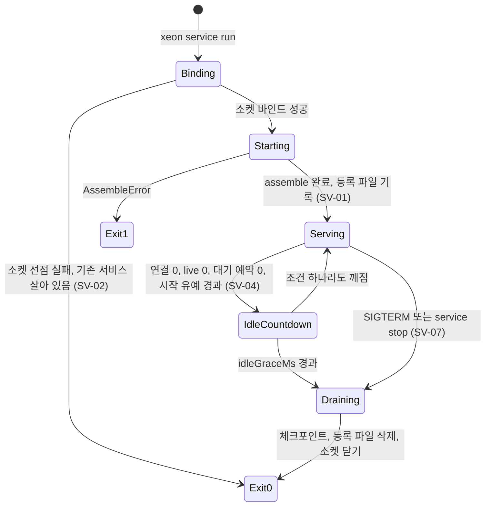

# L4 호스트와 서비스 (host-service)

`xeon/apps/host`(패키지 `@xeon/host`)의 스펙이다. 이 패키지는 두 가지 일을 한다.

- 엔진 조립: F~L3의 플러그인을 Cordis 루트 컨텍스트(ext-host 경유)에 등록해 엔진 하나를 만든다. 저장소 전체에서 조립 루트는 이 패키지 하나다.
- 호스트 계약의 서버 쪽: `F.wire-settings.spec`이 정한 메서드·알림을 처리하는 `WireHandlers` 표를 만들고, 세 전송(in-process, stdio, socket)에 같은 표를 건다. 서비스 모드 `xeon service`의 수명도 이 패키지가 정한다.

## 1. 목적과 범위

### 1.1 정하는 것

- 조립 코드(`assemble`)의 위치. `eng.dependency-rules.guide` DR-10의 같은 층 예외(`DR-10/cli-host`)를 이 문서의 안으로 정했다(§3.1, review.decisions-2 U-15).
- 배포 바이너리 이름과 진입 서브커맨드(§3.2).
- 공개 API의 TypeScript 시그니처: `assemble`, `startInProcessHost`, `startStdioHost`, `startService`, 클라이언트 쪽 `createHostConnection`(§3.3).
- 메서드별 처리기, 호출하는 아래 층 서비스, 돌려주는 오류 kind(§3.4).
- 연결 수명, 요청 처리 순서, 구독 재전송 구현, 휘발 스트림, 취소, 예외 정제(§4.1~§4.6).
- 단일 소유: `thread.open`과 세션 잠금, `thread.locked`의 대안 셋, `sys_leases` 행의 소유자 표시(§4.7).
- in-process·stdio 호스트의 종료 절차(§4.8).
- 서비스 모드: 등록 파일 스키마, `ensure`, 이중 기동 방지, 버전 불일치, 유휴 종료, 종료 협조, 인증, 부모-자식 수명. ADR-0006 §3.7 체크리스트 8항을 규칙 SV-01~SV-08로 옮긴다(§4.9).
- 서비스 프로세스의 예약 틱 호스팅과 알림 라우팅(§4.10).
- `l4.host-service.*` 설정 키와 설정 파일 JSON Schema 출력 명령(§6).

### 1.2 다루지 않는 것

| 대상 | 정하는 곳 |
|---|---|
| 메시지 모양, 메서드·알림 레지스트리, 오류 표, 커서, `Transport`·`HostConnection` 인터페이스 | `F.wire-settings.spec` |
| 명령줄 파싱, TUI, `xeon chat`의 화면 | `L4.cli.spec` |
| Tauri 셸, 사이드카 spawn, WebView 쪽 연결 | `L4.desktop.spec` |
| 설정 화면 | `L4.settings-ui.spec` |
| 세션 잠금 구현(OS 잠금 + `sys_leases` epoch 펜싱, review.decisions-2 U-09) | `L0.process.spec`, `L0.store.spec` |
| 경로(데이터, 상태, 런타임, 로그 디렉터리), OS 알림 표시 | `L0.os.spec` |
| 프로세스 spawn·신호 | `L0.process.spec`(DR-13: `Bun.spawn`은 L0 안에만 둔다) |
| 이벤트 저장, 투영, 열 때 복구, 재개 횟수 상한 | `L1.persistence.spec` |
| 입력 큐, 턴 실행, 안전 경계 | `L1.tasks.spec`, `L1.loop.spec` |
| 승인 프로토콜과 승인 이벤트 payload | `L1.tools.spec` |
| 예약 테이블, 놓친 예약 처리 | `L2.schedule.spec` |
| OS 서비스 등록(`xeon service install`) | 2차. 이 문서 범위 밖(ADR-0006 §3.4) |

## 2. 용어

| 용어 | 뜻 |
|---|---|
| 엔진 | `assemble`이 만든 객체. Cordis 루트 컨텍스트, 로드된 플러그인, 열린 저장소, 설정 카탈로그를 담는다. 프로세스 정책을 포함하지 않는다(ADR-0006 §3.1) |
| 호스트 | 엔진 하나와 전송을 묶어 계약의 서버 쪽을 맡는 실행 단위. 모드는 `in-process`, `stdio`, `service` 셋이다 |
| 호스트 모드 | `host.status` 결과의 `mode` 값. 전송 종류(`TransportKind`)와 다른 값 집합이다. 서비스 모드의 연결 전송은 `socket`이다 |
| 조립 루트 | 모든 층의 구현 패키지를 import해도 되는 유일한 패키지(DR-14 예외 2). `apps/host`다 |
| 연결 허브 | 한 호스트 프로세스 안의 모든 연결, 구독, 진행 중 요청을 담는 표. 처리기가 `connectionId`로 연결 상태를 찾는다 |
| 쓰기 소유 | 세션(thread) 하나의 실행을 맡는 권리. 호스트 프로세스 단위로 정하고, 같은 프로세스의 연결은 그 소유를 함께 쓴다(HS-23) |
| 등록 파일 | 서비스 프로세스가 쓰는 JSON 파일. 소켓 경로, pid, 버전, 시작 시각, 토큰을 담는다 |
| `ensure` | 클라이언트가 서비스에 접속하기 전에 부르는 절차. 서비스가 없거나 버전이 다르면 기동한다 |
| live 작업 | 진행 중 turn, 백그라운드 task, 서브에이전트처럼 엔진 안에서 아직 끝나지 않은 일 |
| 대기 예약 | `L2.schedule`의 예약 가운데 아직 실행 시각이 오지 않았거나 실행되지 않은 것 |

ADR-0006 §3.3의 표기 정정 [제안: 코드 식별자는 F 문서의 이름을 따른다는 `_templates/README.md` 문체 규칙과 `F.wire-settings.spec` §3.1 `TransportKind`]: ADR-0006의 `HostTransport`는 F의 `Transport`로, 전송 종류 `"service"`는 F의 `"socket"`으로 읽는다. `"service"`는 `host.status`의 `mode` 값으로만 쓴다. ADR-0006 §3.3의 `HostMessage`는 F의 `JsonRpcMessage`, `TransportCloseReason`은 F의 `CloseInfo.reason`이다.

## 3. 인터페이스

### 3.1 조립 코드의 위치 (DR-10 해소)

CLI는 엔진을 in-process로 쓴다(ADR-0006 §3.3). 그래서 CLI 프로세스 안에서 엔진을 조립하는 코드가 필요하다. 이 코드의 위치는 DR-10의 같은 층 예외로 정한다.

| 안 | 내용 | 층 순위와의 관계 | 결과 | 판정 |
|---|---|---|---|---|
| 1 | `apps/host`를 L4의 "층 기반 패키지"로 두고 `apps/cli`가 `@xeon/host`를 import한다(`architecture.layers.spec` §3.2) | L4 안의 같은 층 간선 하나(`cli → host`)를 허용 목록으로 연다. 한 방향만이고 `host`는 다른 앱을 import하지 않는다 | 조립 코드가 한 곳에 있다. CLI와 서비스·사이드카가 같은 `assemble`을 쓴다 | 채택 [결정: review.decisions-2 U-15] |
| 2 | 조립 코드를 L4 아래 층 패키지로 내린다(DR-10 셋째 항목) | 조립 코드는 L3 그룹(`group-helm`, `group-learning`, 순위 5), L2, L1, L0, X를 모두 import한다. L3에 두면 L3 그룹끼리 import(DR-02)가 생기고, L2 이하에 두면 상향 import(DR-01)가 생긴다. 순위 5 이하 어느 자리에서도 성립하지 않는다 | 새 순위(예: L3와 L4 사이)를 만들어야 한다. 층 순위 변경이라 ADR이 필요하다(`eng.dependency-rules.guide` §4 1번) | 불가 |
| 3 | CLI도 항상 서비스를 거친다 | 같은 층 import가 없다 | CLI 한 번 실행에 서비스 기동이 필요하다. ADR-0006 §5가 탈락시킨 "서비스 모드만 단독" 안과 같고, CLI 기본 전송 in-process [결정]과 충돌한다 | 불가 |

[결정: review.decisions-2 U-15] 안 1을 채택한다. 규칙 문구 수정안은 다음과 같다. `eng.dependency-rules.guide`와 허용 목록 파일은 같은 커밋에서 고친다(같은 문서 §4 절차). eng 문서 반영은 그 문서 쪽 수정이다.

1. 허용 목록 항목(`xeon/scripts/dependency-allowlist.json`). `architecture.layers.spec` §3.2는 "`check-layers.ts`에 목록으로 둔다"고 적었지만, `eng.dependency-rules.guide` §4 2번이 import 한 쌍의 예외를 허용 목록 파일 한 곳에만 두라고 정하므로 그 형식을 따른다. `check-layers.ts`는 이 항목을 읽어 DR-02·DR-10 위반에서 뺀다.

   ```json
   {
     "id": "DR-10/cli-host",
     "rule": "DR-10",
     "from": "apps/cli",
     "to": "@xeon/host",
     "entries": [".", "./client"],
     "reason": "CLI runs the engine in-process; apps/host is the single L4 assembly root (L4.host-service.spec 3.1).",
     "approvedBy": "L4.host-service.spec"
   }
   ```

2. DR-10 본문 둘째·셋째 항목 수정안.
   - 현행: "`apps/cli`는 엔진 라이브러리를 in-process로 쓴다. 이때 엔진 조립 코드는 L4 아래 층의 공개 진입점에서 가져온다. 다른 앱을 import하지 않는다." / "두 앱이 같은 조립 코드를 필요로 하면 그 코드를 아래 층 패키지로 내린다 [미결]."
   - 수정안: "`apps/cli`는 엔진을 `@xeon/host`의 공개 진입점(`.`, `./client`)으로만 만든다. 이 한 방향 간선은 허용 목록 `DR-10/cli-host`로 연다. `apps/host`는 다른 앱을 import하지 않는다. `apps/desktop`은 `@xeon/host`를 import하지 않는다."
3. DR-14 예외 2 수정안.
   - 현행: "조립 루트 `apps/host`는 플러그인을 등록하려고 모든 패키지를 import한다. `apps/cli`가 쓰는 엔진 조립 코드의 위치는 DR-10 [미결]이고, 정해지면 그 위치를 조립 루트에 더한다."
   - 수정안: "조립 루트는 `apps/host` 하나다. 플러그인을 등록하려고 모든 패키지를 import한다. `apps/cli`는 조립 루트가 아니다. `apps/cli`는 F(`@xeon/contracts`)와 `@xeon/host`의 공개 진입점 외의 워크스페이스 패키지를 import하지 않는다."
4. `eng.dependency-rules.guide` §6 마지막 [미결] 항목과 `architecture.layers.spec` §10의 같은 층 예외 항목 가운데 L4 부분을 닫는다. L3 `group-kit` 부분은 `L3.group-kit.spec` 소관으로 남는다.

### 3.2 바이너리와 진입

[제안] 배포 바이너리는 `xeon` 하나다(`bun build --compile`). 진입 파일은 `apps/cli/src/main.ts`이고, 서브커맨드가 호스트 기능을 부른다.

| 서브커맨드 | 동작 | 호출하는 `@xeon/host` API | 단계 |
|---|---|---|---|
| `xeon chat` | 대화. 기본 in-process, 서비스 사용 설정이 켜져 있으면 `ensure` 뒤 socket | `startInProcessHost` 또는 `ensureService` + `connectServiceTransport` | M1(in-process), M3(socket) |
| `xeon host --stdio` | 데스크톱 사이드카. stdin/stdout으로 계약을 처리한다 | `runHostCommand({ kind: "host-stdio" })` → `startStdioHost` | M1(개발 진입, H5), M2(컴파일 바이너리 서브커맨드) |
| `xeon service start` / `status` / `stop` | 서비스 기동·조회·정지 | `runHostCommand({ kind: "service-start" \| "service-status" \| "service-stop" })` | M3 |
| `xeon service ensure --json` | `ensure`만 하고 소켓 경로를 JSON 한 줄로 출력한다. 데스크톱 셸이 쓴다(HS-38) | `runHostCommand({ kind: "service-ensure" })` | M3 |
| `xeon service launch-mode --json` | 엔진 없이 `l0.process.service.enabled`를 읽어 `{ "mode": "in-process" \| "service" }` 한 줄을 쓰고 종료코드 0으로 끝난다. 데스크톱 셸이 사이드카와 서비스 중 어느 쪽으로 갈지 정할 때 쓴다(HS-38, `L4.desktop.spec` §4.2). 사용자 문서에는 싣지 않는다 | `runHostCommand({ kind: "service-launch-mode" })` → `resolveLaunchMode` | M3 |
| `xeon service run` | 서비스 본체를 전경에서 실행한다. `service start`와 `ensure`가 이 인자로 자기 바이너리를 detached 실행한다. 사용자 문서에는 싣지 않는다 | `runHostCommand({ kind: "service-run" })` → `startService` | M3 |
| `xeon config schema --scope <scope>` | 설정 파일 JSON Schema 출력(§6.2) | `runHostCommand({ kind: "config-schema" })` | M1 |

명령줄 파싱과 도움말은 `L4.cli.spec`(§3.1, §3.2)이 정한다. 이 문서는 서브커맨드 이름과 호출 API만 정한다.

M1의 stdio 진입은 개발 진입 `bun xeon/apps/host/src/main.ts host --stdio`(`L4.host-service.plan` H5)이고, 컴파일 바이너리의 `xeon host --stdio` 서브커맨드는 M2다.

두 안의 비교:

| 항목 | 단일 `xeon` [제안] | `apps/host` 단독 사이드카 + `apps/cli` 바이너리(현행 `apps/desktop/README.md`, `eng.toolchain.guide` TC-10 문구) |
|---|---|---|
| 빌드 산출물 | 대상(triple)마다 1개 | 대상마다 2개. 둘 다 Bun 런타임을 포함한다 |
| 디스크 크기 | Bun 런타임 1벌. CLI 전용 코드(TUI, pi-tui의 선택 `.node` 애드온 약 146 KB, `_research/notes/L4-1.md` §5.4)가 사이드카에도 들어간다 | CLI 설치본과 데스크톱 번들에 Bun 런타임이 따로 들어간다. 한 기기에 둘 다 있으면 런타임 2벌이다. Bun 문서는 단일 바이너리 크기를 "still way too big"이라고만 적고 수치는 없다(ADR-0008 §4.2) |
| 서비스 재기동 | `service start`와 `ensure`가 `process.execPath`로 자기 자신을 실행한다. 클라이언트와 서비스의 버전이 항상 같다 | CLI가 host 바이너리 경로를 찾아야 한다. 설치 위치가 다르면 버전이 어긋날 수 있다 |
| 데스크톱 사이드카 인자 | `xeon host --stdio`(ADR-0008 §3.2 제안과 같다) | `xeon-host --stdio` |
| 엔진 진입 코드 | 하나 | 둘. 같은 `assemble`을 부르지만 시작 경로가 둘이다 |
| 위험 | 컴파일 바이너리의 `process.execPath` 값은 H15 spike로 확인했다(아래 표, Linux x64). macOS arm64는 [미확인]이다. TUI 모듈을 `host --stdio`에서 불러오지 않도록 `chat` 경로만 동적 import한다 | 위 위험 중 self-exec 부분은 없다. 대신 경로 탐색 코드가 생긴다 |

- [제안] 근거: ADR-0008 §3.2 제안("사이드카 이름은 `xeon`, CLI와 같은 바이너리를 `host --stdio`로 실행"), `_research/process.md` §6.1 "같은 엔진 바이너리를 CLI도 쓴다".
- 수정 요청 [미결 3]: `eng.toolchain.guide` TC-10 "배포 바이너리: `apps/cli`(CLI), `apps/host`(데스크톱 사이드카, 서비스 모드)를 `bun build --compile`로 만든다"를 "배포 바이너리는 `apps/cli/src/main.ts`를 진입점으로 하는 `xeon` 하나다. 데스크톱 사이드카와 서비스 모드는 같은 바이너리의 `host --stdio`, `service` 서브커맨드다"로 고친다. 같은 문서 §2 바이너리 행(`apps/cli`, `apps/host`(사이드카))도 맞춘다. `xeon/apps/desktop/README.md`의 "엔진은 `apps/host`를 `bun build --compile`로 묶은 사이드카"는 "엔진은 `xeon` 바이너리를 `host --stdio`로 실행한 사이드카"로 고친다.
- 개발과 테스트에서는 컴파일하지 않고 `bun xeon/apps/host/src/main.ts host --stdio`처럼 실행한다. `main.ts`는 `import.meta.main`일 때 `process.argv`를 `HostCommand`로 바꿔 `runHostCommand`를 부른다. 이 경로는 테스트 전용이고 배포 진입점이 아니다.
- 자기 실행 명령(§4.9.2): 컴파일 바이너리이면 `[process.execPath]`, 아니면 `[process.execPath, Bun.main]`이다. 판별은 `Bun.main`이 `/$bunfs/` 아래인지로 한다 [결정: H15 spike, Linux x64에서 확인. macOS arm64는 미확인].
- 컴파일 진입은 최상위 `await`를 쓸 수 없다. `bun build --compile --bytecode`가 거부하기 때문이다. `main.ts`는 `detach(runFromProcess(...).then(process.exit), …)`로 끝나고, `test/entry-bundle.test.ts`가 같은 옵션으로 진입을 번들해 최상위 `await`가 다시 생기면 깨진다 [결정: m2-plan HOST.5, open-issues M-08].

#### 3.2.1 컴파일 바이너리 spike 결과 (H15) [결정: m2-plan HOST.5]

측정 환경은 Linux x64(WSL2), Bun 1.4.3, `bun build --compile --minify --bytecode`다. 확인용 진입 파일과 실제 `apps/host/src/main.ts` 두 가지를 같은 옵션으로 묶어 실행했다. 데스크톱 사이드카 빌드(`--minify --bytecode`, 크기 상한 triple별 500 MiB)는 사용자 결정이다(`L4.desktop.plan` §3.1.1).

| 항목 | 결과 |
|---|---|
| (a) 실행 경로 | `process.execPath`는 바이너리의 절대 경로다. `Bun.main`은 `/$bunfs/root/<바이너리 이름>`이다. `process.argv`는 `["bun", "/$bunfs/root/<이름>", …사용자 인자]`라 사용자 인자는 `slice(2)`부터다. `import.meta.main`은 진입 파일에서 참이다. `process.argv0`은 실행한 이름 그대로이고 `import.meta.path`는 빌드 때의 소스 경로다. `bun main.ts`로 실행하면 `Bun.main`은 소스 파일 경로이므로 `/$bunfs/` 접두로 판별한다 |
| (b) Unix 소켓 | `Bun.listen({ unix })`와 `Bun.connect({ unix })`의 에코 왕복이 성공한다 |
| (c) stdin EOF | `Bun.stdin.stream()`이 파이프를 닫으면 `done`이 된다(바이트가 있으면 읽고 난 뒤). 실제 호스트 `host --stdio`는 stdin을 닫으면 종료코드 0으로 끝난다. 기동부터 종료까지 5회 중 146~151 ms(첫 실행 243 ms) |
| (d) 자기 실행 | `Bun.spawn([process.execPath, …])`로 띄운 자식이 같은 `Bun.main`을 본다. `detached: true`와 `unref()`로 띄운 자식은 부모가 끝난 뒤에도 실행을 이어 가고 부모는 init 계열로 바뀐다 |
| 호스트 협조 종료 | 컴파일한 호스트에 `host.shutdown`을 보내면 `{ accepted: true }` 뒤 종료코드 0으로 끝난다(요청부터 종료까지 약 170 ms). 읽기를 열어 둔 채 SIGTERM을 보내면 30 ms 안에 종료코드 0으로 끝난다 |
| 크기 | `apps/host/src/main.ts` 묶음은 107,243,488 바이트(약 102.3 MiB), 1,993 모듈이다 |

macOS arm64에서의 (a)~(d)는 이 기기에 없어 확인하지 못했다. CI `desktop-macos` job이나 실기에서 같은 확인용 진입 파일로 다시 잰다.

### 3.3 공개 API

패키지 `@xeon/host`의 진입점은 둘이다.

| 진입점 | 파일 | 내용 | 소비자 |
|---|---|---|---|
| `.` | `src/index.ts` | `assemble`, `startInProcessHost`, `startStdioHost`, `startService`, `ensureService`, `runHostCommand`, `renderSettingsSchema`, 타입 | `apps/cli` |
| `./client` | `src/client.ts` | `@xeon/client`의 `createHostConnection`을 다시 내보낸다(adr.0020), `connectServiceTransport`. 엔진 패키지를 import하지 않는다 | `apps/cli`, (선택) `apps/desktop`(§10 미결 5) |

F에서 가져오는 이름은 `F.wire-settings.spec` 그대로다: `Transport`, `TransportKind`, `CloseInfo`, `Unsubscribe`, `HostConnection`, `WireHandlers`, `WireHandler`, `WireRequestContext`, `StdioTransportOptions`, `SocketTransportOptions`, `WireMethodName`, `WireParams`, `WireResult`, `JsonRpcMessage`, `RpcId`, `StreamPosition`, `StoreId`, `Seq`, `EventFilter`, `WIRE_METHODS`, `WIRE_ERRORS`, `WIRE_LIMITS`, `WIRE_PROTOCOL_VERSION`, `isCompatible`, `checkEnvelope`, `toEventWire`, `toVolatileEventWire`, `SettingCatalog`, `SettingScope`, `ScopeStack`, `buildCatalog`, `CatalogIssue`, `resolveSetting`, `checkSettingWrite`, `settingsJsonSchema`, `defineSettings`. 새 공용 이름은 만들지 않는다. 아래 이름은 `@xeon/host` 안의 이름이다.

#### 3.3.1 조립

```ts
// src/assemble.ts
import type { StoreId, WireResult } from "@xeon/contracts/wire";
import type { SettingCatalog, CatalogIssue, SettingDefInput, SettingGroup, SettingNamespace } from "@xeon/contracts/settings";
import type { Clock, IdFactory } from "@xeon/contracts";            // F 루트 주입 인터페이스. 구현은 platform-os(review.decisions-2 U-03)
import type { AgentDefinition, ShutdownCoordinator, ShutdownReason } from "@xeon/contracts/services";
import type { ModelsExtensionOptions } from "@xeon/core-models";
import type { DnsResolver, HttpTransport } from "@xeon/cap-web";

/** host.status.mode와 같은 값 집합: "in-process" | "stdio" | "service" */
export type HostMode = WireResult<"host.status">["mode"];

/** ext-host가 받는 플러그인 모듈. X.loading-trust.spec의 `BuiltinExtensionModule`(manifest + extension 엔트리)이다. */
export type HostPluginModule = import("@xeon/ext-host").BuiltinExtensionModule;

/** 종료 협조 창구(L0.process.spec §4.2). 참여자를 등록 역순으로 `l0.process.shutdown.timeoutMs` 안에서 기다리고, 시한을 넘기면 `AssembleOptions.exit(1)`을 부른다. */
interface EngineShutdown extends ShutdownCoordinator {
  request(reason: ShutdownReason): Promise<{ readonly completed: boolean; readonly elapsedMs: number }>;
}

export interface AssembleOptions {
  readonly mode: HostMode;
  readonly dataDir?: string;                              // 없으면 L0.os의 기본 데이터 디렉터리
  readonly extraPlugins?: readonly HostPluginModule[];    // 테스트용 그룹, 모델 테이프 provider
  readonly defaultGroups?: boolean;                       // 기본 true. false면 Helm·학습 그룹을 싣지 않는다
  readonly safeMode?: boolean;                            // 기본 false. 참이면 L3 내장 그룹(학습)을 싣지 않는다(HS-79). L1·L2 내장 패키지는 그대로 싣는다
  readonly defaultPluginsDir?: string;                    // 기본 플러그인 번들 뿌리(<뿌리>/<이름>/.xeon-plugin/plugin.json). 생략하면 실행 파일 옆 default-plugins/
  readonly settingGroups?: readonly SettingGroup<SettingNamespace, Readonly<Record<string, SettingDefInput>>>[];
                                                          // 조립 루트가 import할 수 없는 앱의 설정(예: l4.cli.*, L4.cli.spec §6)
  readonly devChecks?: boolean;                           // 결과 스키마 검사, in-process JSON 왕복. 개발 빌드만 true
  readonly clock?: Clock;                                 // 테스트 주입(eng.testing.guide TS-03)
  readonly ids?: IdFactory;
  readonly schedule?: ScheduleOverrides;                  // 예약 서비스 시험 주입(clock, ticker, store, policy). 운영은 생략(§4.17, HS-86)
  // 아래는 코드가 더한 선택 필드다(deviation). 시험이 쓴다
  readonly exit?: (code: number) => never;                // 종료 협조 시한을 넘겼을 때 프로세스를 끝내는 함수. 기본 process.exit
  readonly buildModels?: ModelsExtensionOptions["buildModels"];  // pi-ai 모델 모음을 만드는 함수(모델 테이프 provider를 더한 것). core-models가 먼저 올라 xeon.models를 내므로 extraPlugins로는 바꿀 수 없다
  readonly agentDefinitions?: readonly AgentDefinition[]; // 서브에이전트 정의. 정의 파일 탐색(사용자·프로젝트 디렉터리)은 L1.agents 2차라 M2에는 이 경로뿐이다
  readonly secretsRuntime?: (deps: SecretsRuntimeDeps) => SecretsRuntime;
                                                          // 비밀 서비스(와 관리 서비스)를 만드는 함수. 기본은 sops 제공자를 가진 createSecretsRuntime. 시험이 platform-secrets/testing의 memorySecrets를 넘겨 sops와 age 키 없이 secretEnv 호출의 승인 증거를 끝에서 끝까지 본다
  readonly webPorts?: { readonly resolver?: DnsResolver; readonly transport?: HttpTransport; readonly hostedSearch?: HostedSearchPort };
                                                          // 웹 능력의 DNS 해석기와 HTTP 전송, hosted 검색(내장 검색 래퍼). 루프백은 정책이 항상 거부하므로 시험이 공개 주소로 풀리는 이름과 가짜 전송을 넣는다. hostedSearch를 생략하면 xeon.models의 포트다(HS-75)
}

export interface Engine {
  readonly mode: HostMode;
  readonly storeId: StoreId;
  readonly catalog: SettingCatalog;
  readonly startedAt: number;                             // ms. host.status.startedAt의 원천
  readonly ports: EnginePorts;                            // §3.3.2
  readonly shutdown: EngineShutdown;                      // 종료 협조 창구(deviation). EOF, 신호, host.shutdown이 request(reason)을 부른다(HS-31)
  diagnose(signal: AbortSignal): Promise<EngineDiagnostics>; // 진단 함수(HS-69). `doctor`와 첫 실행 안내가 부른다. 외부 바이너리 점검은 자식 프로세스를 띄우므로 엔진을 열 때가 아니라 이 호출에서 한다
  close(): Promise<void>;                                 // task 결과를 쓰지 않는다(ADR-0006 §3.1)
}

export interface EngineDiagnostics {
  readonly binaries: Result<BinaryCheckReport, { readonly kind: "cancelled" }>;  // L0.os.spec §3.6.1. 쓸 수 없는 필수 바이너리는 `ready: false`, `blocking`이다
}

export type AssembleIssue =
  | { readonly code: "catalog"; readonly issues: readonly CatalogIssue[] }
  | { readonly code: "store"; readonly message: string; readonly failure: StoreFailureKind }  // HS-68. failure는 F.records.spec §3.7 7항의 안내 분류다
  | { readonly code: "missingService"; readonly service: string }
  | { readonly code: "plugin"; readonly plugin: string; readonly message: string };  // 기본 플러그인이나 extraPlugins 하나의 설치 실패(deviation)

/** 조립 결함. 선언 결함은 Result 대신 예외로 알린다(eng.typescript.guide TY-11). */
export declare class AssembleError extends Error {
  readonly issues: readonly AssembleIssue[];
}

/** 엔진 하나를 만든다. 실패하면 AssembleError를 던지고, 그때까지 연 자원을 닫는다. */
export declare function assemble(options: AssembleOptions): Promise<Engine>;
```

#### 3.3.2 엔진 포트

처리기는 Cordis 서비스를 직접 다루지 않고 아래 포트만 쓴다. 포트 구현(어댑터)은 `assemble.ts` 한 곳에 두고, F에 정의된 서비스 타입으로 주입받은 L0~L2 서비스를 감싼다. 포트는 `@xeon/host` 내부 타입이다. 아래 층 서비스의 이름과 메서드는 각 spec이 정한다. 대응은 [가정]이다.

```ts
// src/assemble.ts (계속)
import type { ThreadId, TurnId, ItemId } from "@xeon/contracts/conversation";
import type { DurableEventEnvelope, VolatileEventEnvelope } from "@xeon/contracts/records";
import type { LeaseToken, LifecycleError, ReadFailure, StoreError } from "@xeon/contracts/records";       // F records lease.ts(L0.store.spec FR-S2) [가정]
import type { LoopError, ResumeResult } from "@xeon/contracts/services";
import type { EventFilter, StreamPosition, TurnStartInput, Unsubscribe, WireParams, WireResult } from "@xeon/contracts/wire";
import type { ScopeStack, SettingKey, SettingScope } from "@xeon/contracts/settings";

export interface EnginePorts {
  readonly threads: ThreadPort;        // L1.persistence
  readonly turns: TurnPort;            // L1.tasks, L1.loop
  readonly feed: EventFeedPort;        // L1.persistence(L0.store 읽기 API와 커밋 후 알림)
  readonly locks: SessionLockPort;     // L0.process(OS 잠금), L0.store(sys_leases epoch 펜싱과 소유 표시)
  readonly settings: SettingsStorePort;// L1.persistence(세션 범위)와 설정 파일 범위(호스트 소유)
  readonly approvals: ApprovalPort;    // L1.tools
  readonly activity: ActivityPort;     // L1.tasks, L1.tools, L2.schedule
  readonly schedule: ScheduleService;  // L2.schedule 예약 서비스(M3b, §4.17). 서비스 모드에서만 틱을 돌린다
  readonly notify: UserNotifyPort;     // L0.os
  readonly log: HostLogPort;           // L0.os
  readonly secrets: SecretsPort;       // L0.secrets 관리 서비스(`xeon.secretAdmin`)와 wire 밖 값 전달 통로 [결정: m2-plan HOST.3]
  readonly ids: IdFactory;             // 새 id 발급(traceId, 연결 id). 엔진의 IdFactory(deviation)
  readonly clock: Clock;               // 엔진의 시계. 송신 큐 같은 호스트 자신의 시각에 쓴다(deviation)
  readonly scheduler: Scheduler;       // L0.os 타이머. 관찰 폴링(HS-16)이 쓴다. 시험은 수동 스케줄러를 넣는다
}

/** `thread.read`가 결과를 만들지 못한 이유. 처리기가 와이어 오류로 옮긴다(F wire §3.4.6 3항) */
export type ThreadReadFailure =
  | ReadFailure
  | { readonly kind: "thread_not_found"; readonly threadId: ThreadId }
  | { readonly kind: "invalid_target"; readonly reason: "item_not_found" | "not_on_branch" };

export interface ThreadPort {
  create(input: { readonly workspace?: string; readonly title?: string }): Promise<{ readonly threadId: ThreadId; readonly position: StreamPosition }>;
  exists(threadId: ThreadId): Result<boolean, ReadFailure>;     // 읽기 실패는 값이다. 처리기가 store.* 와이어 오류로 옮긴다
  list(params: WireParams<"thread.list">): Promise<WireResult<"thread.list">>;
  /** 새 thread를 만든다. 쓰기 소유는 얻지 않는다(처리기가 SessionLockPort로 얻는다). 실패는 수명 주기 오류 값이다 */
  fork(threadId: ThreadId, at: ItemId | undefined): Promise<Result<{ readonly threadId: ThreadId; readonly position: StreamPosition }, LifecycleError>>;
  /** 쓰기 소유자만. 열린 turn이 있으면 turn_running이다. 호출마다 새 요청 키를 만든다 */
  revert(threadId: ThreadId, to: ItemId): Promise<Result<{ readonly position: StreamPosition }, LifecycleError>>;
  /** 쓰기 소유자만. 지운 뒤 이 프로세스가 쥔 그 thread의 임대와 확장 상태를 거둔다 */
  remove(threadId: ThreadId): Promise<Result<void, LifecycleError>>;
  /** 현재 가지의 내구 item을 오래된 것부터 limit개(§4.13) */
  read(params: WireParams<"thread.read">): Promise<Result<WireResult<"thread.read">, ThreadReadFailure>>;
  position(threadId: ThreadId): Result<StreamPosition, ReadFailure>;
}

export type SubmitOutcome =
  | { readonly ok: true; readonly turnId: TurnId }                 // 같은 requestId 재제출이면 처음 turnId
  | { readonly ok: false; readonly reason: "busy"; readonly turnId: TurnId }
  | { readonly ok: false; readonly reason: "rejected"; readonly error: LoopError };  // 루프가 입력을 받지 않았다(저장소 부족, 소유 상실, 잘못된 입력). 와이어 오류로 옮기는 것은 처리기 몫(deviation)

export interface TurnPort {
  submit(threadId: ThreadId, input: TurnStartInput, requestId: string | undefined): Promise<SubmitOutcome>;
  interrupt(threadId: ThreadId, turnId: TurnId | undefined): Promise<boolean>;
  /** 열린 turn을 재개한다(자동 재개는 하지 않는다, L1.loop.spec §4.6). `turn.resume`(HS-74)이 사용자 확인 뒤 부르고 서비스 모드 자동 재개(M3)도 쓴다 */
  resume(threadId: ThreadId): Promise<Result<ResumeResult, LoopError>>;
  /** 진행 중 turn을 다음 안전 경계에서 멈추고 체크포인트를 커밋한다. 시한 안에 끝나면 true. */
  stopAtSafeBoundary(deadlineMs: number): Promise<boolean>;
  /** 그 thread에 진행 중인 turn이 있는가. 서비스 모드의 잠금 해제 판정(HS-27)이 쓴다. */
  isLive(threadId: ThreadId): boolean;
}

export interface CommitBatch {
  readonly firstSeq: number;           // (firstSeq - 1, lastSeq] 구간
  readonly lastSeq: number;
  readonly events: readonly DurableEventEnvelope[];
}

export interface EventFeedPort {
  headSeq(): Result<number, ReadFailure>;
  oldestReplayableSeq(): number;
  /** seq > after AND seq ≤ upto, 필터 적용. 행이 limit만큼 차면 거기서 멈추고, 아니면 scanLimit 행까지 훑는다. */
  read(after: number, upto: number, filter: EventFilter | undefined, limit: number, scanLimit: number):
    Result<{ readonly events: readonly DurableEventEnvelope[]; readonly scannedTo: number }, ReadFailure>;
  /** 커밋 직후 같은 JS 턴에서 동기로 부른다(eng.transactions.design §7, TX-09). */
  onCommit(listener: (batch: CommitBatch) => void): Unsubscribe;
  onVolatile(listener: (event: VolatileEventEnvelope) => void): Unsubscribe;
}

export type OwnerKind = "cli" | "app" | "service";       // L0.store LeaseKind = sys_leases.kind(표시용)

export type LockOutcome =
  /** token은 L0.store LeaseToken(resource "session:<threadId>", holderId, epoch). L1.persistence 쓰기마다 대조한다 */
  | { readonly ok: true; readonly token: LeaseToken; release(): Promise<void> }
  | { readonly ok: false; readonly ownerKind: OwnerKind | null };   // sys_leases 행의 kind. 표시값이라 틀릴 수 있다

export interface SessionLockPort {
  tryAcquire(threadId: ThreadId, kind: OwnerKind): Promise<LockOutcome>;   // 같은 thread의 획득이 진행 중이면 그 결과를 함께 기다린다(HS-23)
  holds(threadId: ThreadId): boolean;
  release(threadId: ThreadId): Promise<void>;                              // 쥔 잠금을 놓는다. 쥐지 않았으면 아무 일도 하지 않는다
}

/** 설정 쓰기가 실패한 이유. 처리기가 와이어 오류로 옮긴다(§4.14) */
export type SettingsWriteFailure =
  | { readonly kind: "thread_required"; readonly scope: SettingScope }   // session·project·local인데 threadId가 없다
  | { readonly kind: "not_owner"; readonly threadId: ThreadId }          // session 범위는 이 프로세스가 쓰기 소유를 쥔 thread에만 쓴다
  | { readonly kind: "workspace_required"; readonly scope: SettingScope }
  | { readonly kind: "untrusted_project"; readonly workspace: string }
  | { readonly kind: "managed_read_only" }
  | { readonly kind: "file_invalid"; readonly path: string }             // 기존 파일이 JSON 객체가 아니다
  | { readonly kind: "file_unwritable"; readonly path: string; readonly code: string }
  | StoreError;                                                          // thread_not_found 포함

export interface SettingsStorePort {
  layers(threadId: ThreadId | undefined): ScopeStack;
  /** thread의 작업 폴더가 신뢰되었으면 그 폴더의 project·local 설정 파일을 읽어 layers가 쓰게 한다(layers가 동기라서 신뢰 판정은 thread를 여는 곳에서 먼저 한다) */
  prepare(threadId: ThreadId): Promise<void>;
  write(scope: SettingScope, key: SettingKey, value: unknown, threadId: ThreadId | undefined): Promise<Result<void, SettingsWriteFailure>>;
  reset(scope: SettingScope, key: SettingKey, threadId: ThreadId | undefined): Promise<Result<void, SettingsWriteFailure>>;
  /** 범위 하나의 설정 파일 원문(`settings.readFile`, HS-98). 작업 폴더를 정할 수 없으면 path가 null이고, 신뢰하지 않은 폴더는 읽기 전용이다 */
  readFile(scope: SettingsFileScope, threadId: ThreadId | undefined): Promise<Result<SettingsFileRead, SettingsWriteFailure>>;
  /** 파일 전체를 바꾼다(`settings.writeFile`, HS-98). 파일 잠금 안에서 지금 파일의 해시가 baseSha256과 같을 때만 쓴다 */
  writeFile(scope: "user" | "project" | "local", text: string, baseSha256: string | null, threadId: ThreadId | undefined): Promise<Result<{ path: string; sha256: string }, SettingsWriteFailure | { kind: "conflict"; scope: SettingScope }>>;
  /** 사용자 설정 파일을 다시 읽어 메모리 층에 반영하고 값이 달라진 키를 알린다(HS-99). 읽을 수 없거나 JSON 객체가 아니면 앞 값을 둔다 */
  refreshUserFile(): Promise<void>;
  onChange(listener: () => void): Unsubscribe;
}

export interface SettingsFileRead {
  readonly path: string | null;
  readonly exists: boolean;
  readonly readOnly: boolean;
  readonly text: string;
  readonly sha256: string | null;          // 원문의 SHA-256(hex). 파일이 없으면 null
}

export interface ApprovalPort {
  /** 응답이 속한 표면 thread. 메모리 대기 목록에 없으면 쥔 thread마다 restore한 뒤 다시 찾고, 그래도 없으면 저장소의 미해결 요청을 훑는다. 없으면 undefined */
  locate(approvalId: string): Promise<Result<ThreadId | undefined, ReadFailure>>;
  respond(params: WireParams<"approval.respond">): Promise<WireResult<"approval.respond">>;
  /** thread의 미해결 요청과 그 시점의 위치(F wire §3.4.6 5항). 이 프로세스가 쥐지 않은 thread도 읽는다 */
  list(threadId: ThreadId): Promise<Result<WireResult<"approval.list">, ReadFailure | { readonly kind: "thread_not_found"; readonly threadId: ThreadId }>>;
}

export interface ActivitySnapshot {
  readonly liveTurns: number;
  readonly liveTasks: number;          // liveTurns 포함, 백그라운드 task와 서브에이전트 포함
  readonly waitingApprovals: number;
  readonly pendingSchedules: number;
}
export interface ActivityPort {
  snapshot(): ActivitySnapshot;
  onChange(listener: () => void): Unsubscribe;
}

export interface UserNotifyPort {
  show(input: { readonly title: string; readonly body: string; readonly threadId?: ThreadId }): Promise<void>;
}

export interface HostLogPort {
  error(message: string, fields: Readonly<Record<string, unknown>>): void;
  info(message: string, fields: Readonly<Record<string, unknown>>): void;
}

/** `secret.*` 처리기가 쓰는 비밀 관리 포트. 관리 서비스는 사람 전용이라 L4 진입점인 이 포트에만 주고 확장과 모델 도구에는 주지 않는다. */
export interface SecretsPort {
  readonly admin: SecretAdminService;      // L0.secrets.spec §3.8, 구현 platform-secrets(createSecretsRuntime().admin)
  readonly offers: SecretOfferStore;       // SecretOutOfBandPort(맡기는 쪽, CLI)와 꺼내는 쪽(처리기)이 한 저장소를 쓴다
  /** `secret.beginEntry { action: "add" }`가 만들 비밀의 기본 메타. 기본 제공자가 sops가 아니어서 값을 놓을 곳을 정할 수 없으면 undefined(설정에 SOPS 파일이 없는 것은 원인이 아니다: HS-45) */
  newMeta(name: SecretName): SecretMeta | undefined;
}
```

#### 3.3.3 처리기 표와 연결

```ts
// src/connection.ts
import type { CloseInfo, Transport, TransportKind, WireHandlers } from "@xeon/contracts/wire";

export interface HostLimits {
  readonly maxReplayEvents: number;              // l4.host-service.maxReplayEvents
  readonly maxSubscriptionsPerConnection: number;// l4.host-service.maxSubscriptionsPerConnection
  readonly replayBatchMaxEvents: number;         // 상수 500 (F wire §3.4.3)
  readonly scanLimit: number;                    // 상수 10,000
  readonly sendLowWaterBytes: number;            // 상수 1 MiB
  readonly sendQueueMaxBytes?: number;           // 송신 큐 상한(바이트). 없으면 64 MiB(HS-05). 시험이 작은 값을 넘긴다(deviation)
}

export interface ServeOptions {
  readonly limits: HostLimits;
  readonly devChecks: boolean;                   // 결과 스키마 검사(F wire §4.3 7단계), in-process JSON 왕복 검사
}

export interface ServedConnection {
  readonly id: string;                           // WireRequestContext.connectionId
  readonly transportKind: TransportKind;
  readonly closed: Promise<CloseInfo>;
  close(reason?: string): Promise<void>;
}

/** 한 호스트 프로세스의 연결 표. 처리기와 수명 관리가 같은 허브를 본다. */
export interface ConnectionHub {
  readonly size: number;                         // 열린 연결 수(host.status.connections, 유휴 판정)
  serve(transport: Transport, options: ServeOptions): ServedConnection;
  onSizeChange(listener: (size: number) => void): Unsubscribe;
  closeAll(reason: string): Promise<void>;
  state(connectionId: string): ConnectionState | undefined;               // 처리기가 연결의 열기 기록(openThreads, writeThreads, observedThreads)과 구독을 다룬다
  connections(): readonly ConnectionState[];
  beginShutdown(): void;                                                   // HS-31 1단계
  releaseUnused(threadIds: readonly ThreadId[]): void;                     // HS-27. 서비스 모드만 놓는다
  watchObserved(): void;                                                   // HS-16. 관찰할 thread가 생겼으면 폴링을 시작한다
  dispose(): void;
}

export declare function createConnectionHub(engine: Engine, handlers: WireHandlers): ConnectionHub;

// src/handlers/index.ts
export interface HostInfo {
  readonly serverName: "xeon";
  readonly serverVersion: string;                // 엔진 빌드 버전. 등록 파일 version과 같은 값
  readonly pid: number;
}
/** 호스트 프로세스의 수명 신호. host.shutdown이 협조 종료를 마치고 응답이 나간 뒤 부른다(HS-31). 없으면 host.shutdown을 열지 않는다(in-process) */
export interface HostLifecycle {
  stopRequested(reason: "shutdown_request" | "version_replace"): void;
}
/** 전송과 무관한 처리기 표 하나. in-process, stdio, socket이 같은 표를 쓴다. */
export declare function createWireHandlers(engine: Engine, hub: () => ConnectionHub, info: HostInfo, lifecycle?: HostLifecycle): WireHandlers;
```

- `WireHandlers`는 모든 `WireMethodName`에 처리기를 요구한다(`F.wire-settings.spec` §3.1). 아직 구현하지 않은 메서드는 `notImplemented(method)` 처리기로 채운다. 이 처리기는 `-32601`(`jsonrpc.methodNotFound`)을 돌려주고, 그 메서드는 `host.hello`의 `features`에서 빠진다 [제안]. 그래서 M1 호스트도 타입상 완전한 표를 갖는다.
- M2(HOST.2·HOST.4)에서 메서드 표가 구현되었다. M3b B1-NTF(H4)에서 `notify.list`(HS-82)와 `usage.get`(HS-83)이 더해졌다. M3b B3-SET에서 `settings.readFile`·`settings.writeFile`(HS-98)이 더해졌다. 지금 `notImplemented`로 남는 것은 수명 신호(`lifecycle`)가 없는 호스트(in-process)의 `host.shutdown`뿐이다.

#### 3.3.4 호스트 시작 함수

```ts
// src/main.ts
import type { StdioTransportOptions, Transport } from "@xeon/contracts/wire";

export interface InProcessHost {
  readonly client: Transport;                    // kind "in-process". createHostConnection에 넘긴다
  readonly engine: Engine;
  readonly secretOutOfBand: SecretOutOfBandPort; // 값 입력·열람 수단을 wire 밖으로 맡기는 통로(§3.4 secret.*). CLI가 secret.beginEntry·beginReveal 전에 맡긴다
  close(): Promise<"clean" | "deadline">;       // 종료 절차(§4.8)를 거쳐 엔진을 닫는다. 진행 중 turn이 시한 안에 멈추지 않았거나 멈추는 호출이 실패했으면 "deadline"
}
export declare function startInProcessHost(options?: Omit<AssembleOptions, "mode">): Promise<InProcessHost>;

export interface HostExit {
  readonly code: 0 | 1;                          // 0 정상 종료, 1 시작 거부(AssembleError 등)
  readonly reason: "eof" | "signal" | "idle" | "stop" | "startup";
}

export interface StdioHostOptions extends StdioTransportOptions {
  readonly assemble?: Omit<AssembleOptions, "mode">;
}
/** stdio 호스트 하나를 실행하고 끝날 때 resolve한다. 프로세스 종료(exit)는 호출자가 한다. */
export declare function startStdioHost(options: StdioHostOptions): Promise<HostExit>;

export type HostCommand =
  | { readonly kind: "host-stdio" }
  | { readonly kind: "service-run"; readonly safeMode: boolean; readonly tcp?: { readonly host: string; readonly port: number } }   // `xeon service run`, `xeon host --service [--safe-mode] [--listen-tcp <host>:<port> [--allow-non-loopback]]`
  | { readonly kind: "service-start"; readonly start?: ServiceCommand; readonly safeMode?: boolean; readonly tcp?: { readonly host: string; readonly port: number } }   // safeMode·tcp는 새로 띄울 때 `service run`의 인자가 된다
  | { readonly kind: "service-status"; readonly json: boolean }
  | { readonly kind: "service-stop" }
  | { readonly kind: "service-ensure"; readonly start?: ServiceCommand; readonly safeMode?: boolean }
  | { readonly kind: "service-launch-mode" }
  | { readonly kind: "config-schema"; readonly scope: "managed" | "user" | "project" | "local"; readonly out?: string; readonly coreOnly: boolean };

export interface CommandIo {
  readonly stdout: WritableStream<Uint8Array>;   // host-stdio에서는 계약 전용. 다른 출력을 쓰지 않는다
  readonly stderr: WritableStream<Uint8Array>;
  readonly stdin: ReadableStream<Uint8Array>;
}
/** 종료코드를 돌려준다. 0 성공, 1 실패(시작 거부, 서비스 없음 등), 2 사용 오류. */
export declare function runHostCommand(command: HostCommand, io: CommandIo): Promise<0 | 1 | 2>;
```

```ts
// src/service/lifetime.ts (구현됨, M3b B1-SVC)
export declare const SERVICE_STARTUP_GRACE_MS: 10_000;

export interface ServiceOptions {
  readonly assemble?: Omit<AssembleOptions, "mode">;   // safeMode, pendingSchedules 등
  readonly runtimeDir?: string;                  // 서비스 파일 디렉터리. 없으면 L0.os의 dirs.runtime
  readonly startupGraceMs?: number;              // 기본 SERVICE_STARTUP_GRACE_MS
  readonly idleGraceMs?: number;                 // 기본 설정 l0.process.service.idleGraceMs(60000)
  readonly tcp?: { readonly host: string; readonly port: number; readonly allowNonLoopback?: boolean };   // TCP로도 연다. 토큰 필수, 루프백이 아니면 allowNonLoopback 필수(`tcp_not_loopback`, SV-05)
  readonly time?: { readonly clock: Clock; readonly scheduler: Scheduler };   // 유휴 타이머용. 시험이 수동 시간을 넘긴다
  readonly handleSignals?: boolean;              // SIGTERM·SIGINT 처리. 기본 true
  readonly random?: (bytes: number) => Uint8Array;   // 토큰용
}

export interface ServiceHandle {
  readonly registration: ServiceRegistration;    // 지금 등록 파일 내용(토큰을 돌리면 새 토큰)
  readonly tcpAddress: string | undefined;
  readonly exited: Promise<HostExit>;
  idleShutdownAt(): number | null;
  connections(): number;
  shutdown(reason: "signal" | "idle" | "stop"): Promise<void>;
  rotateToken(): string;                         // 등록 파일을 먼저 쓰고 성공해야 토큰을 바꾼다(실패하면 던지고 이전 토큰 유지). 이전 토큰은 새 연결에 즉시 무효
}
export type ServiceStart =
  | { readonly started: true; readonly handle: ServiceHandle }
  | { readonly started: false; readonly reason: "in_use"; readonly existing: ServiceRegistration | null }   // 소켓 선점에 진 경우(SV-02)
  | { readonly started: false; readonly reason: "failed"; readonly message: string };                       // 경로·소켓·조립 실패

export declare function startService(options?: ServiceOptions): Promise<ServiceStart>;
```

```ts
// src/service/ensure.ts, control.ts, commands.ts, launch-mode.ts (구현됨)
export interface ServiceCommand { readonly command: string; readonly args: readonly string[] }   // 서비스를 띄우는 전체 명령(`... service run`)
export interface EnsureHostServiceOptions {
  readonly runtimeDir?: string;
  readonly start: ServiceCommand;
  readonly startTimeoutMs?: number;              // 기본 10000
  readonly retryMs?: number;                     // 기본 200
  readonly ownVersion?: string;                  // 기본 엔진 버전
}
export interface EnsuredService { readonly outcome: EnsureOutcome; readonly paths: ServicePaths }
/** L0.process의 ensureService를 host.hello·host.status·host.shutdown과 detached 기동으로 채운다. 접속은 돌려주지 않는다(registration.socket으로 새로 접속) */
export declare function ensureHostService(options: EnsureHostServiceOptions): Promise<Result<EnsuredService, EnsureHostServiceError>>;
export declare function serviceStatus(options?: ServiceControlOptions): Promise<Result<ServiceStatusResult, ServicePathError>>;
export declare function stopHostService(options?: ServiceControlOptions): Promise<Result<ServiceStopResult, ServicePathError>>;
export declare function connectServiceTransport(endpoint: ServiceEndpoint, options?: ConnectServiceOptions): Promise<Result<Transport, ServiceConnectError>>;   // 구현은 `@xeon/client/socket`(adr.0020). 기본으로 L0 `openTunnel`을 쓰는 SSH 터널 포트(`createSshTunnelPort`)를 끼운다
/** unix(로컬 서비스), tcp(사설망, 토큰이 있으면 host.hello에 싣는다), ssh(SSH 터널로 이은 원격 Unix 소켓). 문법은 `unix:/경로`, `tcp://호스트:포트`, `ssh://[사용자@]호스트[:포트]/원격/소켓/경로`(`@xeon/client/endpoint`) */
export type ServiceEndpoint = { kind: "unix"; path: string } | { kind: "tcp"; host: string; port: number; token?: string } | { kind: "ssh"; target: string; remoteSocket: string; port?: number };
/** 주소를 정해(원격 주소 또는 이 기기의 서비스 ensure) 접속하고 host.hello까지 마친 연결을 돌려준다. 오류는 값이다(ensure_failed, connect_failed, hello_failed) */
export declare function attachToService(target: AttachTarget, options: AttachOptions): Promise<Result<ServiceAttachment, AttachError>>;
/** 데스크톱 사이드카 `host --stdio`가 엔진을 열지 않고 원격 서비스에 붙는 중계. 셸은 그대로 사이드카의 stdin/stdout만 중계한다. 메시지마다 envelope 검사만 한다 */
export declare function bridgeStdioToService(options: BridgeOptions): Promise<BridgeExit>;
/** `--remote` 플래그, 없으면 사용자 설정 `l0.process.service.remote`. tcp 토큰은 환경 변수 XEON_REMOTE_TOKEN(설정과 argv에는 두지 않는다) [결정: 오케스트레이터 기본값] */
export declare function resolveRemoteEndpoint(options: { flag?: string; env: Readonly<Record<string, string | undefined>> }): Promise<RemoteResolution>;
export declare function defaultServiceCommand(extra?: { readonly safeMode?: boolean; readonly tcp?: { readonly host: string; readonly port: number } }): ServiceCommand;   // 이 실행 파일을 `service run [--safe-mode] [--listen-tcp h:p]`로. 소스 실행(bun 진입 파일)과 컴파일 바이너리를 가른다
export declare function resolveLaunchMode(): Promise<"in-process" | "service">;   // 사용자 설정 파일의 l0.process.service.enabled. 관리 범위 파일은 읽지 않는다 [미결]
```

```ts
// src/client.ts  ("./client". 엔진 패키지를 import하지 않는다. `createHostConnection`은 `@xeon/client`에서 다시 내보낸다)
import type { HostConnection, SocketTransportFactory, Transport } from "@xeon/contracts/wire";

export interface HostConnectionOptions {
  readonly defaultTimeoutMs?: number;            // 없으면 시한 없음
  readonly onTransportError?: (cause: unknown) => void;   // 응답을 기다리지 않는 전송(취소 알림)이 실패했을 때. 진단용
}
/**
 * F의 HostConnection 구현. 요청 id는 연결마다 r1, r2, … 를 쓴다(F wire §3.1).
 * 구현은 L4 공유 패키지 `@xeon/client`(`src/connection.ts`)에 있고 이 파일은 같은 이름을 다시 내보낸다(adr.0020)
 */
export declare function createHostConnection(transport: Transport, options?: HostConnectionOptions): HostConnection;

/** F의 SocketTransportFactory 구현(Bun.connect, unix). */
export declare const connectServiceTransport: SocketTransportFactory;
```

전송 구현(서버 쪽)은 F의 팩토리 타입을 그대로 구현한다.

| 파일 | F 타입 | 구현 |
|---|---|---|
| `src/transport/in-process.ts` | `InProcessTransportFactory` | 메모리 큐 쌍. 전달은 `queueMicrotask`로 보낸 순서대로 한다. `devChecks`이면 `JSON.parse(JSON.stringify(m))` 왕복 |
| `src/transport/stdio.ts` | `StdioTransportFactory` | 구현은 F `@xeon/contracts/wire`(`wire/stdio.ts`, `framing.ts`)로 옮겼고 이 파일은 다시 내보낸다(m2 F.8). JSON Lines. `maxFrameBytes` 초과 줄은 끝까지 읽고 버린다(F wire §5). 읽기 끝(EOF)에서 `onClose({ reason: "eof" })` |
| `src/transport/socket.ts` | `SocketTransportFactory`(클라이언트), 서버 리스너는 아래 | `Bun.listen({ unix })`, `Bun.connect({ unix })`. 연결마다 JSON Lines |

```ts
// src/transport/socket.ts (서버 쪽 리스너. F 타입이 없어 host 안에 둔다)
export interface SocketListener {
  readonly path: string;
  onConnection(handler: (transport: Transport) => void): Unsubscribe;
  close(): Promise<void>;
}
export type ListenOutcome =
  | { readonly ok: true; readonly listener: SocketListener }
  | { readonly ok: false; readonly reason: "inUse" };   // 살아 있는 다른 서비스가 경로를 쥐고 있다
export declare function listenServiceSocket(path: string, maxFrameBytes?: number): Promise<ListenOutcome>;
```

#### 3.3.5 `L4.cli.spec` §3.3 요구 모양과의 대응

`L4.cli.spec` §3.3은 CLI 안의 연결 이름(`connectEngine`, `EngineHandle`, `EngineStartError`)을 아래 API의 조합으로 정한다. [제안] 이 문서는 `EngineConnector`, `StdioHostRunner`, `ServiceControl` 같은 CLI 쪽 이름을 `@xeon/host`에 두지 않는다. 이름이 CLI 안에만 있으면 데스크톱과 서비스가 쓰지 않는 CLI 전용 개념(작업 폴더 옵션, CLI 상태 파일, 오류 문구)이 조립 루트에 들어오지 않는다.

| CLI 이름(`L4.cli.spec` §3.3) | `@xeon/host` API | 차이 |
|---|---|---|
| `connectEngine({ preference: "auto" })` | `resolveLaunchMode()` → `"in-process"`면 `startInProcessHost({ settingGroups, devChecks })` + `createHostConnection(host.client)`, `"service"`면 `ensureService` + `connectServiceTransport` + `createHostConnection` | `host.hello`는 CLI가 보낸다 |
| `EngineConnectOptions.settingGroups` | `AssembleOptions.settingGroups` | 같다 |
| `EngineConnectOptions.devWireRoundTrip` | `AssembleOptions.devChecks` | 이름만 다르다 |
| `EngineConnectOptions.observe` | 없음. CLI가 `Transport`를 감싸 `send`·`onMessage`를 탭한다 | 호스트는 관여하지 않는다 |
| `EngineStartError.kind` | `AssembleError.issues[].code`(`catalog`, `store`, `missingService`), `EnsureResult.reason` | CLI가 자기 kind로 바꾼다. `store`는 `message`로 `fts5Missing`·`dataDirPermission`·`storeFutureVersion`·`storeCorrupt`·`storeMigrationFailed`·`storeUnavailable`을 구별하고 `failure`로 안내 분류(`future_version`, `corrupt`, `migration_failed`, `unavailable`)를 준다(HS-68). `catalog` → `catalogConflict`, `missingService` → `missingService`이고 둘 다 CLI 종료코드 1이다. 나머지 kind는 3이다(`L4.cli.spec` §4.10) |
| `EngineHandle.shutdown(reason)` | in-process: `InProcessHost.close()`(HS-31, 시한은 `l0.process.shutdown.timeoutMs`). socket: `HostConnection.close()` | 시한 인자 없이 설정 키 값을 쓴다 |
| `xeon host --stdio`(`CliHostCommand`) | `runHostCommand({ kind: "host-stdio" }, io)` | 같은 일. 설정 그룹을 넘길 때는 `startStdioHost`의 `assemble.settingGroups` |
| `xeon service *`, `xeon config schema` | `runHostCommand({ kind: "service-…" \| "config-schema" }, io)` | 결과는 종료코드와 stderr 문구. 구조화 결과가 필요하면 CLI가 `ensureService`, `readRegistration`을 직접 쓴다 |

- 종료코드 관계: `runHostCommand`의 0·1·2는 CLI가 바꾸지 않고 그대로 `xeon`의 종료코드로 쓴다(`L4.cli.spec` §3.6의 0 정상, 1 일반 오류, 2 사용법 오류와 같은 뜻). 이 경로의 시작 거부(`AssembleError`, SV-05 권한 검사)는 1이다. CLI가 in-process로 `assemble`할 때의 `EngineStartError`만 `L4.cli.spec` §4.10 표로 1 또는 3이 된다.

#### 3.3.6 상태 디렉터리 API [결정: review.decisions-2 B-07]

CLI는 경로를 계산하지 않는다(DR-13, `L4.cli.spec` §10 1번). 그래서 `@xeon/host`가 L0.os의 `OsDirs.state`에서 CLI 상태 파일 위치를 만들어 준다.

```ts
export interface HostStatePaths {
  /** OsDirs.state. 로그, 복구 표식처럼 기기에 남는 상태 */
  readonly stateDir: string;
  /** <stateDir>/cli/state.json. L4.cli.spec §3.7 CliStateSchema 파일 */
  readonly cliStateFile: string;
}
export type HostStatePathError =
  | { readonly kind: "dirs_unavailable"; readonly message: string }     // OsDirs를 정할 수 없음(홈 없음 등)
  | { readonly kind: "permission"; readonly path: string; readonly cause: unknown };   // 디렉터리를 만들거나 쓸 수 없음. cause는 원래 오류(삼키지 않는다, TY-25)
/** 디렉터리를 만들고(0700) 경로를 돌려준다. 예상 가능한 실패는 Result로 돌려준다 */
export declare function resolveHostStatePaths(options?: {
  /** 테스트 격리용 덮어쓰기. 값이 있으면 cliStateFile로 그대로 쓴다. 운영 경로는 이 값을 넘기지 않는다 */
  readonly cliStateFileOverride?: string;
}): Promise<Result<HostStatePaths, HostStatePathError>>;
```

- 위치 규칙은 L0.os가 정한다: 이 함수는 `@xeon/platform-os`의 `resolveOsDirs`(`L0.os.spec` §3.2)로 `OsDirs.state`를 구하고 `<state>/cli`만 만든다. 자원 디렉터리 인자는 `assemble`과 같은 `hostResourceDir()`(실행 파일 옆)다.
- `connectEngine`은 이 함수의 결과로 `EngineHandle.paths.cliStateFile`을 채운다. 서비스 모드에서도 CLI 프로세스 쪽에서 부른다. 상태 파일은 CLI 프로세스의 파일이기 때문이다.
- 환경 변수 `XEON_CLI_STATE_FILE`은 테스트 격리용 덮어쓰기로만 남긴다. CLI가 이 값을 읽어 `cliStateFileOverride`로 넘기고, 값이 없으면 기본 경로를 쓴다. M1 코드처럼 환경 변수가 없을 때 상태 파일을 쓰지 않는 동작은 없앤다.

### 3.4 처리기 표

"서비스"는 처리기가 부르는 포트와 그 뒤의 아래 층 문서다. "오류"는 처리기가 던지는 `WireError`의 kind이고 code는 `WIRE_ERRORS`(F wire §3.5.2)의 값이다. 모든 메서드에 공통으로 `-32602`(params), `-32603`(정제된 내부 오류), `5001 request.cancelled`, `5002 host.shuttingDown`이 올 수 있으므로 표에서 생략한다. `host.hello` 외의 모든 메서드는 hello 전이면 `1001 host.helloRequired`다.

M1:

| 메서드 | 처리 | 서비스 | 오류 |
|---|---|---|---|
| `host.hello` | 접속 인증, `isCompatible(params.protocolVersion, WIRE_PROTOCOL_VERSION)` 검사, opt-in 실험 기능 기록, 연결을 ready로 바꾼다. 인증은 연결이 `ServeOptions.auth.requiresToken`(TCP 연결)일 때만 하고 `params.auth.token`을 상수 시간으로 비교한다. 결과의 `features`는 구현한 메서드·알림의 `WIRE_METHODS` 항목(status, since)이다 | 엔진 `storeId`, 연결 허브 | 1002 `host.helloDuplicate`, 1003 `protocol.unsupported`, 1004 `host.authFailed`(`details.reason`은 `missing`·`invalid`, 응답이 나간 뒤 연결을 닫는다) |
| `thread.create` | thread를 만들고 쓰기 소유를 함께 얻는다(F wire §3.3.1 제안: M1에서는 create가 소유를 얻는다). `workspace`는 절대 경로이고 있는 폴더여야 하며 정규 경로로 저장한다(HS-76). 아니면 -32602(`path: "workspace"`) | `ThreadPort.create`(L1.persistence), `SessionLockPort.tryAcquire`(L0.process) | 3002 `thread.locked`(새 thread라 정상 경로에서는 없다. 잠금 서비스 실패 시) |
| `turn.start` | 쓰기 소유를 확인하고 없으면 암묵 획득(HS-28)한 뒤 입력을 제출한다. `requestId`가 같으면 처음 `turnId` | `SessionLockPort.holds`·`tryAcquire`, `TurnPort.submit`(L1.tasks) | 3001 `thread.notFound`, 3002 `thread.locked`, 3003 `turn.busy` |
| `events.subscribe` | §4.4 재전송 알고리즘 | `EventFeedPort`(L1.persistence, L0.store) | 2001 `replay.outOfRange`, 2003 `events.subscriptionLimit`, 2004 `events.filterInvalid` |
| `settings.get` | `keys`가 없으면 카탈로그 전체. 키마다 `resolveSetting(def, layers(threadId))`, 기본 모델 문제는 `problem`으로 싣는다(HS-80) | 카탈로그, `SettingsStorePort.layers`(L1.persistence) | 3101 `settings.unknownKey`, 3001 `thread.notFound`(`threadId`가 있을 때) |

M1 알림:

| 알림 | 방향 | 처리 |
|---|---|---|
| `events.batch` | 서버 → 클라이언트 | 구독마다 §4.4 규칙으로 보낸다. 이벤트는 `toEventWire(event, redact)`로 바꾼다 |
| `stream.chunk` | 서버 → 클라이언트 | §4.5. `toVolatileEventWire`로 바꾸고 `n`, `afterSeq`를 채운다 |
| `$/cancelRequest` | 클라이언트 → 서버 | §4.6. hello 전이면 무시한다 |
| `settings.invalidated` | 서버 → 클라이언트 | M2 마감 G1-08. 설정이 바뀔 때 hello를 마친 연결 전체에 보낸다(HS-71). 값이 없다 |

M2:

| 메서드 | 처리 | 서비스 | 오류 |
|---|---|---|---|
| `thread.open` | `mode: "write"`이면 세션 잠금을 얻고(이미 쥐었으면 그대로) 결과 `role`은 `owner`다. 실패하면 `thread.locked`에 대안(§4.7). `mode: "observe"`이면 잠금 없이 열고 `role`은 `observer`다. 둘 다 그 thread의 `stream.chunk`를 이 연결에 보낸다(HS-17) | `SessionLockPort`(L0.process, L0.store), `ThreadPort.position`(L1.persistence) | 3001, 3002 |
| `thread.close` | 그 연결의 열기 기록(`openThreads`, `writeThreads`, `observedThreads`)을 지운다. 열려 있지 않아도 오류가 아니다. §4.7 해제 조건이 맞으면 잠금을 푼다(서비스 모드만, HS-27) | 연결 허브 | 3001 |
| `thread.list` | 투영 목록을 돌려준다. 종결(`closed`)된 thread는 뺀다. `workspace` 필터는 저장된 값과 같은 정규 경로 형태로 견준다(HS-76) | `ThreadPort.list`(L1.persistence) | - |
| `thread.read` | 현재 가지의 내구 item을 오래된 것부터 `limit`개(기본 200). 소유를 얻지 않고 닫힌 thread도 읽는다. §4.13의 스냅샷 규칙 | `ThreadPort.read`(L1.persistence) | 3001, 3005 |
| `thread.fork` | 원본의 쓰기 소유 없이 새 thread를 만들고(`forkedFrom`), 이 연결이 새 thread의 쓰기 소유를 얻는다. 확장이 막으면(`session.fork.before`) 3006 | `ThreadPort.fork`, `SessionLockPort` | 3001, 3002, 3005, 3006 |
| `thread.revert` | 쓰기 소유자만(HS-28: 암묵 획득 없음). 진행 중 turn이 있으면 3003. 호출마다 새 요청 키를 만든다 | `ThreadPort.revert`(L1.persistence) | 3001, 3002, 3003, 3005, 3006 |
| `thread.delete` | 쓰기 소유자만 지운다. 소유를 쥐지 않았으면 한 번 얻어 본다(`xeon sessions rm`처럼 열지 않고 지우는 클라이언트를 위해 HS-28의 암묵 획득을 따른다). 얻지 못하면 3002. 지우지 못하면 이 호출이 얻은 잠금은 놓되, 그동안 다른 연결이 소유를 이어받았으면 놓지 않는다(HS-28). 이 thread를 `forkedFrom`으로 가리키는 thread가 있으면 3004 | `ThreadPort.remove`, `SessionLockPort` | 3001, 3002, 3004 |
| `turn.interrupt` | 쓰기 소유자만(HS-28). `interrupted`는 중단할 turn이 있었는가 | `TurnPort.interrupt`(L1.loop) | 3001, 3002 |
| `events.unsubscribe` | 구독을 지운다 | 연결 허브 | 2002 `events.subscriptionNotFound` |
| `approval.respond` | [가정: F wire §4.6 A안] 요청이 속한 thread를 찾아(§4.13) 이 프로세스가 그 thread의 쓰기 소유를 쥐고 있으면 응답을 L1.tools에 넘긴다. 적용하지 못하면 `applied: false`와 이유(`reason`)를 돌려준다: 모르는 `approvalId`는 호스트가 `unknown_approval`, 이미 해결됨(`already_resolved`)·응답이 요청에 맞지 않음(`answer_invalid`, `detail`에 어디가 맞지 않는지 한 줄)·커밋 실패(`commit_failed`)는 L1.tools가 낸다. 쥐지 않았으면 3002(잠금을 얻으려 하지 않는다) | `ApprovalPort.locate`·`respond`(L1.tools) | 3002 |
| `approval.list` | thread의 미해결 요청과 그 시점의 위치. 소유를 쥐지 않은 thread도 읽는다. §4.13 | `ApprovalPort.list`(L1.persistence) | 3001 |
| `settings.set` | `checkSettingWrite(catalog, layers, key, scope, value)` 통과 뒤 §4.14의 범위별 저장, 결과는 `resolveSetting`. `session`·`project`·`local` 범위는 `threadId`가 필요하고 `project`·`local`은 그 thread의 workspace가 신뢰되어 있어야 한다. 없으면 3103에 `details.reason` `workspaceRequired`·`untrustedProject`, `managed`는 `managedReadOnly`. 모델 참조 키는 카탈로그에 없는 모델이면 3102(HS-78). 사용자 범위 `l1.models.providers` 쓰기 뒤에는 연결된 비밀에 모델 provider 사용 하나를 허용한다(HS-45) | `SettingsStorePort.write`, `SecretsPort.linkModelProviders` | 3001, 3002, 3101, 3102, 3103, 3104, 3105 |
| `settings.reset` | 키·범위·잠금 검사 뒤 그 범위 값을 지운다(`checkSettingWrite`의 값 검사는 건너뛴다). 저장은 `settings.set`과 같다 | `SettingsStorePort.reset` | 3001, 3002, 3101, 3103, 3104 |
| `settings.list` | 카탈로그를 `SettingDefWire`(`toSettingDefWire`)로 바꿔 키 순으로 돌려준다. `prefix`로 거르고 폐기된 키는 `includeDeprecated`일 때, 읽는 코드가 없는 `stage: "reserved"` 키는 `includeReserved`일 때만 싣는다(HS-71). `type`은 `toJsonSchema(def.type)`이고 `range`는 따로 싣는다 | 카탈로그 | - |
| `host.status` | 모드, pid, 시작 시각(ISO), 연결 수, `liveTurns`, 유휴 종료 예정 시각(서비스만, 아니면 `null`), 안전 모드로 열렸으면 `safeMode: true`(아니면 필드 없음). `includeBinaries: true`면 `Engine.diagnose`의 `binaries`를 `HostBinaryReport`로 옮겨 `binaries`에 싣는다(HS-69). 생략하거나 거짓이면 점검하지 않는다 | 연결 허브, `ActivityPort`, 수명 관리, `Engine.diagnose` | `request.cancelled`(점검이 중단된 경우) |
| `secret.list` | 관리 서비스 목록을 값 없는 `SecretListEntry`로 바꾼다. `meta: true`일 때만 메타를 싣고, `usage: true`면 마지막 사용 시각을 감사 파일에서 채운다 | `SecretsPort.admin.ls`(L0.secrets) | - |
| `secret.meta` | 준 필드만 메타에 적용하고 바뀐 항목을 상태와 함께 돌려준다 | `SecretsPort.admin.meta`, `ls` | -32602(메타 검사 실패), §4.12의 비밀 오류 |
| `secret.remove` | 확인을 거친 삭제로 본다. 이미 없는 이름은 `removed: false`다 | `SecretsPort.admin.rm` | §4.12의 비밀 오류(활성 lease가 있으면 `in_use`) |
| `secret.test` | 제공자에 값이 있으면 `registered`, 없으면 `missing`. `decryptable`, `length`, `sha256Prefix`를 함께 싣는다(HS-48) | `SecretsPort.admin.test` | §4.12의 비밀 오류 |
| `secret.references` | G1-07. 삭제 전에 이 비밀을 가리키는 곳 `{ settingKeys, activeLeases, sessions }`를 돌려준다. 읽기 전용이다. thread id 모양이 아닌 항목은 빼고 상한(설정 키 256, thread 100)에서 자른다 | `SecretsPort.admin.references`(L0.secrets) | §4.12의 비밀 오류(`secret.notFound`) |
| `secret.beginEntry` | CLI가 맡긴 값 입력 수단을 꺼내 `add`·`set`·`rotate`를 실행한다. 맡긴 수단이 없거나 사람이 입력을 취소했으면 `started: false`다 | `SecretsPort.offers`, `admin.add`·`set`·`rotate` | -32602(값이 8바이트 미만), §4.12의 비밀 오류 |
| `secret.beginReveal` | CLI가 맡긴 열람 수단을 꺼내 `reveal`한다. 맡긴 수단이 없거나 사람 확인이 유효하지 않으면 `started: false`다 | `SecretsPort.offers`, `admin.reveal` | §4.12의 비밀 오류 |

M2 마감(m2c, 항목 ID는 `review.milestone-audit`):

| 메서드 | 처리 | 서비스 | 오류 |
|---|---|---|---|
| `command.list` | G1-01. 엔진에 등록한 슬래시 명령(`dialog.commands`)의 목록. `prefix`로 거르고 `includeHidden`이면 같은 이름의 가려진 후보도 싣는다. `threadId`가 있으면 thread가 있는지 확인하고(없으면 3001) 프로젝트 명령(`.xeon/commands`)을 그 thread의 작업 폴더 기준으로 읽는다. 없으면 엔진의 기본 작업 폴더 기준이다. 쓰기 소유는 얻지 않는다(HS-72) | `CommandPort.list` → `dialog.commands.list`(L2.dialog) | 3001 |
| `command.run` | G1-01. 사용자가 친 한 줄(`/plan 설계`)을 thread 문맥에서 실행한다. 쓰기 소유를 암묵 획득한다(HS-28). 결과는 `dialog.commands.run` 출력 그대로: `not_command`, `expanded`(`turn.start`로 보낼 최종 텍스트), `needs_confirmation`(셸 주입 확인, `confirmShell: true`로 다시 부름), `done`(`message`와 `result`. 확장 명령은 처리기 반환을 옮긴 값이다, HS-72) | `CommandPort.run` → `dialog.commands.run`, `SessionLockPort` | 3001, 3002, -32602(`text`: 인자 오류, 셸 주입 꺼짐), -32603(그 밖의 거절) |
| `turn.resume` | G1-02. 끊긴 turn을 이어 실행한다. 열린 turn은 thread마다 하나라 turn id를 받지 않는다. 쓰기 소유를 암묵 획득한다(HS-28, 열 때 복구와 미해결 승인 되살리기를 지난다). `resumed`는 접수만 뜻한다(HS-74) | `SessionLockPort`, `TurnPort.resume`(L1.loop) | 3001, 3002, 3003, 5003~5007 |
| `thread.rename` | G2-12. 제목을 바꾼다(1~200자). 쓰기 소유자만 바꿀 수 있어 소유를 쥐지 않았으면 한 번 얻어 바꾼 뒤 놓는다. 그동안 다른 연결이 소유를 이어받았으면 놓지 않는다(HS-28, HS-73). 결과 `position`은 `thread.updated`를 반영한 위치다 | `ThreadPort.rename`(L1.persistence `setTitle`), `SessionLockPort` | 3001, 3002, 3007, 5003~5007 |
| `thread.compact` | G2-01. 대화를 지금 요약한다(`/compact`). 쓰기 소유를 암묵 획득하고(HS-28) 진행 중인 turn이 있으면 `turn.busy`다. 요약하는 동안 같은 thread의 `turn.start`·`turn.resume`은 끝날 때까지 기다린다(HS-77). `ContextService.compact`를 이유 `manual`로 부르고 `instructions`를 넘긴다. 결과 `compacted { eventId, tokensBefore, fromExtension, position }` 또는 `skipped { why }`. 확장이 막으면 3006(`session.compact.before`), 요약이나 커밋이 실패하면 3008(HS-77) | `ContextService.compact`(L1.context), `SessionLockPort`, `ActivityPort` | 3001, 3002, 3003, 3006, 3007, 3008, 5001, 5003~5007 |
| `trust.get` | G1-03. 작업 폴더(절대 경로)의 프로젝트 신뢰 판정과 선택지. 아무것도 바꾸지 않는다. 결과 `TrustStatus`(HS-70) | `TrustPort.get` → `ProjectTrust.inspect`(X.loading-trust) | -32602(`workspace`가 절대 경로가 아님) |
| `trust.decide` | G1-03. 사람의 결정을 저장 파일(`folder`, `parent`)이나 이 프로세스의 기억(`session`)에 쓰고 반영한 뒤의 `TrustStatus`를 돌려준다. 저장은 `fileLock` 안에서 한다(HS-58). 결정 뒤 project·local 설정 층을 다시 읽는다 | `TrustPort.decide` → `ProjectTrust.decide`, `OsServiceHandle.fileLock` | -32602(`workspace`, `choice`가 선택지에 없음), 5006 `store.io`(`details.code: "trust_store"`) |
| `web.providers` | M3-REQ-96. 웹 provider 상태 목록과 웹 설정의 유효 값을 읽는다. 읽기 전용이고 비밀 값과 헤더 이름을 싣지 않는다. 쓰기 소유를 얻지 않는다(HS-91 (6)) | `WebPort.providers` → cap-web 런타임 `providerStatus`와 설정 층 | 없음(항상 성공, 런타임이 없으면 목록이 빈다) |
| `status.list` | M3-REQ-16. thread의 상태줄 세그먼트 전체를 돌려준다(재접속 뒤 다시 그리기). thread가 있는지 확인하고(없으면 3001) 쓰기 소유는 얻지 않는다(HS-93). 변경은 휘발 이벤트 `dialog.status`로 온다 | `DialogWirePort.statusList` → `dialog.status.list`(L2.dialog) | 3001, -32602(`threadId`: 문맥 거절), -32603(그 밖의 능력 오류, 서비스 없음) |
| `attachments.add` | M3-REQ-16, M3-20. 첨부 하나를 검사하고 저장해 입력 파트(`parts`)를 만든다. `threadId`를 주면 그 thread가 있어야 하고(없으면 3001), 첨부 한도는 그 thread의 설정으로 정해진다. 쓰기 소유는 얻지 않는다(HS-93) | `DialogWirePort.attachmentsAdd` → `dialog.attachments.add`(L2.dialog) | 3001, -32602(`source`: `attachment_too_large`, `attachment_type_unsupported`, `not_found`, `denied`, `invalid_input`), -32603(그 밖의 능력 오류, 서비스 없음) |
| `notify.list` | M3-REQ-16. `afterSeq` 뒤의 알림을 오래된 것부터 당겨 읽는다. `threadId`를 주면 그 thread가 있어야 하고(없으면 3001), 그 thread의 알림만 본다. 목록만 읽으므로 쓰기 소유는 얻지 않는다(HS-94). 실시간 알림은 `notify.delivered`로 온다 | `DialogWirePort.notifyList` → `dialog.notify.list`(L2.dialog) | 3001, -32602(`afterSeq`: 능력이 입력을 거절), -32603(그 밖의 능력 오류, 서비스 없음) |
| `usage.get` | M3-REQ-15. 사용량 게이지를 원천(`EnginePorts.usage`)에서 읽어 `{ gauges, asOf }`를 돌려준다. `providerId`를 주면 원천이 준 게이지를 그 제공자로 거른다. `threadId`를 주면 그 thread가 있어야 하고(없으면 3001) 원천에 넘긴다. 쓰기 소유는 얻지 않는다(HS-83). 게이지가 256개를 넘으면 결과 스키마를 어기므로 `internal`이다. 원천의 조립 기본은 thread `session` 게이지(tokens, usd, requests)다. `threadId`가 없으면 빈 목록이다 | `UsagePort.gauges`(조립: `assembly/usage.ts`, `ModelService.usage`를 구독한다. 창, 한도, 계정 게이지는 §10 46번 [미결]) | 3001, -32603(원천이 256개를 넘게 준 경우) |

- `settings.set`의 `details`에는 값이 비밀이면 그 값을 넣지 않는다(F wire §4.9 비밀 값 비표시 규칙 4).
- `settings.set`·`settings.reset`이 `session` 범위를 바꾸면 L1.persistence가 그 thread에 `settings.changed` 내구 이벤트를 커밋한다 [가정: `L1.persistence.spec`]. 파일 범위(`user`, `project`, `local`) 변경은 thread에 속하지 않아 같은 이벤트로 알릴 곳이 없다. 다른 클라이언트의 설정 화면은 `settings.invalidated` 알림으로 이 변경을 안다(HS-71, §10 미결 17).
- `settings.list`의 `type`에 `range`를 합쳐 실을지는 `_research/notes/L4-3.md` §1의 제안(병합 함수를 F에 공통으로 둔다)과 함께 F가 정한다(§10 미결 11). 이 문서는 F wire §3.8.2 모양 그대로 싣는다.

### 3.5 서비스 등록 파일

[결정: ADR-0006 §3.4] 등록 파일은 권한 0600이고 소켓 주소, pid, 버전, 시작 시각 지문, 무작위 토큰을 담는다. 스키마에 없는 필드를 보존한다.

[결정: 오케스트레이터 기본값, §10 7번] 스키마와 읽기·쓰기는 `L0.process.spec` §3.2(`ServiceRegistration`, `createRegistrationStore`)가 정본이다. 아래 블록은 초안이고 어긋나면 L0 쪽이 맞다: `startedAt`은 epoch ms 정수, `schemaVersion`·`protocolVersion`·`storeId`가 더 있고, 읽기·쓰기는 동기 `Result`이며 `readRegistration` 등 이름은 `RegistrationStore` 메서드다. 서비스는 TCP로 열면 `tcp: "host:port"` 필드를 더한다(모르는 필드로 보존된다).

```ts
// src/service/registration.ts
import { Type, type TObject, type TString, type TInteger } from "typebox";

export type ServiceRegistration = {
  readonly version: string;            // 엔진 빌드 버전(HostInfo.serverVersion). 불일치 판정
  readonly socket: string;             // Unix 소켓 절대 경로
  readonly pid: number;
  readonly startedAt: string;          // ISO 8601 UTC. pid 재사용 구별 지문. host.status.startedAt과 같다
  readonly token: string;              // 32자 이상 무작위. Unix 소켓 접속에는 쓰지 않는다(SV-05)
  readonly [field: string]: unknown;   // 모르는 필드
};
export const ServiceRegistrationSchema: TObject<{
  version: TString; socket: TString; pid: TInteger; startedAt: TString; token: TString;
}> = Type.Object(
  {
    version: Type.String({ minLength: 1, maxLength: 64 }),
    socket: Type.String({ minLength: 1, maxLength: 1024 }),
    pid: Type.Integer({ minimum: 1 }),
    startedAt: Type.String({ format: "date-time", maxLength: 32 }),
    token: Type.String({ minLength: 32, maxLength: 256 }),
  },
  { additionalProperties: true },
);

export type RegistrationRead =
  | { readonly kind: "missing" }
  | { readonly kind: "invalid"; readonly message: string }
  | { readonly kind: "ok"; readonly value: ServiceRegistration };

export declare function readRegistration(path: string): Promise<RegistrationRead>;
/** 임시 파일(0600)에 쓰고 rename한다. 기존 파일의 모르는 필드를 보존한다. */
export declare function writeRegistration(path: string, value: ServiceRegistration): Promise<void>;
/** 자기 pid·startedAt과 같을 때만 지운다. */
export declare function removeRegistration(path: string, own: Pick<ServiceRegistration, "pid" | "startedAt">): Promise<void>;
```

- 위치 [제안]: L0.os가 주는 사용자 상태 디렉터리 아래 `service.json`. 소켓은 L0.os가 주는 런타임 디렉터리(권한 0700) 아래 `xeon.sock`. 경로 결정은 `L0.os.spec`이 한다. macOS의 Unix 소켓 경로 길이 한도(`sun_path` 104바이트)를 넘지 않는 위치여야 한다 [가정: 한도 값은 플랫폼 헤더 기준이고 실측하지 않았다].
- `L0.process.spec`이 등록 파일 형식을 따로 정하지 않는다면 이 절이 정본이다. ADR-0006 §3.4는 최종 형태를 이 문서와 `L0.process.spec`에 맡겼다. 두 문서가 어긋나면 이 문서의 스키마를 고친다(§10 미결 7).

### 3.6 설정 파일 JSON Schema 출력

```ts
// src/settings.ts
import type { TInteger } from "typebox";
import type { SettingCatalog, SettingDefInput, SettingGroup } from "@xeon/contracts/settings";

/** settingsJsonSchema 결과를 2칸 들여쓰기 JSON과 끝 줄바꿈 하나로 직렬화한다. 같은 입력이면 바이트가 같다. */
export declare function renderSettingsSchema(catalog: SettingCatalog, scope: "managed" | "user" | "project" | "local"): string;

/** 이 패키지의 설정 그룹(§6.1). defineSettings("l4.host-service", {...})로 선언하고 assemble이 카탈로그에 넣는다. */
export type HostSettingInputs = {
  readonly maxReplayEvents: SettingDefInput<TInteger>;
  readonly maxSubscriptionsPerConnection: SettingDefInput<TInteger>;
};
export declare const hostSettings: SettingGroup<"l4.host-service", HostSettingInputs>;

/** 엔진 없이 사용자·관리 설정 파일만 읽어 l0.process.service.enabled를 해석한다(HS-37). 키 정의는 L0.process.spec §6이 소유한다. */
export declare function resolveLaunchMode(options?: { readonly dataDir?: string }): Promise<"in-process" | "service">;
```

## 4. 동작 규칙

### 4.1 조립 순서

`assemble`은 아래 순서를 지킨다. 한 단계라도 실패하면 이미 연 자원을 역순으로 닫고 `AssembleError`를 던진다.

1. 경로: `dataDir`가 없으면 L0.os에서 기본 데이터 디렉터리를 받는다.
2. 루트 컨텍스트: ext-host가 제공하는 루트 생성 API로 Cordis 루트 컨텍스트를 만든다. `apps/host`는 Cordis를 직접 import하지 않는다(DR-11). L4는 Cordis 서비스를 제공하지 않는다(`architecture.layers.spec` §4.4).
3. 플러그인 등록: 기본 플러그인을 의존 순서로 싣고(§4.15), 이어서 `extraPlugins`를 싣는다. `defaultGroups`가 `false`거나 안전 모드이면 L3 기본 그룹(Helm, 학습 그룹)을 빼고 싣는다. 안전 모드는 `AssembleOptions.safeMode`(CLI `--safe-mode`)가 참이거나, 옵션이 없고 사용자 설정 `x.operations.safeMode.default`가 참일 때다(옵션이 `false`를 명시하면 설정보다 앞서 끈다). `Engine.safeMode`와 `host.status.safeMode`가 이 값을 알린다. `defaultGroups`가 `false`가 아니면 기본 플러그인(Helm, 계정 회전)을 사용자 확장 위치(`<config>/extensions/<이름>/`)에 설치하고(`installDefaultPlugin`, 번들 버전 비교, 호스트 상태의 표지 `<state>/default-plugins.json`) 외부 로더가 `user` 등급으로 싣는다. 사용자가 설치본을 지우면 표지가 있어 다시 설치하지 않는다. 설치본이 낸 서브에이전트 정의(`agents/*.md`)는 엔진 조립에 필요해 단위 목록보다 먼저 읽어 `agentDefinitions`에 더한다. 확장이 `registerCommand`로 올린 명령(`/helm`)은 명령 서비스(`command.list`·`command.run`)에 이어 준다. 호출 id는 명령 입력의 `requestId`를 `invocationId`로 넘긴다(재시도에도 같은 값). 번들이 외부 import로 남기는 SDK 모듈 가운데 `@xeon/group-kit`만 호스트가 가상 모듈로 넘긴다(나머지는 X가 등록한다). 프로젝트 확장은 모드에 따라 다르다: in-process·stdio는 시작 때 `loadAll`이 `cwd`의 프로젝트를 판정해 싣고, 서비스 모드는 시작 때 싣지 않고(`projects: "on_demand"`) 작업 폴더를 여는 때 싣는다(§4.9.4, M3-REQ-38). 그룹의 켜기·끄기는 `ext.helm.enabled`(`reservedExtensionSettings`로 카탈로그에 실린다)와 `l3.learning.*`이 정하고, Helm 동작 설정은 `ext.helm.*`이다(외부 그룹은 X의 `settingValue`로 자기 키를 읽는다). 신뢰 판정은 X(`X.loading-trust.spec`)가 한다.
4. 서비스 확인: 포트가 요구하는 서비스(§3.3.2)가 모두 주입됐는지 확인한다. 없으면 `missingService`.
5. 카탈로그: 모든 패키지의 설정 그룹과 확장 매니페스트에서 나온 정의를 `buildCatalog`에 넣는다. 결과가 `{ ok: false }`이면 기동을 거부한다(`catalog`). 단, F wire §5 규칙대로 확장 키 문제(`foreignNamespace`, 확장 사이 `duplicateKey`)는 X 로더가 그 확장의 설정을 빼고 다시 조립하므로 여기까지 오는 문제는 코어 키 문제다 [가정: 재조립 절차는 `X.loading-trust.spec`이 정한다]. 정적 카탈로그에는 `group-helm`, `group-account-rotation`의 설정 그룹이 듭니다(HS-80).
6. 설정 범위: `SettingsStorePort.layers(undefined)`로 파일 범위를 읽는다. 값 검사 실패는 진단으로 남기고 시작을 막지 않는다(F wire §4.8).
7. 열 때 복구: L1.persistence가 표식(`running_since`, `resume_attempts`)을 확인하고 결과 불명 도구 호출을 정리한다(`architecture.runtime-flow.design` §4.4). 실행은 시작하지 않는다(ADR-0006 §3.1, durable `Harness.open`과 같다).
8. 자동 재개: `mode === "service"`이고 `l1.persistence.autoResume`이 `true`일 때만 표식이 남은 thread를 재개한다. 구현은 `startService`가 연결을 받기 시작한 뒤 백그라운드로 한다(`service/auto-resume.ts`): 표식이 남은 thread마다 서비스가 쓰기 소유를 얻고(`tryAcquire`, 다른 프로세스가 쥔 thread는 건너뛴다) `turn.resume`과 같은 `TurnPort.resume`을 부른다. 키와 재개 횟수 상한(`l1.persistence.maxResumeAttempts`)은 L1.persistence가 소유한다(`L1.persistence.spec` §6).

9. 보관 정리와 자동 제목(§4.18): 엔진 열기 때 spill 보관 정리를 한 번 하고 하루마다 되풀이한다. 블롭 GC는 설정이 켜져 있고 서비스 모드일 때만 첫 실행을 1분 뒤에 건다. 자동 제목은 `turn.completed` 커밋을 구독한다. 확장 진단은 상한(256)이 있는 모음에 쌓는다.

`Engine.close()`는 역순으로 닫는다: 자동 제목 구독과 보관 정리·블롭 GC 타이머 정지, 예약 틱 정지, 플러그인 dispose, 저장소 닫기. task 결과를 쓰지 않는다.

### 4.2 연결 수명

규칙 HS-01~HS-04는 F wire §4.1을 구현한다.

- HS-01. 연결은 `awaitingHello` → `ready` → `closed` 세 상태를 가진다. `awaitingHello`에서 `host.hello` 외 요청은 1001, `$/cancelRequest`는 무시한다.
- HS-02. `host.hello`에서 `isCompatible`이 거짓이면 1003(`details: { serverVersion, clientVersion }`)을 돌려주고 연결은 `awaitingHello`에 남긴다. 닫기는 클라이언트가 한다. 두 번째 hello는 1002다.
- HS-03. hello 결과:
  - `protocolVersion`: `WIRE_PROTOCOL_VERSION`.
  - `server`: `{ name: "xeon", version: HostInfo.serverVersion }`.
  - `storeId`: `Engine.storeId`.
  - `transport`: 그 연결의 `Transport.kind`.
  - `features`: `notImplemented`가 아닌 메서드와 알림의 `FeatureInfo`.
  - `experimental`: 클라이언트가 요청한 이름 가운데 서버에 있는 `experimental` 기능.
- HS-04. 연결이 닫히면 그 연결의 구독을 지우고, 진행 중 요청의 `signal`을 중단한다. 진행 중 turn은 멈추지 않는다. 그 연결이 연 thread의 열기 기록을 지우고 §4.7 해제 조건을 다시 본다.
- HS-05. 한 연결 안에서 응답과 알림은 생성 순서대로 송신 큐에 들어간다. 송신 큐가 `sendLowWaterBytes`(1 MiB)를 넘으면 재전송 읽기를 멈추고(§4.4), 실시간 알림은 큐에 계속 쌓는다. 큐가 `WIRE_LIMITS.maxFrameBytes`의 64배(64 MiB)를 넘으면 그 연결을 `CloseInfo { reason: "error", message: "sendQueueOverflow" }`로 닫는다 [제안]. 클라이언트는 마지막 `to`부터 다시 구독한다.

### 4.3 요청 처리 순서와 예외 정제

F wire §4.3의 1~7단계를 그대로 구현한다. 1단계(프레임 크기)와 2단계(JSON 해석)는 전송이 하고, 3단계부터 연결 허브가 한다.

- HS-06. 3단계 `checkEnvelope` 실패는 `EnvelopeCheck.errorCode`로 응답한다. 진행 중 `id` 재사용은 `-32600`이다.
- HS-07. 4단계 메서드 조회: `WIRE_METHODS`에 없거나, `experimental`인데 opt-in하지 않았거나, `notImplemented`이면 `-32601`.
- HS-08. 6단계 처리기 실행 결과:
  - 처리기가 `WireError`를 던지면 그 kind의 `WIRE_ERRORS` 항목으로 code와 `retryable`을 채운다.
  - 그 밖의 예외는 `-32603`, `message: "Internal error"`, `data: { kind: "internal", retryable: true, traceId }`로 바꾼다. 원래 메시지와 스택은 `HostLogPort.error`에만 남기고 `traceId`로 연결한다. 응답 어디에도 원래 메시지를 싣지 않는다(F wire A12).
  - `traceId`는 엔진의 `IdFactory`로 만든다.
- HS-09. 7단계 결과 검사는 `devChecks`일 때만 한다. 실패하면 처리기 결함이므로 HS-08 둘째 항목처럼 정제해 응답하고 로그에 `resultSchema`를 남긴다.

### 4.4 구독과 재전송 구현

[제안] F wire §3.4.3 알고리즘을 `src/handlers/events.ts`와 연결 허브에 구현한다. 구현 규칙만 더 적는다.

- HS-10. 3단계(head 읽기와 구독 등록)는 `await` 없이 한 함수 안에서 끝낸다. `EventFeedPort.headSeq()`와 등록 사이에 커밋 알림이 끼어들지 않게 하기 위해서다. bun:sqlite가 동기 API이고 커밋 후 알림도 같은 JS 스레드에서 동기로 실행되므로 성립한다 [가정: F wire §3.4.3과 같은 가정. L0.store가 커밋을 다른 스레드로 옮기면 깨진다].
- HS-11. `replaying` 구독은 커밋 알림을 받으면 `pending`에 넣기만 한다. 재전송 읽기의 위치가 `upto`(등록 시점 head)와 같아진 뒤 `pending`을 커밋 순서대로 비운다. 그래서 재전송 중 커밋된 이벤트는 정확히 한 번 간다.
- HS-12. 재전송 읽기는 `EventFeedPort.read(sub.pos, upto, filter, replayBatchMaxEvents, scanLimit)`로 한다. 한 번에 한 묶음만 읽고, 송신 큐가 lowWater 아래로 내려간 뒤 다음 묶음을 읽는다. 묶음 사이에는 `await`(송신 대기)가 있으므로 그 사이 커밋은 HS-11로 처리된다.
- HS-13. 경계 검사 값: `storeId`는 `Engine.storeId`, `oldestReplayable`은 `EventFeedPort.oldestReplayableSeq()`, `maxReplayEvents`는 설정 키 값. 오류 details는 F wire §3.5.2의 `reason`, `storeId`, `headSeq`, `oldestReplayableSeq`를 모두 채운다.
- HS-14. 실시간 구독에서 필터에 맞는 이벤트가 없는 커밋은 같은 JS 턴에 보내지 않고, `queueMicrotask`로 모아 빈 `events.batch` 하나로 위치를 넘긴다. 한 턴에 커밋이 여럿이면 마지막 `to` 하나로 합친다 [제안].
- HS-15. 이벤트 변환은 `toEventWire(event, redact)`다. `redact`는 L1.persistence가 제공하는 가리기 규칙(2차 방어)을 쓴다. 1차 방어는 payload에 비밀 값을 넣지 않는 기록 규칙이다(F wire §3.4.5).
- HS-16. 관찰 모드의 다른 프로세스 커밋: 이 호스트 프로세스가 쓰기 소유자가 아닌 thread의 커밋은 같은 프로세스의 커밋 알림으로 오지 않는다. 그런 thread를 관찰하는 연결(`thread.open { mode: "observe" }`)이 하나라도 있으면 호스트는 `OBSERVE_POLL_MS`(250ms) 간격으로 `headSeq()`를 읽고, 늘었으면 그 구간을 `CommitBatch`로 만들어 HS-11과 같은 경로로 처리한다 [제안]. 관찰하는 연결이 없거나 관찰하는 thread를 이 프로세스가 쥐었으면 폴링하지 않는다. 구현은 `handlers/observe.ts`이고 `EnginePorts.scheduler`로 타이머를 건다.
  - 폴링이 읽는 구간은 필터 없이 읽어 모든 구독에 같은 경로로 전한다. 그래서 필터는 구독마다 다시 적용된다.
  - 이 프로세스의 커밋 알림은 자기 커밋만 싣는다. 알림의 `firstSeq`가 구독이 책임진 위치보다 앞서 시작하면 사이 구간은 다른 프로세스의 커밋이므로, 구독은 그 구간을 `EventFeedPort.read`로 먼저 읽어 보낸 뒤 알림을 처리한다(`fillGap`, 재전송 뒤 `pending`을 비울 때도 같다). 그래서 폴링이 오기 전에 이 프로세스가 커밋해도 이벤트가 빠지지 않는다.

### 4.5 휘발 스트림

- HS-17. `EventFeedPort.onVolatile`로 받은 휘발 이벤트는 그 thread를 이 프로세스가 소유하고, 그 thread를 `thread.create`·`thread.open`(write 또는 observe)으로 연 연결에 `stream.chunk`로 보낸다. 구독은 필요 없다(F wire §3.4.4 [제안]).
- HS-18. [결정: m2-plan HOST.7, open-issues D-12] `n`과 `afterSeq`는 발신자(core-loop)가 채운다(`F.records.spec` §4.3 1번). 호스트는 `toVolatileEventWire`로 바꿔 그대로 보낸다. `n`은 `(threadId, turnId)`마다 0부터 세는 값이고 `afterSeq`는 휘발 이벤트를 만든 시점의 head다. 이전 문구(호스트가 센다, 보내는 시점의 `headSeq()`)는 폐기한다: 호스트가 다시 세면 발신자의 값과 어긋나고 재접속한 연결의 `n`이 끊긴다.
- HS-19. 휘발 이벤트는 송신 큐가 lowWater를 넘으면 버린다. 재전송하지 않는다. 완성 기록은 `events.batch`로 다시 온다.
- HS-20. 다른 프로세스가 소유한 thread의 관찰자는 `stream.chunk`를 받지 못한다. 휘발 이벤트는 소유 프로세스의 메모리에만 있다. 관찰자에게 토큰 단위 표시가 필요하면 위임(서비스 경유)으로 접속해야 한다.

### 4.6 취소

- HS-21. `$/cancelRequest { id }`를 받으면 그 요청의 `AbortController`를 중단한다. 처리기가 `signal` 때문에 거부하면 5001 `request.cancelled`로 응답한다. 처리기가 취소와 무관하게 결과를 내면 그 결과를 보낸다. 이미 응답한 id, 모르는 id는 무시한다.
  - [결정: m2-plan HOST.7, open-issues D-12] `events.subscribe`의 순서 규칙: F wire §3.4.3은 구독 등록(3), 응답(4), 재전송(5) 순서다. 호스트는 구독을 등록한 뒤 응답 전에 송신 큐가 lowWater 아래일 때까지 기다리며 `signal`을 본다(취소 창). 이 창에서 취소되면 구독을 지우고 5001로 끝낸다(AH-07). 응답이 송신 큐에 들어간 직후(`afterResponse`) 재전송을 시작하고, 그 뒤의 취소는 재전송을 멈추지 않는다(HS-21의 "응답 뒤 취소는 무시"). F wire §3.4.3의 4·5단계 사이에는 이 규칙이 들어간다.
- HS-21a. `$/connectionReset {}`(m2 F.8, `F.wire-settings.spec` §4.1 5~7번). 연결이 `ready`일 때 받으면 (a) 진행 중 요청의 `AbortController`를 모두 중단하고 응답을 내지 않는다(새 화면의 요청 id와 겹치므로 5001도 보내지 않는다. 처리기가 늦게 끝나도 응답을 버린다), (b) 구독을 지우고(`SubId` 카운터는 이어간다), (c) `openThreads`·`observedThreads`를 비우고, (d) `phase`를 `awaitingHello`로, `experimental`을 빈 목록으로 돌린다. `writeThreads`(쓰기 소유)와 진행 중 turn은 건드리지 않는다. `awaitingHello`에서는 무시한다. `host.hello`의 `features`에 알림으로 올라간다.
- HS-22. `turn.start`는 접수만 처리하므로 취소가 turn을 멈추지 않는다. 접수 뒤 취소가 오면 turn은 계속 돌고 응답만 5001일 수 있다. 클라이언트는 이벤트로 접수 여부를 확인한다(F wire §5 "응답 전에 연결이 닫힌다" 행과 같은 처리).

### 4.7 단일 소유

[결정: ADR-0006 §3.6] 쓰기 소유자는 세션마다 하나다. [결정: review.decisions-2 U-09] 판정은 OS 잠금(생존 판정)과 `sys_leases.epoch` 펜싱 둘로 한다. 별도 소유 표시 테이블은 두지 않고 `sys_leases` 행(`kind`, `pid`, `host`, `heartbeat_at`)이 표시를 겸한다(`L0.store.spec` §3.1 `LeaseService`). 호스트 코드는 `SessionLockPort` 뒤의 구현에 의존하지 않는다.

- HS-23. 쓰기 소유는 호스트 프로세스 단위다. 같은 호스트(예: 서비스)의 여러 연결이 같은 thread를 `write`로 열면 모두 `role: "owner"`이고 입력은 L1.tasks 입력 큐가 직렬화한다.
- HS-24. `thread.open { mode: "write" }`:
  1. thread가 없으면 3001.
  2. 이 프로세스가 이미 잠금을 쥐었으면 `owner`.
  3. 아니면 `SessionLockPort.tryAcquire(threadId, kind)`. `kind`는 호스트 모드에서 정한다: `in-process` → `cli`, `stdio` → `app`, `service` → `service`.
  4. 성공하면 받은 `LeaseToken`으로 L1.persistence `openForWrite(threadId, token)`를 부르고 `{ role: "owner", position }`. 소유 표시는 임대 획득 때 L0.store가 `sys_leases` 행에 쓴다.
  5. 실패하면 3002 `thread.locked`, `details: { ownerKind, options }`.
- HS-25. `options` 구성:
  - `"observe"`는 항상 넣는다.
  - `"fork"`는 항상 넣는다.
  - `"delegate"`는 등록 파일이 있고 그 서비스에 접속할 수 있으며 이 호스트 자신이 서비스가 아닐 때만 넣는다. 위임은 클라이언트가 서비스에 다시 접속해 같은 thread를 여는 것이다. 호스트 사이 중계는 하지 않는다.
  - 순서는 `["delegate", "observe", "fork"]`에서 해당하는 것만 남긴다. 단계 2 이후 기본이 위임이기 때문이다(ADR-0006 §3.6 3번).
- HS-26. `ownerKind`는 `LockBusy.owner`(`sys_leases` 행)의 `kind`다. 행이 없거나 반납·만료 상태면 `null`이다. 판정에 쓰지 않는다.
- HS-27. 잠금 해제: 그 thread를 `write`로 연 연결이 이 프로세스에 없고, 그 thread에 live 작업이 없을 때 푼다. 서비스 모드에서는 연결이 모두 떠나도 live 작업이 있으면 쥔다. in-process·stdio는 프로세스 종료 때 커널이 푼다.
  - 구현(`ConnectionHub.releaseUnused`): 연결이 닫힐 때 그 연결이 쓰기로 연 thread마다 판정하고, 서비스 모드만 `SessionLockPort.release`를 부른다. live 작업은 `TurnPort.isLive`(진행 중 turn)로 본다. 연결이 떠난 뒤 turn이 끝나는 시점에 다시 판정하지 않으므로, live 작업 때문에 쥔 잠금은 서비스가 닫힐 때까지 남는다 [미결 §10 20번].
  - 잠금을 기다리는 동안 연결이 닫혔으면 처리기는 `request.cancelled`로 끝나고 얻은 잠금은 같은 판정으로 놓는다.
  - `thread.close`(HOST.2)도 같은 판정을 쓴다.
- HS-28. `turn.start`는 이 프로세스가 그 thread의 잠금을 쥐고 있지 않으면 먼저 `tryAcquire`를 한 번 시도한다(암묵 획득) [제안]. 성공하면 HS-24 4단계처럼 토큰으로 쓰기를 열고 제출한다. 실패하면 3002와 HS-25의 `options`다. 그래서 M1에서도 기존 thread의 재개(`xeon chat --continue`, `L4.cli.spec` §4.3)가 `thread.open` 없이 동작한다. `turn.interrupt`, `thread.revert`는 암묵 획득을 하지 않고 `SessionLockPort.holds(threadId)`가 거짓이면 3002다. `thread.delete`는 한 번 얻어 본다: 열지 않고 지우는 클라이언트(`xeon sessions rm`)가 있고, 지우려면 쓰기 소유가 필요하기 때문이다(§3.4 표). `approval.respond`는 잠금을 얻으려 하지 않는다(§4.13). 소유를 한 번 얻어 쓰고 놓는 처리기(`thread.rename`, `thread.delete`)는 `holds`만 보고 "내가 얻었다"고 판단하지 않는다. 같은 프로세스의 모든 처리기가 같은 `holds`를 보므로 빌린 잠금도 쥔 것으로 보이고, 같은 thread의 다른 연결이 그동안 `turn.start`·`thread.open`으로 소유를 이어받았는데 빌린 쪽이 일을 마치고 놓으면 그 연결이 잠금 없이 쓰게 된다. 그래서 빌린 호출은 같은 thread에서 일하는 호출 가운데 마지막이 끝날 때 한 번 놓고, 그때 쓰기로 연 연결(`writeThreads`)이 있거나 소유를 얻는 중인 호출이 있거나 turn이 도는 중이면 놓지 않는다(`handlers/owner.ts`의 `withWriteOwner`와 `claimWrite`). 연결 단위 소유자 검사는 하지 않는다: 같은 호스트의 여러 연결이 쓰기 소유를 함께 쓴다(HS-23) [결정: M2 마감 재검토 결함 10].
- HS-29. `sys_leases.heartbeat_at` 갱신은 `LeaseService.keepAlive`가 한다. 갱신이 `lease_lost`로 실패하면 호스트는 그 thread의 쓰기를 멈추고 소유를 잃은 것으로 다룬다. 주기는 L0.store가 정한다.
- HS-30. 비정상 종료 표식의 "이어서 실행" 후보는 `thread.list`의 `ThreadSummary.resumable`(`turnId`, `runningSince`, `resumeAttempts`)이 클라이언트에 알린다(`F.wire-settings.spec` §3.3.1, 미결 9). 호스트는 `L1.persistence`의 `ThreadSummaryRow.marker`를 그 모양으로 옮길 뿐 자동으로 재개하지 않는다. 이어 실행은 사용자 확인 뒤 `turn.resume`이다(HS-74).

### 4.8 in-process·stdio 호스트의 종료

- HS-31. 종료 절차(공통). `HostExit.reason`이 정해지면:
  1. 새 요청을 받지 않는다. 진행 중이 아닌 새 요청은 5002 `host.shuttingDown`(`retryAfterMs` 1,000)으로 응답한다.
  2. `TurnPort.stopAtSafeBoundary(deadline)`로 진행 중 turn을 다음 안전 경계에서 멈추고 체크포인트를 커밋한다. `deadline`은 `l0.process.shutdown.timeoutMs`(ms)다.
  3. 연결을 모두 닫는다.
  4. `Engine.close()`.
- HS-32. stdio: 전송이 `onClose({ reason: "eof" })`를 내면 HS-31을 `reason: "eof"`로 실행한다. 이것이 stdin EOF 임대다(ADR-0008 §3.3). 부모가 어떻게 끝나든 OS가 파이프 쓰기 끝을 닫으므로 자식이 남지 않는다.
- HS-33. stdio 호스트는 stdout에 계약 메시지 외의 바이트를 쓰지 않는다. 로그는 stderr 또는 L0.os 로그 파일로 보낸다.
- HS-34. 데스크톱 종료 요청: Tauri 셸 플러그인은 SIGKILL만 보내므로 데스크톱은 종료 전에 stdin으로 `shutdown` 요청을 보내야 한다(ADR-0008 §3.3 제안 3번). F 메서드 표에 `host.shutdown`이 M2로 들어왔다(`F.wire-settings.spec` §4 host 행). M2 전까지 데스크톱은 stdin을 닫아 HS-32 경로로 종료를 요청한다. 이 경로도 체크포인트 뒤 종료하므로 같은 결과를 낸다. 차이는 응답을 받지 못한다는 점이다.
- HS-35. in-process: `InProcessHost.close()`가 HS-31을 실행한다. CLI 프로세스가 강제 종료되면 절차 없이 끝나고 다음 열기에서 복구한다(`architecture.runtime-flow.design` §4.6).
- HS-36. 신호: stdio와 in-process 호스트는 SIGTERM·SIGINT를 받으면 HS-31을 `reason: "signal"`로 실행한다. 신호 수신 등록은 L0.process의 신호 API로 한다 [가정: 이름은 `L0.process.spec`이 정한다].

### 4.9 서비스 모드



#### 4.9.1 시작

`xeon service run`이 `startService`를 부른다.

1. 소켓 선점(SV-02).
2. `assemble({ mode: "service" })`. 실패하면 소켓을 닫고 종료코드 1.
3. 처리기 표와 연결 허브를 만들고 리스너의 연결을 허브에 넘긴다.
4. 등록 파일 기록(SV-01). `startedAt`은 `Engine.startedAt`.
5. 예약 틱 시작(§4.10).
6. 유휴 감시 시작(SV-04).

#### 4.9.2 체크리스트 규칙

ADR-0006 §3.7의 여덟 항목을 순서대로 옮긴다. 각 규칙은 `L4.host-service.plan` §5의 테스트로 확인한다.

- SV-01 등록 파일 [결정: ADR-0006 §3.7 1번]
  - `writeRegistration`은 같은 디렉터리의 임시 파일을 모드 0600으로 만들고 내용을 쓴 뒤 rename한다. 권한은 생성 시점에 정한다. 쓴 뒤 chmod하지 않는다. 그래야 다른 사용자가 읽을 틈이 없다.
  - 기존 파일이 있으면 읽어서 `ServiceRegistrationSchema`에 없는 필드를 새 내용에 그대로 옮긴다. 새 버전 서비스가 더한 필드를 옛 버전이 지우지 않게 하기 위해서다.
  - 정상 종료 때 `removeRegistration`으로 자기 기록만 지운다(pid와 startedAt이 같을 때).
- SV-02 기동 경합 [결정: ADR-0006 §3.7 2번]
  - 고정 소켓 경로 바인드가 판정 지점이다. `listenServiceSocket(path)`의 절차:
    1. 경로에 접속을 시도한다. 접속되고 `host.hello`에 응답하면 `inUse`를 돌려준다.
    2. 접속이 거부되면(파일은 있으나 듣는 프로세스 없음) 낡은 소켓 파일이다. 낡은 파일 삭제와 바인드는 활성화 잠금을 쥔 동안에만 한다. 활성화 잠금은 L0.os의 `fileLock.withLock`(`<runtimeDir>/service.activation`, 기다리지 않음)을 `ActivationLock`으로 감싸 L0.process의 `bindServiceSocket`에 넘긴다 [결정: 오케스트레이터 기본값]. 잠금을 못 얻은 쪽은 `inUse`로 본다.
    3. 바인드한다. `EADDRINUSE`이면 `inUse`.
  - `inUse`를 받은 `startService`는 `{ started: false, existing }`을 돌려주고, `service run`은 종료코드 0으로 끝난다. 그 프로세스를 띄운 `ensure`는 기존 서비스에 접속한다.
  - 두 프로세스가 같은 DB에 대해 서비스 둘을 여는 경우는 생기지 않는다. 포트 0처럼 늘 성공하는 바인드는 쓰지 않는다(opencode `background-service.ts:49-52`의 이유와 같다).
- SV-03 버전 불일치 [결정: ADR-0006 §3.7 3번]. `ensureService` 절차:
  1. `readRegistration`. `missing`이거나 `invalid`이면 기동(4번)으로 간다. `invalid`는 진단을 남긴다.
  2. 소켓에 접속해 `host.hello`, `host.status`를 부른다. 접속이 안 되거나 `status.startedAt`이 등록 파일과 다르면 낡은 등록이다. 기동으로 간다.
  3. `version`이 자기 버전과 다르면:
     - 서비스가 한가하면 재기동한다. 한가함은 `liveTurns == 0`이고 `connections == 1`(자기 연결뿐)이다. 재기동은 등록 파일의 pid로 SIGTERM을 보내고(L0.process), 등록 파일이 사라지거나 `l0.process.shutdown.timeoutMs` + 2000ms가 지나면 기동한다. 신호 전에 `host.status.pid`와 `startedAt`이 등록 파일과 같은지 확인한다. pid 재사용 오인을 막기 위해서다.
     - 한가하지 않으면 경고를 남기고 그대로 접속한다(`action: "versionWarning"`). hello가 1003이면 `{ ok: false, reason: "protocolUnsupported" }`이고, CLI는 `xeon service stop` 뒤 다시 시도하라고 안내한다.
  4. 기동: L0.process로 자기 실행 명령(§3.2)에 `service run`을 붙여 detached로 띄운다(SV-06). 소켓이 hello에 응답할 때까지 조건 대기(100ms 간격, 상한 `spawnTimeoutMs`)한다.
- SV-04 유휴 종료 [결정: ADR-0006 §3.7 4번]
  - 판정은 L0.process의 `createIdleMonitor`가 한다(`L0.process.spec` §3.2, §4.4.4). 서비스는 `IdleInputs { connections, liveTasks, pendingSchedules }`를 입력이 바뀔 때마다 넘긴다. `liveTasks`는 `ActivitySnapshot.liveTasks + waitingApprovals`다(승인 대기 세션 포함). `pendingSchedules`는 `ActivitySnapshot.pendingSchedules`이고 값의 출처는 예약 서비스의 대기 수다(HS-84). `AssembleOptions.pendingSchedules`(`PendingSchedulesPort { count, onChange }`)를 넣으면 그 값이 이긴다(시험 주입) [결정: 오케스트레이터 기본값, M3b B1-SVC, B1-SCH].
  - 유휴는 다섯 조건이 모두 성립할 때다: 연결 0, `liveTasks` 0, (`countApprovalAsLive`이면) `waitingApprovals` 0, `pendingSchedules` 0, 시작 뒤 `SERVICE_STARTUP_GRACE_MS`(10초) 경과.
  - 유휴가 되면 `l0.process.service.idleGraceMs` 타이머를 건다. 타이머가 끝나기 전에 조건이 하나라도 깨지면 타이머를 지운다. 끝나면 HS-31 절차를 `reason: "idle"`로 실행한다. 판정은 `ConnectionHub.onSizeChange`와 `ActivityPort.onChange`가 올 때마다 다시 한다. 시계는 엔진 `Clock`과 L0.os 타이머를 쓴다(테스트 주입).
  - `host.status.idleShutdownAt`은 타이머가 걸려 있으면 그 시각, 아니면 `null`이다.
  - 승인 대기 세션 [제안]: live로 센다(`countApprovalAsLive: true`). 승인 대기는 사용자의 답을 기다리는 진행 중 작업이고, 서비스가 내려가면 응답 경로(서비스 접속)가 사라진다. Claude Code도 권한 프롬프트에서 멈춘 세션을 실행 중으로 본다(`CC/agent-view.md:819`). 확정은 ADR-0006 §6 [미결]이다(§10 미결 6).
- SV-05 인증 [결정: ADR-0006 §3.7 5번]
  - 로컬은 Unix 소켓과 파일 권한으로 인증한다. 소켓은 권한 0700 디렉터리 안에 두고 소켓 파일 자체도 0600으로 만든다. 같은 사용자만 접속할 수 있다.
  - 시작할 때 소켓 디렉터리의 소유자가 현재 사용자가 아니거나 그룹·기타 권한이 열려 있으면 시작을 거부한다(종료코드 1). 권한을 대신 좁히지 않는다. 다른 사용자가 만든 디렉터리를 쓰지 않기 위해서다 [제안].
  - 등록 파일의 `token`은 TCP·WebSocket 전송용이다. Unix 소켓 접속에는 요구하지 않는다. 토큰을 `host.hello`에 실을지는 F wire §10 미결 4에 맞춘다(§10 미결 10). F가 정하기 전에는 토큰 필드를 계약에 더하지 않는다.
  - TCP 리스너는 루프백 주소만 기본으로 연다. 비루프백은 `--allow-non-loopback`(`ServiceOptions.tcp.allowNonLoopback`)을 명시할 때만 열리고 아니면 `tcp_not_loopback`으로 시작을 거부한다 [결정: 오케스트레이터 기본값]. 원격 전송이 생기면 토큰 없는 기동을 금지하고 인증을 `host.hello` 전에 끝낸다(ADR-0006 §3.2).
- SV-06 부모-자식 수명 [결정: ADR-0006 §3.7 6번]
  - 자식 엔진(stdio)은 stdin EOF 임대로 정리한다(HS-32).
  - 서비스는 L0.process의 detached spawn으로 띄운다. 요구 동작: 새 세션(setsid), stdin·stdout·stderr를 부모와 공유하지 않음(로그는 L0.os 로그 파일), 부모 이벤트 루프에서 `unref`. 부모(`ensure`를 부른 CLI)가 끝나도 서비스는 남는다(pi `PX/process.ts:40-70`).
- SV-07 종료 협조 [결정: ADR-0006 §3.7 7번]
  - 서비스는 SIGTERM을 받으면 HS-31 절차를 `reason: "signal"`로 실행하고, 등록 파일을 지우고, 소켓을 닫고, 종료코드 0으로 끝난다.
  - `xeon service stop`(`stopHostService`)은 등록 파일을 읽고 `host.status`로 pid가 같은지 확인한 뒤 먼저 `host.shutdown`(reason `user`)을 보내 협조 종료를 시도하고 `l0.process.shutdown.timeoutMs` + 1000ms 안에 등록 파일이 사라지기를 기다린다. 남아 있으면 SIGTERM, 시한 안에 안 끝나면 SIGKILL을 보낸다. 신호는 보내기 직전마다 그 pid가 등록 파일의 서비스인지(살아 있고 L0.os 시작 시각 지문 == `startedAt`) 다시 확인하고, 확인하지 못하면(지문 없음, 불일치 = pid 재사용) 보내지 않고 `not_running`이다. 등록 파일은 있고 프로세스가 같은데 hello·status에 답하지 않는 멈춘 서비스는 `host.shutdown` 없이 바로 SIGTERM → SIGKILL이다. `serviceStatus`도 `host.status`의 pid와 `startedAt`이 등록 파일과 같을 때만 실행 중으로 본다. SIGKILL 뒤 남은 등록 파일과 소켓 파일은 다음 `ensure`가 낡은 기록으로 처리한다.
  - 비협조 확장 코드는 안전 경계 도달을 막을 수 있다(ADR-0006 §4.2). 시한 뒤 SIGKILL이 마지막 수단이고, 진행 중 단계는 다음 열기에서 복구한다.
- SV-08 단일 장애점 [결정: ADR-0006 §3.7 8번]
  - 서비스가 죽어도 DB와 복구 표식은 남는다. 다음 `ensure`가 새 서비스를 띄우고, 그 서비스가 §4.1의 7·8단계(열 때 복구, 설정 시 자동 재개)를 한다.
  - socket 연결이 `reason: "eof"` 또는 `"error"`로 닫힌 클라이언트는 진행 중 요청을 실패로 끝내고, 새 요청을 보내지 않는다. 재접속은 `ensureService`를 다시 부르는 것으로만 한다. 자동 재접속 횟수와 화면 표시는 `L4.cli.spec`, `L4.desktop.spec`이 정한다.
  - 서비스는 소유한 thread의 세션 잠금을 프로세스 수명에 묶는다. 서비스가 죽으면 커널이 잠금을 풀고, 다른 프로세스가 `thread.open`으로 소유를 얻을 수 있다.

#### 4.9.3 클라이언트의 전송 선택

- HS-37. [제안] CLI는 시작할 때 `l0.process.service.enabled`를 사용자·관리 범위 파일에서 읽는다. `false`면 `startInProcessHost`, `true`면 `ensureService` 뒤 `connectServiceTransport`를 쓴다. 이 값을 읽는 함수는 엔진 없이 설정 파일만 읽는다(`resolveLaunchMode`, `src/settings.ts`).
- HS-38. 데스크톱은 서비스 사용 설정이 켜져 있으면 사이드카 엔진을 띄우지 않고, 셸(Rust)이 서비스 소켓 바이트를 WebView로 중계한다(`L4.desktop.spec` §4.8). 이를 위해 이 문서는 `xeon service ensure --json` 서브커맨드를 둔다 [제안]. 동작은 `ensureService`이고, stdout에 JSON 한 줄 `{ "ok": true, "socket": <경로>, "version": <버전>, "action": <EnsureResult.action> }` 또는 `{ "ok": false, "reason": <EnsureResult.reason> }`을 쓰고 끝난다. 종료코드는 성공 0, 실패 1이다. 셸은 이 명령을 짧게 실행해 소켓 경로를 얻는다. 셸은 엔진 카탈로그를 읽지 못하므로 서비스 경로로 갈지는 먼저 `xeon service launch-mode --json`(§3.2, `resolveLaunchMode`)으로 정한다 [제안]. 사이드카가 stdio와 소켓 사이를 중계하는 안은 쓰지 않는다. 엔진 프로세스가 하나 더 생기고, 데스크톱 쪽 소켓 중계(`EnginePipe`)가 이미 같은 일을 하기 때문이다.

#### 4.9.4 서비스 모드의 프로젝트 확장 [결정: 오케스트레이터 기본값, M3-REQ-38]

- 서비스는 시작 때 프로젝트 확장을 싣지 않는다. 쓰기 소유를 얻는 thread(`thread.create`, `thread.open` write)의 작업 폴더와 `trust.decide`가 끝난 폴더에 대해 `ProjectExtensions.ensure(workspace)`(`assembly/project-extensions.ts`)를 부른다.
- `ensure`는 `ProjectTrust.resolve`로 판정하고 신뢰된 폴더만 로더의 `loadProject`로 싣는다(단위는 프로젝트 루트, `X.loading-trust.spec` §4.7.8). 결정이 없는 폴더는 싣지 않는다.
- 프롬프트를 받을 클라이언트는 그 폴더를 연 연결이다. 클라이언트가 `trust.get`으로 선택지를 읽고 `trust.decide`로 정한다(thread 없는 신뢰 경로). `trust.decide`가 허용을 돌려주면 같은 호출 안에서 그 프로젝트의 확장을 싣는다. "이번 세션만" 결정은 서비스 프로세스 수명 동안 유지한다.
- 프로젝트 확장의 설정 키는 시작 때 만든 카탈로그에 없다 [미결].

### 4.10 예약과 알림

- HS-39. 예약 틱 [제안]: 서비스 프로세스가 L2.schedule의 틱을 호스팅한다. `startService`가 엔진 조립 뒤 틱 시작을 부르고 종료 절차에서 멈춘다. 틱 주기, 예약 테이블, 실행 입력 `post`(`timer:<timerId>:<dueAt>` 키, `eng.transactions.design` §8)는 `L2.schedule.spec`이 정한다.
- HS-40. 틱 실행권은 `sys_leases`의 `scheduler` 자원 하나로 판정한다(`eng.transactions.design` §8 [제안]). in-process·stdio 호스트는 `l0.process.service.enabled`가 `false`일 때만 틱을 켠다 [제안]. 앱 실행 중 반복(루프, 웨이크업)은 서비스가 없어도 동작해야 하기 때문이다(`product.scope.spec` §4.5 마지막 항목). 서비스가 켜져 있으면 실행권은 서비스가 쥔다.
- HS-41. 놓친 예약: 재부팅 뒤 `ensure`로 서비스가 다시 뜨기 전까지의 예약을 따라잡을지 건너뛸지는 `L2.schedule.spec`에 위임한다(ADR-0006 §3.5 [미결: L2.schedule.spec]).
- HS-42. 알림 라우팅 [제안]: 예약 실행 결과, 승인 요청, 장기 turn 종료처럼 사용자에게 알릴 사건이 생기면
  - 그 thread를 연 연결이 하나라도 있으면 OS 알림을 내지 않는다. 클라이언트는 내구 이벤트(`events.batch`)로 사건을 받아 표시한다.
  - 연결이 없으면 `UserNotifyPort.show`(L0.os)로 OS 알림을 낸다. 알림 본문에 비밀 값과 도구 출력 원문을 싣지 않는다.
  - 어떤 사건이 알림 대상인지는 사건을 낸 층(L1.tools, L2.schedule)의 이벤트 kind로 정하고, 호스트는 대상 kind 목록을 설정으로 받지 않는다 [가정].
- HS-43. wire에는 "사용자 알림" 전용 알림이 없다(F wire §3.3.2는 `events.batch`, `stream.chunk`뿐). 클라이언트가 알림 대상 사건을 이벤트 kind로 구별해야 한다. 전용 알림이나 표시 힌트 필드가 필요한지는 F 변경 요청으로 §10 미결 13에 올린다.

### 4.12 비밀 관리 처리기 [결정: m2-plan HOST.3]

`secret.*` 여섯 메서드는 값 필드가 없다(F wire §3.3.1). 값은 요청, 응답, 이벤트, 로그, 오류 `details` 어디에도 나타나지 않는다.

- HS-43. 처리기는 `EnginePorts.secrets`만 쓴다. 관리 서비스(`xeon.secretAdmin`)는 조립 루트가 `createSecretsRuntime().admin`으로 얻어 이 포트에만 넣는다. 확장과 모델 도구에는 `xeon.secrets`만 주어지고 관리 서비스는 주어지지 않는다.
- HS-44. `secret.beginEntry`와 `secret.beginReveal`은 CLI가 `InProcessHost.secretOutOfBand`(F `SecretOutOfBandPort`)에 맡긴 수단 하나를 꺼낸다. 입력 수단은 이름과 동작(`add`·`set`·`rotate`)이 모두 같아야 꺼내고, 열람 수단은 이름이 같아야 꺼낸다. 꺼내면 비워진다. 맡긴 수단이 없으면 `{ started: false }`이다. stdio 호스트와 서비스에는 이 통로가 없으므로 항상 `started: false`다(서비스 쪽 OS 입력 창은 M3).
- HS-45. `add`가 만드는 메타는 wire에 필드가 없어 호스트가 정한다(`SecretsPort.newMeta`): 제공자 `sops`, `ref`는 `l0.secrets.sops.files`의 첫 항목 `env`와 이름을 대문자·밑줄로 바꾼 키(`exa-key` → `dev/EXA_KEY`), 범위 `user`, 승인 `l0.secrets.approval.default`, `ttlSeconds`·`maxUses`는 `l0.secrets.lease.*`, 사용 정책은 비어 있다(사용 불가). 사람이 `secret.meta`로 모드·도구·호스트를 정해야 에이전트가 쓴다. [결정: m2r sec] 설정에 SOPS 파일이 없으면 사용자 기본 파일(env `user`, `<OsDirs.config>/secrets/sops/user.yaml`)이 첫 항목이다(`L0.secrets.spec` §4.8). 조립 루트가 `l0.secrets.*` 설정에 이 기본값을 채운 유효 설정(`effectiveSecretsConfig`)을 `newMeta`와 platform-secrets에 같이 넘기므로 새 비밀의 `ref`가 SOPS 제공자가 찾는 파일과 어긋나지 않고, `ref`는 `user/<KEY>`다. 파일과 age 키는 첫 `add`가 만든다. 이제 `provider_unavailable`(`not_registered`)은 기본 제공자가 `sops`가 아닐 때만 나온다 [제안]. 같은 사용자의 호스트가 여럿(CLI, 데스크톱 사이드카)이어도 `OsDirs`가 사용자 하나에 하나라 메타, 감사 파일, age 키, SOPS 파일이 같고, 조립 루트가 `xeon.os`의 파일 잠금(`OsServiceHandle.fileLock`)을 platform-secrets에 넘겨 같은 SOPS 파일에 대한 쓰기를 프로세스 사이에서 차례로 한다. 실패 원인은 `secret.writeFailed`(`target`: `sops_file`, `key_store`, `key_file`)로 알린다. [결정: M2 Mac 실기] 사용 정책이 비어 있는 채로는 모델 provider 키를 쓸 수 없다(L1.models가 `runtime-http` 모드, purpose `model.provider:<id>`, 대상 호스트 = provider 주소의 호스트로 lease하므로 `mode_not_allowed`다. 기본 승인 `per-session`도 승인 증거 없는 모델 호출에는 `approval_missing`이다). 그래서 사람이 비밀을 provider에 연결하는 행위가 그 호출 하나를 허용한다: 사용자 범위 `l1.models.providers`의 `settings.set`(데스크톱 "provider에 연결"과 `xeon config set`이 같은 요청이다)이 성공하면 호스트가 켜진 모든 항목의 `apiKeyRef`가 가리키는 비밀 메타에 `use`를 더한다. 더하는 것은 `modes`에 `runtime-http`, `tools`에 `model.provider:<id>`, `hosts`에 `ModelService.providerTarget(<id>)`의 호스트(포트가 있으면 `host:port`)뿐이다. `env` 모드, 도구 이름, 와일드카드, 다른 호스트는 열지 않고, 이미 있는 항목과 `origins`·`commands`는 그대로 둔다(합집합, 멱등). 정책이 모델 provider 사용만 남으면 승인을 `none`으로 낮춘다(모델 호출은 사람에게 승인을 물을 수 없고, 연결이 사람의 허용이다). 다른 사용이 함께 있으면 승인은 그대로다(`env` 모드는 어느 쪽이든 실행마다 승인을 요구한다, `L0.secrets.spec` §4.2 6번). 연결은 사용자 범위뿐이다: project·local·session·managed 범위의 `l1.models.providers`는 연결로 세지 않아 저장소 안 파일이 비밀의 사용 범위를 넓히지 못한다. 비밀이 아직 없으면 건너뛰고(CLI처럼 연결을 먼저 쓴 경우), 새 비밀을 만들 때 `newMeta`가 이미 연결된 이름이면 같은 정책으로 시작한다. 연결 뒤 provider를 끄거나 키 참조를 바꿔도 더한 허용은 거두지 않는다(허용은 그 호스트·목적 하나라 값이 다른 곳에 닿지 않는다. 거두려면 `secret meta`). 메타를 쓰지 못하면 경고(`secret.provider_link_failed`)만 남기고 설정 쓰기는 되돌리지 않는다. 제안한 대안 중 시작 때 설정을 훑어 허용을 더하는 방법은 쓰지 않았다(설정 파일을 읽는 것만으로 정책이 바뀌어 사람의 행위가 근거가 아니게 된다)
- HS-46. 사람이 입력을 취소(`cancelled`)했거나 사람 확인이 유효하지 않으면(`reauth_required`) 오류로 다루지 않고 `{ started: false }`를 돌려준다. 이때 아무것도 저장하지 않는다. 값 길이 오류(`value_too_short`)와 메타 검사 오류는 `-32602`이고 `details`에 값이 없다.
- HS-47. [결정: m2c G1-07] `SecretError`는 `secret.<kind>` 전용 kind로 1:1 옮긴다(F wire §3.5.2 3201~3212): `secret_missing`→`secret.notFound`(`where`), `denied`→`secret.denied`(`reason`), `provider_unavailable`→`secret.providerUnavailable`(`provider`, `reason`), `key_unavailable`→`secret.keyUnavailable`(`key`, `reason`), `decrypt_failed`→`secret.decryptFailed`(`provider`, `exitCode`), `in_use`→`secret.inUse`(`activeLeases`), `already_exists`→`secret.alreadyExists`, `read_only_provider`→`secret.readOnlyProvider`(`provider`), `reauth_required`→`secret.reauthRequired`, `cancelled`→`secret.cancelled`, `audit_unwritable`→`secret.auditUnwritable`(`code`), `write_failed`→`secret.writeFailed`(`target`, `code`). 입력 오류(`invalid_ref`, `unsupported_ref_syntax`, `meta_invalid`, `value_too_short`)는 새 kind 없이 `-32602`다. `details`는 안전한 필드만 싣는다: `decrypt_failed`의 `stderrMasked`와 `audit_unwritable`·`write_failed`의 파일 경로는 싣지 않는다(HS-56). 이전의 `-32603 internal` + `details.secret` 대용은 없어졌다.
- HS-48. `secret.list`는 메타가 없는 제공자 항목(`orphaned`)의 이름을 `ref` 마지막 조각을 소문자·하이픈으로 바꿔 만든다(`dev/OLD_TOKEN` → `old-token`). 이름 규칙(`^[a-z][a-z0-9-]{1,63}$`)에 맞지 않으면 목록에서 빼고 로그에 상태만 남긴다. `secret.test`의 결과는 `state`(`registered`/`missing`)에 복호화 가능 여부, 길이, SHA-256 앞 8자(값이 없거나 풀 수 없으면 `null`)를 더해 싣는다. 값 자체는 어디에도 없다.

### 4.11 원격 전송

[결정: review.decisions-2 U-11] 원격 사용은 1차(M3)에 넣는다. 방식은 로컬 서비스 소켓을 SSH 터널이나 사설망(Tailscale 등)으로 연결하는 것이다. 호스트는 비루프백 리스너를 만들지 않고, 원격 클라이언트도 로컬 서비스 전송(`socket`)으로 붙는다. 내장 TLS + 토큰 WebSocket은 2차다. 2차 전송에 대한 불변식은 다음과 같다.

- 원격 전송도 F의 `Transport`를 구현하고 같은 `WireHandlers` 표를 쓴다.
- 비루프백 리스너는 토큰 없이 기동하지 않는다. 인증은 `host.hello` 전에 끝낸다. 실패한 연결은 hello 전에 닫는다(`product.scope.spec` §4.4 M3 조건).

### 4.13 읽기 스냅샷과 승인 응답 [결정: m2-plan HOST.2·HOST.4]

- HS-49. `thread.read`의 쪽 읽기는 L1.persistence의 `branchItemRecords`(`itemPagesOf(session)`)에 맡긴다 [결정: m2c G2-11, 통합 검토 M4]. 호스트는 `before`와 `limit`(기본 200)을 그대로 넘긴다. 질의는 쪽에 든 item의 이벤트만 읽고 그 blob만 되돌리며, `headSeq`를 item과 같은 읽기 트랜잭션에서 재므로 `position.seq`가 items와 같은 저장소 상태를 가리킨다(F wire §3.4.6 1항). fork한 thread는 출처 thread의 fork 지점까지 같은 itemId로 이어서 돌려준다(F wire §3.4.6 3.1항). 호스트가 더하는 것은 응답 한 개의 직렬화 예산(프레임 한도에서 64 KiB 여유를 뺀 값)이다: 쪽이 예산을 넘으면 오래된 쪽부터 줄이되 item 하나는 담고, 줄였으면 `hasMore`를 참으로 둔다. `before`가 없는 item은 3005다: thread에 아예 없으면 `item_not_found`, thread에는 있으나 현재 가지에 없으면 `not_on_branch`. 세션 서비스가 쪽 질의를 내놓지 않는 구현이면 조립이 틀린 것이라 `Bug`다.
- HS-50. `approval.list`는 미해결 요청의 id를 투영(`pendingApprovals`)에서 읽는다. 하나도 없으면 거기서 끝난다(승인이 대기 중인 thread에만 요청하는 것이 보통이다, F wire §3.4.6 5항). 있으면 그 thread의 이벤트를 앞에서부터 읽어 `approval.requested`의 payload와 `seq`를 모은다. head 읽기와 투영 조회는 같은 동기 구간이다. 쓰기 소유와 무관하다.
- HS-51. `approval.respond`는 요청이 속한 표면 thread를 쥔 호스트만 처리한다. 순서는 이렇다. (1) L1.tools의 메모리 대기 목록에서 `approvalId`를 찾는다. (2) 없으면 이 프로세스가 쥔 thread마다 `restore(threadId)`로 저장소의 미해결 요청을 되살린 뒤 다시 찾는다. (3) 그래도 없으면 저장소에서 미해결 요청을 가진 thread를 훑어 찾는다. 어디에도 없으면 `applied: false`다. 찾았는데 이 프로세스가 그 thread를 쥐지 않았으면 3002다: 응답은 그 thread의 `approval.resolved` 커밋이라 쓰기 소유가 필요하고, 응답을 위해 잠금을 얻지는 않는다. 쥐었으면 L1.tools의 `respond`로 넘긴다. 요청 kind와 맞지 않는 `decision`·`answer`는 `applied: false`다.
- HS-52. 쓰기 소유를 얻을 때(`SessionLockPort.tryAcquire`) `restore(threadId)`를 한다. 재시작 뒤 같은 thread를 `thread.open`·`turn.start`로 다시 쥐면 미해결 요청이 메모리 대기로 되살아나 `approval.respond`가 찾는다. `restore`가 읽지 못하면 획득을 실패로 돌린다(store.*). 획득이 세션을 연 뒤에 실패하면(`ext.openThread`·`restore` 실패) 조립 루트가 열린 것을 되돌린다: 유지 신호를 끄고, `session.release("quit")`, `ext.closeThread`, 임대 반납 순서로 부른다. 단계마다 따로 감싸서 하나가 던져도 나머지가 돌고, 정리 중 오류는 `thread.open_cleanup_failed`로 기록만 해서 원래 실패를 가리지 않는다. 열린 turn의 재개(`TurnPort.resume`, wire `turn.resume`)는 따로다: 재개해야 응답을 기다리던 turn이 이어진다(HS-74).
- HS-53. A1 시험(m2-plan HOST.4, open-issues M-02)은 한 저장소 위에서 이렇게 이어진다. 승인 요청 → 호스트 프로세스 SIGKILL → 새 호스트가 같은 저장소를 열어 목록을 본다(`approval.list`, `ThreadSummary.pendingApprovals`, `resumable`) → 소유 없이 응답하면 3002 → 쓰기로 열기 → 재개 → 응답이 같은 도구 호출을 이어 turn이 끝난다. 구현은 `test/int/approval-restart.int.test.ts`이고 첫 호스트는 실제 자식 프로세스(stdio)다.

### 4.14 설정 쓰기 [결정: m2-plan HOST.2]

- HS-54. 값 검사는 F의 `checkSettingWrite`가 한다(`settings.set`과 CLI `config set`이 같은 함수). 저장은 범위마다 다르다.
  - `user`: `<config>/settings.json`. 읽기-수정-쓰기를 임시 파일과 rename으로 한다(0600). 다른 키와 카탈로그에 없는 키는 보존한다(F wire §4.8). 같은 파일에 대한 쓰기는 프로세스 안에서 차례로 한다. 기존 파일이 JSON 객체가 아니면 쓰지 않고 `store.io`(`details.code: settings_file_invalid`)다.
  - `session`: `sessionSettings.set`·`reset`(`settings.changed` 커밋). `threadId`가 필요하고 이 프로세스가 그 thread의 쓰기 소유를 쥐어야 한다(없으면 3002). 요청 키는 호출마다 새로 만들므로 저장소의 `key_reused`는 호출 결함(`Bug`)이다: `store-error.ts`의 `keyReusedBug` 한 곳이 판정하고 와이어에는 `-32603 internal`로 나간다(원문은 로그에만, HS-08).
  - `project`·`local`: 신뢰한 작업 폴더의 `.xeon/settings.json`·`.xeon/settings.local.json`(X.loading-trust.spec §4.7.2). `threadId`와 그 thread의 workspace가 필요하다. 프로젝트 신뢰 판정(§4.15 HS-58)이 `allow`여야 쓴다. 신뢰 필요 자원이 없어 판정을 건너뛴 폴더(`notRequired`)는 사람이 정한 결정(저장 파일 또는 기본 정책 `always`)이 있을 때만 쓴다: 파일을 쓰는 순간 그 폴더가 판정 대상이 되므로 결정 없이 쓰면 다음 시작에 파일이 무시된다.
  - `managed`: 쓰지 않는다(읽기 전용 관리 정책 파일). 3103 `reason: managedReadOnly`.
- HS-55. `layers(threadId)`는 동기라서 project·local 파일은 thread를 쥘 때와 `settings.get`·`set`·`reset`을 받을 때(`prepare`) 신뢰한 작업 폴더의 것을 읽어 둔다. 한 번 읽은 파일은 이 프로세스가 쓸 때까지 다시 읽지 않는다(사용자 파일도 시작 때 한 번만 읽는다). 신뢰하지 않은 폴더는 층이 없고, 다음 `prepare`가 판정을 다시 한다.
- HS-56. 오류 `details`에 값과 파일 경로를 싣지 않는다. 경로는 로그에만 둔다.

### 4.15 M2 조립 [결정: m2-plan HOST.6]

- HS-57. 기본 플러그인 순서는 이렇다: core-persistence → core-tasks → core-models → core-context → core-tools → core-loop → host-groups → core-agents → cap-workspace → cap-dialog → host-dialog-bridge → cap-work → cap-mcp → cap-web → cap-knowledge. 뒤 단위의 setup이 앞 서비스를 동기로 찾으므로 순서가 곧 의존이다. 조립 루트가 만든 단위(`host-groups`, `host-dialog-bridge`, cap-web·cap-mcp의 엔트리)는 해당 패키지가 확장 엔트리를 내놓지 않아서 이 패키지에 있다.
- HS-58. 프로젝트 신뢰(X.loading-trust.spec §4.7, 결정 D6): 저장 파일은 `<config>/trust.json`이고 읽고-고치고-쓰기는 L0.os의 `fileLock.updateText`(`<path>.lock` 아래 OS 잠금, 같은 디렉터리 임시 파일과 이름 바꾸기)로 한다. CLI의 `xeon trust`와 데스크톱 카드가 각자의 호스트로 쓰므로 호스트 프로세스 둘이 동시에 결정을 저장해도 앞 결정을 덮지 않는다[결정: m2c G1-10]. 잠금을 얻지 못하면(시간 초과, I/O) 결정은 저장되지 않고 `trust.decide`는 `store.io`다. 모드는 `headless`다. 프롬프트를 띄울 클라이언트가 없어 결정이 없는 프로젝트는 `undecided`이고 불신으로 다룬다(fail-closed). 기본 정책은 `x.loading-trust.defaultProjectTrust`다. `session.trust.before` 지점은 thread 없이 발화할 수 없고 그 지점에 핸들러를 거는 확장이 M2에 없어 발화하지 않는다(`PointDecl.threadless`는 메타데이터일 뿐 디스패처의 thread 없는 경로는 M3다). 이 판정을 쓰는 곳은 셋이다: project·local 설정 파일(HS-54), cap-knowledge의 프로젝트 스킬(`.xeon/skills`), cap-mcp의 `.mcp.json`·`.xeon/mcp.json`.
- HS-59. L2 승인 포트: cap-*는 F `L2ApprovalsPort` 모양으로 승인을 쓰고(L2.readme §5.7), 조립 루트가 F `ApprovalService`(`open`·`wait`·`get`) 위에 어댑터를 얹는다(`assembly/l2-approvals.ts`). 질문(`dialog.ask`)은 호출 문맥에서 출처를 만든다: 도구 호출 안이면 `origin.toolCallId`가 있어 L1.tools가 그 호출의 대기 체크포인트를 같은 커밋에 넣는다. 계획 승인은 호출마다 출처를 받는 공장이고, 웹 도메인 질문은 대화만 아는 출처 없는 포트다(체크포인트 없음). 요청 키: cap-*는 F `requestKeyFor`(records)로 만든 키를 `requestId`로 넘기므로 어댑터는 다시 해시하지 않고 F `isApprovalRequestKey`(records)로 키인지만 검사해 그대로 쓴다(`h_` 해시 키를 한 번 더 해시하면 cap이 아는 키와 달라진다). 키가 아닌 `requestId`(허용 밖 문자, 48자 초과, `h_` + hex 40자가 아닌 `h_` 접두 원문)는 `approvals.request_invalid` 거부 Result로 돌려준다: 어댑터가 조용히 해시하면 `h_plain` 같은 원문이 해시 키와 겹칠 수 있다 [결정: 통합 검토 L5 후속 N-2, U-13]. 키 알파벳 정규식은 호스트에 두지 않는다. 어댑터에 자체 키 변환 함수를 두지 않는다.
- HS-60. core-tools는 도구 호출에서 능력 공급자를 `ScopeHostApi.capability`로 찾으므로 그 능력이 core-tools 매니페스트 `optional`에 있어야 한다. 조립 루트가 도구를 올리는 L2 능력(web.search, web.fetch, web.browse, knowledge.skills, work.tasks, work.plans, dialog.ask, mcp.client)을 `toolsPlugin({ capabilities })`로 넘긴다. 빠지면 도구 호출이 "공급자 없음"으로 끝난다.
- HS-61. 자식 thread: core-agents가 자식 thread를 만들고 `runChildTurn`을 부르는 사이에 열 틈이 없어, 조립 루트가 `agentsPlugin({ loop })`에 감싸개를 넘긴다. 감싸개는 `ExtHost.openThread(child)`를 하고 자식 turn을 돌린 뒤 `closeThread`한다. 열지 못하면(`storage_unavailable`) 자식 turn을 시작하지 않고 `io` 오류 값으로 돌려준다. 부모의 세션 쓰기 토큰은 이 프로세스가 쥔 thread의 임대 토큰이고(`parentToken`), 자식은 같은 holder로 소유를 이어받는다.
- HS-62. 보관 정리: 엔진을 열 때 한 번 계약의 `SessionService.retention.prune()`을 부른다(L1.persistence.spec §6.1, F records `SessionRetention`). 필수 멤버라 없는 경우를 따로 다루지 않는다. `l1.persistence.retention.maxAgeDays`·`maxCount`가 둘 다 0(기본)이면 아무것도 지우지 않는다. 실패는 시작을 막지 않고 로그만 남긴다.
- HS-63. 그룹 서비스: `host-groups`가 `createGroupService`를 X의 임대 중재 포트(`xeon.groups`)와 같은 객체로 올린다. 그룹 목록은 설치한 단위 가운데 L3 매니페스트, 구동 그룹 설정은 `x.primitives.activeDriveGroup`(설정 엔진으로 읽고 `SettingsStorePort`로 쓴다. 쓰는 thread는 요청의 `threadId`이고, 없으면 이 엔진이 쓰기 소유를 쥔 thread가 하나일 때만 그 thread다: 없으면 `no_thread`, 여럿이면 `ambiguous_thread`이며 마지막에 쥔 thread를 고르지 않는다. 실패는 `group.settingLocked`(관리 범위 쓰기. 키가 허용하지 않는 다른 범위는 `invalid_value`)와 `group.settingUnwritable`의 이유로 가른다: `not_owner`, `project_unavailable`, `invalid_value`, `storage`; 저장소의 `key_reused`는 호출 결함이라 `Bug`로 던진다 [결정: 통합 검토 L5 후속 N-1·N-4]), 그룹 설정 읽기(`xeon.settings`)는 설정 엔진의 유효 값이다. 서비스가 상태를 보이는 thread는 이 엔진이 가장 최근에 쓰기 소유를 쥔 thread다(설정 쓰기 대상을 정하는 데는 쓰지 않는다). `/group` 명령은 아직 등록하지 않는다. 처리기가 출력을 돌려줄 길은 F `CommandResourceDef`에 있고(`CommandOutput`), 그 출력은 HS-72의 `done`으로 옮긴다. 등록은 §10 미결 26대로 M3 그룹 작업에서 한다.
- HS-64. cap-mcp: HTTP·SSE 서버는 연결되고 서버 도구는 도구 표에 오른다. 서버 변화와 정의 다시 읽기는 단계를 여는 `boundary.step.before`(도구 광고 앞)에서 반영한다: 그 대화의 작업 폴더로 `reload(signal, { threadId })`를 부르고(HS-76) 이어서 `applyBoundary`로 도구 표에 올린다. 서버 연결은 시작을 막지 않으므로 대화의 첫 단계에는 연결이 끝나지 않은 서버의 도구가 없고, 연결이 끝난 다음 단계의 `boundary.step.before`부터 보인다. stdio 서버는 사용자 권한 자식 프로세스로 뜬다 [결정: m2c G1-04, ADR-0011]: 조립 루트가 L0 platform-process의 `createMcpProcessPort`(`assembly/mcp-process.ts`)를 cap-mcp의 `McpProcessPort`로 넘기고, 레지스트리는 `xeon.process`의 `BackgroundRegistry`(owner kind `mcp`, ref 서버 id)다. 종료는 stdin 닫기 → `stdinCloseMs`(기본 500ms) → SIGTERM → 레지스트리 유예 → SIGKILL이고, 엔진을 닫으면 서버 프로세스가 남지 않는다. `xeon.process`가 없으면 포트가 없어 stdio 서버는 연결에 실패한다. 비밀 env(`secret://`)를 쓰는 stdio 서버는 기동 시점에 사람이 승인하는 지점이 없어 `secret_denied`로 끝난다(비밀 값을 읽지 않고 자식도 띄우지 않는다, M3). `session.mcp.after` 지점은 thread 없이 발화할 수 없어 발화하지 않는다.
- HS-65. 실제 엔진 시험은 엔진이 서지 못하면 건너뛰지 않고 시험 파일이 실패한다(`test/fixtures/real-engine.ts`). 건너뛰면 조립 실패가 모든 실제 엔진 시험을 가려 검증이 통과한 것처럼 보인다.
- HS-66. `input.bash.before` 지점 페이로드의 `cwd`는 그 대화의 작업 디렉터리다. 조립 루트가 `loopExtensionUnit({ workingDirectory })`에 `(threadId) => string | undefined`를 넘기고, 이 함수는 세션 서비스의 thread 행 `workspace`를 읽는다(설정 엔진의 project·local 층 조회와 같은 함수 `threadWorkspaceOf`). 작업 디렉터리가 없는 대화나 모르는 thread는 빈 문자열이다. thread 읽기가 실패(busy, io, row_invalid)해도 값은 같은 빈 문자열이지만 `host.thread_workspace_unreadable` 경고(threadId, reason)로 남긴다: 읽기 실패를 작업 디렉터리 없음으로 조용히 바꾸지 않는다 [결정: 통합 검토 L5 후속 N-5]. 엔진 프로세스의 cwd를 대신 쓰지 않는다: 대화마다 작업 디렉터리가 다르다.

### 4.16 M2 마감 조립 [결정: m2c 마감 G1-12, G2-05, G2-06, G2-07]

L0 플랫폼 쪽에 있던 호출 경로를 조립 루트가 잇는다. 아래 규칙은 `m2c` 트랙 T3가 L0에 낸 API를 쓴다.

- HS-67. L0 연결 네 가지.
  - `xeon.os`는 조립 루트의 `osPlatform`이 올리고 핸들(`fileLock`, `checkBinaries`)을 쥔다. F `OsService`에는 이 둘이 없고(`L0.os.spec` §3.6.1, §3.11) `platformOsPlugin`은 서비스만 내놓기 때문이다. 시작 실패는 값으로 돌려준다(L0.os.spec §3.10).
  - `l0.os.log.level`은 값이 아니라 읽기 함수(`logLevelOf`)로 넘긴다. 로그를 낼 때마다 읽으므로 설정을 바꾸면 다음 줄부터 반영되고 사용자 설정 파일을 읽기 전의 첫 줄만 기본값 `info`다.
  - 출력 spill 파일과 임시 파일은 OS 임시 폴더가 아니라 `<dirs.state>/spill`(소유자 전용 0700)에 둔다. `createExecService`의 `tempDir`로 넘기고, 평문 출력이 남기 때문에 운영 조립은 항상 넘긴다(`L0.exec.spec` §3.8).
  - 샌드박스 서비스를 올릴 때 `SandboxServiceHandle.startSelfTests(xeon.exec)`를 한 번 부른다. 시작을 기다리지 않는다: 첫 실행 결과가 나오면 `sandbox.self_test`로 한 줄 남기고(통과는 info, 실패는 warn과 실패 항목 id), 이후 `l0.sandbox.selfTestIntervalMin`분마다는 서비스가 반복한다. 서비스 dispose가 반복을 멈춘다. 시험 자체가 던진 경우의 기록은 서비스가 한다.
- HS-68. 저장소 열기 실패와 실행 중 손상 [결정: m2c G2-06]. `AssembleError { code: "store" }`의 이슈는 `failure`(`future_version`, `corrupt`, `migration_failed`, `unavailable`, F.records.spec §3.7 7항의 `storeFailureKindOf`)와 CLI가 구별하는 `message`를 가진다. `message`는 `fts5Missing`(FTS5 없음), `dataDirPermission`(권한, 지원하지 않는 파일 시스템), 그 밖은 분류에 따라 `storeFutureVersion`, `storeCorrupt`, `storeMigrationFailed`, `storeUnavailable`이다. 안내와 복구 길이 달라 한 이름으로 합치지 않는다. 마이그레이션 전 스냅샷(`VACUUM INTO`, `<데이터 디렉터리>/backups`)을 만들지 못하면 단계를 하나도 실행하지 않고 `migration_failed`(`code: snapshot_failed:*`)로 끝난다. 열기 경고는 로그로 남긴다: 스냅샷을 만들었으면 `store.migration_snapshot`(info, 경로·소유자·버전), 옛 스냅샷을 지우지 못했으면 `store.snapshot_prune_failed`(warn), 그 밖의 경고는 `store.warning`(종류)이다. 실행 중에 읽은 행이 스키마와 다르면(`row_invalid`) wire `store.corrupt`(5007, `details.where`)로 알리고, 종결된 thread에 쓰거나 수명 주기 호출을 하면 `thread.closed`(3007, `details.threadId`)로 알린다. 이전에는 각각 `store.io`(`details.code: "row_invalid"`)와 `thread.notFound`였다.
- HS-69. 진단 함수 [결정: m2c G2-07]. `Engine.diagnose(signal)`는 첫 실행 점검과 `doctor`가 부른다. 지금은 외부 바이너리 필수/선택 표 점검(`OsServiceHandle.checkBinaries`, L0.os.spec §3.6.1) 하나이고, 결과 `ready: false`면 호출자가 환경 문제로 보고한다(CLI는 종료코드 2 계열, 데스크톱 첫 실행 화면은 `hint`를 보인다). 엔진을 열 때는 점검하지 않는다: `--version` 확인이 바이너리마다 자식 프로세스를 띄운다. wire에는 진단 메서드가 없다(`host.diagnose`는 반려, F.wire-settings.spec §3.3). 사이드카 안의 엔진을 wire로만 보는 클라이언트(데스크톱)는 `host.status`의 `includeBinaries: true` 요청으로 이 결과를 `binaries`로 받는다호스트는 `includeBinaries`가 참일 때만 `engine.diagnose(signal)`를 부른다(요청의 취소 신호를 그대로 넘긴다). 결과 `BinaryCheckReport`에서 실행 파일 `path`만 빼 `HostBinaryReport`(`platform`, `ready`, `blocking`, `degraded`, `items`)로 옮기고(`src/binary-report.ts`) 항목의 `status`는 `ok { version, source }`, `missing { hint }`, `too_old { found, required }`, `unusable { reason }`로 싣는다. 경로는 사용자 홈 폴더 같은 값을 담을 수 있고 화면에는 버전과 안내만 필요해 wire에 싣지 않는다. 점검이 취소되면 부분 결과 없이 `request.cancelled`(5001)이다. `includeBinaries`를 생략한 `host.status`는 점검하지 않으므로 이전 클라이언트가 `{}`로 부르는 호출은 그대로 싸다.
- HS-70. 프로젝트 신뢰 wire [결정: m2c G1-03]. `trust.get { workspace }`는 클라이언트가 폴더에서 thread를 만들거나 열기 전에 부르고, `verdict`가 `undecided`이고 `required`가 참이면 `options`를 보여 준 뒤 `trust.decide { workspace, choice }`로 보낸다(F wire §3.3.1). 호스트는 프롬프트를 띄우지 않는다. `options`는 그 폴더에서 가능한 선택지(`folder`·`parent`·`session` 허용, `folder`·`session` 거부)이고 상위 폴더가 없으면 `parent`가 빠진다. 선택지에 없는 `choice`는 `-32602`(`path: "choice"`)이고 아무것도 바꾸지 않는다. 결정이 서면 저장 파일이 바뀌고(`folder`, `parent`는 앞선 세션 기억을 지운다), 호스트는 모든 작업 폴더의 project·local 설정 층을 거두고 이 프로세스가 쥔 thread의 층을 신뢰 판정부터 다시 읽는다. 그 뒤 `settings.invalidated`를 보낸다(HS-71). 이미 연 thread의 프로젝트 스킬과 MCP 정의는 다음 thread 열기와 다음 서버 로드 때 반영된다. 폴더 경로는 성공 값의 `projectRoot`로만 나가고 오류 `details`에는 싣지 않는다(HS-56).
- HS-71. 설정 변경 알림과 예약 키 [결정: m2c G1-08, G5-04]. 설정 변경 반영 규칙의 소유자는 호스트다. 설정 저장소가 쓰기를 마칠 때(`settings.set`·`reset`의 모든 범위)와 신뢰 결정이 project·local 층을 다시 읽은 뒤 `SettingsChange`(`keys`, `scopes`, `threadId`)를 낸다. 연결 허브가 이를 받아 hello를 마친(`ready`) 모든 연결에 `settings.invalidated { keys, scopes, threadId }`를 보낸다. 같은 연결의 `settings.set` 호출자도 받는다. 값은 싣지 않는다. `keys`는 쓴 키 하나이고, 신뢰 결정은 어느 키인지 모르는 변경이라 비어 있다(`scopes: ["project", "local"]`). `threadId`는 `session` 범위일 때만 있고 나머지는 `null`이다. 송신 큐가 차 있어도 건너뛰지 않는다: 놓치면 클라이언트가 옛 값을 계속 보인다. 호스트 안에서 같은 신호(`SettingsEngine.onChange`)를 받는 쪽은 MCP 정의 재적재(다음 단계 시작, `L2.mcp.spec`)다. 파일을 호스트 밖에서 직접 고친 변경은 파일 감시(M3)가 생기기 전에는 알리지 못한다. `settings.list`는 `stage: "reserved"` 키를 기본으로 뺀다. `settings.set`은 예약 키에 `3106 settings.reserved`로 거절한다(F `checkSettingWrite`).
- HS-72. 슬래시 명령 [결정: m2c G1-01]. 명령 서비스는 cap-dialog의 `dialog.commands` 능력이다. `host-dialog-bridge` 확장이 그 API를 조립 루트의 `CommandRegistryHolder.api`에 채우고(`registerAction`을 가진 등록부는 `current`에 채워 cap-work가 `/plan`, `/tasks`를 등록한다), `CommandPort`(`assembly/commands.ts`)가 호출 때 읽는다. 호스트의 호출 문맥은 호출자 `host`(승인 origin의 `caller`도 `host`, F `approvalCallerOf`), 사람이 입력 자리에 있으므로 `interactive`는 생략(대화형)이고, `command.run`은 thread 문맥을 싣는다. 요청 키는 호출마다 새 `evt_` id다: wire에는 클라이언트 키가 없어 같은 줄을 다시 보내면 다시 실행된다. 클라이언트가 같은 줄을 다시 보내는 것은 `needs_confirmation` 뒤의 `confirmShell: true` 재호출처럼 의도한 경우뿐이어야 한다. 명령 서비스가 입력을 거절하면(`command_args_invalid`, `command_shell_disabled`, `invalid_input`) `-32602`(`path: "text"`)이고, 그 밖의 거절(셸 명령 거부 등)은 wire에 명령 전용 오류 kind가 없어 `-32603`에 능력 오류 코드를 싣는다. 명령 서비스가 없으면(`dialog.commands` 공급자 없음) `command.list`·`command.run`은 `-32603`이다. `command.list`는 선택 params `threadId`를 받는다(G1-01 F 후속). 있으면 thread가 있는지 확인하고(없으면 3001) `CommandPort.list`가 `threadId`를 서비스 입력(`prefix`, `includeHidden`)에서 떼어 호출 문맥의 `threadId`에 싣는다(`command.run`과 같다). 프로젝트 명령은 그 문맥의 thread가 가진 작업 폴더(HS-76)로 읽는다. 목록만 읽으므로 `command.run`과 달리 쓰기 소유를 얻지 않고, 다른 프로세스가 쥔 thread여도 된다. 생략하면 thread 문맥이 없어 프로젝트 명령은 엔진의 기본 작업 폴더 기준으로 나온다(데스크톱 사이드카는 홈 폴더이므로 열린 thread의 id를 보내야 한다). `/group` 명령은 아직 등록하지 않는다(§10 미결 26). 확장 명령(`hostOf(g).registerCommand`)은 조립 루트의 브리지(`assembly/extension-commands.ts`)가 같은 등록부에 올린다. 처리기는 호출자의 취소 신호를 `ctx.signal`로 받고, 반환은 `done`으로 옮긴다. 반환이 없으면 `message`는 `null`, 문자열이면 그 문자열, `{message, result}`면 그대로다. 그 밖의 모양은 `ext.command_output_invalid`로 기록하고 `message`를 `null`로 낸다 [결정: 오케스트레이터 기본값].
- HS-73. 대화 제목 [결정: m2c G2-12]. `thread.rename`은 `SessionService.threads.setTitle`을 부르고 호출마다 새 요청 키를 만든다. 제목을 지우는 길은 없다. 첫 입력의 자동 제목: `turn.start`가 입력을 접수한 뒤(접수되지 않았으면 하지 않는다) thread에 제목이 없으면 입력 텍스트의 공백(줄바꿈 포함)을 한 칸으로 줄이고 앞뒤를 자른 앞 80자(코드 포인트 수)를 `rename`으로 정한다. 이미지 블록만 있는 입력은 제목을 정하지 않는다. 사람이 정한 제목(`thread.create { title }`, `thread.rename`)이 있으면 덮지 않고, 첫 입력 뒤에는 제목이 있으므로 다시 정하지 않는다. 자동 제목이 실패해도 `turn.start`는 실패하지 않고 `thread.auto_title_failed`(threadId, step, kind)를 로그로 남긴다. 턴이 끝난 뒤 모델로 만드는 제목은 HS-91·HS-92가 정한다(M3-REQ-83).
- HS-74. 턴 재개 [결정: m2c G1-02]. `turn.resume { threadId }`는 `LoopService.resume`을 부른다. 호스트는 자동 재개를 하지 않는다(서비스 모드의 `l1.persistence.autoResume`은 M3): `thread.list`의 `ThreadSummary.resumable`을 보고 사용자가 확인한 뒤 클라이언트가 부른다. 재시작 뒤 첫 쓰기 소유 획득이 열 때 복구(`session.recover`)와 미해결 승인 되살리기(`approvals.restore`)를 하므로 `turn.resume`은 `turn.start`처럼 소유를 암묵 획득한다. 응답 `resumed { turnId, from }`은 이어 실행을 접수했다는 뜻이고 진행은 이벤트로 온다. 승인을 기다리던 turn이었으면 `approval.respond`가 와야 도구 호출이 이어진다. `closed`는 중단 요청이나 소유자 취소로 이어 실행하지 않고 닫았다는 뜻이고 `nothing`은 이어 실행할 열린 turn이 없다. `LoopError`는 `turn.start`의 입력 접수 거절과 같은 표로 옮긴다(`turn_aborting`은 `turn.busy`, `stale_lease`는 `thread.locked`, 저장소 오류는 `store.*`).
- HS-75. cap-web 연결 [결정: m2c G1-12, H1, E4]. 조립 루트가 `createWebRuntime`에 실제 포트를 잇는다(`xeon.store`, `xeon.approvals`, `xeon.session` 이벤트 읽기, `xeon.secrets`의 마스킹, 설정 층)와 함께 `xeon.models`의 `hostedSearch`(내장 검색 래퍼)를 넘긴다. 시험은 `AssembleOptions.webPorts.hostedSearch`로 대역을 넣는다. `web.search`의 기본 provider는 내장 래퍼이고 SearXNG와 키 API는 사용자가 설정했을 때만 체인에 든다(ADR-0005 개정, `L2.web.spec` §4.8): 호스트는 SearXNG를 감지하거나 켜지 않는다. 호스트가 하는 일은 둘 더 있다. (1) 설정이 바뀌면 탐침 기억(성공 5분, 실패 30초)을 지운다: `SettingsEngine.onChange`가 `ProbeCache.forget`을 부른다. 설정한 SearXNG를 새로 띄우거나 주소를 바꾼 뒤 기억이 풀리기를 기다리지 않게 한다. (2) `session.shutdown`에서 `purgeSessionRaw`를 부른다. 살아 있는 세션은 이 엔진이 쓰기 소유를 쥔 thread뿐이다: 다른 프로세스가 쥔 thread의 `retention='session'` 원문 행도 지워질 수 있고(캐시라 다시 읽으면 된다), 닫은 thread를 다시 열면 이전 원문 참조는 만료된다 [미결: L2.web 작성자와 정한다]. `modelTool` 판정(`boundary.step.before`)은 연결하지 않았다: L1.models의 hosted 경로가 연결된 뒤에 잇는다. 플러그인 provider 등록과 헤더 비밀은 HS-80이 잇는다.
- HS-76. 프로젝트 자원의 기준 폴더 [결정: m2c G2-02]. 대화가 읽는 프로젝트 자원(`.xeon/settings.json`·`settings.local.json`, `.mcp.json`·`.xeon/mcp.json`, `.xeon/skills`, `.xeon/commands`, 작업 공간 도구와 사용자 셸의 cwd)의 기준 폴더는 그 대화의 작업 폴더(`thread.started.workspace`)다. 규칙 다섯.
  1. 저장 형태: `thread.create`의 `workspace`는 절대 경로여야 하고(상대 경로를 호스트의 작업 디렉터리 기준으로 풀지 않는다: 데스크톱 사이드카의 작업 디렉터리는 홈이다), 있는 폴더여야 하며, 심볼릭 링크를 푼 정규 경로로 저장한다(`assembly/workspace.ts`). 프로젝트 신뢰 저장소의 키와 같은 형태라 `trust.get`이 알려 준 `projectRoot`와 대화의 폴더가 같은 문자열이다. 받아들이지 못하면 thread를 만들지 않고 `-32602`(`path: "workspace"`)다. `thread.list`의 `workspace` 필터도 같은 형태로 견준다: 폴더가 지금 없으면(옮기거나 지운 프로젝트) `.`·`..`만 정리한 절대 경로로 견주므로 그 대화의 목록은 계속 볼 수 있다. `workspace`를 생략하면 작업 폴더가 없는 대화다.
  2. 대화 단위: 엔진 단위로 만들어진 L2 자원(cap-mcp, cap-knowledge)도 대화를 지정한 읽기는 그 대화의 작업 폴더를 기준으로 한다. 대화를 지정하지 않는 읽기(엔진을 열 때의 첫 로드)에는 기본 폴더를 두지 않는다: 엔진의 작업 디렉터리(`xeon.exec`의 `cwd`)는 프로젝트가 아니다(데스크톱 사이드카는 홈이다). 그래서 홈의 `.mcp.json`을 읽거나 홈을 신뢰 판정하지 않는다. 대화마다 폴더가 다를 수 있으므로 한 폴더의 자원이 다른 폴더의 대화에 새지 않는다.
  3. 작업 폴더가 없는 대화에는 프로젝트 자원이 없다. 엔진의 작업 디렉터리로 내려가지 않는다(HS-66과 같다): 데스크톱 사이드카의 홈이 프로젝트가 되지 않는다.
  4. 신뢰: 프로젝트 자원은 모두 같은 판정(HS-58)을 쓰되 판정 대상은 그 대화의 작업 폴더다. 홈이나 엔진 cwd에 대한 판정이 아니다.
  5. 전달: 조립 루트가 대화의 작업 폴더를 찾는 함수(`threadWorkspaceOf`, HS-66)를 L2 패키지에 넘긴다. cap-mcp는 `McpDeps.workspaceOf`와 `boundary.step.before`의 `reload(signal, { threadId })`, cap-knowledge는 `KnowledgePluginOptions.workspaceOf`, cap-dialog는 `DialogPluginOptions.workspaceOf`와 `projectTrust`(`.xeon/commands` 신뢰 게이트, G1-03)다. cap-workspace는 `xeon.session`의 thread 행을 직접 읽는다. 이 규칙에 F 변경은 필요 없다. 클라이언트는 thread를 만들 때 사용자가 고른 폴더(데스크톱) 또는 `--cwd`·프로세스 cwd(CLI)를 `workspace`로 보낸다.
- HS-77. 수동 컴팩션 [결정: m2c G2-01]. `thread.compact { threadId, instructions? }`는 대화를 지금 요약한다(`/compact`). 순서는 (1) thread 확인(없으면 3001), (2) `turn.start`처럼 쓰기 소유 암묵 획득(HS-28, 못 얻으면 3002), (3) `ThreadPort.compact`다. 어댑터는 먼저 투영 행이 종결(`closed`)이면 3007, `LoopService.threadStatus`의 열린 turn이 있으면 `turn.busy`(3003, `turnId`)로 거절하고 컨텍스트 서비스도 모델도 부르지 않는다. 그다음 `ModelService.resolve("main")`으로 현재 모델의 `ModelBinding`과 `contextWindow`를 정해 `ContextService.compact`를 이유 `manual`, `willRetry: false`, 요청의 취소 신호와 함께 부른다. 요약에 쓰는 모델은 컨텍스트 서비스가 `summary` 역할로 따로 고른다. 수동 컴팩션은 설정 `l1.context.autoCompact`가 꺼져 있어도 한다. 결과는 오류와 값으로 나뉜다. 값: `compacted`는 `CompactOutcome`에 위치를 더한 것으로 `position`은 컴팩션 이벤트를 커밋한 뒤 읽은 저장소 위치다. `skipped`(`nothing_to_summarize`, `last_entry_is_compaction`, `disabled`)는 오류가 아니다. 오류: 확장이 막으면(`CompactOutcome.cancelled`) 3006 `session.compact.before`에 확장이 낸 이유(512자까지), `ContextError`의 `read_failed`·`projection_failed`·`summary_failed`·`summary_has_tool_call`·`summary_truncated`·`commit_failed`는 3008에 같은 이름의 `reason`, `aborted`는 5001이다. 요약할 모델을 해석하지 못해도 요약이 시작되지 못한 것이라 3008 `summary_failed`다. `branch_not_found`는 컨텍스트 서비스가 활성 가지를 스스로 읽으므로 이벤트가 없는 thread를 만들었다는 뜻이고 불변 조건 위반이라 `Bug`(-32603)다. 모델 출력과 제공자 응답 본문은 와이어 오류에 싣지 않는다(호스트 로그에는 `thread.compact_failed`로 thread와 오류 kind만 남긴다). 같은 thread에서 컴팩션이 도는 동안 들어온 `turn.start`와 `turn.resume`은 컴팩션이 끝날 때까지 기다렸다가 처리한다 [결정: M2 마감 재검토 3, §10 31]. 어댑터가 thread마다 한 번에 하나씩만 도는 구간(`assembly/thread-gate.ts`)으로 컴팩션 전체(열린 turn 확인, 요약, 커밋)와 `TurnPort.submit`·`TurnPort.resume`을 차례로 돌린다. 먼저 온 쪽이 먼저 돈다: turn을 먼저 접수했으면 뒤따르는 컴팩션은 열린 turn을 보고 `turn.busy`(3003)이고, 컴팩션이 먼저면 `turn.start`는 `thread.compacted`가 커밋된 뒤에 turn을 열어 요약이 새 입력을 담지 않는다. 다른 thread끼리는 서로 기다리지 않는다. 기다리는 `turn.start`는 요약 시간만큼(수 초) 응답이 늦는다.
- HS-78. [결정: M2 Mac 실기] `settings.set`은 모델 id를 값으로 갖는 키(`l1.models.default`, `l1.models.routing.*`)가 카탈로그(`ModelService.list`, 허용·차단 적용)에 없는 모델을 가리키면 쓰기 전에 3102로 거절하고 아무것도 저장하지 않는다. `details.issues[0].message`는 `알 수 없는 모델 <provider>/<modelId> (<provider>의 모델: …최대 5개)`(provider에 모델이 없으면 `provider <id>에 등록된 모델이 없다`)다. 추론 수준 접미(`:high`)는 떼고 비교하고 null(지움)은 검사하지 않는다. CLI `config set`과 데스크톱 설정 화면이 같은 요청이라 둘 다 같은 문장을 본다. 파일을 직접 고쳐 틀린 id가 들어간 경우는 turn의 `model_unavailable: model_not_found: model <ref> is not in the catalog`로 드러난다(`L1.loop.spec` §4.3).
- HS-79. 학습 그룹과 지식 제안 대기열 [결정: review.m3-design-inputs D-M3-02·07·32 a, M3-REQ-18·104]. (1) 학습 그룹은 L3 내장 그룹이고 기본으로 싣는다. `defaultGroups: false`나 `safeMode: true`면 싣지 않는다. 안전 모드의 적용 규칙(L3 내장 그룹 제외, L1·L2 유지)은 X.operations.spec §4.6.2와 같다. ext-host가 `allowedInSafeMode`를 진입점으로 내지 않아 조립 루트가 같은 규칙을 직접 적용한다 [미결]. (2) 조립 루트는 서비스가 올라온 뒤(조립 순서 4단계, 서비스 확인 뒤) 투영기 `learningProjector`를 `xeon.session`에 등록하고(소유자 `ext.learning` 등록 포함, 버전이 다르면 기록에서 다시 만든다) 읽기 면(`createSqlReader`)과 목록 면(`LearningBridge`)을 그룹에 넘긴다. 호스트는 대기열 행을 쓰지 않는다. 후보 id는 도구 호출 id에서 정해진다. (3) 브리지 확장 `host-proposals-bridge`가 `knowledge.ledger`로 L2 대기열 어댑터(`createKnowledgeProposalWire`)를 얻어 처리기에 준다. (4) cap-knowledge에는 학습 그룹을 싣는 구성에서만 `trustedEvidenceSources: ["learning.queue"]`를 넘긴다. 그래서 학습 대기열의 승인이 L2에서 한 번만 일어난다. (5) `proposal.list`는 두 출처를 `createdAt` 내림차순(같으면 source, id 오름차순)으로 합치고 출처마다 행을 `ProposalRow`로 옮긴다. 읽지 못하는 출처(그룹이 꺼짐, 안전 모드, 지식 능력 없음)는 `unavailable`에 올리고 나머지는 돌려준다. 학습 쪽은 읽기 전에 지연 정리(만료, 승인된 미적용 재적용)를 `/learning queue` 명령으로 한 번 돌린다. 열린 대화가 없으면 건너뛰고 목록은 읽는다. 커서는 마지막 행의 `(createdAt, source, id)`를 base64url JSON으로 감싼 불투명 값이다. 커서가 있으면 지식 출처에는 `before`로 그 시각 이전을 읽어 200행을 넘는 목록도 끝까지 이어진다. 쪽 크기는 100행으로 줄이고(지식 어댑터는 한 번에 200행까지 준다) 같은 시각의 행에 쓸 여유 50행을 더 읽는다. 근거 thread id가 `thr` 형식이 아닌 학습 후보 항목은 행에서 빼고 `proposal.evidence_dropped`로 남긴다. (6) `proposal.decide`는 `source`로 보낸다. 학습 결정은 기록을 쓰므로 대화(ambient)가 필요하다. 조립 루트는 `decisionCommandLine`으로 만든 `/learning` 명령 줄을 X 자원 표(`ExtHost.resources`)의 처리기로 실행한다. 호출마다 새 `invocationId`를 만들어 넘기고(재시도하지 않는 경로라 같은 값을 다시 쓰지 않는다) 호출의 취소 신호도 `ctx.signal`로 함께 넘긴다. 그 id로 명령이 `report`로 낸 결과를 찾는다. 실행 대화는 후보의 부모 대화이고, 이 호스트에서 열려 있지 않으면 가장 최근에 연 대화다. 열린 대화가 없으면 `unavailable`이다. 학습 결정의 오류(`learning.*`)와 승인 뒤 결과(스캔 거절, 원본 변경으로 `pending` 복귀, 적용 실패)는 결정 실패 이유로 옮긴 오류 값이고 던지지 않는다. 지식 결정은 어댑터가 `ledger.decide`의 오류를 옮긴다. 호출은 호스트(사용자) 문맥이다(`ledger.decide`는 호스트 호출만 받는다). 시험은 `test/assembly/proposals.test.ts`, `test/assembly/learning.test.ts`, `test/handlers/proposal.test.ts`, `test/int/proposals.int.test.ts`다.
- HS-80. 설정 문제 표시와 계정 회전 설정 [결정: F.wire-settings.spec §4.10 11, M3-m2c-02, M3-REQ-85]. (1) `settings.get`·`settings.set`·`settings.reset`이 돌려주는 `EffectiveSetting`은 호스트만 아는 사실로 쓸 수 없을 때 `problem`을 싣습니다. `l1.models.default`의 값이 문자열이고 참조 형식이 맞는데 그 provider의 `modelIds`에 모델 id가 없으면 `{ kind: "unknownModel", args: { id: <저장된 값> } }`입니다. 그 밖의 경우에는 `problem` 필드를 아예 싣지 않습니다. 판정은 `settings-problems.ts`의 `settingProblemOf`가 합니다(순수 함수). 추론 수준 접미는 떼고 비교합니다(HS-78과 같습니다). 데스크톱 첫 실행 안내는 이 필드가 있으면 "기본 모델 선택" 단계를 끝내지 않은 것으로 봅니다. (2) 계정 회전 플러그인 `group-account-rotation`의 설정 그룹을 카탈로그에 넣습니다. 기본 플러그인이므로 예약 키 `ext.account-rotation.enabled`(기본 false)와 `isolation`을 `reservedExtensionSettings`로 더합니다. 위장 provider 플러그인은 배포에서 빼므로(L1.models.spec §4.11.4) 호스트 의존과 카탈로그에 넣지 않습니다. 그 설정 키는 외부 로더가 매니페스트 userConfig에서 선언합니다. (3) 기본 플러그인 목록은 `helm`, `account-rotation`입니다(`DEFAULT_PLUGIN_NAMES`). 계정 회전은 기본 꺼짐이라 설치만 되고 켜지지 않습니다. 번들 디렉터리를 만드는 릴리즈 단계는 아직 없습니다 [미결: B5-REL]. (4) `ext.account-rotation.acknowledgeRisk`는 설정 엔진의 `value`로 읽어 `modelsSettingsOf`의 `rotationAcknowledged`가 됩니다. 키가 카탈로그에 없으면 값이 없어 `false`입니다. 시험은 `test/settings-problems.test.ts`, `test/handlers/settings.test.ts`, `test/int/settings-problem.int.test.ts`, `test/assembly/settings-sources.test.ts`, `test/assembly/default-plugins.test.ts`입니다.

### 4.17 예약 조립 [결정: 오케스트레이터 기본값, M3b B1-SCH]

`@xeon/cap-schedule`(`L2.schedule.spec` §4.4.9)의 상태 기계를 조립 루트가 호스트 포트에 잇는다(`assembly/schedule.ts`, `assembly/schedule-store.ts`). 이 단계는 트리거 상태 기계와 조립까지다. 와이어·CLI 메서드와 cron은 §10 미결이다.

- HS-80. 포트 구현. (1) 저장소: `<dirs.state>/schedule/state.json` 한 파일. 쓰기는 같은 폴더의 `state.json.tmp`에 쓰고 동기화한 뒤 이름을 바꾼다. 파일은 0600, 폴더는 0700이다. 읽을 때는 형태를 typebox로 검사한다. 파일이 없으면 빈 상태이고, JSON이 아니거나 형태가 다르면 `store_failed` 값이다. (2) 감시: 경로마다 `OsService.watch`(L0.os.spec §3.8)를 하나 건다. (3) 틱: 주기마다 `OsService.time.scheduler`로 다시 건다. OS 스케줄러에는 반복 타이머가 없다. 주기는 정책 `tickMs`(15초)다. (4) 시계는 엔진의 `Clock`을 쓴다. (5) ID: `IdFactory`는 접두를 고정 목록으로 받으므로 `evt` ID의 ULID 본문을 빌려 `sch_`·`run_` 접두를 붙인다. 발급 원천은 주입된 `IdFactory` 하나다(TY-21).
- HS-81. 실행 포트. 실행 하나는 (1) `threads.create`로 thread를 만든다. 제목은 요청 제목이고, 없으면 프롬프트 앞 40자다(줄바꿈과 연속 공백은 한 칸으로 줄인다). (2) `locks.tryAcquire`로 쓰기 소유를 얻는다. 종류는 HS-25의 모드별 표를 따른다(서비스 모드는 `service`). (3) `feed.onCommit`으로 그 thread의 `turn.completed`를 기다린다. 구독은 입력보다 먼저 건다. (4) `loop.whenIdle` 안에서 `inputs.enqueue`로 입력을 넣는다. 모드는 `followUp`, 출처는 `{ type: "schedule", timerId }`, 요청 키는 `<scheduleId>:<dueAt>`다. 어느 단계든 실패하면 `start_failed` 값을 돌려주고 소유를 놓는다.
- HS-82. 입력과 결과. 엔진 시험으로 확인했다: `input.queued`(followUp, 출처 schedule) → `turn.started`(출처 `scheduled`, 비대화형) → `turn.completed`(`completed`). 입력은 `whenIdle` 안에서 넣어야 루프가 thread를 알고 시작한다(`threadStatus`는 thread를 등록하지 않는다). `turn.completed`의 상태는 `completed`→`completed`, `interrupted`→`aborted`, `failed`→`failed`로 옮긴다. 정착하면 쓰기 소유를 놓는다(`locks.release`). 승인 대기 결과는 아직 내지 않는다(§10 미결).
- HS-83. 수명. `start()`는 조립 끝에서 서비스 모드일 때만 부른다. in-process와 stdio는 틱을 돌리지 않는다. 프로세스 사이의 실행권(HS-40)이 아직 없기 때문이다. `start()`가 실패하면 `schedule.start_failed`를 남기고 예약 없이 엔진을 계속 연다. 엔진을 닫을 때는 저장소를 닫기 전에 `close()`를 부른다. 틱과 감시를 끊고 진행 중인 저장과 정착을 기다린다.
- HS-84. 활동 집계(M3-10). `liveTasks`는 백그라운드 task 수에 켜진 루프 수(`liveSchedulerTasks`)를 더한다. `pendingSchedules`는 켜진 타이머와 파일 감시 항목 수에 claimed·started 실행 수를 더한 값이다. `AssembleOptions.pendingSchedules`를 넣으면 그 값을 쓴다. `onChange`는 예약 서비스의 변화도 알린다.
- HS-85. 무인 명령 상한(M3-16). `cap-workspace`는 `unattendedTimeoutMs`를 호출마다 읽는다. 값은 `readUnattendedTimeoutMs`가 `l0.exec.unattendedTimeoutMs`에서 읽는다. 값이 없거나 범위 밖이면 기본값 30분이다. 설정 변경은 다음 무인 호출부터 반영된다.
- HS-86. 시험 주입과 접근자. `AssembleOptions.schedule`(`clock`, `ticker`, `store`, `policy`)을 넣으면 운영 구현 대신 쓴다. `EnginePorts.schedule`이 서비스이고 `ServiceHandle.schedule()`이 같은 서비스를 돌려준다.
- HS-87. 원격 사용(M3-REQ-44). 서비스는 비루프백 리스너를 만들지 않는다. 다른 기기의 CLI·데스크톱은 SSH 터널(`ssh -L 로컬소켓:원격소켓`, `BatchMode`라 키나 ssh-agent가 필요하다)이나 사설망으로 서비스의 Unix 소켓(또는 루프백 TCP)에 붙는다. 주소는 설정 `l0.process.service.remote` 또는 CLI 전역 플래그 `--remote`(플래그 우선)이고, 비어 있으면 평소대로 in-process나 로컬 서비스다. 문법이 틀리면 로컬로 가지 않고 사용 오류로 알린다. tcp 주소의 토큰은 환경 변수 `XEON_REMOTE_TOKEN`에서 읽고 `host.hello`의 `auth.token`에 싣는다 [결정: 오케스트레이터 기본값, 설정 파일과 argv에는 비밀을 두지 않는다].
- HS-88. `xeon chat` 등 엔진을 쓰는 CLI 명령은 원격 주소가 있으면 `attachToService`로 원격에 붙고, 서비스 사용 설정이 켜져 있으면 `ensureHostService` 뒤 로컬 서비스에 붙는다. 서비스 접속에는 값 입력 통로(`secretOutOfBand`)가 없고 종료는 연결을 닫는 것뿐이다(서비스와 진행 중 turn은 계속된다).
- HS-89. 데스크톱 사이드카 `host --stdio`에 원격 주소가 있으면(플래그 또는 설정) 엔진을 열지 않고 `bridgeStdioToService`로 stdin/stdout을 원격 서비스에 중계한다. 셸(Rust)과 `sidecar.json`은 바뀌지 않는다. stdin이 닫히면 원격 연결만 닫고 종료코드 0, 원격이 끊기면 1이다. HS-38이 로컬 서비스에서 이 중계를 쓰지 않는 이유(엔진 프로세스 추가)는 원격에는 해당하지 않는다: 이 경우 엔진 프로세스를 띄우지 않는다.
- HS-90. `waitServiceGone`은 기다리는 서비스의 pid와 시작 시각을 받아, 등록이 다른 서비스를 가리키면 내려간 것으로 본다(교체 중 승계 경쟁). 유휴 타이머는 울릴 때 연결·live·예약 수를 다시 읽어 한가하지 않으면 종료하지 않는다.
- HS-91. 웹 provider 등록·헤더 비밀·브라우저 MCP·브라우저 도구와 `web.providers` [결정: m3b-plan B2-WEB, M3-REQ-37, M3-REQ-96]. (1) 등록 목록. 플러그인이 `hostOf(g).registerWebProvider`로 낸 `web_provider` 기록을 `ExtHost.resources.list("web_provider")`로 읽고, `webProviderRegistrationOf`가 등록 값을 돌려준 기록만 cap-web의 `registrations`로 넘긴다(`webRegistrationSource`, `assembly/cap-web.ts`). 공급자 ID는 cap-web이 `plugin:<확장 이름>`으로 만든다. (2) 헤더 비밀. `SecretService`가 있으면 `createWebHeaderSecrets`(`assembly/web-header-secrets.ts`)가 `createPluginHttp(secrets, { purpose: "web.search" })`로 치환을 맡는다. 목적은 세 능력(검색, 가져오기, 브라우즈)이 모두 `web.search`다. 인터페이스가 능력별 목적을 받지 않아서다 [결정: 오케스트레이터 기본값]. 설정 값은 `ext.<확장>.<키>`를 설정 엔진의 유효 값으로 읽는다(카탈로그에 정의가 없으면 undefined). 값이 `secret://` 참조 문자열이 아니면 `unset`이다. 참조의 이름이 잘못되었거나 제공자에 항목이 없으면 `unset`, 잠긴 키·승인 필요·제공자 오류는 `unavailable`이다. 오류 값에는 설정 키 이름만 싣고 값은 싣지 않는다. 템플릿은 참조만 담고 값은 `send` 콜백 인자로만 간다. 비밀 서비스가 없으면 비밀 헤더 provider는 no-key다. (3) 브라우저 MCP. `mcp.client` 능력이 있으면(cap-mcp, 매니페스트 `optional`) `createBrowserMcpPort`(`assembly/web-browser-mcp.ts`)가 `BrowserMcpPort`를 맞춘다. 서버 이름은 `playwright`다. 사용자가 설정에 `@playwright/mcp`를 이 이름으로 둔다. 다른 이름을 고르는 설정은 나중 옵션이다 [결정: 오케스트레이터 기본값]. `available`은 목록에서 그 서버가 `connected`일 때만 참이다. `callTool`은 텍스트 부분을 줄바꿈으로 잇고 이미지 부분은 blob 저장소에서 읽어 base64로 싣는다. `input_required`, 호출 예외, blob 읽기 실패는 `unavailable`이고 중단은 `aborted`다. 이 경로는 cap-mcp의 `callTool`을 직접 부르므로 서버 도구의 승인 모드(`l2.mcp` 승인)를 거치지 않는다 [미결: L1.tools 도구 경로 밖의 승인, §10 34]. (4) 브라우저 도구. `WebBrowse`의 네 도구 가운데 `web_browse_open`, `web_browse_act`, `web_browse_close`는 위험 등급 `write`, `web_browse_read`는 `read`로 등록하고 능력 공급자 `WebBrowseKey`를 낸다[결정: 오케스트레이터 기본값]. 기본 모드에서 쓰기 등급 도구는 승인을 거치고 plan 모드에서는 막힌다. 능력은 L1 도구 능력 목록(HS-60)에도 든다. (5) 세션 종료. `session.shutdown` 지점에서 `onWebSessionShutdown`이 그 대화가 연 브라우저 세션을 `closeThread`로 닫고(L2.web.spec §4.10.1), 살아 있지 않은 대화의 session 원문을 지운다(HS-75 (2)). 사람 확인 포트 `browseConfirm`은 아직 잇지 않았다. 확인이 필요한 브라우저 동작(결제·게시 어휘의 click, 교차 origin 폼 제출, 신뢰하지 않은 입력 뒤의 입력)은 `confirmation_denied`로 거부된다 [미결: xeon.approvals를 감싸는 어댑터, §10 35]. (6) `web.providers`. 처리기(`handlers/web.ts`)는 `EnginePorts.web`을 부른다(`assembly/web-providers.ts`). 포트는 런타임이 채운 holder의 `providerStatus(signal)`로 행을 얻고, 웹 설정은 설정 층에서 `readWebSettings`로 읽어 `describeWebSettings`로 옮긴다. 런타임이 없으면 행은 비고 설정 값은 같은 설정 층에서 읽는다. 설정 파일이 비었으면 `DEFAULT_WEB_SETTINGS`와 같다 [결정: 오케스트레이터 기본값, 기본값 상수 대신 유효 값을 읽는다]. 읽기 전용이라 쓰기 소유를 얻지 않는다. 시험: `test/assembly/cap-web-bridge.test.ts`(등록 목록 값, 세션 종료), `test/assembly/web-header-secrets.test.ts`(비밀 값이 `send` 인자에만 가고 템플릿과 오류에는 없다), `test/assembly/web-browser-mcp.test.ts`(텍스트·이미지 조립, 미연결, input_required, 중단), `test/assembly/web-providers.test.ts`, `test/handlers/web.test.ts`, `test/int/web-providers.int.test.ts`(실제 엔진의 목록과 기본 설정).
- HS-92. 확장 핸들러 실패 알림 [결정: 오케스트레이터 기본값, M3-REQ-35]. `createVolatileNotifier`(`X.operations.spec` §4.3.4)의 `emit`은 `apps/host/src/assembly/handler-failed.ts`의 발신 함수다. 실패마다 `scope.handler_failed` 휘발 이벤트를 열린 thread마다 하나씩 보낸다. `n`은 thread마다 0부터 1씩, `afterSeq`는 발신 시점의 `headSeq()`다. 열린 thread는 연결 허브의 `openThreads` 합집합이고, 허브가 엔진 뒤에 생기므로 `startHost`가 `AssembleOptions.openThreads`로 늦게 읽는 함수를 넘긴다. 열린 thread가 없거나 `headSeq()`를 읽지 못하면 보내지 않고 운영 로그 한 줄을 남긴다. 발신이 던지면 thread마다 운영 로그에 남기고 호출자에게 던지지 않는다. 같은 thread에서 `cap-dialog`의 `dialog.status`도 `turnId`가 null이라 `n`이 두 발신자에서 겹친다. 클라이언트가 kind별로 셀지 정하지 않았다 [미결]. 클라이언트 표시: CLI는 print 모드와 대화형에서 모두 `L4.cli.spec` §4.5.1대로 그린다(M3b B1-NTF C1). 데스크톱 표시는 M4(B4-DSK)에 남는다.
- HS-93. 상태줄과 첨부 [결정: M3-REQ-16, M3-20]. `status.list`와 `attachments.add`는 명령과 같은 자리(`assembly/dialog-wire.ts`의 `DialogWirePort`)로 능력을 부른다. 서비스는 cap-dialog의 `dialog.status`와 `dialog.attachments`이고, 브리지 확장(`host-dialog-bridge`)이 그 API를 `CommandRegistryHolder`(`status`, `attachments`, `notify`)에 채운다. 호출자는 `host`이고 `threadId`가 있으면 호출 문맥에 싣는다. `status.list`는 thread를 확인한 뒤(없으면 3001) 목록만 읽는다. `attachments.add`는 `threadId`가 있을 때만 확인하고 쓰기 소유를 얻지 않는다(첨부 blob은 thread 소유가 아니다). 능력 오류는 명령과 같이 옮긴다. 입력 문제 코드(`invalid_input`, `not_found`, `denied`, `attachment_too_large`, `attachment_type_unsupported`)는 `jsonrpc.invalidParams`(`path: "source"`, `status.list`는 `"threadId"`)이고, 그 밖의 능력 오류와 서비스 없음은 `internal`에 코드를 싣는다. 상대 경로는 능력이 `threadId`의 작업 폴더로 푼다(§10 34번, 닫힘 m3b B1-NTF D4).
- HS-94. 알림 목록과 알림 전달 [결정: M3-REQ-16, review.m3-design-inputs D-M3-17. 종류별 설정 게이트는 오케스트레이터 기본값]. (1) `notify.list`는 HS-93과 같은 자리(`DialogWirePort.notifyList`)로 `dialog.notify.list`를 부른다. 호출자는 `host`이고 `threadId`는 호출 문맥으로만 싣는다. (2) 알림 전달: `startEventFanout`이 시작할 때 `startNoticeDelivery`(`handlers/notice-delivery.ts`)를 건다. 이 함수는 `DialogWirePort.subscribeNotices`로 같은 프로세스 알림 구독을 붙이고, 알림 한 건마다 종류의 설정 `l2.dialog.notify.<kind>`(`completed`, `approvalWaiting`, `questionWaiting`, `error`, `backgroundCompleted`)을 그 thread의 범위로 읽는다. 꺼져 있으면 보내지 않는다. 켜져 있으면 `phase`가 `ready`인 연결 모두에 `notify.delivered { threadId, notice, deliveredAt }`를 `sender.push`로 보낸다. `deliveredAt`은 엔진 시계의 ISO 시각이다. 송신 큐가 차도 건너뛰지 않는다(`settings.invalidated`와 같다). (3) 창이 앞에 있는지는 호스트가 보지 않고 클라이언트가 정한다(D-M3-17). OS 토스트 설정 `l2.dialog.notify.os`는 이 경로가 보지 않는다(cap-dialog의 OS 전달 수단이다). (4) 알림 서비스는 브리지 확장이 `CommandRegistryHolder.notify`에 채운다. 구독은 서비스보다 먼저 와도 된다. `holder.notifyListeners`가 서비스가 나타날 때 붙이고 사라질 때 뗀다. (5) `host.hello`의 `features`에 `notify.delivered`와 `notify.list`가 오른다. (6) CLI는 대화형에서만 이 알림을 그린다. print 모드와 JSON 모드는 그리지 않는다(`L4.cli.spec` §4.5.1).
- HS-95. 사용량 게이지 [결정: M3-REQ-15]. `usage.get`은 HS-93과 같은 방식으로 `EnginePorts.usage`(`UsagePort.gauges`, `types.ts`)를 부른다. 원천이 받는 입력은 `providerId`와 `threadId`뿐이고 호출자 `host`의 문맥은 싣지 않는다. 처리기는 `providerId`로 한 번 더 거르고, 응답의 `asOf`는 엔진 시계의 ISO 시각이다. 조립 기본 원천(`assembly/usage.ts`의 `createUsageSource(meter)`)은 L1.models 합산기(`ModelService.usage`, `UsageMeter`)의 기록을 조립 때 한 번 구독한다. 기록 하나마다 (thread, provider)별로 `requests`(기록 수), `tokens`(`usage.totalTokens` 합), `usd`(`usage.cost.total` 합)를 더한다. 중단된 호출(`aborted`)도 센다. `threadId`를 주면 그 thread에 기록이 있는 provider마다 `session` 게이지 세 줄을 provider 이름순으로 낸다. 줄의 순서는 tokens, usd, requests다. 게이지는 `account`, `limit`, `resetsAt`이 모두 null이고 `id`는 계정 자리를 빈 문자열로 둔 `<providerId>::session:<unit>` 꼴이다(예: `anthropic::session:tokens`). `threadId`가 없거나 모르는 thread면 빈 목록이다. 분에서 월까지의 창 게이지, 한도, 계정별 게이지는 만들지 않는다. L1이 레이트 리밋과 계정 기록을 보관하지 않으므로 §10 46번 [미결]이다. 원천의 실패를 값으로 돌려줄지(`Result`)와 던질지는 B2-MDL이 정한다(§10 35번).
- HS-96. 비밀 env stdio MCP 서버의 기동 승인 [결정: m3b-plan B3-SEC, M3-05, M3-REQ-75]. `cap-mcp.ts`가 `xeon.approvals`가 있으면 `mcp-start.ts`의 `createHostMcpStart`로 게이트를 만들어 전송 팩토리와 `createMcp`에 잇는다. 정의 해시는 `platform-secrets`의 `mcpDefinitionHash`, 승인 흐름과 승인 레코드(`argsHash`·`args.definitionHash`)는 `core-tools`의 `createMcpStartGate`다(`L1.tools.spec` §4.12.1). 승인 서비스가 없으면 게이트가 없어 비밀 env 서버는 `secret_denied`다. 끝 시험은 `test/int/mcp-secret-env.int.test.ts`(승인 1회 뒤 기동, 정의를 바꾸면 다시 승인). 엔진의 서버 도구는 연결이 끝난 뒤 다음 단계 경계에 도구 표에 오른다.
- HS-97. 브라우저 MCP 직접 호출 경로의 승인과 사람 확인 [결정: 오케스트레이터 기본값, §10 42·43번 닫음]. (1) `createBrowserMcpPort`는 `l2.mcp`의 유효 승인 모드(`tools.approval[도구]` > `approvalMode`)를 읽어 `deny`를 이 경로에서도 거부한다. `prompt`는 호출을 감싼 `web_browse_*` 도구가 L1.tools 승인(쓰기 등급)을 이미 받았으므로 다시 묻지 않고, `auto`는 묻지 않는다. (2) `web-browse-confirm.ts`가 cap-web `BrowseConfirmPort`를 `xeon.approvals`의 차단형 승인(kind `tool`, 도구 이름 `web_browse_confirm`)으로 잇는다. 대화를 모르면 `unavailable`이라 동작은 거부된다.
- HS-98. 설정 파일 잠금과 파일 단위 읽기·쓰기 [결정: M3-REQ-82, M3-REQ-15. 잠금 소유는 오케스트레이터 기본값]. (1) 설정 파일(user는 `<config>/settings.json`, project·local은 신뢰한 작업 폴더의 `.xeon/settings*.json`)을 바꾸는 읽고-고치고-쓰기는 모두 `OsServiceHandle.fileLock.withLock(<파일 경로>)`(`L0.os.spec` §3.11) 안에서 한다. 키 하나를 바꾸는 `settings.set`·`settings.reset`과 파일 전체를 바꾸는 `settings.writeFile`이 같은 잠금을 쓰므로 호스트 둘(CLI, 데스크톱 사이드카, 서비스)이 같은 파일에 동시에 써도 앞 쓰기를 덮지 않는다. 잠금 파일은 `<파일 경로>.lock`이고 그 디렉터리는 먼저 만든다(0700). 잠금을 얻지 못하면(시한 5초, 중단, 입출력) `file_unwritable`(코드 `LOCK_TIMEOUT`, `LOCK_CANCELLED`, errno)이고 파일은 그대로다. (2) `settings.readFile`은 잠금 없이 읽는다(쓰기가 임시 파일을 바꿔 넣으므로 옛 파일이나 새 파일 하나를 본다). `sha256`은 원문 바이트의 SHA-256 hex이고 파일이 없으면 null이다. `managed`는 관리 정책 파일의 위치가 정해지지 않아(F wire §3.9) 경로가 null인 읽기 전용 빈 파일이다. `project`·`local`은 `threadId`의 작업 폴더가 없으면 경로가 null이고 신뢰하지 않은 폴더는 `readOnly: true`로 읽는다. `unknownKeys`는 카탈로그에 없는 최상위 키(정렬, 128자 이하, 256개까지)이고 파일에는 그대로 보존한다. (3) `settings.writeFile`은 잠금 안에서 지금 파일의 해시가 `baseSha256`과 같을 때만 쓴다(없던 파일은 null). 다르면 `settings.fileConflict`(3107)다. 쓰기 전에 원문을 검사한다: JSON 객체여야 하고(빈 문자열은 빈 객체), 카탈로그에 있고 그 범위가 허용하며 `reserved`가 아닌 키는 `checkSettingWrite`와 같은 값 검사(잠금 검사는 뺀다)를 통과해야 한다. 어기면 `settings.fileInvalid`(3108)에 `issues`(`path`는 키와 값 안 경로)를 싣는다. 비밀 키에 참조가 아닌 값을 넣으면 값을 싣지 않고 키만 알린다. 카탈로그에 없는 키와 그 범위가 허용하지 않는 키는 스키마가 막지 않으므로(`settingsJsonSchema`의 `additionalProperties: true`) 통과한다. project·local은 `thread_required`(`jsonrpc.invalidParams`), 작업 폴더 없음과 신뢰하지 않음(`settings.fileInvalid`, `issues[0].path = "scope"`)으로 거절한다. (4) 쓰기에 성공하면 메모리 층(user는 값 전체, project·local은 작업 폴더 층)을 바꾸고 `settings.invalidated`를 보낸다. user는 달라진 키 목록, project·local은 키 없이 범위만 싣는다. 사용자 범위 `l1.models.providers`를 파일 단위로 바꿔도 연결된 비밀의 사용 정책(HS-45)은 고치지 않는다: 그 허용은 `settings.set` 경로의 사람 행위만 근거로 한다 [제안].
- HS-99. 설정 파일 외부 변경 통지 [결정: M3-REQ-49, M3-new-08]. 조립 루트(`assembly/settings-watch.ts`)가 `OsService.watch(<config 디렉터리>)`를 열고 사용자 설정 파일의 변경 배치를 받으면 `SettingsStorePort.refreshUserFile`을 차례로 부른다. 다시 읽은 값이 메모리 층과 같으면(우리 자신의 쓰기가 되울린 경우 포함) 알리지 않고, 다른 키만 모아 `settings.invalidated { keys, scopes: ["user"], threadId: null }`를 연결 전체에 보낸다. 파일이 JSON 객체가 아니거나 읽을 수 없으면(사람이 고치던 중간 상태) 앞 값을 두고 경고(`settings.user_reload_skipped`)만 남긴다. 감시를 열 수 없으면(`outside_app_dirs`, 백엔드 없음) 경고(`settings.watch_failed`)만 남기고 감시 없이 돈다. 모든 호스트 모드(in-process, stdio, 서비스)가 같은 감시를 연다. 작업 폴더의 project·local 파일은 감시하지 않는다(작업 공간 감시는 `L0.exec.spec`의 몫이고 신뢰 판정과 함께 다음에 `prepare`가 읽는다) [제안]. 감시는 종료 때 먼저 닫는다.


### 4.18 보관 정리, 블롭 GC, 자동 제목, 진단 상한 [결정: 오케스트레이터 기본값, M3-REQ-84, 83, 47, 52]

조립 루트(`assembly/data-ops.ts`, `assembly/auto-title.ts`, `assembly/diagnostics.ts`)가 L0·L1의 규칙을 잇는다. 설정은 모두 실행할 때마다 읽는다.

- HS-100. 대화 보관 정리는 §4.1 7번 뒤 `pruneOnOpen`이 한 번 부른다(L1.persistence.spec §6.1). 기본 설정은 아무것도 지우지 않는다.
- HS-101. spill 보관 정리 [결정: M3-REQ-47]. 열 때 한 번, 그 뒤 하루마다 `pruneSpill({ dir: <상태 디렉터리>/spill, maxAgeDays: l0.exec.spillRetentionDays, now })`를 부른다(L0.exec.spec §3.8.2). 값이 0이면 디스크를 읽지 않는다. 지운 수나 실패 수가 0이 아니면 `spill.pruned`(info: removed, bytesFreed, failed)를, 정리가 실패하면 `spill.prune_failed`(warn: kind)를 남긴다. `l0.exec.spillMaxBytes`는 `execOptionsOf`가 읽어 `ExecServiceOptions.spillMaxBytes`로 넘긴다(기본 1 GiB).
- HS-102. 블롭 GC [결정: M3-REQ-84]. `l0.store.blobGcEnabled`(기본 끔)가 참이고 이 프로세스가 주기 작업을 맡을 때만 돈다. 주기 작업은 서비스 모드가 맡는다(`schedule.start()`와 같은 조건, HS-40). `scheduler` 임대는 아직 아무도 잡지 않으므로 이 조건을 대신 쓴다 [미결 §10 36]. 첫 실행은 열고 1분 뒤, 그 뒤는 하루마다다. 실행할 때마다 설정을 다시 읽고 꺼져 있으면 아무 일도 하지 않는다. 켜져 있으면 `session.query.liveBlobRefs()`로 뿌리 집합을 모아 `OpenedStore.gcBlobs({ liveRefs })`를 부른다(L0.store.spec §4.9). 보고는 `store.blob_gc`(info: rows, orphanFiles, tmpFiles, deferred, truncated)로, 실패는 `store.blob_gc_failed`(warn: kind)로 남긴다. 실패해도 호스트는 계속 돈다.
- HS-103. 보관 정리와 블롭 GC의 타이머는 호스트 타이머(`setTimer`)로 건다. 닫을 때 가장 먼저 끊는다(§4.1 종료 순서). 끊은 뒤에는 실행하지 않는다.
- HS-104. 자동 제목 [결정: M3-REQ-83]. `turn.completed`가 이 프로세스의 커밋으로 오면 그 thread의 제목을 정하려 한다. 쓰기 소유가 없으면 디버그 로그만 남기고 건너뛴다. 제목 모델은 역할 `summary`로 `ModelService.resolve`를 부르고(해석이 없으면 `main`으로 대체된다), 그 모델의 자격 증명 참조가 있을 때만 쓴다(`ModelService.list({ available: true })`). 자격 증명이 없거나 모델을 해석하지 못하면 그 이유를 프로세스마다 한 번 `thread.auto_title_skipped`(info: reason, detail)로 남기고 건너뛴다. 제목 정하기 본체는 `autoTitleThread`다(L1.persistence.spec §4.10.6). 모델은 시스템 지시와 첫 사용자 입력·첫 응답 한 쌍을 받고 출력 256 토큰, 캐시 없음으로 부른다. 응답의 첫 줄을 제목으로 쓴다. 쓰기 직전에 소유를 다시 본다.
- HS-105. 임시 제목 판정. 저장된 제목이 `null`이거나, 이 프로세스가 본 첫 사용자 입력에서 `titleFromInput`으로 만든 제목과 같을 때만 임시다. 첫 사용자 입력은 `item.recorded` 커밋에서 읽는다. 이 프로세스가 시작한 뒤의 커밋만 본다. 사람이 정한 제목은 덮지 않는다. 제목을 정했거나(`titled`), 사람 제목을 보았거나(`has_human_title`), 모델이 실패했으면 그 thread는 이 프로세스에서 다시 부르지 않는다. 실패는 `thread.auto_title_failed`(error: threadId, step `model`, kind)로 남긴다. 입력이 비었거나(`no_user_text`, `no_assistant_text`, `empty_title`) 읽기가 실패하면 다음 턴이 끝날 때 다시 한다. 제목 작업은 턴을 기다리지 않는다. 턴과 `turn.start`는 제목 작업의 결과와 무관하게 끝난다.
- HS-106. 확장 진단 상한 [결정: M3-REQ-52]. 확장 진단은 `createExtDiagnosticSink()`(상한 256, `DEFAULT_DIAGNOSTICS_CAP`, L0.os.spec §3.14)에 쌓는다. 상한을 넘으면 가장 오래된 것부터 버리고 `dropped()`로 버린 수를 센다. 진단마다 남기는 `ext.diagnostic` 경고는 그대로다. 진단 목록을 읽는 와이어 메서드는 없다 [미결 §10 50].

## 5. 실패와 경계 사례

| 사례 | 처리 |
|---|---|
| `buildCatalog`가 코어 키 중복을 돌려준다 | `AssembleError { code: "catalog" }`. `xeon`은 문제 목록을 stderr에 쓰고 종료코드 1. CLI in-process 경로는 `catalogConflict`로 바꿔 같은 1이다(`L4.cli.spec` §4.10). 서비스면 등록 파일을 쓰지 않는다 |
| 포트가 요구하는 서비스가 없다(플러그인 누락) | `AssembleError { code: "missingService" }`. 종료코드 1. CLI in-process 경로는 `missingService`, 1이다 |
| DB를 열 수 없다(권한, 손상, 새 버전, 마이그레이션 실패, FTS5 없음) | `AssembleError { code: "store", message, failure }`. FTS5 검사는 L0.store(TC-11). 안내가 갈리는 분류(`future_version`, `corrupt`, `migration_failed`, `unavailable`)를 `failure`에 싣는다(HS-68) |
| 처리기가 알 수 없는 예외를 던진다 | `-32603 "Internal error"`, 원문은 로그에만(HS-08) |
| 저장소 쓰기가 실패한다(`turn.start` 제출, 열 때 복구, thread 생성, 임대 획득) | `StoreError`·`LeaseError`는 `Bug`로 던지지 않고 `5003 store.busy`, `5004 store.diskFull`, `5005 store.readOnly`, `5006 store.io`로 옮긴다. `ownership_lost`·`lease_lost`는 3002, `thread_not_found`는 3001이다(`apps/host/src/store-error.ts`) |
| 저장소 읽기가 실패한다(`ThreadPort.exists`·`position`, `EventFeedPort.headSeq`·`read`) | 포트는 `Result<_, ReadFailure>`로 돌려주고 처리기가 `5003 store.busy`나 `5006 store.io`로 옮긴다. 손상된 행(`row_invalid`)은 `5007 store.corrupt`이고 `details.where`가 `<표>.<열>` 위치다(HS-68). 재전송 중 읽기가 실패하면 구독을 닫고 `events.ended { reason: "replayFailed" }`를 보낸다 |
| 재전송 읽기가 실패한다 | 로그를 남기고 구독을 지운 뒤 `events.ended { sub, reason: "replayFailed" }` 알림을 보낸다. 클라이언트는 마지막 `to`부터 다시 구독한다 |
| 서버 응답이 `WIRE_METHODS[m].result` 스키마와 맞지 않는다 | 클라이언트가 `HostClientError("invalidResponse")`로 거부한다. 알림 params가 스키마와 맞지 않으면 핸들러를 부르지 않는다 |
| `host.hello` 전 `turn.start` | 1001(HS-01) |
| 재전송 중 커밋 | `pending`에 넣고 재전송 뒤 한 번만 보낸다(HS-11) |
| 재전송 중 연결 종료 | 읽기를 멈추고 구독을 지운다(HS-04). 클라이언트는 마지막 `to`부터 재구독한다 |
| 송신 큐 넘침 | 64 MiB에서 연결을 닫는다(HS-05) |
| `thread.open write`인데 다른 프로세스가 소유 | 3002, `options`(HS-25) |
| 소유 프로세스가 죽은 직후 `thread.open` | 커널이 잠금을 풀었으면 성공한다. DB 임대 행 방식이면 만료까지 3002가 올 수 있다(T-4) |
| stdio 상대가 EOF | 체크포인트 뒤 종료(HS-32) |
| stdio 줄이 1 MiB를 넘는다 | `-32600 frameTooLarge`, 줄 끝까지 버린다(F wire §5) |
| 서비스 두 개가 동시에 기동된다 | 소켓 선점에서 하나만 남는다. 진 쪽은 종료코드 0(SV-02) |
| 낡은 소켓 파일이 있다 | 활성화 잠금 안에서 지우고 바인드한다(SV-02) |
| 등록 파일 pid가 다른 프로세스에 재사용됐다 | `host.status.startedAt` 대조로 낡은 기록으로 판정한다. 신호를 보내지 않는다(SV-03, SV-07) |
| 서비스 버전이 다르고 작업 중이다 | 경고 후 접속. 프로토콜 비호환이면 1003으로 접속 실패(SV-03) |
| 서비스가 체크포인트 시한을 넘긴다 | `service stop`이 SIGKILL. 다음 열기에서 복구(SV-07) |
| 서비스가 죽었다 | 클라이언트는 요청을 실패로 끝내고 멈춘다. 다음 `ensure`가 재기동(SV-08) |
| 승인 대기만 남았다 | live로 세어 유휴 종료하지 않는다(SV-04 [제안]) |
| 대기 예약만 남았다 | 유휴 종료하지 않는다(SV-04) |
| `settings.set`에 평문 비밀 | 3105, details에 값 없음 |
| 설정 파일 값이 스키마에 맞지 않다 | 그 범위 값을 건너뛴다. 진단만 남긴다(F wire §4.8) |
| 컴파일 바이너리에서 `process.execPath`가 바이너리 경로가 아니다 | 자기 실행 실패. `ensure`가 `spawnTimeout`을 돌려준다. Linux x64 spike에서는 절대 경로였다(§3.2.1). macOS arm64는 미확인이다 |

## 6. 설정 노출

### 6.1 `l4.host-service.*` 키

[제안] F wire §6의 열 형식으로 쓴다. 모두 `layer: "L4"`, `since: "0.1.0"`, `secret: false`이고 `ui.tab`은 `"execution"`이다(`SettingsTab` 12값 중 하나). 프로젝트·로컬 범위를 허용하지 않는다. 저장소를 받는 것만으로 연결 한도가 바뀌지 않게 하기 위해서다(F wire §4.7 규칙 4).

| 키 | 타입 | 기본값 | range | runtimeChange | allowedScopes | ui.tab | secret | 뜻 |
|---|---|---|---|---|---|---|---|---|
| `l4.host-service.maxReplayEvents` | integer | `100000` | min 1,000, max 1,000,000 | `live` | `managed`, `user` | `execution` | false | 구독 한 번에 재전송할 수 있는 최대 이벤트 수. 넘으면 `replay.outOfRange { tooFar }`(HS-13) |
| `l4.host-service.maxSubscriptionsPerConnection` | integer | `16` | min 1, max 256 | `live` | `managed`, `user` | `execution` | false | 연결당 구독 한도. 넘으면 `events.subscriptionLimit`. 새 구독부터 적용 |

- `live` 키는 다음 판정·다음 구독부터 적용한다. 진행 중인 재전송은 시작 때 값을 쓴다.
- 기본값 근거: `maxReplayEvents` 100,000과 구독 16은 F wire §3.4.3 한도 기본값이다.
- 재전송 묶음 크기(500), `scanLimit`(10,000), 송신 lowWater(1 MiB), 시작 유예(10초), 관찰 폴링(250ms)은 상수로 두고 키로 열지 않는다 [제안].
- 같은 동작을 가리키는 키는 한 층만 정의한다 [제안]. 이 문서가 읽기만 하고 정의하지 않는 키는 아래와 같다.
  - 서비스 수명: `l0.process.service.enabled`(서비스 사용, HS-37·HS-38·HS-40), `l0.process.service.idleGraceMs`(유휴 유예, SV-04), `l0.process.service.startTimeoutMs`(기동 대기), `l0.process.service.remote`(원격 서비스 주소, HS-87), `l0.process.shutdown.timeoutMs`(종료 체크포인트 시한, HS-31·SV-07). 단위는 ms다. 소유는 `L0.process.spec` §6이다.
  - 자동 재개: `l1.persistence.autoResume`(§4.1 8단계)과 재개 횟수 상한 `l1.persistence.maxResumeAttempts`. 소유는 `L1.persistence.spec` §6이다.
- 화면: `L4.settings-ui.spec`의 `execution` 탭("실행과 서비스", ADR-0006 §3.4). 명령: `xeon config get/set/reset l4.host-service.<이름>`(`L4.cli.spec`). 서비스 수명·자동 재개 키는 각 소유 층 이름으로 바꾼다. 파일: 사용자·관리 설정 파일.

### 6.2 설정 파일 JSON Schema 출력 명령

[제안] F wire §4.9 표가 이 문서에 맡긴 생성 명령이다.

- 명령: `xeon config schema --scope <managed|user|project|local> [--out <path>]`. `--out`이 없으면 stdout에 쓴다. 앱이 카탈로그에 더하는 설정 그룹(CLI의 `l4.cli.*`)은 `HostCommand`의 `settingGroups`로 받아 파일 스키마에 넣는다(`--core-only`면 넣지 않는다). 그래서 `xeon config schema`의 키 집합이 `xeon config list`의 키 집합과 같다(X10) [결정: M3b B3-SET]. `session`은 파일이 없으므로 받지 않는다(종료코드 2).
- 내용: `renderSettingsSchema(engine.catalog, scope)`. `settingsJsonSchema` 결과를 `JSON.stringify(value, null, 2) + "\n"`으로 쓴다. 키 정렬은 `settingsJsonSchema`가 보장하므로(F wire §4.10 9번) 같은 카탈로그와 범위면 바이트가 같다(F wire S10).
- 카탈로그는 `assemble({ defaultGroups: true })`의 결과다. 외부 확장은 사용자 환경에 따라 다르므로, 저장소에 커밋하는 스키마 파일은 외부 확장 없이 만든다. 명령은 외부 확장을 싣지 않는 옵션 `--core-only`를 둔다 [제안].
- 커밋본: `xeon/apps/host/schema/settings.<scope>.schema.json` 네 파일. 테스트가 `--core-only` 출력과 커밋본을 바이트 비교한다(plan §5 `settings-schema-committed`). 커밋본에는 `ext.account-rotation.*` 키가 듭니다(HS-80).
- 편집기 연결: 사용자 설정 파일의 `$schema`가 가리킬 경로는 `L0.os.spec`의 설정 디렉터리 규칙을 따른다 [가정].

## 7. 확장 지점

- 이 도메인은 `on`, `post`, `drive`, `scope` 지점을 선언하지 않는다. 지점 디스패치는 L1과 X가 한다(DR-12).
- 호스트는 확장을 직접 싣지 않는다. `assemble` 3단계에서 X 로더를 부를 뿐이다. 확장 켜기·끄기는 `ext.<name>.enabled`(X 소유)이고 적용 시점은 단계 경계다(`F.extensions.spec` §4.5).
- Helm과 학습 그룹은 L3 기본 그룹으로 `assemble`이 싣는다. 학습 그룹은 `drive`를 쓰지 않는다[결정: `_research/decisions-log.md` 2026-10-21 계획 v2]. 호스트는 drive 임대를 중재하지 않는다(ext-host 소관).
- 확장 wire 메서드(`ext.<id>.<동사>`)는 F wire §4.2에서 M2 이후이고 허용 여부가 F 미결 5다. 허용되면 `createWireHandlers`가 X가 넘긴 확장 메서드 표를 `WireHandlers`와 별도 표로 받아 같은 처리 순서(§4.3)로 실행한다. 그 전까지 확장은 내구 이벤트로만 클라이언트에 정보를 보낸다.

## 8. 다른 문서와의 인터페이스

| 방향 | 문서 | 내용 |
|---|---|---|
| 요구 | `F.wire-settings.spec` | `Transport`, `HostConnection`, `WireHandlers`, `WireRequestContext`, 팩토리 타입, `WIRE_METHODS`, `WIRE_ERRORS`, `WIRE_LIMITS`, `checkEnvelope`, `isCompatible`, `toEventWire`, 재전송 알고리즘, `WIRE_CONFORMANCE_CASES`, 설정 함수 전부 |
| 요구 | `F.records.spec` | `DurableEventEnvelope`, `VolatileEventEnvelope`, seq 규칙. A안이면 `approval.requested`/`approval.resolved` kind |
| 요구 | `F.extensions.spec` | 매니페스트 `userConfig` → 설정 정의, 확장 켜기 적용 시점 |
| 요구 | `L0.process.spec` | 세션 잠금(세션 id 키), 활성화 잠금 키 `service-activation`, detached spawn(setsid, stdio 분리, unref), 신호 송수신 |
| 요구 | `L0.os.spec` | 데이터·상태·런타임·로그 디렉터리, 소켓 경로 길이 제약, OS 알림 표시, 타이머 |
| 요구 | `L0.store.spec` | `StoreId` 발급, `headSeq`, 구간 읽기, 커밋 후 동기 알림, `LeaseService`(`sys_leases` epoch 펜싱, 소유 표시. review.decisions-2 U-09) |
| 요구 | `L1.persistence.spec` | thread 생성·목록·분기·되감기·삭제, 열 때 복구, 자동 재개와 상한, `LeaseToken` 대조 쓰기(`openForWrite`), 설정 범위 읽기·쓰기, `redact` 규칙 |
| 요구 | `L1.tasks.spec`, `L1.loop.spec` | 입력 제출(`requestId` 멱등), 중단, 안전 경계 정지, live task 수 |
| 요구 | `L1.tools.spec` | 승인 응답, 승인 대기 수 |
| 요구 | `L2.schedule.spec` | 틱 시작·정지, 대기 예약 수, 놓친 예약 정책 |
| 요구 | `X.loading-trust.spec` | 루트 컨텍스트 생성, 플러그인 모듈 타입, 확장 설정 재조립 |
| 요구 | `eng.dependency-rules.guide` | DR-10, DR-11, DR-13, DR-14. §3.1의 수정 요청 |
| 요구 | `eng.events.design`, `eng.transactions.design` | 커밋 뒤 방출, TX-07(세션 쓰기 단일 경로), TX-09, `scheduler` 임대 |
| 요구 | adr.0004, adr.0006, adr.0008 | 단일 DB, 프로세스 구조와 체크리스트, 사이드카 수명 |
| 제공 | `L4.cli.spec` | `startInProcessHost`, `startStdioHost`, `ensureService`, `createHostConnection`, `connectServiceTransport`, `runHostCommand`(`HostCommand`, `CommandIo`), `resolveLaunchMode`, 바이너리 서브커맨드 표(§3.2), §3.3.5 대응표와 종료코드 관계 |
| 제공 | `L4.desktop.spec` | 사이드카 인자 `host --stdio`, stdin EOF 종료와 시한 `l0.process.shutdown.timeoutMs`, 서비스 중계와 `xeon service ensure --json`(HS-38), `xeon service launch-mode --json`(§3.2), `shutdown` 부재와 대체 경로(HS-34) |
| 제공 | `L4.settings-ui.spec` | `l4.host-service.*` 키(§6.1), `settings.*` 처리기 |
| 제공 | `eng.testing.guide` | 전송 동등성 `contract` 테스트(TS-01 `conf` 행이 이 문서에 맡김) |
| 제공 | `eng.toolchain.guide` | TC-10 수정 요청(§3.2) |

## 9. 수용 기준

- AH-01. 같은 모델 테이프, 같은 고정 ID·시계 대역(`test/` 안, review.decisions-2 U-03), 같은 요청 열로 in-process 전송과 stdio 전송을 돌리면 클라이언트가 받는 메시지 열(응답과 알림, 정규화 후)이 같다(`product.scope.spec` §4.4 M2, F wire A10).
- AH-02. `WIRE_CONFORMANCE_CASES` 전부가 in-process와 stdio에서 통과한다.
- AH-03. `host.hello` 전의 요청은 1001, 두 번째 hello는 1002, 주 버전이 다른 hello는 1003이다.
- AH-04. 처리기가 `new Error("secret detail")`을 던지면 응답은 `-32603`, `message: "Internal error"`이고 응답 바이트에 `"secret detail"`이 없으며 로그에 같은 `traceId`와 원문이 있다.
- AH-05. `events.subscribe({ from: { storeId, seq: k } })` 재전송 도중 이벤트 N개를 커밋하면, 클라이언트가 받는 이벤트는 seq > k 전부이고 각 seq가 한 번씩이며 오름차순이다. 연속 알림의 `from`은 직전 `to`다.
- AH-06. 재구독 뒤 이전 `stream.chunk`가 다시 오지 않는다.
- AH-07. `$/cancelRequest`로 취소한 `events.subscribe` 재전송은 5001로 끝나고 그 구독은 남지 않는다.
- AH-08. 두 호스트 프로세스가 같은 DB에서 같은 thread를 `write`로 열면 하나만 `owner`이고 다른 하나는 3002와 `options`를 받는다. 서비스가 없으면 `options`에 `"delegate"`가 없다.
- AH-09. 모델 테이프로 turn을 진행하던 stdio 호스트 자식 프로세스를 SIGKILL한 뒤 같은 DB로 다시 열면 이전 이벤트 seq 뒤로 새 이벤트가 이어지고, 결과 불명 도구 호출은 "중단됨" 결과로 합성된다.
- AH-10. stdin을 닫으면 stdio 호스트는 진행 중 단계의 체크포인트를 커밋하고 `l0.process.shutdown.timeoutMs` 안에 종료코드 0으로 끝난다.
- AH-11. 서비스 체크리스트(SV-01~SV-08) 각각이 `L4.host-service.plan` §5의 테스트로 확인된다.
  - SV-01: 등록 파일 권한이 0600이고, 모르는 필드가 다시 쓴 뒤에도 남는다.
  - SV-02: 두 `service run`을 동시에 띄우면 하나만 소켓을 쥐고 다른 하나는 종료코드 0으로 끝나며, `ensure`는 남은 서비스에 접속한다.
  - SV-03: 버전이 다른 한가한 서비스는 재기동되고 작업 중인 서비스는 경고 뒤 접속된다.
  - SV-04: 연결·live task·대기 예약 중 하나라도 있으면 종료하지 않고, 모두 0이면 시작 유예와 `l0.process.service.idleGraceMs` 뒤 종료한다. 승인 대기만 있으면 종료하지 않는다.
  - SV-05: 소켓 파일과 디렉터리 권한이 소유자 전용이다.
  - SV-06: `ensure`를 부른 부모가 끝나도 서비스가 남는다. stdio 자식은 stdin EOF로 끝난다.
  - SV-07: SIGTERM을 받은 서비스는 체크포인트 뒤 종료하고, 시한을 넘긴 서비스는 `service stop`이 SIGKILL한다.
  - SV-08: 서비스를 SIGKILL하면 연결된 클라이언트의 진행 중 요청이 실패로 끝나고, 다음 `ensure`가 새 서비스를 띄우며 표식이 남은 thread가 재개 후보로 남는다.
- AH-12. `renderSettingsSchema`는 같은 카탈로그·범위에 바이트가 같은 문자열을 낸다. 커밋본 네 파일과 `--core-only` 출력이 같다.
- AH-13. `buildCatalog`가 코어 키 중복을 돌려주는 카탈로그로 `assemble`하면 `AssembleError { code: "catalog" }`이고 열린 DB 핸들이 남지 않는다.
- AH-14. `apps/cli`가 `@xeon/host`의 `.`, `./client` 외 진입점이나 다른 워크스페이스 구현 패키지를 import하면 `just check-layers`가 실패한다(허용 목록 반영 뒤).

## 10. 미결 사항

1. [결정: review.decisions-2 U-15] 조립 위치(DR-10)는 안 1이다(§3.1). 허용 목록 항목 `DR-10/cli-host`, DR-10·DR-14 문구 수정, `architecture.layers.spec` §3.2의 L4 부분은 각 문서 쪽에서 반영한다.
2. [미결] 바이너리 구성. 단일 `xeon`(제안)과 `apps/host` 단독 사이드카 중 선택(§3.2). 사용자 확인.
3. [미결] 문서 수정 요청: `eng.toolchain.guide` TC-10과 같은 문서 §2 바이너리 행, `xeon/apps/desktop/README.md`의 사이드카 문구(§3.2). 2번이 확정되면 작성자가 고친다.
4. [결정: review.decisions-2 U-11] 원격 사용은 M3이고 로컬 서비스 소켓을 SSH 터널·사설망으로 연결한다. 내장 TLS + 토큰 WebSocket은 2차다(§4.11).
5. [결정: adr.0020] 클라이언트 연결 코드(`createHostConnection`)와 설정 view-model, CLI·데스크톱 공유 로직은 새 L4 공유 패키지 `xeon/packages/client`(`@xeon/client`, F만 import)로 옮긴다(`review.m3-design-inputs` D-M3-26 b 변형). `@xeon/host/client`는 M3a 구현에서 `@xeon/client`를 다시 내보내는 얇은 파일로 남겼고(허용 목록 `DR-10/host-client`), F는 런타임 로직 없는 계약(stdio 줄 프레이밍 제외)으로 둔다. [미결] 재노출을 없애는 안은 호스트 시험의 `@xeon/client` import에 시험 한정 DR-10 예외가 필요하다. `apps/cli`·`apps/desktop` → `@xeon/client`는 허용 목록 `DR-10/cli-client`, `DR-10/desktop-client`다(`architecture.layers.spec` §3.2).
6. [결정: review.m3-design-inputs D-M3-13 행 2] 승인 대기 세션은 유휴 종료 판정에서 live다(SV-04).
7. [결정: 오케스트레이터 기본값, M3b B1-SVC] 등록 파일 스키마의 정본은 `L0.process.spec` §3.2다(§3.5).
8. (닫힘 m2c G1-02) 비정상 종료 표식의 "이어서 실행" 후보는 `ThreadSummary.resumable`로 알리고 `turn.resume`으로 이어 실행한다(HS-30, HS-74).
9. (닫힘) 종료 협조용 메시지는 F `host.shutdown`(M2)이다(`F.wire-settings.spec` §4). M2 전까지 stdin 닫기로 대신한다(HS-34).
10. [결정: review.m3-design-inputs D-M3-16 c] 서비스 인증: 로컬 Unix 소켓은 파일 권한만 쓰고, TCP로 열 때만 `host.hello` 토큰이 필수다(SV-05). 원격 형태는 자체 호스트 서버의 호스트에 다른 기기의 데스크톱·CLI가 접속하는 것과 자기 컴퓨터에서 호스트를 켜는 것 둘이다([결정: review.m3-design-inputs D-M3-17]).
11. [미결] `settings.list`의 `SettingDefWire.type`에 `range`를 합쳐 실을지, 병합 함수를 F에 둘지(`_research/notes/L4-3.md` §1, §4). F 변경 요청.
12. 닫음: `xeon service ensure --json` 출력 형식(HS-38)을 `L4.desktop.spec` §4.8이 그대로 인용한다. 서비스 경로 진입 판정은 `xeon service launch-mode --json`(§3.2)으로 맞췄다.
13. [결정: review.decisions-2 U-04] F 변경 요청: 사용자 알림용 wire 알림 또는 표시 힌트 필드(HS-43). M1에 넣지 않고 M2 계획에서 정한다. (닫힘 m3b B1-NTF H4) 사용자 알림 전용 서버 알림 `notify.delivered`가 F wire §3.3.2에 있고 HS-82가 보낸다. 표시 힌트 필드는 넣지 않았다. 창 앞 생략은 클라이언트가 정한다.
14. [결정: review.decisions-2 U-09] 세션 잠금 구현은 OS 잠금(생존) + `sys_leases.epoch` 펜싱이다. 호스트는 `SessionLockPort`로 감싸고 받은 `LeaseToken`을 L1.persistence에 넘긴다(§4.7).
15. (닫힘) `architecture.runtime-flow.design` §4.6 표의 service 열은 로컬 소켓과 원격 [미결]로 고쳐졌다(review.consistency-1 S-16). 원격은 U-11에 따라 로컬 소켓을 터널로 연결한다.
16. [결정: review.decisions-2 U-03] 적합성 실행기 위치: F에는 `./testing` 서브패스를 두지 않는다. 실행기는 `apps/host/test/contract/conformance-runner.ts`에 둔다. F plan W14의 틀을 다른 패키지 테스트가 함께 쓰는 방법은 F 문서 쪽에서 정한다.
17. (닫힘 m2c G1-08) 파일 범위 설정 변경 통지는 서버 알림 `settings.invalidated`로 정했고 호스트가 보낸다(HS-71). 파일 감시(M3) 전에는 호스트 밖에서 직접 고친 파일의 변경은 알리지 못한다.
18. [미결] 패키지 도메인 이름: `package.json`의 `xeon.domain`은 `host`이고 routes.yaml 도메인은 `host-service`다(`architecture.layers.spec` §10 첫 항목). 작성자 결정 사항이며 이 문서는 디렉터리와 패키지 이름 `host`를 유지한다.
19. (일부 닫힘 m2c G1-07) 비밀 관리 wire 보강(HOST.3). (a) 전용 `secret.*` kind 3201~3212로 닫았다(HS-47). (b) `SecretTestResult`가 복호화 가능 여부, 길이, SHA-256 앞 8자를 싣는다(HS-48). (d) `secret.references`를 처리한다(§3.4). 남은 것: (c) `SecretEntryOffer`에 `add`용 메타 일부(`desc`, `provider`, 사용 정책)를 싣는 선택 필드가 없어 HS-45의 기본 메타를 쓴다. M3다.
20. [미결] HS-27 후속: 서비스 모드에서 live 작업 때문에 쥔 잠금을 작업이 끝난 뒤에 놓는 시점. `ActivityPort.onChange`와 thread별 활성 판정이 필요하다. M3 서비스 모드(H10~H11)에서 정한다.
21. (닫힘 m2c G1-02) 열린 turn의 재개는 `turn.resume`으로 낸다(HS-74). 서비스 모드의 자동 재개는 M3다.
22. (닫힘 m2c G2-11) `thread.read`는 L1.persistence의 쪽 질의(`branchItemRecords`)로 쪽에 든 item만 읽고, fork한 thread는 출처의 기록을 이어 읽는다(HS-49).
23. (닫힘 m2c G1-07) 종결된 thread에 대한 수명 주기 호출(`thread_closed`)은 `thread.closed`(3007)로 알린다(HS-68).
24. (닫힘 m2c G1-10) 프로젝트 신뢰 저장 파일의 프로세스 사이 잠금은 L0.os의 `fileLock.updateText`로 닫았다(HS-58). 남은 것: `session.trust.before` 지점 발화는 thread 없는 발화 경로가 생긴 뒤에 연결한다(M3). `settings.json`(사용자·프로젝트 설정 파일)의 프로세스 사이 잠금은 M3다(`review.m3-plan`).
25. (닫힘 m2c G1-04) `McpProcessPort`는 L0 platform-process가 내놓았고 조립 루트가 잇는다(HS-64). 비밀 env를 쓰는 stdio 서버의 기동 승인은 HS-96으로 닫았다(ADR-0011).
26. (일부 닫힘 m2c G1-01) 명령 처리기의 출력은 `command.run`의 `done { message, result }`로 낸다(HS-72). 동작 명령(`CommandActionRegistry.registerAction`)은 메시지를 돌려줄 수 있다. 남은 것: `host-groups`가 `/group` 명령을 이 등록부로 등록하는 일(구동 그룹 상태 출력)은 M3 그룹 작업에서 한다.
27. [미결] 문서 정정 요청 D-12의 F 쪽: `F.wire-settings.spec` §3.4.3의 4·5단계 사이에 취소 창이 있다(HS-21), `F.records.spec` §4.3과 §3.4.4의 `n`·`afterSeq`는 발신자 값이다(HS-18). F 작성자가 반영한다.
28. (닫힘 m2c G2-07) 데스크톱이 외부 바이너리 점검 결과를 받는 경로는 `host.status`의 `includeBinaries`와 `binaries`다(HS-69). `host.diagnose`는 반려 그대로이고 진단 서브커맨드(`xeon doctor --json`)를 Rust 셸이 실행하는 후보는 쓰지 않는다. 데스크톱이 첫 실행 화면에서 이 필드를 읽는 일은 `L4.desktop.spec` 몫이다.
29. (닫힘 m2c G1-01) `command.list`의 선택 params `threadId`는 호스트가 받는다(HS-72). 데스크톱이 열린 thread의 id를 보내는 일은 `L4.desktop.spec` 몫이다.
30. (닫힘 m2c G2-01) 수동 컴팩션 `thread.compact`는 호스트가 처리한다(HS-77). `host.hello`의 features에 오른다. 클라이언트가 `/compact`를 `command.run`이 아니라 이 메서드로 부르는 일(cap-dialog에 `/compact` 명령 등록 여부 포함)은 CLI·데스크톱과 L2.dialog 몫이다.
31. (닫힘 M2 마감 재검토 3) 수동 컴팩션과 같은 thread의 `turn.start`가 겹치던 틈을 막았다. 전에는 어댑터가 열린 turn이 없음을 확인한 뒤 요약(모델 호출, 수 초)과 커밋을 하는 사이에 thread 단위 잠금이 없어 다른 연결의 `turn.start`가 turn을 열 수 있었다. 해결 후보 (a) `TurnPort.submit`이 컴팩션 중인 thread에 `turn.busy`와 같은 재시도 가능 거절을 낸다, (b) L1.context가 컴팩션 중 표지를 커밋한다 가운데 어느 쪽도 항목이 우선이라고 적지 않았다. 둘 다 고르지 않고 어댑터 안의 thread별 순차 구간으로 `turn.start`를 기다리게 했다(HS-77). 이유: (a)의 `turn.busy`는 `details.turnId`가 필수인데(`F.wire-settings.spec` §3.5.2) 컴팩션에는 turn이 없어 가짜 id를 싣거나 F 계약을 바꿔야 하고, (b)는 표지 커밋과 해제의 실패 처리를 L1에 더한다. 기다리기는 호스트의 어댑터 한 곳에서 끝나고 계약과 L1을 건드리지 않으며, 클라이언트는 응답이 늦을 뿐 새 오류 경로가 없다. 시험: `test/assembly/thread-gate.test.ts`, `test/assembly/ports.test.ts`의 "a manual compaction and the turns of the same thread", `test/int/thread-compact-turn-start.int.test.ts`(HOST.22).
32. [미결] 같은 틈이 `thread.revert`에도 있다. 수동 컴팩션이 요약하는 사이에 `thread.revert`가 가지를 되감으면 컴팩션이 커밋하는 가지가 달라진다. 어댑터의 순차 구간(미결 31)은 `turn.start`·`turn.resume`과 컴팩션만 감싼다. `thread.revert`는 열린 turn이 있으면 3003이지만 컴팩션 중은 보지 않는다. 같은 구간으로 감쌀지는 되감기와 컴팩션의 가지 규칙(`L1.persistence.spec`, `L1.context.spec` §4.6)을 확인한 뒤 정한다.
33. (닫힘 m3b B1-NTF H1) 확장 자동 끄기 알림 `scope.handler_failed`는 조립 루트가 `createVolatileNotifier`를 `notifier`로 넘겨 보낸다(HS-92). 페이로드에 thread가 없으므로 열린 thread마다 한 번씩 보내고, 그 thread를 연 연결에만 `stream.chunk`로 간다. 연 연결이 없으면 운영 로그만 남긴다 [결정: 오케스트레이터 기본값]. CLI 표시는 닫혔다(M3b B1-NTF C1, `L4.cli.spec` §4.5.1). 남은 일은 데스크톱이 이 kind를 그리는 일이다(M4, B4-DSK, `review.m3-plan` M3-22). 그 전까지 데스크톱은 이 알림을 표시하지 않는다.
34. [미결] 예약 와이어·CLI 메서드(만들기, 목록, 취소, 실행 기록)와 원격 트리거 `fire`는 F 와이어 메서드가 필요하다(`L2.schedule.spec` §4.4.9). 이 단계는 서비스 함수만 있다.
35. [미결] cron 식과 시간대(`L2.schedule.spec` §4.4.2)는 이 단계에 없다.
36. [미결] 여러 프로세스 사이의 틱 실행권. `scheduler` 임대(HS-40)를 아직 쓰지 않는다. in-process와 stdio는 틱을 돌리지 않으므로 앱만 열린 동안의 예약은 실행되지 않는다.
37. [미결] 승인 대기 결과 `awaiting_approval`. turn 상태(`TurnStatus`)에 승인 대기 표지가 없어 승인 요청이 낀 실행은 turn이 끝날 때까지 `started`로 남는다.
38. [미결] 저장소 손상 뒤의 쓰기. 시작이 `store_failed`로 실패하면 예약 상태는 빈 상태이고, 이후 `create`가 저장할 때 손상된 파일을 덮어쓴다(`cap-schedule`의 `start` 실패 처리 [미결], HS-80).
39. [미결] 재시작 뒤 `claimed` 실행. `ThreadPort.create`는 `creationKey`를 받지 않아 같은 기한의 thread가 두 번 생길 수 있다. 입력 요청 키는 같은 thread 안에서만 멱등이다(`L2.schedule.spec` §4.4.4의 세션 생성 키 [미결]).
40. [미결] 정착을 기다리는 `close()`. 정착하지 않은 실행이 있으면 저장소를 닫기 전 `close()`가 기다린다. 종료 협조의 시한(HS-31)이 턴을 멈추지만, 멈추지 못한 실행의 정착은 보장하지 않는다.
41. [미결] 파일 감시 경로. `OsService.watch`는 허용 루트 안의 경로만 받는다. 허용 밖의 `file_watch` 경로는 감시되지 않고 `schedule.watch_failed` 경고만 남는다.
42. (닫힘 B3-SEC, HS-97) 브라우저 MCP 직접 호출 경로는 `deny` 승인 모드를 지키고 `prompt`는 감싼 도구의 승인이 대신한다.
43. (닫힘 B3-SEC, HS-97) `browseConfirm`을 `xeon.approvals` 어댑터로 잇는다.
44. [미결] `ext.<확장>.<키>` 설정의 정의를 설정 카탈로그가 어떻게 받는지는 확장 설정 경로가 정한다. 정의가 없는 키는 값이 없어서 헤더 비밀 provider가 no-key가 된다(HS-80 (2)). 이 조립은 카탈로그에 든 정의만 읽는다.
45. (닫힘 m3b B1-NTF D4) `attachments.add`의 상대 경로 기준. 첨부 서비스(`packages/cap-dialog/src/attachments/service.ts`)가 호출 문맥의 `threadId` 작업 폴더(`CommandRoots.projectRoot`)에 상대 경로를 이어 붙여 `files`(`xeon.exec`)에 넘긴다(`L2.dialog.spec` §4.5, F wire §3.3.1). 호스트는 `threadId`를 호출 문맥으로만 싣는다(HS-93). 작업 폴더가 없으면 경로를 그대로 넘기므로 엔진 기본 작업 폴더 기준이다. 시험은 `packages/cap-dialog/test/attachments.test.ts`의 "상대 경로는 thread의 작업 폴더 기준이다" 묶음이다.
46. [미결, M3b B1-NTF H4] `usage.get`의 창, 한도, 계정별 게이지 원천. 조립 기본은 L1.models 합산기의 기록으로 만든 thread `session` 게이지(tokens, usd, requests)다(HS-95). 분에서 월까지의 창 게이지, `limit`과 `resetsAt`, 계정별 행은 L1이 레이트 리밋과 계정 기록을 보관하지 않아 제공하지 않는다. 이 게이지를 채우는 일(레이트 리밋, 계정 풀: B2-MDL 트랙)과 원천이 실패를 어떻게 알릴지(`Result`의 `kind` 또는 던짐, 지금은 던짐이 -32603으로 옮겨진다)는 B2-MDL이 정한다. 게이지 한도 256은 결과 스키마의 `maxItems`다.

47. [미결] 자동 제목의 임시 판정은 이 프로세스가 본 첫 사용자 입력에만 기댄다. 시작 전에 생긴 thread는 자동 제목을 쓰지 않는다(HS-92). 활성 가지의 첫 사용자 입력을 저장소에서 읽는 L1 질의가 생기면 바꾼다.
48. [미결] 테이프 제공자에는 자격 증명 참조가 없어 `available`이 거짓이다. 그래서 실제 엔진 시험에서 제목 모델 경로는 건너뛴 쪽만 본다(`test/int/auto-title.int.test.ts`). 긍정 경로는 가짜 모델 포트로 `test/assembly/auto-title.test.ts`가 본다. 자격 증명 참조를 가진 테이프 제공자가 생기면 실제 엔진 시험을 더한다.
49. [미결] 블롭 GC를 켜기 전에 `L0.store.spec` §6의 소비자 고정 목록(cap-web 캐시, cap-knowledge 매니페스트와 쓰기, cap-mcp 내용, cap-dialog 첨부, cap-workspace 이미지)을 닫는다. 목록을 닫기 전에는 설정을 켜지 않는다.
50. [미결] 확장 진단을 읽는 와이어 메서드나 `host.status` 항목이 없다. 상한은 쌓이기만 하는 모음에 건다(HS-93).
