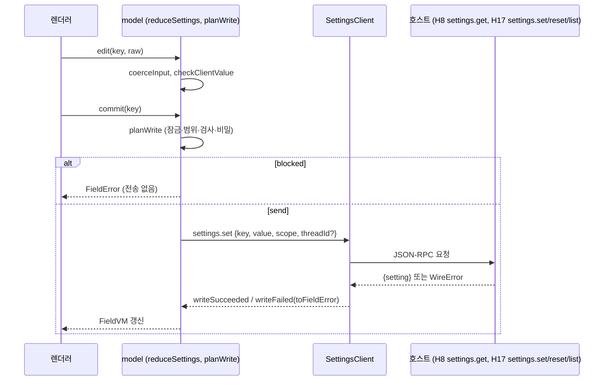

# L4 설정 화면 (settings-ui)

이 문서는 데스크톱 앱의 설정 화면을 정한다. 설정 화면은 F5 설정 스키마(`SettingDefWire`, `EffectiveSetting`)를 호스트 계약으로 받아 탭과 항목을 만들고, 값 쓰기를 `settings.set`·`settings.reset`으로 보낸다.

- [결정] 모든 설정은 F5 설정 스키마 하나에서 L4 화면, 설정 파일, 명령을 함께 만든다(`_research/layer-plan-v2-notes.md` 층 사이 규칙 6, `F.wire-settings.spec` §4.9).
- [결정] 추론 예산, 라우팅, 레이트 리밋, 계정 회전은 L4 클라이언트 설정 화면에서 조작할 수 있어야 한다(`_research/decisions-log.md` 2026-10-21 결정(2차)). 마일스톤은 M3다(`product.scope.spec` I14). 레이트 리밋·계정 회전 설정을 2차로 미루지 않고 M3 화면에 넣는다 [결정: review.decisions-2 U-21].
- [결정] 데스크톱은 Tauri 2이고 UI와 엔진은 stdio JSON-RPC로 연결한다(adr.0008).

## 1. 목적과 범위

### 1.1 정하는 것

- `SettingDefWire`와 `EffectiveSetting`에서 화면 탭과 항목을 만드는 규칙(§4.1, §4.2).
- `SettingsTab` 12값 각각의 한국어 라벨, 들어오는 층과 키 네임스페이스, 편집 방식, 상태 게이지 유무(§4.1).
- `SettingWidget` 8값과 화면 부품의 대응, `range`·`ui.unit`·`ui.help`·`ui.order` 반영 규칙(§4.2).
- 항목 공통 표시: 범위 배지, `runtimeChange` 배지와 `pendingUntil`, 잠금, 가려진 값, 저장 파일 경로, 기본값 복귀, 폐기 배지, 쓰기 범위 선택(§4.3).
- 쓰기 흐름: 편집, 클라이언트 즉시 검사, `settings.set`, 오류 코드의 필드 문구 변환, 변경 수신, 재시작 안내(§4.4, §4.5).
- 비밀 화면: 참조와 상태 표시, 값 입력과 열람 경로의 비교와 제안(§4.6).
- 첫 실행 권장 화면: 검색 provider 상태, SearXNG 주소, 무료 크레딧 API 플러그인 권장 목록(§4.10, ADR-0005 ④, `product.scope.spec` I10 M3).
- 상태 게이지 자리(§4.7), 접근성과 문구 규칙(§4.8), 코드 위치(§4.9).
- 화면 로직을 DOM과 무관한 순수 TS view-model(`settings/model`)과 렌더링 부분(`settings/views`)으로 나누는 경계(§3).

### 1.2 다루지 않는 것

- 설정 키 목록과 각 키의 탭 배정: 키를 소유하는 각 층 spec의 "설정 노출" 절이 정한다(`F.wire-settings.spec` §1.2, §6). 이 문서는 그 정의를 읽는 쪽이다. 키를 새로 정의하지 않는다.
- 설정 파일 JSON Schema 생성 명령: `L4.host-service.spec`(`F.wire-settings.spec` §4.9 표).
- `xeon config get/set/reset/list` 명령: `L4.cli.spec`(같은 표).
- 설정 병합, 파일 감시, 파일 쓰기: `L1.persistence.spec`, `L4.host-service.spec`.
- 셸 창, 엔진 사이드카 수명, 전송, 패키징: `L4.desktop.spec`. 경계는 "화면 생성·검증·표시는 settings-ui, 셸·수명·전송·패키징은 desktop"이다 [제안](`L4.desktop.spec` §1.2 첫 항목, `L4.readme` §2).
- 비밀 값 저장, 해석, 마스킹, 승인: `L0.secrets.spec`.
- 승인 요청 화면(비밀 사용 승인 포함): 대화 화면 쪽이다. [가정] 승인은 `F.wire-settings.spec` §4.6 A안(내구 이벤트 + `approval.respond`)을 따르고, 설정 화면은 승인 요청을 띄우지 않는다.
- 표시 설정(테마, 글꼴, 키 바인딩) 키의 정의: `L4.desktop.spec`의 `l4.desktop.*`와 `L4.cli.spec`의 `l4.cli.*`.

## 2. 용어

| 용어 | 뜻 |
|---|---|
| 정의 | `settings.list`가 돌려준 `SettingDefWire` 하나 |
| 유효 값 | `settings.get`이 돌려준 `EffectiveSetting` 하나 |
| 항목 | 한 정의를 화면 한 줄로 그린 것. view-model 타입은 `FieldVM` |
| 탭 | `SettingsTab` 값 하나에 해당하는 화면 묶음. view-model 타입은 `TabVM` |
| 파일 전용 키 | `ui`가 없는 정의. advanced 탭의 파일 편집기에서만 보인다(`F.wire-settings.spec` §3.8.2 `ui` 주석) |
| 초안 | 사용자가 편집 중이고 아직 `settings.set`으로 보내지 않은 값 |
| 쓰기 범위 | 이 화면이 값을 저장할 수 있는 범위. `managed`를 뺀 `SettingScope` 값. 타입은 `WritableScope` |
| 변경 신호 | 다른 연결(CLI 등)이나 엔진이 설정을 바꿨다는 수신 정보. 현재는 `settings.changed` 내구 이벤트(§4.5) |
| view-model | DOM, 프레임워크, 전송에 의존하지 않는 순수 TS 상태와 함수. `xeon/apps/desktop/src/settings/model/` |
| 렌더러 | view-model을 화면 부품으로 그리는 코드. `xeon/apps/desktop/src/settings/views/` |
| 셸 포트 | desktop이 settings-ui에 넘기는 의존 묶음(`SettingsHostPort`). 연결, 현재 thread, 재시작 동작을 담는다 |

`SettingDefWire`, `EffectiveSetting`, `SettingsTab`, `SettingWidget`, `SettingScope`, `RuntimeChange`, `SettingKey`, `SecretRef`, `settingsJsonSchema`, `checkSettingWrite`, `validateSettingValue`의 이름과 값 집합은 `F.wire-settings.spec` §3.8~§4.10을 그대로 따른다.

## 3. 인터페이스

### 3.1 입력 경계

[제안] 설정 화면 코드는 다음만 import한다.

| 가져오는 것 | 출처 | 쓰는 곳 |
|---|---|---|
| `HostConnection`, `WireParams`, `WireResult`, `WireError`, `WireErrorData`, `EventWire`, `EventsBatchParams`, `Unsubscribe` | `@xeon/contracts/wire`(F) | `connection.ts` |
| `SettingDefWire`, `EffectiveSetting`, `SettingsTab`, `SettingWidget`, `SettingScope`, `RuntimeChange`, `SettingKey`, `SecretRef` 타입 | `@xeon/contracts/settings`(F) | `model/**` |
| `ThreadId` 타입 | `@xeon/contracts/conversation`(F) | `model/**`, `connection.ts` |
| `Result` 타입 | `@xeon/contracts`(F 루트) | `model/**` |
| `Check`(JSON Schema 검사) | `typebox/schema`(1.3.27, `xeon/package.json` catalog) | `model/validate.ts` |
| `DesktopSettingsStore` 타입 | `xeon/apps/desktop/src/settings-store`(같은 desktop 패키지, `L4.desktop.spec` §3.6) | `index.ts`, `connection.ts` |
| `HostConnection` 인스턴스 | `xeon/apps/desktop/src/transport` 공개 진입점(같은 패키지). 실제 값은 셸 포트로 받는다 | `index.ts` |

- import 범위는 `L4.desktop.spec` §4.9 규칙 W3("`src/settings/**`는 `src/transport`의 공개 진입점과 `src/settings-store`만 import한다")과 같다. 위 F 서브패스와 `typebox/schema`는 W3이 다루지 않는 외부 의존이고, [제안] W3의 허용 목록에 더하도록 desktop에 요청한다(§10 미결 17).
- F는 모든 층보다 낮으므로 L4가 import할 수 있다(`eng.dependency-rules.guide` DR-01). X~L3 패키지(`@xeon/ext-host`, `@xeon/platform-*`, `@xeon/core-*`, `@xeon/cap-*`, `@xeon/group-*`)와 다른 앱(`@xeon/host`, `@xeon/cli`)은 import하지 않는다(DR-10, `L4.desktop.spec` §4.9 W6).
- 호스트 메서드는 `settings.list`, `settings.get`, `settings.set`, `settings.reset` 네 개와 변경 신호 수신용 `events.subscribe`·`events.unsubscribe`만 쓴다. `HostConnection` 객체는 desktop이 만들어 셸 포트로 넘긴다. 설정 화면은 연결을 열거나 닫지 않는다.
- 설정 원천은 둘이다. 엔진 카탈로그(`settings.*` 메서드)와 데스크톱 로컬 저장소(`DesktopSettingsStore`, `l4.desktop.*` 키만)다. 로컬 저장소는 엔진이 꺼져 있어도 셸이 읽어야 하는 값 때문에 desktop이 둔 것이다(`L4.desktop.spec` §3.6, 같은 문서 §10 미결 6). 두 원천의 합치기 규칙은 §4.1.3이다.
- [제안] `model/**`은 `document`, `window`, `HTMLElement` 같은 DOM 전역과 `views/**`를 참조하지 않는다. `bun test`로 DOM 없이 돈다.
- 클라이언트 번들에는 `typebox/schema` 서브패스만 넣는다(`_research/notes/L4-3.md` §4 P4).

### 3.2 셸 포트와 컨트롤러

```ts
// xeon/apps/desktop/src/settings/index.ts
import type { HostConnection, Unsubscribe } from "@xeon/contracts/wire";
import type { ThreadId } from "@xeon/contracts/conversation";
import type { SettingKey, SettingScope } from "@xeon/contracts/settings";
import type { DesktopSettingsStore } from "../settings-store/index.ts";
import type { SettingsState } from "./model/state.ts";
import type { SecretStatus, WritableScope } from "./model/types.ts";

/** desktop(L4.desktop.spec)이 채워 넘긴다. settings-ui는 이 값만으로 동작한다. */
export interface SettingsHostPort {
  readonly connection: HostConnection;
  /** l4.desktop.* 키의 로컬 저장소(L4.desktop.spec §3.6). 엔진 연결이 없어도 읽고 쓸 수 있다. */
  readonly localStore: DesktopSettingsStore;
  /** 현재 보고 있는 대화. 없으면 null이고 session 범위 쓰기를 숨긴다(§4.3.6). */
  currentThreadId(): ThreadId | null;
  /** 재시작이 필요한 변경을 적용하려고 호스트 재시작을 요청한다. 수명 관리는 desktop 몫이다.
   *  [가정] desktop이 L4.desktop.spec §10 미결 2의 host.shutdown {reason: "restart"}와 재기동으로 구현한다. */
  requestHostRestart(): Promise<void>;
  /** 비밀 탭에서 L0.secrets 흐름으로 넘긴다. M3 전까지는 없을 수 있다(§4.6.4). */
  readonly openSecretFlow?: (request: SecretFlowRequest) => Promise<SecretFlowOutcome>;
}

export type SecretFlowRequest =
  | { readonly kind: "register"; readonly name: string }
  | { readonly kind: "rotate"; readonly name: string }
  | { readonly kind: "reveal"; readonly name: string };
export type SecretFlowOutcome =
  | { readonly kind: "done"; readonly status: SecretStatus }
  | { readonly kind: "cancelled" }
  | { readonly kind: "unavailable"; readonly reason: string };

export interface SettingsController {
  getState(): SettingsState;
  subscribe(listener: (state: SettingsState) => void): Unsubscribe;
  /** settings.list → settings.get 순서로 읽고 변경 신호를 구독한다. */
  load(signal?: AbortSignal): Promise<void>;
  /** 초안을 바꾼다. 클라이언트 검사 결과를 상태에 남긴다. 전송하지 않는다. */
  edit(key: SettingKey, raw: unknown): void;
  selectScope(key: SettingKey, scope: WritableScope): void;
  /** 초안을 settings.set으로 보낸다. 클라이언트 검사가 실패하면 보내지 않는다. */
  commit(key: SettingKey): Promise<void>;
  discard(key: SettingKey): void;
  reset(key: SettingKey, scope: Exclude<SettingScope, "managed">): Promise<void>;
  restartHost(): Promise<void>;
  dispose(): Promise<void>;
}

export declare function createSettingsController(port: SettingsHostPort): SettingsController;
export type { SecretStatus };
```

- [제안] 렌더러는 `SettingsController`와 `buildSettingsView`(§3.4)의 결과만 쓴다. 렌더러가 `HostConnection`을 직접 부르지 않는다.

### 3.3 연결 어댑터

```ts
// xeon/apps/desktop/src/settings/connection.ts
import type { HostConnection, Unsubscribe, WireParams, WireResult } from "@xeon/contracts/wire";
import type { ThreadId } from "@xeon/contracts/conversation";
import type { SettingKey, SettingScope } from "@xeon/contracts/settings";

/** 변경 신호 하나. 값은 싣지 않는다. 받은 쪽은 settings.get으로 다시 읽는다(§4.5). */
export interface SettingsChangeSignal {
  readonly key: SettingKey;
  readonly scope: SettingScope;
  readonly threadId: ThreadId | null;
}

/** settings.* 네 메서드와 변경 신호만 여는 좁은 클라이언트. */
export interface SettingsClient {
  list(params: WireParams<"settings.list">, signal?: AbortSignal): Promise<WireResult<"settings.list">>;
  get(params: WireParams<"settings.get">, signal?: AbortSignal): Promise<WireResult<"settings.get">>;
  set(params: WireParams<"settings.set">, signal?: AbortSignal): Promise<WireResult<"settings.set">>;
  reset(params: WireParams<"settings.reset">, signal?: AbortSignal): Promise<WireResult<"settings.reset">>;
  /** events.subscribe({from: "head", filter: {kindPrefixes: ["settings."]}})로 구독한다. */
  onChange(handler: (signal: SettingsChangeSignal) => void): Promise<Unsubscribe>;
}

export declare function createSettingsClient(connection: HostConnection): SettingsClient;
```

- `onChange`는 `events.batch` 알림 중 자기 구독 id(`sub`)의 것만 읽고, `kind === "settings.changed"`인 `EventWire`의 `payload`에서 `key`, `scope`만 꺼낸다(`F.records.spec` §3.3 `SettingsChangedPayload`). `payload.value`는 읽지 않는다. 값은 항상 `settings.get`으로 다시 받는다(§4.5).
- `HostConnection.request`가 실패하면 `WireError`(`F.wire-settings.plan` W6)나 `CloseInfo`를 담은 오류로 끝난다(`F.wire-settings.spec` §5). 어댑터는 오류를 바꾸지 않고 그대로 던진다. 변환은 `model/write-flow.ts`의 `toFieldError`가 한다.

### 3.4 view-model 타입

```ts
// xeon/apps/desktop/src/settings/model/types.ts
import type {
  EffectiveSetting, RuntimeChange, SecretRef, SettingDefWire, SettingKey, SettingScope, SettingsTab,
} from "@xeon/contracts/settings";

export type WritableScope = Exclude<SettingScope, "managed">;
export type BadgeScope = SettingScope | "default";

export interface ScopeBadge {
  readonly scope: BadgeScope;
  readonly text: string;            // "관리", "사용자", "프로젝트", "로컬", "세션", "기본값"
  readonly tone: BadgeScope;        // 렌더러가 색 토큰으로 바꾼다(§4.3.1)
}

export interface RuntimeBadge {
  readonly change: RuntimeChange;
  readonly text: string;            // "즉시 적용", "다음 턴부터", "재시작 필요"
  readonly pending: "nextTurn" | "restart" | null;   // EffectiveSetting.pendingUntil
  readonly pendingText: string | null;               // "다음 턴부터 적용돼요", "재시작해야 적용돼요"
}

export interface LockInfo {
  readonly path: string | null;     // EffectiveSetting.source.path
  readonly text: string;            // §4.8.3 문구 규칙
}

export interface ShadowedVM {
  readonly scope: BadgeScope;
  readonly path: string | null;
}

export interface DeprecatedVM {
  readonly since: string;
  readonly replacedBy: SettingKey | null;
  readonly replacedByLabel: string | null;   // 대체 키 정의의 ui.label. 없으면 null
  readonly note: string | null;
}

export type ListItemKind = "string" | "number" | "integer" | "boolean";
export interface TableColumn {
  readonly name: string;
  readonly kind: ListItemKind | "enum";
  readonly options: readonly (string | number)[] | null;
  readonly required: boolean;
}

export type WidgetVM =
  | { readonly kind: "toggle" }
  | { readonly kind: "select"; readonly options: readonly (string | number)[] }
  | { readonly kind: "number"; readonly min: number | null; readonly max: number | null; readonly integer: boolean; readonly unit: string | null }
  | { readonly kind: "text"; readonly minLength: number | null; readonly maxLength: number | null; readonly pattern: string | null }
  | { readonly kind: "list"; readonly item: ListItemKind; readonly maxItems: number | null }
  | { readonly kind: "table"; readonly shape: "rows" | "record"; readonly columns: readonly TableColumn[]; readonly maxItems: number | null }
  | { readonly kind: "secret" }
  | { readonly kind: "readonly" };

/** 비밀 참조 상태. "registered"·"missing"은 L0.secrets 상태를 받을 수 있을 때만 쓴다(§4.6.2). */
export type SecretStatus = "unset" | "referenced" | "registered" | "missing";
export interface SecretFieldVM {
  readonly ref: SecretRef | null;
  readonly status: SecretStatus;
}

export type FieldError =
  | { readonly kind: "invalidValue"; readonly message: string; readonly issues: readonly { readonly path: string; readonly message: string }[] }
  | { readonly kind: "scopeNotAllowed"; readonly message: string; readonly allowed: readonly SettingScope[] }
  | { readonly kind: "locked"; readonly message: string }
  | { readonly kind: "secretValue"; readonly message: string }
  | { readonly kind: "unknownKey"; readonly message: string }
  | { readonly kind: "transient"; readonly message: string }
  | { readonly kind: "internal"; readonly message: string; readonly traceId: string | null };

export interface FieldVM {
  readonly key: SettingKey;
  readonly tab: SettingsTab;
  readonly order: number;
  readonly label: string;
  readonly help: string | null;
  readonly widget: WidgetVM;
  /** 표시할 값. 초안이 있으면 초안, 없으면 유효 값. secret이면 SecretRef 또는 null만 담긴다. */
  readonly value: unknown;
  readonly dirty: boolean;
  readonly scope: ScopeBadge;
  readonly runtime: RuntimeBadge;
  readonly lock: LockInfo | null;
  readonly shadowed: readonly ShadowedVM[];
  readonly filePath: string | null;
  readonly writableScopes: readonly WritableScope[];
  readonly selectedScope: WritableScope | null;
  readonly canReset: boolean;
  readonly editable: boolean;
  readonly deprecated: DeprecatedVM | null;
  readonly secret: SecretFieldVM | null;
  readonly error: FieldError | null;
  readonly saving: boolean;
  readonly remoteChanged: boolean;           // 초안 편집 중 다른 곳에서 값이 바뀜(§4.5.3)
}

export interface GaugeSlotVM {
  readonly tab: "budgets" | "providers";
  readonly status: "unavailable";            // M3 범위에서는 이 값만 쓴다(§4.7)
  readonly text: string;
}

export interface TabVM {
  readonly id: SettingsTab;
  readonly label: string;
  readonly fields: readonly FieldVM[];
  readonly gauge: GaugeSlotVM | null;
  readonly emptyText: string | null;         // fields가 비면 이유 문구
}

export interface FileOnlyEntryVM {
  readonly key: SettingKey;
  readonly value: unknown;                   // secret이면 SecretRef 또는 null
  readonly scope: ScopeBadge;
  readonly lock: LockInfo | null;
  readonly writableScopes: readonly WritableScope[];
  readonly jsonSchema: Readonly<Record<string, unknown>>;   // toValueJsonSchema(def)
}

export type ViewDiagnostic =
  | { readonly code: "widgetMismatch"; readonly key: SettingKey; readonly widget: string }
  | { readonly code: "unknownWidget"; readonly key: SettingKey; readonly widget: string }
  | { readonly code: "unknownTab"; readonly key: SettingKey; readonly tab: string }
  | { readonly code: "missingValue"; readonly key: SettingKey }
  | { readonly code: "duplicateKey"; readonly key: SettingKey };   // 두 원천이 같은 키를 냄(§4.1.3)

export interface OverviewVM {
  readonly countsByScope: Readonly<Record<BadgeScope, number>>;
  readonly locked: readonly SettingKey[];
  readonly pendingRestart: readonly SettingKey[];
  readonly pendingNextTurn: readonly SettingKey[];
  readonly deprecatedInUse: readonly SettingKey[];
  readonly secretRefs: readonly { readonly key: SettingKey; readonly tab: SettingsTab | null; readonly status: SecretStatus }[];
}

export interface SettingsView {
  readonly tabs: readonly TabVM[];           // TAB_SPECS.position 순서, 항상 12개
  readonly fileOnly: readonly FileOnlyEntryVM[];
  readonly overview: OverviewVM;
  readonly diagnostics: readonly ViewDiagnostic[];
  readonly restartBanner: { readonly count: number; readonly text: string } | null;
}
```

### 3.5 view-model 함수

모든 함수는 순수 함수다. 아래 코드 블록은 같은 디렉터리 `types.ts`와 F 타입의 import 줄을 줄여 적었다.

```ts
// model/group-by-tab.ts
import type { SettingDefWire, SettingsTab } from "@xeon/contracts/settings";

export interface TabSpec {
  readonly id: SettingsTab;
  readonly label: string;
  readonly position: number;                       // 0..11, 탭 표시 순서
  readonly gauge: boolean;                          // §4.7
  readonly emptyText: string;
}
/** 키 집합이 SettingsTab 전체와 같아야 한다(Record 타입으로 누락을 컴파일 오류로 잡는다). */
export declare const TAB_SPECS: Readonly<Record<SettingsTab, TabSpec>>;

export interface TabGrouping {
  readonly byTab: ReadonlyMap<SettingsTab, readonly SettingDefWire[]>;  // ui.order 오름차순, 같으면 key 오름차순
  readonly fileOnly: readonly SettingDefWire[];                          // ui 없음, key 오름차순
  readonly diagnostics: readonly ViewDiagnostic[];
}
export declare function groupByTab(defs: readonly SettingDefWire[]): TabGrouping;

export declare function buildSettingsView(state: SettingsState): SettingsView;
```

```ts
// model/widget-map.ts
export declare function resolveWidget(def: SettingDefWire): { readonly widget: WidgetVM; readonly diagnostic: ViewDiagnostic | null };
```

```ts
// model/badges.ts
export declare function scopeBadge(source: EffectiveSetting["source"]): ScopeBadge;
export declare function runtimeBadge(setting: EffectiveSetting): RuntimeBadge;
export declare function lockInfo(setting: EffectiveSetting): LockInfo | null;
export declare function deprecatedInfo(def: SettingDefWire, catalog: ReadonlyMap<SettingKey, SettingDefWire>): DeprecatedVM | null;
/** allowedScopes에서 managed를 빼고, 잠겼으면 빈 배열, thread가 없으면 session을 뺀다. */
export declare function writableScopes(def: SettingDefWire, setting: EffectiveSetting | undefined, hasThread: boolean): readonly WritableScope[];
/** user가 있으면 user, 없으면 project, local, session 순으로 첫 값. 비어 있으면 null. */
export declare function defaultWriteScope(scopes: readonly WritableScope[]): WritableScope | null;
```

```ts
// model/validate.ts
import type { SettingDefWire } from "@xeon/contracts/settings";
import type { Result } from "@xeon/contracts";

export type JsonSchemaObject = Readonly<Record<string, unknown>>;
export interface ValueIssue { readonly path: string; readonly message: string }

/** def.type에 range를 합친다(range.min → minimum, range.max → maximum, range.enum → enum).
 *  F.wire-settings.spec §4.10 3번과 같은 규칙이다. F가 같은 함수를 제공하면 그것으로 바꾼다(§10 미결 7). */
export declare function toValueJsonSchema(def: SettingDefWire): JsonSchemaObject;

/** typebox/schema의 Check로 검사한다. 범위 허용은 함께 본다. 잠금·비밀 값 판정은 하지 않는다(서버 전용). */
export declare function checkClientValue(def: SettingDefWire, value: unknown): Result<unknown, readonly ValueIssue[]>;

/** 위젯 입력을 값으로 바꾼다. number는 Number 변환, text는 문자열 그대로,
 *  파일 편집기의 원문 입력은 JSON 해석 후 실패하면 문자열(F.wire-settings.spec §4.11). */
export declare function coerceInput(widget: WidgetVM, raw: unknown): Result<unknown, ValueIssue>;
```

```ts
// model/write-flow.ts
import type { WireParams } from "@xeon/contracts/wire";

export type WritePlan =
  | { readonly kind: "send"; readonly params: WireParams<"settings.set"> }
  | { readonly kind: "blocked"; readonly error: FieldError };   // 잠금, 범위 밖, 클라이언트 검사 실패, 비밀 비참조

/** 초안을 settings.set params로 바꾸거나 막는다. 순수 함수. */
export declare function planWrite(
  def: SettingDefWire, setting: EffectiveSetting | undefined, draft: unknown,
  scope: WritableScope | null, threadId: ThreadId | null,
): WritePlan;

export type FollowUp = "none" | "refreshValue" | "reloadCatalog";
/** settings.set·reset 실패를 필드 문구로 바꾼다. 서버 message 문자열은 화면에 쓰지 않는다(F.wire-settings.spec §3.5.1). */
export declare function toFieldError(def: SettingDefWire | undefined, error: unknown): { readonly error: FieldError; readonly followUp: FollowUp };
```

```ts
// model/state.ts
export interface FieldDraft {
  readonly value: unknown;                 // secret 정의면 SecretRef만 들어온다(§4.6.1)
  readonly issues: readonly ValueIssue[];
}
/** 정의 하나가 어느 원천에서 왔는가(§4.1.3). */
export type SettingOrigin = "engine" | "desktop";

export interface SettingsState {
  readonly status: "idle" | "loading" | "ready" | "failed";
  readonly defs: ReadonlyMap<SettingKey, SettingDefWire>;
  readonly origins: ReadonlyMap<SettingKey, SettingOrigin>;
  readonly values: ReadonlyMap<SettingKey, EffectiveSetting>;
  readonly drafts: ReadonlyMap<SettingKey, FieldDraft>;
  readonly scopes: ReadonlyMap<SettingKey, WritableScope>;
  readonly saving: ReadonlySet<SettingKey>;
  readonly errors: ReadonlyMap<SettingKey, FieldError>;
  readonly remoteChanged: ReadonlySet<SettingKey>;
  readonly requestSeq: ReadonlyMap<SettingKey, number>;   // 키별 마지막 요청 번호(늦게 온 응답 버림)
  readonly threadId: ThreadId | null;
}

export type SettingsAction =
  | { readonly type: "catalogLoaded"; readonly origin: SettingOrigin; readonly defs: readonly SettingDefWire[] }
  | { readonly type: "valuesLoaded"; readonly settings: readonly EffectiveSetting[]; readonly seq: number }
  | { readonly type: "draftEdited"; readonly key: SettingKey; readonly raw: unknown }
  | { readonly type: "scopeSelected"; readonly key: SettingKey; readonly scope: WritableScope }
  | { readonly type: "draftDiscarded"; readonly key: SettingKey }
  | { readonly type: "writeStarted"; readonly key: SettingKey; readonly seq: number }
  | { readonly type: "writeSucceeded"; readonly setting: EffectiveSetting; readonly seq: number }
  | { readonly type: "writeFailed"; readonly key: SettingKey; readonly error: FieldError; readonly seq: number }
  | { readonly type: "changeSignaled"; readonly signal: SettingsChangeSignal }
  | { readonly type: "threadChanged"; readonly threadId: ThreadId | null }
  | { readonly type: "loadFailed" };

export declare const initialSettingsState: SettingsState;
export declare function reduceSettings(state: SettingsState, action: SettingsAction): SettingsState;
```

- 이 문서가 정하는 이름은 settings-ui 내부 이름이다. 다른 패키지가 import하지 않는다. desktop은 `index.ts`의 `createSettingsController`, `SettingsHostPort`, `SettingsController`만 쓴다.

## 4. 동작 규칙

### 4.1 탭 생성 규칙

1. 탭은 `SettingsTab` 12값 전부를 `TAB_SPECS.position` 순서로 항상 만든다. 정의가 없는 탭도 숨기지 않고 `emptyText`를 보인다.
2. 정의 하나는 정확히 한 곳에 놓인다.
   - `ui`가 있으면 `ui.tab` 탭의 항목이 된다.
   - `ui`가 없으면 advanced 탭의 파일 편집기 목록(`fileOnly`)에만 들어간다.
   - `ui.tab`이 `TAB_SPECS`에 없는 값이면(새 F 부 버전) advanced 탭 파일 편집기 목록에 넣고 `unknownTab` 진단을 남긴다.
3. 탭 안 정렬은 `ui.order` 오름차순, 같으면 `key` 오름차순이다. 같은 입력이면 순서가 같다.
4. 개요(overview) 탭은 `ui.tab: "overview"`인 정의의 항목과 함께 요약(`OverviewVM`)을 보인다. 요약은 다른 탭 항목으로 가는 바로 가기 목록이다. 그래서 규칙 2의 "정확히 한 곳"은 요약 목록을 세지 않는다.
5. 폐기된 정의(`deprecated` 있음)는 `settings.list({includeDeprecated: true})`로 받는다. 유효 값 출처가 `default`이면 화면에 보이지 않고, 사용자가 값을 둔 경우에만 항목과 폐기 배지를 보인다 [제안].
6. 각 정의가 어느 탭에 들어갈지는 정의의 `ui.tab`이 정한다. 아래 표의 "들어오는 층·키 네임스페이스"는 키 소유 층이 탭을 고를 때 쓰는 기본 배치 안내다 [제안]. 설정 화면은 네임스페이스로 탭을 바꾸지 않는다.

#### 4.1.1 탭 표

| 탭 id | 한국어 라벨 [제안] | 들어오는 층·키 네임스페이스 (기본 배치 안내) | 편집 방식 | 상태 게이지 |
|---|---|---|---|---|
| `overview` | 개요 | F5 요약(유효 값 출처, 잠긴 항목, 재시작 대기, 폐기 키 사용), `ui.tab: "overview"` 정의 | 읽기 전용과 바로 가기 | 없음. 사용량 요약은 게이지 자리와 같은 이유로 비운다(§4.7) |
| `models` | 모델 | L1-c `l1.models.*`(기본 모델, 용도별 라우팅, 폴백 체인, 추론 레벨, 레벨별 토큰 예산, 허용 목록), L1-g `l1.agents.*`(`maxDepth`, `maxConcurrent`, `resultMaxChars`, `judge.maxRuns`. review.decisions-2 S-14) | 폼 + 전용 편집기(역할 표, 폴백 체인, M3) | 없음 |
| `budgets` | 예산과 한도 | L1-b `l1.loop.*`(단계 상한, 완료 게이트, 반복 감지), L1-c `l1.models.rateLimit`(레이트 리밋 정책, M3) | 폼(number, select) | 있음(자리만, §4.7) |
| `providers` | 계정과 제공자 | L1-c `l1.models.*` 중 제공자 연결, `l1.models.accounts`(계정 풀, 우선순위, 예약 %, 계정 회전, M3), 확장 제공자 `ext.<id>.*` 중 키 참조 | 목록·표 편집기, 키는 `secret` 위젯(참조만) | 있음(자리만, §4.7) |
| `secrets` | 비밀 | L0-c `l0.secrets.*` 중 `ui.tab: "secrets"`인 키(제공자 기본값 등) + 비밀 관리 패널(§4.6) | 폼 + `SecretsTab` 전용 패널 | 없음 |
| `permissions` | 권한과 샌드박스 | L1-d 승인·권한 규칙(소유 문서 `L1.tools.spec`, `l1.tools.*`), L0-c `l0.secrets.approval.*`(비밀 승인 기본 정책, 쓰기 허용 호스트), L0-b `l0.sandbox.*`(켜기·끄기, 쓰기 경로, 허용 도메인, 프록시) | 규칙 편집기, 목록 편집기(M3) | 없음 |
| `sessions` | 세션과 컨텍스트 | L1-e `l1.context.*`(자동 컴팩션, 임계), L1-f `l1.persistence.*`(보관 기간, 내보내기, 자동 재개), L2-d `l2.knowledge.*`(메모리) | 토글과 폼. 삭제성 동작은 확인 단계 | 없음 |
| `tools` | 도구와 웹 | L2 `l2.mcp.*`, `l2.web.*`, `l2.workspace.*`, `l2.knowledge.*`(스킬), `l2.dialog.*` 중 질문·명령·첨부 키, 그 밖의 `l2.*` | 목록 토글, 선택 | 없음 |
| `plugins` | 플러그인과 그룹 | X `x.loading-trust.*`(신뢰, 격리), `x.operations.*`(핸들러 시한, 자동 끄기, 안전 모드), `x.primitives.driveDefaultLimits`(drive 기본 상한, review.decisions-2 U-12), `x.primitives.driveLimits`(천장), `x.primitives.activeDriveGroup`(구동 그룹 선택, review.decisions-2 S-15), `x.primitives.capabilityProviders`, 그룹 켜기 키 `ext.<id>.enabled`, L3 `l3.group-kit.*`, `l3.helm.*`, `l3.learning.*`, 확장 `ext.<id>.*`(userConfig에서 온 키는 `plugins` 고정, `F.wire-settings.spec` §3.8.3) | 목록 토글과 그룹별 묶음 | 없음 |
| `execution` | 실행과 서비스 | L1-a `l1.tasks.*`(동시 상한, 큐 기본 모드), L0-d `l0.process.*`, L2 `l2.dialog.notify.*`(알림 켜기와 종류. L0.os는 전달 수단만 소유한다, review.decisions-2 S-04), `l0.exec.*`(셸), `l2.schedule.*`, `l4.host-service.*`(재전송·구독 한도). 공유 서비스 모드 토글은 `l0.process.service.enabled`이고 L0-d 행에 포함된다, `l4.desktop.engine.restartLimit`(desktop 원천) | 토글과 폼 | 없음 |
| `appearance` | 외관 | `l4.desktop.appearance.*`(테마, 글꼴, 글자 크기, 키 바인딩), `l4.desktop.window.*`(desktop 원천, §4.1.3), `l4.cli.*`(TUI 표시, 엔진 원천), `l2.dialog.status.segments`, `l2.dialog.styles.active` | 선택, 토글. 미리보기는 desktop이 정한다 | 없음 |
| `advanced` | 고급 | `ui.tab: "advanced"` 정의(캐시 TTL, 샘플링, 재시도 `l1.models.retry`, `l4.desktop.engine.shutdownGraceMs` 등) + `ui`가 없는 모든 키(파일 편집기) | 폼 + 파일 편집기(§4.2.3) | 없음 |

- 층 표기(L1-a~L1-g, L0-b 등)는 `_research/settings.md` §2와 `_research/layer-plan-v2-notes.md` L4 설정 화면 구성안의 하위 층 이름이다. 네임스페이스의 도메인 이름은 `_routing/routes.yaml` layout을 따른다(`F.wire-settings.spec` §3.8.1).
- [가정] 승인·권한 규칙 키의 소유 문서는 `L1.tools.spec`이다(`F.wire-settings.spec` §4.6 "payload는 `L1.tools.spec`(승인 프로토콜) 소관"). 키 이름은 그 문서가 정한다.
- [결정: review.decisions-2 S-11] 이 표의 배치는 각 키 소유 층 문서의 `ui.tab`을 옮긴 것이다(`L1.loop.spec` §6, `L1.models.spec` §6, `L1.agents.spec` §6, `L0.secrets.spec` §6, `L2.dialog.spec` §6, `X.operations.spec` §6, `X.primitives.spec` §6). 어긋나면 소유 층 문서가 정본이고 이 표를 고친다.
- [결정: review.decisions-2 S-14] `l1.agents.*`는 models 탭이다. `F.wire-settings.spec` §4.9가 "에이전트" 탭을 모델에 합쳤기 때문이다.

#### 4.1.2 초안 탭과 F 12값의 대응

`_research/settings.md` §4의 13개 초안과 `_research/layer-plan-v2-notes.md` L4 설정 화면 구성안의 8탭이 `SettingsTab` 12값으로 합쳐진 대응이다. `F.wire-settings.spec` §4.9는 "에이전트를 모델에 합침, 비밀과 외관을 따로 둠"만 적었다. 나머지 합침(권한+샌드박스, 플러그인+그룹)은 8탭안의 묶음을 따른 것으로 이 문서가 읽어 낸 결과다 [제안].

| `SettingsTab` | settings.md §4 초안(13) | layer-plan-v2 8탭 | 비고 |
|---|---|---|---|
| `overview` | 0. 개요 | 없음 | |
| `models` | 1. 모델 + 9. 에이전트 | 모델 | 8탭안의 모델 탭은 서브에이전트를 포함한다 |
| `budgets` | 2. 예산과 한도 | 없음(모델·계정 탭에 흩어짐) | 레이트 리밋 정책은 이 탭, 계정 풀과 회전은 providers |
| `providers` | 3. 계정과 제공자 | 계정과 provider | 사용량 게이지 자리 |
| `secrets` | 없음(3번 안의 "키는 등록 전용") | 비밀 | 8탭안에서 가져옴 |
| `permissions` | 4. 권한 + 5. 샌드박스와 네트워크 | 권한과 샌드박스 | 8탭안 묶음을 따름 |
| `sessions` | 6. 세션과 컨텍스트 | 세션과 컨텍스트 | |
| `tools` | 7. 도구와 확장 | 도구와 웹 | 라벨은 8탭안의 것 |
| `plugins` | 8. 플러그인과 신뢰 + 11. 그룹 | 플러그인과 그룹 | 8탭안 묶음을 따름 |
| `execution` | 10. 실행과 알림 | 실행과 서비스 | 라벨은 8탭안의 것 |
| `appearance` | 없음(§2.13 층 밖 항목) | 없음 | `SettingLayer`에 L4를 넣은 이유와 같다(`F.wire-settings.spec` §3.8.1) |
| `advanced` | 12. 고급 | 없음 | |

- 합계: 13 − 3(에이전트, 샌드박스, 그룹을 합침) + 2(비밀, 외관 추가) = 12.
- [제안] 현재 `SettingsTab` enum은 바꾸지 않는다. 탭별 전용 편집기(§4.2.4)가 새 탭을 요구하면 F 부 버전 변경 요청으로 올린다(§10 미결 8).

#### 4.1.3 두 원천 합치기

`L4.desktop.spec` §3.6은 `l4.desktop.*` 키를 엔진 카탈로그 밖의 데스크톱 로컬 저장소에 둔다. [제안] 설정 화면은 두 원천을 아래 규칙으로 합친다.

1. 정의 목록은 `settings.list` 결과와 `localStore.defs()`의 합집합이다. 키 `l4.desktop.`로 시작하는 정의는 `origin: "desktop"`, 나머지는 `origin: "engine"`이다.
2. 같은 키가 양쪽에 있으면 desktop 쪽 정의를 쓰고 `duplicateKey` 진단을 남긴다.
3. 읽기·쓰기·복귀·변경 수신은 `origin`으로 보낼 곳을 정한다.

| 동작 | `origin: "engine"` | `origin: "desktop"` |
|---|---|---|
| 정의 | `settings.list` | `localStore.defs()` |
| 유효 값 | `settings.get` | `localStore.get(key)` |
| 쓰기 | `settings.set {key, value, scope, threadId?}` | `localStore.set(key, value)`. 범위는 user 하나다 |
| 복귀 | `settings.reset` | `localStore.reset(key)` |
| 변경 수신 | §4.5(이벤트 수신 뒤 다시 읽기) | `localStore.onChange`. 결과 `EffectiveSetting`을 바로 반영한다 |
| 쓰기 실패 | `WireError`(§4.4.4) | `DesktopSettingWrite`의 `kind`(`settings.unknownKey`, `settings.invalidValue`). 같은 표로 변환한다 |

- 엔진 연결이 없어도(엔진 `failed`·`restarting`) desktop 원천 항목은 편집할 수 있다. 엔진 원천 항목은 읽기 전용으로 두고 "엔진과 연결되면 바꿀 수 있어요"를 보인다.
- 두 원천이 같은 `SettingDefWire`·`EffectiveSetting` 모양을 쓰므로 탭 생성, 위젯, 배지, 클라이언트 검사 규칙은 원천과 무관하게 같다.
- desktop이 `l4.desktop.*`를 엔진 카탈로그로 옮기면(`L4.desktop.spec` §10 미결 6의 대안) 이 절은 없어지고 원천은 하나가 된다.

### 4.2 항목 생성 규칙

#### 4.2.1 위젯 대응

| `SettingWidget` | 화면 부품 [제안] | `SettingDefWire`에서 읽는 것 | 조건(맞지 않으면 `widgetMismatch`) |
|---|---|---|---|
| `toggle` | 스위치 | `type.type === "boolean"` | D8 |
| `select` | 단일 선택 목록. 선택지 8개 이하면 라디오 묶음, 넘으면 드롭다운 | `range.enum`(표시 순서 그대로) | D8. `range.enum`이 없으면 불일치 |
| `number` | 숫자 입력 + 단위 꼬리표 | `range.min`, `range.max`, `type.type === "integer"`이면 정수 단계, `ui.unit` | D8 |
| `text` | 한 줄 입력 | `type.minLength`, `type.maxLength`, `type.pattern` | `type.type === "string"` |
| `list` | 원소 추가·삭제·순서 변경 목록 | `type.items.type`(string, number, integer, boolean), `type.maxItems` | `type.type === "array"`이고 `items`가 원시 타입 |
| `table` | 행 추가·삭제 표. `rows` 모양은 열이 `items.properties` 순서, `record` 모양은 "이름"·"값" 두 열 | `rows`: `type.items.properties`, `type.items.required`, 열의 `enum`. `record`: `type.additionalProperties`의 원시 타입 | `rows`: `type.type === "array"`이고 `items.type === "object"`. `record`: `type.type === "object"`이고 `additionalProperties`가 원시 타입 스키마(예: `l4.desktop.appearance.keybindings`, `L4.desktop.spec` §6) |
| `secret` | 참조 선택기(`secret://<이름>`)와 상태 칩. 값 입력란 없음(§4.6) | `secret: true`, `type.pattern` | D3. `secret`이 거짓이면 불일치 |
| `readonly` | 값 표시. 객체·배열은 JSON 접힘 보기 | 없음 | 없음 |

- `ui.label`은 항목 라벨, `ui.help`는 라벨 아래 설명, `ui.unit`은 숫자 꼬리표다. `ui.order`는 §4.1 규칙 3의 정렬에 쓴다.
- `range`가 `type`보다 우선하지 않는다. D6에 따라 같은 제약이 두 곳에 있을 수 없다. 화면은 `range`와 `type`의 제약을 합쳐서 읽는다(§4.4.2 `toValueJsonSchema`와 같은 규칙).
- 위젯이 `widgetMismatch`이거나 알 수 없는 값(`unknownWidget`)이면 그 항목을 `readonly`로 그리고 진단을 advanced 탭에 모은다. 편집은 파일 편집기로만 한다 [제안].
- 표 열 하나가 원시 타입이나 enum이 아니면(중첩 객체) 그 열은 JSON 접힘 보기로 읽기만 하고, 그 열 편집은 파일 편집기로 넘긴다 [제안].

#### 4.2.2 값이 없을 때

- 정의는 있는데 `settings.get` 결과에 그 키가 없으면 항목을 읽기 전용으로 그리고 "값을 불러오지 못했어요"를 보인다. `missingValue` 진단을 남긴다.
- 유효 값이 있는데 정의가 없는 키(카탈로그에서 빠진 키)는 화면에 그리지 않는다. 모르는 키 목록은 wire로 받을 방법이 없다(§10 미결 6).

#### 4.2.3 advanced 탭 파일 편집기

[제안] 단계를 둘로 나눈다.

| 단계 | 형태 | 데이터 경로 | 검사 |
|---|---|---|---|
| M2 키 단위 편집기 | 파일 전용 키(`ui` 없음)와 `widgetMismatch` 항목을 키 목록으로 보이고, 키 하나의 값을 JSON 원문으로 편집한다 | 읽기 `settings.get`, 쓰기 `settings.set` | 그 범위의 `settingsJsonSchema(scope).properties[key]`와 같은 스키마. 클라이언트는 `toValueJsonSchema(def)`로 만들고 범위 허용을 함께 본다 |
| M3 파일 단위 편집기 | 범위 하나(user, project, local)의 설정 파일 전체를 JSON으로 편집한다. managed는 읽기 전용 | F 변경 요청: `settings.readFile`, `settings.writeFile`(§10 미결 6). 파일 쓰기는 호스트 한 곳에서 한다 | 그 범위의 `settingsJsonSchema` 출력 전체(`additionalProperties: true`, 모르는 키 경고) |

- 키 단위 편집기의 범위별 스키마는 `F.wire-settings.spec` §4.10의 규칙 3(type + range 병합)과 규칙 4(그 범위가 `allowedScopes`에 없는 키는 제외)를 따른다. 그래서 키 단위 편집 결과는 파일 단위 편집기와 같은 판정을 받는다.
- 원문 입력은 `F.wire-settings.spec` §4.11 규칙대로 JSON으로 먼저 해석하고, 실패하면 문자열로 본다.
- 파일 단위 편집기를 데스크톱 파일 시스템 접근(Tauri fs)으로 직접 쓰는 안은 [제안]하지 않는다. 호스트의 `settings.set` 경로와 쓰는 곳이 둘이 되고, 파일 감시와 검사(§4.8)를 우회하기 때문이다.

#### 4.2.4 탭별 전용 편집기

`_research/settings.md` §5의 "UI 필요" 항목은 일반 위젯으로 부족하다. [제안] M2는 일반 렌더러(table, list)로 그리고, M3에 아래 전용 편집기를 같은 정의 위에 얹는다. 전용 편집기도 값은 `settings.set` 한 번으로 키 하나를 통째로 쓴다(`F.wire-settings.spec` §4.7 규칙 2, 깊은 병합 없음).

| 전용 편집기 | 탭 | 대상(키 소유 문서) | 일반 렌더러 대비 더하는 것 |
|---|---|---|---|
| 모델 역할 표 | models | 용도별 라우팅(`L1.models.spec`) | 역할 행 고정, 모델 선택 목록, 추론 레벨과 토큰 예산을 한 행에 |
| 폴백 체인 | models | 폴백 체인(`L1.models.spec`) | 순서 끌어 옮기기, 발동 조건 설명 |
| 권한 규칙 편집기 | permissions | 권한 규칙(`L1.tools.spec`) | 허용·거부·질문 열, 규칙 충돌 표시 |
| 샌드박스 경로·도메인 목록 | permissions | 쓰기 경로, 허용 도메인(`L0.sandbox.spec`) | 차단 우선 표시, 경로 형식 검사 |
| 계정 풀 | providers | 계정 목록, 우선순위, 예약 %(`L1.models.spec`) | 순위 끌어 옮기기, 키 참조는 `secret` 위젯 |

- 전용 편집기를 고르는 기준은 키 이름이다(예: 정의 키가 정해진 목록에 있음). [미결] 키 이름에 묶는 대신 F `SettingUi`에 편집기 힌트 필드를 더할지(§10 미결 8).

### 4.3 항목 공통 표시

`_research/settings.md` §4 화면 공통 규칙을 F 필드에 대응시킨다.

| 표시 | F 필드 | 규칙 |
|---|---|---|
| 범위 배지 | `EffectiveSetting.source.scope` | §4.3.1 |
| 세션 중 변경 | `EffectiveSetting.runtimeChange`, `pendingUntil` | §4.3.2 |
| 관리 잠금 | `EffectiveSetting.locked`, `source.path` | §4.3.3 |
| 가려진 값 | `EffectiveSetting.shadowed` | §4.3.4 |
| 저장 파일 경로 | `EffectiveSetting.source.path` | §4.3.5 |
| 쓰기 범위 | `SettingDefWire.allowedScopes` | §4.3.6 |
| 기본값 복귀 | `settings.reset` | §4.3.7 |
| 폐기 | `EffectiveSetting.deprecated`, `SettingDefWire.deprecated` | §4.3.8 |

#### 4.3.1 범위 배지

[제안] 배지는 색과 글자를 함께 쓴다. 색만으로 구분하지 않는다(§4.8.1).

| `source.scope` | 글자 | 색 토큰 | 기호 |
|---|---|---|---|
| `managed` | 관리 | `--badge-managed`(적갈색 계열) | 자물쇠 |
| `user` | 사용자 | `--badge-user`(파랑 계열) | 없음 |
| `project` | 프로젝트 | `--badge-project`(초록 계열) | 없음 |
| `local` | 로컬 | `--badge-local`(보라 계열) | 없음 |
| `session` | 세션 | `--badge-session`(주황 계열) | 없음 |
| `default` | 기본값 | `--badge-default`(회색) | 없음 |

- 색 값은 desktop 테마가 정한다. 배지 글자와 배경의 대비는 4.5:1 이상이다.

#### 4.3.2 runtimeChange 배지와 대기 표시

| `runtimeChange` | 배지 글자 | `pendingUntil`이 null이 아닐 때 |
|---|---|---|
| `live` | 즉시 적용 | 생기지 않는다 |
| `nextTurn` | 다음 턴부터 | "다음 턴부터 적용돼요" |
| `restart` | 재시작 필요 | "재시작해야 적용돼요". 화면 위 재시작 띠에 개수를 더한다(§4.4.5) |

- 세션 중 변경 가능 여부는 `runtimeChange`와 `allowedScopes`에 `session`이 있는지로 보인다(`F.wire-settings.spec` §4.9 둘째 항목).

#### 4.3.3 잠금

- `locked: true`이면 편집 부품을 끄고(`editable: false`), 범위 선택과 기본값 복귀 버튼을 숨긴다. 자물쇠와 잠금 문구(§4.8.3)를 보인다.
- 잠금 판정은 화면 표시용이다. 최종 판정은 서버 `settings.locked`(3104)다.

#### 4.3.4 가려진 값

- `shadowed`가 비어 있지 않으면 "다른 범위의 값이 가려져 있어요"와 가려진 범위 배지 목록(우선순위 순)과 경로를 접힘 영역에 보인다(`F.wire-settings.spec` §4.7 규칙 5).
- `shadowed`에는 값이 없다. 화면은 가려진 값을 보이지 않는다.

#### 4.3.5 저장 파일 경로

- `source.path`가 있으면 항목 아래에 경로를 보인다. `default`와 `session`은 경로가 없다. 경로 문자열은 그대로 보이고 홈 디렉터리만 `~`로 줄인다 [제안].
- "파일 열기" 동작은 desktop 셸이 제공할 때만 보인다(§10 미결 6).

#### 4.3.6 쓰기 범위 선택

1. 후보는 `allowedScopes`에서 `managed`를 뺀 값이다. 화면은 managed에 쓰지 않는다.
2. 잠겼으면 후보가 없다.
3. `currentThreadId()`가 null이면 `session`을 뺀다. `settings.set`의 session 쓰기에는 `threadId`가 필요하기 때문이다.
4. 기본 선택은 `user`다. user가 후보에 없으면 project, local, session 순으로 첫 값이다.
5. `session`은 범위 선택 목록에 넣지 않고 "이번 대화에만 적용" 확인란으로 보인다. 켜면 쓰기 범위가 session이 되고 `threadId`를 함께 보낸다.
6. 후보가 하나도 없으면 항목은 읽기 전용이고 "이 화면에서는 바꿀 수 없어요"를 보인다.
7. 범위 밖 범위는 선택지에 나타나지 않는다. 서버가 `settings.scopeNotAllowed`를 돌려주면 §4.4.4대로 처리한다.

#### 4.3.7 기본값 복귀

- `source.scope`가 쓰기 범위 후보에 있으면 "이 범위 값 지우기" 버튼을 보인다. 누르면 `settings.reset({key, scope: source.scope, threadId?})`를 보낸다. 결과 `EffectiveSetting`으로 항목을 바꾼다. 다음 순위 값이 있으면 그 값이 유효 값이 된다.
- `default`, `managed` 출처에서는 버튼이 없다.

#### 4.3.8 폐기 배지

- `deprecated: true`이면 "폐기 예정" 배지와 `SettingDefWire.deprecated.note`를 보인다. `replacedBy`가 있으면 대체 키의 `ui.label`(없으면 키 문자열)로 가는 바로 가기를 보인다.
- 값 옮기기(폐기 키 → 대체 키)는 자동으로 하지 않는다 [제안].

### 4.4 쓰기 흐름



#### 4.4.1 편집과 전송 시점 [제안]

| 위젯 | 전송 시점 |
|---|---|
| `toggle`, `select` | 값을 바꾸는 즉시 |
| `number`, `text` | 포커스를 벗어날 때 또는 Enter. Escape는 초안을 버린다 |
| `list`, `table`, 전용 편집기, 파일 편집기 | "저장" 버튼 |
| `secret` | 참조를 고르는 즉시. 값 입력은 §4.6 |
| `readonly` | 없음 |

#### 4.4.2 클라이언트 즉시 검사

`_research/notes/L4-3.md`의 결론을 따른다.

1. [제안] 값 검사는 `typebox/schema`의 `Check`로 `toValueJsonSchema(def)` 결과를 검사한다. `SettingDefWire.type`에는 `range`가 합쳐져 있지 않으므로 `range.min` → `minimum`, `range.max` → `maximum`, `range.enum` → `enum`을 합친다(`F.wire-settings.spec` §4.10 규칙 3).
2. `range`만 보는 경량 검사는 쓰지 않는다. `pattern`, `minLength`, `items`를 놓치기 때문이다(L4-3 §3 Q3).
3. 범위 허용(`allowedScopes`)은 클라이언트가 미리 막는다(§4.3.6).
4. 잠금과 비밀 값 거부의 최종 판정은 서버 전용이다. 화면은 `locked`로 편집을 막고, secret 위젯은 참조 형식이 아닌 입력을 받지 않을 뿐이다.
5. 서버가 권위다. 클라이언트 검사가 통과해도 서버가 거부하면 서버 결과를 보인다. 클라이언트 검사가 실패하면 전송하지 않는다.
6. [제안] 새 검사기를 만들지 않는다. 서버 `validateSettingValue`와 같은 스키마(type + range)를 같은 검사 엔진(TypeBox 1.3.27)으로 검사한다. 일치는 계약 테스트(`client-check-matches-server`, plan §5)로 확인한다.
7. `Check`는 불리언만 돌려준다. 필드 문구는 정의의 `range`와 `type` 키워드에서 만든다(§4.4.4). [가정] `typebox/schema`에 오류 목록 함수가 있으면 첫 오류 경로를 함께 보인다. 없으면 정의에서 만든 문구만 쓴다.
8. `Check` 경로는 `new Function`을 쓰지 않으므로 WebView CSP에서 `unsafe-eval`이 필요 없다(L4-3 §2.5).

#### 4.4.3 전송과 결과 반영

1. `planWrite`가 `send`를 돌려주면 `writeStarted`로 키별 요청 번호(`seq`)를 올리고 `settings.set`을 보낸다.
2. 성공하면 결과 `setting`으로 유효 값을 바꾸고 초안과 오류를 지운다.
3. 같은 키에 요청이 여럿이면 마지막 번호의 응답만 반영한다. 한 연결 안에서 응답은 보낸 순서대로 오므로(`F.wire-settings.spec` §4.1 규칙 3) 번호 비교로 충분하다.
4. 전송 중인 항목은 `saving: true`로 표시하고 같은 항목의 추가 편집은 받되 전송은 응답 뒤로 미룬다 [제안].

#### 4.4.4 오류 코드의 필드 문구 변환

서버 `message`는 개발자용 영어라 화면에 쓰지 않는다(`F.wire-settings.spec` §3.5.1). 분기는 `code` 대신 `data.kind`로 한다(같은 문서 §3.5.3).

| `data.kind` | `FieldError.kind` | 문구 예 [제안: 해요체] | 뒤따르는 동작 |
|---|---|---|---|
| `settings.invalidValue` | `invalidValue` | 숫자 범위: "{min}에서 {max} 사이 값만 넣을 수 있어요". enum: "목록에 있는 값만 고를 수 있어요". pattern: "형식이 맞지 않아요". 그 밖: "이 값은 저장할 수 없어요" | 초안 유지 |
| `settings.scopeNotAllowed` | `scopeNotAllowed` | "{범위} 범위에는 저장할 수 없어요" | `details.allowedScopes`로 후보를 다시 계산하고 `settings.list`를 다시 읽는다(`reloadCatalog`) |
| `settings.scopeNotAllowed` + `details.reason: "workspaceRequired"` | `scopeNotAllowed` | "열린 프로젝트가 없어 {범위} 범위에는 저장할 수 없어요" | 초안 유지, `followUp: "none"`. 카탈로그를 다시 읽지 않는다(`L4.host-service.spec` §3.4 `settings.set` 행 [제안]) |
| `settings.locked` | `locked` | "관리 정책으로 잠겨 있어 바꿀 수 없어요" | `settings.get`으로 그 키를 다시 읽는다(`refreshValue`) |
| `settings.secretValue` | `secretValue` | "비밀 값은 여기에 넣을 수 없어요. 비밀 탭에서 등록한 뒤 참조를 골라 주세요" | 초안을 버린다. 오류에 값을 남기지 않는다 |
| `settings.unknownKey` | `unknownKey` | "이 설정을 찾을 수 없어요. 목록을 새로 불러왔어요" | `reloadCatalog` |
| `host.shuttingDown`, `request.cancelled`, 연결 종료 | `transient` | "엔진과 연결이 끊겼어요. 다시 연결되면 저장해 주세요" | 초안 유지 |
| `jsonrpc.invalidParams`, `internal`, 그 밖 | `internal` | "저장하지 못했어요. 추적 번호: {traceId}" | 초안 유지 |

- `details.issues`의 `message`(서버 검사기 문자열)는 화면에 그대로 쓰지 않고 `path`만 쓴다 [제안].

#### 4.4.5 재시작 안내

- `pendingUntil: "restart"`인 항목이 하나라도 있으면 설정 화면 위에 "재시작해야 적용되는 변경이 {n}개 있어요" 띠와 "엔진 재시작" 버튼을 보인다.
- 버튼은 `SettingsHostPort.requestHostRestart()`를 부른다. 재시작 절차(체크포인트, 사이드카 재기동, 재연결)는 desktop 몫이다(`L4.desktop.spec`). 진행 중 turn이 있으면 desktop이 확인을 받는다 [가정].
- 재연결 뒤 desktop이 새 `HostConnection`으로 컨트롤러를 다시 만들거나 `load()`를 다시 부른다. 대기 표시는 다시 읽은 `pendingUntil`로 정한다.

### 4.5 변경 수신

#### 4.5.1 수신 경로

1. `load()`가 `events.subscribe({from: "head", filter: {kindPrefixes: ["settings."]}})`로 구독한다. `threadIds` 필터는 두지 않는다.
2. `settings.changed` 이벤트가 오면 `payload.key`, `payload.scope`, 이벤트의 `threadId`로 `SettingsChangeSignal`을 만든다.
3. 신호를 받으면 그 키만 `settings.get({keys: [key], threadId: 현재 thread})`로 다시 읽는다. 같은 틱에 여러 신호가 오면 키를 모아 한 번에 읽는다.
4. 이벤트 `payload.value`는 쓰지 않는다. 유효 값은 다른 범위(managed 등)에 가려질 수 있고, 비밀 키 값은 참조만 담기지만 화면 상태를 값 원천 하나로 두기 위해서다 [제안].
5. 카탈로그에 없는 키의 신호는 `settings.list`를 다시 읽는다(확장 설치·제거 뒤).
6. 구독이 `replay.outOfRange`로 끝나면 `from: "head"`로 다시 구독하고 전체를 `settings.get`으로 다시 읽는다(`F.wire-settings.spec` §3.4.3 복구 절차).

#### 4.5.2 범위의 빈틈

- `settings.changed`는 세션 동작에 영향을 주는 변경만 기록하는 thread 내구 이벤트다(`F.records.spec` §3.3 표 "세션 범위 설정 변경", 같은 절 [제안]). `EventWire.threadId`는 null이 될 수 없다. 그래서 CLI가 `xeon config set`으로 user·project 파일을 바꾸거나 사용자가 파일을 직접 고친 변경은 이 이벤트로 오지 않을 수 있다.
- [제안] F 변경 요청: 서버 알림 `settings.invalidated`(params `{ keys: SettingKey[], scopes: SettingScope[], threadId: ThreadId | null }`, 값 없음)를 `ServerNotificationMap`에 더한다. 호스트는 모든 범위의 쓰기와 파일 감시 결과에 이 알림을 보낸다. 값이 없으므로 비밀이 실릴 수 없다(§10 미결 1).
- 알림이 생기기 전 [제안]: 설정 화면이 다시 보일 때(창 포커스, 탭 전환) 전체 `settings.get`을 한 번 부른다. 이 동작은 알림이 생긴 뒤에도 남겨 둔다.
- 어긋남이 있으면 `L4.host-service.spec`의 정의를 따른다(`L4.readme` §8 어긋남 표 머리말).

#### 4.5.3 초안과 원격 변경이 겹칠 때

- 초안이 없는 항목은 다시 읽은 값으로 바로 바꾼다.
- 초안이 있는 항목은 초안을 지우지 않고 `remoteChanged: true`로 "다른 곳에서 값이 바뀌었어요" 안내와 새 값을 함께 보인다. 사용자가 저장하면 나중 쓰기가 남는다(서버 기준). 별도 충돌 검사는 두지 않는다 [제안]. `settings.set`에 버전 조건이 없기 때문이다.

### 4.6 비밀 화면

`F.wire-settings.spec` §4.9 비밀 값 비표시 규칙 1~4와 `_research/secrets.md` §6.7을 따른다.

#### 4.6.1 설정 항목의 비밀 키(`secret` 위젯)

1. 비밀 키의 값은 `secret://<이름>` 참조이거나 null이다. 화면은 참조 이름과 상태만 보인다.
2. secret 위젯에는 값 입력란이 없다. 입력은 등록된 비밀 이름 목록에서 고르거나 이름을 적는 참조 선택기다. 적은 이름은 `SecretRef` 패턴(`^secret://[a-z][a-z0-9-]{1,63}$`)에 맞아야 하고, 맞지 않는 입력은 초안 상태에 남기지 않고 버린다(`reduceSettings`의 `draftEdited`).
3. secret 위젯의 항목은 정의의 `ui.tab`에 있다(예: providers 탭의 API 키 참조). secrets 탭은 이 키들의 참조 위치 목록을 바로 가기로만 보인다(§4.1 규칙 2).
4. view-model, 로그, 오류 객체, 상태 직렬화(`JSON.stringify(state)`)에 참조 아닌 비밀 문자열이 없다. 이것을 테스트로 확인한다(plan §5 `secret-never-holds-value`).

#### 4.6.2 상태 표시

| `SecretStatus` | 뜻 | 데이터 출처 |
|---|---|---|
| `unset` | 키에 참조가 없다(value null) | `EffectiveSetting.value` |
| `referenced` | 참조는 있으나 저장소 등록 여부는 아직 확인하지 않았다 | `EffectiveSetting.value` |
| `registered` | 참조가 가리키는 비밀이 저장소에 있다 | L0.secrets 상태. 현재 wire 경로 없음 |
| `missing` | 참조가 가리키는 비밀이 저장소에 없다 | 같음 |

- [제안] M2와 wire 경로가 생기기 전에는 `unset`과 `referenced`만 쓴다. `F.wire-settings.spec` §4.9 규칙 3의 "등록됨, 없음"은 비밀 상태 조회 경로(§10 미결 3)가 생긴 뒤에 채운다.

#### 4.6.3 비밀 관리 패널(SecretsTab)

`_research/secrets.md` §6.7의 화면 요소를 둔다. 모두 L0.secrets 데이터가 필요하고 현재 wire 메서드가 없다(§10 미결 3).

| 화면 요소 | 내용 | 값 노출 |
|---|---|---|
| 목록 | 이름, 제공자, 설명, 범위, 허용 호스트, 마지막 사용, 만료, 상태(유효, 임박, 폐기) | 값 열 없음 |
| 추가 | 이름, 제공자, 설명, 범위, 호스트, 만료, 승인 정책. 값은 §4.6.4 경로로만 받는다 | 값 입력란은 WebView에 두지 않는다 [제안] |
| 값 보기 | 재인증 뒤 한 번 표시하고 자동으로 숨긴다. 사람 전용이다. `secret.revealed`를 남긴다 | §4.6.4 경로로만 |
| 메타 편집 | 설명, 범위, 만료, 호스트. 값 교체는 별도 "회전" 동작 | 없음 |
| 사용 이력 | 감사 로그(`secret.used`, `secret.denied`, `secret.approved`) 목록, 도구·호스트·결정 필터 | 없음 |
| 정책 편집 | 허용 도구, 호스트, 모드, 승인. 기본은 거부 | 없음 |
| 삭제 | 참조하는 정책과 세션, 그리고 이 화면이 아는 설정 키 참조(§4.6.1 3번 목록)를 보인 뒤 확인. 사용 중이면 거부 | 없음 |

- 설정 키 참조 목록은 화면이 이미 가진 `EffectiveSetting`에서 계산한다(값이 `secret://<이름>`인 키). 정책·세션 참조는 L0.secrets가 돌려줘야 한다.

#### 4.6.4 값 입력과 열람 경로 비교

값이 wire를 지나면 내구 이벤트, 개발 빌드 JSON 왕복 검사, 추적 로그에 남을 위험이 있다. 그래서 경로를 비교한다.

| 안 | 흐름 | 값이 지나는 곳 | 장점 | 단점 | F 변경 |
|---|---|---|---|---|---|
| A. wire 전용 메서드 | WebView 입력란 → `secret.put {name, value}` → 호스트 → L0.secrets | WebView DOM, JSON-RPC 프레임, 호스트 메모리 | 구현이 단순하다. CLI와 데스크톱이 같은 메서드를 쓴다 | 값이 DOM과 wire를 지난다. 요청 로그·추적·개발 검사에서 가림 규칙을 따로 지켜야 한다. "비밀 키의 DOM에 값 없음" 기준을 만족하지 못한다 | 값을 싣는 메서드 추가, 로그 가림 규칙 |
| B. Tauri command | WebView 입력란 → Rust command → sops·키체인 직접 호출 | WebView DOM, Tauri IPC, Rust 프로세스 | wire를 지나지 않는다 | 값이 DOM을 지난다. 비밀 저장 로직이 L0.secrets(TS)와 Rust 두 곳에 생긴다. 메타·감사 기록이 엔진 밖에서 생긴다 | 없음(대신 desktop에 비밀 로직) |
| C. L0.secrets 흐름 위임 | WebView는 `secret.beginEntry {name, action}` 같은 값 없는 요청만 보낸다 → 호스트의 L0.secrets가 OS 보안 입력(키체인 대화상자, pinentry 등)이나 터미널 프롬프트를 띄워 값을 직접 받는다 → 결과 상태만 돌려준다 | L0.secrets와 OS 입력 창 | 값이 DOM, wire, 이벤트 어디에도 없다. 열람(`secret.beginReveal`)도 같은 경로로 OS 창에 한 번 보이고 닫힌다. CLI의 `secret add`(stdin) 흐름과 소유 위치가 같다(`_research/secrets.md` §6.6) | OS별 보안 입력 구현이 필요하다(L0.os·L0.secrets). Linux에 pinentry가 없으면 대체 경로가 필요하다 | 값 없는 메서드 추가 |

- [제안] C안을 쓴다. CLI의 `secret add/set/rotate`도 같은 값 없는 `secret.beginEntry`를 쓴다(`L4.cli.spec` §4.7). 메서드 이름은 단수 `secret.*`이고 `L4.readme` §8.1 표가 정본이다. M3 전까지(M2)는 비밀 등록 버튼 대신 `xeon secret add <이름>` 명령 안내를 보인다. 이 명령은 stdin으로 값을 받는다(`_research/secrets.md` §6.6).
- [결정: review.decisions-2 U-20] 값 열람 경로는 M2 CLI `xeon secret reveal`(`L4.cli.spec` §4.7)과 M3 이 화면의 "값 보기" 둘이다. 에이전트 경로에는 열람이 없다. 이 화면의 열람은 C안 경로(`secret.beginReveal`, OS 인증 재확인)를 쓴다.
- [제안] C안에서 셸 포트 `openSecretFlow`는 desktop이 호스트 메서드를 불러 구현한다. settings-ui는 결과 상태(`SecretFlowOutcome`)만 받는다.
- C안이 OS에서 불가능한 경우의 대체로 A안을 쓸지는 [미결]이다(§10 미결 2). A안을 쓰면 값이 wire를 지나므로 `L4.readme` §4 비밀 행, `L4.desktop.spec` E11, `L0.secrets.spec` §8.3 R4의 전제를 함께 고쳐야 한다. 그때도 입력란은 한 번 쓰고 비우는 별도 창에 두고, view-model 상태에는 넣지 않는다.
- 어느 안이든 F 메서드 추가가 필요하므로 F 변경 요청 여부를 §10 미결 2, 3에 둔다.

### 4.7 상태 게이지

- budgets 탭과 providers 탭에 게이지 자리를 둔다. 사용량과 한도 데이터 원천은 L1.models의 사용량 투영이다(`_research/settings.md` §2.5 "레이트 리밋과 사용량 한도 대응" 행).
- 현재 이 투영을 읽는 wire 메서드가 없다(`F.wire-settings.spec` §3.3.1 메서드 표). 그래서 M3 범위에서 게이지는 자리만 두고 `GaugeSlotVM.status: "unavailable"`과 "사용량 정보는 아직 볼 수 없어요"를 보인다.
- 레이트 리밋·계정 회전 설정 항목은 M3에 넣는다 [결정: review.decisions-2 U-21]. 사용량 wire 메서드(예: `usage.get`)는 M1에 넣지 않고 M2 계획에서 정한다 [결정: review.decisions-2 U-04]. 메서드가 정해지기 전에는 게이지를 자리만 둔다(§10 미결 5).

### 4.8 접근성과 문구

#### 4.8.1 접근성

1. 탭 목록은 WAI-ARIA 탭 패턴을 따른다. 좌우 화살표로 탭을 옮기고, Tab 키로 탭 패널 안의 첫 항목으로 간다.
2. 항목 안에서는 Tab 키 순서가 라벨 순서(`ui.order`)와 같다. 범위 선택, 값 입력, 저장, 기본값 복귀 순이다.
3. 모든 입력 부품은 `ui.label`을 접근 이름으로 쓰고, `ui.help`와 오류 문구를 설명으로 연결한다.
4. 배지는 글자를 함께 둔다(§4.3.1). 텍스트 대비 4.5:1 이상, 테두리·아이콘 등 비텍스트 대비 3:1 이상이다.
5. 저장 결과와 오류는 보조 기술에 알리는 상태 영역으로도 낸다.
6. 키보드 포커스 표시를 끄지 않는다.
7. 잠긴 항목은 포커스는 받되 편집할 수 없다는 상태와 잠금 문구를 읽을 수 있게 한다.

#### 4.8.2 라벨과 i18n

- 항목 라벨은 `SettingDef.ui.label`, 설명은 `ui.help`, 단위는 `ui.unit`을 그대로 쓴다. 설정 화면이 라벨을 다시 짓지 않는다.
- 탭 라벨(§4.1.1), 배지 글자, 오류·안내 문구는 settings-ui가 소유한다.
- [제안] UI 문구는 한 형식으로 맞춘다. 문장 문구(오류, 안내, 빈 탭 이유)는 해요체로 쓰고, 라벨·배지·버튼은 명사(구)로 쓴다. 문서 본문의 한다체 규칙은 UI 문구 예에 적용하지 않는다.
- [미결] i18n 방침. `SettingUi.label`은 문자열 하나이고 언어별 값을 담는 필드가 없다. 키 소유 층이 한국어로 적을지, 메시지 카탈로그 키를 둘지 정해야 한다(§10 미결 9).

#### 4.8.3 관리 잠금 문구 규칙

1. 기본 문구는 "관리 정책으로 잠겨 있어요"다.
2. `source.path`가 있으면 "정책 파일: {경로}"를 덧붙인다. 없으면 경로 자리를 비운다.
3. 잠금 사유를 짐작해 만들지 않는다. F에는 사유 문자열 필드가 없다(`settings.locked`의 `details`는 `lockedBy: "managed"`뿐). [미결] 관리 정책 파일에 사유 문구를 두고 `EffectiveSetting`에 실을지(§10 미결 10).
4. 잠긴 키를 바꾸려면 관리자에게 문의하라는 안내 문구는 두지 않는다. 본인 사용이 첫 대상이라 관리자가 곧 사용자인 경우가 많기 때문이다 [가정].

### 4.9 코드 위치

- [제안] 코드는 `xeon/apps/desktop/src/settings/`에 둔다(`_routing/routes.yaml` layout L4 `settings-ui`). `architecture.layers.spec` §10은 "설정 화면의 코드 위치를 `apps/desktop/src/settings`로 둘지 별도 앱으로 둘지"를 미결로 둔다. 이 문서는 별도 앱 없이 desktop 안 하위 디렉터리를 제안하고 같은 미결을 이어 받는다(§10 미결 11).
- `package.json`의 `xeon.domain`은 `desktop`이다. settings-ui는 별도 패키지가 아니므로 층 검사(`check-layers.ts`)는 desktop 패키지 단위로 돈다.
- [미결] CLI가 같은 view-model을 쓰려면 공유 위치가 필요하다. 앱끼리 import 금지(DR-10) 때문에 `apps/cli`가 `apps/desktop/src/settings/model`을 import할 수 없다. 후보는 셋이다(§10 미결 12).
  - 공유 패키지로 내린다. L4 아래 층에 화면 view-model을 두는 것이 층 뜻과 맞는지 정해야 한다.
  - `apps/` 아래 라이브러리 패키지(앱이 아닌 L4 패키지)를 허용한다. DR-10과 `architecture.layers.spec` §10 "같은 층 예외"를 바꾸는 일이다.
  - CLI는 `xeon config`(F `checkSettingWrite` 기반)만 쓰고 view-model을 공유하지 않는다.

### 4.10 첫 실행 권장 화면 (M3)

[결정: ADR-0005 ④, `product.scope.spec` I10] 첫 실행 설정에서 무료 크레딧 검색 API 플러그인 등록을 권장한다. 단계는 M3다(①~③은 M2, `L2.web.spec`).

- [제안] 표시 시점: 데스크톱 첫 실행에서 설정 화면을 처음 열 때 한 번, 그리고 `tools` 탭 상단의 "검색 설정" 묶음에 항상 보인다. 닫으면 desktop 원천 키 `l4.desktop.firstRun.searchHintDismissed`(`L4.desktop.spec` §6)로 "다시 보지 않음"을 기억한다(§4.1.3).
- 내용:

| 항목 | 내용 | 원천 |
|---|---|---|
| 검색 provider 상태 | 현재 `l2.web.search.provider` 유효 값, `auto`이면 설정에서 정해지는 체인(키를 등록한 플러그인, 주소를 설정한 SearXNG, 내장 검색 래퍼 순) | `settings.get`, `L2.web.spec` §4.8.2 선택 체인 |
| SearXNG 주소 | `l2.web.search.searxng.url` 입력란. 비어 있으면 SearXNG는 체인에 들어가지 않는다 | `settings.get`·`settings.set`, `L2.web.spec` §4.8.3 설정한 SearXNG |
| 권장 목록 | 무료 크레딧 API 플러그인(Exa, Brave)과 월 크레딧 안내, 키 등록 버튼 | ADR-0005 §3.1 ④, 키 등록은 §4.6 C안 경로 |

- 키 등록 버튼은 §4.6.4 C안(`secret.beginEntry`)을 쓰고, 값은 이 화면을 지나지 않는다. 등록 뒤 provider 설정에는 `secret://<이름>` 참조만 쓴다.
- [결정: review.m2-plan §9 H1] SearXNG 자동 감지는 없다. SearXNG는 사용자가 주소를 설정했을 때만 체인에 들어가므로 이 화면에 감지 결과 칸을 두지 않는다. provider 상태 행은 설정 값으로 계산한 체인만 보인다.
- [가정] 마지막 검색에서 실제로 쓴 provider와 탐침 결과(`unreachable`, `json-disabled`)를 읽는 wire 수단은 없다. 이 값을 화면에 보이려면 F 변경 요청이 필요하고 M3 첫 실행 화면 작업에서 정한다. 그 전까지 탐침 실패는 `meta.warnings`와 L4 진단으로만 보인다(`L2.web.spec` §4.8.3).
- CLI는 같은 내용을 `xeon doctor`의 검색 provider 묶음으로 보인다(`L4.cli.spec` §4.7.1).

## 5. 실패와 경계 사례

| 사례 | 처리 |
|---|---|
| `settings.list`가 M1 호스트에 없다(`jsonrpc.methodNotFound`) | 설정 화면 전체를 "이 엔진 버전에서는 설정 화면을 쓸 수 없어요"로 보인다. M1에는 `settings.get`만 있다 |
| `settings.list` 실패 | `status: "failed"`, 다시 시도 버튼 |
| 정의는 있는데 유효 값이 없다 | 읽기 전용, `missingValue` 진단(§4.2.2) |
| `ui.widget`이 `type`과 맞지 않는다 | `readonly`로 그리고 `widgetMismatch` 진단, 파일 편집기에서 편집(§4.2.1) |
| `ui.tab`이 모르는 값 | advanced 파일 편집기 목록, `unknownTab` 진단(§4.1 규칙 2) |
| 같은 키를 연속 저장 | 마지막 요청 응답만 반영(§4.4.3) |
| 초안 편집 중 원격 변경 | `remoteChanged` 안내, 초안 유지(§4.5.3) |
| 잠긴 키 편집 시도 | 부품이 꺼져 있다. 서버가 `settings.locked`를 돌려주면 값을 다시 읽는다 |
| secret 위젯에 참조 아닌 문자열 입력 | 초안에 남기지 않고 버린다. 전송하지 않는다 |
| 서버가 `settings.secretValue`를 돌려줌 | 초안을 버리고 §4.4.4 문구. 오류 객체에 값 없음 |
| thread가 없는데 session 쓰기 | 선택지에 session이 없다(§4.3.6 3번) |
| project·local 범위인데 열린 프로젝트가 없다 | 호스트가 3103 `settings.scopeNotAllowed`에 `details.reason: "workspaceRequired"`를 돌려준다(`L4.host-service.spec` §3.4 `settings.set` 행 [제안]). 화면은 §4.4.4 표의 workspaceRequired 행 문구를 보이고 초안을 지킨다 |
| 연결이 끊긴 상태에서 저장 | `transient` 문구, 초안 유지. 재연결 뒤 desktop이 `load()`를 다시 부른다 |
| 구독이 `replay.outOfRange` | `from: "head"`로 다시 구독하고 전체를 다시 읽는다(§4.5.1 6번) |
| 재시작 버튼을 눌렀는데 진행 중 turn이 있다 | desktop이 확인을 받는다 [가정](§4.4.5) |
| 엔진이 `failed`·`restarting`이다 | desktop 원천 항목만 편집할 수 있다. 엔진 원천 항목은 읽기 전용과 안내 문구(§4.1.3) |
| 엔진 카탈로그와 로컬 저장소가 같은 키를 낸다 | desktop 정의를 쓰고 `duplicateKey` 진단(§4.1.3) |
| 확장이 제거되어 `ext.<id>.*` 정의가 사라졌다 | 다음 `settings.list`에서 항목이 빠진다. 파일 값은 카탈로그에 없는 키로 호스트가 보존한다(`F.wire-settings.spec` §4.8) |

## 6. 설정 노출

- 이 문서가 소유하는 설정 키: 없음. 설정 화면의 동작 중 사용자가 바꿀 값이 없다. 마지막으로 연 탭 같은 화면 상태는 desktop의 창 상태로 다루고 설정 키로 두지 않는다 [제안].
- 표시 설정(테마, 글꼴, 글자 크기, 키 바인딩, 창 닫기 동작)은 `l4.desktop.*`에 있고 소유 문서는 `L4.desktop.spec`(§6)이다. 값은 데스크톱 로컬 저장소(`DesktopSettingsStore`)에 있고, 설정 화면은 §4.1.3 규칙으로 엔진 카탈로그와 합쳐 appearance 탭 등에 그린다.
- 다른 층의 키는 이 문서가 읽는 입력이다. 각 층 spec의 "설정 노출" 표(키, 타입, 기본값, range, runtimeChange, allowedScopes, ui.tab, secret)가 화면 배치를 정한다(`F.wire-settings.spec` §6).
- 화면에서 쓴 엔진 원천 값은 `settings.set`을 통해 호스트가 파일에 저장하고, desktop 원천 값은 `DesktopSettingsStore.set`으로 셸이 저장한다. 같은 키를 `xeon config set`(CLI)과 설정 파일로도 바꿀 수 있다(`F.wire-settings.spec` §4.9 표).

## 7. 확장 지점

- 이 도메인은 on·post·drive·scope 지점을 선언하지 않는다. L4 앱 코드라 확장 호스트에 참여하지 않는다.
- 확장(외부 의도 그룹 포함)의 설정은 `ExtensionManifest.userConfig` → `settingsFromManifest` → 카탈로그 → `settings.list` 경로로 들어오고, `ui.tab`이 `plugins`로 고정된다(`F.wire-settings.spec` §3.8.3 규칙 1). 설정 화면은 이 정의를 다른 정의와 같은 규칙으로 그린다.
- L3 기본 그룹(Helm, 학습 그룹)의 키는 `l3.helm.*`, `l3.learning.*`이다(같은 절 규칙 3). 그룹 켜기·끄기 키는 X 로더 예약 키 `ext.<name>.enabled` 하나다(내장 그룹도 `ext.helm.enabled`, `ext.learning.enabled`) [결정: review.decisions-2 K-04]. 범위는 X 정의(managed~session), `runtimeChange`는 `live`이고 적용은 다음 단계 경계다(`X.loading-trust.spec` §6). 설정 화면은 이 키를 일반 토글로 그리고, 실행 중이면 "다음 단계 경계에 적용" 배지를 보인다.
- drive 보유 그룹 선택은 X 키 `x.primitives.activeDriveGroup`(`select`, 후보는 drive를 등록한 scope, 빈 값은 "자동") 하나다 [결정: review.decisions-2 S-15]. group-kit은 별도 키를 두지 않는다(`L3.group-kit.spec` §6).
- [제안] 확장이 설정 화면에 자기 화면 부품(맞춤 패널)을 넣는 것은 M3 범위에 두지 않는다(§10 미결 13).

## 8. 다른 문서와의 인터페이스

| 방향 | 문서 | 내용 |
|---|---|---|
| 요구 | `F.wire-settings.spec` | `HostConnection`, `WireParams`, `WireResult`, `WireError`, `WireErrorData`, `EventWire`, `Unsubscribe`, 메서드 `settings.list/get/set/reset`, `events.subscribe/unsubscribe`, `SettingDefWire`, `EffectiveSetting`, `SettingsTab`, `SettingWidget`, `SettingScope`, `RuntimeChange`, `SecretRef`, 오류 kind 3101~3105, §4.10 병합 규칙 |
| 요구(변경 요청) | `F.wire-settings.spec` | 알림 `settings.invalidated`(§4.5.2), 검사용 병합 함수 `toValueJsonSchema(def: SettingDefWire)`(L4-3 P1), 파일 메서드 `settings.readFile`·`settings.writeFile`(§4.2.3), 값 없는 비밀 메서드(§4.6.4), 사용량 메서드(§4.7), 잠금 사유 필드(§4.8.3), `SettingUi` 편집기 힌트(§4.2.4). 모두 §10 미결 |
| 요구 | `F.records.spec` | `settings.changed` kind와 `SettingsChangedPayload { key, scope, value }` |
| 요구 | `L4.host-service.spec` | 설정 처리기(`L4.host-service.plan` H8 `settings.get`, H17 `settings.set/reset/list`), 쓰기 때 `settings.changed` 기록 범위, 재시작 의미, project·local 범위의 프로젝트 해석(`workspaceRequired`). 이 문서와 어긋나면 host-service가 우선한다(`L4.readme` §8) |
| 요구 | `L4.desktop.spec` | D6 UI 셸: `SettingsHostPort` 구현(연결, `DesktopSettingsStore`, 현재 thread, `requestHostRestart`, `openSecretFlow`), 화면 프레임워크(React 19, adr.0010), 색 토큰, CSP, 모듈 경계 W3·W4 |
| 제공 | `L4.desktop.spec` | `createSettingsController`, `SettingsController`, `SettingsHostPort`, `SecretFlowRequest`, `SecretFlowOutcome`, `SecretStatus` |
| 요구 | `L0.secrets.spec` | 비밀 목록·메타·정책·감사 이력·등록·회전·열람 흐름과 값 없는 상태 조회(§4.6). 값 입력은 L0.secrets가 직접 받는다(C안 제안) |
| 요구 | `L1.models.spec` | 사용량 투영(게이지 자리, §4.7), 라우팅·폴백·계정 풀 키 모양(전용 편집기, §4.2.4) |
| 요구 | 각 층 spec(X, L0~L4) | "설정 노출" 표의 `ui` 필드. 탭 배치는 §4.1.1 안내를 참고한다 |
| 제공 | `L4.cli.spec` | 없음. view-model 공유는 §10 미결 12 |
| 참고 | `adr.0008` | Tauri 2 WebView 렌더링, stdio JSON-RPC 연결 |

## 9. 수용 기준

- AC1. 테스트 카탈로그 fixture의 모든 `SettingDefWire`가 `buildSettingsView` 결과에서 정확히 한 곳에 나타난다. `ui`가 있으면 `ui.tab` 탭의 `fields`, 없으면 `fileOnly`(advanced 탭 파일 편집기)다.
- AC2. `buildSettingsView`의 `tabs`는 항상 12개이고 id 집합이 `SettingsTab` 값 집합과 같다. 정의가 없는 탭은 `emptyText`가 null이 아니다.
- AC3. 같은 탭 안 항목 순서는 `ui.order` 오름차순, 같으면 `key` 오름차순이고 입력 순서를 섞어도 결과가 같다.
- AC4. `SettingWidget` 8값 각각이 `resolveWidget`에서 같은 `kind`의 `WidgetVM`으로 바뀌고, 렌더러가 8종 모두를 그린다. `number`는 `range.min`·`max`·`ui.unit`을, `select`는 `range.enum`을 담는다.
- AC5. `locked: true`인 항목은 `editable: false`, `writableScopes: []`, `canReset: false`다. 이 항목에 `commit`을 불러도 `settings.set`이 나가지 않는다.
- AC6. 비밀 키에 참조 아닌 문자열을 `edit`한 뒤의 상태를 `JSON.stringify`한 결과, 컨트롤러가 남긴 로그, `FieldError` 객체, 렌더링 결과 DOM 어디에도 그 문자열이 없다.
- AC7. 쓰기 범위 선택지는 `allowedScopes`에서 managed를 뺀 집합의 부분집합이다. `allowedScopes`에 없는 범위는 선택지에 없다. thread가 없으면 session이 없다. 기본 선택은 user(있을 때)다.
- AC8. `settings.changed` 이벤트를 받으면 그 키를 `settings.get`으로 다시 읽고 `FieldVM.value`와 배지가 새 `EffectiveSetting`으로 바뀐다. 이벤트 `payload.value`는 상태에 들어가지 않는다.
- AC9. `settings.set` 실패의 `data.kind` 다섯 가지(`settings.invalidValue`, `settings.scopeNotAllowed`, `settings.locked`, `settings.secretValue`, `settings.unknownKey`)와 `settings.scopeNotAllowed`의 `details.reason: "workspaceRequired"`가 각각 §4.4.4 표의 `FieldError.kind`와 뒤따르는 동작으로 바뀐다. 서버 `message` 문자열은 `FieldError.message`에 없다.
- AC10. `pendingUntil: "restart"`인 항목 수와 재시작 띠의 개수가 같다.
- AC11. 임의 정의와 값에 대해 `checkClientValue(def, v).ok`와 서버 `validateSettingValue`의 결과가 같다(직렬화한 `SettingDefWire` 경로 포함).
- AC12. `deprecated` 정의에 사용자 값이 있으면 폐기 배지와 대체 키 라벨이 보이고, 값이 기본값이면 항목이 보이지 않는다.
- AC13. `model/**` 파일은 DOM 전역과 `views/**`를 참조하지 않고 `bun test`로 돈다.
- AC14. `l4.desktop.*` 정의는 로컬 저장소로, 나머지 정의는 `settings.*` 메서드로 읽고 쓴다. 엔진 연결이 없을 때도 desktop 원천 항목의 쓰기가 성공한다.
- AC15. 키 플러그인이 없고 `l2.web.search.searxng.url`이 비어 있는 fixture로 첫 실행 권장 화면 view-model을 만들면 provider 상태 행, SearXNG 주소 입력란, Exa·Brave 권장 항목 셋이 있고, 어느 항목에도 비밀 값 필드가 없다(§4.10).
- AC16. 테스트 카탈로그 fixture에서 `x.primitives.activeDriveGroup`과 `ext.helm.enabled`는 plugins 탭, `l1.agents.judge.maxRuns`는 models 탭, `l2.dialog.notify.os`는 execution 탭, `l0.secrets.approval.default`는 permissions 탭에 나타난다(§4.1.1, 소유 층 `ui.tab`).

## 10. 미결 사항

1. [결정: review.decisions-2 U-04] 변경 신호 범위. `settings.changed`는 thread 내구 이벤트라 user·project 파일 변경이 오지 않을 수 있다. 값 없는 서버 알림 `settings.invalidated`(§4.5.2)는 M1에 넣지 않고 M2 계획에서 정한다. 그때까지 F.wire-settings 미결이고 화면은 §4.5.2의 다시 읽기 규칙을 쓴다.
2. [미결] 비밀 값 입력·열람 경로. 제안은 C안(L0.secrets 흐름 위임, 값 없는 `secret.beginEntry`·`secret.beginReveal`). CLI도 같은 C안을 쓴다. C안이 불가능한 OS에서 A안(wire 전용 메서드)을 대체로 쓸지(§4.6.4). F 변경 요청.
3. (닫힘) 비밀 관리 데이터의 wire 경로. `secret.list { meta?, usage? }`, `secret.meta`, `secret.remove`, `secret.test`, `secret.beginEntry`는 F 메서드 표에 M2로 들어왔다(`F.wire-settings.spec` §4). 열람 시작 `secret.beginReveal`의 F 추가는 M2 계획에서 정한다(review.decisions-2 U-04, U-20). 정본 표는 `L4.readme` §8.1이다.
4. [미결] secrets 탭과 비밀 관리 명령(M2, `product.scope.spec` UC-6)의 순서. 명령이 M2이고 화면이 M3이므로 M2 화면은 명령 안내만 보인다.
5. [결정: review.decisions-2 U-04, U-21] 레이트 리밋·계정 회전 설정은 M3 화면에 넣는다. 사용량 wire 메서드와 게이지 채우기 시점은 M2 계획에서 정한다(§4.7).
6. [결정: review.decisions-2 U-04] 파일 단위 편집기의 `settings.readFile`·`settings.writeFile`, 모르는 키 목록, "파일 열기" 동작 제공 여부(§4.2.3, §4.3.5)는 M1에 넣지 않고 M2 계획에서 정한다.
7. [미결] 검사용 병합 함수 `toValueJsonSchema`를 F에 둘지, `settings.list`가 병합한 `type`을 실을지(`_research/notes/L4-3.md` §4 P1, `L4.host-service.spec` §10 미결 11과 같은 항목). 두면 settings-ui의 같은 이름 함수를 지우고 F 것을 쓴다. 그 전까지는 settings-ui에 두고 계약 테스트로 F `settingsJsonSchema`와 같은지 확인한다.
8. [미결] `SettingsTab` enum과 `SettingUi` 변경. 현재 변경은 필요 없다고 본다. 전용 편집기 힌트 필드를 더할지, 탭을 더할지는 M3 전용 편집기 작업 때 F 부 버전 변경 요청으로 올린다(§4.1.2, §4.2.4).
9. [미결] i18n 방침. `ui.label`·`ui.help`의 언어와 메시지 카탈로그 여부(§4.8.2).
10. [미결] 관리 잠금 사유 문구를 F에 실을지(§4.8.3).
11. [미결] 설정 화면 코드 위치. `architecture.layers.spec` §10과 같은 항목. 제안은 `apps/desktop/src/settings` 유지(§4.9).
12. [미결] CLI와 view-model 공유 위치(DR-10, §4.9).
13. [미결] 확장의 맞춤 설정 패널 허용 여부와 시점(§7).
14. 닫음: project·local 범위 쓰기에서 열린 프로젝트가 없을 때의 오류는 3103 `settings.scopeNotAllowed` + `details.reason: "workspaceRequired"`다(`L4.host-service.spec` §3.4 `settings.set` 행). §4.4.4 표와 §5에 반영했다.
15. [결정: review.decisions-2 U-24] TypeBox 버전은 1.3.27이다(`F.wire-settings.spec` §10 6번). 클라이언트 `Check`와 서버 검사가 catalog의 같은 사본을 써서 AC11이 성립한다.
16. [미결] 화면 프레임워크와 렌더러 형식, 화면 부품 테스트(`ui` 태그)와 시각 회귀(`visual`) 도입 여부. `eng.testing.guide` TS-01에서 보류이고 `L4.desktop.spec`이 정한다. AC4의 "렌더러가 8종 모두를 그린다"와 AC6의 DOM 확인은 이 결정 뒤에 테스트 형식이 정해진다. 프레임워크는 React 19 + Zustand 5로 정해졌다(adr.0010, `L4.desktop.spec` §10 미결 11 닫힘). 렌더러 형식과 `ui`·`visual` 시험 도입은 남는다.
17. [미결] `L4.desktop.spec` §4.9 규칙 W3의 허용 목록에 `@xeon/contracts/{wire,settings,conversation}`와 `typebox/schema`를 넣을지(§3.1). W3을 문자 그대로 읽으면 F 서브패스 import가 빠진다.
18. [미결] 설정 원천 둘(§4.1.3). `L4.desktop.spec` §10 미결 6과 같은 항목이다. 로컬 저장소 키의 관리 잠금(`locked`)을 어떻게 채울지도 그 결정에 따른다.
