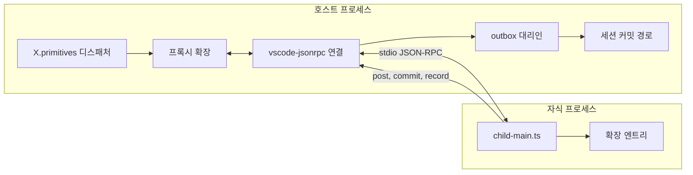

# X 로딩과 신뢰 (loading-trust)

코드 위치: `xeon/packages/ext-host/src/loading-trust/`. 공개 이름은 `@xeon/ext-host`가 재export한다. 루트가 다시 내보내는 이름의 목록은 X.primitives.spec §3.1 표(이 문서 행 포함)가 정본이고, 이 문서는 그 행에 들어갈 로딩·신뢰 이름의 시그니처를 정한다.

## 1. 목적과 범위

확장이 발견되고 검증되어 로드되는 흐름, 프로젝트 신뢰, 선택적 프로세스 격리, pi 확장 어댑터의 범위를 정한다.

근거:

- [결정] 확장 지점은 on(fold tap/first/chain), post, drive(배타 임대), scope 4연산이다(`_research/decisions-log.md` 2026-10-21 계획 v2, adr.0007 §3).
- [결정] DI는 Cordis 하나다. `cordis`를 import하는 패키지는 `ext-host` 하나다(adr.0002 §3, eng.dependency-rules.guide DR-11). vendored Cordis에는 `@cordisjs/plugin-loader`가 없다(`xeon/vendor/cordis/UPSTREAM.json` `notCopied`). 설정 파일 기반 로딩은 ext-host가 직접 구현한다(adr.0002 §4.2).
- [결정] 확장 프로세스 격리는 사용자가 확장마다 켜는 2차 선택 기능이고 기본값은 꺼짐이다(`_research/layer-plan-v2-notes.md` "확장 프로세스 격리는 기본값이 아니어도 된다", `_research/decisions-log.md` 2026-10-21 결정(2차), adr.0006 §4.2).
- 층 구성 계획 v2 X-a 행: 확장 로딩(그대로, Cordis), 능력 선언 정적 검증(설계), 프로젝트 신뢰(포크, pi `trust-manager.ts`·`project-trust.ts`), 프로세스 격리(자체, vscode-jsonrpc 9.0.3)(`_research/packages.md` §4.5, §2.5).
- 항목 카탈로그 X절의 확장 로딩 방식, 프로젝트 신뢰, 프로세스 격리, 능력 선언 행(`_research/item-catalog.md` X절).

정하는 것:

- 탐색 규칙: 설치 위치, 매니페스트 파일, 우선순위, 로드 순서
- 로드 파이프라인 단계와 단계별 실패 상태, 진단 레코드
- TS 엔트리 로딩 방식, `ExtHost.install` 위임과 오류 변환, 핫 리로드 범위, 제거 흐름
- 확장 설정 연결과 예약 키 `ext.<name>.enabled`, `ext.<name>.isolation`, X 층 키 `x.loading-trust.*`
- 신뢰 등급 4값의 뜻과 허용 연산 표, 프로젝트 신뢰 판정과 저장
- 프로세스 격리(2차)의 전송, 프록시, 직렬화, 수명, 기록 경로
- pi 확장 어댑터의 범위와 지원 표, 가상 모듈 처리
- `project_trust`, `resources_discover` 지점의 발화 시점(F.extensions.spec §7)

다루지 않는 것:

- 매니페스트 스키마, 지점 41행, fold 규칙, 정적 검사 함수(`validateManifest`, `validateUsage`, `validateManifestSet`)와 `ManifestIssueCode`: F.extensions.spec이 정본이다. 이 문서는 이름으로 인용한다.
- 4연산 실행, 디스패처, post 큐, drive 임대 중재, scope 토글·상태, 리소스 등록 API, 설정 키 `x.primitives.*`: X.primitives.spec.
- tier, 핸들러 시간 예산, 실패 격리·자동 끄기, 확장 전용 저장(접두 테이블 API), 이름 충돌 규칙, 안전 모드, 외부 훅 프로토콜, 설정 키 `x.operations.*`: X.operations.spec. tier와 시간 예산은 operations 소유로 본다 [제안]. F.extensions.spec §1·§4.2의 primitives 표기는 정합성 단계에서 고친다.
- 설정 파일 경로와 읽기, 유효 값 계산: F.wire-settings.spec과 L1.persistence.spec. 이 문서는 키 정의와 신뢰 전 적용 제외 규칙만 둔다.
- 자식 프로세스 기동·종료의 OS 구현: L0.process.spec.

## 2. 용어

| 용어 | 뜻 |
|---|---|
| 후보 (candidate) | 탐색이 찾은 확장 하나. 매니페스트 위치와 설치 위치를 가진다. 아직 코드를 실행하지 않은 상태다 |
| 설치 위치 (source) | `builtin`, `managed`, `user`, `project` 넷. 후보를 어디서 찾았는지 나타낸다 |
| 신뢰 등급 (trust level) | `builtin`, `user`, `project`, `untrusted` 넷. 확장이 할 수 있는 일을 정한다(§4.6) |
| 프로젝트 루트 | 신뢰 판정 대상 폴더. 현재 작업 디렉터리(cwd)를 정규화한 경로다 [제안] |
| 신뢰 필요 자원 | 신뢰 판정 전에 읽거나 실행하면 안 되는 프로젝트 파일 묶음(§4.7.2) |
| 로드 세대 (generation) | 한 확장의 엔트리를 한 번 실행한 단위. 핫 리로드나 격리 재시작마다 1씩 오른다 |
| 진단 레코드 | 로드 중 생긴 문제 하나를 적은 `LoadDiagnostic` 값 |
| 내장 필수 확장 | `essential: true`로 등록된 내장 확장. 이 확장의 실패는 시작 실패다 |
| 격리 확장 | `ext.<name>.isolation`이 `process`인 확장. 자식 프로세스에서 실행된다 |
| 프록시 | 격리 확장 대신 호스트 프로세스에서 지점 핸들러와 리소스를 등록하는 대리 객체 |
| pi 확장 | 매니페스트 없이 `ExtensionFactory`(`(pi) => void`)를 default export하는 pi coding-agent 확장 모듈 |

## 3. 인터페이스

F에서 가져오는 이름은 F 문서 그대로 쓴다: `ExtensionManifest`, `ExtensionManifestSchema`, `ExtensionName`, `ExtensionEntry`, `ScopeFn`, `ScopeApi`, `ManifestIssue`, `ManifestIssueCode`, `ExtensionUsage`, `validateManifest`, `validateUsage`, `validateManifestSet`, `PointName`, `POINTS`, `FIRST_DENY`, `PostItem`, `PostOptions`(F.extensions.spec), `CapabilityId`, `SemVer`, `ServiceKey`(F.capabilities.spec), `SettingDef`, `SettingDefInput`, `SettingCatalog`, `CatalogIssue`, `SettingNamespace`, `defineSettings`, `settingsFromManifest`, `buildCatalog`(F.wire-settings.spec).

### 3.1 신뢰 등급과 설치 위치 (`trust/levels.ts`)

```ts
import { Type, type Static } from "typebox";

/** F.extensions.spec TrustRequestSchema의 값 집합을 확정한다 [제안] */
export type TrustLevel = "builtin" | "user" | "project" | "untrusted";
export const TRUST_LEVELS: readonly ["builtin", "user", "project", "untrusted"] = ["builtin", "user", "project", "untrusted"];
/** 높을수록 앞. 비교는 이 배열의 index로 한다 */
export function trustRank(level: TrustLevel): number;

export type InstallSource = "builtin" | "managed" | "user" | "project";
export const INSTALL_SOURCES: readonly ["builtin", "managed", "user", "project"] = ["builtin", "managed", "user", "project"];

/** 설치 위치가 정하는 상한 등급 */
export const SOURCE_TRUST: { readonly [S in InstallSource]: Exclude<TrustLevel, "untrusted"> } = {
  builtin: "builtin",
  managed: "user",
  user: "user",
  project: "project",
};

export type StorageAccess = "prefix" | "none";
export type IsolationRule = "forbidden" | "optional" | "notLoaded";

export interface TrustPermissions {
  readonly load: boolean;
  /** project_trust 외 지점 */
  readonly on: boolean;
  /** project_trust 지점에 on을 걸 수 있는가 */
  readonly onProjectTrust: boolean;
  readonly post: boolean;
  /** kind가 group이고 usesDrive가 참일 때 */
  readonly drive: boolean;
  /** 도구·명령·provider 등록(X.primitives.spec 리소스 등록) */
  readonly resources: boolean;
  /** 확장 접두 테이블(X.operations.spec). 격리 확장은 이 값과 무관하게 직접 접근이 없다(§4.9.6) */
  readonly storage: StorageAccess;
  readonly isolation: IsolationRule;
}

/** §4.6 표의 코드형. 문서 표와 같은지 테스트가 확인한다 */
export const TRUST_MATRIX: { readonly [L in TrustLevel]: TrustPermissions };
```

### 3.2 내장 모듈과 후보 (`discover.ts`)

```ts
import type { ExtensionEntry, ExtensionManifest, ExtensionName } from "@xeon/contracts/extensions";

/** 내장 패키지(core-*, cap-*, group-*)가 export하는 확장 모듈. 조립 루트(L4 host)가 목록을 넘긴다 */
export interface BuiltinExtensionModule {
  readonly manifest: ExtensionManifest;
  /** 엔트리. 내장 패키지는 named export `extension`으로 둔다(§4.4) */
  readonly extension: ExtensionEntry;
  /** 참이면 이 확장의 로드 실패가 시작 실패다. 기본 false */
  readonly essential?: boolean;
}

export type CandidateOrigin = "manifest" | "pi";

export interface ExtensionCandidate {
  readonly source: InstallSource;
  readonly origin: CandidateOrigin;
  /** 확장 루트 절대 경로. 내장은 null */
  readonly root: string | null;
  /** `.xeon-plugin/plugin.json` 절대 경로. 내장과 pi 확장은 null */
  readonly manifestPath: string | null;
  /** pi 확장의 엔트리 파일 절대 경로. 그 밖에는 null */
  readonly piEntryPath: string | null;
  /** 내장만 */
  readonly builtin: BuiltinExtensionModule | null;
}

// 탐색이 쓰는 파일 접근(LoaderFs)과 설치 위치 경로(LoaderPaths)는 F 포트다(F.extensions.spec §3.2.1 로더 포트).
// X는 L0를 import하지 않으므로 조립 루트가 구현(L0.os)을 주입한다(architecture.layers.spec §4.3.3). 여기서는 다시 export만 한다
import type { LoaderFs, LoaderPaths } from "@xeon/contracts/extensions";
export type { LoaderFs, LoaderPaths } from "@xeon/contracts/extensions";

export interface DiscoverInput {
  readonly builtins: readonly BuiltinExtensionModule[];
  readonly paths: LoaderPaths;
  /** 프로젝트 루트. 신뢰가 허용된 뒤에만 넘긴다(§4.7.4) */
  readonly projectRoot: string | null;
  /** x.loading-trust.paths 유효 값 */
  readonly extraPaths: readonly string[];
  readonly piCompat: boolean;
}

export function discover(fs: LoaderFs, input: DiscoverInput): Promise<{
  readonly candidates: readonly ExtensionCandidate[];
  readonly diagnostics: readonly LoadDiagnostic[];
}>;
```

### 3.3 로드 순서 (`load-order.ts`)

```ts
/** 내장 층 순서. L0 플랫폼 플러그인은 이 파이프라인 밖에서 먼저 등록된다(§4.3) */
export const BUILTIN_LAYER_ORDER: readonly ["L1", "L2", "L3", "plugin"] = ["L1", "L2", "L3", "plugin"];
export const SOURCE_ORDER: readonly ["builtin", "managed", "user", "project"] = ["builtin", "managed", "user", "project"];

export interface OrderKey {
  readonly source: InstallSource;
  /** 내장만 쓴다. 외부는 0 */
  readonly layerIndex: number;
  readonly name: ExtensionName;
}

/** 순수 함수. 입력 순서와 무관하게 같은 결과를 낸다 */
export function compareLoadOrder(a: OrderKey, b: OrderKey): number;
export function orderManifests<T extends { readonly key: OrderKey }>(items: readonly T[]): readonly T[];
```

### 3.4 상태와 진단 (`pipeline.ts`)

```ts
export type LoadState =
  | "discovered" | "validated" | "trusted" | "resolved" | "loading" | "active"
  | "rejected" | "disabled" | "error";

export type LoadStage =
  | "discover" | "manifest" | "set" | "trust" | "settings" | "capabilities" | "admit"
  | "entry" | "usage" | "activate" | "isolation" | "pi";

export type LoadDiagnosticCode =
  | "manifest_missing" | "manifest_parse" | "manifest_invalid"
  | "name_conflict" | "trust_exceeds_source" | "trust_denied" | "trust_undecided" | "trust_store_corrupt"
  | "settings_rejected" | "settings_reserved_key" | "config_required"
  | "capability_missing" | "capability_provider_failed"
  | "tier_rejected"
  | "entry_not_found" | "entry_import_failed" | "entry_not_function" | "entry_threw"
  | "setup_threw" | "setup_timeout" | "setup_action"
  | "usage_invalid" | "usage_warning"
  | "essential_failed" | "disabled_by_setting" | "safe_mode" | "disabled_flag"
  | "isolation_unavailable" | "isolation_point_unsupported" | "isolation_drive_unsupported"
  | "isolation_exited" | "isolation_restart_limit" | "isolation_protocol"
  | "pi_unsupported_module" | "pi_unsupported_api" | "pi_input_mutation" | "pi_name_invalid";

export const LoadDiagnosticSchema = Type.Object({
  extension: Type.Union([Type.String(), Type.Null()]),
  source: Type.Union([
    Type.Literal("builtin"), Type.Literal("managed"), Type.Literal("user"), Type.Literal("project"), Type.Null(),
  ]),
  stage: Type.String(),
  severity: Type.Union([Type.Literal("error"), Type.Literal("warning"), Type.Literal("info")]),
  code: Type.String(),
  message: Type.String({ maxLength: 2000 }),
  path: Type.Optional(Type.String()),
  /** validate* 결과 원본 */
  issues: Type.Optional(Type.Array(Type.Object({
    severity: Type.String(), code: Type.String(), path: Type.String(), message: Type.String(),
  }))),
  generation: Type.Integer({ minimum: 0 }),
});

export interface LoadDiagnostic {
  readonly extension: ExtensionName | null;
  readonly source: InstallSource | null;
  readonly stage: LoadStage;
  readonly severity: "error" | "warning" | "info";
  readonly code: LoadDiagnosticCode;
  /** 사람이 읽는 문장. 비밀 값과 파일 내용을 넣지 않는다 */
  readonly message: string;
  readonly path?: string;
  readonly issues?: readonly ManifestIssue[];
  readonly catalogIssues?: readonly CatalogIssue[];
  readonly generation: number;
}

export interface LoadedExtensionInfo {
  readonly name: ExtensionName;
  readonly version: SemVer;
  readonly source: InstallSource;
  readonly origin: CandidateOrigin;
  readonly trust: TrustLevel;
  readonly state: LoadState;
  readonly isolation: "none" | "process";
  readonly essential: boolean;
  /** 로드 순서 index. 디스패치 순서의 두 번째 키(F.extensions.spec §4.2). 로드되지 않았으면 null */
  readonly loadIndex: number | null;
  readonly generation: number;
  readonly diagnostics: readonly LoadDiagnostic[];
}
```

### 3.5 로더 서비스 (`index.ts`)

```ts
export type LoaderMode = "interactive" | "headless";

export interface LoadOptions {
  readonly builtins: readonly BuiltinExtensionModule[];
  readonly cwd: string;
  readonly mode: LoaderMode;
  /** CLI 일회 지정. 있으면 신뢰 판정의 첫 단계로 쓴다(§4.7.3) */
  readonly trustOverride?: boolean;
  /** 안전 모드와 --disable-ext(X.operations.spec §3.6 StartupOptions). 없으면 둘 다 꺼짐. 2차 */
  readonly startup?: StartupOptions;
  readonly signal: AbortSignal;
}

export interface LoadReport {
  readonly extensions: readonly LoadedExtensionInfo[];
  readonly diagnostics: readonly LoadDiagnostic[];
  readonly projectTrust: ProjectTrustResult;
  /** 거부된 확장을 뺀 설정 그룹. 조립 루트가 buildCatalog에 넣는다(§4.5.4) */
  readonly settingGroups: readonly {
    readonly owner: string;
    readonly namespace: SettingNamespace;
    readonly defs: readonly SettingDef[];
  }[];
}

/** 내장 필수 확장이 실패하면 loadAll이 던진다 */
export declare class LoadAbortError extends Error {
  readonly diagnostics: readonly LoadDiagnostic[];
}

/** 제거 확인 화면용. 지울 확장 전용 테이블 목록(X.operations.spec ExtStorageAdmin.dropExtension(name, false)) */
export interface RemovalPreview {
  readonly name: ExtensionName;
  readonly tables: readonly string[];
}

export interface RemoveResult {
  readonly name: ExtensionName;
  /** 지운 테이블. dropTables가 거짓이면 빈 배열 */
  readonly dropped: readonly string[];
  /** 남은 테이블("주인 없는 확장 테이블") */
  readonly remaining: readonly string[];
}

export interface ExtensionLoader {
  /** 시작 때 한 번. 파이프라인 전체를 실행한다 */
  loadAll(options: LoadOptions): Promise<LoadReport>;
  /** ext.<name>.enabled가 거짓에서 참이 되면 부른다. 아직 로드되지 않은 확장을 로드한다 */
  ensureLoaded(name: ExtensionName, signal: AbortSignal): Promise<LoadedExtensionInfo>;
  list(): readonly LoadedExtensionInfo[];
  diagnostics(): readonly LoadDiagnostic[];
  /** 개발용. M2 이후(§4.4.4) */
  reload(name: ExtensionName, signal: AbortSignal): Promise<LoadedExtensionInfo>;
  /** 제거 1단계. 아무것도 바꾸지 않고 지울 테이블 목록만 돌려준다(§4.4.5). M2 */
  previewRemoval(name: ExtensionName): Promise<RemovalPreview>;
  /** 제거 2단계. 실행 중 호스트에서 내리고, dropTables가 참이면 확장 전용 테이블을 지운다(§4.4.5). M2 */
  remove(name: ExtensionName, options: { readonly dropTables: boolean; readonly signal: AbortSignal }): Promise<RemoveResult>;
  /** 역순으로 scope를 정리하고 격리 프로세스를 끝낸다 */
  dispose(): Promise<void>;
}

/** 조립 루트가 주입하는 의존. 없는 항목은 그 기능을 쓰는 단계에서 실패한다(§4.3.2) */
export interface LoaderDeps {
  /** 설치 대상. 엔트리 호출과 scope 실행은 ExtHost.install이 한다(§4.1) */
  readonly host: ExtHost;
  /** 운영 정책(X.operations.spec §3.8). 6a단계 admit, 설치 실패·제거 때 forget, 5a단계 startupFilter */
  readonly policy: Pick<OperationsPolicy, "admit" | "forget" | "startupFilter">;
  readonly fs: LoaderFs;
  readonly paths: LoaderPaths;
  readonly trustBackend: TrustStoreBackend;
  /** 대화형 프롬프트. headless면 없다 */
  readonly prompter?: TrustPrompter;
  /** 격리(2차). 조립 루트가 host.ports.get(ProcessPortKey)로 꺼내 넣는다. 없으면 격리 설정 확장은 isolation_unavailable */
  readonly process?: IsolationProcessPort;
  /** 제거 흐름의 테이블 삭제(X.operations.spec §3.4). 없으면 remove는 테이블을 남긴다. M2 */
  readonly storageAdmin?: ExtStorageAdmin;
  readonly clock: { now(): number };
}

export function createExtensionLoader(deps: LoaderDeps): ExtensionLoader;
```

- 같은 패키지의 다른 도메인 이름은 타입만 가져온다: `ExtHost`, `ExtensionUnit`, `InstallResult`(`../primitives/index.ts`), `OperationsPolicy`, `StartupOptions`, `ExtStorageAdmin`(`../operations/index.ts`). 값 import가 없으므로 도메인 사이 값 순환이 없다.
- [제안] `ExtensionLoader`는 Cordis 서비스로 등록하지 않는다. 조립 루트(L4 host)가 `createExtensionLoader(deps)` 결과를 직접 쥐고 `host.status`, 설정 화면, 확장 명령에 넘긴다. `ExtHost`(`xeon.ext`)에는 `loader` 속성을 두지 않는다. 로더는 `ExtHost`를 쓰고 `ExtHost`는 로더를 참조하지 않으므로 의존이 한 방향이다.
- 조립 순서: `createOperationsPolicy` → `createExtHost` → `ExtHost.registerPlatform`(L0) → `createExtensionLoader({ host, policy, … })` → `loadAll`(X.operations.spec §3.8, L4.host-service.spec).
- L4.host-service.spec이 [가정]으로 둔 `HostPluginModule = import("@xeon/ext-host").PluginModule`은 이 문서의 `BuiltinExtensionModule`이다 [제안]. 이름 `PluginModule`을 따로 두지 않는다.
- `LoaderFs`, `LoaderPaths`, `TrustStoreBackend`, `TrustPrompter`, `IsolationProcessPort`는 L0·L4가 구현하는 포트다. 타입 정본은 F.extensions.spec §3.2.1 `ports.ts`이고, 이 문서는 `@xeon/contracts/extensions`에서 가져와 다시 export만 한다([결정: review.decisions-2 U-14]). 판정 함수(`discover`, `resolveProjectTrust`, `trustOptions`)와 신뢰 파일 스키마(`TrustFileSchema`)는 X에 남는다.

### 3.6 설정 키 정의 (`settings-keys.ts`)

```ts
import type { SettingDef, SettingDefInput, SettingGroup } from "@xeon/contracts/settings";

/** ext.<name>.enabled, ext.<name>.isolation. 확장마다 로더가 만든다(§4.5) */
export function reservedExtensionSettings(manifest: ExtensionManifest, source: InstallSource): {
  readonly namespace: `ext.${string}`;
  readonly defs: readonly SettingDef[];
};

export const RESERVED_EXT_KEYS: readonly ["enabled", "isolation"] = ["enabled", "isolation"];

/** X 층 키. defineSettings("x.loading-trust", …) */
export declare const loadingTrustSettings: SettingGroup<"x.loading-trust", {
  readonly defaultProjectTrust: SettingDefInput;
  readonly paths: SettingDefInput;
  readonly piCompat: SettingDefInput;
  readonly "isolation.maxRestarts": SettingDefInput;
  readonly "isolation.restartWindowSec": SettingDefInput;
}>;
```

값 스키마와 기본값은 §6 표가 정한다.

### 3.7 신뢰 (`trust/store.ts`, `trust/resolve.ts`, `trust/resources.ts`)

```ts
// 신뢰 포트와 부속 타입은 F가 정본이다(F.extensions.spec §3.2.1 로더 포트). 여기서는 다시 export만 한다.
// 구현: TrustStoreBackend는 L0.os, TrustPrompter는 대화형 클라이언트(L4)
import type { Result } from "@xeon/contracts";
import type {
  LoaderFs, TrustStoreBackend, TrustPrompter, TrustPromptRequest, TrustOption, TrustUpdate, TrustChoice, TrustChoiceKind,
} from "@xeon/contracts/extensions";
export type {
  TrustStoreBackend, TrustPrompter, TrustPromptRequest, TrustOption, TrustUpdate, TrustChoice, TrustChoiceKind,
} from "@xeon/contracts/extensions";

export type TrustVerdict = "allow" | "deny" | "undecided";

/** 저장 파일 형식. pi trust.json(Record<path, boolean|null>)에 버전과 출처를 더했다. 패키지 안에서만 쓴다(공개 이름이 아님) */
const TrustFileSchema = Type.Object({
  version: Type.Literal(1),
  entries: Type.Record(
    Type.String({ minLength: 1, maxLength: 4096 }),
    Type.Object({
      verdict: Type.Union([Type.Literal("allow"), Type.Literal("deny")]),
      /** ISO 8601 */
      decidedAt: Type.String(),
      via: Type.Union([Type.Literal("prompt"), Type.Literal("point"), Type.Literal("command")]),
    }),
  ),
});
type TrustFile = Static<typeof TrustFileSchema>;

export type TrustLookup =
  | { readonly kind: "found"; readonly verdict: "allow" | "deny"; readonly path: string }
  | { readonly kind: "none" }
  | { readonly kind: "corrupt"; readonly reason: string };

export declare class ProjectTrustStore {
  constructor(backend: TrustStoreBackend, normalize: (path: string) => Promise<string>, clock: { now(): number });
  /** 저장소 키로 쓰는 정규 경로(normalize) */
  canonical(path: string): Promise<string>;
  /** cwd에서 위로 올라가며 가장 가까운 항목. 읽기·파싱·스키마 실패는 던지지 않고 corrupt다 */
  lookup(cwd: string): Promise<TrustLookup>;
  /**
   * 갱신을 하나의 읽기-수정-쓰기(TrustStoreBackend.update)로 적용한다. 파일이 손상이면 쓰지 않고 corrupt를,
   * 백엔드 쓰기가 실패하면 io를 돌려준다(던지지 않는다, eng.typescript.guide TY-24)
   */
  setMany(updates: readonly TrustUpdate[]): Promise<Result<void, TrustStoreError>>;
}

export type TrustStoreError =
  | { readonly kind: "corrupt"; readonly reason: string }
  | { readonly kind: "io"; readonly cause: unknown };

/**
 * pi getProjectTrustOptions 포크. §4.7.3 표의 선택지 다섯 개와 저장할 갱신(TrustOption은 F 타입). 상위 폴더가 없으면(parent가 null)
 * 상위 선택지를 뺀다. label은 표시 문구가 아니라 L4가 현지화할 식별자다(trust-folder, trust-parent, trust-session, deny-folder,
 * deny-session). 세션 선택지의 updates는 비어 있고 호출자가 sessionMemory에 둔다
 */
export function trustOptions(projectRoot: string, parent: string | null): readonly TrustOption[];

/** pi hasTrustRequiringProjectResources 포크(§4.7.2) */
export const TRUST_REQUIRING_PROJECT_RESOURCES: readonly string[];
export function findTrustRequiringResources(fs: LoaderFs, projectRoot: string, homeDir: string): Promise<readonly string[]>;

export type TrustVia =
  | "override" | "notRequired" | "point" | "store" | "sessionMemory" | "default" | "prompt" | "headless" | "corruptStore";

export interface ProjectTrustResult {
  readonly projectRoot: string;
  /** 신뢰 필요 자원이 있었는가 */
  readonly required: boolean;
  readonly trusted: boolean;
  readonly verdict: TrustVerdict;
  readonly via: TrustVia;
  /** 찾은 신뢰 필요 자원(프로젝트 루트 기준 상대 경로) */
  readonly resources: readonly string[];
  /** 결정을 저장하려다 실패했다(손상된 저장 파일 등). 결정은 유효하다. 호출자가 trust_store_corrupt 진단을 남긴다 */
  readonly storeError?: TrustStoreError;
}

export interface ResolveProjectTrustInput {
  readonly projectRoot: string;
  readonly mode: LoaderMode;
  readonly trustOverride?: boolean;
  readonly defaultProjectTrust: "ask" | "always" | "never";
  readonly store: ProjectTrustStore;
  readonly fs: LoaderFs;
  readonly homeDir: string;
  readonly prompter?: TrustPrompter;
  /** project_trust 지점 디스패치. X.primitives의 디스패처를 감싼 함수 */
  readonly emitProjectTrust: (cwd: string, signal: AbortSignal) => Promise<
    { readonly trusted: "yes" | "no"; readonly remember?: boolean } | undefined
  >;
  /** 이번 호스트 프로세스 동안만 유지하는 결정 */
  readonly sessionMemory: Map<string, "allow" | "deny">;
  readonly signal: AbortSignal;
}

export function resolveProjectTrust(input: ResolveProjectTrustInput): Promise<ProjectTrustResult>;
```

- `emitProjectTrust`의 반환 형태는 pi `ProjectTrustEventResult`(`types.ts:693-696`)에서 `undecided`를 뺀 것이다. 정본은 F.extensions.spec §3.5.1의 `ProjectTrustDecision`(`{ trusted: "yes" | "no"; remember?: boolean }`)이고, 위 반환 형태와 같다.

### 3.8 프로세스 격리 (`isolation/rpc.ts`, `isolation/proxy.ts`, `isolation/outbox-agent.ts`) — 2차

```ts
// 자식 프로세스 기동 포트와 부속 타입은 F가 정본이다(F.extensions.spec §3.2.1, ProcessPort의 부분).
// 구현은 platform-process(서비스 xeon.process, ProcessService extends ProcessPort)다. 여기서는 다시 export만 한다
import type { IsolationProcessPort, IsolatedChild } from "@xeon/contracts/extensions";
export type { IsolationProcessPort, IsolationSpawnSpec, IsolatedChild } from "@xeon/contracts/extensions";

export const ISOLATION_PROTOCOL_VERSION = 1;

/** vscode-jsonrpc 메서드 이름. 접두 "xeon/"는 F.wire-settings의 호스트 계약과 겹치지 않게 둔다 */
export const IsoMethods = {
  // 호스트 → 자식
  init: "xeon/iso.init",
  dispatch: "xeon/iso.dispatch",
  toolExecute: "xeon/iso.tool.execute",
  dispose: "xeon/iso.dispose",
  // 자식 → 호스트
  register: "xeon/iso.register",
  post: "xeon/iso.post",
  commit: "xeon/iso.commit",
  record: "xeon/iso.record",
  readRecords: "xeon/iso.readRecords",
  capabilityCall: "xeon/iso.capability.call",
  log: "xeon/iso.log",
} as const;

export const IsoInitParams = Type.Object({
  protocolVersion: Type.Literal(1),
  manifest: ExtensionManifestSchema,
  entryPath: Type.String(),
  generation: Type.Integer({ minimum: 1 }),
  /** 이 확장의 ext.<name>.* 유효 값. secret 키는 참조 문자열만 */
  settings: Type.Record(Type.String(), Type.Unknown()),
});
export const IsoInitResult = Type.Object({
  /** setup 동안의 사용 기록(ExtensionUsage와 같은 형태) */
  usage: Type.Object({
    on: Type.Array(Type.String()),
    post: Type.Boolean(),
    drive: Type.Boolean(),
    capabilities: Type.Array(Type.String()),
    recordKinds: Type.Array(Type.String()),
    readsRecordKinds: Type.Array(Type.String()),
  }),
  tools: Type.Array(Type.Object({ name: Type.String(), definition: Type.Unknown() })),
});

export const IsoDispatchParams = Type.Object({
  dispatchId: Type.String(),
  point: Type.String(),
  scopeId: Type.String(),
  threadId: Type.String(),
  /** JSON 직렬화된 페이로드. 동결은 자식이 다시 한다 */
  payload: Type.Unknown(),
  /** chain 지점만 */
  current: Type.Optional(Type.Unknown()),
  state: Type.Unknown(),
});
export const IsoDispatchResult = Type.Object({
  /** tap은 null. first는 결정 또는 null(=undefined), chain은 패치 또는 null */
  result: Type.Unknown(),
});

export const IsoPostParams = Type.Object({
  scopeId: Type.String(),
  item: Type.Unknown(),          // PostItem. 호스트가 F 스키마로 다시 검사한다
  requestId: Type.String({ minLength: 1, maxLength: 64 }),
  when: Type.Union([Type.Literal("steer"), Type.Literal("followUp"), Type.Literal("next")]),
});

/** 호스트 쪽 대리인. 격리 확장의 기록을 세션 커밋 경로로 옮긴다 */
export interface OutboxAgent {
  post(params: Static<typeof IsoPostParams>): Promise<{ readonly requestId: string; readonly duplicate: boolean }>;
  commit(scopeId: string, state: unknown, rev: number): Promise<void>;
  record(scopeId: string, kind: string, subject: { readonly type: string; readonly id: string }, payload: unknown): Promise<void>;
}

/** 페이로드·결정·패치 스키마가 JSON으로 왕복 가능한 지점. POINTS에서 계산한다(§4.9.4) */
export function isolatablePoints(): ReadonlySet<PointName>;

export interface IsolationPolicy {
  readonly maxRestarts: number;
  readonly restartWindowSec: number;
  /** 취소 요청 뒤 강제 종료까지의 유예 시간 [제안] 2000ms */
  readonly killGraceMs: number;
}
```

### 3.9 pi 어댑터 (`pi-adapter/factory.ts`, `pi-adapter/api-map.ts`, `pi-adapter/compat-report.ts`) — M2 이후

```ts
/** pi ExtensionFactory. 타입은 pi 패키지에 의존하지 않고 로컬로 둔다 */
export type PiExtensionFactory = (pi: PiExtensionApiShim) => void | Promise<void>;

/** pi ExtensionAPI 중 어댑터가 제공하는 부분. 형태는 pi types.ts:1564-1890을 따른다 */
export interface PiExtensionApiShim {
  on(event: string, handler: (event: unknown, ctx: unknown) => unknown): void;
  registerTool(tool: unknown): void;
  registerCommand(name: string, options: unknown): void;
  sendMessage(message: unknown, options?: unknown): void;
  sendUserMessage(content: unknown, options?: unknown): void;
  appendEntry(customType: string, data?: unknown): void;
  // §4.10.4 지원 표의 나머지 멤버. 비지원 멤버는 PiCompatUnsupportedError를 던진다
  readonly [member: string]: unknown;
}

export declare class PiCompatUnsupportedError extends Error {
  readonly api: string;
}

/** 공장 함수 실행 동안 기록한 사용 */
export interface PiRecordedUsage {
  readonly on: readonly PointName[];
  readonly post: boolean;
  readonly tools: readonly string[];
  readonly commands: readonly string[];
  readonly providers: readonly string[];
  readonly appendEntry: boolean;
}

/** 합성 매니페스트. 순수 함수 */
export function synthesizeManifest(input: {
  readonly name: ExtensionName;
  readonly version: SemVer;
  readonly entry: string;
  readonly source: "user" | "project";
  readonly usage: PiRecordedUsage;
}): ExtensionManifest;

/** pi 파일·디렉터리 이름에서 확장 이름을 만든다. "pi-" 접두, 소문자, 64자 이하 */
export function piExtensionName(entryPath: string): ExtensionName | null;

/** post 멱등 키. 길이 64자 이하 */
export function piPostKey(input: {
  readonly extension: ExtensionName;
  readonly turnId: string | null;
  readonly content: unknown;
  /** 같은 turn 안에서 같은 내용의 몇 번째 호출인가(0부터) */
  readonly ordinal: number;
}): string;

export type PiSupport = "supported" | "partial" | "unsupported";
export interface PiCompatRow {
  readonly api: string;
  readonly support: PiSupport;
  /** Xeon 대응 */
  readonly maps: string;
  readonly note: string;
}
/** §4.10.4 표의 코드형 */
export const PI_COMPAT_TABLE: readonly PiCompatRow[];

/** 로드한 pi 확장 하나의 호환 보고. 쓰인 비지원·부분 항목 목록 */
export interface PiCompatReport {
  readonly extension: ExtensionName;
  readonly used: readonly { readonly api: string; readonly support: PiSupport }[];
}

/** 가상 모듈. 제공 패키지가 등록한다(§4.10.6) */
export interface VirtualModuleRegistry {
  register(specifier: string, namespace: Readonly<Record<string, unknown>>): void;
  /** 비지원 모듈. import하면 pi_unsupported_module 진단과 함께 실패한다 */
  block(specifier: string, reason: string): void;
}
```

## 4. 동작 규칙

### 4.1 기본 로딩 방식

- [결정] 기본 로딩은 같은 프로세스의 Cordis 플러그인이다. 격리는 확장마다 사용자가 켜는 2차 선택이다(§1 근거).
- [제안] 로더는 검증을 마친 확장을 `ExtensionUnit`(정규화 매니페스트, 엔트리, `loadIndex`, `builtin`)으로 만들어 `ExtHost.install(unit)`에 넘긴다(X.primitives.spec §3.2). 엔트리 호출, scope 정의 수집, scope 세대마다의 Cordis fiber 생성, scope setup 실행과 시간 예산, setup 직후 `validateUsage`는 primitives가 한다(X.primitives.spec §4.5.3, §4.5.6). 로더는 `InstallResult`를 진단으로 옮긴다(§4.4.3).
- 로더는 Cordis(`@xeon/vendor-cordis`)를 import하지 않는다. Cordis import는 `src/primitives/cordis-bridge.ts` 한 파일이다(X.primitives.plan §2). Cordis 객체(`Context`, `Fiber`)는 확장 코드에 넘기지 않는다(adr.0002 §3).
- 로드 세대는 엔트리를 다시 실행하는 단위(핫 리로드, 격리 재시작)다. scope를 켤 때마다 바뀌는 scope 세대(X.primitives.spec §2)와 다르다. 다시 로드할 때 로더는 `ExtHost.uninstall` 뒤 새 `install`을 부른다. 세대 번호는 `LoadedExtensionInfo.generation`과 진단 레코드에 남긴다.

### 4.2 탐색 규칙

#### 4.2.1 설치 위치와 매니페스트 파일

| 설치 위치 | 경로 [가정: 기준 디렉터리는 L0.os가 정한다] | 매니페스트 | 등급 상한 |
|---|---|---|---|
| `builtin` | 조립 루트가 넘기는 `BuiltinExtensionModule[]` | 모듈의 `manifest` 상수 | `builtin` |
| `managed` | `<managedDir>/extensions/<dir>/` | `.xeon-plugin/plugin.json` | `user` |
| `user` | `<userDir>/extensions/<dir>/`, `x.loading-trust.paths`의 각 경로 | `.xeon-plugin/plugin.json` | `user` |
| `project` | `<projectRoot>/.xeon/extensions/<dir>/` | `.xeon-plugin/plugin.json` | `project` |
| pi(`user`) | `<userDir>/pi-extensions/` | 없음(합성, §4.10) | `user` |
| pi(`project`) | `<projectRoot>/.xeon/pi-extensions/` | 없음(합성) | `project` |

- 외부 확장의 매니페스트는 확장 루트의 `.xeon-plugin/plugin.json`이다(F.extensions.spec §3.1, Claude Code `.claude-plugin/plugin.json` 레이아웃, `_research/refs/claude-code.md` 96-99행).
- 내장 패키지는 엔트리 모듈이 `manifest` 상수와 `extension` 엔트리를 named export한다. 로더는 같은 `validateManifest`로 검사한다. 내장 매니페스트도 JSON 파싱 결과와 같은 검사를 받는다.
- 탐색 깊이는 한 단계다. `extensions/` 아래 디렉터리마다 `.xeon-plugin/plugin.json`이 있으면 후보 하나다. 더 깊이 내려가지 않는다(pi `discoverExtensionsInDir`와 같은 규칙, `loader.ts:791-826`).
- 매니페스트 파일이 없는 디렉터리는 `manifest_missing` 경고만 남기고 건너뛴다. Claude Code의 "매니페스트 없이 표준 레이아웃 자동 탐색"(`_research/refs/claude-code.md` 96행)은 채택하지 않는다 [제안]. 엔트리와 지점 선언이 없으면 정적 검사를 할 수 없기 때문이다.
- pi 디렉터리는 pi 규칙(`*.ts`·`*.js` 파일, `<dir>/index.ts`, `<dir>/package.json`의 `pi.extensions`)으로 찾는다(`loader.ts:736-826`). `x.loading-trust.piCompat`이 거짓이면 찾지 않는다.
- 심볼릭 링크는 `realpath`로 풀고, 같은 실제 경로는 한 번만 후보로 둔다.

#### 4.2.2 우선순위와 이름 충돌

- [제안] 같은 `name`이 여러 위치에 있으면 `builtin` > `managed` > `user` > `project` 순서로 앞의 것을 쓴다. 뒤의 것은 `rejected`(`name_conflict`)다. `validateManifestSet`의 `name_conflict`는 같은 위치 안의 충돌에서도 나오며, 이때는 둘 다 `rejected`다.
- 이 순서는 프로젝트 폴더가 내장이나 사용자 확장을 같은 이름으로 대체하지 못하게 한다. 관리 위치는 사용자 위치보다 앞이다(관리 정책).

#### 4.2.3 로드 순서

- [제안] 순서 키는 (설치 위치 순서, 내장 층 순서, 이름)이다. `SOURCE_ORDER`는 `builtin` → `managed` → `user` → `project`, 내장 층 순서는 `L1` → `L2` → `L3` → `plugin`이다. 같은 위치·같은 층은 `name`의 코드 포인트 사전순이다.
- L0 플랫폼 패키지는 매니페스트 층 값(`ExtensionLayerSchema`)에 L0가 없으므로 이 파이프라인 밖에서 조립 루트가 `ExtHost.registerPlatform`(X.primitives.spec §3.2)으로 먼저 등록한다. L0 등록 실패는 시작 실패다.
- 순서는 파일 시스템 나열 순서, 입력 배열 순서와 무관하게 같아야 한다. 이 순서는 디스패치 순서의 두 번째 키다(F.extensions.spec §4.2).

### 4.3 로드 파이프라인

#### 4.3.1 단계 표

[제안] 확장마다 아래 단계를 차례로 거친다. 한 단계라도 실패하면 그 확장은 표의 상태에서 멈추고 다음 단계를 실행하지 않는다.

| # | 단계 | 입력 → 출력 | 실패 시 상태 | 진단 코드 |
|---|---|---|---|---|
| 1 | 탐색 | 위치 → `ExtensionCandidate` | (후보 없음) | `manifest_missing` |
| 2 | `validateManifest` | JSON 파싱 결과 → 정규화 매니페스트 | `rejected` | `manifest_parse`, `manifest_invalid`(issues 포함) |
| 3 | `validateManifestSet` | 통과한 매니페스트 집합 → 집합 이슈 | `rejected`(오류만) | `name_conflict`, `manifest_invalid` |
| 4 | 신뢰 판정 | 설치 위치, `trust.level`, 프로젝트 신뢰 → `TrustLevel` | `rejected` | `trust_exceeds_source`, `trust_denied`, `trust_undecided`, `trust_store_corrupt` |
| 5 | 설정 연결 | `settingsFromManifest` + 예약 키 → 설정 그룹 | `rejected` | `settings_rejected`, `settings_reserved_key` |
| 5a | 켜짐 확인 | `ext.<name>.enabled`, 필수 userConfig, `LoadOptions.startup`(`policy.startupFilter`, 2차) | `disabled` | `disabled_by_setting`, `config_required`, `safe_mode`, `disabled_flag` |
| 6 | 능력 요구 충족 | `requires` × 집합의 `provides`·코어 능력 | `error` | `capability_missing` |
| 6a | tier 등록 | `policy.admit`(X.operations.spec §3.8) | `error` | `tier_rejected` |
| 7 | 설치 | 엔트리 import(외부) → `ExtensionUnit` → `ExtHost.install` → `InstallResult` | `error` | `entry_not_found`, `entry_import_failed`, `entry_not_function`, `entry_threw`, `setup_threw`, `setup_timeout`, `setup_action` |
| 8 | 사용 대조 결과 반영 | `InstallResult.setups[].issues`(primitives가 부른 `validateUsage`) → 진단 | `error`(오류만) | `usage_invalid`, `usage_warning` |
| 9 | 활성화 | 시작 적용 결과 확정, provider 연쇄 확인 | `error` | `capability_provider_failed` |

- 2단계의 `unknown_key` 경고는 진단에 남기고 계속한다(F.extensions.spec §4.7).
- 3단계는 두 번 실행한다. 첫 번째는 프로젝트 신뢰 전 집합(내장, 관리, 사용자), 두 번째는 프로젝트 후보를 더한 집합이다. 두 번째에서 새로 생긴 오류는 프로젝트 확장만 `rejected`로 만든다.
- `drive_conflict`, `capability_unprovided` 경고는 진단만 남긴다. 실행 중 임대는 X.primitives가 하나만 준다.
- 7단계에서 scope setup이 던지거나 시간 예산을 넘으면 primitives가 그 scope의 fiber를 해제해 setup 동안의 등록(on, drive, 리소스, onDispose)을 모두 되돌린다(X.primitives.spec §4.5.3). pi의 `discard()`와 같다(`loader.ts:542-549`, `621-631`). 시간 예산 값은 X.operations.spec의 `x.operations.budget.setupMs`이고, `ExtHostDeps.setupBudgetMs`로 primitives에 들어간다.
- 7·8단계에서 실패한 확장은 로더가 `ExtHost.uninstall`과 `policy.forget`을 불러 남은 정의와 tier 표 항목을 지운다.
- 8단계의 `point_undeclared`, `post_undeclared`, `drive_undeclared`, `capability_undeclared`, `record_kind_undeclared`, `read_kind_undeclared`는 오류다. 7단계처럼 등록이 되돌려진 상태이고 `error`로 둔다. `point_unused`는 경고다(`usage_warning`).
- 시작 때는 첫 turn 전이므로 install이 켜기를 바로 적용한다(X.primitives.spec §4.5.6 시작 적용). 실행 중 `ensureLoaded`처럼 thread가 돌고 있으면 켜기는 다음 단계 경계에 적용되고(F.extensions.spec §4.5), 그 setup 실패는 9단계 뒤 `ScopeInfo.lastError`로만 보인다 [제안].

#### 4.3.2 실패 격리

- [제안] 내장 필수가 아닌 확장 하나의 실패는 그 확장만 멈춘다. 다른 확장의 단계 진행과 엔진 시작은 계속한다. 이 규칙은 모든 단계에 적용된다(항목 카탈로그 X절 실패 격리 행, pi `loadExtensionsInternal`의 오류 수집 `loader.ts:676-716`).
- 예외 1: `essential: true` 내장 확장이 `rejected`, `disabled`, `error` 중 하나가 되면 `loadAll`은 `essential_failed` 진단과 함께 `LoadAbortError`를 던진다. 조립 루트는 연 자원을 닫고 시작을 거부한다(L4.host-service.spec §4.1). [제안] L1 코어 패키지(`core-*`)의 확장 모듈은 필수다. L2 능력과 L3 그룹은 필수가 아니다.
- 예외 2: 로더 자신이 쓰는 주입 의존이 없으면 시작 실패다(architecture.layers.spec §4.3.3 1번). 대상은 `host`, `policy`, `LoaderFs`, `LoaderPaths`, `TrustStoreBackend`다. `TrustPrompter`가 없으면 headless로 보고, `IsolationProcessPort`가 없으면 격리 설정 확장만 `error`(`isolation_unavailable`)다.
- 능력 연쇄: 6단계는 매니페스트의 `provides`로 정적으로 판정한다. 9단계 뒤 실제로 활성화되지 못한 provider가 있으면, 그 능력을 `requires`로 선언한 확장도 `error`(`capability_provider_failed`)로 바꾼다. `optional`은 영향이 없다. 프로젝트 신뢰 전 집합의 확장이 프로젝트 확장만 제공하는 능력을 `requires`하면 `capability_missing`이다 [제안].
- 같은 이유로 확장 A의 실패가 B의 setup을 막지 않도록 각 단계는 확장마다 `try`로 감싸고, 진단 레코드만 모은다.

#### 4.3.3 진단 레코드

- 모든 실패와 경고는 `LoadDiagnostic` 하나로 남는다. `issues`에는 `validate*`가 돌려준 `ManifestIssue`를 그대로 담는다.
- 진단은 메모리에 두고 `ExtensionLoader.diagnostics()`로 읽는다. L4는 설정 화면 "플러그인과 그룹" 탭과 `host.status`에서 보인다(L4.settings-ui.spec, L4.host-service.spec).
- 진단을 내구 이벤트로 남길지는 [미결]이다(§10 미결 6). 현재 ext-host가 발행하는 코어 kind 영역은 `scope.`, `lease.`, `post.`이다(F.records.spec §3.3, X.primitives.spec §7). 확장 kind는 `x.`/`grp.` 접두다([결정: review.decisions-2 T-21]).
- `message`에는 비밀 값, 설정 값, 파일 내용을 넣지 않는다. 경로와 코드만 넣는다.

### 4.4 엔트리 로딩과 호출 규약

#### 4.4.1 TS 엔트리 로딩 방식 비교

| 안 | 방식 | 장점 | 단점 |
|---|---|---|---|
| A. Bun 직접 `import()` [제안] | 엔트리 절대 경로를 `import()`한다. 가상 모듈은 `Bun.plugin`의 `build.module(specifier, () => ({ exports, loader: "object" }))`로 등록한다 | 의존 0. Bun이 TS를 그대로 변환한다. 런타임과 같은 모듈 그래프라 `instanceof`가 맞는다 | 모듈 캐시를 끄는 옵션이 없다. 핫 리로드에 캐시 무효화 우회가 필요하다(§4.4.4). `Bun.plugin`은 프로세스 전역이다 |
| B. jiti | pi와 같은 방식(`loader.ts:576-581`, `moduleCache: false`, `virtualModules`) | pi 어댑터 경로가 원본과 같다. 캐시를 끌 수 있다 | 의존 하나와 별도 변환기. Bun 변환과 결과가 다를 수 있다. pi는 Bun 바이너리에서 정적 로더(`jiti-static-loader.ts`)로 따로 우회한다 |
| C. `Bun.Transpiler` + 직접 평가 | 소스를 변환해 평가한다 | 캐시를 완전히 통제한다 | import 해석을 직접 만들어야 한다. 오류 위치가 흐려진다 |

- [제안] A를 쓴다. `bun build --compile` 바이너리에서 외부 `.ts` 파일의 동적 `import()`가 동작하는지는 확인하지 않았다 [가정]. 동작하지 않으면 B로 바꾼다. 이 판정은 X.loading-trust.plan의 첫 스파이크 작업이다.

#### 4.4.2 엔트리 모듈 형태

- 외부 확장: 매니페스트 `entry`(확장 루트 상대 경로)를 import한다. export는 `default` 또는 named `extension` 중 하나가 `ExtensionEntry` 함수여야 한다. 둘 다 없으면 `entry_not_function`이다.
- 내장 확장: `BuiltinExtensionModule.extension`을 그대로 쓴다. import는 조립 루트가 이미 했다. Xeon 코드의 lint는 default export를 막으므로 내장 패키지는 named export만 쓴다(`xeon/AGENTS.md` 코드 규칙). F.extensions.spec §3.2의 "default export 형식" 주석과의 조정은 §10 미결 2다.
- `entry`가 확장 루트 밖을 가리키는 경우는 `validateManifest`의 `entry_invalid`가 막는다. 로더는 import 직전에 `realpath` 결과가 확장 루트 안인지 다시 확인한다.

#### 4.4.3 설치 위임과 오류 변환

1. 로더는 한 로드 세대에 `ExtHost.install(unit)`을 정확히 한 번 부른다. 엔트리 호출(`{ manifest, scope }`, `manifest`는 정규화·동결 값)과 scope 실행은 install 안에서 일어난다(X.primitives.spec §3.2, §4.5.6).
2. 엔트리 본문에서 부를 수 있는 연산은 `scope(id, def, setup)`뿐이다(F `ExtensionEntry`). `on`, `drive`, `onDispose`, 리소스 등록, `capability(key)`는 scope setup 안에서 부른다. 이 문서에서 "setup"은 scope setup(`ScopeSetup`)만 뜻한다.
3. 엔트리는 최소 하나의 scope를 만든다. 주 scope id는 매니페스트 `name`이다(F.extensions.spec §3.2). `InstallResult.scopes`가 비어 있고 `entryError`도 없으면 `usage_invalid`다 [제안].
4. scope setup 본문은 thread 맥락 밖이다. 그래서 `state()`, `commit`, `post`, `record`, `readRecords`는 `PrimitiveError("no_thread")`로 거부된다(X.primitives.spec §4.6.3). pi도 로딩 중 동작 메서드를 막는다(`loader.ts:157-162`).
5. 엔트리 본문과 scope setup은 `x.operations.budget.setupMs` 예산 안에서 await된다. 넘긴 뒤 늦게 끝난 setup의 등록은 scope 세대가 닫혀 있으므로 버려진다(X.primitives.spec §4.5.3, `_research/notes/X-2.md` §0 6번).
6. 활성화 뒤의 등록 호출(예: 핸들러 안의 `on`)은 primitives가 호출마다 검사한다. 선언 밖이면 그 호출만 `PrimitiveError("point_undeclared")`로 거부하고 `ExtHostDeps.report`로 진단을 남긴다. 확장 전체를 끄지는 않는다 [제안]. 반복 위반의 자동 끄기는 X.operations.spec 몫이다. 이 경우는 로더 진단이 아니다.

[제안] 오류를 던지는 층과 로더 진단 코드의 대응:

| 일어나는 곳 | 던지는 쪽과 값 | `InstallResult`에서 보이는 곳 | 로더 진단 코드 | 확장 상태 |
|---|---|---|---|---|
| 엔트리 import(외부 확장) | 로더(Bun `import()`) | 해당 없음(install 전) | `entry_not_found`, `entry_import_failed`, `entry_not_function` | `error` |
| 엔트리 본문 예외 | 확장 코드 예외, `PrimitiveError`(`scope_foreign_id`, `scope_duplicate`) | `entryError` | `entry_threw` | `error` |
| 엔트리가 scope를 만들지 않음 | 없음 | `scopes` 빈 배열 | `usage_invalid` | `error` |
| setup 안의 선언 밖 연산 | `PrimitiveError`(`point_undeclared`, `post_undeclared`, `drive_undeclared`, `drive_requires_group`, `capability_undeclared`, `record_kind_undeclared`, `read_kind_undeclared`) | `setups[].failure`(`threw`, `code`) | `usage_invalid`(issues에 같은 코드) | `error` |
| setup 본문의 thread 맥락 연산 | `PrimitiveError("no_thread")` | `setups[].failure`(`threw`, `code: "no_thread"`) | `setup_action` | `error` |
| setup의 그 밖 예외 | 확장 코드 예외, 그 밖의 `PrimitiveError` | `setups[].failure`(`threw`) | `setup_threw` | `error` |
| setup 시간 초과 | primitives(`setupBudgetMs`) | `setups[].failure`(`timeout`) | `setup_timeout` | `error` |
| setup 직후 `validateUsage` 오류 | primitives | `setups[].issues`(error) | `usage_invalid` | `error` |
| setup 직후 `validateUsage` 경고 | primitives | `setups[].issues`(warning) | `usage_warning` | `active` 유지 |
| 활성 뒤 선언 밖 `on` | `PrimitiveError("point_undeclared")`, 그 호출만 | 없음(`ExtHostDeps.report`) | 없음 | `active` 유지 |

- 한 확장의 scope 가운데 하나라도 `failed`이면 그 확장 전체를 `error`로 두고 `uninstall`한다 [제안]. 확장 안의 scope 일부만 살리는 규칙은 두지 않는다.
- `ExtensionUsageError`라는 별도 클래스는 두지 않는다. 확장이 받는 오류는 `PrimitiveError`(X.primitives.spec §3.10) 하나다.

#### 4.4.4 핫 리로드

- [제안] M0·M1에는 핫 리로드를 두지 않는다. 확장 코드 변경은 호스트 재시작으로 반영한다.
- M2 이후 개발용 `ExtensionLoader.reload(name)`를 둔다. 순서: `ExtHost.uninstall(name)`(scope 끄기 요청, 경계에서 정리, fiber 해제는 primitives가 한다, F.extensions.spec §4.5) → 로드 세대 증가 → 재import → 2~9단계 재실행.
- 재import는 Bun 모듈 캐시를 피하려고 엔트리 URL에 `?xeon-gen=<generation>` 질의를 붙인다 [가정: Bun이 질의가 다른 같은 파일을 새 모듈로 평가한다]. 이전 세대 모듈은 메모리에 남는다. 개발용이라 이 누수를 받아들인다.
- 격리 확장의 리로드는 자식 프로세스 재시작이다. 캐시 문제가 없다.
- 파일 감시는 L0 파일 감시 서비스가 있을 때만 쓴다. 기본은 명령(`xeon ext reload <name>` [가정: 명령 이름은 L4.cli.spec])이다.

#### 4.4.5 제거 흐름 (M2)

[제안] 확장 제거는 확인 2단계다. 확인 화면은 L4가 만든다.

1. `previewRemoval(name)`: 아무것도 바꾸지 않는다. `storageAdmin.dropExtension(name, false)`로 지울 테이블 목록을 받아 `RemovalPreview`로 돌려준다. `storageAdmin`이 없으면 빈 목록이다.
2. 사용자가 확인하면 `remove(name, { dropTables: true })`, 테이블을 남기기로 하면 `remove(name, { dropTables: false })`를 부른다.
3. `remove`는 `ExtHost.uninstall(name)`을 await한다(scope 끄기 요청과 경계 적용, 등록 해제, 투영기 해제는 primitives·operations가 한다). 이어 `policy.forget(name)`을 부른다.
4. `dropTables`가 참이면 `storageAdmin.dropExtension(name, true)`를 부른다. 지우는 대상은 소유 장부(`xh_ext_tables`)에 오른 테이블뿐이고 이벤트는 남긴다(X.operations.spec §4.4.7).
5. 확장 상태를 목록에서 지우고 `RemoveResult`를 돌려준다. 설치 파일(확장 디렉터리)의 삭제는 로더 범위 밖이다 [가정: L4.cli.spec·L4.settings-ui.spec이 정한다].

- 내장 확장은 제거할 수 없다. `remove`는 내장 확장 이름에 대해 오류를 던진다. 내장 확장은 `ext.<name>.enabled`로만 끈다.

### 4.5 설정 연결

#### 4.5.1 userConfig

- 로더는 5단계에서 `settingsFromManifest(manifest)`로 `SettingDef[]`를 얻는다(F.wire-settings.spec §3.8.3). 결과의 `issues`가 비어 있지 않으면 그 확장의 설정 전체가 거부된다.
- 로더는 예약 키 두 개를 `reservedExtensionSettings`로 만들어 같은 그룹(`namespace: "ext.<name>"`, `owner: <name>`)에 더한다.
- userConfig 키가 `enabled`나 `isolation`이면 `settings_reserved_key`다(F.wire-settings.spec §3.8.3 "userConfig는 이 이름을 쓸 수 없다").

#### 4.5.2 예약 키

| 키 | 타입 | 기본값 | 범위(allowedScopes) | runtimeChange | 대상 |
|---|---|---|---|---|---|
| `ext.<name>.enabled` | `boolean` | 매니페스트 `defaultEnabled`, 없으면 `true` | `managed`, `user`, `project`, `local`, `session` | `live` | 모든 확장 |
| `ext.<name>.isolation` | `"none" \| "process"` | 매니페스트 `isolation`, 없으면 `"none"` | `managed`, `user` | `restart` | 내장이 아닌 확장 |

- `enabled`의 세션 중 변경: 가능하다. 값이 바뀌면 로더는 바로 요청을 기록하고, 실제 켜짐·꺼짐은 다음 단계 경계에서 적용된다(F.extensions.spec §4.5). 거짓이었다가 참이 된 확장이 아직 로드되지 않았으면 `ensureLoaded`로 5a~9단계를 실행한 뒤 경계에서 켠다. 참에서 거짓이 되면 scope 끄기만 하고 모듈은 남긴다.
- `enabled`가 거짓이면 엔트리를 import하지 않고 실행하지 않는다(5a단계 `disabled`). 내장 확장은 모듈이 이미 import되어 있지만 엔트리를 부르지 않는다.
- `isolation`의 세션 중 변경: 하지 않는다(`restart`). 범위를 `managed`, `user`로 한정하는 이유는 프로젝트 파일이 격리를 끄지 못하게 하기 위해서다 [제안]. 매니페스트 `isolation`은 요청이고 실제 값은 이 설정이 정한다(F.extensions.spec §6).
- 내장 확장에는 `isolation` 키를 만들지 않는다. 내장 확장의 격리는 금지다(§4.6).
- 예약 키의 `layer`는 매니페스트 `layer`를 따른다. `plugin`이면 `L2`로 본다(F.wire-settings.spec §3.8.3 [가정]을 따른다).
- `ui`: 두 키 모두 `tab: "plugins"`. `enabled`는 `toggle`, `isolation`은 `select`다.

#### 4.5.3 `foreignNamespace`와 로딩

- [제안] 설정 거부는 로딩 거부다. 매니페스트의 userConfig가 `foreignNamespace`(다른 네임스페이스 키)나 `invalidDef`, `settings_reserved_key`를 내면 그 확장은 5단계에서 `rejected`(`settings_rejected`)이고 엔트리를 실행하지 않는다.
- 이유: 설정이 없는 상태로 실행하면 확장이 기대한 키를 읽지 못해 다른 방식으로 실패한다. 다른 네임스페이스에 키를 더하려는 매니페스트는 의도적 침범일 수 있다.
- `required: true`인 userConfig 키의 유효 값이 없으면 `disabled`(`config_required`)다. 값이 채워지면 `ensureLoaded`로 이어서 실행한다.

#### 4.5.4 카탈로그 재조립

- `LoadReport.settingGroups`는 `rejected`가 아닌 확장의 그룹(`ext.<name>`)만 담는다. `x.*` 설정 그룹(`primitivesSettings`, `loadingTrustSettings`, `operationsSettings`)은 조립 루트(L4 host)가 코어 그룹, `LoadReport.settingGroups`와 함께 `buildCatalog`에 넣는다.
- 확장 그룹끼리 `duplicateKey`가 나면(같은 이름은 3단계에서 막히므로 [가정] 생기지 않는다) 로드 순서가 뒤인 확장을 `rejected`로 바꾸고 다시 조립한다. 다시 조립한 결과도 `ok: false`이면 남은 이슈는 코어 키 문제이므로 조립 루트가 시작을 거부한다(L4.host-service.spec §4.1 5번).

### 4.6 신뢰 등급과 허용 연산

#### 4.6.1 등급의 뜻과 결정

- [제안] F.extensions.spec이 [가정]으로 둔 값 `builtin`, `user`, `project`, `untrusted`를 그대로 확정한다.
- 유효 등급 = min(설치 위치 상한 `SOURCE_TRUST`, 매니페스트 `trust.level` 요청). 매니페스트가 요청을 생략하면 상한을 쓴다.
- 매니페스트가 상한보다 높은 등급을 요청하면 `rejected`(`trust_exceeds_source`)다. 외부 확장이 `builtin`을 요청해 예약 이름 검사(`name_reserved`)를 피하는 경로를 막는다. F의 `validateManifest`는 `trust.level`만 보고 예약 이름을 허용하므로, 로더는 2단계 전에 설치 위치가 `builtin`이 아닌 매니페스트의 `trust.level: "builtin"`을 거부한다(§10 미결 3).
- `project` 위치의 확장은 프로젝트 신뢰가 `allow`일 때만 `project`이고, 그 밖에는 `untrusted`다.

#### 4.6.2 등급 × 허용 연산 표

| 등급 | 로드 | `on`(일반 지점) | `on`(`project_trust`) | `post` | `drive` | 리소스 등록 | 저장(접두 테이블) | 격리 |
|---|---|---|---|---|---|---|---|---|
| `builtin` | 예 | 예 | 예 | 예 | 예 | 예 | prefix | forbidden |
| `user` | 예 | 예 | 예 | 예 | 예 | 예 | prefix | optional |
| `project` | 예 | 예 | 아니오 | 예 | 예 | 예 | prefix | optional |
| `untrusted` | 아니오 | 아니오 | 아니오 | 아니오 | 아니오 | 아니오 | none | notLoaded |

- `drive`는 그 위에 F 규칙(`kind: "group"`, `usesDrive: true`)을 함께 만족해야 한다.
- `project` 등급의 `project_trust` 금지는 순서 때문이기도 하다. 프로젝트 확장은 신뢰 판정 뒤에 로드된다(§4.7.4). 로더는 `points`에 `project_trust`가 있는 프로젝트 매니페스트를 `usage_invalid`로 거부한다.
- 격리 `forbidden`: 내장 확장은 L0~L2 서비스를 같은 프로세스에서 제공하므로 격리하지 않는다.
- 저장 `prefix`는 X.operations.spec의 확장 접두 테이블 API를 쓸 수 있다는 뜻이다. 격리 확장은 등급과 무관하게 직접 접근이 없다(§4.9.6).
- 이 표는 `TRUST_MATRIX` 상수와 같아야 한다(§9 수용 기준 14).

#### 4.6.3 `untrusted`의 처리

| 안 | 내용 | 장점 | 단점 |
|---|---|---|---|
| A. 로드하지 않음 [제안] | `untrusted` 확장은 import도 하지 않는다. 진단(`trust_denied` 또는 `trust_undecided`)만 남긴다 | 신뢰하지 않은 코드가 한 줄도 실행되지 않는다. 격리(2차)가 없는 M0~M2에서도 같은 규칙이다 | 사용자가 프로젝트 확장을 쓰려면 폴더 신뢰를 해야 한다 |
| B. 격리 강제 | `untrusted` 확장을 자식 프로세스에서만 실행한다 | 신뢰 없이도 일부 기능을 쓴다 | 자식 프로세스도 같은 OS 사용자 권한으로 실행된다. 샌드박스 없는 프로세스 격리는 보안 경계가 아니다(pi `docs/security.md` "Extensions, package installers… run with those same permissions unless an operating-system or virtualization boundary restricts them"). 격리가 2차라 M2 전에는 실행 경로가 없다 |

- [제안] A로 확정한다. 프로세스 격리와 L0 샌드박스를 함께 적용하는 실행 경로가 생기면 B를 다시 검토한다(§10 미결 4).

### 4.7 프로젝트 신뢰

#### 4.7.1 포크 범위

[제안] pi `trust-manager.ts`(246줄)와 `project-trust.ts`(97줄)를 포크한다(`_research/packages.md` §4.5 X-a 프로젝트 신뢰 행). 원본: `~/projects/_ref/pi-src/packages/coding-agent/src/core/trust-manager.ts`, `project-trust.ts`.

| 원본 요소 | 원본 동작 | Xeon에서 바꿀 점 | 이유 |
|---|---|---|---|
| `import lockfile from "proper-lockfile"`, `acquireTrustLockSync`(138-168) | 동기 잠금, 20ms 바쁜 대기 10회 | 삭제. `TrustStoreBackend.update`가 잠금과 원자 교체를 맡는다 | 잠금 구현은 L0 소관이다(adr.0006 §6 세션 잠금 미결과 같은 문제). 바쁜 대기를 없앤다 |
| `CONFIG_DIR_NAME`(`../config.ts`) | `.pi` | 상수 `.xeon`. config 모듈을 import하지 않는다 | config.ts 결합 해체 |
| `homedir()`, `process.env.HOME` | 직접 읽기 | `LoaderPaths.homeDir` 주입 | 테스트와 OS 차이를 L0로 넘긴다 |
| `existsSync`, `readFileSync`, `writeFileSync`, `mkdirSync` | 동기 fs | `LoaderFs`, `TrustStoreBackend` 비동기 포트 | X는 L0를 import하지 않는다(architecture.layers.spec §4.3.3) |
| `canonicalizePath`, `resolvePath`(`../utils/paths.ts`) | 경로 정규화 | 생성자에 받는 `normalize`(=`LoaderFs.realpath` 기반) | 유틸 결합 해체 |
| `stripBom`(`../utils/text.ts`) | BOM 제거 | 같은 기능의 로컬 함수 3줄 | 유틸 결합 해체 |
| 저장 위치 `~/.pi/agent/trust.json` | 사용자 영역 | `<userDir>/trust.json`(기본 `~/.xeon/trust.json`) [가정: userDir은 L0.os] | `.xeon` 사용자 영역 |
| 파일 형식 `Record<path, boolean \| null>` | 값만 | `TrustFileSchema`(`version`, `verdict`, `decidedAt`, `via`) | 버전 관리와 감사 |
| `readTrustFile`의 예외 | 손상이면 던짐 → 시작 실패 | `TrustLookup.kind: "corrupt"` → 불신 처리, 쓰기 거부(§4.7.5) | 손상 파일 하나로 엔진이 시작하지 못하는 일을 막는다. 덮어써서 기존 결정을 잃는 일도 막는다 |
| `TRUST_REQUIRING_PROJECT_CONFIG_RESOURCES`(30-39) | `.pi/` 아래 8개 | §4.7.2 목록 | Xeon 자원 이름 |
| `hasTrustRequiringProjectResources`(186-208) | 불리언 | `findTrustRequiringResources`가 찾은 목록을 돌려준다 | 프롬프트와 진단에 보인다 |
| `getProjectTrustOptions`(67-97) | 영어 라벨 5개 | `trustOptions`. 라벨은 L4가 현지화한다. 선택지는 §4.7.3 | 표시는 L4 소관 |
| `resolveProjectTrusted`(`project-trust.ts` 47-97) | 판정 순서 | `resolveProjectTrust`. 순서는 같고 `project_trust` 예외는 거부(F fail-closed) | F.extensions.spec §3.4 27행 |
| `emitProjectTrustEvent` 결과 `undecided` | 결정 없음 | `undefined`(first fold의 결정 없음) | F fold 규칙 |
| `DefaultProjectTrust`(`settings-manager.ts`) | `always`/`never`/`ask` | 설정 키 `x.loading-trust.defaultProjectTrust` | F wire 설정 체계 |
| `AppMode`(`interactive`/`print`/`json`/`rpc`) | 프롬프트 가능 여부 | `LoaderMode`(`interactive`/`headless`) + `TrustPrompter` 유무 | 전송 형태와 무관하게 판정 |

- 라이선스 표기: pi는 MIT다(`~/projects/_ref/pi-src/LICENSE` "Copyright (c) 2025 Mario Zechner", `packages/coding-agent/package.json` `"license": "MIT"`, 소스 1.1.0, 커밋 `cdaf6c2`). 포크 파일 머리에 원본 경로, 커밋, 라이선스 문구를 둔다. 위치는 X.loading-trust.plan §4가 정한다.

#### 4.7.2 신뢰 필요 자원

[제안] 프로젝트 루트에 아래 중 하나라도 있으면 신뢰 판정이 필요하다. 하나도 없으면 판정 없이 `trusted: true`(`via: "notRequired"`)다(pi `project-trust.ts:51-53`과 같다).

| 경로(프로젝트 루트 기준) | 대상 |
|---|---|
| `.xeon/extensions/` | 프로젝트 확장 |
| `.xeon/pi-extensions/` | 프로젝트 pi 확장 |
| `.xeon/settings.json`, `.xeon/settings.local.json` [가정: 파일 이름은 L1.persistence.spec] | 프로젝트·로컬 설정 |
| `.xeon/mcp.json` | 프로젝트 MCP 서버 |
| `.xeon/hooks/` [가정: 외부 훅 위치는 X.operations.spec] | 외부 훅 |
| `.xeon/skills/`, `.xeon/prompts/`, `.xeon/agents/` | 프로젝트 자원 |
| `.xeon/SYSTEM.md`, `.xeon/APPEND_SYSTEM.md` | 시스템 프롬프트 파일 |
| `.agents/skills/`(프로젝트 루트와 상위 디렉터리, 사용자 홈의 것은 제외) | pi와 같은 공유 스킬 위치(`trust-manager.ts:186-208`) |

- 빈 `.xeon` 디렉터리는 신뢰를 요구하지 않는다(pi `docs/security.md` "A bare `.pi` directory does not require project trust").
- `AGENTS.md`, `CLAUDE.md` 같은 컨텍스트 파일은 이 목록에 없다. pi처럼 신뢰와 무관하게 읽힌다. 내용은 모델 입력으로만 쓰이고 코드로 실행되지 않는다. 그래도 신뢰되지 않은 입력으로 본다(pi `docs/security.md` 프로젝트 신뢰 절).

#### 4.7.3 판정 순서와 선택지

`resolveProjectTrust`의 순서:

1. `trustOverride`가 있으면 그 값(`via: "override"`). 저장하지 않는다.
2. 신뢰 필요 자원이 없으면 `trusted: true`(`via: "notRequired"`).
3. 이번 호스트 프로세스의 세션 기억(`sessionMemory`)에 결정이 있으면 그 값(`via: "sessionMemory"`).
4. `project_trust` 지점을 발화한다. 첫 결정이 `yes`나 `no`면 그 값(`via: "point"`). `remember: true`면 저장한다. 핸들러 예외는 `FIRST_DENY.project_trust`(불신)다(F.extensions.spec §3.4 27행). 결정이 없으면 다음으로 간다.
5. 저장소 조회. `found`면 그 값(`via: "store"`). `corrupt`면 §4.7.5.
6. `x.loading-trust.defaultProjectTrust`가 `always`면 신뢰, `never`면 불신(`via: "default"`).
7. `mode`가 `headless`이거나 `TrustPrompter`가 없으면 불신(`via: "headless"`, 결정 `undecided`). 저장하지 않는다.
8. 프롬프트. 선택지는 아래 표다. 닫거나 취소하면 불신(`undecided`)이고 저장하지 않는다.

| 선택지 | `TrustChoice` | 저장 갱신 |
|---|---|---|
| 이 폴더를 신뢰 | `{ kind: "folder", verdict: "allow" }` | 프로젝트 루트 `allow` |
| 상위 폴더를 신뢰 | `{ kind: "parent", verdict: "allow" }` | 상위 폴더 `allow`, 프로젝트 루트 항목 삭제 |
| 이번 세션만 신뢰 | `{ kind: "session", verdict: "allow" }` | 없음. `sessionMemory`에 둔다 |
| 이 폴더를 신뢰하지 않음 | `{ kind: "folder", verdict: "deny" }` | 프로젝트 루트 `deny` |
| 이번 세션만 신뢰하지 않음 | `{ kind: "session", verdict: "deny" }` | 없음. `sessionMemory`에 둔다 |

- 결정 3값: 저장소와 결과는 `allow`, `deny`, `undecided`를 쓴다. `undecided`는 저장되지 않는다.
- "이번 세션만"의 "세션"은 호스트 프로세스 수명이다 [제안]. 서비스 모드(adr.0006)에서는 서비스 프로세스가 끝날 때까지 유지된다. thread 단위로 좁힐지는 §10 미결 7.
- 상위 폴더 조회는 pi `findNearestTrustEntry`처럼 루트까지 올라가며 가장 가까운 항목을 쓴다(`trust-manager.ts:45-59`).
- 사용자가 나중에 결정을 바꾸는 경로는 명령(`/trust` 대응, [가정: 이름은 L4.cli.spec])이다. 저장 `via: "command"`.
- [제안] 비대화형 모드의 기본은 불신이다(pi `docs/security.md` "Project trust without an interactive prompt"). `always`를 사용자 설정에 둔 경우만 예외다.

#### 4.7.4 신뢰 전에 실행하지 않는 것과 `project_trust` 발화 시점

시작 순서 [제안]:

1. L0 플랫폼 패키지 등록(조립 루트, `ExtHost.registerPlatform`).
2. 내장, 관리, 사용자 확장의 파이프라인 1~9단계. 프로젝트 위치는 탐색하지 않는다.
3. `findTrustRequiringResources`로 프로젝트 루트를 검사한다. 파일 존재만 확인하고 내용은 읽지 않는다.
4. 자원이 있고 `trustOverride`가 없으면 `project_trust`를 발화한다(§4.7.3 4번). 이 시점의 핸들러는 2번에서 활성화된 `builtin`, `user` 등급 확장의 것뿐이다. 발화는 신뢰 판정 한 번에 한 번이다.
5. 신뢰가 `allow`면 프로젝트 위치를 탐색하고 프로젝트 후보에 1~9단계를 실행한다. 3단계 집합 검사는 두 번째 실행이다(§4.3.1).
6. `resources_discover`를 발화한다(§7).

신뢰 판정 전에 실행하거나 적용하지 않는 것:

| 대상 | 처리 | 소유 문서 |
|---|---|---|
| 프로젝트 확장 | 매니페스트 읽기, import, 엔트리 실행을 하지 않는다. 판정 전에는 매니페스트 JSON도 파싱하지 않는다 | 이 문서 |
| 프로젝트 pi 확장 | import하지 않는다 | 이 문서 |
| 프로젝트 훅(외부 훅 프로토콜) | 실행하지 않는다 | X.operations.spec |
| 프로젝트·로컬 설정 파일의 `ext.*` 키와 `x.loading-trust.*` 키 | 유효 값 계산에서 뺀다. 파일에서 지우지 않는다 | 이 문서(규칙), L1.persistence.spec(적용) |
| 프로젝트 MCP 서버(`.xeon/mcp.json`) | 기동하지 않는다 | L2.mcp.spec |
| 프로젝트 스킬·프롬프트·에이전트·시스템 프롬프트 파일 | 자원 목록에 넣지 않는다 | L2.knowledge.spec, L1.context.spec |

- 불신(`deny`, `undecided`)이면 위 표의 대상은 이 실행 동안 계속 제외된다. 프로젝트 후보는 `rejected`(`trust_denied` 또는 `trust_undecided`)로 진단에 남는다. 탐색은 존재 확인만 한 상태이므로 후보 이름은 디렉터리 이름으로 적는다.
- 프로젝트 설정 파일의 나머지 키(예: `l1.loop.maxSteps`)를 신뢰 전에 적용할지는 §10 미결 5다. pi는 프로젝트 설정 전체를 막는다(pi `docs/security.md` "Granting project trust allows Pi to load: project settings").

#### 4.7.5 저장 파일 손상

- `TrustStoreBackend.read`가 실패하거나, JSON 파싱이 실패하거나, `TrustFileSchema` 검사가 실패하면 `lookup`은 `corrupt`다.
- [제안] `corrupt`이면 판정은 불신(`via: "corruptStore"`, 결정 `undecided`)이다. `defaultProjectTrust: "always"`와 `trustOverride`는 여전히 적용한다(1번, 6번이 먼저다). 프롬프트는 띄우지 않는다. 띄워서 저장하면 손상 파일을 덮어써 다른 폴더의 결정을 잃기 때문이다.
- 손상 상태에서 `setMany`는 쓰지 않고 `err({ kind: "corrupt", reason })`를 돌려준다. `resolveProjectTrust`는 저장에 실패해도 결정을 유지하고 결과의 `storeError`로 알린다. 진단 `trust_store_corrupt`를 남기고, L4는 파일 경로와 복구 방법(직접 수정, 초기화 명령)을 보인다.
- pi 형식(`Record<path, boolean | null>`) 파일을 읽으면 [제안] 손상으로 보지 않고 버전 0으로 읽어 같은 의미로 변환한다. 다음 쓰기 때 버전 1로 바꾼다.

### 4.8 능력 요구 충족

- 6단계는 `requires`의 각 `{ id, range }`에 대해 다음 둘 중 하나가 있는지 본다. (a) 같은 판정 집합 안에서 `rejected`, `disabled`가 아닌 확장의 `provides`에 `id`가 같고 `version`이 `range`를 만족하는 항목, (b) 코어 능력 레지스트리의 같은 조건 항목 [가정: 레지스트리 API는 X.primitives.spec].
- 없으면 `error`(`capability_missing`)이고 진단에 능력 ID와 범위를 적는다. `optional`은 검사하지 않는다. 실행 중 `optional` 능력이 없을 때의 호출 거부는 F.capabilities.spec §5 2번(`unavailable`)을 따른다.
- 이 단계는 엔트리 실행 전에 한다. 요구가 채워지지 않은 확장의 코드는 실행하지 않는다.

### 4.9 프로세스 격리 (2차)

#### 4.9.1 구조



- 전송: vscode-jsonrpc 9.0.3(MIT, 의존 0)을 stdio에 그대로 쓴다(`_research/packages.md` §2.5, §4.5). 연결은 `vscode-jsonrpc/node`의 `StreamMessageReader`, `StreamMessageWriter`로 만든다. 프로토콜과 outbox는 자체다. pi-protocol은 Chord 결합이라 쓰지 않는다(같은 표).
- 자식 프로세스 기동·종료는 `IsolationProcessPort`(platform-process 서비스)로만 한다. ext-host는 `Bun.spawn`, `node:child_process`를 import하지 않는다(eng.dependency-rules.guide DR-07).
- 자식 진입점은 ext-host 패키지의 `isolation/child-main.ts`다. 자식은 매니페스트와 엔트리 경로를 `xeon/iso.init`으로 받아 엔트리를 import하고 실행한다.

#### 4.9.2 프록시

- [제안] 호스트 쪽 프록시 확장은 격리 확장 대신 scope를 만들고(프록시도 `ExtensionUnit`으로 `ExtHost.install`에 넘긴다), `init` 결과의 `usage.on` 중 매니페스트 `points`에 선언된 지점에만 핸들러를 등록한다. 선언 밖 지점의 등록 요청은 `validateUsage`로 거부한다(8단계와 같다).
- 프록시 핸들러는 페이로드를 JSON으로 직렬화해 `xeon/iso.dispatch`를 보내고 결과를 F 스키마(`PointDecl.result`)로 검사한 뒤 돌려준다. 검사 실패는 핸들러 예외와 같다(F.extensions.spec §5 2번, 3번).
- 리소스: 격리 확장이 등록한 도구는 프록시가 같은 이름으로 대신 등록한다. 실행은 `xeon/iso.tool.execute`로 자식에게 보낸다.
- 능력 호출: 자식의 `capability(key)` 메서드 호출은 `xeon/iso.capability.call`로 호스트에 와서 실행된다. 매니페스트 `requires`·`optional` 밖의 능력은 거부한다.

#### 4.9.3 직렬화와 취소

- 페이로드, 현재값, 결정, 패치, scope 상태는 JSON으로 왕복할 수 있어야 한다. `undefined`는 `null`로 보내고 받는 쪽에서 `undefined`로 되돌린다(결정 없음).
- `HandlerContext.signal`은 직렬화하지 않는다. 디스패처가 신호를 중단하면 프록시는 vscode-jsonrpc 취소(`$/cancelRequest`)를 보낸다. 자식 런타임은 받은 취소로 자기 `AbortController`를 중단해 핸들러의 `ctx.signal`에 전한다.
- 시간 예산: 프록시 핸들러의 시간 예산은 X.operations.spec이 정한 지점별 예산과 같다. 예산을 넘으면 디스패처는 그 핸들러를 예외로 처리한다. 그래서 first 지점이면 `FIRST_DENY`, chain이면 그 패치 생략, tap이면 기록 후 계속이다(F.extensions.spec §4.1). 프록시는 동시에 취소를 보내고, `killGraceMs` 안에 자식이 응답하지 않으면 자식을 `SIGKILL`로 끝낸다.
- 비협조적인 확장 코드를 강제로 멈출 수 있는 경로는 프로세스 경계뿐이다(adr.0007 §4.2, adr.0006 §4.2). 같은 프로세스 확장의 시간 초과는 결과를 버릴 뿐 실행 중인 코드를 멈추지 못한다.

#### 4.9.4 격리 가능 지점

- [제안] 지점 N이 격리 가능하려면 `POINTS[N].payload`와 `POINTS[N].result`가 JSON 왕복 가능한 스키마여야 한다. `isolatablePoints()`는 스키마를 훑어 `Type.Unknown()`, 함수, `Uint8Array`, `AbortSignal`을 포함한 지점을 뺀다.
- [제안] 위 계산과 별개로 고빈도 휘발 지점 `provider_stream_event`, `message_update`, `tool_execution_update`는 격리 불가로 둔다. 스트림 조각마다 프로세스 왕복을 하면 지연이 커지기 때문이다.
- 격리 확장의 `points`에 격리 불가 지점이 있으면 `error`(`isolation_point_unsupported`)다. 같은 프로세스로 몰래 바꾸지 않는다. 사용자가 격리를 요청했기 때문이다.
- M1 이후 페이로드가 정확화되면(F.extensions.plan M2) 목록이 바뀐다. 목록은 코드가 계산하고 문서는 규칙만 둔다.

#### 4.9.5 drive

- [제안] 격리 확장은 `drive`를 쓸 수 없다. `usesDrive: true`이고 `isolation: "process"`면 `error`(`isolation_drive_unsupported`)다.
- 이유: `LoopHandle`의 `turn`, `spawn`은 오래 걸리는 양방향 호출이고, drive 재호출 규칙(F.extensions.spec §4.6)을 프로세스 재시작과 함께 맞추는 설계가 없다. 허용 여부는 §10 미결 8.

#### 4.9.6 기록 경로와 접근 경계

- 격리 프로세스는 세션 DB를 열지 않는다. 자식 환경 변수에 DB 경로와 비밀을 넣지 않는다. `IsolationSpawnSpec.env`는 허용 목록(`PATH`, `HOME`, `LANG`, `XEON_EXT_NAME`, `XEON_EXT_DATA`)으로만 만든다 [제안].
- 격리 확장의 `post`, `commit`, `record`는 RPC로 호스트에 오고, 호스트 쪽 대리인(`OutboxAgent`)이 그 확장의 scope로 실행한다(eng.transactions.design §7 "격리 확장이 세션에 결과를 돌려줄 때는 호스트 쪽 대리인이 그 확장의 `requestId`로 `post`나 확장 이벤트 커밋을 한다").
- `post`의 `requestId`는 자식이 만든 값을 그대로 쓴다. 같은 키의 재전송은 `duplicate: true`가 된다(F.extensions.spec §4.4). 자식 재시작 뒤 같은 핸들러가 같은 키로 다시 post해도 한 번만 들어간다.
- 격리 확장이 자기 데이터를 오래 보관하려면 `XEON_EXT_DATA` 디렉터리의 자기 파일을 쓴다. 세션 이벤트를 읽어 자기 파일에 반영하는 경우의 커서 규칙은 eng.transactions.design §7 "신뢰 등급 2·3 확장이 별도 프로세스이고 자기 DB 파일을 쓸 때" 행을 따른다. 접두 테이블 API와 그 접근 차단 장치는 X.operations.spec이 소유한다. 이 문서는 격리 확장에 DB 핸들을 주지 않는다는 경계만 정한다.

#### 4.9.7 비정상 종료와 재시작

- 자식이 예기치 않게 끝나면 진행 중인 요청은 모두 오류로 끝난다. 디스패처는 각 핸들러를 예외로 처리한다(fold 규칙).
- [제안] 재시작 정책: `isolation.restartWindowSec`(기본 600초) 안의 종료 횟수가 `isolation.maxRestarts`(기본 3) 이하면 지수 대기(1초, 2초, 4초) 뒤 새 세대로 다시 띄운다. 재시작 때 `init`의 `usage`가 이전 세대와 다르면 `error`(`isolation_protocol`)다.
- 횟수를 넘으면 `error`(`isolation_restart_limit`)로 두고 scope 끄기를 요청한다. 자동 끄기 기록과 사용자 알림은 X.operations.spec의 실패 격리 경로를 쓴다.
- 대기 중에 들어온 디스패치는 프로세스가 없으므로 즉시 예외로 처리한다.
- 호스트 종료(`ExtensionLoader.dispose`) 때는 `xeon/iso.dispose`를 보내고 `killGraceMs` 뒤 `SIGKILL`한다. 서비스 모드의 유휴 종료도 같은 경로를 쓴다(adr.0006 §3.4).

### 4.10 pi 확장 어댑터 (M2 이후)

#### 4.10.1 범위

- [제안] 매니페스트가 없는 pi `ExtensionFactory`(`(pi) => void`)를 로드하는 경로를 둔다. 대상은 §4.2.1의 pi 디렉터리에서 찾은 파일이다.
- 지점 이름은 pi 이벤트명과 같으므로(F.extensions.spec §3.4) `pi.on(name, h)`은 같은 이름의 `on`으로 옮긴다. 의미 차이는 지원 표에 적는다.
- 지원 범위의 기준은 예제 근거와 공식 타입 계약의 합집합이다(`_research/notes/X-3.md` §4).

#### 4.10.2 로드 흐름

1. 엔트리 import(가상 모듈 등록 상태, §4.10.6). 실패하면 `error`(`entry_import_failed` 또는 `pi_unsupported_module`).
2. 기록용 `PiExtensionApiShim`으로 공장 함수를 실행한다. 등록은 아직 적용하지 않고 `PiRecordedUsage`로 모은다. 비지원 멤버 호출은 `PiCompatUnsupportedError`이고, 공장 함수가 그 예외로 끝나면 `error`(`pi_unsupported_api`)다.
3. `synthesizeManifest`로 합성 매니페스트를 만들고 `validateManifest`, `validateManifestSet`을 거친다. 이름은 `piExtensionName`(파일·디렉터리 이름 → `pi-<slug>`)이고 만들 수 없으면 `rejected`(`pi_name_invalid`)다.
4. 4~6단계(신뢰, 설정, 능력)를 거친다.
5. 기록한 등록을 다시 실행하는 `ExtensionEntry`(주 scope 하나의 setup 안에서 기록 순서대로 `on`·리소스 등록을 부른다)를 만들어 `ExtensionUnit`으로 `ExtHost.install`에 넘긴다(6a~9단계). `validateUsage` 대조는 install 안에서 primitives가 한다.

- 합성 매니페스트 [제안]:

```ts
{
  schemaVersion: 1,
  name,                                 // "pi-<slug>"
  version,                              // 가까운 package.json의 version, 없으면 "0.0.0"
  layer: "plugin",
  kind: "plugin",
  entry,                                // 확장 루트 기준 상대 경로
  points: usage.on,                     // 공장 함수 실행 중 기록한 사용
  usesPost: usage.post,
  usesDrive: false,
  recordKinds: usage.appendEntry ? [{ kind: `x.${name}.pi.entry`, version: 1, description: "pi appendEntry", payload: PI_ENTRY_SCHEMA }] : [],
  trust: { level: source === "project" ? "project" : "user" },
  isolation: "none",
}
```

- 배치 지시는 합성 등급을 `user`로 둔다. 프로젝트 위치의 pi 확장은 §4.6.1 상한 규칙 때문에 `project`가 된다 [제안].
- 어댑터 확장의 `defaultEnabled`는 생략한다(기본 켜짐). 사용자는 `ext.pi-<slug>.enabled`로 끈다.
- pi 확장의 격리는 1차 어댑터에서 지원하지 않는다 [제안]. `ext.<name>.isolation: "process"`면 `error`(`isolation_unavailable`)다.

#### 4.10.3 API 대응

| pi | Xeon | 규칙 |
|---|---|---|
| `pi.on(event, handler)` | `g.on(event, h)` | 페이로드 사본에 `type: event`를 더해 넘긴다. 반환값은 지점별 변환표(`api-map.ts`)로 F 결정·패치로 바꾼다. 예: `tool_call`의 `{ block: true, reason }` → `ToolCallDecision`의 거부 형태, `project_trust`의 `undecided` → `undefined` |
| `pi.sendMessage(message, { deliverAs, triggerTurn })` | `g.post({ kind: "context", customType, content, display, details }, { when, requestId })` | `deliverAs` `steer`→`steer`, `followUp`→`followUp`, `nextTurn`→`next`. 생략 시 실행 중이면 `steer`, 유휴면 `followUp`. X.primitives.spec §4.7 [제안]에서 유휴 post는 turn을 시작하지 않으므로 pi `triggerTurn: true`의 유휴 즉시 시작은 옮기지 못한다. 시작 값(`start`) 추가 여부는 X.primitives.spec §4.7 [미결]이고, 결정 전에는 `triggerTurn`을 부분 지원으로 둔다(`_research/notes/X-1.md` §4.2). `customType`은 `x.<name>.pi.<정규화 이름>`으로 바꾼다 |
| `pi.sendUserMessage(content, options)` | `g.post({ kind: "user", content }, { when, requestId })` | `when` 대응은 위와 같다 |
| post `requestId` | `piPostKey` | [제안] `pi:` + base32(sha256(`<name>\|<turnId 또는 "idle">\|<정규화 JSON 내용 해시>\|<ordinal>`)) 앞 40자. 같은 turn에서 같은 내용의 k번째 호출이 같은 키를 얻으므로 재생 때 중복 주입이 없다. adr.0007 §3.7 "메시지 내용과 호출 순번에서 `requestId`를 파생" |
| `pi.appendEntry(customType, data)` | `g.record("x.<name>.pi.entry", { type: "thread", id }, { customType, data })` | 확장 레코드. 레코드 종류 하나로 모은다 |
| `pi.registerTool(def)` | X.primitives 리소스 등록(도구) | TypeBox 매개변수 스키마는 그대로. `execute(toolCallId, params, signal, onUpdate, ctx)` 인자 순서를 맞춘다 |
| `pi.registerCommand(name, opts)` | X.primitives 리소스 등록(명령) | 명령 이름은 `<name>:<command>` 네임스페이스 [가정: 이름 충돌 규칙은 X.operations.spec] |
| `pi.registerShortcut(key, opts)` | `hostOf(g).registerShortcut(key, def)`(X.primitives.spec §3.8) | 이름 규칙은 `ResourceClaim`(X.operations.spec §4.5). 키 바인딩 적용은 L4 |
| `pi.registerFlag(name, opts)`, `pi.getFlag(name)` | `hostOf(g).registerFlag(name, def)`, `hostOf(g).getFlag(name)` | 이름 규칙은 `ResourceClaim`. 플래그 값은 L4 CLI 인자 해석이 채운다 [가정: L4.cli.spec] |
| `pi.registerProvider(...)` | L1.models provider 등록 | 부분 지원. M2 이후 2차 |
| `ctx`(이벤트 핸들러 두 번째 인자) | 어댑터가 만든 부분 `ExtensionContext` | 지원 표의 ctx 행 |

#### 4.10.4 지원 표

지원률 근거: pi 예제 79단위의 정적 집계(`_research/notes/X-3.md` §2, research 질문 3). 예제를 실행하지 않았다.

| 항목 | 등급 | Xeon 대응 | 예제 근거(단위 수) | 비고 |
|---|---|---|---|---|
| `pi.on` 이벤트 41종 | 지원 | 같은 이름 지점 | 24종 사용(`session_start` 25, `before_agent_start` 8 …) | fold가 pi와 다른 지점은 F.extensions.spec §3.4 "pi와 차이" 열 |
| `tool_call` 차단(`block`) | 지원 | `ToolCallDecision` 거부 | 4 | |
| `tool_call` `event.input` 제자리 수정 | 비지원 | 없음 | 0 | 페이로드는 읽기 전용(F.extensions.spec §5 10번). `tool_call`은 인자 변경을 지원하지 않는다([결정: review.decisions-2 U-06]). [제안] 어댑터는 사본을 넘기고 핸들러 뒤 사본이 바뀌었으면 거부로 처리하고 `pi_input_mutation` 진단을 남긴다. 무시하면 정리 의도의 변경이 빠진 채 도구가 실행되므로 거부가 안전하다 |
| `session_before_*` 취소 | 부분 | first `SessionCancelDecision` | fork 3, switch 3, compact 1 | pi는 예외 시 계속, Xeon은 취소 |
| `registerCommand` | 지원 | 리소스 등록 | 35 | |
| `registerTool` | 지원 | 리소스 등록 | 19 | |
| `sendMessage`, `sendUserMessage` | 지원 | `post` | 5, 4 | `triggerTurn`은 부분(§4.10.3) |
| `appendEntry` | 지원 | 확장 레코드 | 8 | |
| `exec` | 지원 | `xeon.exec` 서비스 | 9 | 샌드박스 규칙은 L0.exec.spec |
| `registerFlag`, `getFlag` | 부분 | `hostOf(g).registerFlag`·`getFlag`(X.primitives.spec §4.8) | 4 | 값 해석은 L4 CLI [가정]. 이름은 `--<확장 이름>:<이름>`, 충돌이 없으면 `--<이름>`(X.operations.spec §4.5 규칙 8) |
| `getActiveTools`, `setActiveTools`, `getAllTools` | 부분 | L1.tools 노출 목록 | 3, 3, 2 | |
| `setModel`, `getThinkingLevel`, `setThinkingLevel` | 부분 | L1.models | 1, 2, 1 | |
| `getSessionName`, `setSessionName`, `setLabel` | 지원 | L1.persistence 제목·라벨 | 2, 2, 1 | |
| `registerProvider`, `registerVirtualModel` | 부분 | L1.models | 2, 1 | M2 이후 |
| `registerShortcut` | 부분 | `hostOf(g).registerShortcut`(X.primitives.spec §4.8) | 2 | 핸들러가 `ctx.ui` 커스텀 컴포넌트를 쓰면 실행 때 `PiCompatUnsupportedError` |
| `registerMessageRenderer`, `registerEntryRenderer` | 비지원 | 없음 | 2, 2 | pi 렌더러는 pi-tui 컴포넌트를 돌려주는 함수라 `RendererResourceDef`(모듈 경로, X.primitives.spec §3.9)로 옮길 수 없다. L4.cli.spec도 확장 UI 렌더를 두지 않는다 |
| ctx 읽기: `cwd`, `hasUI`, `mode`, `model`, `isIdle`, `isProjectTrusted`, `getContextUsage`, `getSystemPrompt`, `thinkingLevel` | 지원 | 어댑터 ctx | 11, 15, 14, 6, 1, 1, 2, 1, 1 | |
| ctx `sessionManager`, `modelRegistry` | 부분 | 읽기 전용 일부 | 15, 6 | |
| ctx `compact`, `shutdown` | 부분 | L1.context 컴팩션 요청, 호스트 종료 요청 | 1, 1 | |
| `ctx.ui` 대화상자: `notify`, `select`, `confirm`, `input`, `editor`, `setStatus`, `setTitle` | 지원 | L2.dialog 서비스 | 46, 9, 5, 2, 3, 12, 2 | |
| `ctx.ui` 커스텀 컴포넌트: `custom`, `setWidget`, `setFooter`, `setHeader`, `setEditorComponent`, `addAutocompleteProvider` | 비지원 | 없음 | 합집합 24 | L4.cli.spec §7 "pi의 `ctx.ui.custom`은 두지 않는다" |
| 명령 전용 세션 제어: `ctx.newSession`, `fork`, `reload`, `waitForIdle`, `navigateTree`, `switchSession` | 비지원 | 없음 | `newSession` 1, `reload` 1, 나머지 0 | 루프 소유가 필요한 흐름은 drive 그룹으로 옮긴다 |
| `ctx.executeTool`, `ctx.tools` | 비지원 | 없음 | 0 | 지원 보류 |
| import `@earendil-works/pi-tui` | 비지원 | 차단 모듈 | 25 | |
| import `@earendil-works/pi-coding-agent` 유틸·상수 12종 | 지원 | 어댑터 shim | 단위 합 미집계 | `getAgentDir`은 `userDir`을 돌려준다 |
| import `@earendil-works/pi-coding-agent` 도구 팩토리 15종 | 비지원(1차) | 없음 | 4~1 | §10 미결 9 |
| import `@earendil-works/pi-coding-agent` TUI 계열 6종 | 비지원 | 없음 | 3~1 | |
| import `typebox`, `@earendil-works/pi-ai`, `@earendil-works/pi-agent-core` | 지원 | 가상 모듈 | 12, 14, 3 | 버전 차이는 §10 미결 10 |
| import `@earendil-works/pi-ai/oauth` | 비지원 | 차단 모듈 | 0 | 위장 경로 분리 결정(`_research/decisions-log.md` 2026-10-21 결정(2차)). 위장 provider는 pi 확장 경로에 두지 않고 `plugins/*` 패키지(L1 순위)로 둔다. 그 패키지는 F, X, L0, pi-ai만 import하고 `core-*`는 import하지 않으며, F provider 인터페이스로 `core-models` 서비스에 등록한다([결정: review.decisions-2 U-16]) |

- 지원률 [가정]: TUI 의존 단위 32개(40.5%)와 명령 전용 제어 단위(`reload-runtime` 1, `handoff`는 TUI 집합에 이미 포함)를 빼면 수정 없이 올라갈 수 있는 상한은 79단위 중 46단위(약 58%)다(`_research/notes/X-3.md` §2.6, §2.8). 외부 npm 의존 4단위의 설치 상태, 도구 팩토리 사용 단위, 실행 결과는 확인하지 않았다. 실제 비율은 X.loading-trust.plan의 호환 보고(`compat-report.ts`)로 다시 잰다.
- 이 표는 어댑터 범위의 고정선이다. 표에 없는 멤버는 비지원이고, 표를 고쳐야 범위가 늘어난다(X.loading-trust.plan §7).

#### 4.10.5 어댑터 위치

- 코드는 `xeon/packages/ext-host/src/loading-trust/pi-adapter/`에 둔다. pi coding-agent 패키지에 의존하지 않는다. pi 타입은 필요한 부분만 로컬 타입으로 옮겨 적는다(F.extensions.spec §3.3 페이로드 형태 규칙과 같은 원칙).

#### 4.10.6 가상 모듈

- pi 확장은 `@earendil-works/pi-coding-agent` 등을 import한다(79단위 전부, `_research/notes/X-3.md` §2.1). pi는 `virtual-modules.ts`(38줄)에서 키 20개를 실체 9개에 대응시킨다.
- [제안] ext-host는 `pi-ai`, `pi-agent-core`를 직접 import할 수 없다(eng.dependency-rules.guide DR-07: `pi-ai`는 `core-models`와 `plugins/*`([결정: review.decisions-2 U-16]), `pi-agent-core`는 어느 패키지도 import하지 않는다[결정: adr.0009]). 그래서 가상 모듈 표는 소유 패키지가 `VirtualModuleRegistry.register`로 채운다.

| 지정자(키) | 실체 | 등록하는 패키지 |
|---|---|---|
| `typebox`, `typebox/compile`, `typebox/value`, `@sinclair/typebox`, `@sinclair/typebox/compile`, `@sinclair/typebox/value` | 워크스페이스 `typebox` 1.3.27 | ext-host |
| `@earendil-works/pi-ai`, `@earendil-works/pi-ai/compat`, `@mariozechner/pi-ai`, `@mariozechner/pi-ai/compat` | pi-ai 공개 엔트리 [가정: 1.3.0에 compat 엔트리가 있다] | core-models |
| `@earendil-works/pi-ai/providers/all`, `@mariozechner/pi-ai/providers/all` | pi-ai providers | core-models |
| `@earendil-works/pi-agent-core`, `@mariozechner/pi-agent-core` | pi-agent-core | 소유 패키지 없음 [미결](§10 16) |
| `@earendil-works/pi-coding-agent`, `@mariozechner/pi-coding-agent` | 어댑터 shim(지원 표의 export만) | ext-host |
| `@earendil-works/pi-ai/oauth`, `@mariozechner/pi-ai/oauth` | 차단 | ext-host |
| `@earendil-works/pi-tui`, `@mariozechner/pi-tui` | 차단 | ext-host |

- 등록 방식은 §4.4.1 A안의 `Bun.plugin` 모듈 등록이다. 차단 모듈은 import 시점에 `PiCompatUnsupportedError`를 던지는 모듈로 등록한다.
- `@sinclair/typebox` 키는 DR-07의 import 금지와 다르다. Xeon 코드가 그 패키지를 import하지 않고, pi 확장의 지정자를 워크스페이스 typebox로 돌릴 뿐이다.
- 가상 모듈은 pi 확장의 import에만 필요하다. `Bun.plugin` 등록은 프로세스 전역이므로 같은 지정자를 쓰는 Xeon 패키지도 같은 실체를 받는다. 실체가 같은 모듈 인스턴스이면 결과가 같다 [가정]. 확인은 plan의 스파이크 작업이다.

## 5. 실패와 경계 사례

| 사례 | 처리 |
|---|---|
| `plugin.json`이 JSON이 아님 | `rejected`(`manifest_parse`). 다른 확장은 계속 |
| 매니페스트의 `points`에 없는 지점에 scope setup 중 `on` | primitives가 `PrimitiveError("point_undeclared")`로 setup을 끝내고 등록을 되돌린다 → `usage_invalid`(issues에 `point_undeclared`), `error`(F.extensions.spec §5 1번, §4.4.3 표) |
| 활성 뒤 핸들러 안에서 선언 밖 지점에 `on` | 그 호출만 `PrimitiveError("point_undeclared")`로 거부, primitives 진단(`ExtHostDeps.report`). 확장은 계속 |
| 엔트리 본문이 throw | `error`(`entry_threw`). 등록 없음. 다른 확장과 시작은 계속 |
| scope setup이 throw | `error`(`setup_threw`). 등록 되돌림. 다른 확장과 시작은 계속 |
| scope setup 본문에서 `post`·`state()` 호출 | `PrimitiveError("no_thread")` → `error`(`setup_action`) |
| 안전 모드 또는 `--disable-ext`로 빠진 확장 | `disabled`(`safe_mode`, `disabled_flag`). 외부 확장은 import하지 않고 내장 확장은 install하지 않는다 |
| 내장 필수 확장이 throw | `LoadAbortError`, 시작 거부 |
| 같은 이름이 사용자와 프로젝트 위치에 모두 있음 | 사용자 것을 쓰고 프로젝트 것은 `rejected`(`name_conflict`) |
| 외부 확장이 `trust.level: "builtin"` | `rejected`(`trust_exceeds_source`) |
| 비대화형 실행, 프로젝트에 `.xeon/extensions/` 있음, 저장 결정 없음 | 불신. 프로젝트 확장은 import되지 않고 `rejected`(`trust_undecided`) |
| `project_trust` 핸들러가 throw | `FIRST_DENY.project_trust`(불신). 저장하지 않는다 |
| 신뢰 저장 파일 손상 | 불신(`corruptStore`), 프롬프트 없음, 쓰기 거부, 진단 |
| 프롬프트 중 사용자가 창을 닫음 | 불신(`undecided`), 저장 없음 |
| `ext.foo.enabled = false` | 엔트리를 실행하지 않는다(`disabled`) |
| userConfig `setting`이 `l1.loop.maxSteps` | `foreignNamespace` → `rejected`(`settings_rejected`) |
| `requires: [{ id: "web.search", range: "^2.0.0" }]`인데 provider가 1.x | `error`(`capability_missing`). 진단에 능력 ID와 범위 |
| provider 확장이 9단계에서 실패 | 그 능력을 `requires`한 확장도 `error`(`capability_provider_failed`) |
| 격리 설정인데 `xeon.process` 서비스 없음 | `error`(`isolation_unavailable`) |
| 격리 확장의 first 핸들러가 예산 초과 | `FIRST_DENY` 적용, 취소 전송, 유예 뒤 강제 종료 |
| 격리 프로세스 연결 끊김 | 진행 중 요청 예외 처리, 재시작 정책(§4.9.7) |
| pi 확장이 `@earendil-works/pi-tui` import | `error`(`pi_unsupported_module`) |
| pi 확장이 `tool_call`에서 `event.input` 수정 | 그 호출 거부, `pi_input_mutation` 진단 |
| pi 확장이 공장 함수 실행 중 `ctx.ui.custom` 경로를 가진 명령만 등록 | 로드는 성공한다. 명령 실행 때 `PiCompatUnsupportedError` |

## 6. 설정 노출

F.wire-settings.spec §6의 열 형식을 따른다. 모든 키의 `ui.tab`은 `plugins`, `secret`은 거짓이다.

| 키 | 타입 | 기본값 | range | runtimeChange | allowedScopes | ui.widget |
|---|---|---|---|---|---|---|
| `ext.<name>.enabled` | `boolean` | 매니페스트 `defaultEnabled`, 없으면 `true` | - | `live` | `managed`, `user`, `project`, `local`, `session` | `toggle` |
| `ext.<name>.isolation` | `"none" \| "process"` | 매니페스트 `isolation`, 없으면 `"none"` | enum `none`, `process` | `restart` | `managed`, `user` | `select` |
| `x.loading-trust.defaultProjectTrust` | `"ask" \| "always" \| "never"` | `"ask"` | enum | `restart` | `managed`, `user` | `select` |
| `x.loading-trust.paths` | `string[]` | `[]` | - | `restart` | `managed`, `user` | `list` |
| `x.loading-trust.piCompat` | `boolean` | `true` | - | `restart` | `managed`, `user` | `toggle` |
| `x.loading-trust.isolation.maxRestarts` | `integer` | `3` | 0~20 | `live` | `managed`, `user` | `number` |
| `x.loading-trust.isolation.restartWindowSec` | `integer` | `600` | 10~86400 | `live` | `managed`, `user` | `number` |

- `x.loading-trust.*` 키는 프로젝트 범위를 허용하지 않는다. 저장소를 받는 것만으로 신뢰·탐색 설정이 바뀌지 않게 하기 위해서다(F.wire-settings.spec §4.7 규칙 4).
- 안전 모드 키는 X.operations.spec 소유다. L4.settings-ui.spec §표가 `x.loading-trust.*`에 안전 모드를 넣은 표기는 정합성 단계에서 `x.operations.*`로 고친다 [제안].
- L4 노출: 설정 화면 "플러그인과 그룹" 탭에 확장 목록(상태, 등급, 위치, 진단 수), 토글(`enabled`), 격리 선택(`isolation`), 신뢰 결정 목록(저장 파일 내용)을 둔다. CLI는 `xeon config`로 같은 키를 다룬다.

## 7. 확장 지점

| 지점 | 이 문서의 역할 | 발화 시점 |
|---|---|---|
| `project_trust`(session, first) | 발화한다 | 프로젝트 신뢰 판정 4번(§4.7.3). 내장·관리·사용자 확장 활성화 뒤, 프로젝트 탐색 전. 판정 한 번에 한 번 |
| `resources_discover`(session, chain) | 발화한다 | `loadAll` 끝(모든 단계 뒤) `reason: "startup"`, `reload` 끝 `reason: "reload"`. pi는 `session_start` 뒤에 발화한다(`types.ts:709`). Xeon은 로더 수명에 맞춘다 [제안]. 프로젝트 불신이면 프로젝트 확장의 핸들러는 없다 |

- post, drive와의 관계: 로더는 post와 drive를 직접 쓰지 않는다. 격리 확장의 post는 `OutboxAgent`가 그 확장 scope로 대신 실행한다(§4.9.6). drive는 격리 확장에 허용하지 않는다(§4.9.5).
- 4연산 사용과 매니페스트의 대조(`validateUsage`)는 primitives가 `install` 안에서 하고, 로더는 그 결과를 진단으로 옮긴다(§4.4.3). 연산 실행 자체도 X.primitives.spec이다.

## 8. 다른 문서와의 인터페이스

제공:

| 이름 | 쓰는 문서 |
|---|---|
| `createExtensionLoader`, `ExtensionLoader`, `LoadOptions`, `LoadReport`, `LoadAbortError`, `LoaderDeps`, `BuiltinExtensionModule`, `RemovalPreview`, `RemoveResult` | L4.host-service.spec(조립 3·5단계, 로더를 직접 보유), L4.settings-ui.spec·L4.cli.spec(제거 확인) |
| `LoadedExtensionInfo`, `LoadDiagnostic`, `LoadDiagnosticSchema`, `LoadState` | L4.settings-ui.spec, L4.host-service.spec(`host.status`), X.operations.spec |
| `TrustLevel`, `TRUST_LEVELS`, `TRUST_MATRIX`, `SOURCE_TRUST` | F.extensions.spec(`TrustRequestSchema` 값 확정), X.primitives.spec(연산 허용 검사), X.operations.spec |
| `ProjectTrustResult`, `TrustPrompter`·`TrustPromptRequest`·`TrustChoice`(F 이름 재export) | L4.cli.spec, L4.desktop.spec(프롬프트 구현) |
| `TrustStoreBackend`, `LoaderFs`, `LoaderPaths`(F 이름 재export) | L0.os.spec(구현) |
| `IsolationProcessPort`, `IsolatedChild`(F 이름 재export) | L0.process.spec(구현) |
| `VirtualModuleRegistry` | L1.models.spec, L1.loop.spec(pi 모듈 등록) |
| 예약 키 `ext.<name>.enabled`, `ext.<name>.isolation`, 키 `x.loading-trust.*` | F.wire-settings.spec, L4.settings-ui.spec, L3.readme |
| 신뢰 전 적용 제외 규칙(§4.7.4) | L1.persistence.spec, L2.mcp.spec, L2.knowledge.spec, X.operations.spec |

요구:

| 이름 | 출처 |
|---|---|
| `ExtensionManifest`, `ExtensionEntry`, `ScopeFn`, `validateManifest`, `validateUsage`, `validateManifestSet`, `ManifestIssue`, `POINTS`, `FIRST_DENY`, `PointName`, `ProjectTrustDecision` | F.extensions.spec |
| 로더 포트 `LoaderFs`, `LoaderPaths`, `TrustStoreBackend`, `TrustPrompter`와 부속 타입(`TrustPromptRequest`, `TrustOption`, `TrustUpdate`, `TrustChoice`, `TrustChoiceKind`), `IsolationProcessPort`, `IsolationSpawnSpec`, `IsolatedChild` | F.extensions.spec §3.2.1 `ports.ts` |
| `settingsFromManifest`, `buildCatalog`, `defineSettings`, `SettingDef`, `CatalogIssue` | F.wire-settings.spec |
| `CapabilityId`, `SemVer`, 범위 비교 [가정: `satisfies` 함수] | F.capabilities.spec |
| `ExtHost.install`·`uninstall`·`registerPlatform`·`ports`, `ExtensionUnit`, `InstallResult`, `ScopeSetupOutcome`, `PrimitiveError`, `ProcessPortKey`, `ScopeFn` 구현, 디스패처, 리소스 등록, 코어 능력 레지스트리, scope 켜기·끄기 | X.primitives.spec |
| `OperationsPolicy.admit`·`forget`·`startupFilter`, `StartupOptions`, `ExtStorageAdmin`, 시간 예산(`x.operations.budget.setupMs`), 실패 격리·자동 끄기, 안전 모드, 접두 테이블 API, 외부 훅 | X.operations.spec |
| 의존 규칙(DR-07, DR-11, DR-14) | eng.dependency-rules.guide |
| outbox 규칙(§7) | eng.transactions.design |
| 층 순위와 주입 원칙(§4.3.3) | architecture.layers.spec |
| 단일 DI와 플러그인 로더 부재 | adr.0002 |
| 격리 2차, 서비스 모드 유휴 종료 | adr.0006 |
| 4연산, pi `sendMessage` → `post` requestId 파생 | adr.0007 |

## 9. 수용 기준

1. `points`에 `tool_call`만 선언한 확장이 scope setup에서 `on("turn_end", …)`을 호출하면 그 확장은 `error`이고 진단 코드는 `usage_invalid`, `issues`에 `point_undeclared`가 있다. 그 확장의 다른 등록도 남지 않는다.
2. 내장 필수가 아닌 확장 셋 중 가운데 확장의 엔트리가 throw해도 나머지 둘은 `active`이고 `loadAll`은 성공한다.
3. `essential: true` 내장 확장의 엔트리가 throw하면 `loadAll`이 `LoadAbortError`를 던지고 진단에 `essential_failed`가 있다.
4. 프로젝트 신뢰 판정 전에는 프로젝트 확장의 엔트리 모듈이 import되지 않는다(가짜 `LoaderFs`와 import 기록기로 확인). `project_trust` 핸들러가 `no`를 돌려주면 끝까지 import되지 않는다.
5. `mode: "headless"`, 저장 결정 없음, `defaultProjectTrust: "ask"`이면 프로젝트 확장이 로드되지 않고 `ProjectTrustResult.via`가 `headless`, 진단 코드가 `trust_undecided`다.
6. `ext.<name>.enabled`의 유효 값이 `false`인 확장은 엔트리가 한 번도 호출되지 않고 상태가 `disabled`다. 세션 범위에서 `true`로 바꾸면 `ensureLoaded`가 엔트리를 한 번 부른다.
7. 격리 확장 프록시의 `tool_call` 핸들러가 시간 예산을 넘기면 결정은 `FIRST_DENY.tool_call`이고 자식에게 취소가 전송된다(가짜 `IsolationProcessPort`).
8. `tool_call`에서 `{ block: true, reason }`을 돌려주는 pi 샘플 확장을 어댑터로 로드하면 합성 매니페스트의 `points`가 `["tool_call"]`이고, 해당 도구 호출의 결정이 거부다.
9. `requires: [{ id: "web.search", range: "^1.0.0" }]`인 확장은 provider가 없으면 엔트리가 실행되지 않고 진단 `capability_missing`에 능력 ID가 있다.
10. 같은 후보 집합을 섞은 순서로 넣어도 `orderManifests` 결과와 `loadIndex`가 같다.
11. 신뢰 저장 파일이 JSON이 아니면 판정은 불신(`via: "corruptStore"`)이고, 프롬프트가 호출되지 않으며 `setMany`가 `TrustStoreCorruptError`를 던진다. 파일 내용은 바뀌지 않는다.
12. userConfig의 `setting`이 `l1.loop.maxSteps`인 확장은 `rejected`(`settings_rejected`)이고 `LoadReport.settingGroups`에 그 확장 그룹이 없다.
13. 사용자 위치와 프로젝트 위치에 같은 이름이 있으면 사용자 것이 `active`, 프로젝트 것이 `rejected`(`name_conflict`)다.
14. 이 문서 §4.6.2 표의 각 행·열과 `TRUST_MATRIX` 상수가 같다(문서 대조 테스트).
15. 외부 확장 매니페스트의 `trust.level: "builtin"`은 `trust_exceeds_source`로 거부된다.
16. pi 확장이 `@earendil-works/pi-tui`를 import하면 `error`(`pi_unsupported_module`)이고 다른 pi 확장의 로드는 계속된다.
17. `piPostKey`는 같은 입력에 같은 값을, ordinal만 다른 입력에 다른 값을 돌려주며 길이가 64 이하다.
18. 격리 자식이 `restartWindowSec` 안에 `maxRestarts + 1`번 끝나면 상태가 `error`(`isolation_restart_limit`)다.
19. 로더는 Cordis를 import하지 않는다. 확장 엔트리는 `ExtHost.install`로만 실행되고(가짜 `ExtHost`의 호출 기록으로 확인), scope setup 본문의 `post`는 `setup_action`, 엔트리 본문 예외는 `entry_threw`가 된다.
20. `policy.admit`이 `TierError`를 내면 그 확장은 install되지 않고 진단이 `tier_rejected`다.
21. `previewRemoval`은 아무것도 바꾸지 않고 테이블 목록만 돌려준다. `remove(name, { dropTables: true })`는 `uninstall`, `forget`, `dropExtension(name, true)`를 이 순서로 부른다. `dropTables: false`면 테이블이 남는다.
22. `LoadOptions.startup`의 `disabled`에 든 외부 확장은 엔트리가 import되지 않고 상태가 `disabled`, 진단이 `disabled_flag`다. 내장 확장이면 `install`이 불리지 않는다.

## 10. 미결 사항

1. (해소) [결정: review.decisions-2 U-14] 포트 타입(`LoaderFs`, `LoaderPaths`, `TrustStoreBackend`, `TrustPrompter`와 부속 타입, `IsolationProcessPort`, `IsolationSpawnSpec`, `IsolatedChild`)의 정본은 F.extensions.spec §3.2.1 `ports.ts`다. X 순위 유지의 조건 2(architecture.layers.spec §4.3.3, X가 받는 포트와 각 층의 서비스 인터페이스는 F에 정의한다)를 따른다. 이 문서는 §3.2, §3.7, §3.8에서 F 이름을 다시 export만 하고 자기 정의를 두지 않는다.
2. [미결] 엔트리 export 형태. F.extensions.spec §3.2는 `ExtensionEntry`를 default export로 적었고, Xeon lint는 default export를 막는다. [제안] 내장은 named `extension`, 외부는 `default` 또는 `extension`을 허용한다. F 주석 수정 요청.
3. [미결] F `validateManifest`의 `name_reserved` 판정이 매니페스트 `trust.level`에만 의존한다. [제안] F가 설치 위치를 인자로 받거나, 로더의 `trust_exceeds_source` 검사를 정본으로 둔다. F 수정 요청.
4. [미결] `untrusted` 처리(§4.6.3). [제안] 로드하지 않음. 격리와 샌드박스를 함께 쓰는 경로가 생기면 격리 강제를 다시 검토한다.
5. [미결] 프로젝트 설정 파일 중 `ext.*`, `x.loading-trust.*` 밖의 키를 신뢰 전에 적용할지(§4.7.4). pi는 프로젝트 설정 전체를 막는다.
6. [미결] 로드 진단을 내구·휘발 이벤트로 낼지와 type 접두(`ext.`/`extension.`). F.records.spec과 eng.context-map.design 변경이 필요하다.
7. [미결] "이번 세션만" 신뢰의 범위. [제안] 호스트 프로세스 수명. 서비스 모드에서 thread·클라이언트 단위로 좁힐지.
8. [미결] 격리 확장의 drive 허용(§4.9.5). [제안] 1차 격리에서는 금지.
9. [미결] pi `pi-coding-agent` 도구 팩토리 15종의 대응(L1.tools·L2.workspace 계약과 연결). 1차는 비지원.
10. [결정: review.decisions-2 U-24] TypeBox 버전은 1.3.27이다. pi 확장과 워크스페이스가 같은 판이라 가상 모듈 `typebox`가 pi 확장에 같은 판을 준다.
11. [미결] eng.context-map.design §4.1이 ext-host 소유 데이터로 `xh_*`(신뢰 결정, 설치·신뢰 등급)를 적었다. 이 문서는 신뢰 결정을 사용자 영역 파일(`<userDir>/trust.json`)에 둔다 [제안]. DB 테이블을 둘지, context-map 표를 고칠지 정해야 한다.
12. [미결] 서비스 모드에서 프로젝트 확장의 단위. 여러 작업 폴더를 동시에 여는 서비스 프로세스에서 프로젝트 확장을 작업 폴더별로 따로 로드할지, 프롬프트를 어느 클라이언트에 보낼지. [제안] 작업 폴더를 처음 여는 thread 시점에 판정하고, 프롬프트는 그 thread를 연 연결로 보낸다. wire 방식은 승인 요청과 같은 A안(내구 이벤트 `approval.requested` + 호스트 메서드 `approval.respond`, [결정: review.decisions-2 U-02])을 따른다. 남은 결정은 프로젝트 확장의 로드 단위다.
13. (해소) 이벤트 kind 접두는 F 규칙 `x.<name>.`/`grp.<name>.`이다([결정: review.decisions-2 T-21]). 이 문서는 `x.<name>.pi.entry`를 쓴다.
14. [미결] eng.dependency-rules.guide DR-07 표에 `vscode-jsonrpc` → `ext-host` 행 추가 요청.
15. [가정] Bun 직접 `import()`가 `bun build --compile` 바이너리에서 외부 `.ts`를 불러오는지, `Bun.plugin` 모듈 등록이 가상 모듈로 동작하는지, 질의 접미로 캐시를 피할 수 있는지. 확인 전이다.
16. [미결] adr.0009로 pi-agent-core 의존이 없어졌다. 가상 모듈 `@earendil-works/pi-agent-core`(pi 확장 호환)를 계속 제공할지, 제공하면 F `AgentTool` 등 타입 별칭을 둘지(adr.0009 §6). 1차는 비지원으로 둔다 [제안].
