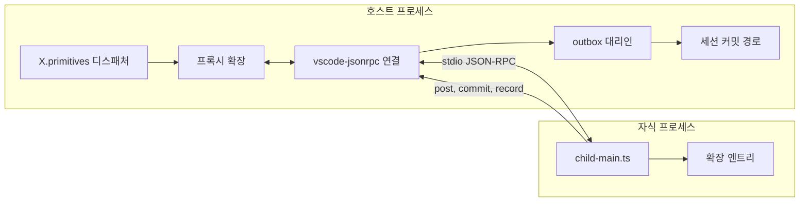

# X 로딩과 신뢰 (loading-trust)

코드 위치: `xeon/packages/ext-host/src/loading-trust/`. 공개 이름은 `@fresnel/ext-host`가 재export한다. 루트가 다시 내보내는 이름의 목록은 X.primitives.spec §3.1 표(이 문서 행 포함)가 정본이고, 이 문서는 그 행에 들어갈 로딩·신뢰 이름의 시그니처를 정한다.

## 1. 목적과 범위

확장이 발견되고 검증되어 로드되는 흐름, 프로젝트 신뢰, 선택적 프로세스 격리, SDK 가상 모듈, 기본 플러그인 설치를 정한다. pi 확장 어댑터는 두지 않는다(adr.0017 §3.7).

근거:

- [결정] 훅은 on(fold tap/first/chain), post, drive(배타 drive 락), Registration 4연산이다(`_research/decisions-log.md` 2026-10-21 계획 v2, adr.0007 §3).
- [결정] DI는 Cordis 하나다. `cordis`를 import하는 패키지는 `ext-host` 하나다(adr.0002 §3, eng.dependency-rules.guide DR-11). vendored Cordis에는 `@cordisjs/plugin-loader`가 없다(`xeon/vendor/cordis/UPSTREAM.json` `notCopied`). 설정 파일 기반 로딩은 ext-host가 직접 구현한다(adr.0002 §4.2).
- [결정] 확장 프로세스 격리는 사용자가 확장마다 켜는 2차 선택 기능이고 기본값은 꺼짐이다(`_research/layer-plan-v2-notes.md` "확장 프로세스 격리는 기본값이 아니어도 된다", `_research/decisions-log.md` 2026-10-21 결정(2차), adr.0006 §4.2).
- 층 구성 계획 v2 X-a 행: 확장 로딩(그대로, Cordis), 기능 선언 정적 검증(설계), 프로젝트 신뢰(포크, pi `trust-manager.ts`·`project-trust.ts`), 프로세스 격리(자체, vscode-jsonrpc 9.0.3)(`_research/packages.md` §4.5, §2.5).
- 항목 카탈로그 X절의 확장 로딩 방식, 프로젝트 신뢰, 프로세스 격리, 기능 선언 행(`_research/item-catalog.md` X절).

정하는 것:

- 탐색 규칙: 설치 위치, 매니페스트 파일, 우선순위, 로드 순서
- 로드 파이프라인 단계와 단계별 실패 상태, 진단 레코드
- TS 엔트리 로딩 방식, `ExtHost.install` 위임과 오류 변환, 핫 리로드 범위, 제거 흐름
- 확장 설정 연결과 예약 키 `ext.<name>.enabled`, `ext.<name>.isolation`, X 층 키 `x.loading-trust.*`
- 신뢰 등급 4값의 뜻과 허용 연산 표, 프로젝트 신뢰 판정과 저장
- 프로세스 격리(2차)의 전송, 프록시, 직렬화, 수명, 기록 경로
- SDK 가상 모듈(`@fresnel/contracts`, `@fresnel/group-sdk`, `typebox`)과 기본 플러그인 설치(§4.4.6, §4.4.7), 안전 모드 연결(§4.3.1 5a단계)
- `thread.trust.before`, `thread.resources` 훅의 발화 시점(F.extensions.spec §7)
- Plugin UI 기여(매니페스트 `ui`)의 파일과 정책 검사, Plugin App 파일 풀이, `x.ui.*` 키(§4.3.4, §3.10)

다루지 않는 것:

- 매니페스트 스키마, 훅 46행, fold 규칙, 정적 검사 함수(`validateManifest`, `validateUsage`, `validateManifestSet`)와 `ManifestIssueCode`: F.extensions.spec이 정본이다. 이 문서는 이름으로 인용한다.
- 4연산 실행, 디스패처, post 큐, drive 락 중재, Registration 토글·상태, 리소스 등록 API, 설정 키 `x.primitives.*`: X.primitives.spec.
- tier, 핸들러 시간 예산, 실패 격리·자동 끄기, 확장 전용 저장(접두 테이블 API), 이름 충돌 규칙, 안전 모드, 외부 훅 프로토콜(M4로 옮김 [결정: 2026-10-28 사용자]), 설정 키 `x.operations.*`: X.operations.spec. tier와 시간 예산은 operations 소유로 본다 [제안]. F.extensions.spec §1·§4.2의 primitives 표기는 정합성 단계에서 고친다.
- 설정 파일 경로와 읽기, 유효 값 계산: F.wire-settings.spec과 L1.persistence.spec. 이 문서는 키 정의와 신뢰 전 적용 제외 규칙만 둔다.
- 자식 프로세스 기동·종료의 OS 구현: L0.process.spec.

## 2. 용어

| 용어 | 뜻 |
|---|---|
| 후보 (candidate) | 탐색이 찾은 확장 하나. 매니페스트 위치와 설치 위치를 가진다. 아직 코드를 실행하지 않은 상태다 |
| 설치 위치 (source) | `builtin`, `managed`, `user`, `project` 넷. 후보를 어디서 찾았는지 나타낸다 |
| 신뢰 등급 (trust level) | `builtin`, `user`, `project`, `untrusted` 넷. 확장이 할 수 있는 일을 정한다(§4.6) |
| 프로젝트 루트 | 신뢰 판정 대상 폴더. 현재 작업 디렉터리(cwd)를 정규화한 경로다 [제안] |
| 신뢰 필요 자원 | 신뢰 판정 전에 읽거나 실행하면 안 되는 프로젝트 파일 묶음(§4.7.2) |
| 로드 세대 (generation) | 한 확장의 엔트리를 한 번 실행한 단위. 핫 리로드나 격리 재시작마다 1씩 오른다 |
| 진단 레코드 | 로드 중 생긴 문제 하나를 적은 `LoadDiagnostic` 값 |
| 내장 필수 확장 | `essential: true`로 등록된 내장 확장. 이 확장의 실패는 시작 실패다 |
| 격리 확장 | `ext.<name>.isolation`이 `process`인 확장. 자식 프로세스에서 실행된다 |
| 프록시 | 격리 확장 대신 호스트 프로세스에서 훅 핸들러와 리소스를 등록하는 대리 객체 |
| SDK 가상 모듈 | 플러그인 번들이 import하는 `@fresnel/contracts`, `@fresnel/group-sdk`, `typebox`를 호스트가 쓰는 모듈 객체로 돌려주는 등록(§4.4.6) |
| 기본 플러그인 | 릴리즈에 들어 있고 첫 실행 때 사용자 확장 위치에 복사되는 외부 확장 형식의 플러그인(Helm, §4.4.7) |

## 3. 인터페이스

F에서 가져오는 이름은 F 문서 그대로 쓴다: `ExtensionManifest`, `ExtensionManifestSchema`, `ExtensionName`, `ExtensionEntry`, `RegistrationFn`, `RegistrationApi`, `ManifestIssue`, `ManifestIssueCode`, `ExtensionUsage`, `validateManifest`, `validateUsage`, `validateManifestSet`, `HookName`, `HOOKS`, `FIRST_DENY`, `PostItem`, `PostOptions`(F.extensions.spec), `CapabilityId`, `SemVer`, `ServiceKey`(F.capabilities.spec), `SettingDef`, `SettingDefInput`, `SettingCatalog`, `CatalogIssue`, `SettingNamespace`, `defineSettings`, `settingsFromManifest`, `buildCatalog`(F.wire-settings.spec).

### 3.1 신뢰 등급과 설치 위치 (`trust/levels.ts`)

```ts
import { Type, type Static } from "typebox";

/** F.extensions.spec TrustRequestSchema의 값 집합을 확정한다 [제안] */
export type TrustLevel = "builtin" | "user" | "project" | "untrusted";
export const TRUST_LEVELS: readonly ["builtin", "user", "project", "untrusted"] = ["builtin", "user", "project", "untrusted"];
/** 높을수록 앞. 비교는 이 배열의 index로 한다 */
export function trustRank(level: TrustLevel): number;

export type InstallSource = "builtin" | "managed" | "user" | "project";
export const INSTALL_SOURCES: readonly ["builtin", "managed", "user", "project"] = ["builtin", "managed", "user", "project"];

/** 설치 위치가 정하는 상한 등급 */
export const SOURCE_TRUST: { readonly [S in InstallSource]: Exclude<TrustLevel, "untrusted"> } = {
  builtin: "builtin",
  managed: "user",
  user: "user",
  project: "project",
};

export type StorageAccess = "prefix" | "none";
export type IsolationRule = "forbidden" | "optional" | "notLoaded";

export interface TrustPermissions {
  readonly load: boolean;
  /** project_trust 외 지점 */
  readonly on: boolean;
  /** project_trust 지점에 on을 걸 수 있는가 */
  readonly onProjectTrust: boolean;
  readonly post: boolean;
  /** 플러그인의 `drives`가 참이고 정책 `x.primitives.driveRequiresGroup`(X.primitives.spec §4.4.1)이 허용할 때 */
  readonly drive: boolean;
  /** 도구·명령·provider 등록(X.primitives.spec 리소스 등록) */
  readonly resources: boolean;
  /** 확장 접두 테이블(X.operations.spec). 격리 확장은 이 값과 무관하게 직접 접근이 없다(§4.9.6) */
  readonly storage: StorageAccess;
  readonly isolation: IsolationRule;
}

/** §4.6 표의 코드형. 문서 표와 같은지 테스트가 확인한다 */
export const TRUST_MATRIX: { readonly [L in TrustLevel]: TrustPermissions };
```

### 3.2 내장 모듈과 후보 (`discover.ts`)

```ts
import type { ExtensionEntry, ExtensionManifest, ExtensionName } from "@fresnel/contracts/extensions";

/** 내장 패키지(core-*, cap-*, group-*)가 export하는 확장 모듈. 조립 루트(L4 host)가 목록을 넘긴다 */
export interface BuiltinExtensionModule {
  readonly manifest: ExtensionManifest;
  /** 엔트리. 내장 패키지는 named export `extension`으로 둔다(§4.4) */
  readonly extension: ExtensionEntry;
  /** 참이면 이 확장의 로드 실패가 시작 실패다. 기본 false */
  readonly essential?: boolean;
}

export interface ExtensionCandidate {
  readonly source: InstallSource;
  /** 확장 루트 절대 경로(심볼릭 링크를 푼 경로). 내장은 null */
  readonly root: string | null;
  /** `.fresnel-plugin/plugin.json` 절대 경로. 내장은 null */
  readonly manifestPath: string | null;
  /** 내장만 */
  readonly builtin: BuiltinExtensionModule | null;
}

// 탐색이 쓰는 파일 접근(LoaderFs)과 설치 위치 경로(LoaderPaths)는 F 포트다(F.extensions.spec §3.2.1 로더 포트).
// X는 L0를 import하지 않으므로 조립 루트가 구현(L0.os)을 주입한다(architecture.layers.spec §4.3.3). 여기서는 다시 export만 한다
import type { LoaderFs, LoaderPaths } from "@fresnel/contracts/extensions";
export type { LoaderFs, LoaderPaths } from "@fresnel/contracts/extensions";

export interface ExternalLocation {
  readonly source: "managed" | "user" | "project";
  /** `extensions/`와 같은 모양의 디렉터리. 그 아래 한 단계의 디렉터리마다 후보 하나다 */
  readonly dir: string;
}

/**
 * 설치 위치별 탐색 디렉터리(§4.2.1 표). `projectRoot`는 신뢰가 허용된 뒤에만 넘긴다(§4.7.4).
 * `sources`를 생략하면 managed, user, project 모두다
 */
export function externalLocations(input: {
  readonly paths: LoaderPaths;
  /** x.loading-trust.paths 유효 값. user 위치로 본다 */
  readonly extraPaths: readonly string[];
  readonly projectRoot: string | null;
  readonly sources?: readonly ExternalLocation["source"][];
}): readonly ExternalLocation[];

/** 외부 확장 탐색. 매니페스트 내용은 읽지 않고 존재만 확인한다. 위치 순서, 이름의 코드 포인트 순이다 */
export function discoverExternal(fs: LoaderFs, locations: readonly ExternalLocation[]): Promise<{
  readonly candidates: readonly ExtensionCandidate[];
  readonly diagnostics: readonly LoadDiagnostic[];
}>;
```

### 3.3 로드 순서 (`load-order.ts`)

```ts
/** 내장 층 순서. L0 플랫폼 플러그인은 이 파이프라인 밖에서 먼저 등록된다(§4.3) */
export const BUILTIN_LAYER_ORDER: readonly ["L1", "L2", "L3", "plugin"] = ["L1", "L2", "L3", "plugin"];
export const SOURCE_ORDER: readonly ["builtin", "managed", "user", "project"] = ["builtin", "managed", "user", "project"];

export interface OrderKey {
  readonly source: InstallSource;
  /** 내장만 쓴다. 외부는 0 */
  readonly layerIndex: number;
  readonly name: ExtensionName;
}

/** 순수 함수. 입력 순서와 무관하게 같은 결과를 낸다 */
export function compareLoadOrder(a: OrderKey, b: OrderKey): number;
export function orderManifests<T extends { readonly key: OrderKey }>(items: readonly T[]): readonly T[];
```

### 3.4 상태와 진단 (`pipeline.ts`)

```ts
export type LoadState =
  | "discovered" | "validated" | "trusted" | "resolved" | "loading" | "active"
  | "rejected" | "disabled" | "error";

export type LoadStage =
  | "discover" | "manifest" | "set" | "trust" | "settings" | "ui" | "capabilities" | "admit"
  | "entry" | "usage" | "activate" | "isolation";

/** Plugin UI 검사가 내는 코드(§4.3.4). 매니페스트 모양 오류는 `manifest_invalid`(F의 `ui_*` 코드)로 남는다 */
export type UiDiagnosticCode =
  | "ui_file_missing" | "ui_invalid" | "ui_limit" | "ui_path_invalid" | "ui_mode_not_allowed"
  | "widgets_unsupported" | "bridge_unsupported";

export type LoadDiagnosticCode =
  | "manifest_missing" | "manifest_parse" | "manifest_invalid"
  | "name_conflict" | "trust_exceeds_source" | "trust_denied" | "trust_undecided" | "trust_store_corrupt"
  | "settings_rejected" | "settings_reserved_key" | "config_required"
  | "capability_missing" | "capability_provider_failed"
  | "tier_rejected"
  | "entry_not_found" | "entry_import_failed" | "entry_not_function" | "entry_threw"
  | "setup_threw" | "setup_timeout" | "setup_action" | "reload_failed" | "reload_rejected"
  | "usage_invalid" | "usage_warning" | "plugin_not_registered"
  | "essential_failed" | "disabled_by_setting" | "safe_mode" | "disabled_flag"
  | "isolation_unavailable" | "isolation_point_unsupported" | "isolation_drive_unsupported"
  | "isolation_exited" | "isolation_restart_limit" | "isolation_protocol"
  | UiDiagnosticCode;

export const LoadDiagnosticSchema = Type.Object({
  extension: Type.Union([Type.String(), Type.Null()]),
  source: Type.Union([
    Type.Literal("builtin"), Type.Literal("managed"), Type.Literal("user"), Type.Literal("project"), Type.Null(),
  ]),
  stage: Type.String(),
  severity: Type.Union([Type.Literal("error"), Type.Literal("warning"), Type.Literal("info")]),
  code: Type.String(),
  message: Type.String({ maxLength: 2000 }),
  path: Type.Optional(Type.String()),
  /** validate* 결과 원본 */
  issues: Type.Optional(Type.Array(Type.Object({
    severity: Type.String(), code: Type.String(), path: Type.String(), message: Type.String(),
  }))),
  generation: Type.Integer({ minimum: 0 }),
});

export interface LoadDiagnostic {
  readonly extension: ExtensionName | null;
  readonly source: InstallSource | null;
  readonly stage: LoadStage;
  readonly severity: "error" | "warning" | "info";
  readonly code: LoadDiagnosticCode;
  /** 사람이 읽는 문장. 시크릿 값과 파일 내용을 넣지 않는다 */
  readonly message: string;
  readonly path?: string;
  readonly issues?: readonly ManifestIssue[];
  readonly catalogIssues?: readonly CatalogIssue[];
  readonly generation: number;
}

export interface LoadedExtensionInfo {
  readonly name: ExtensionName;
  readonly version: SemVer;
  readonly source: InstallSource;
  readonly trust: TrustLevel;
  readonly state: LoadState;
  readonly isolation: "none" | "process";
  readonly essential: boolean;
  /** 로드 순서 index. 디스패치 순서의 두 번째 키(F.extensions.spec §4.2). 로드되지 않았으면 null */
  readonly loadIndex: number | null;
  readonly generation: number;
  /** 읽은 매니페스트. 읽거나 검증하지 못한 후보는 없다. 조립 루트의 `ext.list`가 위치와 상관없이(사용자, 관리, 프로젝트) 이 값으로 행을 만든다 */
  readonly manifest?: ExtensionManifest;
  /** 확장 루트 디렉터리(절대 경로). 내장 확장은 없다 */
  readonly root?: string;
  readonly diagnostics: readonly LoadDiagnostic[];
}
```

### 3.5 로더 서비스 (`index.ts`)

```ts
export type LoaderMode = "interactive" | "headless";

export interface LoadOptions {
  readonly builtins: readonly BuiltinExtensionModule[];
  readonly cwd: string;
  readonly mode: LoaderMode;
  /** CLI 일회 지정. 있으면 신뢰 판정의 첫 단계로 쓴다(§4.7.3) */
  readonly trustOverride?: boolean;
  /** 안전 모드와 --disable-ext(X.operations.spec §3.6 StartupOptions). 없으면 둘 다 꺼짐 */
  readonly startup?: StartupOptions;
  /** x.loading-trust.paths 유효 값. 각 경로는 `extensions/`와 같은 모양의 디렉터리이고 user 위치로 본다(§4.2.1) [제안] */
  readonly extraPaths?: readonly string[];
  /**
   * 프로젝트 확장을 어떻게 싣는가. 기본 "cwd"는 cwd의 프로젝트를 이 호출에서 판정하고 싣는다(in-process·stdio 호스트).
   * "on_demand"는 판정도 적재도 하지 않는다. 서비스 모드는 작업 폴더를 여는 thread마다 loadProject를 부른다(§4.7.8)
   */
  readonly projects?: "cwd" | "on_demand";
  /** 화면 앱 정책(`x.ui.apps`, `x.ui.allowProjectApps`, §4.3.4). 없는 값은 앱 끔, 프로젝트 앱 끔이다(ADR-0021 §3.6.2 3번, §6 미결 1: 실기 확인 전 빌드는 프레임 모드를 끈다. 켜는 시점은 [미결]이고 사용자가 정한다). `loadProject`도 이 값을 쓴다 */
  readonly uiPolicy?: { readonly apps?: boolean; readonly allowProjectApps?: boolean };
  readonly signal: AbortSignal;
}

/** loadProject 입력(§4.7.8) */
export interface LoadProjectOptions {
  /** 작업 폴더. 판정은 이 폴더의 프로젝트 루트(정규화한 경로)에 대해 한다 */
  readonly projectRoot: string;
  readonly mode: LoaderMode;
  /** 이 호출 전용 프롬프트 수단. 없으면 LoaderDeps.prompter */
  readonly prompter?: TrustPrompter;
  /** 호출자가 이미 정한 판정(저장하지 않는다) */
  readonly trustOverride?: boolean;
  readonly signal: AbortSignal;
}

export interface ProjectLoadReport {
  /** 정규화한 프로젝트 루트. 판정이 실패했거나 안전 모드이면 null */
  readonly projectRoot: string | null;
  readonly projectTrust: ProjectTrustResult | null;
  /** 이 루트의 확장을 앞선 호출에서 이미 실었다. 다시 싣지 않았다 */
  readonly alreadyLoaded: boolean;
  /** 이 호출이 새로 시도한 프로젝트 확장 */
  readonly extensions: readonly LoadedExtensionInfo[];
  /** 이 호출이 남긴 진단 */
  readonly diagnostics: readonly LoadDiagnostic[];
}

export interface LoadReport {
  readonly extensions: readonly LoadedExtensionInfo[];
  readonly diagnostics: readonly LoadDiagnostic[];
  /** 프로젝트 신뢰 판정. 안전 모드라 판정하지 않았으면 null */
  readonly projectTrust: ProjectTrustResult | null;
  /** 거부된 확장을 뺀 설정 그룹. 조립 루트가 buildCatalog에 넣는다(§4.5.4) */
  readonly settingGroups: readonly {
    readonly owner: string;
    readonly namespace: SettingNamespace;
    readonly defs: readonly SettingDef[];
  }[];
}

/** 내장 필수 확장이 실패하면 loadAll이 던진다 */
export declare class LoadAbortError extends Error {
  readonly diagnostics: readonly LoadDiagnostic[];
}

/** 제거 확인 화면용. 지울 확장 전용 테이블 목록(X.operations.spec ExtStorageAdmin.dropExtension(name, false)) */
export interface RemovalPreview {
  readonly name: ExtensionName;
  readonly tables: readonly string[];
}

export interface RemoveResult {
  readonly name: ExtensionName;
  /** 지운 테이블. dropTables가 거짓이면 빈 배열 */
  readonly dropped: readonly string[];
  /** 남은 테이블("주인 없는 확장 테이블") */
  readonly remaining: readonly string[];
}

export interface ExtensionLoader {
  /** 시작 때 한 번. 파이프라인 전체를 실행한다 */
  loadAll(options: LoadOptions): Promise<LoadReport>;
  /** 프로젝트 하나를 판정하고 신뢰되면 그 프로젝트의 확장을 싣는다(서비스 모드, §4.7.8). loadAll 뒤에 부른다 */
  loadProject(options: LoadProjectOptions): Promise<ProjectLoadReport>;
  /** ext.<name>.enabled가 거짓에서 참이 되면 부른다. 아직 로드되지 않은 확장을 로드한다 */
  ensureLoaded(name: ExtensionName, signal: AbortSignal): Promise<LoadedExtensionInfo>;
  list(): readonly LoadedExtensionInfo[];
  diagnostics(): readonly LoadDiagnostic[];
  /**
   * 화면 기여 항목의 검사 결과(§4.3.4). 로드 순서, 선언 순서다. `ext.ui.list`가 쓴다. 확장이 목록에서 빠지면 그 확장의 항목도 빠진다. 항목마다 확장 `version`, 설치 등급 `trust`(managed·user·project·builtin)가 붙고, 앱 모드이며 `ok`이고 `builtin`이 아니면 `appRoot`(확장 루트 + `app.root`의 절대 경로)가 붙는다 [결정: 2026-11-04 사용자]. 셸은 이 값으로 `app_roots_set`을 부른다. 주인을 확인한 card 항목만 `forKind`(레코드 kind)를 싣는다(§4.3.4 1번)
   */
  uiEntries(): readonly UiEntryReport[];
  /** 설치된 외부 확장을 새 버전으로 바꾼다. 적용은 단계 경계다(§4.4.4) [결정: 2026-11-03 사용자 (a), M4 T-RELOAD] */
  reload(name: ExtensionName, signal: AbortSignal, options?: ReloadOptions): Promise<Result<ReloadStarted, ReloadFailure>>;
  /** 제거 1단계. 아무것도 바꾸지 않고 지울 테이블 목록만 돌려준다(§4.4.5). M2 */
  previewRemoval(name: ExtensionName): Promise<RemovalPreview>;
  /** 제거 2단계. 실행 중 호스트에서 내리고, dropTables가 참이면 확장 전용 테이블을 지운다(§4.4.5). M2 */
  remove(name: ExtensionName, options: { readonly dropTables: boolean; readonly signal: AbortSignal }): Promise<RemoveResult>;
  /** 역순으로 scope를 정리하고 격리 프로세스를 끝낸다 */
  dispose(): Promise<void>;
}

/** 조립 루트가 주입하는 의존. 없는 항목은 그 기능을 쓰는 단계에서 실패한다(§4.3.2) */
export interface LoaderDeps {
  /** 설치 대상. 엔트리 호출과 scope 실행은 ExtHost.install이 한다(§4.1) */
  readonly host: ExtHost;
  /** 운영 정책(X.operations.spec §3.8). 6a단계 admit, 설치 실패·제거 때 forget. 5a단계는 순수 함수 `startupFilter`를 직접 부른다 [제안] */
  readonly policy: Pick<OperationsPolicy, "admit" | "forget">;
  readonly fs: LoaderFs;
  readonly paths: LoaderPaths;
  readonly trustBackend: TrustStoreBackend;
  /** 대화형 프롬프트. headless면 없다 */
  readonly prompter?: TrustPrompter;
  /** 격리(2차). 조립 루트가 host.ports.get(ProcessPortKey)로 꺼내 넣는다. 없으면 격리 설정 확장은 isolation_unavailable */
  readonly process?: IsolationProcessPort;
  /** 제거 흐름의 테이블 삭제(X.operations.spec §3.4). 없으면 remove는 테이블을 남긴다. M2 */
  readonly storageAdmin?: ExtStorageAdmin;
  readonly clock: { now(): number };
  /**
   * 플러그인 번들에 줄 SDK 가상 모듈 가운데 X가 직접 등록하지 않는 것. 지정자 → 호스트가 쓰는 모듈 객체(§4.4.6). `@fresnel/contracts`와
   * 하위 경로, `typebox`는 X가 등록한다. `@fresnel/group-sdk`은 L3라 X가 import할 수 없어 조립 루트가 넘기며, 없으면 그 import가 실패한다(`entry_import_failed`)
   */
  readonly sdkModules?: SdkModules;
  /** `thread.trust.before` 발화(§4.7.3 4번). 없으면 결정 없음으로 본다 */
  readonly emitProjectTrust?: (cwd: string, signal: AbortSignal) => Promise<{ readonly trusted: "yes" | "no"; readonly remember?: boolean } | undefined>;
}

export function createExtensionLoader(deps: LoaderDeps): ExtensionLoader;
```

- 같은 패키지의 다른 도메인 이름은 타입만 가져온다: `ExtHost`, `ExtensionUnit`, `InstallResult`(`../primitives/index.ts`), `OperationsPolicy`, `StartupOptions`, `ExtStorageAdmin`(`../operations/index.ts`). 값 import가 없으므로 도메인 사이 값 순환이 없다.
- [제안] `ExtensionLoader`는 Cordis 서비스로 등록하지 않는다. 조립 루트(L4 host)가 `createExtensionLoader(deps)` 결과를 직접 쥐고 `host.status`, 설정 화면, 확장 명령에 넘긴다. `ExtHost`(`fresnel.ext`)에는 `loader` 속성을 두지 않는다. 로더는 `ExtHost`를 쓰고 `ExtHost`는 로더를 참조하지 않으므로 의존이 한 방향이다.
- 조립 순서: `createOperationsPolicy` → `createExtHost` → `ExtHost.registerPlatform`(L0) → `createExtensionLoader({ host, policy, … })` → `loadAll`(X.operations.spec §3.8, L4.host-service.spec).
- L4.host-service.spec이 [가정]으로 둔 `HostPluginModule = import("@fresnel/ext-host").PluginModule`은 이 문서의 `BuiltinExtensionModule`이다 [제안]. 이름 `PluginModule`을 따로 두지 않는다.
- `LoaderFs`, `LoaderPaths`, `TrustStoreBackend`, `TrustPrompter`, `IsolationProcessPort`는 L0·L4가 구현하는 포트다. 타입 정본은 F.extensions.spec §3.2.1 `ports.ts`이고, 이 문서는 `@fresnel/contracts/extensions`에서 가져와 다시 export만 한다([결정: review.decisions-2 U-14]). 판정 함수(`discover`, `resolveProjectTrust`, `trustOptions`)와 신뢰 파일 스키마(`TrustFileSchema`)는 X에 남는다.

### 3.6 설정 키 정의 (`settings-keys.ts`)

```ts
import type { SettingDef, SettingDefInput, SettingGroup } from "@fresnel/contracts/settings";

/** ext.<name>.enabled, ext.<name>.isolation. 확장마다 로더가 만든다(§4.5) */
export function reservedExtensionSettings(manifest: ExtensionManifest, source: InstallSource): {
  readonly namespace: `ext.${string}`;
  readonly defs: readonly SettingDef[];
};

export const RESERVED_EXT_KEYS: readonly ["enabled", "isolation"] = ["enabled", "isolation"];

/** X 층 키. defineSettings("x.loading-trust", …) */
export declare const loadingTrustSettings: SettingGroup<"x.loading-trust", {
  readonly defaultProjectTrust: SettingDefInput;
  readonly paths: SettingDefInput;
  readonly "isolation.maxRestarts": SettingDefInput;
  readonly "isolation.restartWindowSec": SettingDefInput;
}>;
```

값 스키마와 기본값은 §6 표가 정한다.

### 3.7 신뢰 (`trust/store.ts`, `trust/resolve.ts`, `trust/resources.ts`)

```ts
// 신뢰 포트와 부속 타입은 F가 정본이다(F.extensions.spec §3.2.1 로더 포트). 여기서는 다시 export만 한다.
// 구현: TrustStoreBackend는 L0.os, TrustPrompter는 대화형 클라이언트(L4)
import type { Result } from "@fresnel/contracts";
import type {
  LoaderFs, TrustStoreBackend, TrustPrompter, TrustPromptRequest, TrustOption, TrustUpdate, TrustChoice, TrustChoiceKind,
} from "@fresnel/contracts/extensions";
export type {
  TrustStoreBackend, TrustPrompter, TrustPromptRequest, TrustOption, TrustUpdate, TrustChoice, TrustChoiceKind,
} from "@fresnel/contracts/extensions";

export type TrustVerdict = "allow" | "deny" | "undecided";

/** 저장 파일 형식. pi trust.json(Record<path, boolean|null>)에 버전과 출처를 더했다. 패키지 안에서만 쓴다(공개 이름이 아님) */
const TrustFileSchema = Type.Object({
  version: Type.Literal(1),
  entries: Type.Record(
    Type.String({ minLength: 1, maxLength: 4096 }),
    Type.Object({
      verdict: Type.Union([Type.Literal("allow"), Type.Literal("deny")]),
      /** ISO 8601 */
      decidedAt: Type.String(),
      via: Type.Union([Type.Literal("prompt"), Type.Literal("point"), Type.Literal("command")]),
    }),
  ),
});
type TrustFile = Static<typeof TrustFileSchema>;

export type TrustLookup =
  | { readonly kind: "found"; readonly verdict: "allow" | "deny"; readonly path: string }
  | { readonly kind: "none" }
  | { readonly kind: "corrupt"; readonly reason: string };

export interface ProjectTrustStore {
  /** 저장소 키로 쓰는 정규 경로(normalize) */
  canonical(path: string): Promise<string>;
  /** cwd에서 위로 올라가며 가장 가까운 항목. 읽기·파싱·스키마 실패는 던지지 않고 corrupt다 */
  lookup(cwd: string): Promise<TrustLookup>;
  /**
   * 갱신을 하나의 읽기-수정-쓰기(TrustStoreBackend.update)로 적용한다. 파일이 손상이면 쓰지 않고 corrupt를,
   * 백엔드 쓰기가 실패하면 io를 돌려준다(던지지 않는다, eng.typescript.guide TY-24)
   */
  setMany(updates: readonly TrustUpdate[]): Promise<Result<void, TrustStoreError>>;
}

/** normalize는 심볼릭 링크를 푼 정규 경로를 돌려준다. clock은 decidedAt에 쓴다. 클래스를 두지 않는다(eng.typescript.guide TY-16) */
export function createProjectTrustStore(backend: TrustStoreBackend, normalize: (path: string) => Promise<string>, clock: { now(): number }): ProjectTrustStore;

export type TrustStoreError =
  | { readonly kind: "corrupt"; readonly reason: string }
  | { readonly kind: "io"; readonly cause: unknown };

/**
 * pi getProjectTrustOptions 포크. §4.7.3 표의 선택지 다섯 개와 저장할 갱신(TrustOption은 F 타입). 상위 폴더가 없으면(parent가 null)
 * 상위 선택지를 뺀다. label은 L4가 현지화할 식별자이고 표시 문구는 담지 않는다(trust-folder, trust-parent, trust-session, deny-folder,
 * deny-session). 세션 선택지의 updates는 비어 있고 호출자가 sessionMemory에 둔다
 */
export function trustOptions(projectRoot: string, parent: string | null): readonly TrustOption[];

/** pi hasTrustRequiringProjectResources 포크(§4.7.2) */
export const TRUST_REQUIRING_PROJECT_RESOURCES: readonly string[];
export function findTrustRequiringResources(fs: LoaderFs, projectRoot: string, homeDir: string): Promise<readonly string[]>;

export type TrustVia =
  | "override" | "notRequired" | "point" | "store" | "sessionMemory" | "default" | "prompt" | "headless" | "corruptStore";

export interface ProjectTrustResult {
  readonly projectRoot: string;
  /** 신뢰 필요 자원이 있었는가 */
  readonly required: boolean;
  readonly trusted: boolean;
  readonly verdict: TrustVerdict;
  readonly via: TrustVia;
  /** 찾은 신뢰 필요 자원(프로젝트 루트 기준 상대 경로) */
  readonly resources: readonly string[];
  /** 결정을 저장하려다 실패했다(손상된 저장 파일 등). 결정은 유효하다. 호출자가 trust_store_corrupt 진단을 남긴다 */
  readonly storeError?: TrustStoreError;
}

export interface ResolveProjectTrustInput {
  readonly projectRoot: string;
  readonly mode: LoaderMode;
  readonly trustOverride?: boolean;
  readonly defaultProjectTrust: "ask" | "always" | "never";
  readonly store: ProjectTrustStore;
  readonly fs: LoaderFs;
  readonly homeDir: string;
  readonly prompter?: TrustPrompter;
  /** project_trust 지점 디스패치. X.primitives의 디스패처를 감싼 함수 */
  readonly emitProjectTrust: (cwd: string, signal: AbortSignal) => Promise<
    { readonly trusted: "yes" | "no"; readonly remember?: boolean } | undefined
  >;
  /** 이번 호스트 프로세스 동안만 유지하는 결정 */
  readonly sessionMemory: Map<string, "allow" | "deny">;
  readonly signal: AbortSignal;
}

export function resolveProjectTrust(input: ResolveProjectTrustInput): Promise<ProjectTrustResult>;
```

- `emitProjectTrust`의 반환 형태는 pi `ProjectTrustEventResult`(`types.ts:693-696`)에서 `undecided`를 뺀 것이다. 정본은 F.extensions.spec §3.5.1의 `ProjectTrustDecision`(`{ trusted: "yes" | "no"; remember?: boolean }`)이고, 위 반환 형태와 같다.

### 3.8 프로세스 격리 (`isolation/rpc.ts`, `isolation/proxy.ts`, `isolation/outbox-agent.ts`) — 2차

```ts
// 자식 프로세스 기동 포트와 부속 타입은 F가 정본이다(F.extensions.spec §3.2.1, ProcessPort의 부분).
// 구현은 platform-process(서비스 fresnel.process, ProcessService extends ProcessPort)다. 여기서는 다시 export만 한다
import type { IsolationProcessPort, IsolatedChild } from "@fresnel/contracts/extensions";
export type { IsolationProcessPort, IsolationSpawnSpec, IsolatedChild } from "@fresnel/contracts/extensions";

export const ISOLATION_PROTOCOL_VERSION = 1;

/** vscode-jsonrpc 메서드 이름. 접두 "xeon/"는 F.wire-settings의 호스트 계약과 겹치지 않게 둔다 */
export const IsoMethods = {
  // 호스트 → 자식
  init: "fresnel/iso.init",
  dispatch: "fresnel/iso.dispatch",
  toolExecute: "fresnel/iso.tool.execute",
  dispose: "fresnel/iso.dispose",
  // 자식 → 호스트
  register: "fresnel/iso.register",
  post: "fresnel/iso.post",
  commit: "fresnel/iso.commit",
  record: "fresnel/iso.record",
  readRecords: "fresnel/iso.readRecords",
  capabilityCall: "fresnel/iso.capability.call",
  log: "fresnel/iso.log",
} as const;

export const IsoInitParams = Type.Object({
  protocolVersion: Type.Literal(1),
  manifest: ExtensionManifestSchema,
  entryPath: Type.String(),
  generation: Type.Integer({ minimum: 1 }),
  /** 이 확장의 ext.<name>.* 유효 값. secret 키는 참조 문자열만 */
  settings: Type.Record(Type.String(), Type.Unknown()),
});
export const IsoInitResult = Type.Object({
  /** setup 동안의 사용 기록(ExtensionUsage와 같은 형태) */
  usage: Type.Object({
    on: Type.Array(Type.String()),
    post: Type.Boolean(),
    drive: Type.Boolean(),
    capabilities: Type.Array(Type.String()),
    recordKinds: Type.Array(Type.String()),
    readsRecordKinds: Type.Array(Type.String()),
  }),
  tools: Type.Array(Type.Object({ name: Type.String(), definition: Type.Unknown() })),
});

export const IsoDispatchParams = Type.Object({
  dispatchId: Type.String(),
  point: Type.String(),
  scopeId: Type.String(),
  threadId: Type.String(),
  /** JSON 직렬화된 페이로드. 동결은 자식이 다시 한다 */
  payload: Type.Unknown(),
  /** chain 훅만 */
  current: Type.Optional(Type.Unknown()),
  state: Type.Unknown(),
});
export const IsoDispatchResult = Type.Object({
  /** tap은 null. first는 결정 또는 null(=undefined), chain은 패치 또는 null */
  result: Type.Unknown(),
});

export const IsoPostParams = Type.Object({
  scopeId: Type.String(),
  item: Type.Unknown(),          // PostItem. 호스트가 F 스키마로 다시 검사한다
  requestId: Type.String({ minLength: 1, maxLength: 64 }),
  when: Type.Union([Type.Literal("steer"), Type.Literal("followUp"), Type.Literal("next")]),
});

/** 호스트 쪽 대리인. 격리 확장의 기록을 세션 커밋 경로로 옮긴다 */
export interface OutboxAgent {
  post(params: Static<typeof IsoPostParams>): Promise<{ readonly requestId: string; readonly duplicate: boolean }>;
  commit(scopeId: string, state: unknown, rev: number): Promise<void>;
  record(scopeId: string, kind: string, subject: { readonly type: string; readonly id: string }, payload: unknown): Promise<void>;
}

/** 페이로드·결정·패치 스키마가 JSON으로 왕복 가능한 지점. HOOKS에서 계산한다(§4.9.4) */
export function isolatableHooks(): ReadonlySet<HookName>;

export interface IsolationPolicy {
  readonly maxRestarts: number;
  readonly restartWindowSec: number;
  /** 취소 요청 뒤 강제 종료까지의 유예 시간 [제안] 2000ms */
  readonly killGraceMs: number;
}
```

### 3.9 SDK 가상 모듈과 기본 플러그인 (`virtual-modules.ts`, `default-plugin.ts`)

```ts
// virtual-modules.ts
/** 플러그인 번들이 호스트와 같은 인스턴스를 쓰게 하는 지정자 */
export const SDK_MODULE_SPECIFIERS: readonly ["@fresnel/contracts", "@fresnel/group-sdk", "typebox"];
/** 지정자 → 호스트의 모듈 객체(보통 `import * as ns`의 결과) */
export type SdkModules = Readonly<Record<string, Readonly<Record<string, unknown>>>>;
export type SdkRegisterError =
  | { readonly kind: "unavailable" }                          // Bun 런타임이 아니다
  | { readonly kind: "conflict"; readonly specifier: string }; // 같은 지정자에 다른 객체가 이미 등록됐다
/** 같은 객체의 재등록은 아무 일도 하지 않는다. 충돌이면 아무것도 등록하지 않는다. 프로세스 전역이다 */
export function registerSdkModules(modules: SdkModules): Result<void, SdkRegisterError>;

// default-plugin.ts
/** 복사에 쓰는 파일 접근. LoaderFs는 읽기 전용이라 조립 루트가 L0.os로 구현해 넘긴다 */
export interface PluginInstallFs {
  readText(path: string): Promise<string | null>;
  listDir(path: string): Promise<readonly { readonly name: string; readonly kind: "file" | "dir" | "symlink" }[] | null>;
  readBytes(path: string): Promise<Uint8Array>;
  writeBytes(path: string, bytes: Uint8Array): Promise<void>;
  makeDir(path: string): Promise<void>;
  removeDir(path: string): Promise<void>;
  rename(from: string, to: string): Promise<void>;
}
export interface DefaultPluginInstallInput {
  readonly fs: PluginInstallFs;
  /** 릴리즈에 든 기본 플러그인 디렉터리 */
  readonly source: string;
  /** `<userDir>/extensions/<name>/` */
  readonly destination: string;
  /** 임시 디렉터리 뿌리. 탐색 밖, 대상과 같은 파일 시스템. 생략하면 `<userDir>/.staging` */
  readonly stagingRoot?: string;
  /** 있으면 교체할 때 버전 기록을 남긴다(§3.11, §4.4.8). 없으면 기록하지 않는다 */
  readonly history?: VersionHistory;
}
export type DefaultPluginInstallOutcome =
  | { readonly action: "installed"; readonly version: string }
  | { readonly action: "replaced"; readonly version: string; readonly previousVersion?: string }
  | { readonly action: "kept"; readonly version: string; readonly installedVersion: string };
export type DefaultPluginInstallError =
  | { readonly kind: "source_invalid"; readonly message: string }
  | { readonly kind: "io"; readonly message: string; readonly cause: unknown };
export function installDefaultPlugin(input: DefaultPluginInstallInput): Promise<Result<DefaultPluginInstallOutcome, DefaultPluginInstallError>>;
```

- [미결] `PluginInstallFs`의 정본 위치. 쓰기 포트는 F.extensions.spec §3.2.1 로더 포트에 있어야 한다. F 수정 요청.

### 3.10 Plugin UI 검사 (`ui-check.ts`, `app-files.ts`, `ui-settings.ts`) [결정: 2026-10-31 사용자, ADR-0021]

```ts
import type { AppDecl, LoaderFs, Placement, UiDecl, UiMode, UiNode } from "@fresnel/contracts/extensions";
import type { SettingDefInput, SettingGroup } from "@fresnel/contracts/settings";

/** 호스트가 싣는 위젯 카탈로그 버전(ADR-0021 §3.4.1 초안). `ui.widgets` 범위가 이 값을 포함해야 native 화면을 그린다 */
export const HOST_WIDGETS_VERSION: string;   // "1.0.0"
/** 다리 API 버전. contracts의 `BRIDGE_VERSION`(정수 1)을 SemVer로 쓴다 */
export const HOST_BRIDGE_VERSION: string;    // "1.0.0"
/** 화면 JSON 파일 하나의 크기 상한 */
export const UI_FILE_MAX_BYTES: number;      // 1048576

export interface UiPolicy {
  readonly apps: boolean;
  readonly allowProjectApps: boolean;
}
export const DEFAULT_UI_POLICY: UiPolicy;    // { apps: false, allowProjectApps: false }

export interface UiIssue {
  readonly severity: "error" | "warning" | "info";
  readonly code: UiDiagnosticCode;
  /** `/ui/items/<i>/...`. 화면 트리 안의 위치는 `#` 뒤에 JSON Pointer로 붙인다 */
  readonly path: string;
  readonly message: string;
}
type UiItemState = "ok" | "invalid" | "disabled";
export interface UiItemReport {
  readonly id: string;
  readonly placement: Placement;
  /** 실제로 그릴 모드. 앱이 금지되어 `fallback`을 쓰면 `native` */
  readonly mode: UiMode;
  readonly title: string;
  readonly state: UiItemState;
  readonly tree?: UiNode;
  readonly app?: AppDecl;
  readonly issues: readonly UiIssue[];
}
/** `ExtensionLoader.uiEntries()`의 원소. 확장 이름을 덧붙인다 */
export interface UiEntryReport extends UiItemReport {
  readonly extension: ExtensionName;
}

export interface UiCheckInput {
  readonly ui: UiDecl;
  /** 확장 루트 절대 경로. 후보의 `root`와 같다 */
  readonly root: string;
  readonly fs: LoaderFs;
  readonly source: InstallSource;
  readonly policy: UiPolicy;
  readonly hostWidgetsVersion: string;
  readonly hostBridgeVersion: string;
}
export function checkUiDecl(input: UiCheckInput): Promise<readonly UiItemReport[]>;

/** 거부 이유. 패키지 안에서만 쓴다(결과 타입에 들어간다) */
type AppFileRejection = "outside_root" | "not_found" | "not_a_file" | "forbidden_type";
export type AppFileResult =
  | { readonly ok: true; readonly path: string; readonly contentType: string }
  | { readonly ok: false; readonly reason: AppFileRejection };
export interface ResolveAppFileInput {
  /** 확장 루트 절대 경로 */
  readonly extensionRoot: string;
  readonly app: AppDecl;
  /** app root 안의 URL 경로. 빈 문자열이면 `app.entry` */
  readonly requestPath: string;
  readonly fs: LoaderFs;
}
export function resolveAppFile(input: ResolveAppFileInput): Promise<AppFileResult>;

/** `x.ui.apps`, `x.ui.allowProjectApps`(§6). `defineSettings("x.ui", …)` */
export declare const uiSettings: SettingGroup<"x.ui", {
  readonly apps: SettingDefInput;
  readonly allowProjectApps: SettingDefInput;
}>;
```

- `UiDiagnosticCode`는 §3.4에 있다. `UiDecl`, `UiContribution`, `AppDecl`, `UiNode`, `validateUi`, `validateUiTree`, `isEntryInsideRoot`, `UI_LIMITS`, `BRIDGE_VERSION`은 F.extensions.spec §3.1.1(`ui.ts`, `validate.ts`)이 정본이고 이 문서는 이름으로 인용한다.
- `checkUiDecl`과 `resolveAppFile`은 `LoaderFs` 포트만 쓴다. 경로 포함 검사(`within`)와 종류 판정(`kindOf`, 부모 폴더 나열로 구한다)은 패키지 안 내부 함수다.
- 앱 정책은 `LoadOptions.uiPolicy`로 로더에 들어온다. `uiSettings`의 값을 읽어 넘기는 일은 조립 루트(L4 host)가 한다(§8).

### 3.11 버전 기록 (`version-history.ts`) [제안: X-8, M4 T-XV]

```ts
// version-history.ts
import type { ExtRollbackResult, ExtVersionEntry } from "@fresnel/contracts/wire";

/** 보관 항목의 출처. `ExtVersionEntry.source`와 같다 */
export type VersionSource = ExtVersionEntry["source"]; // "bundled" | "user" | "authored"

/** 버전 기록의 파일 접근. 없으면 null이나 false, 입출력 실패는 거부다. 구현은 조립 루트(L4 host)가 node:fs로 만든다 */
export interface VersionHistoryFs {
  readText(path: string): Promise<string | null>;
  /** 임시 파일에 쓰고 옮겨 원자적으로 쓴다. 부모 디렉터리를 만든다 */
  writeText(path: string, text: string): Promise<void>;
  exists(path: string): Promise<boolean>;
  listDir(path: string): Promise<readonly { readonly name: string; readonly kind: "file" | "dir" | "symlink" }[] | null>;
  /** 재귀 복사. `to`는 없어야 한다 */
  copyDir(from: string, to: string): Promise<void>;
  /** 디렉터리와 그 아래를 지운다. 없어도 오류가 아니다 */
  removeDir(path: string): Promise<void>;
  /** `to`는 없어야 한다 */
  renameDir(from: string, to: string): Promise<void>;
}
export interface VersionHistoryDeps {
  readonly fs: VersionHistoryFs;
  /** `<사용자 데이터>/extensions/.history`. 확장 탐색 밖이다 */
  readonly historyRoot: string;
  /** 설치 시각(ms). 주입한다 */
  now(): number;
  /** 매니페스트 텍스트의 해시. 빈 문자열이면 안 된다. 호스트는 sha256 16진수를 준다 */
  hash(text: string): string;
  /** 보관 개수. 생략하면 5. 1 이상의 정수가 아니면 `Bug`다 */
  readonly keep?: number;
}
export interface RecordVersionInput {
  readonly name: string;
  readonly version: string;
  readonly source: VersionSource;
  /** 복사할 설치본 디렉터리 */
  readonly extensionDir: string;
  readonly manifestText: string;
  readonly stateSchemaVersion: number | null;
  /** 정리에서 지우지 않을 버전. 되돌리기가 지금 설치본을 기록하는 동안 대상 버전을 지킨다(§4.4.8) */
  readonly protectVersion?: string;
}
export interface VersionRecordOutcome {
  /** 보관 개수를 넘어 지운 버전(새 것부터) */
  readonly pruned: readonly string[];
  /** 정리가 첫 실패에서 멈췄으면 그 원인. 기록은 이미 끝났다 */
  readonly pruneFailure: { readonly cause: unknown } | null;
}
export type VersionSkipReason = "dir_missing" | "meta_missing" | "meta_not_json" | "meta_invalid" | "version_mismatch";
export interface VersionListing {
  /** 설치 시각이 늦은 것부터. 같으면 버전 번호가 높은 것이 앞이다 */
  readonly versions: readonly ExtVersionEntry[];
  readonly skipped: readonly { readonly version: string; readonly reason: VersionSkipReason }[];
}
/** 되돌리기가 부르는 호스트 훅. 끄기와 켜기는 확장 등록 상태를, 상태 비우기는 확장 상태 저장소를 바꾼다 */
export interface RollbackHooks {
  disable(name: string): Promise<void>;
  enable(name: string): Promise<void>;
  clearState(name: string): Promise<void>;
  /** 있고 `hotReload`가 거짓이 아니면 끄기·켜기·상태 비우기 대신 쓴다(§4.4.4, §4.4.8). 새 버전이 열리지 못하면 던진다 */
  reload?(name: string, options: { readonly clearState: boolean }): Promise<RollbackReloadOutcome>;
}
export interface RollbackReloadOutcome {
  readonly stateCleared: boolean;
}
export interface RollbackVersionInput {
  readonly name: string;
  /** 되돌릴 보관 버전 */
  readonly version: string;
  /** 참이면 상태를 비우고 되돌린다. 내려가는 마이그레이션이 없을 때 쓴다 */
  readonly clearState?: boolean;
  /** 지금 설치본 디렉터리, 그 버전, 그 상태 스키마 버전(모르면 null) */
  readonly extensionDir: string;
  readonly currentVersion: string;
  readonly currentStateSchemaVersion: number | null;
  /** 생략하면 참. 거짓이면 `appliesAt`이 `restart`다 */
  readonly hotReload?: boolean;
  readonly hooks: RollbackHooks;
}
export type VersionHistoryError =
  | { readonly kind: "invalid_name"; readonly name: string }
  | { readonly kind: "invalid_version"; readonly version: string }
  | { readonly kind: "io"; readonly cause: unknown }
  | { readonly kind: "not_found"; readonly version: string }
  | { readonly kind: "state_schema_mismatch"; readonly targetSchemaVersion: number; readonly currentSchemaVersion: number }
  | { readonly kind: "disable_failed"; readonly cause: unknown }
  | { readonly kind: "swap_failed"; readonly step: "record" | "stage" | "move_current" | "place"; readonly cause: unknown; readonly restored: boolean; readonly reenabled: boolean; readonly followUps: readonly { readonly step: "restore" | "enable"; readonly cause: unknown }[] }
  | { readonly kind: "clear_state_failed"; readonly cause: unknown }
  | { readonly kind: "enable_failed"; readonly cause: unknown }
  | { readonly kind: "reload_failed"; readonly cause: unknown; readonly restored: boolean };
export interface VersionHistory {
  record(input: RecordVersionInput): Promise<Result<VersionRecordOutcome, VersionHistoryError>>;
  list(name: string, currentVersion: string): Promise<Result<VersionListing, VersionHistoryError>>;
  rollback(input: RollbackVersionInput): Promise<Result<ExtRollbackResult, VersionHistoryError>>;
}
export function createVersionHistory(deps: VersionHistoryDeps): VersionHistory;
```

- 파일 접근, 시계, 해시를 주입받으므로 X는 L0를 import하지 않는다. 예상 가능한 실패(없는 버전, 상태 스키마 불일치, 입출력 실패, 훅 실패)는 모두 `Result`의 오류 값이다.
- 공개 이름은 X.primitives.spec §3.1 표에 있다. `ExtVersionEntry`와 `ExtRollbackResult`는 F.wire-settings.spec(`wire/ext-read.ts`)의 타입이다.
- [미결] `VersionHistoryFs`의 정본은 `PluginInstallFs`와 같이 F.extensions.spec §3.2.1 로더 포트여야 한다(§10 23번).

## 4. 동작 규칙

### 4.1 기본 로딩 방식

- [결정] 기본 로딩은 같은 프로세스의 Cordis 플러그인이다. 격리는 확장마다 사용자가 켜는 2차 선택이다(§1 근거).
- [제안] 로더는 검증을 마친 확장을 `ExtensionUnit`(정규화 매니페스트, 엔트리, `loadIndex`, `builtin`)으로 만들어 `ExtHost.install(unit)`에 넘긴다(X.primitives.spec §3.2). 엔트리 호출, Registration 정의 수집(플러그인마다 하나), 세대마다의 Cordis fiber 생성, setup 실행과 시간 예산, setup 직후 `validateUsage`(그 Registration의 플러그인 항목으로)는 primitives가 한다(X.primitives.spec §4.5.3, §4.5.6). 로더는 `InstallResult`를 진단으로 옮긴다(§4.4.3).
- 로더는 Cordis(`@fresnel/vendor-cordis`)를 import하지 않는다. Cordis import는 `src/primitives/cordis-bridge.ts` 한 파일이다(X.primitives.plan §2). Cordis 객체(`Context`, `Fiber`)는 확장 코드에 넘기지 않는다(adr.0002 §3).
- 로드 세대는 엔트리를 다시 실행하는 단위(핫 리로드, 격리 재시작)다. scope를 켤 때마다 바뀌는 scope 세대(X.primitives.spec §2)와 다르다. 다시 로드할 때 로더는 `ExtHost.uninstall` 뒤 새 `install`을 부른다. 세대 번호는 `LoadedExtensionInfo.generation`과 진단 레코드에 남긴다.

### 4.2 탐색 규칙

#### 4.2.1 설치 위치와 매니페스트 파일

| 설치 위치 | 경로 [가정: 기준 디렉터리는 L0.os가 정한다] | 매니페스트 | 등급 상한 |
|---|---|---|---|
| `builtin` | 조립 루트가 넘기는 `BuiltinExtensionModule[]` | 모듈의 `manifest` 상수 | `builtin` |
| `managed` | `<managedDir>/extensions/<dir>/` | `.fresnel-plugin/plugin.json` | `user` |
| `user` | `<userDir>/extensions/<dir>/`, `x.loading-trust.paths`의 각 경로(`extensions/`와 같은 모양의 디렉터리, 그 아래 한 단계가 확장 하나) [제안] | `.fresnel-plugin/plugin.json` | `user` |
| `project` | `<projectRoot>/.fresnel/extensions/<dir>/` | `.fresnel-plugin/plugin.json` | `project` |

- 외부 확장의 매니페스트는 확장 루트의 `.fresnel-plugin/plugin.json`이다(F.extensions.spec §3.1, Claude Code `.claude-plugin/plugin.json` 레이아웃, `_research/refs/claude-code.md` 96-99행).
- 내장 패키지는 엔트리 모듈이 `manifest` 상수와 `extension` 엔트리를 named export한다. 로더는 같은 `validateManifest`로 검사한다. 내장 매니페스트도 JSON 파싱 결과와 같은 검사를 받는다.
- 탐색 깊이는 한 단계다. `extensions/` 아래 디렉터리마다 `.fresnel-plugin/plugin.json`이 있으면 후보 하나다. 더 깊이 내려가지 않는다.
- 매니페스트 파일이 없는 디렉터리는 `manifest_missing` 경고만 남기고 건너뛴다. Claude Code의 "매니페스트 없이 표준 레이아웃 자동 탐색"(`_research/refs/claude-code.md` 96행)은 채택하지 않는다 [제안]. 엔트리와 훅 선언이 없으면 정적 검사를 할 수 없기 때문이다.
- 심볼릭 링크는 `realpath`로 풀고, 같은 실제 경로는 한 번만 후보로 둔다. 점으로 시작하는 디렉터리는 확장이 아니므로 건너뛴다. 프로젝트 위치의 확장이 `.fresnel/extensions` 밖으로 풀리면 후보로 두지 않고 경고(`manifest_missing`)만 남긴다. 저장소가 심볼릭 링크로 밖의 코드를 끌어오지 못하게 하기 위해서다.

#### 4.2.2 우선순위와 이름 충돌

- [제안] 같은 `name`이 여러 위치에 있으면 `builtin` > `managed` > `user` > `project` 순서로 앞의 것을 쓴다. 뒤의 것은 `rejected`(`name_conflict`)다. `validateManifestSet`의 `name_conflict`는 같은 위치 안의 충돌에서도 나오며, 이때는 둘 다 `rejected`다.
- 이 순서는 프로젝트 폴더가 내장이나 사용자 확장을 같은 이름으로 대체하지 못하게 한다. 관리 위치는 사용자 위치보다 앞이다(관리 정책).

#### 4.2.3 로드 순서

- [제안] 순서 키는 (설치 위치 순서, 내장 층 순서, 이름)이다. `SOURCE_ORDER`는 `builtin` → `managed` → `user` → `project`, 내장 층 순서는 `L1` → `L2` → `L3` → `plugin`이다. 같은 위치·같은 층은 `name`의 코드 포인트 사전순이다.
- L0 플랫폼 패키지는 매니페스트 층 값(`ExtensionLayerSchema`)에 L0가 없으므로 이 파이프라인 밖에서 조립 루트가 `ExtHost.registerPlatform`(X.primitives.spec §3.2)으로 먼저 등록한다. L0 등록 실패는 시작 실패다.
- 순서는 파일 시스템 나열 순서, 입력 배열 순서와 무관하게 같아야 한다. 이 순서는 디스패치 순서의 두 번째 키다(F.extensions.spec §4.2).
- 설치 순서는 로드 순서와 따로 정한다. 7단계 설치는 `requires`를 만족시키는 공급자를 소비자보다 먼저 설치하도록 로드 순서를 안정 정렬한 순서로 한다(로드 순서와 `loadIndex`는 바뀌지 않는다). 순환 의존은 풀 수 없어 로드 순서대로 설치하고, 관련 확장은 모두 `capability_missing`으로 `error`가 된다. 같은 묶음 안에서 이름이 앞선 소비자가 공급자 때문에 영구 실패하는 일을 막는다.

### 4.3 로드 파이프라인

#### 4.3.1 단계 표

[제안] 확장마다 아래 단계를 차례로 거친다. 한 단계라도 실패하면 그 확장은 표의 상태에서 멈추고 다음 단계를 실행하지 않는다.

| # | 단계 | 입력 → 출력 | 실패 시 상태 | 진단 코드 |
|---|---|---|---|---|
| 1 | 탐색 | 위치 → `ExtensionCandidate` | (후보 없음) | `manifest_missing` |
| 2 | `validateManifest` | JSON 파싱 결과 → 정규화 매니페스트 | `rejected` | `manifest_parse`, `manifest_invalid`(issues 포함) |
| 3 | `validateManifestSet` | 통과한 매니페스트 집합 → 집합 이슈 | `rejected`(오류만) | `name_conflict`, `manifest_invalid` |
| 4 | 신뢰 판정 | 설치 위치, `trust.level`, 프로젝트 신뢰 → `TrustLevel` | `rejected` | `trust_exceeds_source`, `trust_denied`, `trust_undecided`, `trust_store_corrupt` |
| 5 | 설정 연결 | `settingsFromManifest` + 예약 키 → 설정 그룹 | `rejected` | `settings_rejected`, `settings_reserved_key` |
| 5a | 켜짐 확인 | `ext.<name>.enabled`, 필수 userConfig, `LoadOptions.startup`(`policy.startupFilter`, 2차) | `disabled` | `disabled_by_setting`, `config_required`, `safe_mode`, `disabled_flag` |
| 5b | 화면 검사 | `checkUiDecl`(§4.3.4): 거부되지 않은 확장의 `ui`를 파일과 정책으로 본다 | 확장 상태는 그대로다. 항목만 `invalid`나 `disabled`가 된다 | `ui_file_missing`, `ui_invalid`, `ui_limit`, `ui_path_invalid`, `ui_mode_not_allowed`, `widgets_unsupported`, `bridge_unsupported` |
| 6 | 기능 요구 충족 | `requires` × 집합의 `provides`·코어 기능 | `error` | `capability_missing` |
| 6a | tier 등록 | `policy.admit`(X.operations.spec §3.8) | `error` | `tier_rejected` |
| 7 | 설치 | 엔트리 import(외부) → `ExtensionUnit` → `ExtHost.install` → `InstallResult` | `error` | `entry_not_found`, `entry_import_failed`, `entry_not_function`, `entry_threw`, `setup_threw`, `setup_timeout`, `setup_action` |
| 8 | 사용 대조 결과 반영 | `InstallResult.setups[].issues`(primitives가 부른 `validateUsage`) → 진단 | `error`(오류만) | `usage_invalid`, `usage_warning` |
| 9 | 활성화 | 시작 적용 결과 확정, provider 연쇄 확인 | `error` | `capability_provider_failed` |

- 2단계의 `unknown_key` 경고는 진단에 남기고 계속한다(F.extensions.spec §4.7).
- `ui`의 모양 오류(`validateUi`의 `ui_invalid`, `ui_limit`, `ui_path_invalid`, `ui_mode_not_allowed`, `ui_duplicate`, `ui_reason_empty`, `widgets_required`)는 2단계에서 매니페스트 거부(`manifest_invalid`)가 된다. 5b단계의 `ui_*` 진단은 파일과 정책을 본 결과이고 확장을 거부하지 않는다(§4.3.4).
- 5a단계의 안전 모드 판정은 `assignTier`로 tier를 구한 뒤 `startupFilter`(X.operations.spec §3.6)를 부른다. 안전 모드에서는 `user`·`project` tier(기본 플러그인 Helm 포함)와 L3 내장 그룹이 `disabled`(`safe_mode`)이고, `--disable-ext`로 지정한 이름은 `disabled`(`disabled_flag`)다. 빠진 외부 확장은 매니페스트만 읽고 엔트리는 import하지 않는다. 안전 모드에서는 프로젝트 위치를 탐색하지도, 프로젝트 신뢰를 묻지도 않는다(`LoadReport.projectTrust`는 null이고 진단 `safe_mode` 하나가 남는다).
- 같은 이름이 여러 위치에 있을 때 위치가 다르면 낮은 순위의 것만 `rejected`이고, 같은 위치 안이면 둘 다 `rejected`다(§4.2.2).
- 3단계는 두 번 실행한다. 첫 번째는 프로젝트 신뢰 전 집합(내장, 관리, 사용자), 두 번째는 프로젝트 후보를 더한 집합이다. 두 번째에서 새로 생긴 오류는 프로젝트 확장만 `rejected`로 만든다.
- `drive_conflict`, `capability_unprovided` 경고는 진단만 남긴다. 실행 중 drive 락은 X.primitives가 하나만 준다.
- 7단계에서 scope setup이 던지거나 시간 예산을 넘으면 primitives가 그 scope의 fiber를 해제해 setup 동안의 등록(on, drive, 리소스, onDispose)을 모두 되돌린다(X.primitives.spec §4.5.3).  시간 예산 값은 X.operations.spec의 `x.operations.budget.setupMs`이고, `ExtHostDeps.setupBudgetMs`로 primitives에 들어간다.
- 7·8단계에서 실패한 확장은 로더가 `ExtHost.uninstall`과 `policy.forget`을 불러 남은 정의와 tier 표 항목을 지운다.
- 8단계의 `hook_undeclared`, `post_undeclared`, `drive_undeclared`, `capability_undeclared`, `record_kind_undeclared`, `read_kind_undeclared`는 오류다. 7단계처럼 등록이 되돌려진 상태이고 `error`로 둔다. `hook_unused`는 경고다(`usage_warning`).
- 시작 때는 첫 turn 전이므로 install이 켜기를 바로 적용한다(X.primitives.spec §4.5.6 시작 적용). 실행 중 `ensureLoaded`처럼 thread가 돌고 있으면 켜기는 다음 단계 경계에 적용되고(F.extensions.spec §4.5), 그 setup 실패는 9단계 뒤 `RegistrationInfo.lastError`로만 보인다 [제안].

#### 4.3.2 실패 격리

- [제안] 내장 필수가 아닌 확장 하나의 실패는 그 확장만 멈춘다. 다른 확장의 단계 진행과 엔진 시작은 계속한다. 이 규칙은 모든 단계에 적용된다(항목 카탈로그 X절 실패 격리 행, .
- 예외 1: `essential: true` 내장 확장이 `rejected`, `disabled`, `error` 중 하나가 되면 `loadAll`은 `essential_failed` 진단과 함께 `LoadAbortError`를 던진다. 조립 루트는 연 자원을 닫고 시작을 거부한다(L4.host-service.spec §4.1). [제안] L1 코어 패키지(`core-*`)의 확장 모듈은 필수다. L2 기능과 L3 그룹은 필수가 아니다.
- 예외 2: 로더 자신이 쓰는 주입 의존이 없으면 시작 실패다(architecture.layers.spec §4.3.3 1번). 대상은 `host`, `policy`, `LoaderFs`, `LoaderPaths`, `TrustStoreBackend`다. `TrustPrompter`가 없으면 headless로 보고, `IsolationProcessPort`가 없으면 격리 설정 확장만 `error`(`isolation_unavailable`)다.
- 기능 연쇄: 6단계는 매니페스트의 `provides`로 정적으로 판정한다. 9단계 뒤 실제로 활성화되지 못한 provider가 있으면, 그 기능을 `requires`로 선언한 확장도 `error`(`capability_provider_failed`)로 바꾼다. `optional`은 영향이 없다. 프로젝트 신뢰 전 집합의 확장이 프로젝트 확장만 제공하는 기능을 `requires`하면 `capability_missing`이다 [제안].
- 같은 이유로 확장 A의 실패가 B의 setup을 막지 않도록 각 단계는 확장마다 `try`로 감싸고, 진단 레코드만 모은다.

#### 4.3.3 진단 레코드

- 모든 실패와 경고는 `LoadDiagnostic` 하나로 남는다. `issues`에는 `validate*`가 돌려준 `ManifestIssue`를 그대로 담는다.
- 진단은 메모리에 두고 `ExtensionLoader.diagnostics()`로 읽는다. L4는 설정 화면 "플러그인과 그룹" 탭과 `host.status`에서 보인다(L4.settings-ui.spec, L4.host-service.spec). 보관 상한은 최근 256개이며, 넘치면 가장 오래된 진단부터 버린다.
- 진단을 내구 이벤트로 남길지는 [미결]이다(§10 미결 6). 현재 ext-host가 발행하는 코어 kind 영역은 `scope.`, `lease.`, `post.`이다(F.records.spec §3.3, X.primitives.spec §7). 확장 kind는 `x.`/`grp.` 접두다([결정: review.decisions-2 T-21]).
- `message`에는 시크릿 값, 설정 값, 파일 내용을 넣지 않는다. 경로와 코드만 넣는다.
- 5b단계 진단은 `stage`가 `ui`이고 `path`는 매니페스트 위치(`/ui/items/<i>/...`)다. 화면 트리 안의 위치는 `#` 뒤에 JSON Pointer로 붙인다. `message`는 `ui item "<id>": …` 꼴이다.

#### 4.3.4 Plugin UI 검사 (5b단계) [결정: 2026-10-31 사용자, ADR-0021 §3.2~§3.6]

- 대상은 거부되지 않은 확장 전부다. 꺼진 확장도 검사한다. 설정 화면이 깨진 화면을 보일 수 있게 하려는 것이다. 내장 확장은 확장 루트가 없어 건너뛴다([미결] §10 18번). 프로젝트 확장은 신뢰된 뒤에만 여기 온다(§4.7).
- 시점은 5a단계 뒤, 7단계 설치 앞이다. 확장의 상태는 바꾸지 않고, 엔트리를 import하지 않는다.
- 입력은 매니페스트 `ui`, 확장 루트, `LoaderFs`, 설치 위치, 앱 정책(`LoadOptions.uiPolicy`), 호스트 위젯 버전 `1.0.0`, 다리 버전 `1.0.0`이다.

항목마다 아래 순서로 본다(`checkUiDecl`).

1. `placement`가 `card`이면 먼저 `forKind`의 주인을 본다(ADR-0021 §3.3, 보고 1). 주인은 자기 kind 접두(그룹은 `grp.<확장 이름>.`, 그 밖은 `x.<확장 이름>.`)의 kind와 매니페스트 `readsRecordKinds`가 덮는 kind(끝의 `*`는 접두 일치)입니다. 어느 것도 아니면 항목은 `invalid`이고 `ui_invalid`(위치 `/ui/items/<i>/forKind`)가 붙으며, 파일과 앱을 보지 않고 항목은 `forKind`를 싣지 않는다. 매니페스트 검사(F)는 kind의 주인을 보지 않으므로 이 검사가 맡는다. `placement`가 `command`면 화면이 없으므로 파일과 앱을 보지 않는다. 상태는 `ok`다.
2. `native`(`mode` 생략 포함)는 `file`을 확장 루트 안에서 찾는다. 없거나 종류가 다르면 `ui_file_missing`, 밖을 가리키면 `ui_path_invalid`다. 본문이 1 MiB(`UI_FILE_MAX_BYTES`)를 넘으면 `ui_limit`이다. LoaderFs에 크기를 묻는 함수가 없어 다 읽은 뒤에 잰다. JSON이 아니면 `ui_invalid`다(파서 원문은 싣지 않는다). 앞의 BOM은 건너뛴다. `validateUiTree`가 실패하면 그 이슈를 옮긴다(`ui_invalid`, `ui_limit`, 위치는 `#` 뒤 JSON Pointer). 통과하면 `tree`를 붙인다.
3. `app`은 정책을 먼저 본다. `x.ui.apps`가 거짓이면 전체가 막힌다. 설치 위치가 `project`이고 `x.ui.allowProjectApps`가 거짓이면 프로젝트 확장이 막힌다. 막히면 앱 파일은 보지 않는다. `fallback`이 있으면 그 파일을 2번처럼 native 화면으로 읽고 검사한다. 모드는 `native`가 되고 정보 진단 `ui_mode_not_allowed`(severity `info`)가 붙는다. `fallback`이 없으면 상태는 `disabled`이고 경고 진단 `ui_mode_not_allowed`(severity `warning`)가 붙는다.
4. 정책이 허용하면 `app.root`가 확장 안의 폴더인지 보고(없으면 `ui_file_missing`, 밖이면 `ui_path_invalid`), `app.entry`가 `app.root` 안의 파일인지 본다. 그다음 `app.bridge`가 다리 버전 `1.0.0`을 포함하는지 본다(아니면 `bridge_unsupported`, 위치 `/ui/items/<i>/app/bridge`).
5. `ui.widgets` 범위가 `1.0.0`을 포함하지 않으면 native로 그리는 항목 모두(fallback으로 바뀐 항목 포함)에 `widgets_unsupported`(위치 `/ui/widgets`)를 붙이고 `invalid`로 둔다.

상태 규칙: `error` 진단이 하나라도 있으면 `invalid`, 없으면 `ok`다. 정책이 막고 대체 화면도 없으면 `disabled`다. `disabled`는 정책이 낸 상태이고, 확장이 꺼진 것은 확장의 `LoadState`가 나타낸다.

- 실패 격리: 화면 진단은 확장의 진단 목록에 항목마다 하나씩 남는다(`LoadDiagnostic`, `stage: "ui"`, `path`는 매니페스트 위치). 확장의 `LoadState`는 바뀌지 않는다. 항목의 `error`는 그 항목만 `invalid`로 만들고, 훅과 엔트리는 그대로 로드된다. 다만 `ui`의 모양 오류는 2단계에서 매니페스트 거부(`manifest_invalid`)이므로 그 확장은 `rejected`다.
- fs 포트가 던지면 그 경로를 찾지 못한 것으로 본다(`ui_file_missing`, 문장에는 던진 내용을 넣지 않는다). `checkUiDecl`은 던지지 않는다.
- 결과는 확장 기록마다 든다. `ExtensionLoader.uiEntries()`가 로드 순서와 선언 순서로 돌려준다. 확장이 목록에서 빠지면(다시 읽기, 제거) 그 확장의 항목도 빠진다.

앱 정책(`x.ui.apps`, `x.ui.allowProjectApps`, §6)이 앱 항목을 정하는 방식은 다음과 같다.

| 설치 위치 | `x.ui.apps` | `x.ui.allowProjectApps` | 앱 항목 |
|---|---|---|---|
| 무관 | 거짓 | 무관 | `fallback`이 있으면 native, 없으면 `disabled` |
| `managed`, `user` | 참 | 무관 | 앱 파일을 검사한다 |
| `project` | 참 | 거짓 | `fallback`이 있으면 native, 없으면 `disabled` |
| `project` | 참 | 참 | 앱 파일을 검사한다 |

Plugin App 파일 풀이(`resolveAppFile`)는 desktop의 전용 URL 스킴이 쓴다(ADR-0021 §3.6.2). 파일 본문은 읽지 않는다.

1. 요청 경로를 한 번만 퍼센트 디코딩한다. 디코딩이 깨지면 `outside_root`다. `%252e%252e`는 `%2e%2e`가 되고, 그 뒤에 `..`으로 보지 않는다.
2. 빈 요청은 `app.entry`다. 그 밖에 빈 마디, `.`과 `..` 마디, 백슬래시, NUL, 앞 `/`, 드라이브 문자(`C:`)가 있으면 `outside_root`다.
3. app root의 실제 경로가 확장 루트의 실제 경로 안이어야 한다(심볼릭 링크 포함). 밖이면 `outside_root`, 없으면 `not_found`다.
4. 요청 파일이 없으면 `not_found`다. 실제 경로가 app root의 실제 경로 밖이면(심볼릭 링크 포함) `outside_root`다.
5. 폴더면 `not_a_file`다.
6. 확장자가 허용 목록에 없으면 `forbidden_type`이다. 확장자는 대소문자를 가리지 않는다. wasm은 목록에 없다.

| 확장자 | Content-Type |
|---|---|
| `html` | `text/html; charset=utf-8` |
| `js`, `mjs` | `text/javascript; charset=utf-8` |
| `css` | `text/css; charset=utf-8` |
| `json`, `map` | `application/json; charset=utf-8` |
| `txt` | `text/plain; charset=utf-8` |
| `svg` | `image/svg+xml` |
| `png`, `jpg`, `jpeg`, `gif`, `webp` | `image/png`, `image/jpeg`, `image/jpeg`, `image/gif`, `image/webp` |
| `woff`, `woff2`, `ttf` | `font/woff`, `font/woff2`, `font/ttf` |

성공하면 `{ ok: true, path, contentType }`이다. `path`는 실제 경로다. 적대적 요청 표(`test/loading-trust/app-files.test.ts`)가 결과 값을 고정한다.

### 4.4 엔트리 로딩과 호출 규약

#### 4.4.1 TS 엔트리 로딩 방식 비교

| 안 | 방식 | 장점 | 단점 |
|---|---|---|---|
| A. Bun 직접 `import()` [제안] | 엔트리 절대 경로를 `import()`한다. 가상 모듈은 `Bun.plugin`의 `build.module(specifier, () => ({ exports, loader: "object" }))`로 등록한다 | 의존 0. Bun이 TS를 그대로 변환한다. 런타임과 같은 모듈 그래프라 `instanceof`가 맞는다 | 모듈 캐시를 끄는 옵션이 없다. 핫 리로드에 캐시 무효화 우회가 필요하다(§4.4.4). `Bun.plugin`은 프로세스 전역이다 |
| B. jiti | 별도 변환기로 엔트리를 평가하고 `moduleCache: false`와 `virtualModules`를 쓴다 | 캐시를 끌 수 있다 | 의존 하나와 별도 변환기. Bun 변환과 결과가 다를 수 있다 |
| C. `Bun.Transpiler` + 직접 평가 | 소스를 변환해 평가한다 | 캐시를 완전히 통제한다 | import 해석을 직접 만들어야 한다. 오류 위치가 흐려진다 |

- [결정] A를 쓴다. 스파이크 결과(Bun 1.4.3, 2026-10-28): `Bun.plugin`의 `build.module(specifier, () => ({ exports, loader: "object" }))`로 등록한 지정자는 그 뒤 `import()`하는 모듈(임의 경로의 `.ts` 엔트리 포함)이 호스트가 넘긴 객체의 값을 그대로 받고, 엔트리 옆 `node_modules`에 같은 이름의 패키지가 있어도 등록한 쪽이 이긴다. 받는 모듈 네임스페이스 객체는 호스트의 것과 다른 객체지만 그 안의 값(함수, 심볼, 배열)은 같다. 이 동작은 `test/loading-trust/external-loader.int.test.ts`가 고정한다.
- `bun build --compile` 바이너리에서 외부 `.ts` 파일의 동적 `import()`가 동작하는지는 확인하지 않았다 [가정]. 동작하지 않으면 B로 바꾼다. 데스크톱 패키징 작업이 확인한다.

#### 4.4.2 엔트리 모듈 형태

- 외부 확장: 매니페스트 `entry`(확장 루트 상대 경로)를 import한다. export는 `default` 또는 named `extension` 중 하나가 `ExtensionEntry` 함수여야 한다. 둘 다 없으면 `entry_not_function`이다.
- 내장 확장: `BuiltinExtensionModule.extension`을 그대로 쓴다. import는 조립 루트가 이미 했다. Fresnel 코드의 lint는 default export를 막으므로 내장 패키지는 named export만 쓴다(`xeon/AGENTS.md` 코드 규칙). F.extensions.spec §3.2의 "default export 형식" 주석과의 조정은 §10 미결 2다.
- `entry`가 확장 루트 밖을 가리키는 경우는 `validateManifest`의 `entry_invalid`가 막는다. 로더는 import 직전에 `realpath` 결과가 확장 루트 안인지 다시 확인한다.

#### 4.4.3 설치 위임과 오류 변환

1. 로더는 한 로드 세대에 `ExtHost.install(unit)`을 정확히 한 번 부른다. 엔트리 호출(`{ manifest, register }`, `manifest`는 정규화·동결 값)과 Registration 실행은 install 안에서 일어난다(X.primitives.spec §3.2, §4.5.6).
2. 엔트리 본문에서 부를 수 있는 연산은 `register(id, def, setup)`뿐이다(F `ExtensionEntry`). `on`, `drive`, `onDispose`, 리소스 등록, `capability(key)`는 Registration setup 안에서 부른다. 이 문서에서 "setup"은 Registration setup(`RegistrationSetup`)만 뜻한다.
3. 엔트리는 매니페스트의 플러그인마다 Registration 하나를 만든다. 루트 플러그인의 Registration id는 매니페스트 `name`, 그 밖은 `<name>/<플러그인 id>`다(F.extensions.spec §3.1 `registrationIdOf`). 선언했지만 만들지 않은 플러그인은 `plugin_not_registered`(warning)다 [제안]. `register`가 선언하지 않은 id를 받으면 `registration_unknown_plugin`으로 엔트리가 던진다. `InstallResult.registrations`가 비어 있고 `entryError`도 없으면 `usage_invalid`다 [제안].
4. Registration setup 본문은 thread 맥락 밖이다. 그래서 `state()`, `commit`, `post`, `record`, `readRecords`는 `PrimitiveError("no_thread")`로 거부된다(X.primitives.spec §4.6.3). pi도 로딩 중 동작 메서드를 막는다(`loader.ts:157-162`).
5. 엔트리 본문과 Registration setup은 `x.operations.budget.setupMs` 예산 안에서 await된다. 넘긴 뒤 늦게 끝난 setup의 등록은 scope 세대가 닫혀 있으므로 버려진다(X.primitives.spec §4.5.3, `_research/notes/X-2.md` §0 6번).
6. 활성화 뒤의 등록 호출(예: 핸들러 안의 `on`)은 primitives가 호출마다 검사한다. 선언 밖이면 그 호출만 `PrimitiveError("hook_undeclared")`로 거부하고 `ExtHostDeps.report`로 진단을 남긴다. 확장 전체를 끄지는 않는다 [제안]. 반복 위반의 자동 끄기는 X.operations.spec 몫이다. 이 경우는 로더 진단이 아니다.

[제안] 오류를 던지는 층과 로더 진단 코드의 대응:

| 일어나는 곳 | 던지는 쪽과 값 | `InstallResult`에서 보이는 곳 | 로더 진단 코드 | 확장 상태 |
|---|---|---|---|---|
| 엔트리 import(외부 확장) | 로더(Bun `import()`) | 해당 없음(install 전) | `entry_not_found`, `entry_import_failed`, `entry_not_function` | `error` |
| 엔트리 본문 예외 | 확장 코드 예외, `PrimitiveError`(`registration_foreign_id`, `registration_duplicate`, `registration_unknown_plugin`. 마지막은 `usage_invalid`가 아니라 `entry_threw`의 issues로 코드를 싣는다) | `entryError` | `entry_threw` | `error` |
| 엔트리가 Registration을 만들지 않음 | 없음 | `registrations` 빈 배열 | `usage_invalid` | `error` |
| setup 안의 선언 밖 연산 | `PrimitiveError`(`hook_undeclared`, `post_undeclared`, `drive_undeclared`, `drive_requires_group`, `capability_undeclared`, `record_kind_undeclared`, `read_kind_undeclared`) | `setups[].failure`(`threw`, `code`) | `usage_invalid`(issues에 같은 코드) | `error` |
| setup 본문의 thread 맥락 연산 | `PrimitiveError("no_thread")` | `setups[].failure`(`threw`, `code: "no_thread"`) | `setup_action` | `error` |
| setup의 그 밖 예외 | 확장 코드 예외, 그 밖의 `PrimitiveError` | `setups[].failure`(`threw`) | `setup_threw` | `error` |
| setup 시간 초과 | primitives(`setupBudgetMs`) | `setups[].failure`(`timeout`) | `setup_timeout` | `error` |
| setup 직후 `validateUsage` 오류 | primitives | `setups[].issues`(error) | `usage_invalid` | `error` |
| setup 직후 `validateUsage` 경고 | primitives | `setups[].issues`(warning) | `usage_warning` | `active` 유지 |
| 선언한 플러그인을 엔트리가 `register`하지 않음 | primitives(`unregistered`) | `unregistered` | `plugin_not_registered`(warning, issues에 같은 코드) | `active` 유지 |
| 활성 뒤 선언 밖 `on` | `PrimitiveError("hook_undeclared")`, 그 호출만 | 없음(`ExtHostDeps.report`) | 없음 | `active` 유지 |

- 한 확장의 scope 가운데 하나라도 `failed`이면 그 확장 전체를 `error`로 두고 `uninstall`한다 [제안]. 확장 안의 scope 일부만 살리는 규칙은 두지 않는다.
- `ExtensionUsageError`라는 별도 클래스는 두지 않는다. 확장이 받는 오류는 `PrimitiveError`(X.primitives.spec §3.10) 하나다.

#### 4.4.4 핫 리로드 [결정: 2026-11-03 사용자 (a), M4 T-RELOAD]

열린 대화가 있는 채로 확장 코드를 새 버전으로 바꾼다. 플러그인 만들기에서 고친 확장을 바로 써 보는 길이고 버전 되돌리기(§4.4.8)가 적용되는 길이다. `ExtHost.uninstall`은 경계 없이 즉시 해제하므로 쓰지 않는다. 대신 `ExtHost.replaceUnit`(X.primitives.spec §4.4.10)이 단계 경계에서 단위를 교체한다.

- `ExtensionLoader.reload(name, signal, options?)` 순서: (1) 매니페스트를 다시 읽고 검증한다. (2) 이름이 같아야 한다(이름이 바뀌면 재시작). (3) 집합 검사를 다시 한다(다른 확장과 이름·기능 충돌). (4) 신뢰 상한을 다시 계산한다. 설치 위치가 줄 수 있는 등급이어야 하고 지금 등급과 같아야 한다(바뀌면 재시작). (5) 엔트리를 새 세대로 import한다. (6) `replaceUnit`이 새 엔트리를 호스트 상태 밖에서 실행해 검사한다. 여기까지 하나라도 실패하면 `rejected`(진단 `reload_rejected` 또는 `entry_import_failed`, `entry_not_function`, `entry_threw`, `plugin_not_registered`)이고 옛 버전이 그대로 돈다. 로더 기록(`manifest`, `generation`)도 바뀌지 않는다.
- 통과하면 `ReloadStarted`를 돌려준다. `appliesAt`은 `now`(실행 중인 thread가 없어 이 호출이 돌아오기 전에 적용을 끝냈다)이거나 `nextStepBoundary`(실행 중인 turn의 step이 끝난 경계를 기다린다)다. `applied`는 적용이 끝나면 정해진다. `applied`(`status: "applied"`)가 되면 그때 로더 기록의 `manifest`와 `generation`이 새 것으로 바뀐다. 경계에서 새 세대가 열리지 못하면 `failed`다: 옛 정의로 되돌려 다시 열었고(`restored`), 진단 `reload_failed`가 확장의 진단과 로더 진단에 남는다. 이 실패는 `nextStepBoundary`로 돌려준 호출에서는 나중에 `applied`로만 알 수 있다.
- `active`인 외부 확장만 다시 읽는다. 내장 확장(`builtin`), 루트가 없는 확장, `active`가 아닌 확장(`error`, `disabled`, `rejected`)은 `not_reloadable`이다. 이런 확장은 재시작하거나 `ensureLoaded`로 싣는다.
- 재import는 Bun 모듈 캐시를 피하려고 엔트리를 `<절대 경로>?fresnel-gen=<세대>`로 import한다. [결정] `file://` URL 형태로는 안 된다: Bun 1.4.3은 `file://` URL의 질의를 무시하고 처음 평가한 모듈을 돌려준다(시험으로 확인). 절대 경로 문자열에 질의를 붙이면 새 모듈로 평가한다. 이전 세대 모듈은 메모리에 남는다. 개발용이라 이 누수를 받아들인다. 엔트리가 상대 경로로 import하는 다른 파일은 처음 평가한 것이 캐시되어 다시 평가되지 않는다. 그래서 번들된 엔트리(`dist/index.js` 하나)만 다시 읽기로 바뀐다 [미결: 하위 파일을 다시 읽으려면 번들하거나 재시작한다].
- `options.resetRefusedState`는 새 버전이 저장된 상태를 받지 못할 때 그 상태를 비우고 이어 가게 한다(되돌리기 `clearState`, X.primitives.spec §4.4.10 8번).
- 단계 경계, 실행 중인 turn, drive lock, 실패와 재시작 때의 규칙은 X.primitives.spec §4.4.10이 정한다. 이 로더는 그 규칙을 바꾸지 않는다.
- 격리 확장의 리로드는 자식 프로세스 재시작이다. 캐시 문제가 없다.
- 파일 감시는 L0 파일 감시 서비스가 있을 때만 쓴다. 기본은 명령(`fresnel ext reload <name>` [가정: 명령 이름은 L4.cli.spec])과 wire `ext.reload`다.

#### 4.4.5 제거 흐름 (M2)

[제안] 확장 제거는 확인 2단계다. 확인 화면은 L4가 만든다.

1. `previewRemoval(name)`: 아무것도 바꾸지 않는다. `storageAdmin.dropExtension(name, false)`로 지울 테이블 목록을 받아 `RemovalPreview`로 돌려준다. `storageAdmin`이 없으면 빈 목록이다.
2. 사용자가 확인하면 `remove(name, { dropTables: true })`, 테이블을 남기기로 하면 `remove(name, { dropTables: false })`를 부른다.
3. `remove`는 `ExtHost.uninstall(name)`을 await한다(scope 끄기 요청과 경계 적용, 등록 해제, 투영기 해제는 primitives·operations가 한다). 이어 `policy.forget(name)`을 부른다.
4. `dropTables`가 참이면 `storageAdmin.dropExtension(name, true)`를 부른다. 지우는 대상은 소유 장부(`xh_ext_tables`)에 오른 테이블뿐이고 이벤트는 남긴다(X.operations.spec §4.4.7).
5. 확장 상태를 목록에서 지우고 `RemoveResult`를 돌려준다. 설치 파일(확장 디렉터리)의 삭제는 로더 범위 밖이다 [가정: L4.cli.spec·L4.settings-ui.spec이 정한다].

- 내장 확장은 제거할 수 없다. `remove`는 내장 확장 이름에 대해 오류를 던진다. 내장 확장은 `ext.<name>.enabled`로만 끈다.

#### 4.4.6 SDK 가상 모듈

- [제안] 플러그인 번들은 `@fresnel/contracts`와 그 하위 경로(`/capabilities`, `/conversation`, `/extensions`, `/records`, `/services`, `/settings`, `/wire`), `@fresnel/group-sdk`, `typebox`를 import한다. 번들에 사본을 넣으면 `instanceof CapabilityError`, `Symbol`, 스키마 객체가 호스트와 어긋나므로, 로더가 이 지정자를 호스트가 쓰는 모듈 객체로 등록한다(M3-REQ-110, adr.0017 §3.7 4번). 이 밖의 하위 경로 지정자(`typebox/value` 등)는 등록하지 않는다. 필요해지면 조립 루트가 `LoaderDeps.sdkModules`에 더한다.
- `@fresnel/contracts`와 하위 경로, `typebox`는 X가 자기 의존으로 직접 등록한다(`X_SDK_MODULES`). 조립 루트는 넘기지 않아도 된다. `@fresnel/group-sdk`은 L3 패키지라 X가 import할 수 없으므로 조립 루트가 `LoaderDeps.sdkModules`로 넘긴다. 조립 루트가 X 몫의 지정자를 다른 객체로 넘기면 `conflict`다. 등록은 첫 외부 엔트리를 import하기 직전에 한다(`registerSdkModules`).
- 등록은 `Bun.plugin`이라 프로세스 전역이고 첫 import 뒤에는 바꿀 수 없다. 같은 지정자에 같은 객체를 다시 등록하면 아무 일도 하지 않고, 다른 객체를 등록하려 하면 `conflict`다. 이 오류는 외부 확장의 `entry_import_failed`로 보인다. Bun이 아닌 런타임에서는 `unavailable`이다.
- 등록한 지정자는 같은 프로세스의 Fresnel 패키지가 import해도 같은 객체를 받는다. 호스트가 넘긴 객체가 곧 호스트가 쓰는 모듈이므로 결과가 같다.

#### 4.4.7 기본 플러그인 설치

- [제안] 릴리즈에 든 기본 플러그인(Helm, D-M3-01 c)은 `installDefaultPlugin`이 사용자 확장 위치 `<userDir>/extensions/<name>/`에 복사한다. 조립 루트가 `loadAll` 전에 부른다. 설치 위치가 `user`라 신뢰 상한이 `user`이고 안전 모드에서 실리지 않는다(M3-REQ-29, M3-REQ-110).
- 규칙은 설치본 매니페스트(`.fresnel-plugin/plugin.json`)의 `version`과 번들 매니페스트의 `version` 비교다.

| 설치본 | 동작 |
|---|---|
| 디렉터리 없음 | 복사한다(`installed`) |
| 매니페스트가 없거나 읽을 수 없거나 검증에 실패함 | 손상으로 보고 교체한다(`replaced`) |
| 번들보다 낮은 버전 | 교체한다(`replaced`, `previousVersion`) |
| 번들과 같거나 높은 버전 | 건드리지 않는다(`kept`). 사용자가 올린 개발 판을 내리지 않는다 |

- [제안: X-8] 교체할 때 `history`가 있으면 이전 설치본을 교체 전에, 새 번들 버전을 교체 뒤에 버전 기록에 남긴다(§4.4.8). 첫 설치(`installed`)는 기록하지 않는다. `history`가 없으면 동작은 이전과 같다.
- 임시 디렉터리는 확장 탐색 디렉터리 밖인 `<userDir>/.staging/<이름>.new`·`.old`다(대상과 같은 파일 시스템, `stagingRoot`로 바꿀 수 있다). 탐색은 점으로 시작하는 디렉터리를 건너뛰므로 남은 흔적이 `name_conflict`를 일으키지 않는다. 교체는 이전 설치본을 `.old`로 옮기고, 새 복사본을 대상으로 옮기고, `.old`를 지운다. 새 복사본을 옮기다 실패하면 `.old`를 되돌린다. 시작할 때 `.new`를 지우고, 대상이 없는데 `.old`가 있으면(교체 도중 끊김) 이전 설치본을 되돌린 뒤 버전을 비교한다. 번들 매니페스트가 없거나 잘못되면 `source_invalid`다(릴리즈 결함).
- [결정: A5 T-H] 사용자가 설치본을 직접 지우면 다시 설치하지 않는다. "이미 설치한 적 있음" 표지는 조립 루트(L4 host)가 호스트 상태 디렉터리의 `default-plugins.json`(`{ schemaVersion: 1, installed: { <이름>: <버전> } }`)에 둔다. X의 `installDefaultPlugin`은 표지를 모르고 번들·설치본 버전만 비교한다. 조립 루트는 표지에 이름이 있고 대상 디렉터리가 없으면 `installDefaultPlugin`을 부르지 않는다(`removed_by_user`). 표지 파일까지 지우면 새로 설치한다. 표지는 설치나 갱신에 성공했을 때만 쓴다(`kept`는 설치본 버전을 적는다). 손상된 표지는 비운 것으로 보고 경고한다.
- 번들 판 읽기: `readBundleManifest(fs, bundleDir)`는 위 설치와 같은 매니페스트 읽기와 검증으로 번들의 `{ version, manifestText }`를 돌려준다. 매니페스트가 없거나 검증에 실패하면 `null`이고, 읽기 실패만 `io` 오류다. L4 host가 버전 목록의 `bundledVersion`과 되돌리기 전 번들 판 기록에 쓴다(HS-108).

#### 4.4.8 버전 기록과 되돌리기 [제안: X-8, M4 T-XV, 제품 결정 수락]

- 위치는 `<사용자 데이터>/extensions/.history/<이름>/<버전>/`이다. `dir/`에 설치본 복사본을, `meta.json`에 `{ version, installedAt, source, manifestHash, stateSchemaVersion }`을 둔다. 이름이 점으로 시작하므로 확장 탐색이 건너뛴다(§4.2.1).
- 보관 개수는 확장마다 5개다. 기록할 때마다 설치 시각이 늦은 것부터 5개를 남기고 나머지를 지운다. 방금 기록한 버전(기록 시점의 설치본)은 빼지 않는다. 그래서 설치 시각이 오래된 설치본을 기록하면 보관이 6개가 될 수 있다.
- 출처(`source`)는 `bundled`(릴리즈의 기본 플러그인 번들), `user`(사용자가 둔 설치본), `authored`(Plugin Builder 묶음)다. 기록이 이미 있는 버전은 그 출처를 유지한다. 기록이 없을 때 기본 플러그인 교체가 남기는 이전 설치본은 `bundled`, 되돌리기가 남기는 지금 설치본은 `user`다.
- 같은 버전을 다시 기록하면 옛 기록을 바꿔 쓴다. 복사본과 메타는 임시 디렉터리 `.<버전>.new`에 다 만든 뒤 옮긴다. 옮기지 못하면 옛 기록이 남는다.
- 기본 플러그인 번들 판을 되돌리기 대상으로 쓸 때(§4.4.8 "앱에 든 버전" 기록), 보관에 같은 판 글자의 항목이 있어도 그 `manifestHash`가 번들 매니페스트 텍스트의 해시(호스트가 버전 기록에 쓰는 것과 같은 sha256)와 같을 때만 믿는다. 다르면 번들 원본을 같은 판으로 다시 기록한다(위 두 번째 불릿의 원자적 교체). 해시는 매니페스트 텍스트만 본다. 복사본(`dir/`)의 내용은 비교하지 않는다 [제안: 복사본 비교는 후속 과제].
- 정리 실패는 기록의 성공을 바꾸지 않는다. 정리는 첫 실패에서 멈추고 `pruneFailure`로 알린다. 남은 버전은 다음 기록이 다시 본다. 지우지 못한 임시 디렉터리도 다음 기록이나 되돌리기가 먼저 지운다.
- 목록은 `<이름>` 디렉터리 가운데 버전 형식 이름만 본다. 메타가 없으면 `meta_missing`, JSON이 아니면 `meta_not_json`, 형식이 맞지 않거나 설치 시각이 날짜가 아니면 `meta_invalid`, `dir/`가 없으면 `dir_missing`, 메타의 버전이 디렉터리 이름과 다르면 `version_mismatch`다. 이 항목은 `skipped`로 알리고 목록에 넣지 않는다. 목록은 설치 시각이 늦은 것부터, 같으면 버전 번호가 높은 것부터다.
- 되돌리기 순서: (1) 대상이 보관되어 있는지 본다. 없거나 건너뛴 버전이면 `not_found`다. (2) 상태 스키마를 본다. 대상 값과 지금 값이 모두 숫자이고 지금 값이 더 크며 `clearState`가 참이 아니면 `state_schema_mismatch`로 멈춘다. 파일은 바뀌지 않는다. UI는 "상태를 비우고 되돌리기"를 제안한다(O-11). (3) 끊긴 되돌리기의 흔적을 치운다. (4) 끄기 훅을 부른다. 실패하면 `disable_failed`로 멈춘다. 파일은 바뀌지 않았다. (5) 지금 설치본을 기록한다. (6) 교체한다. (7) `clearState`가 참이면 상태를 비운다. (8) 켜기 훅을 부른다. (9) 백업을 지운다. 끄기 → 기록 → 교체 → 상태 비우기 → 켜기 순서이고 적용은 다음 단계 경계다(`hotReload`가 거짓이면 재시작 뒤다).
- 핫 리로드 되돌리기 [결정: 2026-11-03 사용자 (a)]: `RollbackHooks.reload`가 있고 `hotReload`가 거짓이 아니면 4번(끄기)과 7·8번(상태 비우기, 켜기)을 하지 않고 7번 자리에서 `reload(name, { clearState })`를 부른다. 확장을 끄지 않으므로 열린 대화에서 확장이 사라지지 않고, 새 버전으로의 교체가 단계 경계에서 일어난다(§4.4.4). `clearState`는 reload가 새 버전이 받지 못하는 상태를 비우는 것으로 처리한다(`stateCleared`는 reload가 돌려준 값). 교체(6)가 실패하면 끈 적이 없으므로 다시 켜지 않는다(`reenabled: true`). reload가 던지면(새 버전이 열리지 못함, 옛 버전은 계속 돈다) 되돌리기 전 설치본(`.swap.old`)을 설치 위치로 되돌리고 `reload_failed`(`restored`)를 돌려준다. 되돌리지 못하면 `restored: false`이고 디스크 파일과 도는 코드가 다르다(재시작하면 디스크 파일이 돈다). 파일 교체 도중 프로세스가 끊기면 §4.4.8의 흔적 치우기(3번)가 다음 되돌리기에서, 시작할 때 로더가 디스크의 설치본을 한 번 싣는 것으로 하나의 세대로 돌아온다.
- 정리는 보관 개수를 넘은 버전을 지우되 되돌릴 대상을 지우지 않는다 [결정: 감사 LT-04]. 지금 설치본을 기록하는 5번이 `protectVersion`으로 대상 버전을 정리에서 뺀다. 그래서 보관이 가득 차 있어도 대상의 복사가 ENOENT로 실패하지 않고 보관본이 사라지지 않는다.
- 교체(6)는 대상 복사본을 `.swap.new`에 먼저 만든다. 옮기기보다 실패하기 쉬운 복사를 먼저 끝내므로 복사가 실패해도 설치본은 그대로다 [제안]. 그다음 설치본을 `.swap.old`로 옮기고 `.swap.new`를 설치 위치로 옮긴다. 마지막 옮기기가 실패하면 `.swap.old`를 설치 위치로 되돌린다.
- 교체 단계(5, 6)가 실패하면 파일을 처음 상태로 되돌리고(`restored`) 확장을 다시 켠다(`reenabled`). 되돌리기나 켜기도 실패하면 그 원인을 `followUps`에 담는다. 실패한 단계는 `step`(`record`, `stage`, `move_current`, `place`)이다.
- 상태 비우기(7)나 켜기(8)가 실패하면 교체는 끝난 채 남고 확장은 꺼진 채 남는다(`clear_state_failed`, `enable_failed`). 백업 삭제(9)가 실패해도 결과는 같고 남은 백업은 다음 되돌리기가 지운다.
- 상태 스키마 규칙: 내려가는 마이그레이션은 없다. 대상의 상태 스키마가 지금보다 낮으면 상태를 비우는 되돌리기만 된다. 값을 모르면(null) 검사하지 않는다. 기본 플러그인 기록은 상태 스키마 버전을 알 수 없어 `null`이다(§10 24번).
- 되돌리기는 보관을 지우지 않는다. 되돌리기 전 설치본이 새로 기록되므로 다시 앞으로 돌아갈 수 있다(왕복).
- 기본 플러그인 설치(§4.4.7)는 `history`가 있을 때만 기록한다. 교체 전 이전 설치본 기록이 실패하면 교체하지 않는다. 교체 뒤 새 번들 버전 기록이 실패하면 `io` 오류를 돌려준다. 설치는 끝난 상태이고, 다음 실행은 같은 버전이라 `kept`가 되어 기록하지 않는다.

### 4.5 설정 연결

#### 4.5.1 userConfig

- 로더는 5단계에서 `settingsFromManifest(manifest)`로 `SettingDef[]`를 얻는다(F.wire-settings.spec §3.8.3). 결과의 `issues`가 비어 있지 않으면 그 확장의 설정 전체가 거부된다.
- 로더는 예약 키 두 개를 `reservedExtensionSettings`로 만들어 같은 그룹(`namespace: "ext.<name>"`, `owner: <name>`)에 더한다.
- userConfig 키가 `enabled`나 `isolation`이면 `settings_reserved_key`다(F.wire-settings.spec §3.8.3 "userConfig는 이 이름을 쓸 수 없다").

#### 4.5.2 예약 키

| 키 | 타입 | 기본값 | 범위(allowedScopes) | runtimeChange | 대상 |
|---|---|---|---|---|---|
| `ext.<name>.enabled` | `boolean` | 매니페스트 `defaultEnabled`, 없으면 `true` | `managed`, `user`, `project`, `local`, `session` | `live` | 모든 확장 |
| `ext.<name>.isolation` | `"none" \| "process"` | 매니페스트 `isolation`, 없으면 `"none"` | `managed`, `user` | `restart` | 내장이 아닌 확장 |

- `enabled`의 대화 중 변경: 가능하다. 값이 바뀌면 로더는 바로 요청을 기록하고, 실제 켜짐·꺼짐은 다음 단계 경계에서 적용된다(F.extensions.spec §4.5). 거짓이었다가 참이 된 확장이 아직 로드되지 않았으면 `ensureLoaded`로 5a~9단계를 실행한 뒤 경계에서 켠다. 참에서 거짓이 되면 scope 끄기만 하고 모듈은 남긴다.
- `enabled`가 거짓이면 엔트리를 import하지 않고 실행하지 않는다(5a단계 `disabled`). 내장 확장은 모듈이 이미 import되어 있지만 엔트리를 부르지 않는다.
- `isolation`의 대화 중 변경: 하지 않는다(`restart`). 범위를 `managed`, `user`로 한정하는 이유는 프로젝트 파일이 격리를 끄지 못하게 하기 위해서다 [제안]. 매니페스트 `isolation`은 요청이고 실제 값은 이 설정이 정한다(F.extensions.spec §6).
- 내장 확장에는 `isolation` 키를 만들지 않는다. 내장 확장의 격리는 금지다(§4.6).
- 예약 키의 `layer`는 확장의 유효 층(`effectiveLayer`, 플러그인 `layer` 가운데 가장 높은 층, F.extensions.spec §3.1)을 따른다. `plugin`이면 `L2`로 본다. 켜기 키는 확장 단위 하나이고 플러그인 단위 키는 만들지 않는다. `group.members` 밖의 플러그인을 따로 끄는 길은 두지 않는다(M4 밖) [제안](F.wire-settings.spec §3.8.3 [가정]을 따른다).
- `ui`: 두 키 모두 `tab: "plugins"`. `enabled`는 `toggle`, `isolation`은 `select`다.

#### 4.5.3 `foreignNamespace`와 로딩

- [제안] 설정 거부는 로딩 거부다. 매니페스트의 userConfig가 `foreignNamespace`(다른 네임스페이스 키)나 `invalidDef`, `settings_reserved_key`를 내면 그 확장은 5단계에서 `rejected`(`settings_rejected`)이고 엔트리를 실행하지 않는다.
- 이유: 설정이 없는 상태로 실행하면 확장이 기대한 키를 읽지 못해 다른 방식으로 실패한다. 다른 네임스페이스에 키를 더하려는 매니페스트는 의도적 침범일 수 있다.
- `required: true`인 userConfig 키의 유효 값이 없으면 `disabled`(`config_required`)다. 값이 채워지면 `ensureLoaded`로 이어서 실행한다.

#### 4.5.4 카탈로그 재조립

- 외부 확장 그룹이 자기 설정을 읽는 길은 `RegistrationHostApi.settingValue`다(X.primitives.spec §3.8). 내장이 아닌 확장은 `fresnel.*` 포트를 쓸 수 없지만 이 메서드로 `ext.<자기 이름>.*` 키만 읽는다. 그룹 설정 이름공간은 신뢰 `user`이면 `ext.<id>`다(`defineGroup`).
- 카탈로그는 시작 때 한 번 만들고 외부 확장이 낸 키는 적재 뒤에야 알려진다. 그래서 조립 루트가 적재 전에 키를 알아야 하는 확장(기본 플러그인 Helm)은 `reservedExtensionSettings(manifest, source)`를 X 루트에서 import해 예약 키(`enabled`, `isolation`)를 만들고, 자기 설정 그룹(`ext.<id>.*`)은 그 그룹의 `defineSettings` 값을 함께 카탈로그에 넣는다. 확장이 선언한 키를 적재 뒤에 카탈로그에 잇는 일은 하지 않는다 [제안: 시작 때 정적 카탈로그가 설정 스키마 산출물(`schema/`)의 원천이어서].
- `LoadReport.settingGroups`는 `rejected`가 아닌 확장의 그룹(`ext.<name>`)만 담는다. `x.*` 설정 그룹(`primitivesSettings`, `loadingTrustSettings`, `operationsSettings`)은 조립 루트(L4 host)가 코어 그룹, `LoadReport.settingGroups`와 함께 `buildCatalog`에 넣는다.
- 확장 그룹끼리 `duplicateKey`가 나면(같은 이름은 3단계에서 막히므로 [가정] 생기지 않는다) 로드 순서가 뒤인 확장을 `rejected`로 바꾸고 다시 조립한다. 다시 조립한 결과도 `ok: false`이면 남은 이슈는 코어 키 문제이므로 조립 루트가 시작을 거부한다(L4.host-service.spec §4.1 5번).

### 4.6 신뢰 등급과 허용 연산

#### 4.6.1 등급의 뜻과 결정

- [제안] F.extensions.spec이 [가정]으로 둔 값 `builtin`, `user`, `project`, `untrusted`를 그대로 확정한다.
- 유효 등급 = min(설치 위치 상한 `SOURCE_TRUST`, 매니페스트 `trust.level` 요청). 매니페스트가 요청을 생략하면 상한을 쓴다.
- 매니페스트가 상한보다 높은 등급을 요청하면 `rejected`(`trust_exceeds_source`)다. 외부 확장이 `builtin`을 요청해 예약 이름 검사(`name_reserved`)를 피하는 경로를 막는다. F의 `validateManifest`는 `trust.level`만 보고 예약 이름을 허용하므로, 로더는 2단계 전에 설치 위치가 `builtin`이 아닌 매니페스트의 `trust.level: "builtin"`을 거부한다(§10 미결 3).
- `project` 위치의 확장은 프로젝트 신뢰가 `allow`일 때만 `project`이고, 그 밖에는 `untrusted`다.

#### 4.6.2 등급 × 허용 연산 표

| 등급 | 로드 | `on`(일반 훅) | `on`(`thread.trust.before`) | `post` | `drive` | 리소스 등록 | 저장(접두 테이블) | 격리 |
|---|---|---|---|---|---|---|---|---|
| `builtin` | 예 | 예 | 예 | 예 | 예 | 예 | prefix | forbidden |
| `user` | 예 | 예 | 예 | 예 | 예 | 예 | prefix | optional |
| `project` | 예 | 예 | 아니오 | 예 | 예 | 예 | prefix | optional |
| `untrusted` | 아니오 | 아니오 | 아니오 | 아니오 | 아니오 | 아니오 | none | notLoaded |

- `drive`는 그 위에 F 규칙(`plugins[].drives: true`와 정책 `x.primitives.driveRequiresGroup`, F.extensions.spec §4.6)을 함께 만족해야 한다. 정책을 풀어도 `untrusted`는 로드되지 않으므로 `drive`를 못 쓴다.
- `project` 등급의 `thread.trust.before` 금지는 순서 때문이기도 하다. 프로젝트 확장은 신뢰 판정 뒤에 로드된다(§4.7.4). 로더는 `plugins[].hooks`에 `thread.trust.before`가 있는 프로젝트 매니페스트를 `usage_invalid`로 거부한다.
- 격리 `forbidden`: 내장 확장은 L0~L2 서비스를 같은 프로세스에서 제공하므로 격리하지 않는다.
- 저장 `prefix`는 X.operations.spec의 확장 접두 테이블 API를 쓸 수 있다는 뜻이다. 격리 확장은 등급과 무관하게 직접 접근이 없다(§4.9.6).
- 이 표는 `TRUST_MATRIX` 상수와 같아야 한다(§9 수용 기준 14).

#### 4.6.3 `untrusted`의 처리

| 안 | 내용 | 장점 | 단점 |
|---|---|---|---|
| A. 로드하지 않음 [제안] | `untrusted` 확장은 import도 하지 않는다. 진단(`trust_denied` 또는 `trust_undecided`)만 남긴다 | 신뢰하지 않은 코드가 한 줄도 실행되지 않는다. 격리(2차)가 없는 M0~M2에서도 같은 규칙이다 | 사용자가 프로젝트 확장을 쓰려면 폴더 신뢰를 해야 한다 |
| B. 격리 강제 | `untrusted` 확장을 자식 프로세스에서만 실행한다 | 신뢰 없이도 일부 기능을 쓴다 | 자식 프로세스도 같은 OS 사용자 권한으로 실행된다. 샌드박스 없는 프로세스 격리는 보안 경계가 아니다(pi `docs/security.md` "Extensions, package installers… run with those same permissions unless an operating-system or virtualization boundary restricts them"). 격리가 2차라 M2 전에는 실행 경로가 없다 |

- [제안] A로 확정한다. 프로세스 격리와 L0 샌드박스를 함께 적용하는 실행 경로가 생기면 B를 다시 검토한다(§10 미결 4).

#### 4.6.4 외부 확장이 공급하는 기능의 `idempotent` 선언 [결정: M3-REQ-31]

- 값 집합: `trust.level`은 `builtin`, `user`, `project`, `untrusted` 넷이다(§4.6.1). 새 값을 더하지 않는다.
- 외부 플러그인 그룹(`group` 선언이 있는 확장)의 등급은 설치 위치가 정한다. `user`·`managed` 위치는 `user`, `project` 위치는 프로젝트 신뢰가 `allow`일 때만 `project`다. `drive`는 두 등급 모두 허용이고 F 규칙(`usesDrive: true`)을 함께 만족해야 한다(§4.6.2).
- `idempotent` 선언은 F 기능 정의(`MethodDef.idempotent`)에 있고 공급자가 그 약속을 지키는지는 적합성 시험(ADR-0015 §3.6)으로만 확인된다. 외부 확장은 시험을 강제할 수 없다.
- 그래서 기능의 현재 공급자가 내장 확장(`builtin: true`, 저장소의 적합성 시험을 통과한 코드)일 때만 `idempotent` 선언을 믿는다. 공급자가 외부 확장(`user`, `project`)이면 X 기능 래퍼는 그 기능의 `idempotent` 메서드를 선언 없음으로 본다. on 핸들러와 drive 함수처럼 재실행되는 문맥에서는 `effect_not_allowed`이고 공급자를 부르지 않는다. 재실행되지 않는 문맥(도구 `execute`, 명령 처리기)에는 영향이 없다.
- 판정은 호출마다 현재 바인딩된 공급자로 한다. 공급자가 바뀌면 다음 호출부터 새 공급자의 등급을 쓴다. 바인딩이 없으면 믿지 않는다(닫힌 쪽).
- [결정: 오케스트레이터 기본값] 외부 공급자에게 신뢰를 열어 주는 설정(허용 확장 목록)은 두지 않는다. 같은 일은 요청 레코드와 워커(ADR-0015 §3.5)로 할 수 있다. 필요가 생기면 사용자 범위 설정으로만 열고 프로젝트 범위는 열지 않는다.
- `readOnly` 선언은 같은 신뢰 조건을 적용하지 않는다. 읽기가 재실행되어 해로운 경우는 공급자 오선언 때뿐이고 비용 문제이지 중복 효과가 아니기 때문이다 [제안].

### 4.7 프로젝트 신뢰

#### 4.7.1 포크 범위

[제안] pi `trust-manager.ts`(246줄)와 `project-trust.ts`(97줄)를 포크한다(`_research/packages.md` §4.5 X-a 프로젝트 신뢰 행). 원본: `~/projects/_ref/pi-src/packages/coding-agent/src/core/trust-manager.ts`, `project-trust.ts`.

| 원본 요소 | 원본 동작 | Fresnel에서 바꿀 점 | 이유 |
|---|---|---|---|
| `import lockfile from "proper-lockfile"`, `acquireTrustLockSync`(138-168) | 동기 잠금, 20ms 바쁜 대기 10회 | 삭제. `TrustStoreBackend.update`가 잠금과 원자 교체를 맡는다 | 잠금 구현은 L0 소관이다(adr.0006 §6 대화 잠금 미결과 같은 문제). 바쁜 대기를 없앤다 |
| `CONFIG_DIR_NAME`(`../config.ts`) | `.pi` | 상수 `.fresnel`. config 모듈을 import하지 않는다 | config.ts 결합 해체 |
| `homedir()`, `process.env.HOME` | 직접 읽기 | `LoaderPaths.homeDir` 주입 | 테스트와 OS 차이를 L0로 넘긴다 |
| `existsSync`, `readFileSync`, `writeFileSync`, `mkdirSync` | 동기 fs | `LoaderFs`, `TrustStoreBackend` 비동기 포트 | X는 L0를 import하지 않는다(architecture.layers.spec §4.3.3) |
| `canonicalizePath`, `resolvePath`(`../utils/paths.ts`) | 경로 정규화 | 생성자에 받는 `normalize`(=`LoaderFs.realpath` 기반) | 유틸 결합 해체 |
| `stripBom`(`../utils/text.ts`) | BOM 제거 | 같은 기능의 로컬 함수 3줄 | 유틸 결합 해체 |
| 저장 위치 `~/.pi/agent/trust.json` | 사용자 영역 | `<userDir>/trust.json`(기본 `~/.fresnel/trust.json`) [가정: userDir은 L0.os] | `.fresnel` 사용자 영역 |
| 파일 형식 `Record<path, boolean \| null>` | 값만 | `TrustFileSchema`(`version`, `verdict`, `decidedAt`, `via`) | 버전 관리와 감사 |
| `readTrustFile`의 예외 | 손상이면 던짐 → 시작 실패 | `TrustLookup.kind: "corrupt"` → 불신 처리, 쓰기 거부(§4.7.5) | 손상 파일 하나로 엔진이 시작하지 못하는 일을 막는다. 덮어써서 기존 결정을 잃는 일도 막는다 |
| `TRUST_REQUIRING_PROJECT_CONFIG_RESOURCES`(30-39) | `.pi/` 아래 8개 | §4.7.2 목록 | Fresnel 자원 이름 |
| `hasTrustRequiringProjectResources`(186-208) | 불리언 | `findTrustRequiringResources`가 찾은 목록을 돌려준다 | 프롬프트와 진단에 보인다 |
| `getProjectTrustOptions`(67-97) | 영어 라벨 5개 | `trustOptions`. 라벨은 L4가 현지화한다. 선택지는 §4.7.3 | 표시는 L4 소관 |
| `resolveProjectTrusted`(`project-trust.ts` 47-97) | 판정 순서 | `resolveProjectTrust`. 순서는 같고 `thread.trust.before` 예외는 거부(F fail-closed) | F.extensions.spec §3.4 27행 |
| `emitProjectTrustEvent` 결과 `undecided` | 결정 없음 | `undefined`(first fold의 결정 없음) | F fold 규칙 |
| `DefaultProjectTrust`(`settings-manager.ts`) | `always`/`never`/`ask` | 설정 키 `x.loading-trust.defaultProjectTrust` | F wire 설정 체계 |
| `AppMode`(`interactive`/`print`/`json`/`rpc`) | 프롬프트 가능 여부 | `LoaderMode`(`interactive`/`headless`) + `TrustPrompter` 유무 | 전송 형태와 무관하게 판정 |

- 라이선스 표기: pi는 MIT다(`~/projects/_ref/pi-src/LICENSE` "Copyright (c) 2025 Mario Zechner", `packages/coding-agent/package.json` `"license": "MIT"`, 소스 1.1.0, 커밋 `cdaf6c2`). 포크 파일 머리에 원본 경로, 커밋, 라이선스 문구를 둔다. 위치는 X.loading-trust.plan §4가 정한다.

#### 4.7.2 신뢰 필요 자원

[제안] 프로젝트 루트에 아래 중 하나라도 있으면 신뢰 판정이 필요하다. 하나도 없으면 판정 없이 `trusted: true`(`via: "notRequired"`)다(pi `project-trust.ts:51-53`과 같다).

| 경로(프로젝트 루트 기준) | 대상 |
|---|---|
| `.fresnel/extensions/` | 프로젝트 확장 |
| `.fresnel/settings.json`, `.fresnel/settings.local.json` [가정: 파일 이름은 L1.persistence.spec] | 프로젝트·로컬 설정 |
| `.fresnel/mcp.json`, `.mcp.json` | 프로젝트 MCP 서버(`.mcp.json`은 프로젝트 루트의 Claude Code 형식 파일, L2.mcp.spec §4.2) |
| `.fresnel/hooks/` [가정: 외부 훅 위치는 X.operations.spec, M4] | 외부 훅 |
| `.fresnel/skills/`, `.fresnel/commands/`, `.fresnel/prompts/`, `.fresnel/agents/` | 프로젝트 자원. `.fresnel/commands/`는 `L2.dialog` 슬래시 명령 파일이다(셸 주입을 담을 수 있다. `L2.dialog.spec` §4.2.1a) |
| `.fresnel/SYSTEM.md`, `.fresnel/APPEND_SYSTEM.md` | 시스템 프롬프트 파일 |
| `.agents/skills/`(프로젝트 루트와 상위 디렉터리, 사용자 홈의 것은 제외) | pi와 같은 공유 스킬 위치(`trust-manager.ts:186-208`) |

- 빈 `.fresnel` 디렉터리는 신뢰를 요구하지 않는다(pi `docs/security.md` "A bare `.pi` directory does not require project trust").
- `AGENTS.md`, `CLAUDE.md` 같은 컨텍스트 파일은 이 목록에 없다. pi처럼 신뢰와 무관하게 읽힌다. 내용은 모델 입력으로만 쓰이고 코드로 실행되지 않는다. 그래도 신뢰되지 않은 입력으로 본다(pi `docs/security.md` 프로젝트 신뢰 절).

#### 4.7.3 판정 순서와 선택지

`resolveProjectTrust`의 순서:

1. `trustOverride`가 있으면 그 값(`via: "override"`). 저장하지 않는다.
2. 신뢰 필요 자원이 없으면 `trusted: true`(`via: "notRequired"`).
3. 이번 호스트 프로세스의 "세션" 기억(`sessionMemory`)에 결정이 있으면 그 값(`via: "sessionMemory"`).
4. `thread.trust.before` 훅을 발화한다. 첫 결정이 `yes`나 `no`면 그 값(`via: "point"`). `remember: true`면 저장한다. 핸들러 예외는 `FIRST_DENY.project_trust`(불신)다(F.extensions.spec §3.4 27행). 결정이 없으면 다음으로 간다.
5. 저장소 조회. `found`면 그 값(`via: "store"`). `corrupt`면 §4.7.5.
6. `x.loading-trust.defaultProjectTrust`가 `always`면 신뢰, `never`면 불신(`via: "default"`).
7. `mode`가 `headless`이거나 `TrustPrompter`가 없으면 불신(`via: "headless"`, 결정 `undecided`). 저장하지 않는다.
8. 프롬프트. 선택지는 아래 표다. 닫거나 취소하면 불신(`undecided`)이고 저장하지 않는다.

| 선택지 | `TrustChoice` | 저장 갱신 |
|---|---|---|
| 이 폴더를 신뢰 | `{ kind: "folder", verdict: "allow" }` | 프로젝트 루트 `allow` |
| 상위 폴더를 신뢰 | `{ kind: "parent", verdict: "allow" }` | 상위 폴더 `allow`, 프로젝트 루트 항목 삭제 |
| 이번 "세션"만 신뢰 | `{ kind: "session", verdict: "allow" }` | 없음. `sessionMemory`에 둔다 |
| 이 폴더를 신뢰하지 않음 | `{ kind: "folder", verdict: "deny" }` | 프로젝트 루트 `deny` |
| 이번 "세션"만 신뢰하지 않음 | `{ kind: "session", verdict: "deny" }` | 없음. `sessionMemory`에 둔다 |

- 결정 3값: 저장소와 결과는 `allow`, `deny`, `undecided`를 쓴다. `undecided`는 저장되지 않는다.
- "이번 세션만"의 "세션"은 호스트 프로세스 수명이다 [제안]. 서비스 모드(adr.0006)에서는 서비스 프로세스가 끝날 때까지 유지된다. thread 단위로 좁힐지는 §10 미결 7.
- 상위 폴더 조회는 pi `findNearestTrustEntry`처럼 루트까지 올라가며 가장 가까운 항목을 쓴다(`trust-manager.ts:45-59`).
- 사용자가 나중에 결정을 바꾸는 경로는 명령(`/trust` 대응, [가정: 이름은 L4.cli.spec])이다. 저장 `via: "command"`.
- [제안] 비대화형 모드의 기본은 불신이다(pi `docs/security.md` "Project trust without an interactive prompt"). `always`를 사용자 설정에 둔 경우만 예외다.

#### 4.7.4 신뢰 전에 실행하지 않는 것과 `thread.trust.before` 발화 시점

시작 순서 [제안]:

1. L0 플랫폼 패키지 등록(조립 루트, `ExtHost.registerPlatform`).
2. 내장, 관리, 사용자 확장의 파이프라인 1~9단계. 프로젝트 위치는 탐색하지 않는다.
3. `findTrustRequiringResources`로 프로젝트 루트를 검사한다. 파일 존재만 확인하고 내용은 읽지 않는다.
4. 자원이 있고 `trustOverride`가 없으면 `thread.trust.before`를 발화한다(§4.7.3 4번). 이 시점의 핸들러는 2번에서 활성화된 `builtin`, `user` 등급 확장의 것뿐이다. 발화는 신뢰 판정 한 번에 한 번이다.
5. 신뢰가 `allow`면 프로젝트 위치를 탐색하고 프로젝트 후보에 1~9단계를 실행한다. 3단계 집합 검사는 두 번째 실행이다(§4.3.1).
6. `thread.resources`를 발화한다(§7).

신뢰 판정 전에 실행하거나 적용하지 않는 것:

| 대상 | 처리 | 소유 문서 |
|---|---|---|
| 프로젝트 확장 | 매니페스트 읽기, import, 엔트리 실행을 하지 않는다. 판정 전에는 매니페스트 JSON도 파싱하지 않는다 | 이 문서 |
| 프로젝트 훅(외부 훅 프로토콜, M4) | 실행하지 않는다 | X.operations.spec |
| 프로젝트·로컬 설정 파일의 `ext.*` 키와 `x.loading-trust.*` 키 | 유효 값 계산에서 뺀다. 파일에서 지우지 않는다 | 이 문서(규칙), L1.persistence.spec(적용) |
| 프로젝트 MCP 서버(`.fresnel/mcp.json`, `.mcp.json`) | 기동하지 않는다 | L2.mcp.spec |
| 프로젝트 스킬·프롬프트·에이전트·시스템 프롬프트 파일 | 자원 목록에 넣지 않는다 | L2.knowledge.spec, L1.context.spec |

- 불신(`deny`, `undecided`)이면 위 표의 대상은 이 실행 동안 계속 제외된다. 프로젝트 후보는 `rejected`(`trust_denied` 또는 `trust_undecided`)로 진단에 남는다. 탐색은 존재 확인만 한 상태이므로 후보 이름은 디렉터리 이름으로 적는다.
- 프로젝트 설정 파일의 나머지 키(예: `l1.loop.maxSteps`)를 신뢰 전에 적용할지는 §10 미결 5다. pi는 프로젝트 설정 전체를 막는다(pi `docs/security.md` "Granting project trust allows Pi to load: project settings").

#### 4.7.5 저장 파일 손상

- `TrustStoreBackend.read`가 실패하거나, JSON 파싱이 실패하거나, `TrustFileSchema` 검사가 실패하면 `lookup`은 `corrupt`다.
- [제안] `corrupt`이면 판정은 불신(`via: "corruptStore"`, 결정 `undecided`)이다. `defaultProjectTrust: "always"`와 `trustOverride`는 여전히 적용한다(1번, 6번이 먼저다). 프롬프트는 띄우지 않는다. 띄워서 저장하면 손상 파일을 덮어써 다른 폴더의 결정을 잃기 때문이다.
- 손상 상태에서 `setMany`는 쓰지 않고 `err({ kind: "corrupt", reason })`를 돌려준다. `resolveProjectTrust`는 저장에 실패해도 결정을 유지하고 결과의 `storeError`로 알린다. 진단 `trust_store_corrupt`를 남기고, L4는 파일 경로와 복구 방법(직접 수정, 초기화 명령)을 보인다.
- pi 형식(`Record<path, boolean | null>`) 파일을 읽으면 [제안] 손상으로 보지 않고 버전 0으로 읽어 같은 의미로 변환한다. 다음 쓰기 때 버전 1로 바꾼다.

#### 4.7.8 서비스 모드의 프로젝트 확장 [결정: review.m3-lower-requirements M3-REQ-38, 오케스트레이터 기본값]

여러 작업 폴더를 동시에 여는 서비스 프로세스(adr.0006)에서 프로젝트 확장을 싣는 규칙이다. 시작 때는 프로젝트를 싣지 않고(`loadAll({ projects: "on_demand" })`), 작업 폴더를 여는 때 `loadProject`가 싣는다.

1. 단위: 프로젝트 루트(정규화한 경로) 하나다. 같은 루트는 한 번만 싣는다(`alreadyLoaded`). 적재가 중단되거나 실패하면 그 루트를 기억하지 않아 다음 호출이 다시 싣는다. 서비스 프로세스 안의 확장 이름은 하나뿐이라(§4.2.2) 먼저 실린 프로젝트의 확장이 이름을 쥐고, 다른 프로젝트의 같은 이름은 `name_conflict`로 거부된다. 나중 것만 거부하고 먼저 실린 것은 `active`로 두어 실행과 상태 표시가 어긋나지 않는다 [결정: 감사 LT-01]. 같은 묶음 안의 같은 위치 충돌(§4.2.2)만 둘 다 거부한다. 서비스를 다시 띄우면 처음부터 다시 정한다.
2. 시점: thread를 만들거나 여는 작업 폴더에 대해 호스트가 부른다. 신뢰가 아직 정해지지 않은 폴더는 아무것도 싣지 않고(`trust_undecided`) 결정은 기억하지 않는다. 결정이 나온 뒤 다음 호출이 싣는다.
3. 프롬프트를 받을 클라이언트: 그 폴더를 연 연결이다. thread가 없는 시점이므로 `thread.trust.before` 훅(thread 필요)은 이 경로에서 발화하지 않는다. 호스트는 wire `trust.get`(선택지)과 `trust.decide`(결정)를 쓰고 `approval.requested`와 같은 A안 모양(F wire, review.decisions-2 U-02)이다. `trust.decide`가 `allow`를 반환하면 호스트가 그 결과를 `trustOverride`로 `loadProject`에 넘긴다. 로더에 직접 프롬프트를 연결하는 구현(`LoadProjectOptions.prompter`)도 같은 규칙을 따르되 그 호출의 `prompter`로만 간다.
4. "이번 세션만" 결정은 서비스 프로세스 수명 동안 유지한다(§10 7번).
5. 안전 모드이면 판정하지 않고 `safe_mode` 진단만 남긴다.
6. 프로젝트 확장이 선언한 설정 그룹(`ext.<name>`)은 시작 때 만든 카탈로그에 없다. 서비스 모드에서 프로젝트 확장의 설정 키는 카탈로그에 추가되지 않는다 [미결].

### 4.8 기능 요구 충족

- 6단계는 `requires`의 각 `{ id, range }`에 대해 다음 둘 중 하나가 있는지 본다. (a) 같은 판정 집합 안에서 `rejected`, `disabled`가 아닌 확장의 `provides`에 `id`가 같고 `version`이 `range`를 만족하는 항목, (b) 코어 기능 레지스트리의 같은 조건 항목 [가정: 레지스트리 API는 X.primitives.spec].
- 없으면 `error`(`capability_missing`)이고 진단에 기능 ID와 범위를 적는다. `optional`은 검사하지 않는다. 실행 중 `optional` 기능이 없을 때의 호출 거부는 F.capabilities.spec §5 2번(`unavailable`)을 따른다.
- 이 단계는 엔트리 실행 전에 한다. 요구가 채워지지 않은 확장의 코드는 실행하지 않는다.

### 4.9 프로세스 격리 (2차)

#### 4.9.1 구조



- 전송: vscode-jsonrpc 9.0.3(MIT, 의존 0)을 stdio에 그대로 쓴다(`_research/packages.md` §2.5, §4.5). 연결은 `vscode-jsonrpc/node`의 `StreamMessageReader`, `StreamMessageWriter`로 만든다. 프로토콜과 outbox는 자체다. pi-protocol은 Chord 결합이라 쓰지 않는다(같은 표).
- 자식 프로세스 기동·종료는 `IsolationProcessPort`(platform-process 서비스)로만 한다. ext-host는 `Bun.spawn`, `node:child_process`를 import하지 않는다(eng.dependency-rules.guide DR-07).
- 자식 진입점은 ext-host 패키지의 `isolation/child-main.ts`다. 자식은 매니페스트와 엔트리 경로를 `fresnel/iso.init`으로 받아 엔트리를 import하고 실행한다.

#### 4.9.2 프록시

- [제안] 호스트 쪽 프록시 확장은 격리 확장 대신 scope를 만들고(프록시도 `ExtensionUnit`으로 `ExtHost.install`에 넘긴다), `init` 결과의 `usage.on` 중 매니페스트 `plugins[].hooks`에 선언된 훅에만 핸들러를 등록한다. 선언 밖 훅의 등록 요청은 `validateUsage`로 거부한다(8단계와 같다).
- 프록시 핸들러는 페이로드를 JSON으로 직렬화해 `fresnel/iso.dispatch`를 보내고 결과를 F 스키마(`HookDecl.result`)로 검사한 뒤 돌려준다. 검사 실패는 핸들러 예외와 같다(F.extensions.spec §5 2번, 3번).
- 리소스: 격리 확장이 등록한 도구는 프록시가 같은 이름으로 대신 등록한다. 실행은 `fresnel/iso.tool.execute`로 자식에게 보낸다.
- 기능 호출: 자식의 `capability(key)` 메서드 호출은 `fresnel/iso.capability.call`로 호스트에 와서 실행된다. 매니페스트 `requires`·`optional` 밖의 기능은 거부한다.

#### 4.9.3 직렬화와 취소

- 페이로드, 현재값, 결정, 패치, scope 상태는 JSON으로 왕복할 수 있어야 한다. `undefined`는 `null`로 보내고 받는 쪽에서 `undefined`로 되돌린다(결정 없음).
- `HandlerContext.signal`은 직렬화하지 않는다. 디스패처가 신호를 중단하면 프록시는 vscode-jsonrpc 취소(`$/cancelRequest`)를 보낸다. 자식 런타임은 받은 취소로 자기 `AbortController`를 중단해 핸들러의 `ctx.signal`에 전한다.
- 시간 예산: 프록시 핸들러의 시간 예산은 X.operations.spec이 정한 훅별 예산과 같다. 예산을 넘으면 디스패처는 그 핸들러를 예외로 처리한다. 그래서 first 훅이면 `FIRST_DENY`, chain이면 그 패치 생략, tap이면 기록 후 계속이다(F.extensions.spec §4.1). 프록시는 동시에 취소를 보내고, `killGraceMs` 안에 자식이 응답하지 않으면 자식을 `SIGKILL`로 끝낸다.
- 비협조적인 확장 코드를 강제로 멈출 수 있는 경로는 프로세스 경계뿐이다(adr.0007 §4.2, adr.0006 §4.2). 같은 프로세스 확장의 시간 초과는 결과를 버릴 뿐 실행 중인 코드를 멈추지 못한다.

#### 4.9.4 격리 가능 훅

- [제안] 훅 N이 격리 가능하려면 `HOOKS[N].payload`와 `HOOKS[N].result`가 JSON 왕복 가능한 스키마여야 한다. `isolatableHooks()`는 스키마를 훑어 `Type.Unknown()`, 함수, `Uint8Array`, `AbortSignal`을 포함한 훅을 뺀다.
- [제안] 위 계산과 별개로 고빈도 휘발 훅 `request.stream`, `boundary.message.update`, `tool.execution.update`는 격리 불가로 둔다. 스트림 조각마다 프로세스 왕복을 하면 지연이 커지기 때문이다.
- 격리 확장의 `plugins[].hooks`에 격리 불가 훅이 있으면 `error`(`isolation_point_unsupported`)다. 같은 프로세스로 몰래 바꾸지 않는다. 사용자가 격리를 요청했기 때문이다.
- M1 이후 페이로드가 정확화되면(F.extensions.plan M2) 목록이 바뀐다. 목록은 코드가 계산하고 문서는 규칙만 둔다.

#### 4.9.5 drive

- [제안] 격리 확장은 `drive`를 쓸 수 없다. `plugins[].drives: true`이고 `isolation: "process"`면 `error`(`isolation_drive_unsupported`)다.
- 이유: `LoopHandle`의 `turn`, `spawn`은 오래 걸리는 양방향 호출이고, drive 재호출 규칙(F.extensions.spec §4.6)을 프로세스 재시작과 함께 맞추는 설계가 없다. 허용 여부는 §10 미결 8.

#### 4.9.6 기록 경로와 접근 경계

- 격리 프로세스는 대화 DB를 열지 않는다. 자식 환경 변수에 DB 경로와 시크릿을 넣지 않는다. `IsolationSpawnSpec.env`는 허용 목록(`PATH`, `HOME`, `LANG`, `FRESNEL_EXT_NAME`, `FRESNEL_EXT_DATA`)으로만 만든다 [제안].
- 격리 확장의 `post`, `commit`, `record`는 RPC로 호스트에 오고, 호스트 쪽 대리인(`OutboxAgent`)이 그 확장의 scope로 실행한다(eng.transactions.design §7 "격리 확장이 세션에 결과를 돌려줄 때는 호스트 쪽 대리인이 그 확장의 `requestId`로 `post`나 확장 이벤트 커밋을 한다").
- `post`의 `requestId`는 자식이 만든 값을 그대로 쓴다. 같은 키의 재전송은 `duplicate: true`가 된다(F.extensions.spec §4.4). 자식 재시작 뒤 같은 핸들러가 같은 키로 다시 post해도 한 번만 들어간다.
- 격리 확장이 자기 데이터를 오래 보관하려면 `FRESNEL_EXT_DATA` 디렉터리의 자기 파일을 쓴다. 대화 이벤트를 읽어 자기 파일에 반영하는 경우의 커서 규칙은 eng.transactions.design §7 "신뢰 등급 2·3 확장이 별도 프로세스이고 자기 DB 파일을 쓸 때" 행을 따른다. 접두 테이블 API와 그 접근 차단 장치는 X.operations.spec이 소유한다. 이 문서는 격리 확장에 DB 핸들을 주지 않는다는 경계만 정한다.

#### 4.9.7 비정상 종료와 재시작

- 자식이 예기치 않게 끝나면 진행 중인 요청은 모두 오류로 끝난다. 디스패처는 각 핸들러를 예외로 처리한다(fold 규칙).
- [제안] 재시작 정책: `isolation.restartWindowSec`(기본 600초) 안의 종료 횟수가 `isolation.maxRestarts`(기본 3) 이하면 지수 대기(1초, 2초, 4초) 뒤 새 세대로 다시 띄운다. 재시작 때 `init`의 `usage`가 이전 세대와 다르면 `error`(`isolation_protocol`)다.
- 횟수를 넘으면 `error`(`isolation_restart_limit`)로 두고 scope 끄기를 요청한다. 자동 끄기 기록과 사용자 알림은 X.operations.spec의 실패 격리 경로를 쓴다.
- 대기 중에 들어온 디스패치는 프로세스가 없으므로 즉시 예외로 처리한다.
- 호스트 종료(`ExtensionLoader.dispose`) 때는 `fresnel/iso.dispose`를 보내고 `killGraceMs` 뒤 `SIGKILL`한다. 서비스 모드의 유휴 종료도 같은 경로를 쓴다(adr.0006 §3.4).

### 4.10 pi 확장 호환 (두지 않음)

[결정: review.m3-design-inputs D-M3-11 c, adr.0017 §3.7] pi 확장 어댑터, pi 가상 모듈, 설정 `x.loading-trust.piCompat`, pi 확장 디렉터리, `pi_*` 진단 코드는 없다. 외부 확장은 자체 확장 API(`.fresnel-plugin/plugin.json` 매니페스트와 `ExtensionEntry`)로만 싣는다. 가상 모듈 등록 수단은 SDK 모듈 세 개를 플러그인 번들에 주는 용도뿐이다(§4.4.6).

## 5. 실패와 경계 사례

| 사례 | 처리 |
|---|---|
| `plugin.json`이 JSON이 아님 | `rejected`(`manifest_parse`). 다른 확장은 계속 |
| 플러그인의 `hooks`에 없는 훅에 Registration setup 중 `on` | primitives가 `PrimitiveError("hook_undeclared")`로 setup을 끝내고 등록을 되돌린다 → `usage_invalid`(issues에 `hook_undeclared`), `error`(F.extensions.spec §5 1번, §4.4.3 표) |
| 활성 뒤 핸들러 안에서 선언 밖 훅에 `on` | 그 호출만 `PrimitiveError("hook_undeclared")`로 거부, primitives 진단(`ExtHostDeps.report`). 확장은 계속 |
| 엔트리 본문이 throw | `error`(`entry_threw`). 등록 없음. 다른 확장과 시작은 계속 |
| scope setup이 throw | `error`(`setup_threw`). 등록 되돌림. 다른 확장과 시작은 계속 |
| scope setup 본문에서 `post`·`state()` 호출 | `PrimitiveError("no_thread")` → `error`(`setup_action`) |
| 안전 모드 또는 `--disable-ext`로 빠진 확장 | `disabled`(`safe_mode`, `disabled_flag`). 외부 확장은 import하지 않고 내장 확장은 install하지 않는다 |
| 내장 필수 확장이 throw | `LoadAbortError`, 시작 거부 |
| 같은 이름이 사용자와 프로젝트 위치에 모두 있음 | 사용자 것을 쓰고 프로젝트 것은 `rejected`(`name_conflict`) |
| 외부 확장이 `trust.level: "builtin"` | `rejected`(`trust_exceeds_source`) |
| 매니페스트 디렉터리에 `plugin.json`이 없음 | 진단 `manifest_missing`(경고)만 남기고 건너뛴다 |
| `entry`가 가리키는 파일이 없음, 함수 export가 없음, import 중 예외, 확장 루트 밖으로 풀림 | `error`(각각 `entry_not_found`, `entry_not_function`, `entry_import_failed`). 다른 확장은 계속 |
| 취소 신호가 설치 중에 켜짐 | `ExtHost.install`이 엔트리를 기다리지 않고 끝내고 `loadAll`은 `LoadAbortError`를 던진다 |
| 비대화형 실행, 프로젝트에 `.fresnel/extensions/` 있음, 저장 결정 없음 | 불신. 프로젝트 확장은 import되지 않고 `rejected`(`trust_undecided`) |
| `thread.trust.before` 핸들러가 throw | `FIRST_DENY.project_trust`(불신). 저장하지 않는다 |
| 신뢰 저장 파일 손상 | 불신(`corruptStore`), 프롬프트 없음, 쓰기 거부, 진단 |
| 프롬프트 중 사용자가 창을 닫음 | 불신(`undecided`), 저장 없음 |
| `ext.foo.enabled = false` | 엔트리를 실행하지 않는다(`disabled`) |
| userConfig `setting`이 `l1.loop.maxSteps` | `foreignNamespace` → `rejected`(`settings_rejected`) |
| `requires: [{ id: "web.search", range: "^2.0.0" }]`인데 provider가 1.x | `error`(`capability_missing`). 진단에 기능 ID와 범위 |
| provider 확장이 9단계에서 실패 | 그 기능을 `requires`한 확장도 `error`(`capability_provider_failed`) |
| 격리 설정인데 `fresnel.process` 서비스 없음 | `error`(`isolation_unavailable`). 2차 격리 실행이 구현되기 전에는 포트가 있어도 같다. 이때 `LoadedExtensionInfo.isolation`은 실제 격리가 없으므로 `none`으로 보고한다 |
| 격리 확장의 first 핸들러가 예산 초과 | `FIRST_DENY` 적용, 취소 전송, 유예 뒤 강제 종료 |
| 격리 프로세스 연결 끊김 | 진행 중 요청 예외 처리, 재시작 정책(§4.9.7) |
| 화면 파일이 없거나 JSON이 아니거나 트리 검사에 실패함 | 그 항목만 `invalid`(`ui_file_missing`, `ui_invalid`, `ui_limit`). 확장은 `active`이고 훅이 실행된다(§4.3.4) |
| 화면 파일이나 app root가 확장 밖을 가리키는 심볼릭 링크 | `ui_path_invalid`. 링크 대상은 읽지 않는다 |
| 프로젝트 확장의 앱 화면, 또는 `x.ui.apps` 거짓 | 앱 파일을 보지 않는다. `fallback`이 있으면 native로 그리고 정보 진단 `ui_mode_not_allowed`, 없으면 `disabled` |
| `ui.widgets` 또는 `app.bridge` 범위가 호스트 버전 `1.0.0`을 포함하지 않음 | `widgets_unsupported`(native 항목 모두) 또는 `bridge_unsupported`. 그 항목은 `invalid` |
| 매니페스트 `ui`의 모양 오류(`validateUi`) | 매니페스트 거부(`manifest_invalid`). 화면 파일은 읽지 않는다 |

## 6. 설정 노출

F.wire-settings.spec §6의 열 형식을 따른다. 모든 키의 `ui.tab`은 `plugins`, `secret`은 거짓이다.

| 키 | 타입 | 기본값 | range | runtimeChange | allowedScopes | ui.widget |
|---|---|---|---|---|---|---|
| `ext.<name>.enabled` | `boolean` | 매니페스트 `defaultEnabled`, 없으면 `true` | - | `live` | `managed`, `user`, `project`, `local`, `session` | `toggle` |
| `ext.<name>.isolation` | `"none" \| "process"` | 매니페스트 `isolation`, 없으면 `"none"` | enum `none`, `process` | `restart` | `managed`, `user` | `select` |
| `x.loading-trust.defaultProjectTrust` | `"ask" \| "always" \| "never"` | `"ask"` | enum | `restart` | `managed`, `user` | `select` |
| `x.loading-trust.paths` | `string[]` | `[]` | - | `restart` | `managed`, `user` | `list` |
| `x.loading-trust.isolation.maxRestarts` | `integer` | `3` | 0~20 | `live` | `managed`, `user` | `number` |
| `x.loading-trust.isolation.restartWindowSec` | `integer` | `600` | 10~86400 | `live` | `managed`, `user` | `number` |
| `x.ui.apps` | `boolean` | `false` | - | `restart` | `managed`, `user` | `toggle` |
| `x.ui.allowProjectApps` | `boolean` | `false` | - | `restart` | `managed`, `user` | `toggle` |

- `x.loading-trust.*` 키는 프로젝트 범위를 허용하지 않는다. 저장소를 받는 것만으로 신뢰·탐색 설정이 바뀌지 않게 하기 위해서다(F.wire-settings.spec §4.7 규칙 4).
- `x.ui.*` 키도 같은 이유로 `project` 범위를 허용하지 않는다. F.wire-settings.spec 범위 표 3번의 `local`(프로젝트의 개인 파일)도 프로젝트가 쓴 값이라 빼며, `launch`는 `restart` 키에 D7 규칙으로 막힌다. 앱 정책은 시작 때 읽으므로 바뀐 값은 다음 시작에 적용된다. `x.ui.apps`를 끄면 프로젝트가 `local`로 다시 켤 수 없다.
- 안전 모드 키(`x.operations.safeMode.default`, `x.operations.safeMode.suggestAfter`)는 X.operations.spec 소유다. L4.settings-ui.spec §표가 `x.loading-trust.*`에 안전 모드를 넣은 표기는 정합성 단계에서 `x.operations.*`로 고친다 [제안].
- L4 노출: 설정 화면 "플러그인과 그룹" 탭에 확장 목록(상태, 등급, 위치, 진단 수), 토글(`enabled`), 격리 선택(`isolation`), 신뢰 결정 목록(저장 파일 내용)을 둔다. CLI는 `fresnel config`로 같은 키를 다룬다.

## 7. 훅

| 훅 | 이 문서의 역할 | 발화 시점 |
|---|---|---|
| `thread.trust.before`(session, first) | 발화한다 | 프로젝트 신뢰 판정 4번(§4.7.3). 내장·관리·사용자 확장 활성화 뒤, 프로젝트 탐색 전. 판정 한 번에 한 번 |
| `thread.resources`(session, chain) | 발화한다 | `loadAll` 끝(모든 단계 뒤) `reason: "startup"`, `reload` 끝 `reason: "reload"`. 로더 수명에 맞춘다 [제안]. 프로젝트 불신이면 프로젝트 확장의 핸들러는 없다 |

- post, drive와의 관계: 로더는 post와 drive를 직접 쓰지 않는다. 격리 확장의 post는 `OutboxAgent`가 그 확장 scope로 대신 실행한다(§4.9.6). drive는 격리 확장에 허용하지 않는다(§4.9.5).
- 4연산 사용과 매니페스트의 대조(`validateUsage`)는 primitives가 `install` 안에서 하고, 로더는 그 결과를 진단으로 옮긴다(§4.4.3). 연산 실행 자체도 X.primitives.spec이다.

## 8. 다른 문서와의 인터페이스

제공:

| 이름 | 쓰는 문서 |
|---|---|
| `createExtensionLoader`, `ExtensionLoader`, `LoadOptions`, `LoadProjectOptions`, `LoadReport`, `ProjectLoadReport`, `LoadAbortError`, `LoaderDeps`, `BuiltinExtensionModule`, `RemovalPreview`, `RemoveResult`, `ReloadOptions`, `ReloadStarted`, `ReloadApplied`, `ReloadFailure` | L4.host-service.spec(조립 3·5단계, 로더를 직접 보유), L4.settings-ui.spec·L4.cli.spec(제거 확인) |
| `LoadedExtensionInfo`, `LoadDiagnostic`, `LoadDiagnosticSchema`, `LoadState` | L4.settings-ui.spec, L4.host-service.spec(`host.status`), X.operations.spec |
| `TrustLevel`, `TRUST_LEVELS`, `TRUST_MATRIX`, `SOURCE_TRUST` | F.extensions.spec(`TrustRequestSchema` 값 확정), X.primitives.spec(연산 허용 검사), X.operations.spec |
| `ProjectTrustResult`, `TrustPrompter`·`TrustPromptRequest`·`TrustChoice`(F 이름 재export) | L4.cli.spec, L4.desktop.spec(프롬프트 구현) |
| `TrustStoreBackend`, `LoaderFs`, `LoaderPaths`(F 이름 재export) | L0.os.spec(구현) |
| `IsolationProcessPort`, `IsolatedChild`(F 이름 재export) | L0.process.spec(구현) |
| `registerSdkModules`, `SDK_MODULE_SPECIFIERS`, `SdkModules`, `installDefaultPlugin`, `readBundleManifest`, `BundleManifest`, `PluginInstallFs` | L4.host-service.spec(조립 루트가 `LoaderDeps.sdkModules`와 첫 실행 설치에 사용, `readBundleManifest`는 버전 목록의 번들 판을 읽는 데 사용) |
| `createVersionHistory`, `VersionHistory`, `VersionHistoryDeps`, `VersionHistoryFs`, `VersionHistoryError`, `VersionListing`, `VersionRecordOutcome`, `VersionSkipReason`, `VersionSource`, `RecordVersionInput`, `RollbackHooks`, `RollbackReloadOutcome`, `RollbackVersionInput` | L4.host-service.spec(조립 루트가 `VersionHistoryFs`를 node:fs로 구현해 `installDefaultPlugin`의 `history`와 `ext.versions`·`ext.rollback` 처리기에 넘긴다), L4.desktop-ux.spec(W-31, O-11, §6.24.1) |
| 예약 키 `ext.<name>.enabled`, `ext.<name>.isolation`, 키 `x.loading-trust.*` | F.wire-settings.spec, L4.settings-ui.spec, L3.readme |
| 키 `x.ui.apps`, `x.ui.allowProjectApps`(`uiSettings`) | L4.settings-ui.spec(설정 화면 "플러그인" 탭), L4.host-service.spec(조립 루트가 카탈로그에 더하고 `LoadOptions.uiPolicy`에 넘긴다) |
| `uiSettings`, `resolveAppFile`, `AppFileResult`, `UiItemReport`, `UiEntryReport`, `UiIssue`, `ExtensionLoader.uiEntries`, `LoadOptions.uiPolicy` | L4.desktop-ux.spec(`ext.ui.list` 화면 기여 목록, 전용 URL 스킴 `fresnel-view://`의 파일 풀이), L4.host-service.spec |
| 신뢰 전 적용 제외 규칙(§4.7.4) | L1.persistence.spec, L2.mcp.spec, L2.knowledge.spec, X.operations.spec |

요구:

| 이름 | 출처 |
|---|---|
| `ExtensionManifest`, `ExtensionEntry`, `RegistrationFn`, `validateManifest`, `validateUsage`, `validateManifestSet`, `ManifestIssue`, `HOOKS`, `FIRST_DENY`, `HookName`, `ProjectTrustDecision` | F.extensions.spec |
| 로더 포트 `LoaderFs`, `LoaderPaths`, `TrustStoreBackend`, `TrustPrompter`와 부속 타입(`TrustPromptRequest`, `TrustOption`, `TrustUpdate`, `TrustChoice`, `TrustChoiceKind`), `IsolationProcessPort`, `IsolationSpawnSpec`, `IsolatedChild` | F.extensions.spec §3.2.1 `ports.ts` |
| `settingsFromManifest`, `buildCatalog`, `defineSettings`, `SettingDef`, `CatalogIssue` | F.wire-settings.spec |
| `CapabilityId`, `SemVer`, 범위 비교 [가정: `satisfies` 함수] | F.capabilities.spec |
| `UiDecl`, `UiContribution`, `AppDecl`, `UiNode`, `UI_LIMITS`, `BRIDGE_VERSION`, `validateUi`, `validateUiTree`, `isEntryInsideRoot` | F.extensions.spec §3.1.1 |
| `ExtHost.install`·`uninstall`·`registerPlatform`·`ports`, `ExtensionUnit`, `InstallResult`, `RegistrationSetupOutcome`, `PrimitiveError`, `ProcessPortKey`, `RegistrationFn` 구현, 디스패처, 리소스 등록, 코어 기능 레지스트리, scope 켜기·끄기 | X.primitives.spec |
| `OperationsPolicy.admit`·`forget`, `startupFilter`·`StartupOptions`(순수 함수와 타입), `ExtStorageAdmin`, 시간 예산(`x.operations.budget.setupMs`), 실패 격리·자동 끄기, 안전 모드, 접두 테이블 API, 외부 훅 | X.operations.spec |
| 의존 규칙(DR-07, DR-11, DR-14) | eng.dependency-rules.guide |
| outbox 규칙(§7) | eng.transactions.design |
| 층 순위와 주입 원칙(§4.3.3) | architecture.layers.spec |
| 단일 DI와 플러그인 로더 부재 | adr.0002 |
| 격리 2차, 서비스 모드 유휴 종료 | adr.0006 |
| 4연산 | adr.0007 |

## 9. 수용 기준

1. `hooks`에 `tool.call.before`만 선언한 플러그인이 Registration setup에서 `on("boundary.step.after", …)`을 호출하면 그 확장은 `error`이고 진단 코드는 `usage_invalid`, `issues`에 `hook_undeclared`가 있다. 그 확장의 다른 등록도 남지 않는다.
2. 내장 필수가 아닌 확장 셋 중 가운데 확장의 엔트리가 throw해도 나머지 둘은 `active`이고 `loadAll`은 성공한다.
3. `essential: true` 내장 확장의 엔트리가 throw하면 `loadAll`이 `LoadAbortError`를 던지고 진단에 `essential_failed`가 있다.
4. 프로젝트 신뢰 판정 전에는 프로젝트 확장의 엔트리 모듈이 import되지 않는다(가짜 `LoaderFs`와 import 기록기로 확인). `thread.trust.before` 핸들러가 `no`를 돌려주면 끝까지 import되지 않는다.
5. `mode: "headless"`, 저장 결정 없음, `defaultProjectTrust: "ask"`이면 프로젝트 확장이 로드되지 않고 `ProjectTrustResult.via`가 `headless`, 진단 코드가 `trust_undecided`다.
6. `ext.<name>.enabled`의 유효 값이 `false`인 확장은 엔트리가 한 번도 호출되지 않고 상태가 `disabled`다. 대화 범위에서 `true`로 바꾸면 `ensureLoaded`가 엔트리를 한 번 부른다.
7. 격리 확장 프록시의 `tool.call.before` 핸들러가 시간 예산을 넘기면 결정은 `FIRST_DENY.tool_call`이고 자식에게 취소가 전송된다(가짜 `IsolationProcessPort`).
8. (삭제) pi 어댑터는 두지 않는다.
9. `requires: [{ id: "web.search", range: "^1.0.0" }]`인 확장은 provider가 없으면 엔트리가 실행되지 않고 진단 `capability_missing`에 기능 ID가 있다.
10. 같은 후보 집합을 섞은 순서로 넣어도 `orderManifests` 결과와 `loadIndex`가 같다.
11. 신뢰 저장 파일이 JSON이 아니면 판정은 불신(`via: "corruptStore"`)이고, 프롬프트가 호출되지 않으며 `setMany`가 `TrustStoreCorruptError`를 던진다. 파일 내용은 바뀌지 않는다.
12. userConfig의 `setting`이 `l1.loop.maxSteps`인 확장은 `rejected`(`settings_rejected`)이고 `LoadReport.settingGroups`에 그 확장 그룹이 없다.
13. 사용자 위치와 프로젝트 위치에 같은 이름이 있으면 사용자 것이 `active`, 프로젝트 것이 `rejected`(`name_conflict`)다.
14. 이 문서 §4.6.2 표의 각 행·열과 `TRUST_MATRIX` 상수가 같다(문서 대조 테스트).
15. 외부 확장 매니페스트의 `trust.level: "builtin"`은 `trust_exceeds_source`로 거부된다.
16. 외부 확장의 `entry`가 없는 파일이거나 함수 export가 없거나 import 중 던지면 그 확장만 `error`(`entry_not_found`, `entry_not_function`, `entry_import_failed`)이고 다른 확장의 로드는 계속된다.
17. 사용자 위치의 외부 확장은 `<userDir>/extensions/<이름>/.fresnel-plugin/plugin.json`에서 발견되어 `user` 등급, `user` tier로 로드되고 `on` 핸들러가 호출된다. 플러그인이 import한 `@fresnel/contracts`, `typebox`, `@fresnel/group-sdk`은 호스트가 넘긴 값과 같다.
18. 격리 자식이 `restartWindowSec` 안에 `maxRestarts + 1`번 끝나면 상태가 `error`(`isolation_restart_limit`)다.
19. 로더는 Cordis를 import하지 않는다. 확장 엔트리는 `ExtHost.install`로만 실행되고(가짜 `ExtHost`의 호출 기록으로 확인), scope setup 본문의 `post`는 `setup_action`, 엔트리 본문 예외는 `entry_threw`가 된다.
20. `policy.admit`이 `TierError`를 내면 그 확장은 install되지 않고 진단이 `tier_rejected`다.
21. `previewRemoval`은 아무것도 바꾸지 않고 테이블 목록만 돌려준다. `remove(name, { dropTables: true })`는 `uninstall`, `forget`, `dropExtension(name, true)`를 이 순서로 부른다. `dropTables: false`면 테이블이 남는다.
22. `LoadOptions.startup`의 `disabled`에 든 외부 확장은 엔트리가 import되지 않고 상태가 `disabled`, 진단이 `disabled_flag`다. 내장 확장이면 `install`이 불리지 않는다.
23. 안전 모드에서는 사용자 위치 외부 확장이 `disabled`(`safe_mode`)이고 엔트리가 import되지 않으며, L3 내장 그룹이 `disabled`이고 L1·L2 내장은 `active`다. 프로젝트 위치는 탐색하지 않고 `LoadReport.projectTrust`는 null이다.
24. 깨진 `plugin.json`(JSON 아님, 스키마 위반, 파일 없음)은 진단(`manifest_parse`, `manifest_invalid`, `manifest_missing`)만 남기고 다른 확장은 로드된다.
25. `installDefaultPlugin`은 없는 대상에 복사하고(`installed`), 같은 버전은 그대로 두며(`kept`), 번들이 더 높은 버전이거나 설치본 매니페스트가 손상이면 교체한다(`replaced`). 번들 매니페스트가 잘못되면 `source_invalid`이고 대상은 바뀌지 않는다.
26. 화면 파일이 없거나 JSON이 아니거나 트리 검사에 실패한 항목은 그 항목만 `invalid`(`ui_file_missing`, `ui_invalid`)이고, 확장은 `active`이며 훅이 실행된다. 진단의 `stage`는 `ui`, `path`는 `/ui/items/0/file`이다(`ui-loader.int.test.ts`).
27. 1 MiB를 넘는 화면 파일은 `ui_limit`이고, 정확히 1 MiB인 파일은 읽힌다(`ui-check.test.ts`).
28. 확장 밖을 가리키는 심볼릭 링크인 화면 파일과 app root는 `ui_path_invalid`이고, 링크 대상은 읽히지 않는다.
29. `app.bridge` 범위가 `1.0.0`을 포함하지 않으면 `bridge_unsupported`다. `ui.widgets`가 `1.0.0`을 포함하지 않으면 native 항목 모두 `widgets_unsupported`이고 `invalid`다.
30. `x.ui.apps`가 거짓이거나 프로젝트 확장에서 `allowProjectApps`가 거짓이면 앱 파일을 보지 않고 `fallback`을 native로 그린다(정보 진단 `ui_mode_not_allowed`). `fallback`이 없으면 `disabled`다. 프로젝트 확장에서 `allowProjectApps`를 켜면 같은 항목이 앱으로 검사된다(`ui-loader.int.test.ts`).
31. 꺼진 확장의 깨진 화면도 검사되어 `uiEntries()`에 `invalid`로 나온다. 내장 확장의 화면은 검사하지 않는다. 확장이 목록에서 빠지면 `uiEntries()`에서도 빠진다.
32. `resolveAppFile`의 적대적 요청 표 25개(`../secret.txt`, `%2e%2e/`, `..%5c`, NUL, 드라이브 문자, 심볼릭 링크 탈출 등)가 정확한 `outside_root`, `not_found`, `not_a_file`, `forbidden_type` 또는 성공 값을 낸다. 퍼센트 디코딩은 한 번만 한다(`%252e%252e`는 문자 그대로의 이름이다). 파일 본문은 읽지 않는다(`app-files.test.ts`).
33. `uiSettings`의 두 키는 카탈로그 규칙을 통과하고, 허용 범위는 `managed`, `user`뿐이다(`project`, `local`, `launch` 없음). `ui-settings.test.ts`.
34. 보관은 확장마다 설치 시각이 늦은 5개를 남기고, 방금 기록한 버전은 지우지 않는다. 같은 버전을 다시 기록하면 바뀐다. 잘못된 이름과 버전(`../x`, `1.0`)은 파일을 쓰기 전에 `invalid_name`, `invalid_version`으로 거부된다. 깨진 메타 항목은 목록에서 빠지고 `skipped`에 사유와 함께 나온다(`version-history.test.ts`).
35. 되돌리기 왕복: 두 버전을 기록하고 앞 버전으로 되돌리면 설치 위치의 파일이 기록과 같고, 되돌리기 전 설치본이 보관에 남으며, 훅은 `disable`→`enable` 순서로만 불린다. 대상보다 상태 스키마가 높으면 `state_schema_mismatch`로 멈추고 파일이 그대로다. `clearState`로 다시 하면 `clearState`가 `enable`보다 먼저 불린다. 교체가 실패하면 원래 파일이 돌아오고 확장이 다시 켜진다(`version-history.test.ts`). L4.desktop-ux.spec Y11의 왕복 시험이 이 파일이다.
36. 기본 플러그인이 `history`와 함께 교체하면 이전 설치본과 새 번들 버전이 기록된다. 이전 설치본을 기록하지 못하면 교체하지 않는다. 첫 설치는 기록하지 않는다(`default-plugin-history.test.ts`).

## 10. 미결 사항

1. (해소) [결정: review.decisions-2 U-14] 포트 타입(`LoaderFs`, `LoaderPaths`, `TrustStoreBackend`, `TrustPrompter`와 부속 타입, `IsolationProcessPort`, `IsolationSpawnSpec`, `IsolatedChild`)의 정본은 F.extensions.spec §3.2.1 `ports.ts`다. X 순위 유지의 조건 2(architecture.layers.spec §4.3.3, X가 받는 포트와 각 층의 서비스 인터페이스는 F에 정의한다)를 따른다. 이 문서는 §3.2, §3.7, §3.8에서 F 이름을 다시 export만 하고 자기 정의를 두지 않는다.
2. [미결] 엔트리 export 형태. F.extensions.spec §3.2는 `ExtensionEntry`를 default export로 적었고, Fresnel lint는 default export를 막는다. [제안] 내장은 named `extension`, 외부는 `default` 또는 `extension`을 허용한다. F 주석 수정 요청.
3. [미결] F `validateManifest`의 `name_reserved` 판정이 매니페스트 `trust.level`에만 의존한다. [제안] F가 설치 위치를 인자로 받거나, 로더의 `trust_exceeds_source` 검사를 정본으로 둔다. F 수정 요청.
4. [미결] `untrusted` 처리(§4.6.3). [제안] 로드하지 않음. 격리와 샌드박스를 함께 쓰는 경로가 생기면 격리 강제를 다시 검토한다.
5. [결정: review.m3-design-inputs D-M3-31 행 3] 프로젝트 설정 파일의 키는 `ext.*`, `x.loading-trust.*` 밖의 것도 신뢰 뒤에만 적용한다(§4.7.4).
6. [미결] 로드 진단을 내구·휘발 이벤트로 낼지와 type 접두(`ext.`/`extension.`). F.records.spec과 eng.context-map.design 변경이 필요하다.
7. [결정: review.m3-design-inputs D-M3-31 행 3] "이번 세션만" 신뢰의 범위는 호스트 프로세스 수명이다. 서비스 모드에서도 thread·클라이언트 단위로 좁히지 않는다.
8. [미결] 격리 확장의 drive 허용(§4.9.5). [제안] 1차 격리에서는 금지.
9. (닫힘) pi `pi-coding-agent` 도구 팩토리 15종의 대응. pi 어댑터를 만들지 않으므로 대상이 없다 [결정: review.m3-design-inputs D-M3-11 c].
10. [결정: review.decisions-2 U-24] TypeBox 버전은 1.3.27이다. 가상 모듈 `typebox`가 플러그인 번들에 워크스페이스와 같은 판을 준다.
11. [미결] eng.context-map.design §4.1이 ext-host 소유 데이터로 `xh_*`(신뢰 결정, 설치·신뢰 등급)를 적었다. 이 문서는 신뢰 결정을 사용자 영역 파일(`<userDir>/trust.json`)에 둔다 [제안]. DB 테이블을 둘지, context-map 표를 고칠지 정해야 한다.
12. [결정: review.m3-lower-requirements M3-REQ-38, 오케스트레이터 기본값] 서비스 모드에서 프로젝트 확장의 단위는 프로젝트 루트다. 작업 폴더를 여는 때 `loadProject`로 판정하고 싣고, 프롬프트는 그 폴더를 연 연결에 `trust.get`·`trust.decide`로 보낸다(§4.7.8). 프로젝트 확장의 설정 키 추가는 [미결]이다.
13. (해소) 이벤트 kind 접두는 F 규칙 `x.<name>.`/`grp.<name>.`이다([결정: review.decisions-2 T-21]).
14. [미결] eng.dependency-rules.guide DR-07 표에 `vscode-jsonrpc` → `ext-host` 행 추가 요청.
15. (해소, 일부) Bun 직접 `import()`와 `Bun.plugin` 모듈 등록은 스파이크로 확인했다(§4.4.1). `bun build --compile` 바이너리에서 외부 `.ts`를 불러오는지, 질의 접미로 캐시를 피할 수 있는지는 확인 전이다 [가정].
16. (닫힘) pi 가상 모듈은 제공하지 않는다 [결정: review.m3-design-inputs D-M3-11 c].
17. (해소, 일부) 기본 플러그인(Helm) 설치 경로는 §4.4.7이 정한다. 설치 위치가 `user`라 신뢰 상한은 `user`이고, `user` 등급은 `on`·`post`·`drive`를 쓸 수 있다(§4.6.2). 교체 규칙은 매니페스트 `version` 비교다. 재설치 방지 표지는 위 규칙으로 정했다. 남은 것은 `PluginInstallFs`의 F 정본화다.
18. [미결] 내장 확장의 화면 기여. 내장 패키지는 확장 루트가 없어 파일을 읽지 못한다. 화면 트리를 JS 값으로 내는지 파일 경로로 내는지 L3·L4와 정한다. 지금은 건너뛴다(§4.3.4).
19. `ui.messages`(메시지 카탈로그 폴더)는 폴더가 확장 안인지 보고, 그 안의 `en.json`, `ko.json`을 읽어(각 32 KiB 이하, 키와 문장이 모두 문자열인 평평한 객체) 항목 보고의 `messages`(로케일 -> 키 -> 문장)로 싣는다. 폴더나 로케일 파일이 없는 것은 오류가 아니다. 읽을 수 없거나 모양이 틀린 파일은 `ui_invalid`·`ui_limit`·`ui_path_invalid` 경고를 내고 그 로케일만 뺀다. 문구는 키 자체로 내려가므로 화면은 그대로 그려진다(ADR-0021 §3.8) [결정: 2026-11-04 T-I18N 기본값].
20. [미결] `LoaderFs`에 파일 크기와 종류를 묻는 함수가 없다. 1 MiB 검사는 읽은 뒤에 하고 종류는 부모 폴더 나열로 구한다. 포트에 `stat`이 생기면 읽기 전에 자르도록 F.extensions.spec §3.2.1을 고친다(F 수정 요청).
21. [미결] 조립 루트가 `uiSettings`를 `apps/host` 카탈로그에 더하고 `x.ui.*` 값을 `LoadOptions.uiPolicy`로 넘기는 연결은 `apps/host` 작업이다. 이 문서는 입력만 정했다.
22. [미결] 이름 정리. L4.desktop-ux.spec §10.3 W-33과 X-7의 옛 이름(`ext.view.list`, `view_*`)은 이 문서의 `ext.ui.list`와 `ui_*`와 다르다. 화면 쪽 문서를 고치는 일은 L4 담당이다.
23. [미결] `VersionHistoryFs`의 정본 위치. `PluginInstallFs`와 같은 사정이다. 쓰기 포트는 F.extensions.spec §3.2.1 로더 포트에 있어야 한다. F 수정 요청과 함께 정한다.
24. [미결] 기본 플러그인 기록과 되돌리기 전 기록의 `stateSchemaVersion`은 파일에서 알 수 없어 `null`이다. 상태 스키마 검사(§4.4.8)가 번들 버전에 걸리려면, 로더가 확장을 등록할 때 `StateDecl.version`(F.extensions.spec)을 알려 보관 항목의 값을 채우는 경로를 정해야 한다.
25. [결정: 2026-11-04 사용자, B2 1안] 설정 키 `x.views.frames`와 `x.views.allowProjectFrames`의 소유 문서는 이 문서입니다(ADR-0021 §6 9번). 구현 때 §3.6의 `loadingTrustSettings` 키 집합에 더하고 §6 표에 값 스키마를 적습니다. 프레임 `call` 확인 줄은 끌 수 없습니다. 어떤 설정 범위에서도 끄는 키를 두지 않습니다.
