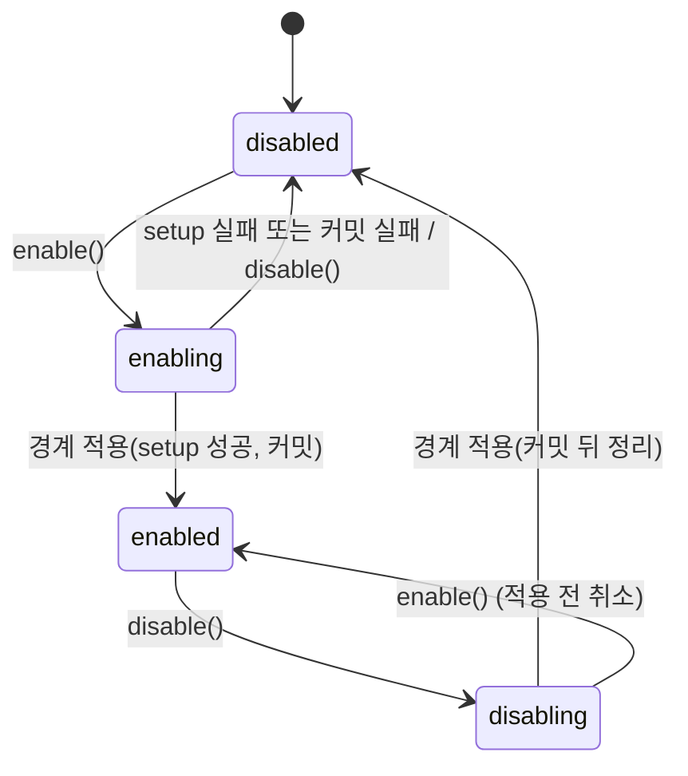

# X 확장 원시 연산 (primitives)

패키지: `@xeon/ext-host`. 코드 위치: `xeon/packages/ext-host/src/primitives/**`.

이 문서는 확장 연산 네 개(`on`, `post`, `drive`, `scope`)와 리소스 등록이 실행 중에 어떻게 동작하는지 정한다. 타입, 지점 선언 표, fold 규칙, 정적 검사의 정본은 F.extensions.spec이다. 이 문서는 그 이름을 인용하고 다시 정의하지 않는다.

## 1. 목적과 범위

정하는 것:

- 디스패처: fold `tap`, `first`, `chain`, `collect`의 실행 알고리즘, 예외·스키마 위반 처리, 스냅샷, 순서 키를 받는 구멍(`DispatchPolicy`)
- 자체 핸들러 레지스트리와 Cordis 사용 범위, Cordis 함정을 막는 래퍼 규칙
- `post`: `when` 세 값의 큐 위치, 멱등, `usesPost` 검사
- `drive`: 임대 중재, `leaseEpoch`, 재호출 시점, 상한 집행, 기본 `requestId` 규칙, 반납 조건
- `scope`: 상태 문서와 커밋, 마이그레이션 훅, 켜기·끄기 상태기계와 적용 시점(실행 중인 turn이 없을 때 포함), `record`/`readRecords` 구현
- 리소스 등록(pi API 형태)의 유지·변환·비지원 표와 자동 해제
- `@xeon/ext-host` 공개 API 이름과 시그니처, 호스트 포트, `CapabilityId`에서 Cordis 서비스 이름을 유도하는 규칙
- 그룹 간 이벤트 이름 격리 정책
- 설정 키 `x.primitives.*`

다루지 않는 것:

- 확장 탐색, 로드 순서 결정, 매니페스트 검증 흐름, 신뢰 판정, 프로세스 격리, SDK 가상 모듈, 설정 키 `ext.<name>.enabled`·`ext.<name>.isolation`: X.loading-trust.spec
- tier 값의 정의, 핸들러 시간 예산 값, 실패 격리와 자동 끄기, 확장 전용 저장 영역 정책, 이름 충돌 규칙, 안전 모드, 외부 훅 프로토콜, 설정 키 `x.operations.*`: X.operations.spec
- 지점을 실제로 발화하는 코드와 boundary 최종 검증 로직: L1.loop.spec, L1.tools.spec, L1.context.spec, L1.models.spec, L1.persistence.spec [가정: 문서 이름은 `_routing/routes.yaml` layout 기준]
- 임대 정책(어느 그룹에 기본 임대를 줄지 고르는 판단)의 그룹 측 구현 `DriveArbiter`: L3.group-kit.spec

소유 경계 조정 [제안]: F.extensions.spec §1과 §4.2는 tier와 핸들러 시간 예산을 이 문서의 몫으로 적었다. `_research/layer-plan-v2.json` X-c와 eng.transactions.design §8은 둘 다 X.operations 소유로 둔다. 이 문서는 후자를 따른다. 디스패처는 tier 정렬 키와 시간 예산을 `DispatchPolicy`로 주입받는 인터페이스만 정의하고 값은 정하지 않는다(§3.4). F §1·§4.2 문구 수정을 요청한다(§10).

## 2. 용어

| 용어 | 뜻 |
|---|---|
| 레지스트리 (registry) | ext-host가 지점별로 핸들러 항목을 보관하는 표. Cordis `ctx.on`의 `_hooks`와 별개다 |
| 핸들러 항목 (handler entry) | 레지스트리의 한 행. 지점, scope, 확장, 로드 순번, 등록 순번, 세대, 함수 |
| 스냅샷 | 디스패치 시작 시점에 고정한 핸들러 항목 배열. 디스패치 도중의 등록·해제·토글은 반영하지 않는다 |
| 세대 (generation) | scope가 켜질 때마다 새로 만드는 정수. 그 세대에서 만든 등록만 유효하다. 꺼지면 세대가 닫힌다 |
| fiber | Cordis의 플러그인 적용 단위(`fiber.ts`). scope가 켜질 때마다 새 fiber 하나를 만든다 |
| 포트 (port) | X가 쓰는 하위·상위 층 기능의 좁은 인터페이스. 구현은 다른 패키지가 Cordis 서비스로 제공하고 X는 주입받는다 |
| 단계 경계 | step이 끝나고 다음 step이 시작되기 전 시점. `boundary.step.after` 처리 뒤다(F.conversation.spec §2, §2.1, F.extensions.spec §4.5) |
| 유휴 (idle) | thread에 실행 중인 turn이 없는 상태 |
| 경계 기여 (boundary contribution) | 단계 경계 커밋에 X가 함께 넣는 내구 이벤트 초안(`scope.changed`, `lease.*`) |
| 디스패치 키 (dispatch key) | L1이 디스패치마다 넘기는 결정적 문자열. 같은 지점이 같은 위치에서 다시 발화하면 같은 값이다. 핸들러 안의 `commit`·`record` 멱등 키의 재료다 |
| 활성 가지 (active branch) | thread의 현재 leaf에서 `parentId`를 따라 처음 이벤트까지 올라간 사슬(F.records.spec §2 leaf) |
| 상태 판 (stateRev) | (thread, scope)의 활성 가지 위 마지막 상태 이벤트의 판. 초기값은 0이다. 되감기·분기 뒤에는 그 가지의 값으로 돌아간다(§4.6.1) |
| 임대 차수 (leaseEpoch) | (thread, scope)의 활성 가지 위 `lease.acquired` 개수. 1부터 센다 |
| 호출 (invocation) | drive 함수를 한 번 부른 것. 임대 하나에 여러 번 일어난다 |

턴과 step의 대응은 F.extensions.spec §2를 따른다. pi `turn_*` 지점은 Xeon step 경계에서 발화한다.

## 3. 인터페이스

모든 코드는 `xeon/packages/ext-host/src/primitives/` 아래에 둔다. F 타입은 `@xeon/contracts/<서브패스>`에서 `import type`으로 가져온다.

```ts
import type {
  PointName, PointSignatures, PointDecl, TapSig, FirstSig, ChainSig, FirstPointName, ChainPointName,
  Handler, HandlerContext, ExtensionOps, PostItem, PostOptions, PostReceipt, PostWhen,
  DriveFn, DriveOptions, DriveLimits, LeaseBudget, LoopHandle, DriveLease, LeaseId, TurnInput, TurnOutcome,
  SpawnSpec, SpawnOutcome, ScopeId, ScopeDef, ScopeApi, ScopeSetup, ScopeStatus, ScopeHandle, ScopeFn,
  ExtensionEntry, ExtensionManifest, ExtensionName, GroupRecord, RecordKind, RecordQuery, RecordSubject,
  ManifestIssue, Unsubscribe, SetupRefusal,
} from "@xeon/contracts/extensions";
import type { Result } from "@xeon/contracts";
import type { CapabilityId, ServiceKey } from "@xeon/contracts/capabilities";
import type { DurableEventDraft, Projector, StoreDb } from "@xeon/contracts/records";
import type { ThreadId, TurnId, StepId, JsonValue, Usage, IdFactory } from "@xeon/contracts/conversation";
// 호스트 포트와 리소스 등록 정의는 F ports.ts가 정본이다(F.extensions.spec §3.2.1, 이 문서 §3.6·§3.9)
import type {
  PortKey, PortLookup, LoopPort, InputQueuePort, RecordCommitPort, ProjectorRegistryPort, ScopedStorePort,
  ProcessPort, LeaseArbiterPort, ToolsPort, ModelsPort, McpPort,
  ToolResourceDef, ProviderResourceDef, McpServerResourceDef,
} from "@xeon/contracts/extensions";
```

### 3.1 공개 API 목록

`@xeon/ext-host` 루트(`src/index.ts`)는 아래 이름만 재export한다 [제안]. 표는 세 도메인(primitives, loading-trust, operations)의 공개 이름 전체이고, 루트 재export 목록의 정본이다. 각 이름의 시그니처는 "정의" 열의 문서가 정한다.

| 이름 | 종류 | 정의 |
|---|---|---|
| `createExtHost`, `ExtHost`, `ExtHostDeps`, `ExtensionUnit`, `InstallResult`, `ScopeSetupOutcome`, `PlatformModule`, `PlatformContext`, `PlatformSetupError`, `LeaseInfo`, `ExtChange` | 함수, 인터페이스 | 이 문서 §3.2 |
| `DispatchOptions`, `DispatchOutcome`, `TapOutcome`, `FirstOutcome`, `ChainOutcome`, `HandlerRef`, `HandlerFailure`, `PayloadOf` | 타입 | 이 문서 §3.3 |
| `DispatchPolicy`, `HandlerEntryInfo`, `HandlerGate`, `HandlerRunOutcome`, `DEFAULT_DISPATCH_POLICY` | 인터페이스, 타입, 상수 | 이 문서 §3.4 |
| `BoundaryHooks`, `BoundarySignal`, `BoundaryContribution` | 인터페이스 | 이 문서 §3.5 |
| `PortKey`, `PortLookup`, `LoopPort`, `LoopPortKey`, `InputQueuePort`, `InputQueuePortKey`, `RecordCommitPort`, `RecordCommitPortKey`, `ProjectorRegistryPort`, `ProjectorRegistryPortKey`, `ScopedStorePort`, `ScopedStorePortKey`, `ProcessPort`, `ProcessPortKey`, `LeaseArbiterPort`, `LeaseArbiterPortKey` 및 부속 타입 | 인터페이스, 상수(F 이름 재export) | F.extensions.spec §3.2.1(재export 목록은 이 문서 §3.6) |
| `ExtHostPortKey`, `SessionFeedPortKey` | 상수 | 이 문서 §3.6, §4.11 |
| `capabilityServiceName`, `providerServiceName`, `isReservedServiceName` | 함수 | 이 문서 §3.7 |
| `capabilityDefTable`, `CapabilityDefLookup` | 함수, 타입 | 이 문서 §4.4.7 |
| `hostOf`, `ScopeHostApi`, `ScopeCallContext`, `StateMigration` | 함수, 인터페이스 | 이 문서 §3.8 |
| `ScopeInfo`, `ResourceRegistry`, `ResourceKind`, `ResourceRecord`, `ResourceExposure`, `ResourcePolicy`, `FlagValueError`, `CommandResourceDef`, `ShortcutResourceDef`, `FlagResourceDef`, `RendererResourceDef` | 인터페이스 | 이 문서 §3.9 |
| `ToolsPort`, `ModelsPort`, `McpPort`, `ToolsPortKey`, `ModelsPortKey`, `McpPortKey`, `ToolResourceDef`, `ProviderResourceDef`, `McpServerResourceDef` | 인터페이스, 상수(F 이름 재export) | F.extensions.spec §3.2.1(재export 목록은 이 문서 §3.9) |
| `PrimitiveError`, `PrimitiveErrorCode` | 클래스, 타입 | 이 문서 §3.10 |
| `primitivesSettings`, `withDriveDefaults` | `defineSettings` 결과, 함수 | 이 문서 §6, §4.4.2 |
| `TrustLevel`, `TRUST_LEVELS`, `InstallSource`, `SOURCE_TRUST`, `TrustPermissions`, `TRUST_MATRIX` | 타입, 상수 | X.loading-trust.spec §3.1 |
| `BuiltinExtensionModule` | 인터페이스 | X.loading-trust.spec §3.2 |
| `LoaderFs`, `LoaderPaths` | 인터페이스(F 이름 재export) | F.extensions.spec §3.2.1(재export는 X.loading-trust.spec §3.2) |
| `LoadState`, `LoadStage`, `LoadDiagnosticCode`, `LoadDiagnostic`, `LoadDiagnosticSchema`, `LoadedExtensionInfo` | 타입, 스키마 | X.loading-trust.spec §3.4 |
| `createExtensionLoader`, `ExtensionLoader`, `LoaderMode`, `LoadOptions`, `LoadReport`, `LoadAbortError`, `LoaderDeps`, `RemovalPreview`, `RemoveResult` | 함수, 인터페이스, 클래스 | X.loading-trust.spec §3.5 |
| `RESERVED_EXT_KEYS`, `reservedExtensionSettings`, `loadingTrustSettings` | 상수, 함수, `defineSettings` 결과 | X.loading-trust.spec §3.6 |
| `installDefaultPlugin`, `DefaultPluginInstallInput`, `DefaultPluginInstallOutcome`, `DefaultPluginInstallError`, `PluginInstallFs`, `SDK_MODULE_SPECIFIERS`, `SdkModules` | 함수, 인터페이스, 타입, 상수 | X.loading-trust.spec §3.9 |
| `StartupOptions`, `SafeModeSource`, `NO_STARTUP_OPTIONS` | 인터페이스, 타입, 상수 | X.operations.spec §3.6 |
| `ProjectTrustResult`, `ResolveProjectTrustInput`, `ProjectTrustStore`, `createProjectTrustStore`, `resolveProjectTrust`, `findTrustRequiringResources`, `TRUST_REQUIRING_PROJECT_RESOURCES`, `trustOptions`, `TrustLookup`, `TrustStoreError`, `TrustVerdict`, `TrustVia`, `LoaderMode` | 인터페이스, 함수, 상수, 타입 | X.loading-trust.spec §3.7 |
| `TrustStoreBackend`, `TrustPrompter`, `TrustPromptRequest`, `TrustChoice`, `TrustChoiceKind`, `TrustOption`, `TrustUpdate` | 인터페이스(F 이름 재export) | F.extensions.spec §3.2.1(재export는 X.loading-trust.spec §3.7) |
| `IsolationProcessPort`, `IsolationSpawnSpec`, `IsolatedChild` | 인터페이스(F 이름 재export) | F.extensions.spec §3.2.1(재export는 X.loading-trust.spec §3.8) |
| `VirtualModuleRegistry` | 인터페이스 | X.loading-trust.spec §3.9 |
| `Tier`, `TIERS` | 타입, 상수 | X.operations.spec §3.1 |
| `ScopeChangeReason`, `ScopeControl`, `OperationsNotifier`, `HandlerOutcomeRecord`, `FailureStats` | 타입, 인터페이스 | X.operations.spec §3.3 |
| `storageOf`, `ExtStorage`, `ExtTables`, `ExtProjection`, `ExtTableDef`, `ExtTableDefs`, `ExtQuery`, `ExtTableReader`, `ExtTableWriter`, `ExtRowError`, `ExtStorageError`, `ExtStorageAdmin`, `ExtTableRecord`, `extTablePrefix`, `parseExtTableName` | 함수, 인터페이스 | X.operations.spec §3.4 |
| `createResourcePolicy`, `ReservedNames` | 함수, 인터페이스 | X.operations.spec §3.5 |
| `StartupOptions`, `StartupHealthStore`, `startupFilter`, `shouldSuggestSafeMode` | 인터페이스, 함수 | X.operations.spec §3.6 |
| `HookDef`, `HookDefSchema`, `HookInput`, `HookOutput`, `HookOutputSchema`, `HOOK_SCHEMA_VERSION` | 타입, 스키마, 상수 | X.operations.spec §3.7 |
| `HookProcessPort`, `HookRunSpec`, `HookRawRun` | 인터페이스(F 이름 재export) | F.extensions.spec §3.2.1(재export는 X.operations.spec §3.7) |
| `createOperationsPolicy`, `OperationsPolicy`, `OperationsDeps`, `OperationsSettingsSource` | 함수, 인터페이스 | X.operations.spec §3.8 |
| `operationsSettings` | `defineSettings` 결과 | X.operations.spec §6 |

패키지 안에서만 쓰는 이름(`ScopeRuntime`, `PostQueue`, `LeaseBroker`, `HandlerRegistry`, `CordisBridge`, `hostInternalsOf`)은 `src/primitives/index.ts`에서만 export하고 루트에서 재export하지 않는다. loading-trust와 operations 코드는 같은 패키지 안이라 이 경로로 import한다. loading-trust·operations의 다른 이름(예: `assignTier`, `runWithBudget`, `PI_COMPAT_TABLE`)도 같은 방식으로 패키지 안에서만 쓴다. 공개가 필요해지면 이 표에 행을 더한다.

### 3.2 호스트 생성과 수명

```ts
// primitives/host.ts
export interface ExtHostDeps {
  /** 사건 id 발급(F.conversation.spec §3.2). 경계 기여 초안의 id에 쓴다 */
  readonly ids: IdFactory;
  /** 밀리초 시각. 시간 예산 측정과 진단에만 쓴다(eng.testing.guide TS-03) */
  readonly now: () => number;
  /** 시간 예산 타이머. 반환값은 취소 함수(TS-03: 테스트는 가짜 타이머를 넘긴다) */
  readonly setTimer: (ms: number, fn: () => void) => () => void;
  /** 순서 키·시간 예산·실패 보고. 기본값 DEFAULT_DISPATCH_POLICY. X.operations가 구현을 넘긴다 */
  readonly policy?: DispatchPolicy;
  /** 리소스 이름 충돌 판정. X.operations가 구현을 넘긴다. 없으면 충돌 시 거부 */
  readonly resourcePolicy?: ResourcePolicy;
  /** scope setup 하나의 시간 예산(ms). 조립 루트가 OperationsPolicy.setupBudgetMs를 넘긴다. 없으면 무제한 */
  readonly setupBudgetMs?: () => number | null;
  /** x.primitives.* 설정 값 읽기. 조립 루트(L4 host)가 설정 서비스에 연결해 넘긴다 */
  readonly settings: PrimitivesSettingsSource;
  /** 진단 출력. 확장 오류, 경고, 포트 부재 */
  readonly report: (diagnostic: ExtDiagnostic) => void;
  /** 참이면 페이로드·패치·결정 스키마 검사와 페이로드 동결을 켠다. 테스트와 개발 빌드 기본값 참 */
  readonly strict?: boolean;
  /** 능력 정의 조회(§4.4.7). 능력 래퍼가 메서드의 `idempotent`·`readOnly` 선언을 읽는 데 쓴다. 없으면 모든 메서드를 선언 없음으로 본다 */
  readonly capabilityDefs?: CapabilityDefLookup;
  /** 선언 없는 쓰기 요청 워커(§4.10). 없으면 X의 기본 워커 [제안] */
  readonly effectWorker?: EffectWorkerPort;
}

export interface PrimitivesSettingsSource {
  driveDefaultLimits(threadId: ThreadId): DriveLimits; // x.primitives.driveDefaultLimits (review.decisions-2 U-12). session 범위까지 합친 값, 빠진 필드는 내장 기본값으로 채움
  driveLimits(threadId: ThreadId): DriveLimits;        // x.primitives.driveLimits (천장). session 범위까지 합친 값
  activeDriveGroup(threadId: ThreadId): ScopeId | null; // x.primitives.activeDriveGroup
  capabilityProviders(): Readonly<Record<CapabilityId, ExtensionName>>; // x.primitives.capabilityProviders
}

export interface ExtDiagnostic {
  readonly level: "error" | "warning" | "info";
  readonly code: PrimitiveErrorCode | ManifestIssue["code"] | "handler_failed";
  readonly scopeId?: ScopeId;
  readonly extension?: ExtensionName;
  readonly message: string;
  readonly cause?: unknown;
}

/** loading-trust가 검증을 끝낸 확장 하나. 순서는 loadIndex가 정한다 */
export interface ExtensionUnit {
  readonly manifest: ExtensionManifest;       // validateManifest를 통과한 정규화 값
  readonly entry: ExtensionEntry;
  /** 로드 순번. 0부터. 핸들러 정렬의 둘째 키 */
  readonly loadIndex: number;
  /** 내장 패키지(core-*, cap-*, group-*)면 참. 포트 제공·조회와 xeon.* 서비스 이름을 허용한다 */
  readonly builtin: boolean;
}

/** install 안의 시작 적용(§4.5.6) 결과. scope 하나에 하나 */
export interface ScopeSetupOutcome {
  readonly scopeId: ScopeId;
  /** applied: setup 성공, 세대 열림. failed: setup 실패로 disabled. skipped: 초기 요청이 꺼짐. deferred: 실행 중 thread가 있어 다음 경계로 미룸 */
  readonly status: "applied" | "failed" | "skipped" | "deferred";
  /** failed일 때만. threw는 setup이 던지거나 거부함, timeout은 setupBudgetMs 초과 */
  readonly failure?: {
    readonly kind: "threw" | "timeout";
    /** 던진 값이 PrimitiveError면 그 코드 */
    readonly code?: PrimitiveErrorCode;
    readonly error?: unknown;
  };
  /** 이 scope setup 직후 validateUsage 결과 */
  readonly issues: readonly ManifestIssue[];
}

export interface InstallResult {
  readonly name: ExtensionName;
  /** 엔트리가 정의한 scope. 엔트리가 던졌으면 빈 배열 */
  readonly scopes: readonly ScopeId[];
  /** 엔트리 본문이 던진 값. 있으면 setups는 비어 있고 등록은 남지 않는다 */
  readonly entryError?: unknown;
  readonly setups: readonly ScopeSetupOutcome[];
  /** setups[].issues의 합 */
  readonly issues: readonly ManifestIssue[];
}

/** L0 플랫폼 패키지(platform-*)의 등록 단위. 매니페스트가 없고 on·post·drive·scope를 쓰지 않는다 */
export interface PlatformModule {
  /** 패키지 매니페스트 이름. 예: "platform-store" */
  readonly name: string;
  /** 실패할 수 있는 시작(디렉터리 준비, 플랫폼 판별)은 err(SetupRefusal)을 돌려준다. 던지면 버그(호출 계약 위반)다 */
  setup(
    ctx: PlatformContext,
  ): void | Result<void, SetupRefusal> | Promise<void | Result<void, SetupRefusal>>;
}

/** registerPlatform이 돌려주는 시작 실패. SetupRefusal(F.extensions.spec §3.2)에 모듈 이름을 더한 값이다 */
export interface PlatformSetupError {
  readonly kind: "setup_failed";
  /** PlatformModule.name */
  readonly module: string;
  readonly reason: string;
  readonly cause: unknown;
}

/** L0 setup이 받는 좁은 객체. Cordis Context는 넘기지 않는다 */
export interface PlatformContext {
  /** xeon.* 포트 제공 */
  providePort<Api>(key: PortKey<Api>, impl: Api): void;
  /** 먼저 등록된 다른 L0 포트 조회(예: xeon.secrets). 없으면 port_unavailable */
  port<Api>(key: PortKey<Api>): Api;
  /** 호스트 dispose 때 역순으로 실행한다 */
  onDispose(fn: () => void | Promise<void>): void;
}

export interface ExtHost {
  /** L0 플랫폼 패키지를 등록한다. 조립 루트가 확장 설치 전에 부른다. setup이 err를 돌려주면 그 모듈의 등록을 거두고 PlatformSetupError를 돌려준다(시작 실패). setup이 던지면 그대로 던진다(버그) */
  registerPlatform(module: PlatformModule): Promise<Result<void, PlatformSetupError>>;
  /** 엔트리를 실행해 scope 정의를 모으고, 기본 활성 scope의 켜기를 시작 적용한다(§4.5.6) */
  install(unit: ExtensionUnit, options?: { readonly signal?: AbortSignal }): Promise<InstallResult>;   // signal이 중단되면 엔트리 실행을 기다리지 않고 entryError(scope_setup_failed)로 끝낸다
  /** 모든 scope를 끄기 요청하고, 적용이 끝나면 정의를 지운다 */
  uninstall(name: ExtensionName): Promise<void>;
  /** 포트 조회. 같은 패키지의 loading-trust·operations와 조립 루트가 쓴다. 확장 코드는 hostOf(g).port를 쓴다 */
  readonly ports: PortLookup;
  scope(id: ScopeId): ScopeHandle | undefined;
  scopes(): readonly ScopeInfo[];
  /** L1이 지점을 발화할 때 부른다(§4.1) */
  dispatch<N extends PointName>(point: N, payload: PayloadOf<N>, options: DispatchOptions<N>): Promise<DispatchOutcome<N>>;
  /** L1 루프가 단계 경계와 유휴 진입 때 부른다(§3.5) */
  readonly boundary: BoundaryHooks;
  /** 이벤트가 커밋된 뒤 부른다. kind가 `LIFECYCLE_POINTS`에 있으면 수명주기 지점을 디스패치한다(§4.11). 끝나기를 기다린다 */
  afterCommit(threadId: ThreadId, events: readonly CommittedEvent[]): Promise<void>;
  /** thread를 열 때(새로 만들거나 재개할 때) 상태 판, 켜짐 상태, 열린 임대를 읽어 들인다 */
  openThread(threadId: ThreadId): Promise<void>;
  closeThread(threadId: ThreadId): Promise<void>;
  /** thread의 현재 임대. 없거나 반납이 커밋되었으면 null. L3.group-kit.spec §3.13 요청 2의 답이다 */
  leaseOf(threadId: ThreadId): LeaseInfo | null;
  /**
   * scope 토글 요청·적용, 임대 부여·반납이 일어나면 알린다(L3.group-kit.spec §3.13 요청 3의 답).
   * 요청은 곧바로, 적용과 임대 변화는 경계 커밋 뒤에 부른다. 구독자의 예외는 `report`로 남기고 다른 구독자에게 이어 간다
   */
  onChange(listener: (change: ExtChange) => void): Unsubscribe;
  /** L4가 읽는 명령·키 조합·플래그·렌더러 표 */
  readonly resources: ResourceRegistry;
  /** 모든 scope를 즉시 끄고 Cordis 루트를 해제한다. 프로세스 종료용. 경계 적용 없이 바로 해제한다 */
  dispose(): Promise<void>;
}

export function createExtHost(deps: ExtHostDeps): ExtHost;

export interface LeaseInfo {
  readonly leaseId: LeaseId;
  readonly scopeId: ScopeId;
  /** 그 scope의 활성 가지 위 `lease.acquired` 개수(§4.4.1 7번) */
  readonly leaseEpoch: number;
  /** active: 사용 중. releasing: 반납이 정해졌고 다음 경계 커밋을 기다린다 */
  readonly status: "active" | "releasing";
}

export interface ExtChange {
  /** scope: 토글 요청, 적용, 오류 표시, 켜짐 집합 변화. lease: 임대 부여나 반납이 커밋됨 */
  readonly kind: "scope" | "lease";
  readonly scopeId: ScopeId;
  /** thread 단위 변화면 그 thread, 전체 요청이면 null */
  readonly threadId: ThreadId | null;
}
```

- `createExtHost`는 Cordis 루트 `Context`를 안에서 만든다(`context.ts:36-49`). 루트와 `Context` 타입은 밖으로 내보내지 않는다(eng.dependency-rules.guide DR-11).
- `createExtHost`가 만든 `ExtHost`는 Cordis 서비스 `xeon.ext`로 등록된다(eng.context-map.design §5.3). L1 내장 확장은 `hostOf(g).port(ExtHostPortKey)`로 얻는다(§3.6). `ExtHost`에는 로더 속성을 두지 않는다. 로더(`ExtensionLoader`)는 Cordis 서비스가 아니고 조립 루트가 직접 쥔다(X.loading-trust.spec §3.5).
- 책임 분담 [제안]: 엔트리 탐색, import, 매니페스트 검증, 신뢰 판정, 설정 연결, 능력 요구 충족은 loading-trust가 하고 그 결과를 `ExtensionUnit`으로 넘긴다. 엔트리 호출(`ExtensionEntry`), scope 정의 수집, scope 세대마다의 Cordis fiber 생성, scope setup 실행과 시간 예산, setup 직후 `validateUsage`는 `install`과 §4.5의 `ScopeRuntime`이 한다. loading-trust는 Cordis를 직접 쓰지 않고 `InstallResult`를 진단으로 옮긴다(X.loading-trust.spec §4.4.3).
- 엔트리 본문은 F `ExtensionEntry`가 받는 `{ manifest, scope }`만 쓴다. 그래서 엔트리 본문에서 부를 수 있는 연산은 `scope(id, def, setup)`뿐이다. `on`, `drive`, `post` 등 `ScopeApi` 연산은 scope setup이나 그 뒤의 핸들러·drive 함수 안에서 부른다. 이 문서에서 "setup"은 scope setup(`ScopeSetup`)만 뜻한다.
- `registerPlatform`은 L0 패키지마다 Cordis fiber 하나를 만들어 `setup`을 실행한다. L0 패키지는 매니페스트 층 값(`ExtensionLayerSchema`)에 L0가 없으므로 `install` 경로를 쓰지 않는다. `providePort`는 `xeon.*` 이름만 받는다(§3.7 예약 규칙의 L0 예외). 등록 순서는 조립 루트가 정하고, 의존하는 포트가 먼저 등록되어 있어야 한다 [제안]. 시작 실패(디렉터리 준비, 플랫폼 판별 같은 예상 가능한 실패)는 `setup`이 `err({ reason, cause })`로 알린다. fiber는 던져야 닫히므로 호스트가 그 값을 내부에서 던져 fiber를 닫고, `registerPlatform`은 던진 값을 `PlatformSetupError`로 되돌려 돌려준다. 그 모듈이 제공한 포트는 남지 않는다(eng.typescript.guide TY-24).

### 3.3 디스패치 타입

```ts
// primitives/dispatch.ts
export type PayloadOf<N extends PointName> = PointSignatures[N]["payload"];
type DecisionOf<N extends FirstPointName> = PointSignatures[N]["decision"];
type ValueOf<N extends ChainPointName> = PointSignatures[N]["value"];

interface DispatchOptionsBase {
  readonly threadId: ThreadId;
  /** 결정적 키. 같은 지점이 같은 위치에서 다시 발화하면 같은 값. 예: "<stepId>:tool_call:<toolCallId>" */
  readonly dispatchKey: string;
  /** 디스패치 전체의 취소 신호. 핸들러 ctx.signal의 부모다 */
  readonly signal?: AbortSignal;
}

export type DispatchOptions<N extends PointName> =
  PointSignatures[N] extends ChainSig<infer _P, infer V, infer _X>
    ? DispatchOptionsBase & {
        /** chain 초기값. 지점이 만든다 */
        readonly initial: V;
        /** POINTS[N].finalize가 "boundary"면 필수. 모든 핸들러 뒤 L1이 최종 값을 검증·보정한다 */
        readonly finalize?: (value: V) => V;
      }
    : DispatchOptionsBase;

export interface HandlerRef {
  readonly scopeId: ScopeId;
  readonly extension: ExtensionName;
  /** 레지스트리 등록 순번 */
  readonly seq: number;
}

export type HandlerFailureReason =
  | "threw"            // 예외 또는 거부된 Promise
  | "timeout"          // DispatchPolicy.budgetMs 초과
  | "result_invalid"   // first 결정·chain 패치가 PointDecl.result 스키마 위반
  | "merge_rejected"   // CHAIN_RULES[N].merge가 예외
  | "value_from_tap";  // tap 핸들러가 undefined 아닌 값을 반환(기록만, 동작 영향 없음)

export interface HandlerFailure {
  readonly point: PointName;
  readonly handler: HandlerRef;
  readonly reason: HandlerFailureReason;
  readonly error?: unknown;
  readonly elapsedMs: number;
}

export interface TapOutcome {
  readonly fold: "tap";
  /** detached 지점이면 참. 이때 failures는 비어 있고 실패는 policy.onHandlerFailure로만 보고된다 */
  readonly detached: boolean;
  readonly failures: readonly HandlerFailure[];
}

export interface FirstOutcome<D> {
  readonly fold: "first";
  /** 결정. 아무 핸들러도 결정하지 않았으면 undefined */
  readonly decision: D | undefined;
  readonly decidedBy: HandlerRef | null;
  /** 참이면 decision은 FIRST_DENY 값이다(핸들러 실패로 대체됨) */
  readonly substituted: boolean;
  readonly failures: readonly HandlerFailure[];
}

export interface ChainOutcome<V> {
  readonly fold: "chain";
  /** finalize를 거친 최종 값 */
  readonly value: V;
  readonly applied: readonly HandlerRef[];
  readonly failures: readonly HandlerFailure[];
  /** stop 규칙으로 뒤 핸들러를 건너뛰었으면 참 */
  readonly stopped: boolean;
}

export interface CollectOutcome<V> {
  readonly fold: "collect";
  /** 모은 기여를 initial에 한 번 병합한 값. 기여가 없으면 initial 그대로다 */
  readonly value: V;
  /** 기여를 낸 핸들러(등록 순서) */
  readonly contributed: readonly HandlerRef[];
  readonly failures: readonly HandlerFailure[];
}

export type DispatchOutcome<N extends PointName> =
  PointSignatures[N] extends TapSig<infer _P> ? TapOutcome
  : PointSignatures[N] extends FirstSig<infer _P, infer D> ? FirstOutcome<D>
  : PointSignatures[N] extends ChainSig<infer _P, infer V, infer _X> ? ChainOutcome<V>
  : PointSignatures[N] extends CollectSig<infer _P, infer V, infer _C> ? CollectOutcome<V>
  : never;
```

### 3.4 DispatchPolicy

```ts
// primitives/dispatch.ts
export interface HandlerEntryInfo {
  readonly point: PointName;
  readonly scopeId: ScopeId;
  readonly extension: ExtensionName;
  readonly layer: ExtensionManifest["layer"];
  readonly builtin: boolean;
  readonly loadIndex: number;
  readonly seq: number;
}

/** 핸들러 실행 중 사용자 응답 대기 동안 예산 시계를 멈추는 장치. X.operations의 BudgetGate가 이 모양을 넓힌다 */
export interface HandlerGate {
  pause(): void;
  resume(): void;
}

/** DispatchPolicy.run 결과. X.operations의 BudgetOutcome과 같은 모양 */
export type HandlerRunOutcome<T> =
  | { readonly kind: "settled"; readonly value: T; readonly activeMs: number }
  | { readonly kind: "threw"; readonly error: unknown; readonly activeMs: number }
  | { readonly kind: "timeout"; readonly budgetMs: number }
  | { readonly kind: "aborted"; readonly reason: unknown };

/** X.operations가 구현한다. 디스패처는 값을 해석하지 않고 쓰기만 한다 */
export interface DispatchPolicy {
  /** 정렬 첫째 키. 작을수록 먼저. 정수 */
  tierOf(entry: HandlerEntryInfo): number;
  /** 핸들러 하나의 시간 예산(ms). null이면 무제한. run이 있으면 디스패처는 이 값을 쓰지 않는다 */
  budgetMs(entry: HandlerEntryInfo): number | null;
  /** 실패 보고. 자동 끄기 판단은 operations 몫이다. 동기, 예외를 던지지 않는다 */
  onHandlerFailure(failure: HandlerFailure): void;
  /** 선택. 성공 보고. 핸들러 호출이 실패로 보고되지 않았을 때 fold 처리 뒤 한 번 부른다. 동기, 예외를 던지지 않는다 */
  onHandlerSettled?(entry: HandlerEntryInfo, activeMs: number): void;
  /** 선택. 있으면 디스패처가 자기 타이머 대신 이 함수로 핸들러를 실행한다. 예산과 사용자 응답 대기 제외를 정책 쪽에서 구현한다 */
  run?<T>(
    entry: HandlerEntryInfo,
    work: (signal: AbortSignal, gate: HandlerGate) => T | Promise<T>,
    outer: AbortSignal | undefined,
  ): Promise<HandlerRunOutcome<T>>;
}

/** tier 0, 예산 없음, 실패는 deps.report로 기록. onHandlerSettled·run 없음 */
export const DEFAULT_DISPATCH_POLICY: DispatchPolicy;
```

- 정렬 키는 `(tierOf(entry), entry.loadIndex, entry.seq)`의 사전식 순서다(F.extensions.spec §4.2).
- [제안] `onHandlerSettled`와 `run`은 X.operations.spec §3.8의 요청을 받아들인 선택 메서드다. 성공 보고가 있어야 operations가 연속 실패 수를 0으로 돌리고 실패율을 계산하며, `run`이 있어야 UI 대기를 예산에서 뺄 수 있다. 둘 다 선택이라 `DEFAULT_DISPATCH_POLICY`와 테스트 정책은 구현하지 않아도 된다.
- `run`이 받는 `gate`는 핸들러의 UI 포트 래퍼에 넘긴다. UI 포트를 핸들러에 주는 방법은 §10 미결이다(X.operations.spec §10 미결 5). `run`이 없으면 디스패처는 멈추지 않는 빈 `HandlerGate`를 쓴다.
- 정렬은 스냅샷을 만들 때 한다. 레지스트리 버전(등록·해제마다 1 증가)과 정책 버전이 같으면 직전 정렬 결과를 재사용한다 [제안].

### 3.5 경계 훅

L1 루프는 단계 경계와 유휴 진입 때 X를 부른다. X는 이 훅에서만 토글 적용, 임대 부여·반납, drive 재호출 예약을 한다.

```ts
// primitives/boundary.ts
export interface BoundarySignal {
  readonly threadId: ThreadId;
  /** step_end: 단계 경계(turn_end 처리 뒤). turn_settled: turn의 마지막 단계 경계 뒤 정착 완료. idle: 유휴 진입 */
  readonly kind: "step_end" | "turn_settled" | "idle";
  readonly turnId?: TurnId;
  readonly stepId?: StepId;
  /** 이 경계를 만든 turn이 drive 임대의 loop.turn으로 시작됐으면 그 임대 id */
  readonly drivenBy?: LeaseId;
}

export interface BoundaryContribution {
  /** L1이 단계 경계 커밋(eng.transactions.design §4.1 C5)에 함께 넣는 초안. scope.changed, lease.acquired, lease.released */
  readonly drafts: readonly DurableEventDraft[];
}

export interface BoundaryHooks {
  /** 커밋 전, 트랜잭션 밖에서 부른다(TX-01). await 허용. 켜기 적용의 setup 실행이 여기서 일어난다 */
  prepare(signal: BoundarySignal): Promise<BoundaryContribution>;
  /** 커밋 결과를 알린다. committed면 끄기 정리(onDispose)와 drive 재호출을 시작하고, failed면 prepare의 변경을 되돌린다 */
  settle(signal: BoundarySignal, result: "committed" | "failed"): Promise<void>;
}
```

- `step_end`와 `turn_settled`는 같은 경계에서 차례로 올 수 있다. 토글과 임대 반납은 `step_end`에서 적용한다. drive 재호출은 `turn_settled`와 `idle`에서만 시작한다(turn 안에서는 `loop.turn`이 새 turn을 시작할 수 없기 때문이다).
- L1이 경계 기여를 커밋에 넣지 못하는 구현(M0 인메모리 포트)이면 X가 `RecordCommitPort.commit`으로 따로 커밋한다. 이 경우 원자성은 경계 커밋과 분리된다 [제안, M0 한정].

### 3.6 호스트 포트

X는 L0·L1을 import하지 않는다(architecture.layers.spec §4.3.3, eng.dependency-rules.guide DR-01·DR-11). 루프 구동, 입력 큐, 세션 커밋, 확장 투영기 등록, 접두 테이블 읽기, 프로세스 실행은 아래 포트로만 쓰고, 구현은 L1 패키지와 L0 패키지(`registerPlatform`, §3.2)가 Cordis 서비스로 제공한다. 서비스 이름은 eng.context-map.design §5.3 표를 따른다.

[결정: review.decisions-2 U-14, D-04] 포트 타입의 정본은 F다. architecture.layers.spec §4.3.3 결론 2번(X가 받는 포트와 각 층의 서비스 인터페이스는 F에 정의한다)이 X 순위 유지의 조건이다. 포트의 이름, 필드, 메서드 시그니처, 키 값은 F.extensions.spec §3.2.1 `ports.ts`가 정하고, `RecordCommitPort`와 부속 타입은 F.records.spec §3.9 `session-service.ts`가 정한다(F `ports.ts`가 다시 export한다). ext-host는 자기 정의를 두지 않고 아래 블록으로 F 이름을 다시 export한다. 이 문서는 X가 포트를 쓰는 규칙(아래 주입 규칙, §4.4, §4.6, §4.7, §4.8)만 정한다. ext-host가 정의하는 포트 키는 `ExtHostPortKey` 하나다. `ExtHost`가 X 타입이라 F에 둘 수 없기 때문이다(F.extensions.spec §3.2.1, eng.context-map.design §5.3 DR-14 예외 4).

```ts
// primitives/ports.ts
// 포트 정의는 모두 F가 정본이다(F.extensions.spec §3.2.1, F.records.spec §3.9). ext-host는 다시 export만 한다
import type { PortKey } from "@xeon/contracts/extensions";
import type { ExtHost } from "./host.ts";
export type {
  PortKey, PortLookup,
  // 루프 (xeon.loop)
  LoopPort, LoopTurnRequest, LoopTurnResult, LoopSpawnRequest, LoopSpawnResult,
  // 입력 큐 (xeon.tasks)
  InputQueuePort, EnqueueRequest, EnqueueResult,
  // 기록 (xeon.session의 ext 속성. 정의는 F.records.spec §3.9)
  RecordCommitPort, ExtCommitRequest, ExtCommitRejectCode, ExtCommitResult,
  StoredScopeState, OpenLease, ExtThreadSnapshot, ExtRecordQuery, ExtRecordRow,
  // 확장 투영기 등록 (xeon.session의 projectors 속성)
  ProjectorRegistryPort,
  // 접두 테이블 (xeon.store)
  ScopedStorePort,
  // 프로세스 실행 (xeon.process). spawn 사용처는 X.loading-trust.spec §3.8, run 사용처는 X.operations.spec §3.7
  ProcessPort, IsolationProcessPort, IsolationSpawnSpec, IsolatedChild, HookProcessPort, HookRunSpec, HookRawRun,
  // 임대 정책 (xeon.groups, 선택)
  LeaseArbiterPort, LeaseCandidate,
} from "@xeon/contracts/extensions";
export {
  LoopPortKey,                // { name: "xeon.loop" }
  InputQueuePortKey,          // { name: "xeon.tasks" }
  RecordCommitPortKey,        // { name: "xeon.session", member: "ext" }
  ProjectorRegistryPortKey,   // { name: "xeon.session", member: "projectors" }
  ScopedStorePortKey,         // { name: "xeon.store" }
  ProcessPortKey,             // { name: "xeon.process" }
  LeaseArbiterPortKey,        // { name: "xeon.groups" }
} from "@xeon/contracts/extensions";

// ── 확장 호스트 자신 (서비스 xeon.ext, 제공 ext-host) ───────────────
export const ExtHostPortKey: PortKey<ExtHost>;               // { name: "xeon.ext" }
```

X가 F 정의를 쓸 때 지키는 대응은 다음과 같다.

- `RecordCommitPort`는 records가 extensions보다 낮아 `ScopeId`, `LeaseId`, `DriveLimits`, `RecordQuery`, `GroupRecord`, `ExtensionName` 자리에 같은 모양의 타입(`string`, `ExtRecordQuery`, `ExtRecordRow`)을 쓴다(F.records.spec §3.9 이름 대응 주석). X는 F extensions 이름의 값을 그대로 넘기고, 돌려받은 `ExtRecordRow`를 `GroupRecord`로 다룬다.
- `queryRecords(threadId, query, reader)`의 `reader`는 호출한 확장의 이름(`ExtensionName`)이다. X는 `readRecords`를 부른 scope의 확장 이름을 넣는다(§4.6.4). 포트는 private 행을 `reader`가 소유 확장일 때만 돌려준다(F.records.spec §3.9 비공개 기록 규칙 3).
- `ProjectorRegistryPort`는 `Pick<ProjectorRegistry, "register" | "onFailure">`다. `register(projector)`는 `Result<{ dispose(): void }, ProjectorRegisterError>`를 돌려준다(L1.persistence.spec §3.4). 투영기 이름은 `"ext.<확장 이름>"`이다.
- `ScopedStorePort`는 `Pick<StoreService, "scoped">`다. `scoped(owner)`의 인자는 소유자 id다. 확장 테이블은 `"ext.<확장 이름>"`, 호스트 소유 장부는 `"xh"`를 넘긴다(L0.store.spec §4.5 소유자 표). 접두(`x_<name>_`, `xh_`)를 넘기지 않는다.

포트 주입 규칙:

1. X는 포트마다 내부 Cordis 플러그인 하나를 두고 `inject: [<포트 이름>]`으로 주입받는다. 포트 fiber가 ACTIVE가 되면 참조를 잡고, 해제되면 참조를 비운다. 포트를 따로 두므로 한 포트가 없어도 나머지 연산은 동작한다.
2. 포트가 없을 때: `dispatch`는 포트 없이 동작한다. `post`는 `InputQueuePort`, `drive`는 `LoopPort`와 `RecordCommitPort`, `commit`·`record`·`readRecords`는 `RecordCommitPort`가 필요하다. 없으면 `PrimitiveError("port_unavailable")`로 거부한다. drive 임대는 두 포트가 모두 있을 때만 부여한다.
3. `LeaseArbiterPort`는 선택이다. 없으면 §4.4.1의 기본 규칙을 쓴다.
4. `xeon.*` 이름의 서비스는 `ExtensionUnit.builtin`이 참인 확장과 `registerPlatform`으로 등록한 L0 패키지만 제공할 수 있다(§3.7).
5. 확장이 아닌 사용처의 포트 경로 [제안]: X 안의 loading-trust·operations는 Cordis를 쓰지 않고 `ExtHost.ports`(`PortLookup`)로 포트를 얻는다. operations는 `OperationsDeps.ports`로 받은 `PortLookup`에서 `ProjectorRegistryPortKey`·`ScopedStorePortKey`(확장 전용 저장, `storageOf`)와 `ProcessPortKey`(외부 훅)를 꺼낸다. operations 정책은 `ExtHost`보다 먼저 만들어지므로 조립 루트가 `ExtHost.ports`를 늦은 연결로 넘긴다(X.operations.spec §3.8). 로더의 `IsolationProcessPort`는 조립 루트가 `ExtHost.ports.get(ProcessPortKey)`로 꺼내 `LoaderDeps.process`에 넣는다(X.loading-trust.spec §3.5).
6. [결정: review.decisions-2 D-04] 포트와 서비스 인터페이스의 관계. 같은 서비스 이름에 등록되는 서비스 인터페이스는 F에 있고, 이 포트를 부분형으로 포함한다. 서비스 이름 하나에는 인터페이스 하나만 등록되므로 X 포트의 메서드와 서비스 인터페이스의 메서드가 어긋나지 않는다.

   | 서비스 이름 | 서비스 인터페이스(F 위치) | 포함하는 포트 |
   |---|---|---|
   | `xeon.loop` | `LoopService`(`@xeon/contracts/services`) | `LoopPort` |
   | `xeon.tasks` | `TaskService`(`@xeon/contracts/services`) | `InputQueuePort` |
   | `xeon.session` | `SessionService`(F.records.spec §3.9) | `RecordCommitPort`(`ext` 속성), `ProjectorRegistryPort`(`projectors` 속성) |
   | `xeon.store` | `StoreService`(F.records.spec §3.9) | `ScopedStorePort` |
   | `xeon.process` | `ProcessService`(`@xeon/contracts/services`) | `ProcessPort` |
   | `xeon.tools` | `ToolService`(`@xeon/contracts/services`) | `ToolsPort`(§3.9) |
   | `xeon.models` | `ModelService`(`@xeon/contracts/services`) | `ModelsPort`(§3.9) |
   | `xeon.mcp` | `McpService`(`@xeon/contracts/services`, F.capabilities.spec §3.12 `services/mcp.ts`) | `McpPort`(§3.9) |
   | `xeon.groups` | `GroupService`(`@xeon/contracts/services`, F.capabilities.spec §3.12 `services/groups.ts`) | `LeaseArbiterPort` |

   - L1.loop.spec의 `LoopService extends LoopPort`와 `threadStatus`가 이 규칙의 예다. L1.tools.spec `ToolService extends ToolsPort`, L1.models.spec의 `registerProvider`, L2.mcp.spec §3.2 `McpService extends McpPort`, F.capabilities.spec §3.12 `GroupService extends LeaseArbiterPort`도 같은 규칙을 따른다.
7. [결정: review.decisions-2 D-05] X 테스트는 L0를 import하지 않는다. 포트 가짜는 X `test/`와 `@xeon/ext-host/testing` 안에 F 인터페이스로 만든다.

### 3.7 Cordis 서비스 이름 유도

F.capabilities.spec §3.5가 위임한 규칙이다.

```ts
// primitives/services.ts
/** 능력의 현재 바인딩 이름. 소비자가 inject하는 이름이다. 예: "cap:web.search" */
export function capabilityServiceName(id: CapabilityId): `cap:${string}`;
/** 공급자별 이름. 예: "cap:web.search@web-exa" */
export function providerServiceName(id: CapabilityId, provider: ExtensionName): `cap:${string}@${string}`;
/** "xeon." 접두, "_" 접두, "cap:" 접두는 예약. 확장 코드가 직접 provide할 수 없다 */
export function isReservedServiceName(name: string): boolean;
```

규칙 [제안]:

1. 공급자는 `hostOf(g).provide(key, impl)`를 부르고, X는 `providerServiceName(key.capability, 확장 이름)`으로 Cordis `provide`를 한다. 이름에 공급자 확장 이름을 넣는 이유는 Cordis가 같은 isolation 안에서 같은 이름을 두 번 등록하면 던지기 때문이다(`reflect.ts:214-216`). 한 능력에 공급자가 여럿일 수 있다(F.capabilities.spec §2 provider 행).
2. X는 능력마다 바인딩 하나를 만든다. 공급자가 하나면 그것, 여럿이면 설정 `x.primitives.capabilityProviders[id]`가 고른 것이다. 설정이 없고 공급자가 여럿이면 바인딩을 만들지 않고 `capability_ambiguous` 진단을 낸다. 바인딩은 X 내부 플러그인이 공급자 서비스를 inject해 `capabilityServiceName(id)`로 다시 provide하는 형태다. 그래서 공급자가 내려가면 바인딩이 내려가고, 바인딩을 inject한 소비자 fiber도 Cordis 규칙대로 내려갔다 다시 올라온다(`fiber.ts:383-412`).
3. 구분자 `:`와 `@`는 `CAPABILITY_ID_PATTERN`과 `EXTENSION_NAME_PATTERN`에 없는 문자다. 그래서 이름에서 능력 id와 공급자 이름을 거꾸로 읽을 수 있다. Cordis가 특별 취급하는 이름(`_` 접두, 숫자 문자열, `then`, `prototype`, `reflect.ts:27-38`)과 겹치지 않는다.
4. 버전은 이름에 넣지 않는다. 바인딩을 만들 때 `ServiceKey.version`과 공급자의 `provides[].version`의 major가 다르면 그 공급자를 후보에서 뺀다(F.capabilities.spec §5 1번).
5. scope fiber의 Cordis `inject`는 매니페스트 `requires`의 능력마다 `capabilityServiceName(id)`이다. `optional`은 inject에 넣지 않고 `capability(key)` 호출 때 루트에서 찾는다. 없으면 `capability_unavailable`로 던진다 [가정: vendored Cordis의 inject에 선택 의존 표기가 없다고 읽었다. `fiber.ts:383-394`는 주입 서비스가 하나라도 없으면 epoch를 INACTIVE로 둔다].
6. 포트 이름(`xeon.*`)은 eng.context-map.design §5.3 표가 정본이다. 능력 이름은 `cap:` 접두를 쓰므로 두 이름 공간이 겹치지 않는다.

### 3.8 scope 확장 API (`hostOf`)

F의 `ScopeApi<S>`에는 서비스 제공, 포트 조회, 리소스 등록, 상태 마이그레이션이 없다. F 타입을 바꾸지 않고 X가 같은 scope에 붙는 부가 API를 준다.

```ts
// primitives/host-api.ts
export type StateMigration = (doc: JsonValue, fromVersion: number) => JsonValue;

/** 지금 실행 중인 재실행 문맥. signal은 on에서는 핸들러 호출의 취소 신호, drive에서는 임대의 취소 신호다 */
export interface ScopeCallContext {
  readonly kind: "on" | "drive";
  readonly threadId: ThreadId;
  readonly signal: AbortSignal;
  /** on일 때 실행 중인 지점 */
  readonly point?: PointName;
}

export interface ScopeHostApi<S = unknown> {
  readonly scopeId: ScopeId;
  readonly extension: ExtensionName;
  /** 능력 공급자 등록. key.capability는 매니페스트 provides에 있어야 한다. fiber effect로 추적한다 */
  provide<Api>(key: ServiceKey<Api>, impl: Api): void;
  /** 포트 제공. builtin 확장만 */
  providePort<Api>(key: PortKey<Api>, impl: Api): void;
  /** 포트 조회. builtin 확장만. 없으면 port_unavailable */
  port<Api>(key: PortKey<Api>): Api;
  /**
   * 설정 키의 유효 값(조립 루트가 `xeon.settings` 포트로 올린 읽기를 거친다). builtin 확장은 모든 키를, 그 밖의 확장(user 신뢰 등)은 자기 이름공간
   * `ext.<확장 이름>.` 아래 키만 읽는다. 다른 키는 값이 있어도 undefined이고, 포트가 없거나 모르는 키도 undefined다
   */
  settingValue(key: string): unknown;
  /** 상태 문서 마이그레이션. setup 안에서 한 번만 부른다 */
  migrateState(fn: StateMigration): void;
  /** 상태 커밋과 그룹 레코드를 한 트랜잭션으로 낸다(§4.6.1, M3-REQ-24 [제안]). F `ScopeApi.commit`에 둘째 인자가 없어 여기에 둔다 */
  commitWith(next: S, records: readonly RecordInput[]): Promise<Readonly<S>>;
  /** 줄 세운 읽기-계산-커밋(§4.6.1, M3-REQ-23 [제안]). 실패는 값이다 */
  updateState(fn: (prev: Readonly<S>) => S, records?: (next: S) => readonly RecordInput[]): Promise<Result<Readonly<S>, StateUpdateError>>;
  /** 선언 없는 쓰기 요청(§4.10, M3-REQ-27 [제안]) */
  requestEffect(request: EffectRequest): Promise<void>;
  /**
   * 호출한 scope의 on 핸들러나 drive 함수 안이면 그 문맥을 돌려준다(§4.2 ambient). setup, 명령 처리기, 도구 execute(이 둘은 ambient는 있지만 재실행되는 문맥이 아니다, §4.6.6),
   * 능력 공급자 안, drive의 turn·spawn 안과 다른 scope의 문맥에서는 undefined다
   */
  callContext(): ScopeCallContext | undefined;
  /**
   * 사용자 응답(대화상자, 승인) 대기를 감싼다. 핸들러 안에서 부르면 wait 동안 핸들러 시간 예산 시계를 멈추고,
   * wait에는 핸들러의 취소 신호와 options.signal을 AbortSignal.any로 합쳐 넘긴다. 핸들러 밖에서는 그대로 실행한다
   * (X.operations.spec §4.2.3, M2 O-07)
   */
  awaitUser<T>(wait: (signal: AbortSignal) => Promise<T>, options?: { readonly signal?: AbortSignal }): Promise<T>;
  // 리소스 등록(§4.8). 모두 fiber effect로 추적되어 scope가 꺼지면 자동 해제된다
  registerTool(def: ToolResourceDef): void;
  registerCommand(name: string, def: CommandResourceDef): void;
  registerShortcut(key: string, def: ShortcutResourceDef): void;
  registerFlag(name: string, def: FlagResourceDef): void;
  getFlag(name: string): boolean | string | undefined;
  registerProvider(name: string, config: ProviderResourceDef): void;
  registerMcpServer(name: string, config: McpServerResourceDef): void;
  registerMessageRenderer(customType: RecordKind, renderer: RendererResourceDef): void;
}

/** setup이 받은 g로 부가 API를 얻는다. ext-host가 만든 g가 아니면 PrimitiveError("no_context") */
export function hostOf<S>(g: ScopeApi<S>): ScopeHostApi<S>;
```

- `hostOf`는 `WeakMap<ScopeApi, ScopeHostApi>`로 찾는다. 같은 g에 대해 같은 객체를 돌려준다.
- `callContext`는 ambient(§4.2 `withAmbient`)를 읽는다. ambient의 `scopeId`가 g를 만든 scope와 다르면 undefined다. drive 문맥의 `signal`은 `LoopHandle.signal`과 같은 임대 신호이고, on 문맥의 `signal`은 핸들러 `ctx.signal`과 같아 시간 초과 때 abort된 상태가 된다. drive의 `turn`·`spawn`과 능력 공급자 호출은 ambient를 끊으므로(§4.4.7) 그 안에서는 undefined다. 이 값으로 L3가 `g.delegate`의 thread를 얻고, on·drive에서 허용되지 않는 연산을 거부한다.
- 포트로 넘기는 리소스 정의(`ToolResourceDef`, `ProviderResourceDef`, `McpServerResourceDef`)는 F.extensions.spec §3.2.1 정의를 쓰고, X가 보관하는 리소스 정의(`CommandResourceDef` 등)는 §3.9에 둔다.
- [미결] F.extensions.spec §3.2 `ScopeApi`에 `provide`를 두지 않은 상태에서 L2 공급자가 이 API로 등록하는 방식이 F.capabilities.spec의 의도와 같은지. 다른 안은 F `ScopeApi`에 `provide<Api>(key, impl)`를 추가하는 것이다.

### 3.9 scope 정보, 리소스 표, 리소스 포트

```ts
// primitives/scope.ts
export interface ScopeInfo {
  readonly id: ScopeId;
  readonly extension: ExtensionName;
  readonly status: ScopeStatus;
  readonly generation: number;          // 꺼져 있으면 마지막 세대
  /** 켜졌지만 requires 능력이 없어 fiber가 PENDING인 경우의 부족 능력 */
  readonly waiting: readonly CapabilityId[];
  readonly drive: "none" | "registered" | "holding" | "error";
  readonly lastError?: { readonly code: PrimitiveErrorCode; readonly message: string };
}

// primitives/resources.ts
export type ResourceKind = "tool" | "command" | "shortcut" | "flag" | "provider" | "mcp_server" | "message_renderer";

export interface ResourceRecord {
  readonly kind: ResourceKind;
  /** 등록을 요청한 이름 */
  readonly name: string;
  /** 사용자·모델에 보이는 이름. ResourcePolicy가 정하고 정책이 없으면 name이다. L4와 모델은 이 이름을 쓴다 */
  readonly exposed: string;
  readonly scopeId: ScopeId;
  readonly extension: ExtensionName;
  /** 내장 패키지의 등록인가. 이름 예약 판정에 쓴다 */
  readonly builtin: boolean;
  readonly def: unknown;              // kind별 *ResourceDef
}

/** L4가 읽는다. command, shortcut, flag, message_renderer는 X가 보관하고, 나머지는 포트로 넘긴 기록만 보관한다 */
export interface ResourceRegistry {
  list(kind?: ResourceKind): readonly ResourceRecord[];
  subscribe(listener: (change: { readonly type: "added" | "removed"; readonly record: ResourceRecord }) => void): Unsubscribe;
  /** L4가 CLI 인자 해석 결과를 넘긴다 [제안]. exposed는 ResourceRecord.exposed다. 값이 선언한 type과 다르면 type_mismatch */
  setFlag(exposed: string, value: boolean | string | undefined): Result<void, FlagValueError>;
}

export type FlagValueError =
  | { readonly kind: "unknown_flag"; readonly name: string }
  | { readonly kind: "type_mismatch"; readonly name: string; readonly expected: "boolean" | "string" };

/** X.operations가 구현한다. 같은 kind·노출 이름이 이미 있을 때의 쌍 판정과, 같은 kind 전체의 집합 판정 */
export interface ResourcePolicy {
  resolve(incoming: ResourceRecord, existing: ResourceRecord):
    | { readonly action: "reject" }
    | { readonly action: "replace" }
    | { readonly action: "rename"; readonly name: string };
  /**
   * 선택. 같은 kind 전체 레코드에서 노출 이름을 다시 정한다. 있으면 레지스트리는 도구·명령·단축키·플래그에 대해
   * 쌍 판정 대신 이것을 쓴다. 결과는 입력 순서와 무관하다(X.operations.spec §4.5 규칙 3)
   */
  exposeAll?(records: readonly ResourceRecord[]): readonly ResourceExposure[];
}

/** exposeAll이 레코드마다 돌려준다. 레코드는 (kind, scopeId, name)으로 가리킨다 */
export interface ResourceExposure {
  readonly kind: ResourceKind;
  readonly scopeId: ScopeId;
  readonly name: string;
  readonly exposed: string;
  /** 짧은 이름을 받지 못한 이유. too_long이면 등록을 거부한다 */
  readonly reason?: "reserved" | "conflict" | "too_long";
}

export interface CommandResourceDef {
  readonly description?: string;
  handler(args: string, ctx: {
    readonly threadId: ThreadId | null;
    readonly invocationId: string;   // 명령 호출 하나의 id. threadId가 있으면 §4.6.6의 디스패치 키가 된다. 같은 호출의 재실행은 같은 값
  }): Promise<void>;
}
export interface ShortcutResourceDef { readonly description?: string; handler(ctx: { readonly threadId: ThreadId | null }): Promise<void> }
export interface FlagResourceDef { readonly description?: string; readonly type: "boolean" | "string"; readonly default?: boolean | string }
export interface RendererResourceDef { readonly module: string; readonly export: string }  // L4가 해석 [제안]

// 포트로 넘기는 리소스(도구, provider, MCP 서버)의 정의와 등록 포트는 F가 정본이다(F.extensions.spec §3.2.1)
export type {
  ToolResourceDef, ProviderResourceDef, McpServerResourceDef, ToolsPort, ModelsPort, McpPort,
} from "@xeon/contracts/extensions";
export {
  ToolsPortKey,    // { name: "xeon.tools" }
  ModelsPortKey,   // { name: "xeon.models" }
  McpPortKey,      // { name: "xeon.mcp" }
} from "@xeon/contracts/extensions";
```

- [결정: review.decisions-2 D-04] 세 포트는 같은 서비스 이름에 등록되는 서비스 인터페이스의 부분형이다. `ToolService extends ToolsPort`, `ModelService extends ModelsPort`, `McpService extends McpPort`이고 세 인터페이스는 F `@xeon/contracts/services`에 있다(F.capabilities.spec §3.12). X가 같은 서비스 이름에 별도 인터페이스를 등록하지 않는다(§3.6 규칙 6 표).
- 등록 메서드의 이름과 인자, 리소스 정의(`ToolResourceDef`, `ProviderResourceDef`, `McpServerResourceDef`)의 모양은 F.extensions.spec §3.2.1이 정한다. `ProviderResourceDef`와 `McpServerResourceDef`의 내용 모양은 각각 L1.models.spec과 L2.mcp.spec(`McpServerDefSchema`)이 정한다. X가 보관만 하는 리소스(`CommandResourceDef`, `ShortcutResourceDef`, `FlagResourceDef`, `RendererResourceDef`)는 위 블록이 정본이다.
- 위장 provider 플러그인(`plugins/*`, L1 순위)은 이 포트를 쓰지 않는다. F provider 인터페이스로 `core-models` 서비스에 등록한다([결정: review.decisions-2 U-16]). `ModelsPort`는 확장의 `hostOf(g).registerProvider` 경로다.

### 3.10 오류

```ts
// primitives/errors.ts
export type PrimitiveErrorCode =
  | "port_unavailable" | "no_context" | "no_thread"
  | "post_undeclared"
  | "drive_requires_group" | "drive_undeclared" | "drive_duplicate" | "drive_outside_setup"
  | "lease_inactive" | "lease_revoked" | "lease_budget" | "handler_aborted"
  | "scope_inactive" | "scope_foreign_id" | "scope_duplicate" | "scope_setup_failed"
  | "point_undeclared"
  | "state_undeclared" | "state_schema" | "state_conflict" | "state_too_large"
  | "state_migration_missing" | "state_migration_failed" | "state_migration_duplicate"
  | "state_migration_outside_setup" | "state_future_version"
  | "storage_unavailable"
  | "record_kind_undeclared" | "record_invalid" | "read_kind_undeclared" | "record_private_invalid"
  | "capability_undeclared" | "capability_unavailable" | "capability_ambiguous"
  | "service_reserved" | "tool_risk_reserved" | "resource_conflict" | "resource_name_invalid";

export class PrimitiveError extends Error {
  readonly code: PrimitiveErrorCode;
  readonly scopeId: ScopeId | undefined;
  constructor(code: PrimitiveErrorCode, message: string, options?: { scopeId?: ScopeId; cause?: unknown });
}
```

- 확장이 부르는 연산(`on`, `post`, `drive`, `commit`, `record`, `readRecords`, `capability`, `hostOf(g).*`)은 실패 시 `PrimitiveError`를 던지거나 거부한다. F `ScopeApi`의 메서드가 `Promise`나 값을 돌려주는 형태라 Result를 쓰지 않는다 [제안, F.capabilities.spec §3.2와 같은 예외 기반 서비스 경계].
- `ManifestIssue` 코드와 겹치는 항목(`point_undeclared`, `post_undeclared`, `drive_undeclared`, `capability_undeclared`, `record_kind_undeclared`, `read_kind_undeclared`, `drive_requires_group`)은 같은 문자열을 쓴다. X는 이 검사를 `validateUsage`로 하고 결과 코드를 그대로 옮긴다. 로더는 scope setup이 이 코드의 `PrimitiveError`로 끝나면 `usage_invalid` 진단으로 옮긴다(X.loading-trust.spec §4.4.3 표).
- [제안] L1 결함(지점 발화 코드의 잘못)은 `PrimitiveError`가 아닌 `Bug`(eng.typescript.guide)로 던진다. 대상은 페이로드 스키마 위반(`Bug("dispatch.payload_invalid: …")`)과 `finalize` 누락(`Bug("dispatch.finalize_missing: …")`)이다. 확장이 고칠 수 있는 오류만 `PrimitiveError`다.

## 4. 동작 규칙

### 4.1 레지스트리와 Cordis 사용 범위

[제안] ext-host는 지점 핸들러를 Cordis 이벤트(`ctx.on`, `emit`, `bail`, `waterfall`)에 걸지 않고 자체 레지스트리에 둔다. 이유는 다음과 같다.

- Cordis `ctx.on`의 순서 옵션은 `prepend`(앞에 넣기)와 기본 push뿐이다(`events.ts:142-149`). tier 정렬과 로드 순서를 표현할 수 없다.
- Cordis `waterfall`은 Koa형 `next`를 받는 동기 함수다(`events.ts:125-140`). F의 chain은 `(payload, current, ctx)`를 받고 패치를 돌려주며 `CHAIN_RULES[N].merge`가 병합한다. 비동기 핸들러, 핸들러별 skip, `stop` 규칙을 waterfall로 표현할 수 없다.
- 핸들러 시간 예산과 핸들러별 실패 기록은 Cordis 디스패치에 끼울 자리가 없다(`events.ts:95-123`).
- Cordis `_resolve`는 디스패치마다 콜백 배열을 복사한다(`events.ts:83-86`). 스냅샷 동작은 같지만 세대 검사가 없다(`_research/notes/X-2.md` §5).

Cordis는 두 가지에만 쓴다.

1. fiber effect: scope 세대마다 fiber 하나를 만들고, 그 세대의 등록(on 항목, drive 등록, 리소스, provide)을 `fiber.effect`로 추적한다. scope를 끄면 `fiber.dispose()`가 해제기를 실행한다(`fiber.ts:270-342`, `453-489`).
2. 서비스: `provide`/`inject`로 능력 바인딩과 포트를 연결한다(§3.6, §3.7).

레지스트리 규칙:

1. `g.on(point, handler)`는 (a) 세대가 열려 있는지(§4.5.4), (b) `validateUsage`의 `point_undeclared`에 걸리지 않는지 확인한 뒤, `fiber.effect(() => { registry.add(entry); return () => registry.remove(entry) })`로 등록한다. 반환하는 `Unsubscribe`는 effect 해제기를 감싼 함수이고 여러 번 불러도 한 번만 동작한다.
2. 등록 순번 `seq`는 ExtHost 전체에서 단조 증가하는 정수다.
3. 디스패치 시작 때 `registry.snapshot(point, threadId)`가 항목 배열을 복사한다. 이 배열에는 스냅샷 시점에 세대가 열려 있고 그 thread에서 켜진 scope의 항목만 들어간다. 디스패치 도중의 `add`·`remove`·토글은 진행 중인 디스패치에 반영되지 않는다(pi `runner.ts:269-271` `snapshotEventHandlers`와 같다).
4. 스냅샷에 들어간 항목의 scope가 디스패치 도중 꺼져도 그 디스패치에서는 실행된다. 끄기 적용은 단계 경계에서만 일어나고 디스패치는 step 안에서 일어나므로 실제로는 겹치지 않는다. detached tap만 경계를 넘어 실행될 수 있다.

### 4.2 디스패처

공통 준비(네 fold 공통):

```text
dispatch(point, payload, options):
  decl = POINTS[point]
  if strict: Value.Check(decl.payload, payload) 실패 → throw new Bug("dispatch.payload_invalid: …")   // L1 결함
             payload = deepFreeze(payload)
  entries = sortByPolicy(registry.snapshot(point, options.threadId))
  states  = 각 entry.scopeId의 (threadId) 마지막 커밋 상태 (메모리 캐시, §4.6.2)
  switch decl.fold: tap / first / chain / collect
```

핸들러 하나 실행(`runOne`):

```text
runOne(entry, args):
  info = info(entry)
  outer = options.signal과 세대 신호(§4.5.4)를 합친 신호
  ambient = { threadId, point, dispatchKey, scopeId, counter: 0 }      // §4.6.3의 멱등 키 재료. point는 callContext가 읽는다(§3.8)
  work = (signal, gate) => withAmbient(ambient, () =>
           entry.fn(...args, { scopeId, state: states[scopeId], threadId, signal }))   // gate는 UI 포트 래퍼로
  o = policy.run
        ? await policy.run(info, work, outer)
        : await ownRun(work, policy.budgetMs(info), outer)   // 자체 타이머, 빈 gate
  switch o.kind:
    settled: return { ok: true, value: o.value, activeMs: o.activeMs }
    threw:   report(failure("threw", o.error)); return { ok: false }
    timeout: report(failure("timeout"));        return { ok: false }
    aborted: return { ok: false, aborted: true }        // 실패로 보고하지 않는다

ownRun(work, budget, outer):
  ctl = new AbortController(); outer를 부모로 연결
  p = Promise.resolve().then(() => work(ctl.signal, 빈 gate))
  budget === null ? p를 await : raceTimeout(p, budget, setTimer)   // 초과 시 ctl.abort()
  결과를 HandlerRunOutcome으로 바꾼다
```

- `Promise.resolve().then(...)`로 감싸서 동기 예외와 거부를 같은 경로로 받는다. `policy.run`도 같은 규칙으로 구현한다(X.operations.spec §3.2 `runWithBudget`).
- 시간 초과 뒤에도 핸들러 Promise는 계속 돈다. X는 결과를 버리고 `ctx.signal`을 중단 상태로 바꾼다. 늦게 끝난 핸들러의 반환값은 쓰지 않고, 늦게 던진 오류는 `policy.onHandlerFailure`로만 보고한다. 강제로 멈추지 못한다(§5 13번).
- `aborted`(사용자 중단, 세션 종료, 세대 닫힘으로 끝남)는 fold에서 실패와 같이 처리한다(`failure: "closed"`인 first는 `FIRST_DENY`, `open`인 first와 collect는 그 핸들러를 건너뜀, chain은 그 패치 생략, tap은 계속). 다만 `onHandlerFailure`로 보고하지 않는다. X.operations.spec §4.3.1의 `aborted` 분류와 같다.
- 성공 보고 [제안]: fold 처리가 끝난 뒤 그 호출이 `onHandlerFailure`로 보고되지 않았으면(`result_invalid`, `merge_rejected`도 실패다) `policy.onHandlerSettled?.(info, activeMs)`를 한 번 부른다. `value_from_tap`은 실패가 아니므로 성공 보고를 막지 않는다.
- `withAmbient`는 `node:async_hooks`의 `AsyncLocalStorage`로 현재 thread와 디스패치 키를 핸들러 비동기 흐름에 싣는다 [제안]. `ScopeApi.state()`, `commit`, `post`, `record`가 이 값을 읽는다(§4.6.3). [가정] Bun 1.4의 `AsyncLocalStorage`가 await 경계를 넘어 값을 유지한다. M0 단위 테스트로 확인한다.

tap:

```text
tap(entries, payload):
  if decl.dispatch == "detached":
    // 완료를 기다리지 않는다. 핸들러는 이 호출이 돌아온 뒤 순서대로 실행한다. 호스트가 작업을 추적한다(whenSettled)
    // 취소 신호는 thread 닫힘뿐이다(디스패치 옵션의 signal은 쓰지 않는다)
    track(Promise.resolve().then(() => 위 순차 await tap을 그대로 실행))
    return { fold: "tap", detached: true, failures: [] }
  failures = []
  for e in entries:                     // 순차 await. F §4.2
    r = await runOne(e, [payload])
    if !r.ok: failures.push(...)        // 기록하고 다음 핸들러로 간다
    else if r.value !== undefined: report(value_from_tap)   // 동작 영향 없음
  return { fold: "tap", detached: false, failures }
```

first:

```text
first(entries, payload):
  closed = decl.failure == "closed"      // adr.0017. open인 지점은 session.compact.before뿐이고 FIRST_DENY 항목이 없다
  for e in entries:
    r = await runOne(e, [payload])
    if !r.ok:                            // 예외·시간 초과
      if !closed: continue               // 그 핸들러를 결정 없음으로 보고 기록한 뒤 다음 핸들러로 간다
      return { decision: FIRST_DENY[point], decidedBy: ref(e), substituted: true, failures }
    if r.value === undefined: continue   // 결정 없음
    if !Value.Check(decl.result, r.value):    // 0, '', NaN, null, false도 여기서 걸린다
      failures.push(result_invalid)
      if !closed: continue
      return { decision: FIRST_DENY[point], decidedBy: ref(e), substituted: true, failures }
    return { decision: r.value, decidedBy: ref(e), substituted: false, failures }
  return { decision: undefined, decidedBy: null, substituted: false, failures }
```

- 결정으로 인정하는 값은 `undefined`가 아니고 `PointDecl.result` 스키마를 통과하는 값뿐이다. F의 first 결정 타입은 모두 객체 형태(예: `ToolCallDecision = { block: true, reason, terminate? }`)다. 그래서 Cordis `bail`처럼 `0`, `''`, `NaN`을 결정으로 받는 일이 없다. 이 값들은 스키마 위반이므로 F.extensions.spec §5 2번대로 거부값으로 바뀐다.
- 결정 스키마 검사는 `strict`와 관계없이 항상 한다. first는 보안 지점(`tool.call.before`, `input.bash.before`, `session.trust.before`, guard 지점 셋)이라 비용보다 정확성이 우선이다 [제안].
- guard 지점(`guard.model.before`, `guard.tool.before`, `guard.output.before`)은 `failure: "closed"`인 first다. 핸들러 예외·시간 초과·스키마 위반은 `FIRST_DENY`의 차단 결정(`{ block: true, reason }`)이 된다. 핸들러가 없으면 결정 없음이고 통과다. 발화 시점은 L1이 정한다(같은 대상의 일반 지점이 끝난 뒤, M3-REQ-109). 내장 검사는 두지 않는다 [결정: adr.0017 §3.6].

chain:

```text
chain(entries, payload, options):
  value = options.initial; applied = []; failures = []; stopped = false
  rule = CHAIN_RULES[point]
  if decl.finalize == "boundary" && options.finalize === undefined: throw new Bug("dispatch.finalize_missing: …")
  for e in entries:
    r = await runOne(e, [payload, value])        // payload는 원본 그대로, value는 누적값
    if !r.ok: continue                            // 그 핸들러만 skip
    if r.value === undefined: continue
    if strict && !Value.Check(decl.result, r.value): failures.push(result_invalid); continue
    try next = rule.merge(value, r.value)
    catch err: failures.push(merge_rejected, err); continue     // 병합 거부(예: message_end role 불일치)
    value = next; applied.push(ref(e))
    if rule.stop?.(value): stopped = true; break
  if options.finalize: value = options.finalize(value)          // L1 검증 호출. 예외는 L1 버그로 전파
  return { fold: "chain", value, applied, failures, stopped }
```

- 패치 스키마 검사는 `strict`일 때만 한다. 운영 빌드에서는 `merge`가 형태 오류를 예외로 드러내면 그 핸들러를 skip한다 [제안]. 다만 `merge`가 예외 없이 잘못된 값을 만들 수 있는 지점(교체형 `ContextPatch`, `ProviderPayloadPatch`)은 `strict`가 아니어도 검사한다. 어느 지점을 상시 검사할지는 `CHAIN_RULES`에 플래그가 없으므로 디스패처 안의 상수 표로 둔다 [제안, M1에서 지점별 확정].
- boundary 지점(`boundary.step.after`, `boundary.settle.before`)의 중간 무효 상태는 허용하고 기록만 한다. 엔트리로 컨텍스트를 재구성할 수 없을 때 `{ entries: [], continue: false }`로 바꾸는 판정은 L1이 `finalize`에서 한다(F.extensions.spec §4.1). X는 `finalize`를 정확히 한 번, 모든 핸들러 뒤에 부른다.

collect [결정: adr.0017]:

```text
collect(entries, payload, options):
  contributions = []; failures = []
  for e in entries:
    r = await runOne(e, [payload])                 // 핸들러는 원본 payload만 받는다. current는 없다
    if !r.ok: continue                              // 그 기여만 뺀다(fail-open)
    if r.value === undefined: continue
    if strict && !Value.Check(decl.result, r.value): failures.push(result_invalid); continue
    contributions.push({ e, value: r.value })
  rule = COLLECT_RULES[point]
  try value = rule.merge(options.initial, contributions.map(value))       // 한 번만 병합한다
  catch: 기여를 등록 순서대로 하나씩 더해 다시 병합하고, 거부한 기여는 merge_rejected로 보고하고 뺀다
  return { fold: "collect", value, contributed, failures }
```

- 기여를 모으는 동안 핸들러는 서로의 결과를 보지 못한다. 병합은 모든 핸들러가 끝난 뒤 한 번이고 순수 함수다. 기여가 없으면 `initial`이 그대로 값이다.
- 지점은 `input.agent.before`와 `session.resources` 둘이다. 두 지점의 `COLLECT_RULES`는 `input.agent.before`가 message를 등록 순서대로 더하고 `systemPrompt`는 마지막으로 정의한 값을 쓰며, `session.resources`가 경로를 등록 순서대로 더한다(F.extensions.spec §4.1).
- 시간 예산은 chain 등급을 쓴다(X.operations.spec §4.2.2). 스키마 검사는 `strict`일 때만 한다. 병합이 예외 없이 잘못된 값을 만드는 지점은 없다.

lifecycle [결정: adr.0017]:

- lifecycle 지점(`lifecycle.agent.settled`, `lifecycle.lease.rejected`)은 `failure: "open"`인 tap이다. 디스패치 키는 내구 이벤트 id다(`dispatchKey`). 내구 kind에서 지점 이름은 F의 `LIFECYCLE_POINTS` 표 하나로 찾는다. 핸들러는 재실행되는 코드라 ADR-0015 표를 따른다. 발화 위치(커밋 뒤)는 L1이 정한다(M3-REQ-109).
- 위임 주체가 그 scope인 이벤트만 넘기는 필터는 발화하는 쪽이 `dispatch`에 해당 scope의 핸들러만 남기는 방식으로 정한다 [미결]. 이 계층의 디스패처는 지점 이름과 payload만 받는다.


### 4.3 Cordis 함정과 래퍼 처리

| 함정 | 근거 | 래퍼 처리 |
|---|---|---|
| `bail`의 `isBailed`가 `null`·`false`·`undefined`만 통과시켜 `0`, `''`, `NaN`을 결정으로 취급한다 | `events.ts:6-8`, `117-123` | `bail`·`serial`을 쓰지 않는다. first는 `undefined` 검사와 결정 스키마 검사로만 결정을 인정한다(§4.2) |
| `bail`은 동기 전용이다. 비동기 리스너의 Promise가 그대로 결정이 된다 | `events.ts:117-123` | 디스패처가 모든 핸들러 반환을 await한다 |
| `emit`은 리스너 오류를 격리하지 않는다. 앞 리스너가 던지면 뒤 리스너가 실행되지 않고 오류가 호출자까지 올라온다. 반환 Promise를 await하지 않는다 | `events.ts:104-107` | `emit`을 쓰지 않는다. tap은 핸들러마다 try/catch로 감싸 기록하고 계속한다 |
| `parallel`은 전원 실행 뒤 `AggregateError`를 던진다 | `events.ts:95-102` | 쓰지 않는다. tap은 F §4.2대로 순차 await다 |
| `waterfall`은 동기이고, `next`를 부르지 않아도 검사하지 않으며, 두 번 부르면 던진다 | `events.ts:125-140` | 쓰지 않는다. chain은 `next` 없는 패치 반환형이라 호출 횟수 문제가 생기지 않는다 |
| `provide`의 disposer는 `() => void`로 선언되지만 Promise를 돌려준다 | `reflect.ts:12-13` 대 `202-237` | 래퍼가 `() => Promise<void>`로 타입을 고쳐 받고 await한다 |
| `on`의 disposer는 `() => boolean`으로 선언되지만 `undefined`를 돌려준다 | `events.ts:29` 대 `162-175` | Cordis `on`을 지점에 쓰지 않는다. X `Unsubscribe`는 `() => void`이고 멱등이다 |
| `ctx.on`·`effect`의 `assertActive`는 uid만 본다. PENDING, FAILED, UNLOADING(uid 유지) fiber에서는 던지지 않는다 | `fiber.ts:218-221`, `_research/notes/X-2.md` §5 | 등록마다 X 세대 검사(§4.5.4)를 먼저 한다 |
| dispose는 진행 중인 핸들러를 취소하지 않는다. Cordis에는 취소 신호가 없다 | `fiber.ts:320-324`, X-2 §4.1 | 세대마다 `AbortController`를 두고 꺼질 때 abort한다. 핸들러 `ctx.signal`의 부모다 |
| 같은 fiber의 effect 해제는 `Promise.all`로 동시에 시작된다. 역순은 시작 순서일 뿐이다 | `fiber.ts:453-463` | `onDispose` 함수들은 effect 하나에 모아 역순으로 차례로 실행한다(§4.5.3) |
| 해제된 fiber는 다시 살아나지 않고, FAILED fiber의 `restart()`는 아무 일도 하지 않는다 | `fiber.ts:136`, `400`, `485-491` | `restart`를 쓰지 않는다. 켤 때마다 `ctx.plugin`으로 새 fiber를 만든다 |
| 같은 isolation에서 같은 서비스 이름을 두 번 provide하면 던진다 | `reflect.ts:214-216` | 공급자 이름에 확장 이름을 넣는다(§3.7) |
| `_` 접두, 숫자 문자열, `then`, `prototype` 이름은 Proxy 검사를 건너뛴다 | `reflect.ts:27-38` | 서비스 이름은 `xeon.`·`cap:` 접두로만 만든다 |
| `Config` 검증은 Standard Schema만 받는다. TypeBox 1.4.2 빌드(조사 당시)에서 `~standard` 문자열이 검색되지 않았다 | `fiber.ts:34-46` | Cordis 플러그인에 `Config` 스키마를 두지 않는다. 설정·상태는 TypeBox로 X가 먼저 검증하고 평문 객체만 넘긴다 |
| 공급자가 내려가면 소비자 fiber가 경계와 무관하게 즉시 내려갔다 다시 올라온다. 올라올 때 Cordis가 apply를 바로 다시 부른다 | `fiber.ts:383-412`, X-2 §6 | 내려갈 때 소비자의 등록(on, drive, 리소스)은 Cordis가 해제한다. 다시 올라와 apply가 불려도 setup은 실행하지 않고 세대에 `stale` 표시만 남긴 뒤 적용을 예약한다. 다음 단계 경계(유휴면 곧바로 이어지는 유휴 적용)에서 낡은 세대를 치우고 새 세대로 setup을 다시 실행한다(§4.5.4, [결정: D8], `review.open-issues` N-02) |

### 4.4 drive

#### 4.4.1 등록과 중재

1. `g.drive(fn, options)`는 setup 안에서만 부를 수 있다. 밖에서 부르면 `drive_outside_setup`이다. 매니페스트 `kind`가 `group`이 아니면 `drive_requires_group`, `usesDrive`가 참이 아니면 `drive_undeclared`, 같은 scope에서 두 번 부르면 `drive_duplicate`다. 그룹당 슬롯은 하나다([결정] ADR-0007 §3.1).
2. 등록은 임대를 만들지 않는다. 등록은 fiber effect이고, scope가 꺼지면 함께 사라진다.
3. 임대는 thread마다 하나다. 한 thread에서 동시에 임대를 가진 scope는 최대 하나다([결정] ADR-0007 §3.6). 임대 부여는 경계 훅(`step_end`, `turn_settled`, `idle`)과 `openThread`에서만 판단한다.
4. 후보는 그 thread에서 켜져 있고 drive 등록이 있고 오류 상태가 아닌 scope다. 고르는 순서 [제안]:
   - `LeaseArbiterPort`가 있으면 그 결과를 쓴다(L3.group-kit.spec의 `DriveArbiter`).
   - 없으면 후보가 하나일 때 그 scope를 고른다.
   - 둘 이상이면 설정 `x.primitives.activeDriveGroup`(thread 범위 값)이 가리키는 후보를 고른다. drive 보유 그룹을 고르는 설정은 이 키 하나다([결정: review.decisions-2 S-15]). 설정이 없거나 후보 밖이면 아무에게도 주지 않고 `drive_conflict` 경고를 낸다. 사용자는 L4 설정 화면에서 고른다(F.extensions.spec §5 5번).
   - 후보는 그 thread에서 켜진 scope만 센다(§4.5.2). 한 thread에서 꺼진 그룹은 다른 thread의 후보여도 이 thread의 후보가 아니다.
5. 이미 임대가 있으면 중재자와 후보 수를 다시 묻지 않는다. 설정 `x.primitives.activeDriveGroup`이 다른 그룹을 가리킬 때만 예외다. 가리킨 그룹이 이 thread의 후보(켜져 있고 drive를 등록했고 오류 상태가 아니고 `idle`·`budget` 반납 뒤 대기 중이 아님)이면 현재 임대를 `revoked` 사유로 `releasing`으로 바꾼다. 반납은 다음 경계 커밋에서 기록되고, 그 커밋이 끝나면 곧바로 이어서 후보를 다시 판단해 가리킨 그룹에 `lease.acquired`를 기록한다. 가리킨 그룹이 후보가 아니면 현재 임대를 유지한다. 진행 중인 `loop.turn`은 끊지 않는다(§4.4.4). 설정이 `null`로 바뀌거나 중재자가 다른 그룹을 고르게 되어도 회수하지 않는다. 회수는 사용자가 이름을 지정한 경우의 동작이다([결정: P-22]).
6. 부여: `leaseEpoch = 그 scope의 직전 차수 + 1`, `leaseId = ids`로 만든 불투명 문자열(40자 이하) [제안]. 경계 기여에 `lease.acquired { leaseId, scopeId, limits }`(F.records.spec §3.3)를 넣는다. 임대 상태는 `active`다.
7. `lease.acquired`의 `leaseEpoch`(F `LeaseAcquiredPayload.leaseEpoch`, 선택 필드)에 부여한 차수를 싣는다. 재개 때는 `ExtThreadSnapshot.openLease.leaseEpoch`와 `leaseEpochs`로 같은 임대를 같은 `leaseId`·차수로 이어 간다(`restore`). 옛 기록처럼 필드가 없으면 활성 가지 위 scope별 `lease.acquired` 개수로 다시 센다. 되감은 뒤에는 버려진 가지의 차수 값이 다시 나올 수 있고, 펜싱과 멱등 키는 `leaseId`(임대마다 새로 발급)를 함께 쓰므로 섞이지 않는다.
8. [제안, M3-REQ-28, D-M3-05 a] 대기와 거부. 임대를 받지 못한 후보(다른 그룹이 임대를 가졌거나 중재자가 다른 그룹을 골랐음)는 대기한다. X는 경계마다 후보별 대기를 세며 `turn_settled`와 `idle` 경계가 한 번 지날 때마다 1을 더한다(`step_end`는 세지 않는다). 값이 `x.primitives.leaseWaitLimit`(기본 8, §6)을 넘으면 그 경계 기여에 내구 이벤트 `lease.rejected { groupId, reason: "wait_limit", requestSeq }`를 싣는다. `requestSeq`는 thread 안에서 후보가 대기를 시작한 순번이다. 거부된 scope는 그 thread에서 다음 임대 반납이 커밋될 때까지 다시 세지 않고, 반납이 커밋되면 모든 후보가 새로 대기를 시작한다. 거부 이벤트의 커밋 키는 `lease:<대기 scope>:rejected:<임대를 가진 scope>.<그 임대 차수>`다. 둘 다 커밋된 값이라 thread를 다시 열어 `requestSeq`가 0부터 다시 시작해도 다른 임대 아래의 거부와 키가 겹쳐 사라지지 않는다. 같은 임대 아래의 같은 거부를 다시 열린 thread가 한 번 더 내면 `replayed`로 한 건만 남는다. 경계 커밋이 실패하면 그 경계가 올린 대기 계수를 되돌린다. 거부는 그룹의 `on`, `post`, `commit`을 막지 않는다. 이벤트가 커밋되면 `lifecycle.lease.rejected`가 발화한다(§4.11). `GroupStatus.drive "rejected"`를 채우는 일은 group-kit 몫이다.
9. 역할 분담: `DriveArbiter`(group-kit)는 누가 받는지(정책)를, X는 대기 계수, 상한 집행, `lease.rejected` 커밋, 부여·반납 커밋(메커니즘)을 맡는다. 유휴 중 임대를 받은 그룹은 임대 상한 안에서 turn을 연다([결정: review.m3-design-inputs D-M3-06 a], §4.5.5).

#### 4.4.2 상한

1. [결정] 일반 대화 턴에는 기본 상한을 두지 않는다(pi 방식, `_research/decisions-log.md` 20행). 상한은 drive 임대에만 건다. [결정: review.decisions-2 U-12] drive 임대에는 기본 상한을 둔다. drive는 사용자 입력 없이 턴을 만들기 때문이다. 기본 상한은 설정 두 단계로 정하고, 둘 다 사용자가 설정 화면에서 조정한다(§6).
   - 일반 기본값 `x.primitives.driveDefaultLimits`(기본 `{ maxTurns: 4, maxSpawns: 8, maxTokens: 400000 }`): 상한을 명시하지 않은 임대에 쓴다.
   - 그룹 덮어쓰기: 그룹이 자기 설정(예: `l3.helm.driveLimits`, Helm 기본 `{ maxTurns: 4, maxSpawns: 8, maxTokens: 400000 }`)을 `DriveOptions.limits`로 넘긴다.
   - 천장 `x.primitives.driveLimits`(기본 `{}`, 천장 없음): 어떤 임대도 이 값을 넘지 못한다.
2. 실효 상한은 필드마다 정한다. 먼저 `base[k] = DriveOptions.limits[k] ?? driveDefaultLimits(threadId)[k]`다. `driveLimits(threadId)[k]`가 있으면 `min(base[k], driveLimits(threadId)[k])`, 없으면 `base[k]`다. `base[k]`도 천장도 없으면 그 필드는 상한 없음(`LeaseBudget`의 `null`)이다. 두 설정은 임대를 받는 thread로 읽는다(둘 다 session 범위를 받는 키이기 때문이다). 사용자가 `driveDefaultLimits`에 일부 필드만 적으면(`{ maxTurns: 6 }`) 빠진 필드는 내장 기본값(`withDriveDefaults`)으로 채워 돌려준다. 그래서 필드를 비워도 기본 상한은 사라지지 않고, 상한을 풀려면 큰 값을 적는다. `DriveOptions.limits`가 천장보다 크면 천장 값으로 클램프하고 `info` 진단을 낸다(F.extensions.spec §6).
3. 실효 상한은 임대 부여 때 한 번 정하고 `lease.acquired.limits`에 기록한다. 임대 도중 설정을 바꿔도 현재 임대에는 반영하지 않는다 [제안].
4. 사용량: `turns`는 새로 실행된(재생이 아닌) `loop.turn` 수, `spawns`는 새로 실행된 `loop.spawn` 수, `tokens`는 그 결과 `usage.totalTokens`의 합이다 [가정: pi-ai `Usage`의 필드 이름]. 재개 때는 `OpenLease.used`로 복원한다.
5. 검사 시점은 `loop.turn`·`loop.spawn` 호출 직전이다. 남은 양이 0 이하면 `PrimitiveError("lease_budget")`로 거부하고 임대를 `releasing`으로 바꾼다. 실행 중인 turn이 토큰 상한을 넘겨도 그 turn을 끊지 않는다.
6. `loop.budget`은 호출 시점의 남은 양을 돌려주는 getter다.

#### 4.4.3 호출과 재호출

drive 함수를 부르는 시점([결정] F.extensions.spec §4.6의 세 시점을 구체화):

| 시점 | 조건 | 경계 훅 |
|---|---|---|
| 임대를 받을 때 | 부여가 커밋된 직후. thread가 유휴면 바로, 실행 중이면 그 turn이 정착한 뒤 | `settle(step_end·idle, committed)` 뒤 |
| 프로세스 재시작 뒤 재개 | `openThread`에서 열린 임대(`openLease`)가 있고 그 scope가 켜져 있을 때. 첫 `idle` 또는 `turn_settled` 경계에서 | `settle(idle·turn_settled)` |
| 반환 뒤 그룹이 아직 활성 | 직전 호출이 반환했고 임대가 `active`일 때. 다음 `turn_settled`(어떤 turn이든) 또는 상태 판이 바뀐 뒤의 `idle` | `settle(turn_settled·idle)` |

```text
invoke(lease):
  st = cache.state(thread, scope)              // 마지막 커밋 상태(판 rev)
  inv = { baseRev: st.rev, i: 0, effects: 0 }
  handle = makeLoopHandle(lease, inv)
  try: await withAmbient({ threadId, scopeId, drive: inv }, () => fn(handle, st.doc))
  catch err:
    release(lease, "error"); markDriveError(scope, err); return   // on 핸들러는 유지
  if lease.status != "active": return
  if inv.effects > 0:
    lease.idleStreak = 0
  else if lease.idleRev == inv.baseRev:
    lease.idleStreak += 1
  else:
    lease.idleRev = inv.baseRev; lease.idleStreak = 1
  if lease.idleStreak >= 2: release(lease, "idle"); return
  scheduleNextInvocation(lease)                 // 위 표의 셋째 행
```

- 효과(`effects`)로 세는 것: 재생이 아닌 `loop.turn`, 재생이 아닌 `loop.spawn`, `duplicate`가 아닌 `post`, `commit`, `record`. 재생된 호출과 중복 post는 효과가 아니다.
- 같은 상태 판으로 연속 두 번 효과 없이 반환하면 임대를 `idle` 사유로 반납한다(F.extensions.spec §5 7번 [제안]을 구현한다).
- `idle`로 반납된 scope는 다음 `turn_settled`나 그 scope의 상태 판이 바뀐 뒤에만 다시 후보가 된다 [제안]. 같은 경계에서 부여와 반납이 되풀이되는 것을 막는다.
- 예외 [제안]: 임대를 `error` 사유로 반납하고 drive 등록을 오류 상태로 표시한다. on 핸들러와 post는 계속 동작한다. 그 scope는 사용자가 끄고 다시 켤 때까지 후보에서 빠진다(자동 재시도 없음). 끄고 켜면 새 세대에서 등록이 새로 생기므로 오류 표시가 지워진다.
- 동시 실행 금지: 한 임대의 drive 함수는 한 번에 한 호출만 돈다. 앞 호출이 끝나지 않았으면 다음 호출을 예약하지 않는다.
- [결정] 상태만 커밋하고 반환한 호출 뒤의 재호출. 한 호출이 `loop.turn`·`loop.spawn` 없이 상태(`commit`)만 바꾸고 반환하면 그 호출 안에서는 경계가 생기지 않아 위 표의 셋째 행이 일어날 시점이 오지 않는다. X는 임대가 `active`이고 thread가 유휴이고 상태 판이 호출 시작 때와 달라졌으면 새 판으로 drive 함수를 바로 다시 부른다. 그래서 drive 함수는 한 호출에서 분기를 여러 개 이어 갈 필요가 없다(한 호출에 한 분기만 진행해도 된다). 경계 없이 이어 부르는 횟수는 `MAX_CHAINED_REINVOKES`(8) [제안]로 막고, 넘으면 `scope_notice` 정보 진단을 남기고 멈춘다. 다음 경계(`turn_settled`·`idle`)가 오면 횟수는 0으로 돌아가고 상태가 바뀌었으면 다시 부른다. 상태가 그대로인 반환(효과 없음)은 이 재호출을 일으키지 않고 idle 반납 규칙을 따른다.

#### 4.4.4 LoopHandle과 기본 requestId

```text
makeLoopHandle(lease, inv):
  turn(input):
    assertLeaseActive(lease)                 // releasing·released면 lease_revoked
    assertBudget(lease, "turns")             // 0 이하면 lease_budget + releasing
    rid = input.requestId ?? `${lease.leaseId}:${inv.baseRev}.${inv.i}`; inv.i++
    r = await LoopPort.runTurn({ threadId, scopeId, leaseId, leaseEpoch, requestId: rid, input: input.input, signal: threadSignal })
    if !r.replayed: lease.used.turns++; lease.used.tokens += tokens(r.usage); inv.effects++
    return r.outcome
  spawn(spec): 같은 규칙. 카운터 "spawns", 신호는 lease.signal
  budget: getter
  signal: lease.signal                       // 반납이 시작되면 abort
```

- [결정] 기본 키 형식은 `${leaseId}:${순번}`이다(F.extensions.spec §3.2 `TurnInput.requestId`). [제안] 순번은 `<호출 시작 때의 상태 판>.<호출 안 일련번호>`다. 이유: 재호출된 함수는 마지막 커밋 상태에서 다시 시작한다. 같은 상태 판으로 다시 불리면 같은 호출이 같은 키를 받아 이미 커밋된 turn과 spawn을 다시 실행하지 않고 기록된 결과를 받는다. 상태가 새 판으로 커밋된 뒤에 다시 불리면 키가 달라지므로, 옛 판에서 쓴 키가 새 진행에 잘못 재사용되지 않는다. 판 없이 일련번호만 쓰면 이 둘째 경우에 지난 turn의 결과가 돌아온다.
- 키 길이: `leaseId` 40자 이하 + 판·일련번호 십진수. 64자 상한(F.extensions.spec §2) 안이다.
- 명시 `requestId`(예: L3.helm.spec의 `helm:<inquiryId>:turn:<phase>:<round>`)는 그대로 쓴다. 포트의 멱등 범위가 (scopeId, requestId)라서 다른 그룹의 키와 섞이지 않는다.
- thread가 실행 중이면 `loop.turn`은 그 turn이 정착한 뒤에 새 turn을 시작한다. 사용자 입력은 임대와 관계없이 turn을 시작할 수 있다 [제안]. 임대는 drive 함수가 turn을 시작할 권한을 뜻하고, 사용자 입력을 막지 않는다.
- 반납은 `loop.turn()` 호출 사이에서만 일어난다. 실행 중인 `loop.turn`은 끊지 않는다([제안] ADR-0007 §3.6, F.extensions.spec §4.5). `lease.signal`은 반납이 시작되면 abort되어 drive 함수가 협조적으로 멈출 수 있게 한다. `runTurn`에는 이 신호를 넘기지 않고 thread 취소 신호(`threadSignal`, 사용자 중단 경로)를 넘긴다. 반납으로 진행 중인 turn이 끊기지 않게 하기 위해서다 [제안]. `spawn`에는 `lease.signal`을 넘긴다.
- eng.transactions.design §4.7·§4.8의 drive 턴·spawn 키는 이 규칙을 따른다. 옛 형식(`drive:<scopeId>:<leaseEpoch>:<turnIndex>`)은 쓰지 않는다.

#### 4.4.5 반납

| 사유(`LeaseReleasedPayload.reason`) | 일어나는 때 | 적용 시점 |
|---|---|---|
| `disabled` | scope 끄기 적용 | 그 단계 경계(§4.5.3 둘째 단계) |
| `budget` | 상한 소진으로 `releasing` | 다음 경계 |
| `error` | drive 함수 예외 | 다음 경계. 함수가 이미 반환했으므로 진행 중인 `loop.turn`이 없다 |
| `idle` | 같은 판으로 연속 두 번 효과 없음 | 다음 경계 |
| `revoked` | `x.primitives.activeDriveGroup`이 다른 후보 그룹을 가리켜 회수(§4.4.1 5번) | 다음 경계. 같은 thread의 다음 부여는 이어서 판단 |
| `restart` | 재개 때 임대 scope가 설치되지 않았거나 꺼져 있음 | `openThread` 직후 첫 경계 |

- `releasing` 상태에서 `loop.turn`·`loop.spawn`은 `lease_revoked`(사유가 budget이면 `lease_budget`)로 거부한다.
- `lease.released` 초안은 경계 기여로 커밋된다. 커밋 뒤 상태는 `released`다. 반납 뒤 루프 소유는 사용자 입력으로 돌아간다.
- [결정] drive 상한과 반납은 협조적 코드에만 유효하다. drive 함수가 포트를 거치지 않는 작업(무한 루프, 타이머, 자체 네트워크 호출)을 하면 X는 멈추지 못한다. 프로세스 격리(2차, X.loading-trust.spec) 없이 비협조적 확장을 강제로 끝낼 수 없다(ADR-0007 §4.2, durable `spec.md:5109-5123`).

#### 4.4.6 Helm과 학습 그룹의 공존

[결정] Helm과 학습 그룹은 L3 기본 그룹이고 학습 그룹은 drive를 쓰지 않는다(F.extensions.spec §4.6).

```text
thread T, 두 scope 모두 켜짐
  helm      : drive 등록, on(before_agent_start chain, tool_call first, turn_end chain), post
  learning  : on(turn_end chain, agent_settled tap), post, 백그라운드 위임(xeon.agents)
경계 b1: 후보 = [helm] → helm 임대 부여(lease.acquired)
helm drive: loop.turn(diverge) → turn 실행 중 dispatch(turn_end) 스냅샷 = [helm.h, learning.h] 둘 다 실행
learning 핸들러: grp.learning.skill.proposed 레코드 초안을 BoundaryPatch.entries에 추가, 백그라운드 위임 시작(임대와 무관)
helm drive: commit(state) → loop.turn(apply) ...
learning이 drive를 등록하지 않으므로 후보는 계속 [helm] 하나다. validateManifestSet의 drive_conflict도 나오지 않는다
```

- 학습 그룹의 검토 포크는 L1 백그라운드 위임 서비스로 실행하고 `loop.spawn`을 쓰지 않는다. 그래서 Helm 임대의 `spawns` 상한에 들어가지 않는다.

#### 4.4.7 능력 래퍼의 문맥 검사

[결정: ADR-0015 §3.1, §3.2] `g.capability(key)`가 돌려주는 서비스는 X가 감싼 객체다(`primitives/capability-guard.ts`). 재실행되는 코드는 ambient 문맥(§4.2 `withAmbient`)으로 판별한다: `drive`가 있으면 drive 함수, 없고 맥락이 있으면 on 핸들러다. 맥락이 없는 호출(setup)과 도구 `execute`·명령 처리기의 호출(ambient의 `invocation`이 있다, §4.6.6)은 재실행되지 않으므로 검사하지 않는다.

- 효과 분류는 정의의 메서드 선언에서 온다: `capabilityEffectOf(method)`가 `capability.idempotent`, `capability.readOnly`, `capability.undeclared` 가운데 하나를 고르고, `isEffectAllowed(effect, 문맥)`이 F `REPLAY_EFFECT_TABLE`로 허용을 판정한다. 정의는 `ExtHostDeps.capabilityDefs`(`CapabilityDefLookup`, 정의 목록은 `capabilityDefTable`)로 받는다. `ServiceKey`는 id와 버전만 싣기 때문이다. 정의나 메서드를 찾지 못하면 선언 없음이다(닫힌 쪽으로 실패).
- 허용되지 않는 호출(on의 읽기, 두 문맥의 선언 없는 쓰기)은 공급자를 부르지 않고 서비스 메서드의 실패 규약대로 `CapabilityError`(코드 `effect_not_allowed`, `retryable: false`)로 거부한다. 선언 없는 쓰기는 `hostOf(g).requestEffect`로 요청 레코드를 남긴다(§4.10).
- `idempotent` 호출에 `requestId`가 없으면 on 핸들러와 drive 함수 모두 `invalid_input`으로 거부한다(공급자를 부르지 않는다). 길이가 1~64자가 아니어도 `invalid_input`이다.
- [결정: adr.0015] drive 함수의 `idempotent` 호출도 명시 `requestId`만 받는다(ADR-0015 §3.4 3번). 기본 키를 주지 않고, 키가 없으면 공급자를 부르지 않고 `invalid_input`으로 거부한다. 기본 키(`${leaseId}:${순번}`)는 `loop.turn`·`loop.spawn`만 받는다(§4.4.4).
- 공급자는 `withoutAmbient`로 부른다. 공급자 안에서 도는 도구와 서비스가 호출자의 재실행 문맥으로 판정되지 않게 한다. `loop.turn`·`loop.spawn`도 같다(turn 안의 도구).
- 호출 옵션에 `context`가 없으면 `CallOptions.context`(`threadId`, `caller { kind: "extension", extension }`)를 채운다(F.capabilities.spec §3.2). L1.tools 어댑터가 이미 채운 `context`(도구 호출 id, 모델 호출자, 승인 증거)는 덮지 않는다.
- `effects` 계수에는 능력 호출을 넣지 않는다. 공급자의 반환만으로는 처음 결과인지 재생된 결과인지 알 수 없다 [미결].
- 시험: `replay-effects.test.ts`가 "재생 2회, 효과 1회"(같은 상태 판으로 drive를 두 번 호출해도 공급자 효과 1회), on의 읽기·선언 없는 쓰기·키 없는 멱등 쓰기 거부와 공급자 미호출을 확인한다.

### 4.5 scope

#### 4.5.1 정의

1. `host.scope(id, def, setup)`(F `ScopeFn`)는 정의만 등록하고 `ScopeHandle`을 돌려준다. setup은 켜기가 적용될 때 실행된다. `install`이 엔트리를 부르면서 넘기는 `scope`가 이 함수다(§3.2).
2. 주 scope의 id는 매니페스트 `name`이다. 하위 scope는 `<name>/<하위>`다(`SCOPE_ID_PATTERN`). 다른 확장 이름으로 시작하는 id는 `scope_foreign_id`, 같은 id를 두 번 정의하면 `scope_duplicate`다.
3. 초기 켜기 요청: `ext.<name>.enabled` 설정 값(X.loading-trust.spec 소유)이 있으면 그 값, 없으면 `ScopeDef.defaultEnabled ?? manifest.defaultEnabled ?? true`다 [제안]. 하위 scope는 매니페스트 기본값을 따르지 않고 `ScopeDef.defaultEnabled ?? false`다 [제안].

#### 4.5.2 상태기계



- `enable()`, `disable()`은 요청만 기록하고 즉시 돌아온다(F.extensions.spec §3.2 `ScopeHandle`). 요청은 마지막 것이 이긴다. 적용 시점에 원하는 상태가 현재 상태와 같으면 아무것도 하지 않는다.
- 상태 값은 F `ScopeStatus` 네 가지다. 실패 정보는 `ScopeInfo.lastError`, 의존 부족은 `ScopeInfo.waiting`으로 보인다.
- 토글 요청은 사용자 조작(L4 명령·설정)과 `ext.<name>.enabled` 설정 변경에서 온다. 요청 자체는 이벤트로 남기지 않고, 적용 결과만 `scope.changed`로 남긴다(F.records.spec §3.3) [제안]. eng.transactions.design §4.8도 같은 코어 kind를 쓴다.
- 켜짐 상태는 thread마다 둔다(`scope.changed`는 thread 이벤트다)([결정: P-28], M2 구현).
  - 요청은 두 층이다. `ScopeHandle.enable()`·`disable()`은 전체 기본값(`ScopeRecord.desired`)을 바꾸고 모든 thread의 별도 요청을 지운다. 새로 여는 thread도 이 기본값으로 시작한다. 한 thread만의 요청은 조립 루트가 쓰는 `scopeToggleSourceOf(host).request(scopeId, enabled, reason, threadId)`(세션 범위 `ext.<name>.enabled`)로 기록한다. 이 요청은 그 thread만 바꾼다.
  - 디스패치 스냅샷은 그 thread에서 켜진 scope의 핸들러만 고른다. 켜진 scope는 세대가 열려 있고 그 thread가 켠 상태(`ThreadRuntime.active`)인 것이다. 열어 두지 않은 thread(M0 시험)는 세대가 열려 있으면 켜진 것으로 본다.
  - 세대와 fiber는 scope마다 하나이고 한 thread라도 켜 두거나 켜기를 바라는 동안 살아 있다. 어느 thread도 쓰지 않으면 다음 경계 적용에서 닫는다. 다른 thread가 이미 연 세대를 켜는 thread는 setup을 다시 실행하지 않고 그 thread의 켜짐 집합과 상태 문서 준비(§4.6.1 3번)만 한다. `onDispose`는 세대를 닫을 때 한 번 실행된다.
  - 임대, 상태 판, `scope.changed`는 thread마다 따로다. 한 thread에서 scope를 끄면 그 thread의 임대만 `disabled`로 반납한다.
  - 같은 thread에서 같은 세대가 켜졌다 꺼졌다 반복되면 유휴 적용의 커밋 키에 전이 횟수를 붙인다(`scope:<scopeId>:<세대>.<횟수>:enabled`, 횟수가 0이면 생략). thread를 열 때 횟수는 `ExtThreadSnapshot.scopeTransitions`(활성 가지 위 `scope.changed` 개수)에서 시작하므로 프로세스를 다시 시작해도 이전 실행이 쓴 키와 겹치지 않는다 [제안].

#### 4.5.3 적용 순서

켜기(`enabling` → `enabled`), `prepare` 안에서:

1. 새 세대 번호와 `AbortController`를 만든다.
2. `ctx.plugin({ name: scopeId, inject: requires 능력 이름들, apply })`로 fiber를 만든다. `apply` 안에서 F `ScopeApi`와 `hostOf` 객체를 만들고 setup을 await한다. setup 안의 모든 등록은 이 fiber의 effect다. setup에는 `ExtHostDeps.setupBudgetMs()` 예산을 건다. 넘으면 fiber를 dispose하고 실패(`timeout`)로 처리한다. 예산을 넘긴 뒤 늦게 끝난 setup의 등록은 세대가 닫혀 있으므로 `scope_inactive`로 버린다.
3. setup이 던지거나 거부하면(선언 밖 `on`의 `point_undeclared`, setup 본문의 `state()`·`post` 등이 낸 `no_thread` 포함) fiber를 dispose하고 실패(`threw`, 그 `PrimitiveError` 코드)로 처리한다. setup이 끝나면 `validateUsage(manifest, usage)`를 부른다. 오류가 있으면 fiber를 dispose하고 실패로 처리한다. 실패한 scope는 `scope_setup_failed`로 `disabled`에 머물고 `ScopeInfo.lastError`에 원인을 둔다.
4. 이 thread의 상태 문서를 준비한다(§4.6.1 3번). setup이 끝난 뒤에 하므로 setup이 `hostOf(g).migrateState`로 등록한 훅을 쓸 수 있다. 마이그레이션이 필요한데 훅이 없으면 `state_migration_missing`, 저장된 버전이 선언보다 높으면 `state_future_version`으로 실패 처리한다. 세대를 새로 만드는 켜기는 전체 실패(`disabled`)가 되고, 다른 thread가 쓰는 열린 세대에 더하는 켜기는 그 thread만 거부한다(`ScopeInfo.lastError`와 진단, 그 thread가 다시 토글하기 전까지 재시도하지 않는다).
5. 경계 기여에 `scope.changed { scopeId, status: "enabled" }`를 넣는다.
6. `settle(committed)`에서 세대를 연다. 이때부터 디스패치 스냅샷에 들어간다. `settle(failed)`면 fiber를 dispose하고 `enabling`으로 남겨 다음 경계에서 다시 시도한다.

끄기(`disabling` → `disabled`), 순서 [제안, F.extensions.spec §4.5]:

1. 핸들러 제외: `prepare`에서 세대를 닫는다. 이후 스냅샷에 들어가지 않는다.
2. 임대 반납: 이 scope가 임대를 가지고 있으면 `releasing`으로 바꾸고 경계 기여에 `lease.released { reason: "disabled" }`를 넣는다. 진행 중인 `loop.turn`이 있으면 이 경계는 그 turn 안의 단계 경계다. 반납은 기록되지만 그 `runTurn`은 정착까지 진행한다. drive 함수에는 `lease.signal` abort로 알린다.
3. 경계 기여에 `scope.changed { status: "disabled" }`를 넣는다.
4. `settle(committed)`에서 세대 `AbortController`를 abort하고 `fiber.dispose()`를 await한다. 이 dispose가 `onDispose` 정리 동작과 등록 해제기(on, drive 등록, 리소스, provide)를 실행한다.

- `onDispose`는 F 타입에 남긴다. X는 setup 중 받은 `onDispose` 함수들을 fiber effect 하나에 모아 등록 역순으로 차례로 await한다. Cordis가 effect들을 동시에 해제하기 때문이다(`fiber.ts:453-463`). 정리 함수의 예외는 기록하고 다음 함수로 간다.
- 큐에 이미 들어간 post 항목은 그대로 둔다(F.extensions.spec §4.5). 끈 scope가 넣은 steer·followUp·next 항목도 예정대로 소비된다.
- 끈 scope의 `ScopeApi` 메서드를 늦게 부르면(정리 뒤 남은 비동기 콜백) `scope_inactive`로 거부한다.

#### 4.5.4 세대 가드

- 세대는 scope마다 1부터 증가한다. 등록 함수(`on`, `drive`, `hostOf(g).register*`, `provide`)는 호출한 `g`의 세대가 열려 있는지 확인한다. setup 실행 중(세대가 아직 열리기 전)의 등록은 허용한다.
- 공급자 재시작으로 Cordis가 소비자 fiber의 apply를 다시 부르면(X-2 §6.3) X는 setup을 바로 다시 실행하지 않는다. 그 세대에 `stale`을 표시하고(`ScopeInfo.status`는 `enabling`) 유휴 적용을 예약한다. 다음 단계 경계의 `prepare`(유휴면 곧바로 이어지는 유휴 적용)가 낡은 세대를 치우고(`onDispose` 포함) 새 세대로 setup을 다시 실행한다. 공급자가 내려갈 때 Cordis가 그 세대의 등록(on, drive, 리소스, provide)을 이미 해제했으므로 그 사이 소비자의 핸들러는 스냅샷에 없다. 임대는 두고 새 세대의 drive 함수로 이어 간다. 켜짐 기록이 그대로라 새 `scope.changed`는 쓰지 않는다. 새 세대의 setup이 실패하면 일반 켜기 실패와 같다([결정: D8, `review.open-issues` N-02]).
- 옛 세대의 g로 부른 등록은 `scope_inactive`로 거부한다. Cordis `assertActive`가 PENDING·UNLOADING에서 던지지 않는 점(`fiber.ts:218-221`)을 이 가드가 메운다.

#### 4.5.5 실행 중인 turn이 없을 때의 적용 시점

F.extensions.spec §4.5와 L3.readme가 위임한 항목이다.

[제안] thread가 유휴이면 토글 요청을 다음 매크로태스크에서 적용한다. 절차는 다음과 같다.

1. X는 `LoopPort.whenIdle(threadId, apply)`를 부른다. L1은 `apply`가 끝날 때까지 새 turn 시작을 막는다.
2. `apply`는 `boundary.prepare({ kind: "idle" })`, `RecordCommitPort.commit({ requestId: "scope:<scopeId>:<세대>" 또는 임대 키, drafts })`, `boundary.settle(...)`을 차례로 실행한다. 키에 넣는 scope id의 `/`는 `:`로 바꾼다(예: `scope:helm:review:3`). [결정: review.decisions-2 U-13] 커밋 키 형식의 정본은 eng.transactions.design의 `COMMIT_KEY_PATTERN`이고 `/`는 그 패턴에 없다.
3. 실행 중에 요청이 오면 다음 단계 경계에서 적용한다. 같은 요청이 유휴 적용과 경계 적용 양쪽에 걸리지 않게 요청마다 처리 표시를 둔다.
4. [결정] 유휴 적용과 다른 경계 훅은 한 thread에서 겹치지 않는다. 유휴 적용이 진행 중이면(`prepare`부터 `settle`까지) 그 사이에 들어온 `boundary.prepare`는 적용이 끝난 뒤에 시작한다. 반대로 루프가 커밋한 경계(`turn_settled`)가 아직 정산되지 않았으면 유휴 적용은 시작하지 않고 그 경계가 정산된 뒤에 다시 요청한다. 겹치면 뒤 prepare가 앞 txn을 실패로 되돌려 이미 커밋된 끄기·켜기가 `scope.changed`로 두 번 기록되고 `ScopeHandle.status`가 `disabling`에 남기 때문이다.

근거: 유휴 thread에는 다가올 단계 경계가 없다. 경계까지 미루면 사용자가 다음 입력을 보낼 때까지 토글이 보류된다. 유휴 상태에는 중간에 끊길 step이 없으므로 즉시 적용해도 경계 적용과 같은 보장을 낸다. L1이 turn 시작을 막는 동안 적용하므로 입력과 경합하지 않는다.

- 유휴 적용으로 drive 임대가 부여되면 drive 함수가 곧바로 불려 `loop.turn`으로 turn을 시작할 수 있다. 사용자 입력 없이 turn이 시작되는 경로는 이것뿐이다 [제안]. L3.readme §10 미결 6("drive 그룹의 자율 턴 시작 허용 여부")에 대한 이 문서의 답이다.

#### 4.5.6 install의 시작 적용

[제안] `install(unit)`은 다음 순서로 실행한다.

1. `unit.entry({ manifest, scope })`를 한 번 부르고 await한다. 엔트리가 던지면 정의한 scope를 지우고 `entryError`에 담아 돌려준다. 엔트리 본문의 시간 예산은 scope setup과 같은 `setupBudgetMs`다.
2. 초기 켜기 요청(§4.5.1 3번)이 참인 scope마다, 실행 중인 thread가 없으면 켜기 적용 1~3단계(fiber 생성, setup, `validateUsage`)를 바로 실행하고 세대를 연다(`applied` 또는 `failed`). 첫 turn 전이므로 단계 경계까지 미룰 이유가 없다. 상태 문서 준비(4단계)는 thread가 열릴 때(`openThread`) 한다.
3. 실행 중인 thread가 있으면(예: 실행 중 `ensureLoaded`) 시작 적용을 하지 않고 켜기 요청만 기록한다(`deferred`). 적용은 다음 경계의 일반 켜기 적용(§4.5.3)이고, 실패는 `ScopeInfo.lastError`로만 보인다.
4. 초기 요청이 거짓인 scope는 `skipped`다.

- 시작 적용으로 켜진 scope의 `scope.changed`는 install 시점에 커밋하지 않는다. thread를 열 때(`openThread`) 이미 세대가 열린 scope를 그 thread의 켜짐 집합에 올리고(`seedThread`), `ExtThreadSnapshot.enabled`와 켜짐 집합이 다를 때만 첫 경계 기여에 넣는다. 같으면 아무것도 쓰지 않는다(`review.open-issues` N-01). 이미 열린 thread가 있는 상태에서 설치하면 그 thread들을 같은 방식으로 바로 켠다.
- setup 실패 원인은 `ScopeSetupOutcome.failure`로 돌려준다. 로더는 이것을 진단 코드로 옮긴다(X.loading-trust.spec §4.4.3 표).

### 4.6 상태 문서, 기록, 레코드

#### 4.6.1 상태 문서와 커밋

1. 상태 문서는 (thread, scope)마다 하나다. `ScopeDef.state`가 없는 scope는 상태가 없다. 그런 scope에서 `state()`·`commit()`을 부르면 `state_undeclared`다.
2. 처음 읽을 때 저장된 문서가 없으면 `StateDecl.initial`을 판 0으로 쓴다. 판 0은 저장하지 않는다.
3. 상태 문서는 thread에서 scope를 켤 때 준비한다(thread를 열 때 이미 세대가 열린 scope, 경계 적용의 켜기, 시작 적용 때 이미 열린 thread). 저장된 판이 없으면 할 일이 없다. 저장된 `version`이 같으면 `StateDecl.schema`로 검사해 어기면 `state_schema`다. 작으면 setup이 `hostOf(g).migrateState`로 등록한 함수를 `(doc, fromVersion)`으로 부른다. 결과를 `StateDecl.schema`로 검사하고 크기를 확인한 뒤 새 판(`rev + 1`, `prevEventId`는 저장된 판의 이벤트 id, `version`은 선언 버전)으로 커밋한다. 이 커밋은 `RecordCommitPort.commit`으로 경계 기여와 따로 하고(`expectStateRev`로 충돌 검사) 키는 `mig:<scope 해시>:<저장 버전>-<선언 버전>:<저장 판>`이라 같은 이동을 다시 하면 `replayed`다. 훅이 없으면 `state_migration_missing`, 훅이 던지면 `state_migration_failed`, 결과가 스키마를 어기면 `state_schema`, 크기를 넘으면 `state_too_large`로 그 thread의 켜기를 실패시킨다. 저장된 `version`이 더 크면 `state_future_version`으로 그 scope를 그 thread에서 켜지 않는다(F.records.spec §3.7 규칙 3의 `future_version`과 같은 취지). `migrateState`는 setup 안에서(`state_migration_outside_setup`) 상태를 선언한 scope(`state_undeclared`)가 한 번만(`state_migration_duplicate`) 부를 수 있다.
4. `commit(next)`:

```text
commit(next):
  amb = ambient()                                   // 없으면 no_context
  assert Value.Check(decl.schema, next)              // 실패: state_schema
  bytes = utf8(JSON.stringify(next)); bytes > ENVELOPE_MAX_BYTES - 4096 → state_too_large
  { rev, eventId: prev } = cache.get(thread, scope)   // 활성 가지 위 마지막 상태. 판 0이면 prev = null
  n = amb.drive ? amb.drive.i++ : amb.counter++
  rid = amb.drive ? `${leaseId}:${amb.drive.baseRev}.c${n}`
                  : `st:${hash(scopeId)}:${amb.dispatchKey}:${n}`
  fp  = amb.drive ? { scopeId, leaseId, baseRev: amb.drive.baseRev, n }
                  : { scopeId, dispatchKey: amb.dispatchKey, n }
  id = ids.event()
  r = RecordCommitPort.commit({ threadId, requestId: rid, fingerprintSource: fp, expectStateRev: { scopeId, rev },
        drafts: [draft(id, kind = stateKind(manifest),
                       payload = { scopeId, rev: rev + 1, prevEventId: prev, version: decl.version, doc: next })] })
  committed → cache.set(thread, scope, { eventId: id, rev: rev + 1, doc: next }); return freeze(next)
  replayed  → s = r.stored                           // 그때 저장된 상태. next는 버린다
              cache.set(thread, scope, s); return freeze(s.doc)
  rejected(state_conflict) → throw PrimitiveError("state_conflict")
  rejected(lease_lost)     → throw PrimitiveError("lease_revoked")
  rejected(busy | storage) → throw PrimitiveError("storage_unavailable")
  rejected(invalid)        → throw Bug("commit.invalid: …")   // 초안과 키는 X가 만들므로 X 결함
```

- 이벤트 kind [제안]: 그룹은 `grp.<name>.state.committed`, 플러그인은 `x.<name>.state.committed`다. F.records.spec §3.2의 확장 kind 형식(`<x|grp>.<확장 이름>.<영역>.<이름>`)을 따른다. 영역 `state`는 X 예약이다. 확장은 `recordKinds`에 `.state.` 영역을 선언할 수 없다. [미결] 이 예약을 F `validateManifest`의 오류 코드로 둘지(`record_kind_reserved` 추가 요청).
- 하위 scope도 같은 kind를 쓰고 payload의 `scopeId`로 구분한다.
- payload [제안]: `{ scopeId, rev, prevEventId, version, doc }`. `prevEventId`는 같은 가지에서 그 scope의 바로 앞 상태 이벤트 id이고 첫 커밋이면 `null`이다. 상태 이벤트는 가지마다 `prevEventId`로 이어진 선형 이력을 이룬다.
- 투영 [제안]: X 소유 투영기가 테이블 `x_<name의 하이픈을 밑줄로>_state`(열: `thread_id`, `scope_id`, `event_id`, `prev_event_id`, `rev`, `version`, `doc`, 기본 키 `event_id`)를 같은 `SessionWriter` 트랜잭션에서 갱신한다(eng.transactions.design TX-03, §4.2 `ProducerHandle`). 상태 이벤트와 투영 행이 한 트랜잭션이다. 행은 가지마다 쌓이고 덮어쓰지 않는다. 활성 가지의 상태는 활성 가지 사슬 위의 `event_id` 중 가장 나중 행이다. L3.group-kit.spec §3.6 `StateProjectionRow`도 이 열 이름을 쓴다.
- 활성 가지 규칙 [제안]:
  1. `loadThread(threadId)`는 현재 leaf에서 `parentId`를 따라 올라간 사슬 위의 `state.committed`, `scope.changed`, `lease.*`만 본다. 버려진 가지의 이벤트는 상태, 켜짐, 임대, 임대 차수 어디에도 들어가지 않는다. eng.events.design §9의 "확장 상태는 분기·되감기·재개를 따라간다"를 이 규칙으로 구현한다.
  2. `rev`는 (thread, scope)의 활성 가지 위 마지막 상태 이벤트의 `rev`다. 되감은 뒤 새 커밋은 그 가지의 `rev + 1`을 쓰므로 버려진 가지에서 이미 쓴 판 번호가 다시 나올 수 있다. 판 번호는 가지 안에서만 유일하고, 행의 신원은 `event_id`다.
  3. `expectStateRev`는 저장소가 같은 트랜잭션 안에서 활성 가지 위 판과 비교한다. 버려진 가지의 더 큰 판과 비교하지 않는다.
  4. leaf가 옮겨지면(`thread.leaf_moved`, F.records.spec) X는 그 thread의 상태 캐시와 임대 정보를 버리고 `loadThread`로 다시 읽는다(§4.6.2).
  5. L1.persistence.spec §3.3의 `ext.loadThread` 구현은 이 규칙을 지켜야 한다. 가지를 구분하지 않는 `query.latestEvent`와 이벤트 순서로 갱신되는 `p_scopes`만으로는 버려진 가지의 마지막 값을 돌려줄 수 있다. 그래서 L1.persistence.spec §3.3은 `latestEvent`에 `onActiveBranch: true` 옵션을 두고 `branchItems`와 같은 사슬 조회를 한다.
- 멱등 키 [제안]: on 핸들러 안에서는 `st:<scope 해시>:<dispatchKey>:<n>`, drive 함수 안에서는 `${leaseId}:${baseRev}.c<n>`이다. 핸들러가 소비 커밋 전 크래시로 다시 실행되면 같은 키가 나와 두 번째 커밋은 `replayed`가 된다(F.extensions.spec §4.3). `<scope 해시>`는 scope id의 SHA-256 앞 12자다. eng.transactions.design §4.7·§4.8의 키 표는 이 키를 쓴다. 키 형식 검사는 `COMMIT_KEY_PATTERN`이다([결정: review.decisions-2 U-13]).
- 지문 규칙 [제안]: 상태 커밋의 지문 원천(`fingerprintSource`)은 키의 신원 부분(on: `{ scopeId, dispatchKey, n }`, drive: `{ scopeId, leaseId, baseRev, n }`)뿐이다. doc 본문과 기대 판은 넣지 않는다. 재실행 때는 상태 커밋이 이미 반영되어 기대 판이 한 칸 앞서 있고 핸들러가 계산한 doc도 처음과 다를 수 있다. 둘 중 하나라도 지문에 들어가면 정당한 재실행이 `key_reused`가 된다.
- 재실행 규칙 [제안]: 소비 커밋 전 크래시 뒤 다시 실행된 핸들러는 이미 커밋된 상태 판을 본다. 재시작 뒤 캐시는 `loadThread`가 읽은 판 k+1이고, `ctx.state`와 `g.state()`도 그 값이다. 핸들러가 그 값으로 다시 계산한 `next`는 `replayed` 결과에서 버려지고, X는 `ExtCommitResult.stored`(저장된 판 k+1)를 캐시에 두고 `commit`의 반환값으로 돌려준다. 그래서 DB, 캐시, 핸들러가 받는 반환값은 같은 doc이다. 다만 `replayed` 이전에 핸들러가 `ctx.state`로 계산한 다른 부수 결과(post 본문, record payload)는 처음 실행과 다를 수 있다. 그래서 상태 갱신 함수는 이미 반영된 갱신을 다시 적용해도 결과가 같은 멱등 reducer로 쓴다(예: 판 번호나 처리한 입력 id를 doc에 두고 비교한다). L3.group-kit.spec §4.5 6번의 멱등 reducer 예제가 이 형태다.
- 저장소 결과 변환: L1.persistence.spec §3.3이 `SessionWriter` 결과를 `ExtCommitResult`로 바꾼다. `ownership_lost` → `lease_lost`, `key_reused` → `invalid`, 쓰기 잠금 대기 초과 → `busy`, `disk_full`·`read_only` → `storage`다. 같은 키·같은 지문의 상태 커밋은 `replayed`와 저장된 상태(`stored`)를 돌려준다. L1.persistence.spec §3.3의 변환표가 이 규칙과 같다.
- 같은 (thread, scope)에 커밋이 겹치면 `expectStateRev`로 뒤 커밋을 `state_conflict`로 거부한다. 호출자는 최신 `state()`를 읽고 다시 계산해야 한다.
- 멱등 신원(키와 지문)은 `record`·`recordPrivate`와 같이 호출 시점에 호출 순서대로 받는다. 줄에서 기다리는 `commit`·`updateState`도 같다. `updateState`의 재시도는 같은 신원에 접미사 `.a1`을 붙인 키와 지문을 쓰고 호출 순번을 더 쓰지 않는다. 시간 예산을 넘겨 버려진 핸들러(좀비)나 닫힌 세션의 핸들러는 신원을 받을 때와 줄에서 실행될 때 `handler_aborted`로 거부되어 커밋하지 못한다(`commit`, `commitWith`, `updateState`, `record`, `recordPrivate`).
- [제안, M3-REQ-23] 같은 프로세스 안의 직렬화. X는 (thread, scope)마다 커밋 줄을 하나 둔다. `commit`은 호출 순서대로 하나씩 실행하고, 호출 때의 판을 기대 판으로 잡는다. 앞 커밋이 끝난 뒤 캐시 판이 기대 판과 다르면 저장소를 부르지 않고 `state_conflict`다(앞선 커밋이 이긴다). 줄 덕분에 겹친 호출의 결과가 호출 순서만으로 정해진다.
- [제안, M3-REQ-23] `hostOf(g).updateState(fn, records?)`는 줄 안에서 최신 상태를 읽어 `fn`을 적용하고 커밋한다. 같은 프로세스의 겹침으로는 충돌하지 않아 갱신을 잃지 않는다. 저장소가 판 충돌을 내면(다른 프로세스, 가지 이동) 저장소에서 상태를 다시 읽고 `fn`을 한 번 더 적용하며, 두 번째도 충돌이면 `err({ kind: "state_conflict" })`다. `state_schema`, `state_too_large`, `storage_unavailable`, `lease_revoked`도 던지지 않고 값으로 돌려준다. 이것으로 Helm `updateState` 큐를 지울 수 있다.
- [제안, M3-REQ-24] `hostOf(g).commitWith(next, records)`는 상태 커밋 초안과 `records`의 그룹 레코드 초안을 한 `RecordCommitPort.commit` 요청으로 낸다(같은 requestId, 같은 트랜잭션). 레코드는 `record`와 같은 검사(`record_kind_undeclared`, `record_invalid`)를 받고, 상태가 충돌하면 레코드도 남지 않는다. `updateState`의 `records`도 같다. F `ScopeApi.commit(next)`는 둘째 인자가 없어 F 변경(`commit(next, { records })`) 대신 X 부가 API로 둔다.
- 핸들러가 받는 `ctx.state`는 디스패치 시작 때의 캐시 값이다. 같은 디스패치 안의 `commit`은 뒤 핸들러의 `ctx.state`를 바꾸지 않는다. `g.state()`는 호출 시점의 캐시 값을 돌려준다.

#### 4.6.2 상태 캐시

- `openThread`가 `RecordCommitPort.loadThread`로 활성 가지 기준 판(이벤트 id 포함), 켜짐 상태, 열린 임대, 임대 차수를 읽어 메모리에 둔다. `loadThread`와 `queryRecords`는 읽기 실패(busy, io, 손상 행)를 `Result<…, ReadFailure>` 값으로 돌려준다. 읽지 못하면 `openThread`는 빈 상태로 열지 않고 `PrimitiveError("storage_unavailable")`로 실패하며, `readRecords`도 같은 오류를 확장에 던진다. 커밋 성공마다 캐시를 갱신한다. `replayed`이면 저장된 상태로 갱신한다(§4.6.1).
- leaf 이동(분기, 되감기, 복원) 뒤에는 캐시를 버리고 다시 읽는다. [제안] L1이 leaf 이동을 커밋한 뒤 `openThread`를 다시 부른다. 다시 읽기 전에는 그 thread의 `commit`을 받지 않는다.
- 캐시 값은 동결된 객체다. 핸들러가 값을 고쳐도 원본이 바뀌지 않는다.

#### 4.6.3 thread 맥락

- F `ScopeApi`의 `state`, `commit`, `post`, `record`, `readRecords`는 thread 인자가 없다. X는 디스패치(§4.2 `withAmbient`)와 drive 호출(§4.4.3)이 연 비동기 맥락에서 thread를 읽는다.
- 맥락 밖(setup 본문, 핸들러가 띄운 타이머의 늦은 콜백 중 맥락이 끊긴 경우)에서 부르면 `no_thread`로 거부한다. 확장 도구 `execute`와 명령 처리기는 §4.6.6의 호출 맥락을 받으므로 맥락 밖이 아니다.
- [미결] 타이머·외부 이벤트에서 시작하는 post(예: L2 schedule의 예약 입력은 포트 경로라 해당 없음, 확장 자체 타이머)를 허용할지. 허용하려면 F `PostOptions`에 `threadId?`를 더해야 한다.

#### 4.6.4 record와 readRecords

```text
record(kind, subject, payload):
  amb = ambient()
  decl = manifest.recordKinds.find(k => k.kind == kind)  // 없으면 record_kind_undeclared
  rec: GroupRecord = { groupId: manifest.name, kind, version: decl.version, subject, payload }
  issues = validateGroupRecord(rec, decl)                  // F §3.7
  errors(issues) → throw PrimitiveError("record_invalid", issues)
  rid = amb.drive ? `${leaseId}:${baseRev}.r${i++}` : `rec:${hash(scopeId)}:${amb.dispatchKey}:${amb.counter++}`
  RecordCommitPort.commit({ threadId, requestId: rid, drafts: [draft(kind, rec)] })

readRecords(query):
  허용 = query.kind가 자기 접두(grp.<name>. 또는 x.<name>.)이거나 readsRecordKinds의 항목과 일치(".*" 접두 일치)
  아니면 read_kind_undeclared
  rows = RecordCommitPort.queryRecords(threadId, query, manifest.name)   // 셋째 인자 reader = 호출한 확장 이름(§3.6)
  각 row: 선언 버전보다 큰 version이면 record_version_unknown 경고(진단)와 함께 원형 그대로 돌려준다
```

- [제안, M3-REQ-39] 계측·승격 집계용 내구 이벤트 조회는 `readRecords`의 kind 접두 질의(`grp.<이름>.*`, 자기 접두이거나 `readsRecordKinds`가 덮을 때)다. 새 API를 두지 않는다. 도구 소유 scope 조회는 `ExtHost.resources.list("tool")`의 `ResourceRecord.scopeId`다. 확장 kind가 아닌 코어 이벤트(`turn.*`, `tool.*`)의 조회는 `ExtRecordQuery.kind`가 확장 kind만 받으므로 X 범위 밖이고 `xeon.session`의 질의를 쓴다 [미결].
- 플러그인(`kind: "plugin"`)도 `x.<name>.` 레코드를 쓸 수 있다. `GroupRecord.groupId`에는 확장 이름이 들어간다 [제안, F `GroupId = ExtensionName`].
- 읽기 범위는 현재 thread다 [제안]. 다른 thread의 레코드 조회는 M2 이후 별도 질의로 둔다.
- 대상 그룹이 설치되어 있지 않아도 빈 목록이나 기존 기록을 돌려준다(F.extensions.spec §5 8번).
- `readRecords`는 다른 확장이 `recordPrivate`로 쓴 행을 돌려주지 않는다(§4.6.5). `readsRecordKinds`가 `grp.<id>.*`처럼 넓게 선언되어도 같다. 거르는 일은 포트가 `reader` 인자로 한다(F.records.spec §3.9 비공개 기록 규칙 3). X는 `reader`에 `readRecords`를 부른 scope의 확장 이름만 넣고, 다른 확장 이름을 넣지 않는다.

#### 4.6.5 recordPrivate

[결정: review.decisions-2 T-21] 비공개 기록 연산은 `ScopeApi.recordPrivate(kind, payload)`다(F.extensions.spec §3.2, §4.8). 다른 확장이 읽지 않는 자기 이력(예: L3.learning.spec §3.7.1의 `grp.learning.proposal.*`, L3.group-kit.spec의 `grp.<그룹>.metrics.recorded`)을 남긴다.

```text
recordPrivate(kind, payload):
  amb = ambient()                                         // 없으면 no_thread
  prefix = manifest.kind == "group" ? `grp.${manifest.name}.` : `x.${manifest.name}.`
  kind가 prefix로 시작하지 않음, RECORD_KIND_PATTERN 위반, 영역이 state, recordKinds에 선언된 공개 kind와 같음
    → throw PrimitiveError("record_private_invalid")
  bytes = utf8(JSON.stringify(payload)); bytes > ENVELOPE_MAX_BYTES - 4096 → state_too_large
  rid = amb.drive ? `${leaseId}:${baseRev}.r${i++}` : `rec:${hash(scopeId)}:${amb.dispatchKey}:${amb.counter++}`
  RecordCommitPort.commit({ threadId, requestId: rid, visibility: "private", drafts: [draft(kind, payload)] })
```

- kind는 자기 접두만 받는다. 그룹은 `grp.<name>.*`, 플러그인은 `x.<name>.*`다. 영역 `state`는 X 예약이라 쓸 수 없다(§4.6.1).
- 매니페스트 `recordKinds`에 선언할 필요가 없다. 공개 kind(`recordKinds`에 있는 kind)와 같은 이름은 거부한다. 같은 kind가 공개와 비공개로 섞이지 않게 하기 위해서다.
- payload 검사는 X가 하지 않는다. 스키마는 쓰는 확장의 투영기와 문서가 정한다. 큰 값(제안 본문, diff)은 F `BlobRef`로 분리하고 이벤트에는 참조만 싣는다(L3.learning.spec §3.7.1 조건 3).
- 멱등 키와 카운터는 `record`와 같다. 재실행된 on 핸들러의 같은 호출은 같은 키를 받아 두 번째 커밋이 `replayed`다.
- 조회: `RecordCommitPort.queryRecords(threadId, query, reader)`는 `visibility: "private"` 행을 `reader`가 그 행을 쓴 확장일 때만 돌려준다. 그래서 그 확장의 `readRecords`만 비공개 행을 받는다(§4.6.4). 다른 확장의 투영기는 `kinds`에 다른 확장의 kind를 둘 수 없으므로(X.operations.spec §4.4.4 `kind_not_owned`) 비공개 기록을 받지 못한다.
- 커밋 단위: on 핸들러와 drive 함수 안의 호출은 `record`와 같이 따로 커밋한다. 단계 커밋에 함께 실으려면 boundary chain 결과의 `entries`를 쓴다.

#### 4.6.6 도구 `execute`와 명령 처리기의 ambient

[결정: M3-REQ-102] `hostOf(g).registerTool`과 `registerCommand`는 받은 정의를 감싸서 등록한다. 감싼 `execute`와 `handler`는 호출 하나마다 ambient(§4.2)를 열고 정의의 함수를 그 안에서 부른다. 그래서 `g.state()`, `g.commit`, `g.updateState`, `g.record`, `g.recordPrivate`, `g.readRecords`, `g.post`가 `no_thread` 없이 동작한다.

[제안: M3-REQ-78] `registerTool`은 정의의 `risk`와 `hints`를 `ToolsPort`로 그대로 넘긴다. 승인 요구를 낮추는 선언(`risk`가 `read`·`write`이거나 `hints.readOnly`가 참)은 builtin 확장만 낼 수 있다. 그 밖의 확장이 내면 `registerTool`이 `tool_risk_reserved`로 던지고 등록은 일어나지 않는다. 사용자·프로젝트 확장 도구는 선언 없이(`exec`) 등록되어 승인 정책을 그대로 받는다.

- thread: 도구는 `ctx.threadId`(도구가 실행된 대화)이고 명령은 `ctx.threadId`다. 위임 자식 대화에서 실행된 도구는 그 자식 대화에 쓴다(REQ-LN-04). 부모 대화에는 쓰지 않는다. thread가 열려 있지 않으면 `no_thread`다. 명령의 `ctx.threadId`가 `null`이면 ambient를 열지 않고 `no_thread`다.
- 디스패치 키: 도구는 `tool:<toolCallId>`, 명령은 `command:<invocationId>`다. `toolCallId`는 `ToolResourceDef.execute`의 `ctx.toolCallId`(F.extensions.spec §3.2.1), `invocationId`는 `CommandResourceDef.handler`의 `ctx.invocationId`이고 L4가 명령 호출마다 정한다. 카운터는 호출마다 0에서 시작하므로 멱등 키는 §4.6.1, §4.6.4, §4.6.5와 같은 모양(`rec:<scope 해시>:<디스패치 키>:<n>`, 상태는 `st:`)이다. 같은 호출 id로 다시 실행하면 같은 키를 받아 저장소 결과가 `replayed`이고 효과는 한 번만 남는다. 호출 id가 다르면 새 효과다. 도구와 명령의 키 접두가 달라 같은 문자열의 id끼리 겹치지 않는다.
- 재실행 검사 제외: 두 호출은 재실행되는 코드가 아니다(ADR-0015 §3.1 1번). ambient에 `invocation`(`"tool"` 또는 `"command"`)을 두어 능력 래퍼(§4.4.7)가 on 핸들러로 보지 않게 한다. `callContext()`는 계속 `undefined`다.
- 시간 예산과 취소: 두 호출은 핸들러 시간 예산(`handler`)이 없다. 도구의 취소는 `ctx.signal`이 알리고 `g.awaitUser`는 scope 세대 신호를 쓴다.
- 도구 `execute`의 `ctx.caller`(`CallerInfo`)는 L1.tools가 채운다. `caller.afterUntrusted`는 이번 turn이 웹·MCP 도구 결과를 읽었는지다(M3-REQ-100, L1.tools.spec §4.3). X는 값을 건드리지 않고 정의에 그대로 넘긴다.
- `onDispose`와 다른 곳에서 부르는 `shortcut` 처리기는 ambient를 받지 않는다 [결정: L3.learning.spec이 `onDispose`에서 하는 일은 `g.cancelDelegates`뿐이라 기록·상태 쓰기가 필요 없다]. 필요가 생기면 요구를 먼저 정한다.

### 4.7 post

1. 첫 `post` 호출 때 `validateUsage`의 `post_undeclared` 검사를 한다. 매니페스트 `usesPost`가 참이 아니면 `PrimitiveError("post_undeclared")`로 거부한다. 플러그인과 그룹 모두 쓸 수 있다.
2. `requestId`가 1~64자가 아니면 `TypeError`로 거부한다(F 타입 위반).
3. `InputQueuePort.enqueue({ threadId, scopeId, requestId, when, item })`를 부른다. 같은 thread에서 같은 (scopeId, requestId)의 두 번째 post는 `ok({ duplicate: true })`를 받고 큐에 넣지 않는다. X는 `PostReceipt { requestId, duplicate }`로 돌려준다. 포트가 `err(EnqueueError)`를 돌려주면 확장에는 예외로 옮긴다: `invalid_request_id`·`mode_not_supported`는 `TypeError`, `thread_closed`·`thread_not_found`는 `PrimitiveError("no_thread")`, 저장소 실패(`busy`, `disk_full`, `io`, `read_only`, `ownership_lost`)는 `PrimitiveError("storage_unavailable")`이고 원인은 `cause`에 둔다. 포트는 `Bug`를 던지지 않는다.
4. 멱등 범위는 thread와 scope다 [제안]. F.extensions.spec §4.4는 "같은 대화"만 적었다. scope를 더하면 다른 확장이 같은 문자열을 써도 서로의 post를 지우지 않는다. 커밋 키는 L1.tasks가 만들고, 키에 scope id를 넣을 때 `/`를 `:`로 바꾼다([결정: review.decisions-2 U-13]).
5. `post`는 효과이므로 재실행되는 on 핸들러에서 써도 된다. 같은 `requestId`를 쓰는 한 중복되지 않는다(F.extensions.spec §4.3).
6. [결정: review.decisions-2 U-05] `post.accepted`는 retire했다. post의 기록은 `input.queued`(`source.type: "extension"`) 하나이고, 재개 때 멱등 판정은 커밋 키 `in:<scopeId>:<requestId>`(`eng.transactions.design` §4.8)가 한다.

`when` 값의 큐 위치 [제안]. 큐 구현은 L1(core-tasks)이고 X는 값을 넘긴다.

| `when` | 실행 중 | 유휴 | 소비 뒤 |
|---|---|---|---|
| `steer` | 다음 단계 경계 뒤, 다음 모델 요청 전에 들어간다. 마지막 응답에 도구 호출이 없었어도 들어가고 같은 turn의 요청 하나를 더 만든다(`_research/notes/X-1.md` §5 4번) | 다음 turn의 입력 뒤에 붙는다. turn을 시작하지 않는다 | 대화에 `user` 또는 `custom` item으로 남는다 |
| `followUp` | 현재 turn이 정착하려 할 때 새 turn의 입력이 된다. steer가 남아 있으면 steer가 먼저다 | `steer`와 같다 | 같다 |
| `next` | 다음 turn이 시작될 때 그 turn의 입력 뒤에 붙는다. turn을 시작하지 않는다 | 같다 | 같다 |

- [미결] `next`의 시작 여부. 조사 결과 pi `deliverAs: "nextTurn"`은 요청을 시작하지 않고 다음 사용자 입력에 붙는다. 소비된 메시지는 전사에 남아 이후 요청에도 보인다(`_research/notes/X-1.md` §0, §4.1). ADR-0007 §3.1의 "경계 뒤 정확히 한 요청에 들어간다"는 pi의 `nextTurn`과 경계 `continue`를 합친 문구다. [제안] 위 표처럼 `next`는 시작하지 않는다(pi `nextTurn`과 1:1). 스스로 turn을 시작하는 경로는 drive뿐이다. 사용자 확인 전이므로 [미결]로 둔다. 확인되면 ADR-0007 §3.1과 architecture.runtime-flow.design §4의 `next` 행을 고친다.
- [미결] 유휴 상태의 `post`. [제안] 위 표처럼 세 값 모두 보관만 하고 turn을 시작하지 않는다. pi 유휴 `triggerTurn: true`(즉시 실행)에 해당하는 값(`start`)을 `PostWhen`에 더할지는 F와 ADR을 바꾸는 사안이다(`_research/notes/X-1.md` §4.2 안 3).
- [미결] pi `sendMessage(…, {triggerTurn: false})`(실행 끝에 기록만)에 대응하는 연산. [제안] 그룹은 `record`, 대화에 보이게 하려면 `post(kind: "context", when: "followUp")`로 옮긴다. 어댑터 매핑은 X.loading-trust.spec이 정한다.

### 4.8 리소스 등록

[결정] 도구, 명령, provider 등록은 확장 지점에 넣지 않고 pi API 형태를 따른다(ADR-0007 §3.4).

| pi API(`types.ts` 줄) | 처리 | Xeon 경로 | 대상 |
|---|---|---|---|
| `registerTool`(1643) | 유지 | `hostOf(g).registerTool(def)` | `ToolsPort`(`xeon.tools`, L1.tools.spec) |
| `registerCommand`(1652) | 유지 | `registerCommand(name, def)` | X 표 → L4(CLI·데스크톱 명령) |
| `registerShortcut`(1655) | 유지 | `registerShortcut(key, def)` | X 표 → L4 |
| `registerFlag`(1664), `getFlag`(1680) | 유지 | `registerFlag`, `getFlag` | X 표 → L4 CLI 인자 해석 |
| `registerProvider`(1830), `unregisterProvider`(1846) | 유지(해제는 자동) | `registerProvider(name, config)` | `ModelsPort`(`xeon.models`, L1.models.spec) |
| `registerMcpServer`(1866), `unregisterMcpServer`(1869) | 유지(해제는 자동) | `registerMcpServer(name, config)` | `McpPort`(`xeon.mcp`, L2.mcp.spec) |
| `getMcpServers`(1872) | 변환 | `g.capability(mcp 키)`의 조회 메서드 | L2.mcp.spec |
| `registerMessageRenderer`(1687) | 변환 | `registerMessageRenderer(customType, def)`. 키는 `RecordKind` 형식 | X 표 → L4. 데스크톱 렌더 계약은 L4.desktop.spec |
| `registerEntryRenderer`(1693) | 변환 | `registerMessageRenderer`로 합친다 [제안] | 같음 |
| `registerToolRenderer`(1696), `registerMarkdownTransformer`(1690) | 비지원(M2 이후 검토) | 없음 | L4 |
| `registerVirtualModel`(1883) | [미결] | 없음 | L1.models.spec(`_research/notes/X-3.md` §5 5번) |
| `sendMessage`(1703), `sendUserMessage`(1713) | 변환 | `post` | §4.7 |
| `appendEntry`(1719) | 변환 | `record`(대화 밖 저장) 또는 `commit`(상태) | §4.6 |
| `setActiveTools`·`getActiveTools`·`getAllTools`(1738-1750) | 변환 | `capability(tools 키)` 메서드 | L1.tools.spec [가정] |
| `setModel`(1763), `setThinkingLevel`(1772) | 변환 | 세션 설정 변경(`settings.changed`) 경로 | L1.models.spec, F.wire-settings.spec |
| `exec`(1735) | 비지원(primitives 범위 밖) | 능력 서비스 | X.loading-trust.spec 어댑터, L0.exec.spec |
| `events` | 비지원 | 그룹 레코드와 서비스로 대체 | §4.9 |
| `ctx.ui.*` | 범위 밖 | L2.dialog, L4 | X.loading-trust.spec 어댑터 |
| 명령 전용 세션 제어(`newSession`, `reload`, `fork` 등) | 비지원 | drive와 L4 명령 | [미결] `_research/notes/X-3.md` §5 2번 |

- 위 표는 Xeon 확장이 쓰는 `hostOf(g)` API다. pi 호환은 두지 않으므로(adr.0017 §3.7) 표의 pi 열은 출처 기록일 뿐 어댑터 대상이 아니다. 렌더러는 함수가 아니라 `RendererResourceDef`(모듈 경로)로 등록한다.

등록 규칙:

1. 모든 등록은 호출한 scope 세대의 fiber effect다. `fiber.effect(() => { const off = port.register(...); return off })` 형태다. scope가 꺼지면(§4.5.3 4단계) 해제기가 자동으로 실행된다. pi는 확장을 내릴 때 자동 해제가 없고, 도구와 명령은 해제 API 자체가 없다(`docs/extensions.md:160` "hidden으로 재등록").
2. 대상 포트가 없으면 `port_unavailable`이다. X가 보관하는 종류(command, shortcut, flag, message_renderer)는 포트 없이 등록된다.
3. 이름 충돌은 노출 이름(`ResourceRecord.exposed`) 기준이다. 정책이 `exposeAll`을 가지면(도구, 명령, 단축키, 플래그) 등록과 해제마다 그 kind 전체 레코드로 부르고, 노출 이름이 바뀐 기존 레코드는 새 이름으로 다시 등록한다(도구는 `ToolsPort`의 등록을 해제하고 새 이름으로 다시 등록한다). 그래서 먼저 등록된 쪽도 나중에 정식 이름이 되고, 한쪽이 해제되면 남은 쪽이 짧은 이름을 되찾는다. `exposeAll`이 없으면 같은 노출 이름이 이미 있을 때 `ResourcePolicy.resolve`가 판정하고(reject, replace, rename), 정책이 없으면 `resource_conflict`로 거부한다. provider, MCP 서버, 메시지 렌더러는 같은 이름이면 정책이 reject로 답한다. 같은 scope가 같은 kind·이름을 두 번 등록하는 것은 정책 없이 `resource_conflict`다. 이름 충돌 규칙 자체는 X.operations.spec 소유다.
4. 등록과 해제는 `ResourceRegistry.subscribe` 구독자에게 알린다. 노출 이름이 바뀌면 `removed`(옛 이름) 뒤에 `added`(새 이름)를 알린다. 구독자의 예외는 `report`로 남기고 다음 구독자에게 이어 간다. L4는 이 표를 읽어 명령 목록과 키 조합를 갱신한다.
5. 도구 등록은 setup 안이나 세대가 열린 동안 할 수 있다. 등록한 도구가 모델에 보이는 시점(다음 요청)은 L1.tools.spec이 정한다. 도구 포트에는 노출 이름을 정의의 `name`으로 넘긴다(`execute`는 원본 정의를 그대로 부른다). 포트가 이름을 거부하면(`ToolRegisterError.name_conflict`) `resource_conflict`다.
6. 이름 형식: 1~64자, 공백·제어 문자 없음. 도구는 `TOOL_NAME_WIRE_PATTERN`(`^[a-zA-Z0-9_-]{1,64}$`)을 따른다. 어기면 `resource_name_invalid`다. 정식 이름이 64자를 넘는 외부 도구는 `exposeAll`의 `too_long`으로 `resource_name_invalid`이다.
7. 플래그 값: `ResourceRegistry.setFlag(exposed, value)`로 L4가 넘긴 값을 `hostOf(g).getFlag(name)`이 돌려준다. 값이 없으면 선언의 `default`, 선언도 없으면 `undefined`다. 값의 타입이 선언한 `type`과 다르면 `type_mismatch`, 등록되지 않은 노출 이름이면 `unknown_flag`다. 플래그가 해제되면 값도 지운다.
8. 세대가 닫히면(scope를 끄거나 공급자 재시작으로 세대를 다시 만들 때) 그 세대가 등록한 리소스는 모두 해제된다. 새 세대의 setup이 다시 등록한다.

### 4.9 그룹 간 이벤트 이름 격리

adr.0002 §6과 ADR-0007 §6에 남은 항목이다. Cordis 일반 `emit`은 thisArg 필터가 없으면 전역으로 전달된다(`events.ts:77-86`).

| 안 | 내용 | 장점 | 단점 |
|---|---|---|---|
| A | Cordis `ctx.emit`/`ctx.on`을 확장에 그대로 노출 | pi `pi.events`와 비슷하고 구현이 없다 | 같은 이름이면 모든 그룹이 받는다. 스키마 없는 통신이 생겨 F.extensions.spec §4.8(그룹끼리 직접 참조 금지, F 스키마로만 통신)을 어긴다. Cordis 타입이 확장 API에 새어 나간다(DR-11) |
| B | 노출하되 이름을 `x.<name>.`/`grp.<name>.` 접두로 강제, 전달은 전역 | 충돌이 사라진다 | 누구나 다른 그룹 접두를 구독할 수 있어 숨은 결합이 남는다. 휘발이라 재개 뒤 신호가 사라진다 |
| C | 그룹마다 `ctx.isolate`나 thisArg 필터로 격리 | Cordis 기능을 쓴다 | 격리가 서비스 조회에도 걸려 능력 공유가 복잡해진다(`reflect.ts:211-212`). rc API 의존이 늘어난다 |
| D | 확장에 범용 이벤트 버스를 주지 않는다. 확장 사이 통신은 그룹 레코드(내구, 스키마, 읽기 선언)와 능력 서비스로만 한다 | F §4.8과 그대로 맞는다. 재생과 감사가 된다. Cordis 이벤트 API를 감출 수 있다 | pi `pi.events` 예제(1단위, `_research/notes/X-3.md` §2.3)는 어댑터 없이 올라오지 않는다 |

[결정: P-26, M2] D를 채택한다. ext-host는 확장에 Cordis `Context`와 `emit`을 노출하지 않는다. 지점은 자체 레지스트리로 디스패치하므로 Cordis 이벤트 이름 공간을 쓰지 않는다. `g`, `hostOf(g)`, `PlatformContext`, `ExtHost`, `ResourceRegistry` 어디에도 `emit`, `parallel`, `serial`, `bail`, `waterfall`, `broadcast`, `ctx`, `root`, `reflect`, `fiber`, `plugin`이 없다는 것을 시험이 확인한다(`event-isolation.test.ts`). 서비스 이름은 §3.7 규칙으로 격리한다.

[결정: ADR-0017 §3.7 1번, M3-REQ-26] pi 확장 어댑터를 두지 않으므로 `pi.events` 호환 휘발 이벤트 버스(`primitives/event-bus.ts`)를 지웠다. 그룹 사이 격리는 그룹 레코드의 kind 접두 필터 하나다.

- 쓰기: `record`와 `recordPrivate`는 자기 접두(그룹 `grp.<이름>.`, 플러그인 `x.<이름>.`)의 kind만 받는다.
- 읽기: `readRecords`는 자기 접두이거나 매니페스트 `readsRecordKinds`가 덮는 kind만 받는다(`isKindReadable`). 덮지 않으면 `read_kind_undeclared`다. 비공개 기록은 쓴 확장만 읽는다(§4.6.5).
- 시험: `event-isolation.test.ts`가 확장에 Cordis 이벤트 API가 없음과 접두 필터를 확인한다.

### 4.10 선언 없는 쓰기 요청과 효과 워커

[결정: ADR-0015 §3.5 1번] 선언 없는 쓰기는 재실행되는 코드에서 직접 부르지 않고 요청 레코드와 워커를 거친다. [제안, M3-REQ-27] 워커는 X가 소유한다(`primitives/effect-worker.ts`). 요청 레코드와 래퍼 검사가 X에 있기 때문이다. 소유가 L1 백그라운드 작업으로 바뀌면 `EffectWorkerPort`(`schedule(job)`)의 구현만 바꾼다. `ExtHostDeps.effectWorker`로 대체한다.

1. 요청: `hostOf(g).requestEffect({ capability, method, input, key })`. 능력은 requires나 optional에 있어야 한다(`capability_undeclared`). `key`는 1~48자의 결정적 키다. 요청은 비공개 레코드 `<x|grp>.<이름>.effect.requested { scopeId, key, capability, method, input }`로 `recordPrivate`와 같은 멱등 키로 커밋한다. 재실행돼도 한 번만 남는다. 영역 `effect`는 X 예약이다.
2. 워커: 요청이 커밋된 뒤와 `openThread` 때(재시작 복구) 그 scope의 요청 레코드를 읽고, 결과가 없는 요청을 레코드 순서대로 실행한다. 재실행되지 않는 문맥(`withoutAmbient`)에서 돌며 능력 래퍼 검사를 받지 않는 원본 서비스를 부른다. scope마다 한 번에 하나만 돈다.
3. 순서: `effect.started { scopeId, key }` 커밋 → 메서드 호출(`requestId = key`, `CallOptions.context` 채움) → `effect.settled { scopeId, key, outcome }` 커밋. `outcome`은 `ok { output }`, `failed { code, message }`(오류 거부, 공급자 없음 `unavailable`), `unknown`이다. 각 커밋 키는 `eff:<scope 해시>:<key>:<단계>`라 같은 단계를 다시 커밋해도 한 번이다.
4. 재시작 복구: `started`는 있고 `settled`가 없으면 결과 불명이다. 메서드 `replay`가 `"safe"`면 다시 부르고, 아니면(정의를 모르는 경우 포함) 부르지 않고 `outcome: { kind: "unknown" }`으로 닫는다.
5. 결과 통지 [제안]: 그룹은 `readRecords({ kind: "<접두>effect.settled" })`로 다음 경계나 on 핸들러에서 읽는다. 별도 통지 지점은 없다.
6. 처리 한 번이 던져도 scope의 처리 표시를 지우고(`finally`) 뒤 요청이 이어서 실행된다. 닫힌 thread의 요청은 건너뛰고 다음 `openThread`에서 이어서 처리한다. 같은 확장의 scope들은 레코드의 `scopeId`로 나뉘어 같은 `key`를 써도 섞이지 않는다.
7. 시험: `replay-effects.test.ts`의 요청 → started → settled 순서와 한 번 실행, 재시작 뒤 `unknown` 종결.

### 4.11 수명주기 지점 디스패치

[결정: ADR-0017 §3.6, M3-REQ-102·108] 내구 이벤트 `agent.settled`와 `lease.rejected`가 커밋되면 대응 지점 `lifecycle.agent.settled`, `lifecycle.lease.rejected`를 디스패치한다. 이벤트 kind에서 지점 이름으로 가는 길은 F `LIFECYCLE_POINTS` 하나이고 X는 다른 표를 두지 않는다. 디스패치 키는 이벤트 id다.

- 피드의 `onCommit`은 저장소 커밋 안에서 동기로 불려 X의 상태 캐시와 임대 갱신보다 앞서므로, 호스트는 한 번 매크로태스크를 넘긴 뒤 발화한다. 핸들러가 읽는 `ctx.state`는 커밋 뒤 판이다.
- 입구는 두 곳이고 모두 커밋 뒤다. 첫째, X가 낸 경계 기여(`lease.rejected`)는 `boundary.settle(committed)`가 `lifecycle.afterCommit`으로 알린다. 커밋 실패(`failed`)와 prepare 시점에는 발화하지 않는다. 둘째, 다른 층이 커밋하는 `agent.settled`(core-agents가 core-persistence로 씀)는 서비스 `xeon.session`의 `feed.onCommit`(F `EventFeed`, 포트 키 `SessionFeedPortKey`)으로 본다. 호스트는 `openThread`에서 피드가 제공되어 있으면 한 번 구독한다. thread가 닫혀 있는 동안 피드로 온 이벤트는 메모리에 쌓아 두었다가(전체 1024개 상한, 넘으면 오래된 것부터 버리고 진단) 그 thread를 열 때 발화한다. 쌓아 둔 이벤트는 프로세스 재시작을 넘기지 못한다 [미결: 피드 `subscribe(afterSeq)` 커서로 따라잡을지]. 같은 이벤트가 두 입구로 오면 한 번만 발화한다(이벤트 id 기억 4096개).
- 피드가 없는 구성에서는 `ExtHost.afterCommit(threadId, events)`를 L1이 직접 부를 수 있다.
- 페이로드는 F 스키마로 검사한다. 어기면 진단을 남기고 건너뛴다.
- [제안] 소유 scope 거르기: `agent.settled.owner`가 `scope` 또는 `drive`이면 그 `scopeId`의 핸들러만 받는다(`DispatchOptions.onlyScope`). F.extensions.spec 지점 45행이 "소유 scope 거르기는 X"라고만 적었다. `owner`가 `tool`이거나 없으면(옛 기록) 거르지 않고 모든 구독자가 받는다 [미결: 옛 기록의 `agent.spawned.owner` 대조는 하지 않는다].
- 시험: `lifecycle.test.ts`가 커밋 전(prepare, 저장소 커밋 직후 settle 전)에는 발화하지 않고 settle(committed)에서 한 번 발화함, 커밋 실패에서는 발화하지 않음, 피드로 온 `agent.settled`의 소유 scope 거르기와 중복 제거를 확인한다.

## 5. 실패와 경계 사례

1. tap 핸들러가 던짐: 실패를 기록하고(`policy.onHandlerFailure`) 다음 핸들러를 실행한다. `TapOutcome.failures`에 남는다.
2. first 핸들러가 던지거나 시간 예산을 넘김: 그 지점의 `FIRST_DENY` 값을 결정으로 쓰고 뒤 핸들러는 실행하지 않는다(`substituted: true`).
3. first 핸들러가 `0`, `''`, `null`, `false`, 잘못된 객체를 돌려줌: 결정 스키마 위반이라 `FIRST_DENY`로 처리한다.
4. chain 핸들러가 던지거나, 패치가 스키마를 어기거나, `merge`가 거부함: 그 핸들러의 패치만 버리고 다음 핸들러로 간다.
5. chain `finalize` 지점인데 L1이 `finalize`를 넘기지 않음: L1 결함이다. `Bug("dispatch.finalize_missing: …")`를 던진다.
6. 디스패치 도중 같은 지점에 등록·해제·토글: 진행 중 디스패치는 스냅샷대로 끝난다. 다음 디스패치부터 반영된다.
7. detached tap(`dispatch: "detached"`, 지점 5개)은 핸들러 완료를 기다리지 않고 `{ detached: true, failures: [] }`를 바로 돌려준다. 핸들러는 그 뒤 순서대로 실행되고 실패는 `policy.onHandlerFailure`와 진단으로만 보고된다. 시간 예산은 받는다(초과하면 signal을 abort하고 `timeout`으로 센다). thread가 닫히면(세션 종료, `ExtHost.dispose`) 실행 중인 핸들러의 signal이 abort되고 뒤 핸들러는 실행하지 않으며, 늦게 끝난 값과 예외는 버린다(`aborted`는 실패로 세지 않는다). 디스패치 옵션의 `signal`은 detached에는 쓰지 않는다. 호출한 turn이 끝나도 계속 도는 것이 목적이기 때문이다.
8. 같은 `requestId`로 두 번째 post: `duplicate: true`, 큐 변화 없음.
9. `usesPost` 없이 post: `post_undeclared`로 거부. 확장은 계속 로드된 상태다(경고로 끝내지 않는다. X.loading-trust.spec이 로드 실패로 바꿀 수 있다).
10. 두 그룹이 drive를 등록하고 기본 활성: 중재 규칙(§4.4.1)에 따라 하나에만 임대를 준다. 선택 설정이 없으면 아무에게도 주지 않고 `drive_conflict` 경고를 낸다. 다른 그룹의 drive 함수는 호출되지 않는다.
11. drive 함수가 예외: 임대 반납(`error`), drive 오류 표시, on 핸들러 유지, 사용자 토글까지 재시도 없음.
12. `turns` 상한 2에서 세 번째 `loop.turn`: `lease_budget`으로 거부, 임대 `releasing`, 다음 경계에서 `lease.released { reason: "budget" }`.
13. 비협조적 확장(시간 예산을 넘긴 핸들러, 반납 신호를 무시하는 drive 함수): X는 결과를 버리고 포트 호출을 거부할 뿐 코드 실행을 멈추지 못한다. 반복 실패의 자동 끄기는 X.operations.spec, 격리는 X.loading-trust.spec(2차)이다.
14. 재개 때 열린 임대의 scope가 설치되어 있지 않음: 첫 경계에서 `lease.released { reason: "restart" }`.
15. 상태 커밋 경합: 뒤 커밋은 `state_conflict`. 확장이 다시 읽고 계산해야 한다.
16. 상태 문서가 256 KiB 근처: `state_too_large`로 거부. 큰 데이터는 L2 지식 저장소나 확장 전용 테이블(X.operations.spec)에 둔다.
17. 공급자 확장이 꺼져 능력 바인딩이 사라짐: 그 능력을 `requires`한 scope의 fiber가 Cordis 규칙대로 PENDING이 되고(`ScopeInfo.waiting`), 그 세대의 핸들러는 스냅샷에서 빠진다. 공급자가 돌아오면 새 세대로 setup이 다시 실행된다. 이 연쇄는 경계와 무관하게 즉시 일어난다(§10 미결).
18. 포트 부재(`xeon.loop` 등이 등록되지 않음): 해당 연산만 `port_unavailable`. 디스패치는 동작한다.
19. 끈 scope의 늦은 콜백이 `on`이나 `post`를 부름: `scope_inactive`.
20. 상태 커밋 뒤 소비 커밋 전 크래시: 재시작 뒤 핸들러가 이미 커밋된 판을 보고 다시 실행된다. 같은 키의 커밋은 `replayed`이고 X는 저장된 doc을 캐시와 반환값에 쓴다(§4.6.1 재실행 규칙).
21. 되감기 뒤 상태: 활성 가지 위 마지막 상태로 돌아간다. 버려진 가지의 판과 임대는 보이지 않는다(§4.6.1 활성 가지 규칙).
22. 저장소가 쓰기 잠금 대기 초과나 저장 매체 실패를 돌려줌: `storage_unavailable`. 저장소가 `key_reused`를 돌려줌: X 결함이라 `Bug`다.

## 6. 설정 노출

`primitivesSettings = defineSettings("x.primitives", { … })`(F.wire-settings.spec §3.8.3)로 선언한다. `x.*` 설정 그룹(`primitivesSettings`, `loadingTrustSettings`, `operationsSettings`)은 조립 루트(L4 host)가 코어 그룹, `LoadReport.settingGroups`와 함께 `buildCatalog`에 넣는다.

| 키 | 타입 | 기본값 | 범위 | 변경 적용 | L4 노출 |
|---|---|---|---|---|---|
| `x.primitives.driveDefaultLimits` | `{ maxTurns?: 정수≥1, maxSpawns?: 정수≥0, maxTokens?: 정수≥1 }` | `{ maxTurns: 4, maxSpawns: 8, maxTokens: 400000 }` [결정: review.decisions-2 U-12] | managed, user, project, session | `nextTurn`. 다음 임대 부여부터 | 설정 화면 "플러그인과 그룹" 탭의 "drive 기본 상한"(숫자 칸 세 개) |
| `x.primitives.driveLimits` | `{ maxTurns?: 정수≥1, maxSpawns?: 정수≥0, maxTokens?: 정수≥1 }` | `{}`(천장 없음) | managed, user, project, session | `nextTurn`. 다음 임대 부여부터 | 같은 탭의 "drive 상한 천장"(숫자 칸 세 개) |
| `x.primitives.activeDriveGroup` | `ScopeId \| null` | `null` | user, project, session | `nextTurn`. 다른 후보 그룹을 가리키면 현재 임대를 다음 경계에서 `revoked`로 반납하고 이어서 부여(§4.4.1 5번) | 같은 탭 "구동 그룹" 선택. 후보 목록은 `ExtHost.scopes()`의 drive 등록 scope |
| `x.primitives.leaseWaitLimit` [제안] | 정수≥1 | `8` | user, project, session | `nextTurn` | 같은 탭 "임대 대기 상한" 숫자 칸. 단위는 `turn_settled`·`idle` 경계 수(§4.4.1 8번) |
| `x.primitives.capabilityProviders` | `Record<CapabilityId, ExtensionName>` | `{}` | user, project | `restart` | 같은 탭 "능력 공급자" 표 |

- `driveDefaultLimits`·`driveLimits`의 `ui.tab`은 `plugins`, `ui.widget`은 `table`이다. `activeDriveGroup`은 `select`, `capabilityProviders`는 `table`이다 [제안]. 두 상한 키는 F 설정 정의(`defineSettings`)의 `allowedScopes`·`ui` 메타데이터를 다른 키와 같은 방식으로 갖는다.
- [결정: review.decisions-2 S-15] drive 보유 그룹 설정은 `x.primitives.activeDriveGroup` 하나다. L3 문서는 별도 키를 두지 않고 이 키를 쓴다. L4 설정 화면은 이 표의 탭을 따른다([결정: review.decisions-2 S-11]).
- [결정: review.decisions-2 U-12] 상한을 명시하지 않은 임대의 기본값은 `driveDefaultLimits` `{ maxTurns: 4, maxSpawns: 8, maxTokens: 400000 }`이다. 값 근거는 Helm 기본값과 같다(`L3.helm.spec` §6) [제안]. 그룹 덮어쓰기(예: `l3.helm.driveLimits`)는 각 그룹이 소유하고 `DriveOptions.limits`로 넘긴다. `driveLimits`는 천장이고 기본값 `{}`다(§4.4.2).
- 명령 [가정: L4.cli.spec이 이름을 정한다]: `xeon ext drive <scopeId>`가 `activeDriveGroup`을 세션 범위로 바꾸고, `xeon ext enable|disable <scopeId>`가 `ScopeHandle.enable/disable`을 부른다.
- 파일: 사용자·프로젝트 설정 파일의 같은 키(F.wire-settings.spec).

## 7. 확장 지점

이 문서는 지점을 정의하지 않는다(F.extensions.spec §3.4). 지점별 실행 규칙은 §4.2다.

| 연산 | 이 문서의 구현 | 관련 이벤트(F.records.spec §3.3) |
|---|---|---|
| `on` | 레지스트리, 스냅샷, fold 디스패처, 시간 예산 | 기록하지 않는다. fold 결과는 해당 이벤트(예: `effect.intent`)에 남는다 |
| `post` | `InputQueuePort.enqueue` 위임, 멱등, `usesPost` 검사 | `input.queued`(`source.type: "extension"`) |
| `drive` | `LeaseBroker`, `LoopHandle`, 재호출 루프, 상한 | `lease.acquired`, `lease.released`, drive turn의 `turn.started` |
| `scope` | `ScopeRuntime`, 세대, 상태 커밋, record, recordPrivate | `scope.changed`, `<x\|grp>.<name>.state.committed`, 그룹 레코드 kind, 비공개 기록 kind |

- `post`, `drive`, `boundary.settle.before`의 `continue`가 겹치는 문제(ADR-0007 §4.2)는 다음 구분으로 둔다. 같은 turn 안의 한 번 연장은 경계 지점 chain의 `continue`, 다음 turn에 붙는 입력은 `post`, turn을 스스로 시작하는 루프 소유는 `drive`다.
- 재생: on 핸들러는 다시 실행해도 되는 질의다([결정] F.extensions.spec §4.3). 재개 때 열린 의도는 저장된 최종 인자를 쓰고 `tool.call.before` 핸들러를 다시 부르지 않는다(eng.events.design §7.1 3번). 이 판단은 L1이 하며, L1은 그 경우 `dispatch`를 부르지 않는다.
- durable `api.memo`에 해당하는 결과 고정 API는 두지 않는다 [제안]. 핸들러 결과를 고정할 필요가 있으면 `commit`으로 상태에 둔다. F.extensions.spec §4.3이 위임한 항목의 답이다.

## 8. 다른 문서와의 인터페이스

제공:

| 이름 | 쓰는 문서 |
|---|---|
| `createExtHost`, `ExtHost`, `ExtHostDeps`, `ExtensionUnit`, `InstallResult`, `ScopeSetupOutcome` | X.loading-trust.spec(검증 뒤 `install`, 결과의 진단 변환, 제거 때 `uninstall`), L4.host-service.spec(조립 루트) |
| `ExtHost.registerPlatform`, `PlatformModule`, `PlatformContext` | L0 플랫폼 패키지 문서, L4.host-service.spec(조립 루트) |
| `ExtHost.dispatch`, `DispatchOptions`, `DispatchOutcome`, `BoundaryHooks` | L1.loop.spec, L1.tools.spec, L1.context.spec, L1.models.spec, L1.persistence.spec, L2.mcp.spec(`session.mcp.after`) |
| `DispatchPolicy`(`onHandlerSettled`, `run` 포함), `HandlerGate`, `HandlerRunOutcome`, `HandlerEntryInfo`, `HandlerFailure`, `ResourcePolicy`, `ResourceRecord` | X.operations.spec |
| `PortKey`, `PortLookup`, `LoopPort`, `InputQueuePort`, `RecordCommitPort`, `ProjectorRegistryPort`, `ScopedStorePort`, `ProcessPort`, `LeaseArbiterPort`, `ToolsPort`, `ModelsPort`, `McpPort`와 키(F 이름 재export, 정의는 F.extensions.spec §3.2.1), `ExtHostPortKey` | L0.store.spec, L0.process.spec, L1.loop.spec, L1.tasks.spec, L1.persistence.spec, L1.tools.spec, L1.models.spec, L2.mcp.spec, L3.group-kit.spec, X.operations.spec(`ExtHost.ports`로 조회) |
| `hostOf`, `ScopeHostApi` | L1·L2 내장 확장, L3.group-kit.spec, X.loading-trust.spec(외부 확장 로더) |
| `capabilityServiceName`, `providerServiceName` | F.capabilities.spec §3.5(위임 답), L2 전체 |
| `ScopeInfo`, `ResourceRegistry`, 설정 키 `x.primitives.*` | L4.settings-ui.spec, L4.cli.spec, L4.desktop.spec |
| `@xeon/ext-host/testing`의 테스트 호스트(인메모리 포트, 가짜 타이머 연결) | eng.testing.guide §1.2, L1·L3 테스트 |

요구:

| 이름 | 출처 |
|---|---|
| `PointName`, `PointSignatures`, `POINTS`, `PointDecl`, `FIRST_DENY`, `CHAIN_RULES`, `Handler`, `HandlerContext`, `ExtensionOps`, `PostItem`, `PostOptions`, `PostReceipt`, `DriveFn`, `LoopHandle`, `DriveLease`, `DriveLimits`, `LeaseBudget`, `ScopeDef`, `ScopeApi`, `ScopeHandle`, `ScopeFn`, `ExtensionEntry`, `GroupRecord`, `validateManifest`, `validateUsage`, `validateManifestSet`, `validateGroupRecord` | F.extensions.spec |
| `CapabilityId`, `ServiceKey`, `ApiOf` | F.capabilities.spec |
| `DurableEventDraft`, `EventId`, `ENVELOPE_MAX_BYTES`, `Projector`, `StoreDb`, 코어 kind `scope.changed`·`lease.acquired`·`lease.released`·`input.queued`·`thread.leaf_moved`와 payload, leaf·`parentId` 분기 트리 | F.records.spec |
| 호스트 포트와 키(`PortKey`, `PortLookup`, `LoopPort`, `InputQueuePort`, `ProjectorRegistryPort`, `ScopedStorePort`, `ProcessPort`, `IsolationProcessPort`, `HookProcessPort`, `LeaseArbiterPort`, `ToolsPort`, `ModelsPort`, `McpPort`, `*PortKey`), 리소스 정의(`ToolResourceDef`, `ProviderResourceDef`, `McpServerResourceDef`) | F.extensions.spec §3.2.1 `ports.ts` |
| `RecordCommitPort`, `ExtCommitRequest`(`visibility` 포함), `ExtRecordQuery`, `ExtRecordRow`와 부속 타입, `queryRecords`의 `reader` 인자와 비공개 기록 규칙 | F.records.spec §3.9 |
| `ProjectorRegistry.register`의 반환(`Result<{ dispose }, ProjectorRegisterError>`) | L1.persistence.spec §3.4 |
| setup 시간 예산 값(`OperationsPolicy.setupBudgetMs`) | X.operations.spec §3.8 |
| `ThreadId`, `TurnId`, `StepId`, `JsonValue`, `Usage`, `IdFactory`, 단계 경계 정의 | F.conversation.spec |
| `defineSettings`, 키 문법 | F.wire-settings.spec |
| `SessionWriter.commit` 한 트랜잭션, `ProducerHandle` 접두 검사, TX-01·TX-03 | eng.transactions.design |
| 서비스 이름 표 | eng.context-map.design §5.3 |
| 탐색·로드 순서(`loadIndex`)·신뢰(`builtin`)·`ext.<name>.enabled` | X.loading-trust.spec |
| tier 값, 시간 예산 값, 자동 끄기, 이름 충돌 판정 | X.operations.spec |
| 단계 경계 훅 호출, `finalize` 검증, `whenIdle`, `runTurn` 멱등 | L1.loop.spec |
| `DriveArbiter`(LeaseArbiterPort 구현) | L3.group-kit.spec §3.5 |

## 9. 수용 기준

모든 항목은 가짜 포트(인메모리 `LoopPort`, `InputQueuePort`, `RecordCommitPort`)와 가짜 타이머로 확인한다.

1. tap 지점에 핸들러 A(던짐), B를 등록하고 디스패치하면 B가 실행되고 `failures`에 A의 `threw` 한 건이 남는다.
2. first 지점(`tool.call.before`)에서 핸들러가 던지면 결과 결정이 `FIRST_DENY.tool_call`과 같고 `substituted`가 참이며 뒤 핸들러는 실행되지 않는다.
3. first 핸들러가 `0`을 돌려주면 결정으로 인정되지 않고 `FIRST_DENY` 값과 `result_invalid` 실패가 나온다.
4. chain 지점(`boundary.message.after`)에서 role이 다른 패치를 돌려준 핸들러는 skip되고(`merge_rejected`), 다음 핸들러의 패치는 적용된다.
5. `input.user.before` chain에서 `handled` 패치 뒤의 핸들러는 실행되지 않고 `stopped`가 참이다.
6. 디스패치 중인 핸들러가 같은 지점에 새 핸들러를 등록하거나 다른 핸들러를 해제해도 그 디스패치의 실행 목록은 바뀌지 않고, 다음 디스패치에 반영된다.
7. `finalize: "boundary"` 지점에 `finalize`를 넘기면 모든 핸들러 뒤에 정확히 한 번 불리고, 넘기지 않으면 `Bug`(`dispatch.finalize_missing`)가 던져진다.
8. 시간 예산 50ms 정책에서 100ms 걸리는 first 핸들러는 `timeout` 실패와 `FIRST_DENY` 결정을 낸다(가짜 타이머로 진행).
9. 같은 `requestId`로 두 번 post하면 두 번째 `PostReceipt.duplicate`가 참이고 큐 항목은 하나다.
10. `usesPost`가 없는 매니페스트의 scope가 post하면 `post_undeclared`로 거부된다.
11. drive를 등록한 두 그룹이 켜져 있고 `x.primitives.activeDriveGroup`이 그중 하나를 가리키면 그 그룹의 drive 함수만 호출되고, 다른 그룹의 함수 호출 횟수는 0이다.
12. `maxTurns: 2` 임대에서 세 번째 `loop.turn`은 `lease_budget`으로 거부되고 임대 상태가 `releasing`이 된다.
13. 첫 호출에서 `loop.turn` 한 번 뒤 프로세스 재시작을 흉내 내고 같은 상태 판으로 다시 호출하면, 같은 기본 `requestId`가 만들어지고 `runTurn`이 `replayed: true`를 돌려주며 새 turn이 실행되지 않는다.
14. drive 함수가 같은 상태 판으로 두 번 연속 효과 없이 반환하면 임대가 `idle` 사유로 반납된다.
15. drive 함수가 던지면 임대가 `error` 사유로 반납되고, 같은 scope의 on 핸들러는 다음 디스패치에서 계속 실행되며, 사용자가 끄고 켜기 전까지 drive가 다시 호출되지 않는다.
16. turn 실행 중 `disable()`을 부르면 상태가 `disabling`이 되고, 진행 중인 `loop.turn`은 정착까지 진행하며, 다음 단계 경계의 `prepare`에서 핸들러가 제외되고 `settle(committed)` 뒤 `onDispose`가 실행된다. 적용 순서는 핸들러 제외 → `lease.released` → `onDispose`다.
17. 유휴 thread에서 `enable()`을 부르면 `whenIdle` 안에서 적용되고 `scope.changed { status: "enabled" }`가 커밋된다.
18. scope를 끄면 그 scope가 `on`으로 건 핸들러와 `hostOf(g).provide`로 등록한 서비스, `registerTool`로 등록한 도구가 모두 해제된다(레지스트리 크기, Cordis 서비스 조회, 가짜 `ToolsPort` 등록 수로 확인).
19. `DriveOptions.limits.maxTurns: 10`이고 설정 `x.primitives.driveLimits.maxTurns: 5`이면 `lease.acquired.limits.maxTurns`가 5다. `DriveOptions.limits`가 없고 `driveDefaultLimits`가 기본값이면 `lease.acquired.limits`가 `{ maxTurns: 4, maxSpawns: 8, maxTokens: 400000 }`다. 사용자가 `driveDefaultLimits`를 `{ maxTurns: 6 }`로만 적으면 `maxSpawns`와 `maxTokens`는 내장 기본값 8과 400000을 쓴다. session 범위에 적은 상한은 그 thread의 임대에만 적용된다(두 설정을 `threadId`로 읽는다).
20. `commit`에 스키마를 어기는 값을 넘기면 `state_schema`, 같은 판에 대한 두 번째 커밋은 `state_conflict`다.
21. `record`에 선언하지 않은 kind를 넘기면 `record_kind_undeclared`, `readRecords`에 `readsRecordKinds`에 없는 kind를 넘기면 `read_kind_undeclared`다.
22. 꺼진 scope의 옛 `g`로 `on`을 부르면 `scope_inactive`다.
23. `capabilityServiceName("web.search")`는 `"cap:web.search"`, `providerServiceName("web.search", "web-exa")`는 `"cap:web.search@web-exa"`이고, 두 공급자가 같은 능력을 provide해도 Cordis 등록 오류가 나지 않는다.
24. `DispatchPolicy.run`을 가진 정책을 넘기면 디스패처는 자기 타이머를 쓰지 않고 모든 핸들러를 `run`으로 실행한다. 성공한 호출마다 `onHandlerSettled`가 한 번 불리고, `aborted`로 끝난 호출은 `onHandlerFailure`로 보고되지 않는다.
25. scope setup이 선언 밖 지점에 `on`을 부르면 `install` 결과의 그 scope가 `failed`이고 `failure.code`가 `point_undeclared`이며, 그 scope의 등록은 남지 않는다. 엔트리 본문이 던지면 `entryError`가 있고 `scopes`가 비어 있다.
26. `registerPlatform`으로 등록한 L0 모듈이 `providePort(ScopedStorePortKey, impl)`를 부르면 `ExtHost.ports.get(ScopedStorePortKey)`가 그 구현을 돌려준다. L0 모듈의 setup이 `err({ reason, cause })`를 돌려주면 `registerPlatform`은 `{ ok: false, error: { kind: "setup_failed", module, reason, cause } }`를 돌려주고 그 모듈의 포트는 조회되지 않는다. setup이 던지면 `registerPlatform`이 그대로 던진다(버그).
27. on 핸들러가 카운터를 1 올려 커밋한 뒤 소비 커밋 전 재시작을 흉내 내면, 다시 실행된 핸들러의 `ctx.state`는 커밋된 판이고, 같은 키의 커밋은 `replayed`이며 `commit`의 반환값·캐시·저장소의 doc이 모두 처음 커밋한 값과 같다.
28. 판 2까지 커밋하고 판 1 이벤트 뒤로 되감은 뒤 `openThread`를 다시 부르면 `state()`는 판 1의 doc이고, 다음 커밋은 `expectStateRev.rev = 1`로 성공해 판 2(새 `event_id`, `prev_event_id` = 판 1 이벤트 id)가 된다.
29. 그룹 `learning`이 `recordPrivate("grp.learning.proposal.created", p)`를 부르면 `visibility: "private"`로 커밋되고, `readsRecordKinds: ["grp.learning.*"]`를 선언한 다른 그룹의 `readRecords`는 그 행을 돌려주지 않는다. 같은 그룹의 `readRecords`는 돌려준다.
30. [M3-REQ-102] 도구 `execute`와 명령 처리기 안에서 `recordPrivate`, `record`, `commit`, `state()`가 `no_thread` 없이 동작한다. 같은 도구 호출 id(명령은 호출 id)로 다시 실행하면 기록과 상태 커밋이 한 번만 남고, 다른 id면 새로 남는다. 위임 자식 대화에서 실행된 도구의 기록은 그 자식 대화에만 남는다. thread가 열려 있지 않거나 명령의 `threadId`가 `null`이면 `no_thread`다.
30. `recordPrivate`에 다른 확장 접두 kind, 영역 `state` kind, `recordKinds`에 선언된 공개 kind를 넘기면 모두 `record_private_invalid`다.
31. `xeon.tools`에 등록된 가짜 `ToolService`가 `ToolsPort`를 포함하면 `hostOf(g).registerTool`이 그 서비스의 `register`를 부르고, scope를 끄면 해제된다.
32. (M2, X.1) `LeaseArbiterPort`가 있으면 후보 전체(`scopeId`, `extension`, `loadIndex`, `defaultEnabled`)를 받아 고른 그룹이 임대를 받고, 임대가 있는 동안에는 다시 묻지 않는다. `null`을 돌려주면 임대가 없다.
33. (M2, X.1) 임대를 가진 그룹이 있을 때 `activeDriveGroup`이 다른 후보 그룹을 가리키면, 다음 경계에서 `lease.released { reason: "revoked" }`와 가리킨 그룹의 `lease.acquired`가 차례로 기록되고 가리킨 그룹의 drive 함수가 호출된다. 후보가 아닌 그룹을 가리키면 임대를 유지한다. `idle`로 반납된 그룹은 다음 `turn_settled`(또는 상태 판 변화) 전까지 후보가 아니다.
34. (M2, X.1) 저장된 상태가 낮은 버전이면 `migrateState` 훅의 결과가 새 판(`rev + 1`, 선언 버전)으로 커밋된다. 훅이 없으면 `state_migration_missing`, 훅이 던지면 `state_migration_failed`, 결과가 스키마를 어기면 `state_schema`, 저장된 버전이 선언보다 높으면 `state_future_version`이고 그 thread에서는 켜지지 않는다. 같은 이동을 두 번째 시작에서 다시 하지 않는다.
35. (M2, X.1) 같은 능력의 공급자가 둘이면 `capabilityProviders`가 고른 공급자만 `cap:<id>`에 바인딩된다. 설정이 없거나 후보가 아닌 확장을 가리키면 `capability_ambiguous` 진단을 내고 바인딩하지 않는다. major가 다른 공급자는 진단과 함께 제외된다.
36. (M2, X.1) 두 thread가 열려 있을 때 한 thread에서 scope를 끄면 그 thread의 핸들러와 임대만 빠지고 세대는 유지된다. 마지막 thread에서도 끄면 세대가 닫히고 `onDispose`가 한 번 실행된다. 전체 `enable()`·`disable()`은 thread별 요청을 지운다.
37. (M2, X.1) `ExtHost.leaseOf(threadId)`가 커밋된 현재 임대를 돌려주고, `onChange`가 토글 요청, 적용, 임대 부여·반납을 알린다. 구독자가 던져도 다른 구독자는 호출된다.
38. (M2, X.3) 공급자가 내려갔다 올라와도 소비자 setup은 즉시 다시 실행되지 않는다. 다음 단계 경계(유휴면 곧바로)에서 새 세대로 한 번 다시 실행되고 새 `scope.changed`는 남지 않는다.
39. (M2, X.3) 저장된 켜짐 기록이 있는 thread를 다시 열면(같은 프로세스와 재시작 모두) 이미 기록된 scope의 `scope.changed`를 다시 쓰지 않는다.
40. (M2, X.2) `hostOf(g).registerTool`·`registerProvider`·`registerMcpServer`는 각 포트(`xeon.tools`, `xeon.models`, `xeon.mcp`)의 등록 함수를 부르고, `registerCommand`·`registerShortcut`·`registerFlag`·`registerMessageRenderer`는 포트 없이 `ExtHost.resources`에 기록된다. scope를 끄면 포트의 등록과 레지스트리 기록이 모두 해제되고 구독자가 `removed`를 받는다.
41. (M2, X.2) 포트가 없으면 `port_unavailable`, 같은 scope의 같은 이름은 `resource_conflict`, 형식 위반은 `resource_name_invalid`다. 정책이 없을 때 다른 scope의 같은 이름도 `resource_conflict`다. 정책의 `rename`·`replace`·`reject`가 각각 그대로 반영된다.
42. (M2, X.2) `exposeAll` 정책에서 외부 확장 둘이 같은 도구 이름을 등록하면 설치 순서와 관계없이 둘 다 정식 이름으로 노출되고, 한쪽을 끄면 남은 쪽이 짧은 이름으로 도구 포트에 다시 등록된다. 내장이 나중에 같은 이름을 등록하면 먼저 등록된 외부 도구가 정식 이름으로 바뀐다.
43. (M2, X.2) 핸들러가 `hostOf(g).awaitUser`로 감싼 대기는 핸들러 시간 예산에 들어가지 않고, 감싸지 않은 같은 대기는 시간 초과다. `wait`가 받는 신호는 핸들러 신호와 호출자 신호를 합친 것이다.
44. (M2, X.3) detached 지점(`session.info.after` 등)에 디스패치하면 핸들러를 기다리지 않고 `detached: true`를 돌려주고, 핸들러는 그 뒤 등록 순서로 실행된다. 늦은 예외는 `policy.onHandlerFailure`로만 보고되고 결과의 `failures`는 비어 있다. 예산을 넘기면 `timeout`이다. thread를 닫으면 실행 중인 핸들러의 signal이 abort되고 뒤 핸들러는 실행되지 않으며 실패로 세지 않는다.
45. (M2, X.3, M3) Cordis 이벤트·컨텍스트 API가 확장에 주는 객체에 없고, 그룹 사이 격리는 kind 접두 필터(자기 접두, `readsRecordKinds`)다. 이벤트 버스는 없다(§4.9).

## 10. 미결 사항

- [미결] `post.when = next`가 turn을 스스로 시작하는지. 조사(`_research/notes/X-1.md`)는 pi `nextTurn`이 시작하지 않음을 확인했다. [제안] 시작하지 않는다(§4.7). 확정되면 ADR-0007 §3.1, architecture.runtime-flow.design §4 표를 고친다.
- [미결] 유휴 상태 post의 동작(보관, 시작, 오류)과 `start` 값 추가 여부(§4.7).
- [미결] pi `triggerTurn: false` 대응 연산(§4.7).
- 포트 정본 이전(해소, [결정: review.decisions-2 U-14, D-04]): 모든 호스트 포트, 리소스 등록 포트와 리소스 정의, 키는 F.extensions.spec §3.2.1 `ports.ts`에 있고, `RecordCommitPort`와 부속 타입(`ExtCommitRequest.visibility` 포함)은 F.records.spec §3.9에 있다. 이 문서는 §3.6·§3.9에서 F 이름을 다시 export만 하고, ext-host 고유 키는 `ExtHostPortKey`뿐이다. `queryRecords`의 셋째 인자 `reader`도 F.records.spec §3.9에 반영됐고 §4.6.4가 호출한 확장 이름을 넘긴다.
- 서비스 인터페이스(해소, [결정: review.decisions-2 D-04]): 같은 서비스 이름의 포트를 부분형으로 포함하는 서비스 인터페이스(`LoopService`, `TaskService`, `ProcessService`, `ToolService`, `ModelService`, `McpService`, `GroupService`)는 F `@xeon/contracts/services`(F.capabilities.spec §3.12)에, `SessionService`와 `StoreService`는 F.records.spec §3.9에 있다(§3.6 규칙 6 표). L1.tools.spec, L1.models.spec, L2.mcp.spec §3.2, L3.group-kit.spec §3.8도 같은 구성을 쓴다.
- F.extensions.spec §1·§4.2 문구(해소): tier 정의와 핸들러 시간 예산은 X.operations 소유이고 primitives는 `DispatchPolicy` 주입 구멍만 둔다(§1). F.extensions.spec §1과 §4.2가 이미 X.operations.spec을 가리킨다.
- [미결] F `ScopeApi`에 `provide`를 넣을지, X `hostOf(g).provide`로 둘지(§3.8).
- `LeaseAcquiredPayload.leaseEpoch`(해소, F M3a A2): 선택 필드로 추가되었고 X가 채운다(§4.4.1 7번).
- [미결] F.extensions.spec §3.2 `TurnInput.requestId` 주석의 순번 정의를 `<상태 판>.<호출 안 일련번호>`로 구체화하는 문구 수정(§4.4.4).
- [미결] 상태 이벤트 kind의 영역 `state` 예약을 F `validateManifest` 오류 코드(`record_kind_reserved`)로 둘지(§4.6.1).
- F.extensions.spec §4.3 문구 보강(해소): 소비 커밋 전 재실행된 핸들러는 같은 페이로드를 받지만 `ctx.state`는 이미 커밋된 판일 수 있다는 규칙이 F.extensions.spec §4.3에 들어갔다(§4.6.1 재실행 규칙).
- 고칠 문서 반영(해소, §4.6.1): L1.persistence.spec §3.3의 `ExtCommitResult` 변환표(`key_reused`·`busy`·`disk_full`·`read_only`), `fingerprintSource` 지문 규칙, `replayed`의 `stored`, `ext.loadThread`의 활성 가지 조회(`latestEvent`의 `onActiveBranch`)가 이 문서와 같다. L3.group-kit.spec §3.6 `StateProjectionRow` 열 이름과 §4.5 6번 멱등 reducer 예제도 반영됐다.
- [미결] thread 맥락 밖 post 허용과 F `PostOptions.threadId?` 추가(§4.6.3).
- 서비스 모드의 thread별 켜짐 상태(해소, M2 X.1·F): thread마다 켜짐 집합과 요청을 두고 세대는 scope마다 하나를 공유한다(§4.5.2, P-28). `ExtThreadSnapshot`이 `scopeTransitions`(전이 횟수), `disabled`(끈 scope), `enabledAtSeq`(켜진 scope의 마지막 켜짐 seq)를 준다. `openThread`는 `flips`를 `scopeTransitions`로, `want`를 `disabled`의 꺼짐 요청으로 시작한다. 그래서 재시작 뒤에도 커밋 키가 겹치지 않고, 기본 켜짐 scope를 끈 thread는 다시 열어도 꺼진 채이며 `scope.changed`도 다시 쓰지 않는다. `replayed`를 보고 전이 횟수를 올려 다시 커밋하던 임시 방편(최대 64번 재시도)은 없앴다.
- 공급자 재시작 뒤 소비자 setup 재실행(해소, [결정: D8]): 재적용 요청만 기록하고 다음 단계 경계에서 적용한다(§4.5.4). U-01의 예외를 두지 않는다.
- [미결] 능력 공급자 선택 규칙(설정 `x.primitives.capabilityProviders`)이 F.capabilities.spec §5 1번의 "provider 선택은 X와 각 L2 spec"과 맞는지, L2 spec별 기본 선택이 필요한지(§3.7).
- [미결] `registerVirtualModel`과 명령 전용 세션 제어의 지원 여부(§4.8, `_research/notes/X-3.md` §5).
- [결정: review.decisions-2 U-01] scope 켜기·끄기와 drive 임대 교대는 단계 경계(step 종료 직후, 도구 결과 커밋 뒤)에 적용한다(§3.5, §4.5.3). 이 문서는 "단계 경계"만 쓴다.
- 이름 정리(해소): eng.transactions.design·eng.events.design의 옛 키(`drive:…`, `spawn:…`, `scope:<scopeId>:<clientUlid>`, `ext:<extId>:…`)와 옛 kind(`scope.toggled`, `drive.leased`)는 고쳐졌다. 확장 kind 접두는 `x.`/`grp.`이다([결정: review.decisions-2 T-21]). 확장 id는 `^[a-z][a-z0-9-]{1,31}$`, 테이블 접두는 `x_<name의 하이픈을 밑줄로>_`다([결정: review.decisions-2 U-18]). F.extensions.spec `EXTENSION_NAME_PATTERN`·`SCOPE_ID_PATTERN`·`RECORD_KIND_PATTERN`, eng.context-map.design §5.2 `EXT_ID_PATTERN`, eng.domain-types.guide DT-08, L0.store.spec, adr.0004도 이 결정대로 `{1,31}`과 `x_` 접두를 쓴다.
- install 시작 적용으로 켜진 scope의 `scope.changed`(해소, M2 X.3): thread를 열 때 저장된 켜짐 상태와 다를 때만 첫 경계 기여에 넣는다(§4.5.6). `ExtThreadSnapshot.enabled`가 실제로 채워지면(core-persistence의 `ext.loadThread`, PS-16) 다시 열기에서 중복 기록이 없다. `loadThread`가 빈 `enabled`를 돌려주는 M1 대역은 같은 기록을 다시 남긴다(`review.open-issues` N-01).
- [미결] F `TrustRequestSchema.level` 값(builtin/user/project/untrusted)은 [가정]이고 X.loading-trust.spec이 확정한다. 이 문서는 `ExtensionUnit.builtin` 불리언만 쓴다.
- [미결] `@xeon/ext-host/src/index.ts`는 다른 작업자가 작성 중이다. §3.1 공개 이름과 충돌하면 이 문서를 기준으로 맞추되 충돌 내용을 여기에 적는다(현재 파일은 `export {}` 스텁이라 충돌 없음).

46. (M3) on 핸들러에서 읽기 능력 호출과 선언 없는 쓰기는 `effect_not_allowed`로 거부되고 공급자는 불리지 않는다. 키 없는 멱등 쓰기는 on·drive 모두 `invalid_input`이다(§4.4.7).
47. (M3) 같은 상태 판으로 drive를 두 번 호출해도 능력 쓰기 효과와 `loop.turn`은 한 번이다(§4.4.7).
48. (M3) 같은 scope의 겹친 `commit`은 호출 순서대로 실행되고 뒤의 것은 `state_conflict`다. `updateState` 셋이 겹쳐도 갱신이 모두 반영된다(§4.6.1).
49. (M3) `commitWith`는 상태와 레코드를 한 커밋 요청으로 내고, 충돌하면 레코드가 남지 않는다(§4.6.1).
50. (M3) 임대 대기가 `x.primitives.leaseWaitLimit`을 넘으면 `lease.rejected`가 경계 기여로 커밋되고 커밋 뒤에만 `lifecycle.lease.rejected`가 발화한다(§4.4.1 8번, §4.11).
51. (M3) 피드로 온 `agent.settled`는 `owner` scope의 구독자만 받고 같은 이벤트는 한 번만 발화한다(§4.11).
52. (M3) 선언 없는 쓰기 요청은 requested → started → settled 순으로 한 번 실행되고, 재시작 뒤 결과 없는 `started`는 `unsafe` 메서드에서 `unknown`으로 닫힌다(§4.10).
53. (M3) `hostOf(g).callContext()`는 on 핸들러 안에서 `kind: "on"`, thread, 지점, 살아 있는 신호를, drive 함수 안에서 `kind: "drive"`와 `LoopHandle.signal`과 같은 신호를 돌려준다. setup, 호출 뒤의 바깥, 다른 scope의 핸들러 안, drive의 `turn`·`spawn` 안에서는 undefined이고, 시간 초과한 핸들러의 문맥은 abort된 신호를 보인다(§3.8).
- [미결] 능력 호출의 `effects` 계수. 공급자 반환으로는 처음 결과와 재생 결과를 구별할 수 없어 세지 않는다(§4.4.7).
- [미결] `ServiceKey`가 정의를 싣지 않아 X가 `ExtHostDeps.capabilityDefs`를 받는다. 조립 루트가 내장 능력 정의 표를 만들어 넘겨야 한다(F에 정의 목록이 없다).
- [미결] 임대 대기 상한의 단위와 기본값 8(§4.4.1 8번, §6). 경계 수 대신 시간으로 둘지.
- [미결] 요청 레코드 워커의 소유(X 또는 L1 백그라운드)와 결과 통지(§4.10). X 구현은 [제안]이다.
- [미결] `lifecycle.agent.settled`의 `owner`가 `tool`이거나 없을 때의 구독자 범위(§4.11).
- [미결] 코어 이벤트(`turn.*`, `tool.*`)의 계측 조회(§4.6.4, M3-REQ-39).
- [미결] F `ScopeApi.commit`에 `records` 옵션을 둘지. 지금은 `hostOf(g).commitWith`다(§4.6.1).
