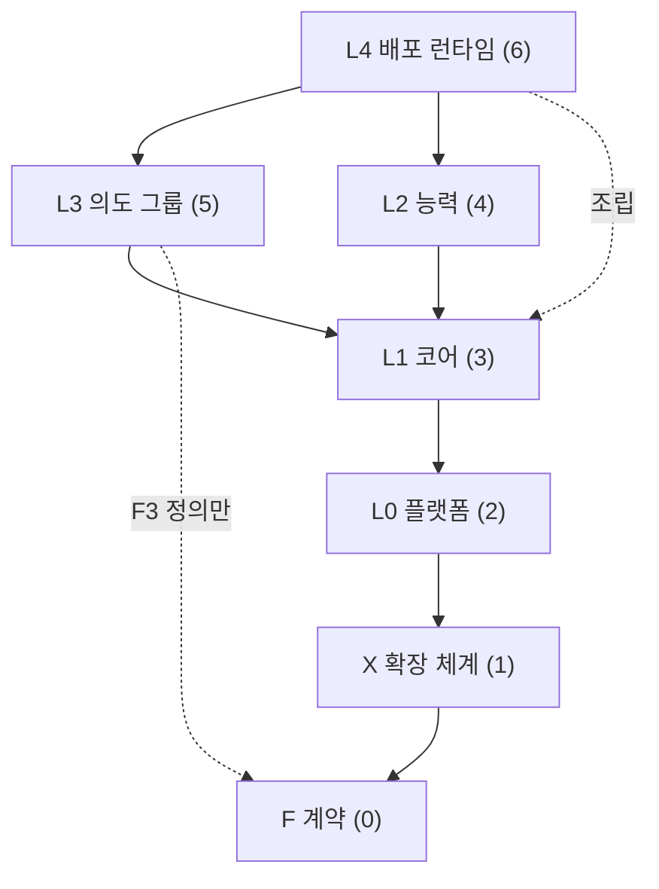
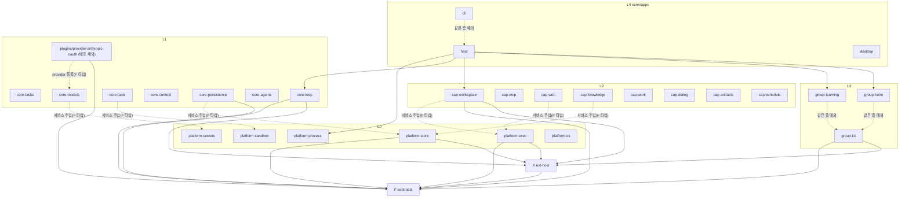

# 층 구성과 의존 규칙

## 1. 목적과 범위

정합성 검토(`_routing/routes.yaml`의 `by_task.review`)가 기준으로 삼는 문서다. 층마다 책임, 순위, 하위 층, 패키지, 허용 의존 방향을 정한다.

- 정하는 것: 층 목록과 순위, 하위 층과 패키지 대응, 의존 규칙의 조항, 층 순위의 근거, 층별 계약 요약, 층 사이 통신 수단.
- 다루지 않는 것: 규칙 조항별 좋은 예·나쁜 예와 린트 설정(`eng.dependency-rules.guide`), 바운디드 컨텍스트와 데이터 소유(`eng.context-map.design`), 각 서비스의 메서드 시그니처(층별 `spec.md`).

## 2. 용어

| 용어 | 뜻 |
|---|---|
| 층 | 의존 순위가 같은 패키지 묶음. F, X, L0, L1, L2, L3, L4 |
| 순위 | 층의 import 순서를 나타내는 숫자. `check-layers.ts`의 `RANK` 값이다(4.1절) |
| 하위 층 | `_research/layer-plan-v2.json`이 층 안을 나눈 단위. 예: L1-b 에이전트 루프 |
| 같은 층 import | 순위가 같은 두 패키지 사이의 import. 기본 규칙 2가 금지한다(3절) |
| 같은 층 예외 | 기본 규칙 2의 예외로 허용 목록에 올린 같은 층 import 간선. 3.2절의 두 간선뿐이다 |

## 3. 인터페이스: 의존 규칙과 `package.json` 필드

[결정: `_research/foundation-plan.md` §3] 아래 세 조항이 기본 규칙이다.

1. 패키지는 자기보다 순위가 낮은 층의 패키지만 import한다.
2. 같은 층의 패키지끼리는 import하지 않는다. 같은 층 협력은 F 정의와 Cordis 서비스로만 한다.
3. 각 패키지의 `package.json`에 `"xeon": {"layer": "<층>", "domain": "<도메인>"}`을 둔다. `xeon/scripts/check-layers.ts`와 dependency-cruiser(`xeon/.dependency-cruiser.cjs`)가 이 값으로 위반을 거부한다.

`package.json` 필드의 타입은 다음과 같다. `Layer`와 `RANK`는 `check-layers.ts`에 이미 있는 이름이다.

```ts
// xeon/scripts/check-layers.ts
export const RANK = { F: 0, X: 1, L0: 2, L1: 3, L2: 4, L3: 5, L4: 6 } as const;
export type Layer = keyof typeof RANK;

/** package.json의 "xeon" 필드. */
export interface XeonPackageField {
  readonly layer: Layer;
  /** routes.yaml layout.<층>.domains의 값. */
  readonly domain: string;
}
```

### 3.1 계획 v2 '층 사이 규칙' 7개와의 대응

`_research/layer-plan-v2-notes.md` "층 사이 규칙"의 7개 조항을 위 규칙과 대응시킨다.

| # | 계획 v2 조항 | Xeon 규칙 | 강제 수단 |
|---|---|---|---|
| 1 | 의존은 위에서 아래로만 흐른다. 같은 층의 다른 부품은 F 정의를 통해서만 참조한다 | 기본 규칙 1, 2 | `check-layers.ts`, dependency-cruiser |
| 2 | L3 그룹은 L2 능력의 정의(F3)만 참조하고 provider 구현을 import하지 않는다 | L3 패키지는 `cap-*`를 import하지 않는다. 능력은 `contracts`의 F3 정의와 Cordis 서비스 주입으로 쓴다 [결정: 계획 v2 '층 사이 규칙' 2, `eng.dependency-rules.guide` DR-14] | `check-layers.ts`의 DR-14 컨텍스트 검사(M1부터). DR-14 도입 전 M0 구간은 dependency-cruiser의 `group-*` 경로 규칙 하나가 `cap-*`를 `forbidden`에 넣어 막는다 [제안] |
| 3 | 그룹끼리 직접 참조하지 않는다. 그룹 사이 통신은 F4에 스키마가 있는 이벤트와 레코드로만 한다 | `group-helm`과 `group-learning` 사이 import 금지. 그룹 레코드는 F4 `GroupRecord` 형식과 kind 규칙(`grp.<그룹>.*`)을 따르고, payload 스키마는 F에 두지 않고 그룹 매니페스트 `recordKinds`(`RecordKindDecl`)에 둔다. 그룹은 다른 그룹의 비공개 레코드를 읽지 않는다 [결정: review.decisions-2 §3 D-10]. 예: Helm은 학습 결과를 L2-d 지식 검색으로 읽는다 | `check-layers.ts`(같은 층 금지) |
| 4 | `drive` 임대는 한 번에 그룹 하나만 가진다. `on`, `post`, 백그라운드 위임은 여러 그룹이 함께 쓴다 | 실행 규칙. `X.primitives.spec`과 `L3.group-kit.spec`이 정한다 | ext-host 테스트 |
| 5 | 켜기와 끄기는 턴 경계(계획 v2 원문의 표기)에서 적용되고, 정리는 Cordis dispose로 실행된다 | 실행 규칙. 원문의 "턴 경계"는 단계 경계(step 종료 직후, 도구 결과 커밋 뒤)로 읽는다. drive 임대 교대도 같은 시점이다 [결정: review.decisions-2 U-01]. `architecture.runtime-flow.design` 4.2절 | ext-host 테스트 |
| 6 | 모든 설정은 F5 설정 스키마 하나에서 L4 화면, 설정 파일, 명령을 함께 생성한다 | 설정 키 정의는 `contracts`에만 둔다 | `F.wire-settings.spec`의 생성 검사 |
| 7 | 이미 있는 패키지는 그대로 쓰고, 부족하면 포크한다 | 패키지 채택 규칙. 의존 방향과 무관 | `eng.best-practices.guide`, 리뷰 |

### 3.2 같은 층 예외 [결정: review.decisions-2 U-15]

기본 규칙 2의 예외는 다음 두 간선뿐이다. 둘 다 허용 목록 파일(`xeon/scripts/dependency-allowlist.json`, `eng.dependency-rules.guide` 4절)에 예외 id로 올린다.

| 예외 id | 간선 | 이유 |
|---|---|---|
| `DR-10/cli-host` | `apps/cli` → `apps/host` | CLI의 in-process 전송은 호스트의 조립 코드를 같은 프로세스에서 쓴다. 엔진 조립 코드를 한 곳에 둔다 |
| `DR-02/group-kit-*` | `group-helm`, `group-learning` → `group-kit` | 그룹은 `group-kit`의 `defineGroup`을 쓴다. 그룹 공통 기반을 그룹마다 중복하지 않는다 |

- 예외 대상 패키지(`apps/host`, `group-kit`) 자신은 같은 층을 import하지 않는다.
- `plugins/*`는 L1 순위이고 같은 층 예외를 두지 않는다 [결정: review.decisions-2 U-16]. 플러그인은 F, X, L0, 외부 패키지(pi-ai)만 import하고 `core-*`를 import하지 않는다. `plugins/provider-anthropic-oauth`는 F의 provider 인터페이스로 provider를 만들고 `core-models` 서비스에 등록한다.
- 목록 밖의 같은 층 import는 `check-layers.ts`가 거부한다.

세부 규칙 본문, 좋은 예·나쁜 예, 린트 설정은 `eng.dependency-rules.guide`가 정한다.

## 4. 동작 규칙

### 4.1 층 표

순위가 낮을수록 아래에 있다. 순위 숫자는 `xeon/scripts/check-layers.ts`의 `RANK`와 같다.

| 층 | 순위 | 책임 | 하위 층 (layer-plan-v2.json id, name) | 코드 위치 (routes.yaml layout) |
|---|---|---|---|---|
| F 계약 | 0 | 모든 층이 공유하는 타입, 스키마, 규약. 실행 코드를 거의 두지 않는다 | F1 대화 모델, F2 기록 계약, F3 능력 계약, F4 확장 계약, F5 연결·설정 계약 | `xeon/packages/contracts/src/{domain}/**` |
| X 확장 체계 | 1 | Cordis 위의 `on`/`post`/`drive`/`scope`, 확장 로딩과 신뢰, 운영 규칙 | X-a 로딩과 신뢰, X-b 원시 연산 네 개, X-c 운영 규칙 | `xeon/packages/ext-host/src/{domain}/**` |
| L0 플랫폼 | 2 | OS·환경마다 구현이 바뀌는 부분. `os.*` provider 공통 인터페이스 뒤에 둔다 | L0-a 실행 환경, L0-b 격리, L0-c 비밀, L0-d 프로세스, L0-e 저장 기반, L0-f OS 연동 | `xeon/packages/platform-{domain}/**` |
| L1 코어 | 3 | 거의 바뀌지 않는 코어 플러그인. 태스크, 루프, 모델, 도구, 컨텍스트, 영속성, 서브에이전트 | L1-a 태스크 엔진, L1-b 에이전트 루프, L1-c 모델 게이트웨이, L1-d 도구 실행과 권한, L1-e 컨텍스트와 컴팩션, L1-f 영속성과 복구, L1-g 서브에이전트 | `xeon/packages/core-{domain}/**` |
| L2 능력 | 4 | 서비스 API와 모델 도구 쌍. 능력 정의는 F3에 있다 | L2-a 작업 도구, L2-b MCP 통합, L2-c 웹, L2-d 지식과 기억 (저장소), L2-e 작업 관리, L2-f 사용자 대화, L2-g 산출물과 세션, L2-h 예약과 백그라운드 | `xeon/packages/cap-{domain}/**` |
| L3 의도 그룹 | 5 | `scope`로 묶인 의도 그룹. Helm과 학습 그룹이 기본 그룹이다 | L3-a 그룹 기반, L3-b Helm (기본 그룹), L3-c 학습 그룹 (기본 그룹), L3-d 추가 그룹 슬롯 | `xeon/packages/group-kit/**`, `xeon/packages/group-helm/**`, `xeon/packages/group-learning/**` (slots는 코드 없음) |
| L4 배포 런타임 | 6 | 엔진 조립과 배포 단위. CLI, 데스크톱, 호스트·서비스, 설정 화면 | 계획 v2 데이터에 하위 층이 없다. 도메인은 4.7절 | `xeon/apps/cli/**`, `xeon/apps/desktop/**`, `xeon/apps/host/**`, `xeon/apps/desktop/src/settings/**` |

- `xeon/plugins/provider-anthropic-oauth`는 L1-c의 배포 제외 구성요소(Anthropic OAuth 위장 provider)다. `check-layers.ts`는 `plugins/*`를 L1로 본다 [결정: review.decisions-2 U-16]. `core-*`를 import하지 않고 F provider 인터페이스로 `core-models` 서비스에 등록한다(3.2절). 배포판에는 넣지 않는다 [결정: `_research/decisions-log.md` 2026-10-21 결정(2차)].
- `xeon/vendor/cordis`는 층 검사 대상에서 빠진다. Cordis는 `ext-host` 뒤에 숨긴다 [결정: ADR-0002 3번]. 직접 import하는 패키지를 `ext-host` 하나로 제한한다 [제안: ADR-0002 4번].

### 4.2 패키지 지도

#### 4.2.1 층 단위 허용 의존

화살표는 import 방향이다. 각 층은 자기보다 순위가 낮은 층을 import할 수 있다. 다만 L3는 `cap-*`(L2)를 import하지 않는다 [결정: 계획 v2 '층 사이 규칙' 2, DR-14](3.1절 2행). 이 금지는 foundation-plan §3 기본 규칙(순위)에는 없고 DR-14가 컨텍스트 규칙으로 막는다. 그림에는 L3 → L2 간선을 두지 않고 L3 → L1 간선을 그렸다. 그림은 인접 층만 그리고, 건너뛰는 import도 허용된다.



| import하는 층 \ 대상 | F | X | L0 | L1 | L2 | L3 | L4 |
|---|---|---|---|---|---|---|---|
| F | 금지(같은 층) | 금지 | 금지 | 금지 | 금지 | 금지 | 금지 |
| X | 허용 | 금지(같은 층) | 금지 | 금지 | 금지 | 금지 | 금지 |
| L0 | 허용 | 허용 | 금지(같은 층) | 금지 | 금지 | 금지 | 금지 |
| L1 | 허용 | 허용 | 허용 | 금지(같은 층) | 금지 | 금지 | 금지 |
| L2 | 허용 | 허용 | 허용 | 허용 | 금지(같은 층) | 금지 | 금지 |
| L3 | 허용 | 허용 | 허용 | 허용 | 금지 [결정: 계획 v2 규칙 2, DR-14](3.1절 2행: F3 정의와 서비스로만) | 금지(같은 층, 3.2절 예외 `DR-02/group-kit-*`만 허용) | 금지 |
| L4 | 허용 | 허용 | 허용 | 허용 | 허용 | 허용 | 금지(같은 층, 3.2절 예외 `DR-10/cli-host`만 허용) |

F와 X는 각각 패키지가 하나라 "같은 층 금지"는 패키지 안 import에 영향이 없다.

표의 허용은 순위(DR-01)만 본 값이다. 컨텍스트가 다르면 DR-14가 구현 import를 다시 막고, F와 ext-host의 서비스 등록·주입 API 외에는 서비스 주입으로 쓴다(`eng.dependency-rules.guide` DR-14, 하위 층의 `@xeon/ext-host` import 예외 [결정: review.decisions-2 U-17]). 구현 패키지를 직접 import하는 곳은 조립 루트(`apps/host`), 같은 컨텍스트 안, 테스트 파일(`*.test.ts`, `test/` 아래)뿐이다. `./testing` 서브패스는 두지 않고 테스트 대역은 각 패키지 `test/` 안에 둔다 [결정: review.decisions-2 U-03, U-17].

#### 4.2.2 패키지 단위 지도

실선은 import 간선이다. `core-*`·`cap-*`·`platform-*`·`group-kit`은 `contracts`(F 타입과 서비스 이름)와 `ext-host`(등록 API)만 import한다. 구현 패키지를 모두 import하는 간선은 조립 루트 `host`에만 둔다(DR-14 예외 2). 라벨 "서비스 주입(F 타입)" 점선은 import가 아니다. 위 패키지가 F 서비스 타입으로 아래 층 서비스를 Cordis에서 주입받는 관계다. 라벨 "같은 층 예외" 점선은 3.2절의 허용 목록 예외에 해당하는 import다. L1 패키지끼리, L2 패키지끼리는 import 간선이 없다. 같은 층 협력은 Cordis 서비스로 한다.



- `plugins/provider-anthropic-oauth`는 `core-models`를 import하지 않는다. F provider 인터페이스로 만든 provider를 `core-models` 서비스에 등록한다. 라벨 "provider 등록(F 타입)" 점선은 import가 아니다 [결정: review.decisions-2 U-16].
- `cli`가 `host`를, 그룹이 `group-kit`을 import하는 "같은 층 예외" 점선 간선은 3.2절의 허용 목록 예외(`DR-10/cli-host`, `DR-02/group-kit-*`)다.
- 그림에서 생략한 `core-*`·`cap-*`·`platform-*` 패키지도 `contracts`와 `ext-host`로 가는 실선만 가진다. `core-persistence`는 `platform-store`를 import하지 않고 `xeon.store`를 F 타입으로 주입받는다(`L1.persistence.plan`). L2 패키지는 L0 패키지를 import하지 않는다(`L0.exec.spec`).

#### 4.2.3 하위 층과 패키지 대응

| 하위 층 | 이름 | 패키지 (경로) |
|---|---|---|
| F1 | 대화 모델 | `contracts` (`src/conversation`) |
| F2 | 기록 계약 | `contracts` (`src/records`) |
| F3 | 능력 계약 | `contracts` (`src/capabilities`) |
| F4 | 확장 계약 | `contracts` (`src/extensions`) |
| F5 | 연결·설정 계약 | `contracts` (`src/wire-settings`) |
| X-a | 로딩과 신뢰 | `ext-host` (`src/loading-trust`) |
| X-b | 원시 연산 네 개 | `ext-host` (`src/primitives`) |
| X-c | 운영 규칙 | `ext-host` (`src/operations`) |
| L0-a | 실행 환경 | `platform-exec` |
| L0-b | 격리 | `platform-sandbox` |
| L0-c | 비밀 | `platform-secrets` |
| L0-d | 프로세스 | `platform-process` |
| L0-e | 저장 기반 | `platform-store` |
| L0-f | OS 연동 | `platform-os` |
| L1-a | 태스크 엔진 | `core-tasks` |
| L1-b | 에이전트 루프 | `core-loop` |
| L1-c | 모델 게이트웨이 | `core-models` (배포 제외 구성요소는 `plugins/provider-anthropic-oauth`) |
| L1-d | 도구 실행과 권한 | `core-tools` |
| L1-e | 컨텍스트와 컴팩션 | `core-context` |
| L1-f | 영속성과 복구 | `core-persistence` |
| L1-g | 서브에이전트 | `core-agents` |
| L2-a | 작업 도구 | `cap-workspace` |
| L2-b | MCP 통합 | `cap-mcp` |
| L2-c | 웹 | `cap-web` |
| L2-d | 지식과 기억 (저장소) | `cap-knowledge` |
| L2-e | 작업 관리 | `cap-work` |
| L2-f | 사용자 대화 | `cap-dialog` |
| L2-g | 산출물과 세션 | `cap-artifacts` |
| L2-h | 예약과 백그라운드 | `cap-schedule` |
| L3-a | 그룹 기반 | `group-kit` |
| L3-b | Helm (기본 그룹) | `group-helm` |
| L3-c | 학습 그룹 (기본 그룹) | `group-learning` |
| L3-d | 추가 그룹 슬롯 | 코드 없음(템플릿 문서만) |
| L4 cli | CLI | `apps/cli` |
| L4 desktop | 데스크톱 | `apps/desktop` |
| L4 host-service | 엔진 진입점과 서비스 | `apps/host` |
| L4 settings-ui | 설정 화면 | `apps/desktop/src/settings` |

- `_research/foundation-plan.md` §3은 F5 서브패스를 `wire`, `settings` 둘로 적었고, routes.yaml은 도메인 `wire-settings` 하나로 적었다. 이 표는 routes.yaml을 따른다. 서브패스 이름은 `F.wire-settings.spec`이 정한다.

### 4.3 층 순위의 근거

#### 4.3.1 현재 순위가 성립하는 이유

- F(0)가 맨 아래다. F에는 타입, TypeBox 스키마, 규약만 있어 다른 층에 의존할 것이 없다. pi-ai 타입의 재노출(`import type`·`export type`)과 TypeBox만 외부 의존으로 둔다. 에이전트 루프 타입은 F가 직접 정의하고 pi-agent-core에는 의존하지 않는다(adr.0009).
- X(1)가 L0 아래다. `ext-host`는 Cordis 위에서 `on`/`post`/`drive`/`scope`와 로딩·신뢰를 제공한다. L0~L3의 모든 패키지는 Cordis 플러그인으로 로드되어 서비스를 제공하고(`ctx.provide`), 지점을 구독하며, `dispose`로 정리된다. 그래서 L0 이상은 X의 플러그인 정의 API를 import한다. Cordis는 `ext-host` 뒤에 숨긴다 [결정: ADR-0002 3번]. Cordis를 직접 import하는 경로는 `ext-host` 하나로 제한한다 [제안: ADR-0002 4번].
- 지점 선언(지점 이름, fold, 페이로드 타입)은 F4에 있다. L1 루프는 F4 선언으로 지점을 디스패치하고, X는 F4 선언으로 fold를 적용한다. 두 층이 같은 선언을 공유하므로 X는 L1을 import하지 않는다 [결정: `_research/foundation-plan.md` §3].
- L4는 엔진을 조립하는 최상위다. `apps/host`가 모든 층의 플러그인을 Cordis에 등록하고 전송을 연다.

#### 4.3.2 대안 비교

| 안 | 순위 | X가 L0 저장소를 쓰는 방법 | L0가 Cordis 플러그인이 되는 방법 | `drive`가 L1 루프를 부르는 방법 | 판단 |
|---|---|---|---|---|---|
| A (현재) | F → X → L0 → L1 → L2 → L3 → L4 | F2 저장소 인터페이스 타입만 import하고, 구현은 Cordis 서비스로 주입받는다 | `ext-host`의 플러그인 API를 import한다 | F4의 루프 인터페이스 타입만 import하고, `core-loop`가 제공하는 서비스를 주입받는다 | 채택 [결정: `_research/foundation-plan.md` §3] |
| B | F → L0 → X → L1 → … | `platform-store`를 직접 import한다 | L0가 Cordis를 직접 import하거나 L4가 감싸야 한다. Cordis 접근 경로가 둘이 된다 | A와 같다 | ADR-0002의 "Cordis는 ext-host 뒤에 숨긴다"와 충돌 |
| C (계획 v2 도면) | X를 L1~L3 옆의 띠로 둔다 | 띠 안에서 정하지 않음 | 정하지 않음 | 정하지 않음 | 순위 숫자가 없어 `check-layers.ts`로 검사할 수 없다. 도면 표현으로만 쓴다 |
| D | X를 L1 안의 코어 패키지(`core-ext`)로 둔다 | L0를 import할 수 있다 | L0는 Cordis를 직접 쓰게 된다 | 같은 층 import가 되어 규칙 2에 걸린다 | L1 내부 협력이 늘어 규칙 2 예외가 많아진다 |

#### 4.3.3 검증 질문과 현재 판단

`_research/foundation-plan.md` §3은 문서 단계에서 이 순위가 타당한지 정합성 검사로 확인하라고 지시한다. 다음 세 질문으로 확인했고, 결론은 질문 아래에 둔다.

1. X가 L0 구현을 import해야 하는 경로가 있는가.
   - 후보 경로는 셋이다. `scope` 상태 레코드와 확장 전용 테이블(X-c)의 저장, 프로젝트 신뢰(X-a)의 파일 읽기, 선택적 프로세스 격리(X-a, 2차)다.
   - 저장은 포트(`ScopedStorePort`)로, 프로세스 격리는 포트(`ProcessPort`)로 받는다. L0가 `ExtHost.registerPlatform`(`PlatformModule`)으로 포트를 제공한다(`X.primitives.spec` §3.2, §3.6).
   - 탐색과 신뢰 판정용 파일 접근은 `X.loading-trust.spec`의 `LoaderFs`·`LoaderPaths`·`TrustStoreBackend` 포트로 받는다. L0.os가 구현하고 조립 루트가 `LoaderDeps`로 주입한다. 그래서 OS 분기는 L0 안에만 남는다(DR-13).
   - 판단: import 경로는 필요 없다. 주입받는 포트가 없으면 X가 시작 단계에서 실패한다. 이 순서는 `X.loading-trust.spec`이 정한다.
2. L0 platform이 `on`을 필요로 하는가.
   - L0는 `os.*` 서비스를 제공할 뿐 루프 지점을 구독하지 않는다. L0가 X에서 쓰는 것은 플러그인 정의, `provide`, `dispose`(잠금 해제, 파일 감시 종료)다.
   - 판단: L0는 `on`을 쓰지 않는다. 그래도 플러그인 수명주기 때문에 X 위에 있어야 한다. 등록 API는 `ExtHost.registerPlatform`이다(`X.primitives.spec` §3.2). L0가 `on`을 쓰기 시작하면 이 문서를 고친다.
3. F4 선언이 X와 L1의 순환을 막는가.
   - L1은 F4 선언으로 X의 디스패치를 부른다. X는 fold 규칙만 적용하고 지점 의미를 해석하지 않는다. 여기까지는 순환이 없다.
   - 남는 경로는 `drive`다. 임대 함수는 `loop.turn`, `loop.spawn`을 불러야 하는데 루프 구현은 L1에 있다.
   - 판단: `drive`가 받는 루프 인터페이스는 포트(`LoopPort`)로 받는다. `core-loop`가 이를 제공하고 X는 주입받으므로 순환이 없다.
   - 포트 타입의 정본은 `F.extensions.spec` §3.2.1 `ports.ts`(`PortKey`, `LoopPort`, `InputQueuePort`, `RecordCommitPort`, `ProjectorRegistryPort`)다. L1 `LoopService`는 `LoopPort`를 확장한다(`L1.loop.spec`). ext-host는 포트 타입을 따로 정의하지 않는다.

결론 [결정: review.decisions-2 U-14]: 순위를 유지한다. 단 다음 세 조건을 지킨다.

1. X 소스와 테스트에서 L0·L1 import가 0건이다(DR-01. 테스트도 대상이다).
2. X가 받는 포트와 각 층의 서비스 인터페이스는 F에 정의한다. 포트는 `F.extensions.spec` §3.2.1, L0·L1 서비스 인터페이스와 서비스 이름 상수는 F `@xeon/contracts/services` 서브패스다 [결정: review.decisions-2 §3 D-04].
3. L0는 `ExtHost.registerPlatform`으로 등록한다.

이 결론으로 `eng.dependency-rules.guide` 1.1절·6절, `L0.readme` 순위 제약 단락, `X.readme` 6절 마지막 단락의 [미결]을 닫는다. 각 문서의 갱신은 그 문서 담당이 이 절을 인용해 한다. X가 OS 기능을 Bun 표준 API로 직접 쓰지 않고 L0.os가 구현한 포트로 받는다는 것이 근거다(1번 질문).

### 4.4 층별 계약 요약

서비스 이름은 [제안]이다. 최종 이름과 메서드는 각 층의 `spec.md`가 정한다.

- F 계약
  - 제공: F1 메시지·스트림 타입(pi-ai 재노출), F2 이벤트·효과·체크포인트 레코드, F3 능력 정의, F4 지점 선언 표·호스트 포트·그룹 레코드 형식(`GroupRecord`), F5 호스트 계약과 설정 스키마, 층별 서비스 인터페이스(`@xeon/contracts/services`).
  - 요구: 없음. pi-ai 타입과 TypeBox만 외부 의존이다.
  - Cordis 서비스: 없음.
- X 확장 체계
  - 제공: `on`, `post`, `drive`, `scope`, 리소스 등록, 확장 로딩·매니페스트 검증·프로젝트 신뢰, 실행 순서와 실패 격리.
  - 요구: F4 지점 선언, 저장소와 루프는 서비스 주입.
  - Cordis 서비스: `ext`.
- L0 플랫폼
  - 제공: `os.*` provider 공통 인터페이스. [결정: `_research/decisions-log.md` 2026-10-19 설계 규칙] OS별 구현만 바꾸고, 소비자 코드에서 OS 분기를 하지 않는다.
  - 요구: X 플러그인 API, F 타입.
  - Cordis 서비스: `os.exec`, `os.sandbox`, `os.secrets`, `os.process`, `os.store`, `os.integration`.
- L1 코어
  - 제공: 입력 큐와 범위 트리, 턴 사이클, 모델 호출, 도구 파이프라인과 승인 프로토콜, 컨텍스트 조립과 컴팩션, 이벤트 저장·투영·재개, 서브에이전트.
  - 요구: L0 서비스, X 지점 디스패치, F 레코드.
  - Cordis 서비스: `tasks`, `loop`, `models`, `tools`, `context`, `persistence`, `agents`.
- L2 능력
  - 제공: 능력마다 서비스 API와 모델 도구 쌍. 예: `web.search`는 그룹 코드가 모델 턴 밖에서 부르는 서비스 API다.
  - 요구: F3 능력 정의, L1 `tools`·`persistence`, L0 서비스.
  - Cordis 서비스: `workspace`, `mcp`, `web`, `knowledge`, `work`, `dialog`, `artifacts`, `schedule`.
- L3 의도 그룹
  - 제공: `scope` 단위 그룹. Helm(L3-b)과 학습 그룹(L3-c)이 기본 그룹이다.
  - 요구: X 연산, F3 능력 정의, F4 그룹 레코드 형식. 그룹별 레코드 payload 스키마는 그 그룹 매니페스트가 선언한다.
  - [결정: `_research/decisions-log.md` 계획 v2] `drive`는 배타 임대이고, 학습 그룹은 `drive`를 쓰지 않으며 Helm과 공존한다. 임대를 한 번에 그룹 하나만 갖는 규칙의 문구는 `_research/layer-plan-v2-notes.md` "층 사이 규칙" 4번이다.
  - [제안: `_research/layer-plan-v2-notes.md`] 학습 그룹은 L1-g 백그라운드 위임으로 검토 포크를 돌린다. 그래서 Helm이 임대를 쥐고 있어도 학습 그룹을 함께 켤 수 있다.
  - Cordis 서비스: `groups`(`group-kit`, 그룹 목록·전환·임대 중재).
- L4 배포 런타임
  - 제공: `xeon` CLI, 데스크톱 앱, `xeon service`, 설정 화면.
  - 요구: 호스트 계약(F5), 모든 층 플러그인(조립).
  - Cordis 서비스: 없음. 호스트는 Cordis 루트 컨텍스트를 만든다.

### 4.5 층 사이 통신

| 수단 | 언제 쓰는가 | 형식의 원천 | 원자성 | 예 |
|---|---|---|---|---|
| 서비스(Cordis) | 아래 층 기능을 동기·비동기로 부를 때, 같은 층 협력 | F 타입, 서비스 이름 | 호출자 트랜잭션 안에서 실행 | `core-loop`가 `models` 서비스를 주입받아 모델을 부른다 |
| 이벤트 | 상태 변화를 여러 구독자에게 알릴 때, 그룹 사이 신호 | F2(기록 이벤트), F4(kind 규칙 `x.`/`grp.`) | 내구 이벤트는 커밋 뒤에 방출한다. 휘발 이벤트는 저장하지 않는다 | L4 화면이 `grp.learning.` 접두로 학습 그룹 공개 레코드를 구독한다 |
| 레코드 | 다른 그룹이나 다음 턴이 읽을 상태 | F4 `GroupRecord` 형식(payload 스키마는 그룹 매니페스트), 확장 접두사 테이블 | 코어 커밋과 같은 트랜잭션 [결정: ADR-0004] | 그룹 상태 레코드(`scope.doc`), 학습 그룹 비공개 기록(`grp.learning.*`, X `ScopeApi.recordPrivate`) |

### 4.6 구성요소 통계

`_research/layer-plan-v2.json` 실측값이다.

| 항목 | 값 |
|---|---|
| 층 | 6 (F, L0, L1, L2, X, L3. L4는 데이터에 없음) |
| 하위 층 | 33 (F 5, L0 6, L1 7, L2 8, X 3, L3 4) |
| 구성요소 | 182 |
| 단계별 | 1차 121, 2차 51, 보류 9, 배포 제외 1 |

- [미결] `_research/foundation-plan.md` Context는 "하위 층 41개"로 적었다. 실측은 33개다. 41이 무엇을 센 값인지 확인하고 계획 문서를 고칠지 정해야 한다.

### 4.7 도메인 목록

`_routing/routes.yaml`의 `layout.domains`를 그대로 옮긴다.

| 층 | 수 | 도메인 |
|---|---|---|
| F | 5 | conversation, records, capabilities, extensions, wire-settings |
| X | 3 | loading-trust, primitives, operations |
| L0 | 6 | exec, sandbox, secrets, process, store, os |
| L1 | 7 | tasks, loop, models, tools, context, persistence, agents |
| L2 | 8 | workspace, mcp, web, knowledge, work, dialog, artifacts, schedule |
| L3 | 4 | group-kit, helm, learning, slots (slots는 코드 없음) |
| L4 | 4 | cli, desktop, host-service, settings-ui |

## 5. 실패와 경계 사례

- 층 위반 import는 `just check-layers`가 종료코드 1로 거부한다(9절).
- `package.json`의 `xeon.layer`가 디렉터리 접두사에서 나온 층과 다르면 `check-layers.ts`가 거부한다(9절).
- 같은 층 간선은 3.2절 허용 목록의 두 예외(`group-*` → `group-kit`, `apps/cli` → `apps/host`)만 통과한다. `plugins/*` → `core-*` import는 L1 같은 층 import라 `check-layers.ts`가 거부한다.
- `xeon/vendor/cordis`는 층 검사 대상에서 빠진다(4.1절).

## 6. 설정 노출

해당 없음. 층 규칙은 사용자 설정으로 바꾸지 않는다.

## 7. 확장 지점

해당 없음. 확장 연산(`on`, `post`, `drive`, `scope`)이 놓이는 층은 4.4절 X 항목에 있고, 연산 정의는 `X.primitives.spec`과 `F.extensions.spec`이 정한다.

## 8. 다른 문서와의 인터페이스

- 제공: 층 목록과 순위, 허용 의존 표, 하위 층과 패키지 대응. `eng.dependency-rules.guide`가 규칙 조항과 강제 수단을, 정합성 검토(`by_task.review`)가 판정 기준을 이 문서에서 가져간다.
- 요구: `drive`가 받는 루프 포트 타입(`F.extensions.spec` §3.2.1 `ports.ts`, 4.3.3절), 연산 정의(`X.primitives.spec`), 순위 숫자(`xeon/scripts/check-layers.ts`의 `RANK`), 도메인 이름(`_routing/routes.yaml` layout).

## 9. 수용 기준

- 4.2절과 4.2.3절의 패키지 이름이 `_research/foundation-plan.md` §3 배치와 `xeon/packages/*`, `xeon/apps/*`, `xeon/plugins/*` 디렉터리 이름과 같다.
- 4.1절의 순위 숫자, 4.2.1절 허용 표, `check-layers.ts`의 `RANK`가 서로 같다. 4.2.1절 표의 L3 → L2 금지는 `RANK` 비교가 아니라 DR-14 컨텍스트 검사(M1부터)와 M0 구간의 dependency-cruiser `group-*` 경로 규칙으로 확인한다(3.1절 2행).
- 층 위반을 일부러 넣은 샘플 import(예: `core-loop`가 `cap-web`을 import)로 `just check-layers`가 종료코드 1을 낸다.
- 모든 패키지 `package.json`의 `xeon.layer`가 디렉터리 접두사에서 나온 층과 같다(`check-layers.ts`의 `expectedLayer`).
- 4.3절이 대안 비교 표와 검증 질문 3개의 판단을 포함한다.

## 10. 미결 사항

- [미결] L4 앱 이름. routes.yaml 도메인은 `host-service`, 패키지 디렉터리와 `xeon.domain`은 `host`다. 설정 화면(`settings-ui`)의 코드 위치를 `apps/desktop/src/settings`로 둘지 별도 앱으로 둘지도 정해야 한다.
- [미결] `package.json`의 `xeon.domain` 값과 routes.yaml 도메인의 불일치. `contracts`(routes는 F 도메인 5개), `ext-host`(routes는 X 도메인 3개), `group-kit`의 `kit`(routes는 `group-kit`), `host`(routes는 `host-service`). 패키지 하나가 도메인 여럿을 담는 F·X는 `xeon.domain`을 패키지 이름으로 둘지 정해야 한다.
- [미결] 4.6절 하위 층 수(계획 41개, 실측 33개).
- [미결] 4.4절 Cordis 서비스 이름. 그룹 사이 이벤트를 전역으로 전달할지 그룹 필터를 기본으로 둘지와 함께 X 문서가 정한다(`_research/notes/arch-1.md` §8).
