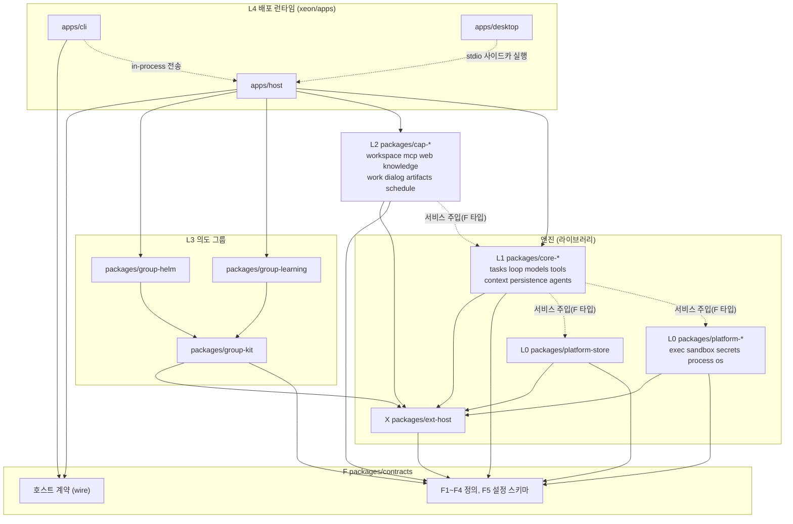

# Xeon 전체 구조

## 1. 목적과 범위

Xeon 전체 구조를 처음 읽는 사람과 에이전트를 위한 진입 문서다. 층별 세부 규칙은 `architecture.layers.spec`, 한 턴이 실행되는 순서는 `architecture.runtime-flow.design`에 있다. 이 문서는 두 문서와 ADR이 어떤 관계인지 한 장에 정리한다.

- 정하는 것: 구성 단위(엔진, 호스트 계약, 전송, 층, 그룹)와 그 관계, 핵심 결정 목록, 기존 Helm 저장소·설계 정본과의 관계, 문서 지도.
- 다루지 않는 것: 각 층의 인터페이스 세부(층별 `spec.md`), 의존 규칙의 검사 방법(`eng.dependency-rules.guide`), 구현 순서(층별 `plan.md`).

### 1.1 한 장 요약

1. Xeon은 대화형 에이전트 런타임이다. CLI와 데스크톱 앱을 같은 엔진으로 제공한다(`product.vision.spec`).
2. 엔진은 프로세스 정책(데몬 여부, 전송, 유휴 종료)을 포함하지 않는 라이브러리다. 데몬을 띄울지, 자식 프로세스로 띄울지는 L4 호스트(`xeon/apps/host`)가 정한다 [결정: ADR-0006].
3. UI는 엔진 객체를 직접 다루지 않고 호스트 계약 하나만 쓴다. 계약 스키마는 F5(`xeon/packages/contracts`)에 둔다 [결정: ADR-0006].
4. 전송은 세 가지다. CLI 기본은 in-process, 데스크톱은 자식 프로세스 stdio JSON-RPC, 공유 서비스는 `xeon service`다. 전송을 바꿔도 호스트 계약과 DB 스키마는 바뀌지 않는다 [결정: ADR-0006, ADR-0008].
5. 코드는 층 F → X → L0 → L1 → L2 → L3 → L4 순서로 쌓인다. 패키지는 자기보다 순위가 낮은 층만 import한다 [결정: `_research/foundation-plan.md` §3].
6. 확장은 `on`(fold `tap`/`first`/`chain`), `post`, `drive`(배타 임대), `scope` 네 연산으로 루프에 붙는다. Helm과 학습 그룹은 이 연산을 쓰는 L3 기본 그룹이다 [결정: ADR-0007].
7. 세션 기록은 SQLite 파일 하나에 저장한다. 불변 이벤트와 조회용 투영, 확장별 접두사 테이블을 단계 경계마다 한 트랜잭션으로 커밋한다 [결정: ADR-0004]. 도구 효과는 호출마다 의도·실행 시작·결과를 따로 커밋한다 [결정: review.decisions-2 U-10].
8. 스택은 Bun 1.4, TypeScript 7, Cordis 단일 DI다 [결정: ADR-0001, ADR-0002].

## 2. 용어

| 용어 | 뜻 | 정본 문서 |
|---|---|---|
| 엔진 | `ext-host`, L0 `platform-*`, L1 `core-*`를 묶은 라이브러리. 프로세스 정책(데몬 여부, 전송, 유휴 종료)을 포함하지 않는다 | `L4.host-service.spec` |
| 호스트 | 엔진을 소유하고 전송을 여는 L4 프로세스 진입점(`xeon/apps/host`) | `L4.host-service.spec` |
| 호스트 계약 | UI와 엔진 사이의 JSON-RPC 계약. 스키마는 F5에 하나만 둔다 | `F.wire-settings.spec` |
| 전송 | 호스트 계약을 실어 나르는 수단. in-process, stdio, service 셋 | `L4.host-service.spec` |
| 층 | 의존 순위가 같은 패키지 묶음. F, X, L0, L1, L2, L3, L4 | `architecture.layers.spec` |
| 그룹 | `scope` 하나로 묶여 단계 경계에서 켜고 끄는 L3 플러그인 단위. Helm, 학습 그룹, 추가 그룹 | `L3.group-kit.spec` |
| 능력(cap) | 서비스 API와 모델 도구를 쌍으로 제공하는 L2 단위(`cap-*`). 정의는 F3에 있다 | `F.capabilities.spec` |
| 확장 지점 | 루프가 확장을 부르는 자리. 각 지점의 fold는 지점 선언이 정한다. 종류를 `input`, `request`, `tool`, `boundary`, `session` 다섯으로 나누는 안은 [제안]이고 사용자 합의 전이다(ADR-0007 3.3) | `F.extensions.spec`, `X.primitives.spec` |
| 임대 | `drive`가 얻는 루프 구동 권한. 한 번에 그룹 하나가 갖고 상한 `{maxTurns, maxSpawns, maxTokens}`가 붙는다 | `X.primitives.spec` |
| 투영 | 이벤트에서 만든 조회용 테이블(메시지, 파트 등). 이벤트와 같은 트랜잭션에서 갱신한다 | `L1.persistence.spec` |
| 내구 이벤트 | DB에 커밋되는 이벤트. `seq`, `parentId`, 종류, 버전을 갖는다 | `F.records.spec` |
| 휘발 이벤트 | 저장하지 않고 연결 중인 구독자에게만 보내는 이벤트. 토큰 델타가 대표 예다 | `F.records.spec`, `eng.events.design` |

## 3. 인터페이스: 엔진, 호스트 계약, 전송

[제안] 엔진은 `ext-host`(X), L0 `platform-*` 6개, L1 `core-*` 7개를 묶은 라이브러리다. L1 코어가 `platform-store` 외에 `platform-sandbox`, `platform-secrets` 같은 L0 패키지에도 의존하므로(`architecture.layers.spec` 4.2.2절) L0 전체를 엔진에 넣는다. `L4.host-service.spec`의 엔진 정의와는 그 문서가 쓰인 뒤 대조한다. 엔진 바깥에서는 호스트 계약만 보인다. 호스트 계약의 메서드 목록과 스키마는 `F.wire-settings.spec`이 정한다.

| 전송 | 쓰는 곳 | 엔진 프로세스 | 연결 | 인증 | 단계 |
|---|---|---|---|---|---|
| in-process | CLI 기본(`xeon chat`) | CLI 프로세스 자신 | 메모리 채널 | 필요 없음 | 1차 |
| 자식 프로세스 stdio | 데스크톱(Tauri 2) | `bun build --compile` 사이드카 | stdin/stdout JSON-RPC | 필요 없음(부모-자식 파이프) | 데스크톱 M2 이후 |
| 서비스(로컬) | `xeon service`(자동 기동, 유휴 종료), CLI·앱이 함께 접속 | 공유 서비스 프로세스 | 로컬 Unix 소켓 | 파일 권한 | 1차, OS 서비스 등록은 2차 |
| 서비스(원격) | 다른 기기의 원격 클라이언트 | 공유 서비스 프로세스 | 로컬 서비스 소켓을 SSH 터널이나 사설망(Tailscale 등)으로 연결 | SSH·사설망 인증과 소켓 파일 권한 | 1차(M3) [결정: review.decisions-2 U-11] |
| 서비스(원격, 내장) | 터널 없이 접속하는 원격 클라이언트 | 공유 서비스 프로세스 | TLS + WebSocket | 무작위 토큰, `initialize` 전에 검사. 비루프백 무인증 기동 금지 | 2차 [결정: review.decisions-2 U-11] |

- 근거: `_research/process.md` §6.1(구조 1안), §6.2(단계 도입 경로), §6.4(서비스 모드 체크리스트). 서비스 전송의 인증 규칙은 ADR-0006 3.3절과 3.7절 5번이다. 결정은 [ADR-0006](../../decisions/ADR-0006-process-service-mode.md), [ADR-0008](../../decisions/ADR-0008-desktop-tauri.md)에 있다.
- process.md는 서비스 명령을 `helm service`로 적었다. 제품 명령은 `xeon service`다.
- process.md §6.2는 공유 서비스를 단계 2(선택 모드)로 두었다. [결정: `_research/foundation-plan.md` §1 2번] 예약·원격·알림을 범위에 넣는 결정에 따라 공유 서비스 모드는 1차로 올라갔고, OS 서비스 등록은 2차다. 원격 사용은 1차(M3)에 넣되 로컬 서비스 소켓을 SSH 터널이나 사설망으로 연결하는 방식으로 하고, 단계 3의 내장 원격 전송(TLS + 토큰 WebSocket)은 2차로 둔다 [결정: review.decisions-2 U-11].
- 불변식 [결정: ADR-0006]: 호스트 계약과 DB 스키마는 전송이 바뀌어도 변하지 않는다. 전송 전환으로 바뀌는 것은 "어느 프로세스가 엔진을 소유하는가" 하나다(`_research/process.md` §6.2 마지막 줄).
- 같은 세션에 쓰는 프로세스는 세션 id 키 OS 잠금으로 하나만 둔다. 잠금을 얻은 프로세스는 `sys_leases.epoch` 펜싱으로 커밋마다 소유를 다시 확인한다 [결정: review.decisions-2 U-09]. 잠금을 얻지 못한 프로세스는 위임, 관찰, 분기 중 하나로 동작한다(`_research/process.md` §6.3, 흐름은 `architecture.runtime-flow.design` 4.4절).

호스트 계약의 모양은 다음과 같다 [제안]. 이름과 메서드 목록은 `F.wire-settings.spec`이 확정한다.

```ts
// xeon/packages/contracts (F5 wire). 전송 셋이 같은 인터페이스를 구현한다.
import type { Static, TSchema } from "typebox";

export type TransportKind = "in-process" | "stdio" | "service";

/** 스트림 재접속 기준. seq는 DB 하나 안에서 모든 내구 이벤트에 붙는 전역 단조 증가 번호다(F.records.spec). 정본은 F.wire-settings.spec §3.4.1 StreamPosition이다. */
export interface StreamCursor {
  readonly storeId: string;
  readonly seq: number;
}

export interface HostConnection {
  readonly transport: TransportKind;
  /** JSON-RPC 2.0 요청 한 건. method는 `<영역>.<동사>` 형식이다. */
  call<P extends TSchema, R extends TSchema>(
    method: string,
    params: Static<P>,
    schemas: { readonly params: P; readonly result: R },
  ): Promise<Static<R>>;
  /** 내구 이벤트는 커서 뒤부터 다시 보내고, 휘발 이벤트는 연결 중에만 보낸다. */
  subscribe(cursor: StreamCursor, onEvent: (event: unknown) => void): () => void;
  close(): Promise<void>;
}
```

## 4. 동작 규칙

### 4.1 전체 구조

간선 방향은 import 방향이다. 실선은 위 패키지가 아래 패키지를 import한다는 뜻이다. 점선은 import가 아니다. 라벨 "서비스 주입(F 타입)" 점선은 위 패키지가 F 서비스 타입으로 아래 층 서비스를 Cordis에서 주입받는 관계이고, 그 밖의 점선은 실행 관계(사이드카 실행, in-process 호출)다. `cap-*`·`core-*`·`platform-*`는 F와 `ext-host` 공개 API만 import하고, 구현 패키지를 모두 import하는 것은 조립 루트 `apps/host`뿐이다(`eng.dependency-rules.guide` DR-14). 노드 라벨은 `xeon/` 아래의 실제 디렉터리 이름이다.



- `apps/host`는 엔진 진입점이다. 모든 층의 패키지를 Cordis 플러그인으로 조립하고, 호스트 계약을 세 전송 중 하나로 노출한다(`_research/foundation-plan.md` §3).
- `apps/desktop`은 `apps/host`를 import하지 않는다. `bun build --compile`로 만든 엔진 바이너리를 사이드카로 실행한다(ADR-0008).
- `apps/cli`의 in-process 전송은 같은 층(L4)인 `apps/host`의 코드를 같은 프로세스에서 쓴다. 같은 층 예외 `DR-10/cli-host`로 허용한다 [결정: review.decisions-2 U-15].
- `group-helm`·`group-learning`이 `group-kit`을 import하는 간선도 같은 층 예외 `DR-02/group-kit-*`로 허용한다 [결정: review.decisions-2 U-15]. 예외 목록은 `architecture.layers.spec` 3.2절과 `eng.dependency-rules.guide` 허용 목록에 있다.
- [결정: 계획 v2 '층 사이 규칙' 2, DR-14] L3 그룹은 `cap-*`를 import하지 않는다. L2 능력은 F3 정의와 Cordis 서비스로만 쓴다(`architecture.layers.spec` 3.1절 2행).
- `cap --> exthost` 간선은 L2의 플러그인 등록 경로다. 하위 층은 `@xeon/ext-host`의 서비스 등록·주입 API만 import한다(DR-14 예외) [결정: review.decisions-2 U-17].
- 서비스 주입 점선의 F 서비스 인터페이스(`TaskService`, `LoopService`, `ModelService`, `ToolService`, `ContextService`, `ExecutionEnv`, `SandboxService`, `ProcessService`, `OsService` 등)와 서비스 이름 상수는 F `@xeon/contracts/services` 서브패스에 둔다 [결정: review.decisions-2 §3 D-04].

### 4.2 핵심 결정 요약

ADR 본문은 `decisions/`에 있다. 각 행의 결정은 사용자 결정 기록(`_research/decisions-log.md`)과 승인 계획(`_research/foundation-plan.md` §1·§2)에서 왔다.

| ADR | 결정 | 요지 |
|---|---|---|
| [ADR-0001](../../decisions/ADR-0001-stack.md) | [결정] 스택 | Bun 1.4.x, TypeScript 7.0.x(tsgo), oxlint·oxfmt, `bun test`, Turborepo, TypeBox, bun:sqlite. 정확 버전은 `_research/foundation-plan.md` §2 표 |
| [ADR-0002](../../decisions/ADR-0002-di-cordis.md) | [결정] DI는 Cordis 하나 | Cordis 4.0.0-rc를 `xeon/vendor/cordis`에 커밋 고정으로 두고 `ext-host` 뒤에 숨긴다 |
| [ADR-0003](../../decisions/ADR-0003-pi-durable-fork.md) | [결정] pi durable 부분 포크 | env, tools, images, truncate만 Chord 의존을 걷어 내고 포크한다. 커널(L1-a/b/f/g)은 직접 구현하고 durable `docs/spec.md`를 설계 근거로 인용한다 |
| [ADR-0004](../../decisions/ADR-0004-session-storage.md) | [결정] 세션 저장 C안 | SQLite 이벤트 소싱과 투영, 단일 DB 파일, 확장별 접두사 테이블. 단계 경계 커밋은 `synchronous=FULL` |
| [ADR-0005](../../decisions/ADR-0005-web-search-default.md) | [결정] 무료 웹 검색 기본값 | 모델 도구는 provider 내장 검색, 서비스 API `web.search`는 내장 검색 래퍼, SearXNG 감지 시 우선, 무료 크레딧 API는 플러그인 권장. 키 없는 스크레이핑 제외 |
| [ADR-0006](../../decisions/ADR-0006-process-service-mode.md) | [결정] 프로세스 구조와 서비스 모드 | 엔진 라이브러리, 호스트 계약 하나, 전송 교체. `xeon service`는 1차, OS 서비스 등록은 2차 |
| [ADR-0007](../../decisions/ADR-0007-ext-points.md) | [결정] 확장 지점 4연산 | `on`(fold `tap`/`first`/`chain`), `post`(`steer`/`followUp`/`next`), `drive`(배타 임대, 상한 `{maxTurns, maxSpawns, maxTokens}`), `scope`(단계 경계 토글). 지점 종류와 이름 목록은 [제안](미합의) |
| [ADR-0008](../../decisions/ADR-0008-desktop-tauri.md) | [결정] 데스크톱 Tauri 2 | 시스템 WebView, 3플랫폼. 엔진은 `bun build --compile` 사이드카, UI와 stdio JSON-RPC로 연결 |

### 4.3 기존 저장소·docs/design과의 관계

[결정: `_research/foundation-plan.md` Context] 기존 Helm 설계 정본 `docs/design/01~26`은 홈서버 데몬과 커널 중심 설계를 전제로 한다. Xeon은 이 문서들을 참고 자료로 인용만 하고, 정본 병합은 하지 않는다. Xeon 문서에서 `docs/design`의 문장을 규칙으로 옮길 때는 Xeon 문서에 다시 쓰고 원문 절을 근거로 단다.

아래 표는 `_research/repo-survey.md` §3.4에서 Xeon에 쓸 만한 절을 옮긴 것이다. 각 항목의 마지막 열은 그대로 따르지 않는 이유다.

| 원문 | 참고하는 내용 | 그대로 따르지 않는 이유 | 받는 Xeon 문서 |
|---|---|---|---|
| `docs/design/18-security.md` §3.10, §3.11 | 비밀 저장·주입·마스킹, 도구 실행 격리와 권한 기준선 | 18은 데몬 시작 시 비밀을 메모리에 주입하는 설계(결정 45)이고, Xeon은 SOPS(age) 파일과 `secret://` 참조를 쓴다 | `L0.secrets.spec`, `L0.sandbox.spec` |
| `docs/design/13-tools-and-execution.md` §3.5, §3.6 | 쓰기 범위 검사, bash 우회 방지, 격리 수준 표 | 13의 S0~S2는 bubblewrap을 직접 다루는 설계이고, Xeon은 `@anthropic-ai/sandbox-runtime`을 그대로 쓴다 | `L0.sandbox.spec`, `L1.tools.spec` |
| `docs/design/12-runtime-engine.md` §3.4 | 루프 포크 `@helm/agent`와 커널 연결점(`beforeToolCall`, `afterToolCall`, `prepareRequest`, `finishTurn`) | 12는 커널 검사를 루프 훅에 거는 포크 설계이고, Xeon은 커널 없이 pi-agent-core 1.3.0 루프를 포크한 core-loop 자체 루프(ADR-0009)와 `on` 지점(종류 5개는 [제안], ADR-0007 3.3)을 쓴다 | `L1.loop.spec`, `X.primitives.spec` |
| `docs/design/09-event-store.md` §3.2 | 이벤트 envelope, 카테고리, 이름 규칙 | 09는 해시 체인과 HMAC 체크포인트를 포함한 정본 이벤트 저장이고, Xeon은 C안(이벤트 + 투영 + 단계 체크포인트, 해시 체인 없음)이다 | `F.records.spec`, `eng.events.design` |
| `docs/design/19-client-protocol.md` §3.3 | JSON-RPC 2.0 규칙(배치 거부, `<영역>.<동사>` 메서드, params 객체, 중첩 깊이 제한) | 19는 데몬과 WebSocket 하나를 전제로 한 핸드셰이크·재전송 설계이고, Xeon은 in-process·stdio·service 세 전송이 같은 계약을 쓴다 | `F.wire-settings.spec`, `L4.host-service.spec` |
| `docs/design/07-pi-reuse-and-fork.md` §3.4, §3.5 | pi-agent-core 파일 계획, 수정 사항 A1~A7 | 07은 pi v1.1.0을 vendor 포크하는 설계이고, Xeon은 pi-agent-core에 의존하지 않고 그 1.3.0 루프를 core-loop로 포크해 다시 설계한다(ADR-0009). durable은 4개 영역만 포크한다(ADR-0003) | `L1.loop.spec`, `L0.exec.spec`, `L2.workspace.spec` |
| `docs/design/22-testing-strategy.md` §3.5.4 | 모델 테이프(가짜 모델 재생) | 22는 Vitest와 커널 테스트 계층을 전제로 하고, Xeon은 `bun test`와 패키지 단위 테스트를 기본으로 한다 | `eng.testing.guide` |

- `docs/design/00-README.md`의 설계 결정 23, 27, 28, 29, 30, 31은 Xeon의 결정과 영역이 겹친다. Xeon에서는 ADR-0001~0008이 우선한다.
- `docs/design/24-adr.md`를 인용하지 않는다.[^adr24]

[^adr24]: `docs/design/00-README.md`, `docs/design/06-system-architecture.md`, `docs/design/process/00-design-brief.md`가 `docs/design/24-adr.md`를 가리키지만, 이 파일은 `archive/design-process/24-adr.md`로 옮겨졌다. `process/rulings-stage2a.md`, `process/implementation-readiness.md`도 같은 이유로 깨진 참조다(`_research/repo-survey.md` §6.1 7번). Xeon 문서는 이 경로를 인용하지 않는다.

### 4.4 레거시 코드와 커밋 범위

- 레거시 Helm JS 코드(루트 `package.json`, `apps/`, `experiments/`, `packages/helm-*`)는 건드리지 않는다. 이 파일들은 미커밋 상태이고, 루트 `workspaces`를 바꾸면 충돌한다(`_research/repo-survey.md` §6.1 6번, §7).
- `xeon/`은 독립 워크스페이스다. 자체 `package.json`, `bun.lock`, `justfile`을 갖고 루트 워크스페이스 글롭에 들어가지 않는다 [결정: `_research/foundation-plan.md` §1 "코드 위치"].
- 커밋 범위는 다음 넷으로 한정한다 [결정: `_research/foundation-plan.md` §6].
  - `xeon/`
  - `docs/xeon/`
  - `.github/workflows/xeon-ci.yml`
  - `.claude/skills/xeon-*`
- 커밋할 때는 위 경로를 명시해서 add한다. 레거시 미추적 파일은 커밋에 넣지 않는다.
- `docs/xeon/`은 "설계 문서는 `docs/design/`에 둔다"는 기존 결정 40의 예외다. 예외 근거는 4.3절과 `xeon.readme`다.

## 5. 실패와 경계 사례

- 같은 세션을 다른 프로세스가 실행 중이면 세션 잠금을 얻지 못한다. 이때의 위임, 관찰, 분기는 3절과 `architecture.runtime-flow.design` 4.4절이 정한다.
- 같은 층 import 금지 규칙의 예외 간선(`apps/cli` → `apps/host`, 그룹 → `group-kit`)은 허용 목록에 있는 것만 허용한다(4.1절). 목록 밖 같은 층 import는 `check-layers.ts`가 거부한다.
- 그 밖의 실패 처리는 층별 `spec.md`가 정한다.

## 6. 설정 노출

해당 없음. 설정 키는 `F.wire-settings.spec`, 설정 화면은 `L4.settings-ui.spec`이 정한다.

## 7. 확장 지점

1.1절 6번의 요약만 둔다. 연산 정의는 ADR-0007, `X.primitives.spec`, 지점 선언은 `F.extensions.spec`이 정한다.

## 8. 다른 문서와의 인터페이스

- 요구: `product.vision.spec`, `product.scope.spec`, ADR-0001~0008(`depends_on`).
- 제공: 아래 문서 지도. 처음 읽는 사람과 에이전트가 다음에 읽을 문서를 고른다.

| 질문 | 읽을 문서 |
|---|---|
| Xeon이 무엇이고 누구를 위한 것인가 | `product.vision.spec`, `product.usecases.spec`, `product.scope.spec` |
| 어떤 패키지가 어느 층이고 무엇을 import할 수 있는가 | `architecture.layers.spec`, `eng.dependency-rules.guide` |
| 한 턴이 어디서 입력을 받고 어디서 커밋되며, 크래시 뒤 어디서 이어지는가 | `architecture.runtime-flow.design` |
| 이벤트·트랜잭션·재생 규칙은 무엇인가 | `eng.events.design`, `eng.transactions.design`, `F.records.spec`, `L1.persistence.spec` |
| 확장을 어떻게 만드는가 | `X.readme`, `X.primitives.spec`, `F.extensions.spec`, `L3.group-kit.spec` |
| 어느 컨텍스트가 어떤 데이터를 소유하는가 | `eng.context-map.design` |
| 타입과 코드를 어떻게 쓰는가 | `eng.typescript.guide`, `eng.domain-types.guide`, `eng.anti-patterns.guide`, `eng.best-practices.guide` |
| 테스트와 툴체인 | `eng.testing.guide`, `eng.toolchain.guide` |
| 특정 층의 범위와 경계 | 그 층의 README(`F.readme`, `X.readme`, `L0.readme`, `L1.readme`, `L2.readme`, `L3.readme`, `L4.readme`) |
| 왜 그렇게 정했는가 | `decisions/ADR-0001`~`ADR-0008` |
| 내 작업에 필요한 문서 목록 | `_routing/routes.yaml`, `just docs-route --task <작업> <경로>` |

## 9. 수용 기준

- 4.1절 Mermaid가 렌더되고, 노드 라벨의 패키지 이름이 `xeon/packages/*`, `xeon/apps/*` 디렉터리 이름과 같다.
- 4.2절의 ADR 링크 8개가 `decisions/` 파일 이름(`ADR-0001-stack.md` ~ `ADR-0008-desktop-tauri.md`)과 같다.
- 4.3절이 `docs/design` 정본을 병합하지 않는다고 명시하고, 표의 각 행에 그대로 따르지 않는 이유가 있다.
- `just docs-route --check --allow-missing`이 이 문서의 프런트매터 오류 0을 보고한다.

## 10. 미결 사항

- [미결] 패키지 스코프 이름. 현재 `xeon/` 패키지는 모두 `@xeon/*`를 쓴다. Xeon은 임시 이름이므로 공개 릴리스 때 스코프를 바꿀지, npm 스코프를 확보할지 정해야 한다.
- [미결] L4 앱 디렉터리 이름. `_research/foundation-plan.md` §3은 `apps/{cli,host,desktop}`, `_routing/routes.yaml`의 L4 domains는 `cli`, `desktop`, `host-service`, `settings-ui`다. routes.yaml은 `host-service`를 `xeon/apps/host/**`로, `settings-ui`를 `xeon/packages/client/src/settings/**`로 대응시킨다. 실제 `xeon/apps/host/package.json`의 `xeon.domain`은 `host`다. 도메인 이름을 `host`로 맞출지 `host-service`로 맞출지, 설정 화면은 별도 앱 없이 `packages/client`(view-model)와 데스크톱(렌더러)에 둔다 [결정: adr.0020].
- [미결] 데스크톱 전송을 stdio로 유지할지 로컬 소켓으로 바꿀지. 장수명 엔진에서 stdio 파이프의 버퍼링과 종료 처리를 spike로 확인해야 한다(`_research/notes/arch-2.md` §5 6행).
