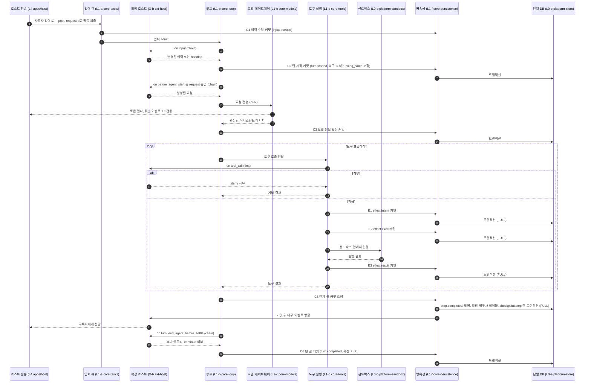
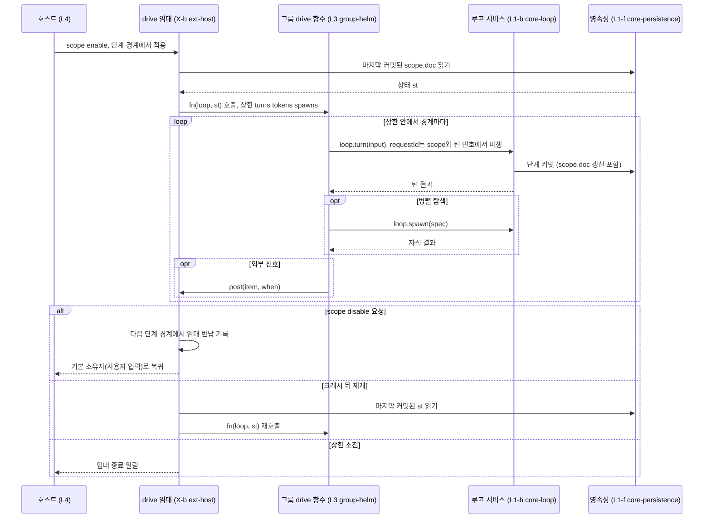
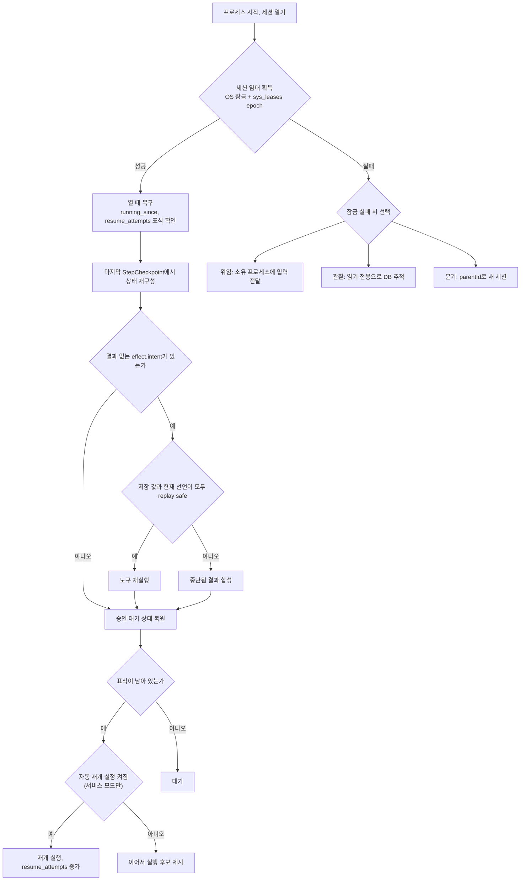

# 런타임 흐름: 한 턴, 구동, 재개

## 1. 문제

한 턴이 어디서 입력을 받고, 어느 층의 어느 서비스를 거쳐, 어디서 커밋되는지를 층 사이 약속으로 고정해야 한다. 크래시나 앱 종료 뒤에 어디서 이어지는지도 같은 약속으로 정해야 한다.

이 약속이 없으면 다음 문제가 생긴다.

- 확장이 루프 중간에 끼어드는 시점이 문서마다 달라진다. Helm처럼 루프를 구동하는 그룹은 재생 규율을 지킬 기준을 잃는다.
- 도구 효과와 확장 기록이 서로 다른 시점에 저장되어, 크래시 뒤 상태가 어긋난다.
- 전송(in-process, stdio, service)마다 흐름이 달라져 같은 기능을 두 번 만들게 된다(`_research/process.md` §3, Goose 사례).

이 문서는 흐름과 경계를 정한다. 레코드 필드는 `F.records.spec`, 지점 선언은 `F.extensions.spec`, 연산 의미는 `X.primitives.spec`, 커밋 구현은 `L1.persistence.spec`이 정한다.

## 2. 선택지 비교

### 2.1 커밋 단위

| 안 | 커밋 시점 | 크래시 뒤 잃는 것 | fsync 비용 | 확장 기록과의 원자성 | 근거 |
|---|---|---|---|---|---|
| A. 이벤트마다 커밋 | 토큰 델타 포함 모든 이벤트 | 거의 없음 | 토큰마다 발생, 과다 | 이벤트 단위로만 | `_research/session-storage.md` "C는 토큰 델타를 쌓지 않는다" |
| B. 단계 경계 한 트랜잭션 + 도구별 효과 커밋 | 단계 경계(나머지 전부) [결정: ADR-0004]. 도구마다 의도(E1), 실행 시작(E2), 결과(E3)의 별도 커밋 [결정: review.decisions-2 U-10] | 진행 중이던 모델 스트림 하나 | 단계마다 몇 번 | 단계 경계에서 코어 기록과 확장 기록을 함께 커밋 | `_research/session-storage.md` 권장안, durable spec 1917-1927 |
| C. 턴 끝에서 한 번 커밋 | 턴 종료 | 턴 전체, 실행된 도구의 사실 | 턴마다 한 번 | 턴 단위 | Claude Code·pi JSONL 방식에 가까움 |
| D. 체크포인트 덮어쓰기만 | 단계 경계, 실행 상태 교체 | 진행 중 단계 | 단계마다 한 번 | 가능하나 경로 이력이 남지 않음 | pi durable(`synchronous=NORMAL`) |

### 2.2 재개 방식

| 안 | 동작 | 장점 | 단점 |
|---|---|---|---|
| a. 자동 재개 | 열 때 표식이 남은 세션을 바로 다시 돌린다 | 사용자 개입 없음 | 비용과 부작용이 사용자 모르게 생긴다 |
| b. 후보 제시 | 열 때 "이어서 실행" 후보만 보여 주고 사용자가 고른다 | 부작용 통제 | 사용자 행동 필요 |
| c. 재개 안 함 | 이력만 복원한다 | 가장 단순 | 승인 대기·구동 중 작업을 잃는다 |

## 3. 선택과 근거

- [결정: ADR-0004] 커밋 단위는 2.1의 B안 가운데 ADR-0004가 정한 부분이다. 단계 경계에서 한 트랜잭션으로 커밋하고, 그 커밋은 `synchronous=FULL`로 디스크까지 보장한다. 도구 실행은 의도 → 실행 → 결과 세 이벤트로 기록한다. 세션 저장 C안(이벤트 소싱 + 투영, 단일 DB, 확장 접두사 테이블)에 단계 체크포인트 테이블을 더해 D안의 빠른 재개를 얻는다.
- [결정: review.decisions-2 U-10] B안의 나머지 부분인 도구별 커밋 시점은 ADR-0004 §3.2 3번 보충이다. 도구마다 의도(E1 `effect.intent`), 실행 시작(E2 `effect.exec`), 결과(E3 `effect.result` + toolResult `item.recorded`)를 각각 별도 트랜잭션으로 커밋한다. 단계당 커밋 수는 `3 + 3n`(n은 도구 호출 수)이다. 커밋 지점 표의 정본은 `L1.persistence.spec` §4.2다.
- [결정: ADR-0007] 확장은 `on`, `post`, `drive`, `scope` 네 연산으로만 흐름에 끼어든다. 지점의 fold는 지점 선언이 정한다.
- [결정: ADR-0006] 재개는 2.2의 b안(후보 제시)이 기본이다. 같은 세션에 쓰는 프로세스는 세션 id OS 잠금으로 하나만 둔다.
- [결정: review.decisions-2 U-09] 쓰기 소유 판정은 OS 잠금(생존 판정)과 `sys_leases.epoch` 펜싱으로 한다. 커밋 트랜잭션마다 `sys_leases` 행의 epoch를 대조해, 잠금을 잃은 이전 소유자의 늦은 쓰기를 거부한다(`L1.persistence.spec` §3.6, `L0.store.spec` §3.1).
- [제안] 자동 재개는 기본 꺼짐이고 서비스 모드에서만 `l1.persistence.autoResume`으로 켠다. 재개 시도 상한은 `l1.persistence.maxResumeAttempts`다. 기본값은 ADR-0006 6절 [미결]이다.
- 위 도구별 커밋의 근거: 도구 결과는 도구마다 끝나는 즉시 별도 트랜잭션으로 커밋한다. 단계 경계까지 미루면 이미 실행된 도구가 크래시 뒤 결과 불명으로 보고된다. 실행 시작(E2)을 따로 커밋하면 "실행 시작 전 중단"과 "실행 중 중단"을 구분할 수 있다. pi durable도 결과 상태와 결과 항목을 도구마다 한 커밋에 쓴다(`_research/notes/F-3.md` §4.1).

## 4. 구조와 흐름

### 4.1 한 턴 흐름

화살표 라벨의 괄호는 그 동작을 맡는 하위 층과 패키지다. `on` 화살표의 라벨은 지점 이름(pi 이벤트명)과 fold다. 지점 이름, 종류, fold 배정은 ADR-0007 §3.3의 [제안]이고 확정은 `F.extensions.spec`의 지점 선언 표가 한다. 한 종류에 fold가 다른 지점이 섞여 있다(예: `tool` 종류의 `tool_call`은 `first`, `tool_result`는 `chain`).

- 루프는 pi agent-core 1.3.0 정확 고정 버전을 훅으로 감싼 것이다(L1-b). 모델 호출은 pi-ai 게이트웨이(L1-c)가 맡는다.
- 그림의 C1~C6, E1~E3은 `L1.persistence.spec` §4.2 커밋 지점 이름이다. 그림에서 C2b, S1, A1, X1, C7은 생략했다.
- `input` 지점은 L1.loop가 발화한다(`F.extensions.spec` §7). L1.tasks는 입력을 큐에 넣고(C1) 루프에 넘긴다.
- 복구 표식(`p_threads.running_since`)은 별도 쓰기 없이 C2의 `turn.started`에서 나온다(`L1.persistence.spec` §4.8).
- 모델 요청에는 별도의 의도 커밋이 없다. 직전 단계 체크포인트가 의도 역할을 하고, 재개하면 요청을 다시 보낸다(`_research/notes/F-3.md` §1).
- 도구 효과는 의도(`effect.intent`) → 실행 시작(`effect.exec`) → 결과(`effect.result`) 순서로 기록한다. 이벤트 정의는 `F.records.spec` §3.5다.
- 내구 이벤트는 커밋이 끝난 뒤에만 구독자에게 방출한다. 커밋 전에 방출하면 크래시 뒤 구독자가 본 상태와 DB가 어긋난다.

### 4.2 단계별 규칙

근거는 `_research/ext-points.md` §5 안 1(재생·토글 보장)과 `_research/layer-plan-v2-notes.md` "확장 지점"이다.

| 항목 | 규칙 | 표지 |
|---|---|---|
| 입력 큐 `post.when = steer` | 다음 도구 라운드 뒤 입력으로 들어간다 | [결정: ADR-0007] |
| 입력 큐 `post.when = followUp` | 에이전트 정착 뒤 입력으로 들어간다 | [결정: ADR-0007] |
| 입력 큐 `post.when = next` | 경계 뒤 정확히 한 요청에 들어간다. 이 항목이 그 요청을 스스로 시작하는지는 미정이다 | [결정: ADR-0007] / 시작 여부 [미결: ADR-0007 6절] |
| 멱등 제출 | 같은 `requestId`는 한 번만 큐에 들어간다 | [결정: ADR-0007] |
| 중복 판정 방법 | 중복 판정은 커밋 안의 조회로 한다(durable spec 2288-2301) | [제안] |
| fold `tap` 실패 | 오류를 기록하고 다음 핸들러로 계속한다 | [결정: ADR-0007] |
| fold `first` 실패 | 핸들러 오류는 거부로 처리한다 | [결정: ADR-0007] |
| fold `chain` 실패 | 오류 난 핸들러만 건너뛰고 앞 결과를 다음 핸들러에 넘긴다 | [결정: ADR-0007] |
| 재생 계약 | `on` 핸들러는 다시 실행해도 되는 질의다. 재생 때 같은 입력으로 다시 불릴 수 있다 | [결정: ADR-0007] |
| 재생 시 도구 지점 | 재생 때 이미 결정된 도구 호출에 대해 `tool_call` 지점을 다시 실행하지 않는다(durable spec 3162-3163) | [제안] |
| 토글 적용 | `scope.enable`, `scope.disable`은 요청만 기록하고 X가 다음 단계 경계(step 종료 직후, 도구 결과 커밋 뒤)에서 적용한다. 실행 중인 턴이 없으면 바로 적용한다(`X.primitives.spec` §4.5). 정리는 Cordis dispose로 한다 | [결정: ADR-0007], 적용 시점 [결정: review.decisions-2 U-01] |
| 핸들러 스냅샷 | 디스패치를 시작할 때 핸들러 목록을 스냅샷한다. 한 디스패치 도중에는 집합이 바뀌지 않는다 | [제안: ADR-0007 3.6] |
| 단계 경계 커밋 | 내구 이벤트, 투영, 확장 접두사 테이블, StepCheckpoint를 한 트랜잭션으로 커밋한다 | [결정: ADR-0004] |

- [제안] `tap`의 "기록 후 계속"은 `ext-host` 래퍼가 구현한다. Cordis `emit`은 리스너 오류를 격리하지 않으므로(`_research/notes/arch-1.md` 요약 2) fold 규칙을 Cordis 이벤트 모드에 그대로 맡기지 않는다.

### 4.3 drive 흐름

`drive`는 루프 구동 권한의 배타 임대다. 그룹 하나만 임대를 가진다.

- [결정: ADR-0007] `drive` 함수는 경계마다 마지막으로 커밋된 상태로 다시 호출될 수 있어야 한다. 효과는 `loop.turn`, `loop.spawn`, `post`로만 낸다.
- [결정: ADR-0007] 임대 상한은 `{maxTurns, maxSpawns, maxTokens}`다. 상한은 `drive` 임대에만 걸리고, 일반 대화에는 기본 단계·비용 상한이 없다(pi 방식). drive 임대에는 기본 상한(일반 `x.primitives.driveDefaultLimits`, Helm `l3.helm.driveLimits`, 둘 다 기본 4/8/400000, 설정 화면에서 조정)을 두고 pi 방식의 예외로 인정한다 [결정: review.decisions-2 U-12].
- [결정: review.decisions-2 U-01] `scope.disable`이 오면 다음 단계 경계에서 `lease.released`를 기록한다. 진행 중인 `loop.turn`은 끊지 않고 정착까지 진행하며, drive 함수에는 `lease.signal` abort로 알린다(`X.primitives.spec` §4.5.3).
- `loop.turn`의 중복 실행은 `requestId`로 막는다. 파생 규칙(예: scope id와 턴 번호의 해시)은 `X.primitives.spec`이 정한다.
- 알려진 한계: `drive`는 async 함수라 재생 규율을 어긴 코드를 타입으로 막을 수 없다. 클로저 지역 변수에 상태를 두면 재개 때 그 상태를 잃는다(`_research/ext-points.md` §5 안 1 "재생").
  - [제안] 완화책: 그룹 상태는 `scope.doc`에만 둔다. `group-kit`의 `defineGroup`은 `drive` 함수에 상태를 인자로만 넘기고, 반환값이나 클로저 상태를 다음 호출에 넘기지 않는다.
  - [제안] L3-a "drive 재생 규율 검사"를 테스트 도구로 제공한다. 같은 `st`로 `drive`를 두 번 호출해 낸 효과 목록이 같은지 비교한다.
- 비협조적 확장 코드는 프로세스 경계 없이 강제로 멈출 수 없다. 상한은 협조적 코드에만 유효하다(`_research/ext-points.md` §6.1 3번).

### 4.4 재개 흐름

- 근거: `_research/process.md` §6.3(단일 소유·잠금 규칙 1~6). durable spec 줄 범위는 `_research/durable-and-search-facts.md` A-6에 있다.
  - 결과 불명 처리: durable spec 1917-1927(효과 샌드위치, 의도 단계 재오픈), 2082-2108(orphaned, replay-unsafe).
  - 재생 시 정책 해석: durable spec 3136-3170.
  - 멱등 제출: durable spec 2288-2301.
- [결정: ADR-0006] 세션 실행을 시작하려는 프로세스는 세션 id 키 OS 잠금을 얻어야 한다. 프로세스가 죽으면 커널이 잠금을 해제한다. 읽기는 잠금 없이 한다(SQLite WAL).
- [결정: review.decisions-2 U-09] 잠금을 얻은 프로세스는 `sys_leases` 행(`session:<threadId>`)의 epoch를 올려 `LeaseToken`을 받는다. 커밋마다 트랜잭션 안에서 epoch를 대조하고, 맞지 않으면 `ownership_lost`로 롤백한다(`L1.persistence.spec` §3.6, `L0.store.spec` §3.1).
- [결정: ADR-0006] 잠금을 얻지 못하면 위임, 관찰, 분기 셋 중 하나로 동작한다. 서비스가 있으면 위임이 기본이다.
- [결정: ADR-0004] 결과가 없는 `effect.intent`는 기본적으로 재실행하지 않고 "중단됨" 결과로 합성한다. 선언이 `unsafe`(기본값)이거나 선언이 없는 도구가 여기에 해당한다.
- [결정: ADR-0004] 예외로, 저장된 정책과 현재 선언이 모두 `replay: safe`인 도구만 재실행한다. 재생 정책 값 집합은 `F.records.spec`이 정한다.
- [결정: ADR-0006] 재개 횟수에는 상한을 둔다.
- [제안] 자동 재개는 기본 꺼짐이고 서비스 모드에서만 `l1.persistence.autoResume`으로 켠다. 재개 시도 상한은 `l1.persistence.maxResumeAttempts`다(수동·자동 공통). 자동 재개 기본값은 ADR-0006 6절 [미결]이다.
- 복구 표식(`p_threads.running_since`, `resume_attempts`)은 C2 `turn.started`가 세우고 `turn.completed`(정상 종료, 사용자 중단, 실패)가 지운다. 비정상 종료 뒤에는 열린 턴이 남아 표식이 남는다(`L1.persistence.spec` §4.8).
- 누가 소유하는지 보여 주는 표시(`kind`, `pid`, `host`, `heartbeatAt`)는 `sys_leases` 행이 겸한다. 별도 소유 표시 테이블을 두지 않는다 [결정: review.decisions-2 U-09].

### 4.5 서브에이전트, 목표 판정, 승인 대기

서브에이전트(L1-g `core-agents`)는 같은 프로세스 안의 자식 세션이다. 모든 태스크와 자식 대화는 소유자를 명시하고, 세션 하나는 소유 트리 하나를 이룬다. 부모가 중단되면 abort가 소유 트리를 따라 자식에게 전파되고, 자식은 부모보다 오래 살지 않는다(durable spec 1972-2030 §5.4 소유 순회와 abort 전파, 2156-2200 §5.5 구조적 동시성). 자식의 권한은 부모 권한을 넘지 못하고, 깊이와 동시 실행 수에 상한을 둔다. 자식 제출의 `requestId`는 부모에서 파생해 재개 때 중복 생성을 막는다(durable spec 3206-3266). 학습 그룹의 검토 포크는 `drive` 없이 이 백그라운드 위임으로 돈다.

목표 지속(L2-e `cap-work`)의 완료 판정은 루프를 도는 모델의 자가 판정에 맡기지 않는다. 별도 판정 모델이 증거를 보고 판정하고, 판정 실행 횟수에는 상한을 둔다(사용자 결정, `_research/foundation-plan.md` §1 4번). 상한 키는 `l1.agents.judge.maxRuns` 하나이고 L2.work는 이 키를 참조한다. 판정 모델은 L1-c 용도별 라우팅의 한 용도로 고른다. 판정 결과는 단계 경계 커밋에 내구 이벤트로 남아 재개 때 다시 판정하지 않는다 [제안].

사용자 질문과 계획 승인은 L1-d 승인 프로토콜 하나로 합친다(사용자 결정, `_research/foundation-plan.md` §1 5번). 승인 요청은 내구 이벤트 `approval.requested`로 나가고, 응답은 호스트 메서드 `approval.respond`로 받는다 [결정: review.decisions-2 U-02]. 루프는 `approval.requested`와 승인 대기 체크포인트를 한 커밋(A1)으로 쓰고 멈춘다. 대기 중에 돌아가는 프로세스는 없다. 세션을 다시 열면 승인 대기 상태가 그대로 복원되어 응답을 받을 수 있다(durable spec 1898-1915, `_research/process.md` §1.1). 서비스 모드의 유휴 종료 판정에서 승인 대기 세션을 live로 셀지는 7절 [미결]이다.

### 4.6 전송별 차이

같은 흐름에서 전송에 따라 달라지는 부분만 적는다. 4.1~4.5의 순서와 커밋은 전송과 무관하다 [결정: ADR-0006].

| 항목 | in-process (CLI) | stdio (데스크톱 사이드카) | service (`xeon service`) |
|---|---|---|---|
| 엔진 소유와 잠금 | CLI 프로세스 | 사이드카 프로세스 | 서비스 프로세스 |
| 입력 제출 | 메모리 호출 | UI가 stdin으로 JSON-RPC 요청 | 클라이언트가 로컬 Unix 소켓(JSON Lines)으로 요청, 잠금 없는 클라이언트는 위임 |
| 내구 이벤트 구독 | 메모리 콜백 | stdout JSON-RPC 알림 | 로컬 Unix 소켓(JSON Lines) 알림, 재접속 시 `seq` 커서 뒤부터 재전송 |
| 휘발 이벤트(토큰 델타) | 메모리 콜백 | stdout 알림 | 로컬 Unix 소켓(JSON Lines) 알림. 재접속 때 재전송하지 않는다 |
| 종료 | 프로세스 종료 시 진행 중 단계는 다음 열기에서 복구 | stdin EOF를 읽으면 안전 경계에서 체크포인트 후 종료 [결정: ADR-0008 3.3] | 연결 0, live 작업 0, 대기 예약 0일 때 유예 뒤 종료 |
| 자동 재개 [제안] | 꺼짐 | 꺼짐 | `l1.persistence.autoResume`으로 켤 수 있음 |

- service 열은 로컬 서비스 전송이다(ADR-0006 §3.3). 원격 사용은 1차(M3)에 넣고, 같은 로컬 서비스 소켓을 SSH 터널이나 사설망(Tailscale 등)으로 연결한다. 흐름은 service 열과 같다. 내장 TLS + 토큰 WebSocket 전송은 2차다 [결정: review.decisions-2 U-11].
- [제안] 세션 스트림 재전송은 내구 이벤트의 `seq` 커서를 기준으로 한다. 클라이언트는 마지막으로 받은 `seq`를 보내고, 호스트는 그 뒤의 내구 이벤트를 DB에서 읽어 보낸다.
- [제안] 데스크톱 종료 처리는 SIGTERM 체크포인트를 가정하지 않는다. Tauri 셸 플러그인은 정상 종료 때 SIGKILL만 보내므로, 종료 전에 shutdown 요청을 stdin으로 보내고 응답을 기다린다(`_research/notes/arch-2.md` §5 1·2행).

## 5. 결과로 생기는 제약

- 모든 내구 이벤트는 `parentId`를 갖는다. 분기와 되감기는 `parentId`로 표현한다.
- 큰 도구 출력은 블롭 파일로 저장하고 이벤트에는 해시만 남긴다(L0-e 블롭 저장소).
- 토큰 델타는 저장하지 않는다. 완성된 메시지 파트만 내구 이벤트로 저장한다.
- 세션을 JSONL로 내보내는 명령을 둔다. 디버깅과 이식에 쓴다(L1-f).
- 확장은 자기 접두사 테이블에만 쓰고, 그 쓰기는 코어 커밋과 같은 트랜잭션에 들어간다. 확장별 DB 파일을 두지 않는다.
- 내구 이벤트 방출은 커밋 뒤에만 한다. 구독자는 커밋되지 않은 내구 이벤트를 받지 않는다.
- `on` 핸들러는 외부 효과를 내지 않는다. 효과가 필요하면 `post`나 도구 호출로 낸다.
- [제안] `drive` 함수의 상태는 `scope.doc`에만 둔다(ADR-0007 3.6).
- 도구는 `replay` 정책을 선언해야 하고, 선언이 없으면 재실행하지 않는 쪽으로 다룬다.

## 6. 다른 문서와의 인터페이스

- 제공: 흐름 순서, 커밋 시점, 재개 순서. `L1.loop.spec`, `L1.persistence.spec`, `L1.tools.spec`, `X.primitives.spec`, `L4.host-service.spec`이 이 순서를 따른다.
- 요구: 레코드와 이벤트 이름(`F.records.spec`), 지점 선언 표(`F.extensions.spec`), 호스트 계약(`F.wire-settings.spec`), 트랜잭션 규칙(`eng.transactions.design`), 이벤트 규칙(`eng.events.design`).
- 마일스톤: M1 스모크(모델 테이프로 `xeon chat` 한 턴, 강제 종료 뒤 재개, drive 그룹 토글의 경계 적용)가 이 문서의 4.1, 4.3, 4.4를 확인한다(`_research/foundation-plan.md` §6). 원문의 "턴 경계"는 단계 경계로 읽는다 [결정: review.decisions-2 U-01]. 유즈케이스 대응은 `product.usecases.spec`이 정한다.

## 7. 미결 사항

- [미결] `boundary` 지점의 "엔트리 추가 + 계속" 합성이 `chain` 하나로 표현되는가(`_research/ext-points.md` §6.1). `_research/notes/F-1.md` §3.1은 표현된다고 판정했다. 단, 세 조건이 붙는다. 엔트리는 누적이 아닌 교체(전체 목록 반환)로 쓴다. 최종 검증은 fold 종료 훅으로 분리한다. continue 승인은 fold 밖에서 호스트가 다시 검사한다. 이 조건을 `F.extensions.spec`에 넣을지 확인이 필요하다.
- [미결] fold에 `collect`를 추가할지. `resources_discover`, `cache_warming_decision`은 세 fold로 그대로 표현되지 않는다(`_research/notes/F-1.md` §3.4).
- [미결] 자동 재개 기본값(ADR-0006 6절). 이 문서는 꺼짐을 [제안]으로 쓴다.
- [미결] `post.when = next`가 요청을 스스로 시작하는지(ADR-0007 6절).
- [미결] 재생 정책 값 집합. process.md는 `safe`/`unsafe`, agent-core 1.3.0은 `"never" | "safe"`를 쓴다(`_research/notes/F-2.md` §5 6번).
- [미결] 세션 잠금 구현. 네이티브 flock 바인딩과 `proper-lockfile`은 크래시 직후 대기 시간이 다르다(`_research/process.md` §6.5 4번).
- [미결] 서비스 모드 유휴 종료에서 승인 대기 세션을 live로 볼지(`_research/process.md` §6.4).
- [미결] 데스크톱 전송을 stdio로 유지할지 로컬 소켓으로 바꿀지(`_research/notes/arch-2.md` §5 6행).
- [미결] 그룹 사이 이벤트를 전역으로 전달할지 그룹 필터를 기본으로 둘지(`_research/notes/arch-1.md` §8).
