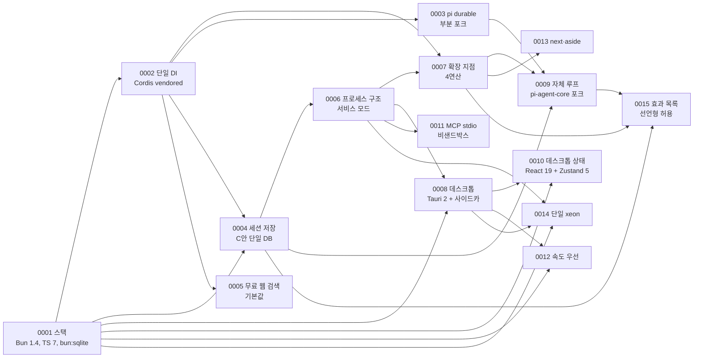

# 결정 기록(ADR) 색인

이 디렉터리는 Xeon에서 되돌리기 어려운 선택과 그 근거를 담는다. 사용자 결정의 원문 메모는 `_research/decisions-log.md`에 있고, 승인된 실행 계획은 `_research/foundation-plan.md`에 있다. ADR은 그중 여러 층에 걸쳐 오래 유지되는 결정을 골라 맥락, 결과, 대안과 함께 고정한다.

## 1. ADR 규칙

### 1.1 파일과 프런트매터

- 파일명: `ADR-NNNN-<slug>.md`. `NNNN`은 0001부터 1씩 늘리는 네 자리 번호이고, 한 번 쓴 번호는 다시 쓰지 않는다. `<slug>`는 영문 소문자와 하이픈으로 쓴다.
- 프런트매터(`_templates/README.md` 형식):

  ```yaml
  ---
  id: adr.NNNN
  layer: adr
  domain: <주제 이름. 영문 소문자와 하이픈, 예: stack, di, session-storage>
  kind: adr
  status: draft            # draft | accepted | superseded
  depends_on: [adr.0001]   # 내용을 가져다 쓰는 ADR이나 문서 id
  binds: [xeon/...]        # 이 결정이 구속하는 코드 경로 glob. routes.yaml layout 경로와 같은 모양
  ---
  ```

- 새 ADR을 추가하면 `_routing/routes.yaml`의 `manifest.decisions`에 id를 더하고 이 색인 표(§2)에 행을 더한다.

### 1.2 본문 골격

`_templates/README.md`의 ADR 골격을 따른다.

1. 상태와 날짜: 상태 값, 날짜, 근거가 된 사용자 결정(`[결정]` 표지와 `_research/decisions-log.md` 날짜 또는 `_research/foundation-plan.md` 절)
2. 맥락: 결정이 필요해진 사실. 근거는 `_research/<파일>.md §절` 형식으로 단다
3. 결정: 번호를 붙인 결정 문장. 사용자 결정은 `[결정]`, 작성자 설계는 `[제안]`으로 구분한다
4. 결과: 좋은 점, 감수할 점
5. 대안: 표. 각 대안에 채택하지 않은 이유를 단다

문서 끝에 "미결 사항" 절을 둔다. 확인하지 않은 전제는 `[가정]`, 사용자 확인이 필요한 항목은 `[미결]`로 적는다.

### 1.3 상태 값

| 상태 | 뜻 | 쓰는 때 |
|---|---|---|
| draft | 작성 중이거나 사용자 확인 전 | 작성자 제안만 있고 근거가 되는 사용자 결정이 없을 때 |
| accepted | 사용자가 결정했거나 결정을 담은 계획을 승인함 | 근거가 `_research/decisions-log.md`의 사용자 결정 또는 승인된 `_research/foundation-plan.md`일 때 |
| superseded | 뒤의 ADR이 이 결정을 대체함 | §1.4 번복 절차를 거친 뒤 |

- [제안] `_templates/README.md`의 프런트매터 `status` 값 목록(draft | review | accepted)에는 superseded가 없다. ADR에 한해 superseded를 허용하도록 템플릿에 추가한다(§6 미결).

### 1.4 번복 절차

결정을 바꿀 때는 기존 ADR 본문의 결정 절을 고쳐 쓰지 않는다.

1. 새 번호로 ADR을 쓴다. 맥락 절에 무엇이 바뀌었는지(새 사실, 새 사용자 결정)를 적고, 결정 절 첫 줄에 "ADR-NNNN을 대체한다"를 적는다.
2. 새 ADR은 사용자 결정을 근거로 accepted가 된다. 근거 없이 작성자 판단만으로 기존 accepted ADR을 대체하지 않는다.
3. 이전 ADR의 프런트매터 `status`를 superseded로 바꾸고, "상태와 날짜" 절에 "superseded: ADR-MMMM(날짜)"를 한 줄 더한다. 다른 절은 그대로 둔다.
4. 이 색인 표의 두 행 상태를 함께 고친다.
5. 이전 ADR을 `depends_on`으로 가진 문서를 찾아 새 ADR로 바꾼다. 찾는 방법은 `just docs-route`와 `depends_on` 검색이다.

부분 번복(결정 일부만 바뀜)도 같은 절차를 따른다. 새 ADR이 이어받는 부분과 바꾸는 부분을 결정 절에 나눠 적는다. 이전 ADR의 결정 대부분이 그대로 남으면 3번 대신 이전 ADR의 `status`를 accepted로 두고, "상태와 날짜" 절에 "부분 대체: 날짜 ADR-MMMM, 대체된 절" 한 줄을 남긴다. 대체된 항목 끝에도 ADR-MMMM을 가리키는 표시를 단다(예: ADR-0003 §3.2 마지막 항목과 ADR-0009).

보충은 번복과 다르게 다룬다. 결정을 뒤집지 않고 [미결]·[제안]을 정하거나 같은 방향으로 세부를 좁히는 개정은 기존 ADR 본문을 고치고, "상태와 날짜" 절에 "개정: 날짜, 근거 문서, 고친 절" 한 줄을 남긴다. 2026-10-21 `review.decisions-2`에 따른 ADR-0002·0004·0006·0007 개정이 이에 해당한다. 그 항목은 [결정(잠정)]으로 표시했다가 2026-10-22 사용자 확인으로 [결정]으로 바꿨다.

## 2. 색인

| 번호 | 제목 | 파일 | 상태 | 핵심 결정 | 근거 결정 | 영향 층 |
|---|---|---|---|---|---|---|
| 0001 | 스택 | [ADR-0001-stack.md](ADR-0001-stack.md) | accepted | Bun 1.4.x(`bun@1.4.3`) + workspaces catalog, TypeScript 7.0.x(tsgo) strict + `isolatedDeclarations`, oxlint 1.89 + tsgolint, oxfmt 0.74 정확 고정, `bun test`, Turborepo 2.11, dependency-cruiser 18, knip 6, TypeBox 1.3.27(U-24), `bun:sqlite` | decisions-log 2026-10-21 3차, foundation-plan §2 | 전 층(F~L4), 툴체인 |
| 0002 | 단일 DI Cordis | [ADR-0002-di-cordis.md](ADR-0002-di-cordis.md) | accepted | DI·플러그인 수명은 Cordis 하나. `xeon/vendor/cordis`에 4.0.0-rc.x 커밋(df4431e) 고정, ext-host 뒤에 숨긴다 | decisions-log 2026-10-19·3차, foundation-plan §1 표 1번·§2 DI 행 | X, 그리고 서비스를 쓰는 L0~L3 |
| 0003 | pi durable 부분 포크 | [ADR-0003-pi-durable-fork.md](ADR-0003-pi-durable-fork.md) | accepted(§3.2 마지막 항목은 0009가 대체) | env·tools·images·truncate만 Chord 제거 포크(`CancelScope`로 치환), 커널 L1-a·b·f·g는 직접 구현하고 durable spec을 인용 | decisions-log 3차, foundation-plan §1 표 1번 | L0(exec), L1(tasks, loop, persistence, agents), L2(workspace) |
| 0004 | 세션 저장 C안 | [ADR-0004-session-storage.md](ADR-0004-session-storage.md) | accepted | SQLite 이벤트 소싱 + 투영, 단일 DB, 확장 접두사 테이블(`x_<id>_`), 단계 경계 FULL, 도구별 효과 커밋(E1~E3), 세션 id OS 잠금 + `sys_leases.epoch` 펜싱 | decisions-log 2026-10-21 2차 | F(records), L0(store), L1(persistence) |
| 0005 | 무료 웹 검색 기본값 | [ADR-0005-web-search-default.md](ADR-0005-web-search-default.md) | accepted | 모델용은 provider 내장 검색. 서비스 API `web.search`는 소형 모델 한 턴 래퍼(약 $0.011/회). SearXNG는 사용자가 주소를 설정했을 때만 래퍼보다 먼저 쓴다(자동 감지 없음, 2026-10-25 개정). 무료 크레딧 API(Exa 월 2,500건, Brave 약 1,000건)는 첫 실행 설정에서 플러그인으로 권장. 키 없는 DuckDuckGo 스크레이핑 제외 | decisions-log 3차, foundation-plan §1 표 6번 | L2(web), L4(첫 실행 설정) |
| 0006 | 프로세스 구조와 서비스 모드 | [ADR-0006-process-service-mode.md](ADR-0006-process-service-mode.md) | accepted | 엔진 라이브러리 + 단일 호스트 계약 + 전송 교체(CLI in-process, 데스크톱 자식 엔진 stdio). 공유 서비스 모드 `xeon service`(자동 기동, 유휴 종료)는 1차, OS 서비스 등록은 2차. 원격 사용은 1차(SSH 터널·사설망), 내장 원격 전송은 2차. 세션 단위 OS 잠금 + `sys_leases` 소유 표시 | decisions-log 계획 v2·3차, foundation-plan §1 표 2번 | L0(process), L4(cli, host-service, desktop) |
| 0007 | 확장 지점 4연산 | [ADR-0007-ext-points.md](ADR-0007-ext-points.md) | accepted | on(fold tap/first/chain), post, drive(배타 임대, 기본 상한은 pi 방식의 예외), scope 4연산. 켜기·끄기와 임대 교대는 단계 경계. 지점 종류 5개와 지점 목록은 [제안](미합의) | decisions-log 2026-10-21 계획 v2 | F(extensions), X, L1, L3 |
| 0008 | 데스크톱 Tauri 2 + 엔진 사이드카 | [ADR-0008-desktop-tauri.md](ADR-0008-desktop-tauri.md) | accepted | Tauri 2.12(시스템 WebView, 3플랫폼) + `bun build --compile` 엔진 사이드카 + stdio JSON-RPC | decisions-log 3차, foundation-plan §1 표 3번·§2 데스크톱 행 | L4(desktop, settings-ui) |
| 0009 | 자체 에이전트 루프 | [ADR-0009-own-agent-loop.md](ADR-0009-own-agent-loop.md) | accepted | pi-agent-core 의존 제거. 1.3.0(MIT) 루프를 core-loop로 포크해 자체 루프로 재설계(진입점 `runTurn(entry)`, 단계 경계 커밋·확장 지점을 루프 코드가 직접 호출, 도구 단계는 core-tools 단계 계약). F가 `AgentMessage`·`AgentEvent`·`AgentTool`을 직접 정의. pi-ai는 유지 | 사용자 지시 2026-10-22, decisions-log 2026-10-21 첫 결정 | F(conversation), L1(loop, tools, models) |
| 0010 | 데스크톱 프런트엔드 상태 | [ADR-0010-desktop-frontend-state.md](ADR-0010-desktop-frontend-state.md) | accepted | React 19 + Zustand 5. 엔진 거울 하나 + UI 스토어, 순수 reducer, 쓰기 미들웨어는 reducer 단계 3개(journal → guard → invariants), Zustand 미들웨어 미사용, 스트리밍 슬롯 + 프레임 커밋. Preact + signals 제외 | 사용자 지시 2026-10-24 | L4(desktop, settings-ui) |
| 0011 | MCP stdio 서버 비샌드박스 실행 | [ADR-0011-mcp-stdio-unsandboxed.md](ADR-0011-mcp-stdio-unsandboxed.md) | accepted | M2는 stdio 서버를 사용자 권한으로 실행. 프로젝트 정의는 프로젝트 신뢰 뒤에만 읽음. 비밀 env 서버는 M3. 샌드박스는 bwrap·Seatbelt 시험 뒤 M3에 다시 정함 | review.m2-plan §8 D6, §9 D-c | L0(process), L2(mcp) |
| 0012 | 실행 속도를 앱 크기보다 우선 | [ADR-0012-speed-over-size.md](ADR-0012-speed-over-size.md) | accepted | 시작·종료·응답 속도를 크기보다 먼저 봄. 사이드카 `--minify --bytecode`, 크기 상한 500 MiB는 회귀 검사용. 예산은 `eng.performance.guide` | 사용자 결정 2026-10-24 | L4(cli, desktop, host-service) |
| 0013 | `post.when = next`와 `aside` | [ADR-0013-post-next-aside.md](ADR-0013-post-next-aside.md) | accepted | `next`는 붙기만 하고 turn을 열지 않음. `aside`는 L1·CLI 사용자 입력 전용. F `PostWhen` 변경 없음 | review.m2-plan §8 D7 | F(extensions), L1(tasks) |
| 0014 | 단일 `xeon` 엔진 바이너리 | [ADR-0014-single-xeon-binary.md](ADR-0014-single-xeon-binary.md) | accepted | CLI와 데스크톱 사이드카가 같은 `xeon` 바이너리(`host --stdio`). 이름은 제품 이름 결정 때 한 번에 바꿈 | ADR-0001 §4.1, DESK.3 | L4(cli, desktop, host-service) |
| 0015 | 재실행되는 확장 코드의 효과 목록 | [ADR-0015-replay-effects.md](ADR-0015-replay-effects.md) | accepted | C안(선언형 허용). `g.delegate`·`loop.spawn`은 코어가 멱등 보장. 능력 메서드는 F 정의 `idempotent: true` + `requestId`만 허용, 읽기(`readOnly`, [제안] 이름)는 drive에서 허용. 선언 없는 쓰기는 요청 레코드 + 워커. 시험은 재생 2회·효과 1회 | 사용자 결정 2026-10-25(M3-03, G1-06) | F(capabilities, extensions), X(primitives), L1(loop, agents), L2(전 능력), L3(group-kit, helm, learning) |

- 상태 열은 각 ADR 파일 프런트매터의 `status`와 같아야 한다. 이 색인을 쓴 시점(2026-10-21)에 0001~0008 여덟 파일 모두와 대조했다. 0009는 2026-10-22에, 0010은 2026-10-24에, 0011~0014는 2026-10-25에, 0015는 2026-10-26에 더했다. 0011~0014는 plan 표에만 있던 결정을 옮긴 것이다(마일스톤 재점검 G3-03, `review.m2-plan` §9).
- 0005~0008의 핵심 결정 열은 조정자가 전달한 요약이다. 정확한 문구는 각 ADR이 기준이다.

## 3. ADR 사이 의존

화살표는 "앞의 결정이 뒤의 결정의 전제"를 뜻한다. 각 ADR 프런트매터의 `depends_on`과 맞춘다.



- 0001 → 0008: 사이드카는 `bun build --compile`로 만든다.
- 0002 → 0005: 검색 provider는 Cordis 서비스로 등록·교체한다(ADR-0005 `depends_on`).
- 0006 → 0007: 확장 지점의 적용 시점(단계 경계)과 실행 위치가 프로세스 구조를 전제한다(ADR-0007 `depends_on`).
- 0003·0004·0007 → 0009: 자체 루프는 커널 직접 구현(0003)을 이어받고, 단계 경계 커밋(0004)과 확장 지점 4연산(0007)을 루프 코드에서 직접 호출한다. 0009는 0003 §3.2 마지막 항목을 대체한다.
- 0001·0008 → 0010: UI 코드는 0001의 TypeScript·`bun build`·`bun test` 스택을 따르고, 0008의 시스템 WebView와 stdio 릴레이 위에서 돈다.
- 0004·0007·0009 → 0015: 효과 목록은 커밋 단위 멱등(0004), 확장 지점 재생 계약(0007), 루프의 drive 연동(0009)을 전제한다.
- 0003은 0004의 이벤트 소싱 결정과 맞물리지만 `depends_on`에는 0002만 둔다. 커널 저장 규칙은 0003 본문에서 0004를 참조한다.

## 4. 아직 ADR이 아닌 결정

사용자가 결정했지만 ADR로 승격하지 않은 항목이다. 한 층이나 한 도메인 안에서 끝나는 결정이라 해당 스펙이 근거를 들고 기록한다. 결정 내용의 정본은 아래 문서 id다.

| 결정 | 근거 | 기록하는 문서 id | 승격 여부 |
|---|---|---|---|
| 위장 provider(pi-ai Anthropic OAuth)를 별도 커스텀 플러그인 `plugins/provider-anthropic-oauth`로 분리하고 배포판(릴리즈)에서 제외 | decisions-log 2026-10-21, 2차 | `L1.models.spec` (`routes.yaml` plugins 항목) | ADR 대상 아님. 조정자 지시로 L1 models 스펙 소관 |
| 비밀 기본값은 SOPS(age). 에이전트는 값을 모른 채 참조(`secret://이름`)로 사용, 사용자는 목록·등록·열람·삭제 | decisions-log 2차, foundation-plan §2 비밀 행 | `L0.secrets.spec`, `L4.settings-ui.spec` | [미결] |
| 목표 판정은 별도 판정 모델 + 실행 횟수 상한 | decisions-log 3차, foundation-plan §1 표 4번 | `product.usecases.spec`(목표 지속 행), `L2.work.spec`, `L1.loop.spec` | [미결] |
| 질문 도구와 계획 승인을 L1-d 승인 프로토콜 하나로 통합 | decisions-log 3차, foundation-plan §1 표 5번 | `product.usecases.spec`, `L1.tools.spec`, `L2.dialog.spec` | [미결] |
| 입출력 가드레일 보류 | decisions-log 2026-10-21 계획 v2 | `product.scope.spec`(N1), `X.primitives.spec` | [미결] |
| 예산은 pi 방식(기본 상한 없음). 추론 예산·라우팅·레이트 리밋·계정 회전은 L4 설정 화면에서 조작 | decisions-log 계획 v2, 2차 | `L1.models.spec`, `L4.settings-ui.spec`, `product.scope.spec`(I14) | [미결] |
| 코드 위치는 `xeon/` 독립 워크스페이스, 문서는 `docs/xeon/` | decisions-log 3차, foundation-plan §1 코드 위치 행 | `eng.toolchain.guide`, `eng.dependency-rules.guide` | [미결] |
| CI 파일 `.github/workflows/xeon-ci.yml` 추가 허용 | decisions-log 3차, foundation-plan §1 CI 행 | `eng.toolchain.guide` | [미결] |

- [제안] 승격 기준: 결정이 두 층 이상의 코드 구조를 바꾸거나, 번복 비용이 패키지 하나를 넘을 때 ADR로 올린다. 이 기준으로 보면 SOPS 기본값(L0·L4·비밀 참조 형식이 F에 걸림)과 승인 프로토콜 통합(L1·L2·L4)이 후보다. 승격은 사용자 확인 뒤에 한다.

## 5. 읽는 법

구현 작업 전에 `just docs-route --task implement <경로>`가 고른 문서를 먼저 읽는다. ADR은 `binds`로도 라우팅되지만, 아래 표로 층별로 함께 읽을 ADR을 확인한다.

| 작업 대상 | 먼저 읽을 ADR | 함께 읽을 문서 id |
|---|---|---|
| 툴체인, CI, 패키지 설정(`xeon/package.json`, `tsconfig.base.json` 등) | 0001 | `eng.toolchain.guide`, `eng.typescript.guide` |
| F `contracts` | 0001, 0004(records), 0007(extensions), 0009(conversation), 0015(capabilities, extensions) | `F.records.spec`, `F.extensions.spec` |
| X `ext-host` | 0002, 0007, 0015 | `X.readme`, `X.primitives.spec`, `X.loading-trust.spec` |
| L0 `platform-exec` | 0003 | `L0.exec.spec` |
| L0 `platform-store` | 0004, 0001 | `L0.store.spec`, `eng.transactions.design` |
| L0 `platform-process` | 0006, 0004 | `L0.process.spec` |
| L1 `core-tasks`, `core-loop`, `core-persistence`, `core-agents` | 0003, 0004, 0007, 0009(`core-loop`) | `L1.tasks.spec`, `L1.loop.spec`, `L1.persistence.spec`, `L1.agents.spec`, `eng.events.design` |
| L2 `cap-workspace` | 0003 | `L2.workspace.spec` |
| L2 `cap-web` | 0005 | `L2.web.spec` |
| L3 그룹(`group-kit`, `group-helm`, `group-learning`) | 0007, 0002, 0015 | `L3.group-kit.spec`, `F.extensions.spec` |
| L4 `apps/cli`, `apps/host` | 0006 | `L4.cli.spec`, `L4.host-service.spec` |
| L4 `apps/desktop` | 0008, 0006, 0010 | `L4.desktop.spec`, `L4.desktop.design`, `eng.frontend-state.guide` |

- ADR과 스펙이 어긋나면 ADR이 우선한다. 스펙을 고치거나, 결정 자체가 바뀌어야 하면 §1.4 번복 절차를 밟는다.
- ADR의 `[가정]`과 `[미결]`은 구현 중 확인 대상이다. 확인 결과는 해당 ADR의 미결 사항 절이나 `_research/notes/`에 남긴다.

## 6. 미결 사항

- [미결] `_templates/README.md`의 `status` 값 목록에 superseded를 추가할지. 추가하지 않으면 번복된 ADR의 상태를 프런트매터로 표시할 수 없다.
- [미결] §4 표의 결정 중 어느 것을 ADR로 승격할지. [제안] 후보는 SOPS 비밀 기본값과 승인 프로토콜 통합이다.
- 닫음: on 핸들러의 외부 효과 금지와 `delegate`, `loop.spawn`, 능력 호출의 충돌(마일스톤 재점검 G1-06)은 ADR-0015(C안, 2026-10-25 사용자 결정)로 정했다.
- [미결] 색인 상태 열과 파일 프런트매터의 일치를 `scripts/docs-route.ts`나 문서 검사에 넣을지.
