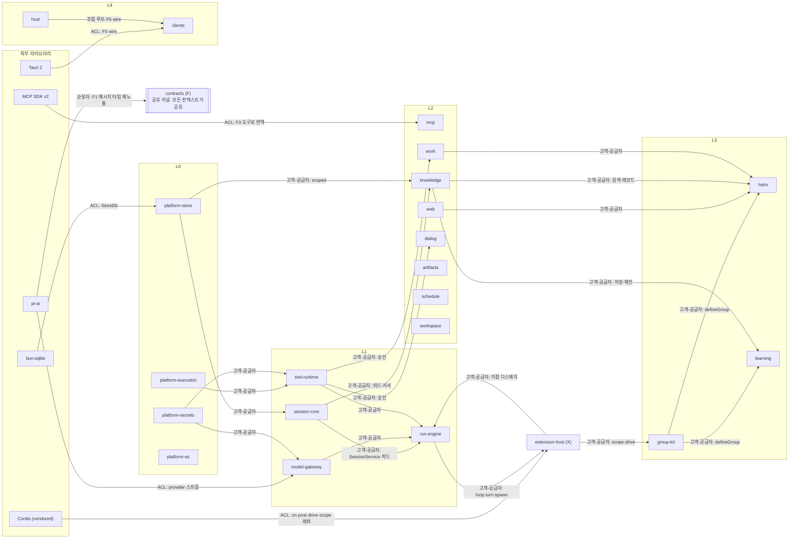
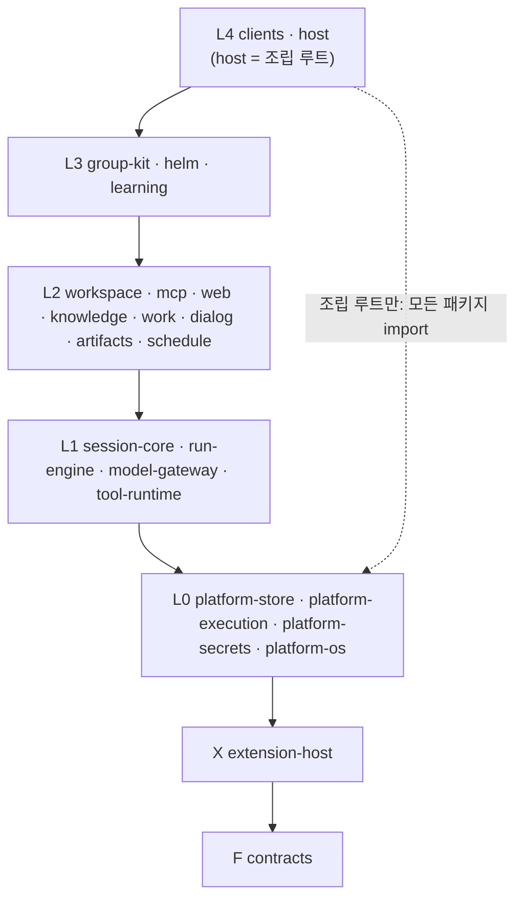

# 컨텍스트 지도

Xeon 코드를 바운디드 컨텍스트로 묶고, 컨텍스트마다 소유 데이터(테이블 접두사), 발행 이벤트 kind 접두, 공개 서비스, 허용 의존, 소유 패키지를 정한다. 이 문서는 컨텍스트 경계와 테이블·이벤트·서비스 소유의 정본이다. import 규칙(층 순위, 같은 층 금지, 외부 모듈 소유, 컨텍스트 사이 import 금지 DR-14)은 `eng.dependency-rules.guide`가 정본이고, 이 문서는 그 위에 데이터 소유 규칙을 더한다. 이벤트 envelope과 재생은 `eng.events.design`, 원자 커밋과 커밋 키(`requestId`)는 `eng.transactions.design`이 정본이다. 이벤트 kind 이름 규칙과 코어 카탈로그는 `F.records.spec`이 정본이다.

이 문서는 구속 문서다. 마지막 절 "구현 작업자 규칙"(CM-NN)은 `xeon/packages/**`의 모든 패키지에 적용된다. 프런트매터 `binds`는 `routes.yaml` layout이 허용하는 패키지 경로 glob으로 `xeon/packages/**` 전체를 나열한 것이다.

## 1. 문제

- 층 구성 계획 v2는 구성요소 182개를 41개 하위 층에 나눴고, `routes.yaml` layout은 이를 37개 도메인과 패키지 경로로 옮겼다. 층은 import 방향을 정하지만 "이 테이블은 누가 쓰는가", "이 이벤트 type은 누가 만드는가"는 정하지 않는다.
- 단일 DB 파일(`eng.transactions.design` 3.1절)에 세션 코어, L2 능력, 확장의 테이블이 함께 있다. 소유 규칙이 없으면 한 컨텍스트가 다른 컨텍스트 테이블을 직접 읽고 써서, 투영 재생성·확장 제거·스키마 변경 때 숨은 결합이 드러난다.
- 같은 층 패키지끼리는 import할 수 없다(DR-02). 그러면 같은 일을 하는 L1 패키지 넷(tasks, loop, context, agents)이 어떤 단위로 협력하는지, 그 단위가 무엇을 외부에 내놓는지를 따로 정해야 한다.
- 외부 라이브러리(pi-ai, MCP SDK, Tauri, Cordis, bun:sqlite)의 타입이 여러 컨텍스트로 퍼지면 버전 고정과 포크 범위를 관리할 수 없다.
- Helm과 학습 그룹은 L3 기본 그룹으로 공존한다. 둘 사이, 그리고 그룹과 능력 사이의 결합 방식이 정해지지 않으면 한 그룹을 끌 때 다른 쪽이 깨진다(`_research/decisions-log.md` 2026-10-21 "그룹 간 강결합 우려").

## 2. 선택지 비교

| 안 | 컨텍스트 단위 | 장점 | 단점 |
|---|---|---|---|
| A. 층 = 컨텍스트 | 7개(F, X, L0~L4) | 단순 | L1 하나가 세션 저장, 루프, 모델, 도구를 모두 품어 소유 경계 역할을 못 한다 |
| B. layout 도메인 = 컨텍스트 | 37개 | layout과 1:1 | 함께 바뀌는 도메인(loop와 tasks, exec와 sandbox)이 서로 다른 컨텍스트로 나뉘어 경계 표가 커지고, 관계 그림을 읽기 어렵다 |
| C. 협력 단위로 묶은 컨텍스트 | 23개. 도메인 하나는 정확히 한 컨텍스트에 속한다 | 소유와 언어가 같은 도메인을 묶는다. layout과 대조 가능 | 컨텍스트 하나가 패키지 여럿에 걸칠 때 같은 층 import 금지(DR-02)가 컨텍스트 안에서도 적용된다 |

## 3. 선택과 근거

[제안] C안을 택한다. 도메인 하나는 정확히 한 컨텍스트에 속하고, 컨텍스트는 같은 데이터와 같은 이벤트 어휘를 쓰는 도메인을 묶는다.

협력 규칙:

1. [결정] 컨텍스트 사이 협력은 F 정의, Cordis 서비스, 이벤트로만 한다. 같은 층 협력은 F 정의와 Cordis 서비스로만 한다(`_research/foundation-plan.md §3`, DR-02). DI는 Cordis 하나다(`_research/decisions-log.md` 2026-10-21 결정 3차).
2. [제안] 다른 컨텍스트의 구현 패키지를 import하지 않는다. 층 순위상 허용되는 하위 층 패키지(DR-01)라도, 컨텍스트가 다르면 F에 둔 서비스 타입으로 주입받는다. 규칙 본문과 예외(F, 조립 루트 `apps/host`와 `DR-10/cli-host`, 테스트 파일의 `testing` 서브패스, `@xeon/ext-host`의 서비스 등록·주입 API, `group-kit` 허용 목록)는 `eng.dependency-rules.guide` DR-14가 정본이다. 이 문서는 4.1절 표로 "다른 컨텍스트"를 정한다. 이 규칙은 OS·환경별 구현을 바꿔 끼울 수 있게 한다(`_research/decisions-log.md` 2026-10-19 설계 규칙: 공통 인터페이스, 구현만 교체).
3. [결정] 세션 코어(L1 persistence, 컨텍스트 `session-core`)가 세션 테이블과 투영을 소유한다. 확장과 그룹은 `x_<extKey>_` 접두사 테이블만 소유한다(`_research/decisions-log.md` 2026-10-21 결정 2차 "확장 접두사 테이블", 층 구성 계획 v2 X-c "확장 전용 저장 영역"). `extKey`는 확장 id의 `-`를 `_`로 바꾼 값이다([결정: review.decisions-2 U-18], 5.2절).
4. [결정] Helm은 L3 기본 그룹이다. 학습 그룹도 L3 기본 그룹이며 drive를 쓰지 않는다(on, post, scope만). 두 그룹은 공존한다(`_research/decisions-log.md` 2026-10-21 계획 v2, 층 구성 계획 v2 L3-c).
5. [결정] 학습 그룹의 저장(스킬, 메모리, 세션 검색, 변경 원장)은 L2 knowledge가 소유한다. 학습 그룹은 정책(트리거, 검토 포크, 제안)만 가진다(층 구성 계획 v2 "Hermes 학습 루프를 별도 그룹으로": "저장소인 스킬, 메모리, 세션 검색, 변경 원장은 L2-d에 남깁니다").
6. [결정] 웹 같은 능력은 L2 능력으로 두고 그룹이 서비스 API로 쓴다. 그룹 안에 능력을 두지 않는다(`_research/decisions-log.md` 2026-10-21 "웹 탐색 같은 능력을 그룹 안에 둘지 코어 층에 둘지(그룹 간 강결합 우려)", 층 구성 계획 v2 L3-a "그룹 안 도구가 두 번째 소비자를 얻으면 L2로 승격").
7. [제안] 그룹은 다른 그룹을 서비스로도 부르지 않는다. 그룹 사이 정보는 이벤트와 L2 능력의 레코드로만 주고받는다(층 구성 계획 v2 층 사이 규칙 3, "Helm은 학습 결과를 그룹 레코드와 L2-d 검색으로 읽습니다").

## 4. 구조와 흐름

### 4.1 컨텍스트 목록

[제안] 서비스 이름은 `xeon.<이름>` 형식이고, F에 `<이름>ServiceName` 상수와 서비스 인터페이스를 둔다(DR-02 예시 `"xeon.models"`와 같은 형식). Cordis `Context`의 기존 속성 이름과 `_`로 시작하는 이름은 피한다(`_research/notes/arch-1.md §2` 이름 규칙).

| 컨텍스트 | 층 | layout 도메인 | 패키지 | (a) 소유 데이터 | (b) 발행 kind 접두 | (c) 제공 서비스 | (d) 쓰는 서비스(허용 의존) |
|---|---|---|---|---|---|---|---|
| `contracts` | F | conversation, records, capabilities, extensions, wire-settings | `contracts` | 없음(스키마·타입·상수만) | 없음(카탈로그 정의만) | 없음 | 없음. 외부는 `typebox`와 pi-ai 타입 재노출만 |
| `extension-host` | X | loading-trust, primitives, operations | `ext-host` | `xh_*`(신뢰 결정, 설치·신뢰 등급) | `scope.`, `lease.` | `xeon.ext` | `xeon.session`, `xeon.tasks`, `xeon.loop`, `xeon.agents`(drive의 `loop.turn`·`loop.spawn`·`post`) |
| `platform-execution` | L0 | exec, sandbox, process | `platform-exec`, `platform-sandbox`, `platform-process` | 없음(백그라운드 프로세스 레지스트리는 메모리) | 없음 | `xeon.exec`, `xeon.sandbox`, `xeon.process` | `xeon.secrets`(실행 직전 비밀 주입) |
| `platform-secrets` | L0 | secrets | `platform-secrets` | DB 밖 SOPS 파일, OS 키체인 | 없음 | `xeon.secrets`, `xeon.secretAdmin` | 없음 |
| `platform-store` | L0 | store | `platform-store` | `sys_*`(메타, 마이그레이션, 임대, blob 색인), blob 파일 | 없음 | `xeon.store` | 없음 |
| `platform-os` | L0 | os | `platform-os` | 없음 | 없음 | `xeon.os` | 없음 |
| `session-core` | L1 | persistence | `core-persistence` | `events`, `event_seq`, `thread_delete_guard`, `requests`, `step_checkpoints`, `consumer_cursors`, `projector_state`, `p_*` | `thread.`, `checkpoint.`, `settings.` | `xeon.session` | `xeon.store`(전체 핸들은 조립 루트가 넘김) |
| `run-engine` | L1 | tasks, loop, context, agents | `core-tasks`, `core-loop`, `core-context`, `core-agents` | 없음(상태는 이벤트와 `p_*`) | `input.`, `turn.`, `step.`, `item.`, `part.`, `post.`, `agent.`, kind 단위 `thread.compacted` | `xeon.tasks`, `xeon.loop`, `xeon.context`, `xeon.agents` | `xeon.session`, `xeon.models`, `xeon.tools`, `xeon.ext` |
| `model-gateway` | L1 | models | `core-models`, `plugins/provider-anthropic-oauth` | `core_models_*`(사용량, 계정 회전 상태. 설정 화면은 M3, [결정: review.decisions-2 U-21]) | `model.`(휘발만, 예약) | `xeon.models` | `xeon.secrets` |
| `tool-runtime` | L1 | tools | `core-tools` | `core_tools_*`(항상 허용 캐시) | `effect.`, `approval.`, `secret.`, `tool.` | `xeon.tools`, `xeon.approvals` | `xeon.session`, `xeon.exec`, `xeon.sandbox`, `xeon.secrets`, `xeon.ext` |
| `workspace` | L2 | workspace | `cap-workspace` | 없음(예약 `cap_workspace_*`) | `workspace.`(예약) | `xeon.workspace` | `xeon.exec`, `xeon.os`, `xeon.tools` |
| `mcp` | L2 | mcp | `cap-mcp` | `cap_mcp_*`(서버 상태) | `mcp.`(휘발, 예약) | `xeon.mcp` | `xeon.process`, `xeon.secrets`, `xeon.tools`, `xeon.store` |
| `web` | L2 | web | `cap-web` | `cap_web_*`(fetch 캐시) | `web.`(휘발, 예약) | `xeon.web` | `xeon.models`(내장 검색 래퍼), `xeon.secrets`, `xeon.tools`, `xeon.store` |
| `knowledge` | L2 | knowledge | `cap-knowledge` | `cap_knowledge_*`(스킬 색인, 메모리, 변경 원장, 제안 대기열, 세션 검색 FTS) | `knowledge.`(예약) | `xeon.knowledge` | `xeon.session`(피드, 소비자 커서), `xeon.store`, `xeon.tools`, `xeon.approvals` |
| `work` | L2 | work | `cap-work` | `cap_work_*`(작업 목록·계획 투영) | `work.` | `xeon.work` | `xeon.session`, `xeon.approvals`, `xeon.tools` |
| `dialog` | L2 | dialog | `cap-dialog` | 없음(예약 `cap_dialog_*`) | `dialog.` | `xeon.dialog` | `xeon.approvals`, `xeon.tools`, `xeon.os`(알림), `xeon.exec`(첨부·명령 파일 읽기, `L2.dialog.spec` §8) |
| `artifacts` | L2 | artifacts | `cap-artifacts` | `cap_artifacts_*`(산출물 색인 투영) | `artifact.` | `xeon.artifacts` | `xeon.session`(제목 요청 포함), `xeon.store`, `xeon.tools` |
| `schedule` | L2 | schedule | `cap-schedule` | `cap_schedule_*`(타이머, 루프 정의) | `schedule.` | `xeon.schedule` | `xeon.store`, `xeon.tasks`(post), `xeon.process`, `xeon.os` |
| `group-kit` | L3 | group-kit, slots | `group-kit`(slots는 코드 없음) | 없음 | 없음(그룹 상태는 각 그룹의 `grp.<groupId>.`) | `xeon.groups` | `xeon.ext` |
| `helm` | L3 | helm | `group-helm` | `x_helm_*` | `grp.helm.` | 없음 | `xeon.groups`, `xeon.ext`, L2 서비스(`xeon.web`, `xeon.knowledge`, `xeon.work`, `xeon.agents`) |
| `learning` | L3 | learning | `group-learning` | `x_learning_*`(트리거 카운터) | `grp.learning.` | 없음 | `xeon.groups`, `xeon.ext`, `xeon.knowledge`, `xeon.agents`(백그라운드 위임) |
| `clients` | L4 | cli, desktop, settings-ui | `apps/cli`, `apps/desktop`(`src/settings` 포함) | 설정 파일(스키마는 F wire-settings) | 없음 | 없음 | F5 wire(전송 계층). Cordis 서비스를 직접 쓰지 않는다 |
| `host` | L4 | host-service | `apps/host` | 서비스 모드 상태 파일(1차). OS 서비스 등록 파일만 2차 | 없음 | 없음(F5 wire 서버) | 조립 루트: 모든 패키지를 import해 플러그인을 등록 |

- 사용자 확장(플러그인)은 layout 밖이다. 각 확장은 자기 컨텍스트 하나이고 `x_<extKey>_*` 테이블과 `x.<extId>.` kind만 소유한다. 의도 그룹은 `grp.<groupId>.` kind를 소유한다(`F.records.spec` §3.2).
- (b)열의 이름은 F 코어 kind 영역(`F.records.spec` §3.2 `CoreArea`)과 L1 spec이 F에 추가를 요청한 영역(`input.`, `approval.`, `agent.`, `eng.events.design` 4.4절)이다.
- `contracts`는 공유 커널이다. 모든 컨텍스트가 의존하고, 컨텍스트 사이에서 주고받는 타입·서비스 인터페이스·이벤트 카탈로그를 둔다.

### 4.2 컨텍스트 맵

화살표는 공급자(상류) → 고객(하류)이다. 라벨은 관계 유형이다. `contracts`(F, 공유 커널)는 모든 컨텍스트가 공유하므로 선을 생략하고 한 노드로만 표시했다.



관계 요약:

| 관계 유형 | 위치 | 뜻 |
|---|---|---|
| 공유 커널 | `contracts`(F) | 모든 컨텍스트가 같은 타입과 카탈로그를 쓴다. 바꿀 때 모든 소비자를 함께 확인한다 |
| 고객-공급자 | 위 그림의 대부분 | 하류가 F의 서비스 인터페이스로 상류를 쓴다. 인터페이스 변경은 F 문서와 함께 한다 |
| 순응자 | pi-ai 메시지 타입 → F1. pi-agent-core 루프는 run-engine이 포크해 자체 코드로 가지므로(adr.0009) 순응 관계가 없다 | 외부 모델을 바꾸지 않고 따른다. 정확 버전 고정 + 별칭 재노출(`_research/packages.md §4.1` F1 메시지 스키마 "그대로") |
| 부패 방지 계층 | `model-gateway`(pi-ai provider·스트림), `mcp`(MCP SDK), `clients`·`host`(Tauri IPC ↔ F5 wire), `extension-host`(Cordis), `platform-store`(bun:sqlite) | 외부 타입을 경계에서 F 타입으로 바꾼다. 경계 밖으로 외부 타입이 나가지 않는다(CM-03) |
| 양방향(파트너) | `extension-host` ↔ `run-engine` | run-engine은 지점을 열고 ext-host는 핸들러를 실행한다. drive는 ext-host가 `xeon.loop`로 턴을 요청한다. 두 쪽 계약은 F4 지점 선언 하나다(DR-12) |

### 4.3 층 의존 그림

화살표는 import 방향(위 층 → 아래 층)이다. 같은 층 안은 import하지 않고 Cordis 서비스로 협력한다.



- 순위는 F(0) → X(1) → L0(2) → L1(3) → L2(4) → L3(5) → L4(6)이다(`_research/foundation-plan.md §3`). 그림의 실선 하나는 "바로 아래 층까지"를 뜻하지만 순위상 더 아래 층 import도 허용된다(DR-01).
- DR-14(3절 협력 규칙 2)에 따라, 컨텍스트가 다른 하위 패키지는 import하는 대신 F 서비스 타입으로 주입받는다. 실제 워크스페이스 import는 F, 조립 루트(`apps/cli` → `apps/host` 포함), 같은 컨텍스트 안의 import, `@xeon/ext-host`의 서비스 등록·주입 API, 테스트 파일의 `testing` 서브패스만 남는다.

### 4.4 층 순위와 컨텍스트 경계가 어긋나는 곳

| # | 위치 | 어긋남 | 처리 |
|---|---|---|---|
| 1 | `run-engine`(L1 tasks·loop·context·agents) | 컨텍스트 하나가 같은 층 패키지 넷에 걸친다. DR-02 때문에 컨텍스트 안에서도 import할 수 없다 | 컨텍스트 안 협력도 F 정의와 `xeon.tasks`·`xeon.loop`·`xeon.context`·`xeon.agents` 서비스로 한다. 컨텍스트는 이벤트 어휘와 데이터 소유를 묶는 단위다. import 허용 여부는 층 규칙(DR-01, DR-02)이 패키지 단위로 정한다 |
| 2 | `extension-host`(X, 순위 1) | L3 그룹(순위 5)을 호스트하고, 세션 쓰기(L1 `session-core`)와 루프(L1 `run-engine`)를 써야 한다. 순위상 import할 수 없다 | F2 `SessionService`·`ProducerHandle`, F4 지점 선언과 포트를 F에 두고, 구현은 Cordis로 주입받는다. X 순위 유지와 세 조건은 [결정: review.decisions-2 U-14](`eng.dependency-rules.guide` 1.1절, `architecture.layers.spec` 4.3.3절) |
| 3 | `approval.` 접두사(L1 `tool-runtime`) | 질문 도구(L2 dialog)와 계획 승인(L2 work)의 기능은 L2에 있으나 이벤트는 L1이 소유한다 | 결정 5(질문·계획 승인을 L1-d 승인 프로토콜 하나로)를 따른다. L2는 `xeon.approvals`로 요청하고 결과를 이벤트로 받는다 |
| 4 | 세션 제목(L2 artifacts "세션 제목과 메타") | 기능은 L2, 이벤트 `thread.updated`(제목)는 L1 `session-core` 소유 | artifacts가 `xeon.session`의 제목 변경 API를 부르고, 이벤트는 session-core가 쓴다 |
| 5 | 학습 그룹(L3)의 저장 | 그룹의 산출물이 아래 층 컨텍스트(L2 knowledge) 테이블에 있다 | 3절 결정 5. 학습 그룹은 `x_learning_*`에 트리거 카운터만 둔다 |
| 6 | `settings-ui`(L4) | layout 경로 `xeon/packages/client/src/settings/**`가 `client` 패키지 안이다(adr.0020). 화면은 `desktop`에 있다 | 두 도메인을 `clients` 컨텍스트로 묶는다. 설정 화면 생성은 F5 설정 스키마 하나에서 나온다 |
| 7 | `slots`(L3) | layout 도메인이지만 코드가 없다(템플릿 문서만) | `group-kit` 컨텍스트에 둔다. 미결 C-2 |
| 8 | `plugins/provider-anthropic-oauth` | L1 순위(`AGENTS.md`)이지만 layout 도메인 밖이고 배포판에서 빠진다 | `model-gateway` 컨텍스트에 속한다. layout `plugins` 항목이 `L1.models.spec`을 문서로 지정한다. import 규칙은 DR-09 |
| 9 | F `records`의 이벤트 카탈로그 | L2 능력이 이벤트 type을 더할 때마다 F를 고친다 | 카탈로그 파일을 소유 컨텍스트별로 나눈다(`contracts/src/records/catalog/<컨텍스트>.ts`) [제안]. 소유는 5.1절 |
| 10 | `sys_leases`(L0 store) | 임대 저장은 L0, 세션 임대의 뜻(자원 `session:<id>`)은 L1 session-core | L0은 일반 자원 임대만 제공하고, 자원 이름과 갱신 정책은 소유 컨텍스트가 정한다(`eng.transactions.design` 3.3절) |
| 11 | `schedule`(L2) | 앱을 닫아도 도는 예약은 L0 process와 L4 host 서비스 모드가 필요하다 | 예약 처리는 `sys_leases`의 `scheduler` 자원을 쥔 프로세스 하나만 한다. 서비스 모드는 1차, OS 서비스 등록만 2차다([결정: review.decisions-2 S-01], 결정 2). 서비스 모드가 꺼져 있으면 예약 생성 때 자동 기동을 시도한다([결정: review.decisions-2 U-23]) |

### 4.5 하위 층 식별자와 layout 도메인 대응

층 구성 계획 v2와 `_research/packages.md`는 하위 층을 `L1-a` 같은 식별자로 부르고, `routes.yaml` layout은 도메인 이름으로 부른다. 아래 표가 둘을 잇는다. 도메인은 각각 정확히 한 컨텍스트에 속한다.

| 계획 id | 계획 이름 | layout 층·도메인 | 패키지 | 컨텍스트 |
|---|---|---|---|---|
| F1 | 대화 모델 | F conversation | `contracts` | `contracts` |
| F2 | 기록 계약 | F records | `contracts` | `contracts` |
| F3 | 능력 계약 | F capabilities | `contracts` | `contracts` |
| F4 | 확장 계약 | F extensions | `contracts` | `contracts` |
| F5 | 연결·설정 계약 | F wire-settings | `contracts` | `contracts` |
| X-a | 로딩과 신뢰 | X loading-trust | `ext-host` | `extension-host` |
| X-b | 원시 연산 네 개 | X primitives | `ext-host` | `extension-host` |
| X-c | 운영 규칙 | X operations | `ext-host` | `extension-host` |
| L0-a | 실행 환경 | L0 exec | `platform-exec` | `platform-execution` |
| L0-b | 격리 | L0 sandbox | `platform-sandbox` | `platform-execution` |
| L0-c | 비밀 | L0 secrets | `platform-secrets` | `platform-secrets` |
| L0-d | 프로세스 | L0 process | `platform-process` | `platform-execution` |
| L0-e | 저장 기반 | L0 store | `platform-store` | `platform-store` |
| L0-f | OS 연동 | L0 os | `platform-os` | `platform-os` |
| L1-a | 태스크 엔진 | L1 tasks | `core-tasks` | `run-engine` |
| L1-b | 에이전트 루프 | L1 loop | `core-loop` | `run-engine` |
| L1-c | 모델 게이트웨이 | L1 models | `core-models` | `model-gateway` |
| L1-d | 도구 실행과 권한 | L1 tools | `core-tools` | `tool-runtime` |
| L1-e | 컨텍스트와 컴팩션 | L1 context | `core-context` | `run-engine` |
| L1-f | 영속성과 복구 | L1 persistence | `core-persistence` | `session-core` |
| L1-g | 서브에이전트 | L1 agents | `core-agents` | `run-engine` |
| L2-a | 작업 도구 | L2 workspace | `cap-workspace` | `workspace` |
| L2-b | MCP 통합 | L2 mcp | `cap-mcp` | `mcp` |
| L2-c | 웹 | L2 web | `cap-web` | `web` |
| L2-d | 지식과 기억(저장소) | L2 knowledge | `cap-knowledge` | `knowledge` |
| L2-e | 작업 관리 | L2 work | `cap-work` | `work` |
| L2-f | 사용자 대화 | L2 dialog | `cap-dialog` | `dialog` |
| L2-g | 산출물과 세션 | L2 artifacts | `cap-artifacts` | `artifacts` |
| L2-h | 예약과 백그라운드 | L2 schedule | `cap-schedule` | `schedule` |
| L3-a | 그룹 기반 | L3 group-kit | `group-kit` | `group-kit` |
| L3-b | Helm(기본 그룹) | L3 helm | `group-helm` | `helm` |
| L3-c | 학습 그룹(기본 그룹) | L3 learning | `group-learning` | `learning` |
| L3-d | 추가 그룹 슬롯 | L3 slots | 없음(템플릿) | `group-kit` |
| (계획 밖) | CLI | L4 cli | `apps/cli` | `clients` |
| (계획 밖) | 데스크톱 | L4 desktop | `apps/desktop` | `clients` |
| (계획 밖) | 설정 화면 | L4 settings-ui | `packages/client/src/settings` | `clients` |
| (계획 밖) | 호스트·서비스 | L4 host-service | `apps/host` | `host` |

L2 하위 층 이름과 layout 도메인 이름이 다르게 읽히는 곳(L2-a "작업 도구" = `workspace`, L2-e "작업 관리" = `work`, L2-g "산출물과 세션" = `artifacts`)은 layout 이름을 코드·서비스·접두사의 기준으로 쓴다. 정리 방식은 미결 C-1이다.

## 5. 소유표

### 5.1 이벤트 kind 접두 소유표

[제안] kind 이름 규칙과 코어 카탈로그의 정본은 `F.records.spec` §3.2·§3.3이다. 이 표는 그 접두마다 소유 컨텍스트와 생산자 id를 정한다. 생산자 id는 `core.<L1 도메인>`, `cap.<L2 도메인>`, `xh`, `ext.<확장 이름>` 형식이다. 생산자 id는 envelope 필드가 아니다(`F.records.spec` §3.1.1에 `producer` 필드가 없다). 커밋을 부르는 쪽의 생산자 핸들이 초안에 붙이는 값(`StampedDraft.producer`, `L1.persistence.spec` §3.2)이고, 저장소는 커밋 때 그 생산자 id와 초안 kind 접두를 이 소유표로 대조한다(`eng.events.design` 4.1절). 코드 상수는 `xeon/packages/contracts/src/records/owners.ts`의 `TYPE_PREFIX_OWNERS`이고, 이 표와 같은 커밋에서 고친다.

| kind 접두 | 소유 컨텍스트 | 생산자 id | 내구 | 휘발 |
|---|---|---|---|---|
| `thread.` | session-core | `core.persistence`(`compacted`만 `core.context`) | `started`, `updated`, `closed`, `leaf_moved`, `compacted`, `branch_summarized`, `resumed` | 없음 |
| `checkpoint.` | session-core | `core.persistence` | `step` | 없음 |
| `settings.` | session-core | `core.persistence` | `changed` | 없음 |
| `input.` | run-engine | `core.tasks` | `queued`, `placed`, `withdrawn` | 없음 |
| `post.` | run-engine | `core.tasks` [제안] | `accepted`(retired, 새로 쓰지 않는다. review.decisions-2 U-05) | 없음 |
| `turn.` | run-engine | `core.loop` | `started`, `completed`, `abort_requested` | `updated` |
| `step.` | run-engine | `core.loop` | `started`, `completed` | `updated` |
| `item.` | run-engine | `core.loop` | `recorded` | `started`, `updated`(도구 진행 조각은 `core.tools`가 발신) |
| `part.` | run-engine | `core.loop` | `recorded` | 없음 |
| `agent.` | run-engine | `core.agents` | `spawned`, `settled`, `judged` | 없음 |
| `effect.` | tool-runtime | `core.tools` | `intent`, `exec`, `result` | 없음 |
| `approval.` | tool-runtime | `core.tools` | `requested`, `resolved` | 없음 |
| `secret.` | tool-runtime | `core.tools` | `used`, `denied`, `approved`, `masked`(`F.records.spec` §3.3) | 없음 |
| `tool.` | tool-runtime | `core.tools` | `sandbox_bypassed`(`F.records.spec` §3.3, `L0.sandbox.spec` §10 2번) | 없음 |
| `scope.` | extension-host | `xh` | `changed` | `handler_failed` |
| `lease.` | extension-host | `xh` | `acquired`, `released` | 없음 |
| `model.` | model-gateway | `core.models` | 없음(예약) | 예약 |
| `workspace.` | workspace | `cap.workspace` | 예약 | 예약 |
| `mcp.` | mcp | `cap.mcp` | 예약 | 예약 |
| `web.` | web | `cap.web` | 예약 | 예약 |
| `knowledge.` | knowledge | `cap.knowledge` | 예약 | 예약 |
| `work.` | work | `cap.work` | `L2.work.spec` 카탈로그 | 예약 |
| `dialog.` | dialog | `cap.dialog` | `L2.dialog.spec` 카탈로그 | `status` |
| `artifact.` | artifacts | `cap.artifacts` | `L2.artifacts.spec` 카탈로그 | 예약 |
| `schedule.` | schedule | `cap.schedule` | `L2.schedule.spec` 카탈로그 | 예약 |
| `grp.helm.` | helm | `ext.helm` | `L3.helm.spec` 카탈로그 | 허용 |
| `grp.learning.` | learning | `ext.learning` | `L3.learning.spec` 카탈로그 | 허용 |
| `grp.<groupId>.` | 그 의도 그룹 | `ext.<groupId>` | 확장 매니페스트 | 허용 |
| `x.<extId>.` | 그 확장(플러그인) | `ext.<extId>` | 확장 매니페스트 | 허용 |
| `ui.`, `notification.`, `projection.` | 금지 | 없음 | 없음 | 없음 |

- kind 단위 예외 [제안]: `thread.compacted`는 컴팩션을 하는 `core.context`가 낸다(`L1.context.spec` §1). toolResult `item.recorded`는 E3 커밋에서 core-tools가 커밋하지만 초안은 루프의 생산자 핸들(`core.loop`)로 만든다(`L1.tools.spec`). 복구 합성 결과(`effect.result{synthesized: true}`와 `isError: true` toolResult `item.recorded`)는 `core.persistence`의 `recover`만 추가로 쓸 수 있다(`L1.persistence.spec` §3.9). `TYPE_PREFIX_OWNERS`는 이 셋을 kind 단위 예외 항목으로 적는다.
- 확장 상태 커밋 kind `x.<name>.state.committed`, `grp.<name>.state.committed`는 그 확장의 접두 안이지만 영역 `state`는 X 예약이다. 생산자는 X가 대행하는 그 확장의 생산자 id다(`X.primitives.spec` §4.6.1).
- `contracts`, `platform-*`, `group-kit`, `clients`, `host`는 이벤트 kind를 소유하지 않는다. group-kit이 다루는 그룹 상태는 각 그룹의 `grp.<groupId>.` kind다.
- "예약"은 이름 충돌을 막으려고 소유를 정해 둔 접두사다. kind를 실제로 더할 때 해당 spec의 카탈로그에 올린다.
- `thread.resumed`, `input.*`, `turn.abort_requested`, `agent.*`, `approval.*`는 F 코어 카탈로그(`F.records.spec` §3.3)에 있다. payload 정본은 F다(`eng.events.design` 4.4절).

### 5.2 테이블 접두사 소유표

[제안] 코드 상수는 `TABLE_PREFIX_OWNERS`다. 정확한 테이블 이름과 DDL은 각 소유 spec이 정한다.

| 접두사 또는 이름 | 소유 컨텍스트 | 쓰는 경로 | 재생으로 다시 만들 수 있나 |
|---|---|---|---|
| `sys_`(`sys_meta`, `sys_migrations`, `sys_leases`, `sys_blobs`) | platform-store | L0 store 내부, 임대 API, blob API | 아니오(운영 상태) |
| `events` | session-core | `SessionService.commit` | 원본 |
| `event_seq` | session-core | `SessionService.commit` | 아니오(전역 seq 수열) |
| `thread_delete_guard` | session-core | thread 삭제 경로 | 아니오(평소 비어 있음) |
| `requests` | session-core | `SessionService.commit` | 아니오(멱등 결과) |
| `step_checkpoints` | session-core | 코어 투영기 `core`(`checkpoint.step` 투영) | 예 |
| `projector_state` | session-core | 커밋과 재생성 | 예 |
| `consumer_cursors` | session-core(테이블), 각 소비자(행) | 소비자가 자기 행만, 자기 테이블과 같은 트랜잭션에서 | 아니오(재생성 때 0으로) |
| `p_` | session-core | 코어 투영기 `core` | 예 |
| `xh_` | extension-host | ext-host 내부(세션 밖) | 아니오 |
| `core_models_` | model-gateway | `xeon.store.scoped` | 아니오 |
| `core_tools_` | tool-runtime | `xeon.store.scoped` | 아니오 |
| `cap_<도메인>_` | 해당 L2 컨텍스트 | 세션 투영이면 `cap.<도메인>` 투영기, 세션 밖 상태면 `xeon.store.scoped` | 투영 테이블은 예, 나머지는 아니오 |
| `x_<extKey>_` | 그 확장(`helm`, `learning`, 사용자 확장) | 확장 투영기 `ext.<extId>`만 | 예 |

- [결정: review.decisions-2 U-18] `extId`는 `^[a-z][a-z0-9-]{1,31}$`(소문자, 숫자, 하이픈)다. 밑줄은 쓰지 않는다. 테이블 접두는 `x_<extKey>_`이고 `extKey`는 `extId`의 `-`를 `_`로 바꾼 값이다. 접두 뒤의 지역 테이블 이름에는 밑줄을 쓰지 않는다. 그래서 `x_<extKey>_<지역 이름>`에서 마지막 `_` 앞까지가 확장 키로 하나로 읽히고, 접두 일치로 다른 확장의 테이블을 지우는 일이 생기지 않는다. 예: `focus-lens`의 `notes` → `x_focus_lens_notes`.
- `core`, `cap`, `xh`, `sys`, `ext`는 확장 id로 쓸 수 없다(예약).
- 세션 투영 테이블(`p_`, 세션 투영 `cap_`, `x_`)은 `thread_id` 열을 두고, thread 삭제 때 session-core가 소유 투영기의 `tables`에 선언된 테이블에서 그 thread 행을 함께 지운다 [제안](`L1.persistence.spec` §3.10).
- 확장을 제거하면 그 확장의 `x_<extKey>_*` 테이블을 DROP한다. 이벤트(`x.<extId>.*`, `grp.<groupId>.*`)는 남긴다(`eng.events.design` 8.3절).

### 5.3 서비스 이름 소유표

[제안] 이름과 인터페이스는 F에 두고(`<Name>ServiceName`, `<Name>Service`), "등록" 열이 "예"인 서비스는 구현 패키지가 Cordis에 등록한다. 정확한 메서드는 각 소유 spec이 정한다. 괄호 안은 F 서브패스다. L1·L0 서비스 인터페이스와 이름 상수, X 포트를 확장하는 `McpService`(L2)와 `GroupService`(L3)는 `@xeon/contracts/services`에 둔다([결정: review.decisions-2 D-04], `F.capabilities.spec` §3.12 규칙 7). [결정: review.decisions-2 D-04] L2 서비스 이름 중 Cordis에 등록되는 것은 `xeon.mcp`뿐이다. `xeon.workspace`, `xeon.web`, `xeon.knowledge`, `xeon.work`, `xeon.dialog`, `xeon.artifacts`, `xeon.schedule`은 같은 도메인 능력 API를 모은 TypeScript 묶음 타입의 이름이고 Cordis에 등록하지 않는다. 소비 쪽은 능력 단위 `ServiceKey`로 API를 얻는다(`F.capabilities.spec` §3.5, `L2.readme` §5.6). 비밀 서비스 인터페이스(`SecretService`, `SecretAdminService`)와 승인·에이전트 서비스 인터페이스(`ApprovalService`, `AgentService`)도 `services`에 둔다(`F.capabilities.spec` §3.12 규칙 7, `L0.secrets.spec` §8.3 R1-a·R2, `L1.tools.spec` §8.3, `L1.agents.spec` §8.3) [제안]. 비밀 메타 타입(`SecretMeta`, `SecretUsePolicy`, `SecretAuditRecord`)은 `capabilities/secrets.ts`에 둔다([결정: review.decisions-2 U-08]). 표에서 위치가 `services`인 서비스 이름의 집합은 F `SERVICE_NAMES`(`F.capabilities.spec` §3.12)와 같다.

| 서비스 이름 | F 인터페이스(위치) | 제공 패키지 | 등록 | 주요 소비 컨텍스트 |
|---|---|---|---|---|
| `xeon.store` | `StoreService`(records) | `platform-store` | 예 | session-core, knowledge, web, mcp, schedule, artifacts |
| `xeon.exec` | `ExecService`(services. `ExecutionEnv`를 확장하고 `withCwd`를 더한다, `L0.exec.spec` §3) | `platform-exec` | 예 | tool-runtime, workspace |
| `xeon.sandbox` | `SandboxService`(services) | `platform-sandbox` | 예 | tool-runtime, workspace |
| `xeon.process` | `ProcessService`(services. `ProcessPort`를 확장한다) | `platform-process` | 예 | mcp, schedule, host |
| `xeon.secrets` | `SecretService`(services) | `platform-secrets` | 예 | tool-runtime, model-gateway, mcp, web, platform-execution |
| `xeon.secretAdmin` | `SecretAdminService`(services, `L0.secrets.spec` §3.8) | `platform-secrets` | 예 | host |
| `xeon.os` | `OsService`(services) | `platform-os` | 예 | workspace, dialog, schedule |
| `xeon.session` | `SessionService`(records) | `core-persistence` | 예 | run-engine, tool-runtime, extension-host, knowledge, work, artifacts, host |
| `xeon.tasks` | `TaskService`(services. post 대상. `InputQueuePort`를 확장한다) | `core-tasks` | 예 | extension-host, schedule, run-engine |
| `xeon.loop` | `LoopService`(services. drive의 `loop.turn`. `LoopPort`를 확장한다) | `core-loop` | 예 | extension-host, host |
| `xeon.context` | `ContextService`(services) | `core-context` | 예 | run-engine |
| `xeon.agents` | `AgentService`(services) | `core-agents` | 예 | tool-runtime, extension-host, helm, learning |
| `xeon.models` | `ModelService`(services. `ModelsPort`를 확장한다) | `core-models` | 예 | run-engine, web |
| `xeon.tools` | `ToolService`(services. `ToolsPort`를 확장한다) | `core-tools` | 예 | run-engine, L2 전체(도구 등록) |
| `xeon.approvals` | `ApprovalService`(services) | `core-tools` | 예 | dialog, work, knowledge, host |
| `xeon.ext` | `ExtHost`(X `primitives`의 공개 타입. F에는 이 인터페이스가 없다. DR-14 예외 4) | `ext-host` | 예 | run-engine, tool-runtime, group-kit, helm, learning, host |
| `xeon.workspace` | `WorkspaceService`(capabilities) | `cap-workspace` | 아니오(묶음 이름) | 그룹 |
| `xeon.mcp` | `McpService`(services. `McpPort`를 확장한다. 능력 정의 `McpClient`는 capabilities) | `cap-mcp` | 예 | 그룹, host |
| `xeon.web` | `WebService`(capabilities) | `cap-web` | 아니오(묶음 이름) | helm, 그룹 |
| `xeon.knowledge` | `KnowledgeService`(capabilities) | `cap-knowledge` | 아니오(묶음 이름) | helm, learning |
| `xeon.work` | `WorkService`(capabilities) | `cap-work` | 아니오(묶음 이름) | helm, 그룹 |
| `xeon.dialog` | `DialogService`(capabilities) | `cap-dialog` | 아니오(묶음 이름) | 그룹 |
| `xeon.artifacts` | `ArtifactService`(capabilities) | `cap-artifacts` | 아니오(묶음 이름) | 그룹, host |
| `xeon.schedule` | `ScheduleService`(capabilities) | `cap-schedule` | 아니오(묶음 이름) | 그룹, host |
| `xeon.groups` | `GroupService`(services. `LeaseArbiterPort`를 확장한다, `F.capabilities.spec` §3.12 `services/groups.ts`) | `group-kit` | 예 | helm, learning, host |

- `helm`, `learning`, 사용자 확장은 서비스를 제공하지 않는다(3절 협력 규칙 7).
- L4(`clients`, `host`)는 Cordis 서비스를 제공하지 않는다. `host`는 F5 wire 서버를 열고, `clients`는 그 wire로 접속한다.
- 서비스 이름 `ModelService`, `ModelServiceName`처럼 DR-02 예시에 쓴 이름은 이 표가 정본이다. 인터페이스 이름은 각 spec이 바꿀 수 있으나 서비스 이름 문자열은 이 표를 먼저 고친다(CM-04).

### 5.4 코드 상수

```ts
// xeon/packages/contracts/src/records/owners.ts
export type LayerId = "F" | "X" | "L0" | "L1" | "L2" | "L3" | "L4";

export interface ContextDef {
  readonly id: string;
  readonly layer: LayerId;
  /** routes.yaml layout.<층>.domains 값. 모든 도메인은 정확히 한 컨텍스트에 */
  readonly domains: readonly string[];
  readonly producers: readonly string[];
  readonly typePrefixes: readonly string[];
  readonly tablePrefixes: readonly string[];
  readonly services: readonly string[];
}

/** 4.1절 표를 코드로 옮긴 것. 이 문서와 같은 커밋에서 고친다 */
export declare const CONTEXTS: readonly ContextDef[];
/** kind 접두(또는 kind 단위 예외) → 생산자 id */
export declare const TYPE_PREFIX_OWNERS: Readonly<Record<string, string>>;
/** 테이블 접두사 또는 정확한 이름 → 컨텍스트 id */
export declare const TABLE_PREFIX_OWNERS: Readonly<Record<string, string>>;
/** 확장 id 형식과 예약어(review.decisions-2 U-18). 형식 정본은 F.extensions.spec의 ExtensionName이고 이 값과 같다 */
export const EXT_ID_PATTERN: string = "^[a-z][a-z0-9-]{1,31}$";
export const RESERVED_EXT_IDS: readonly string[] = ["core", "cap", "xh", "sys", "ext"];
/** 확장 테이블 접두: x_<id의 '-'를 '_'로>_ */
export const extTablePrefix = (extId: string): string => `x_${extId.replaceAll("-", "_")}_`;
```

`declare const`는 이 문서의 표기다. 구현은 표의 값을 그대로 담은 상수로 쓴다.

## 6. 결과로 생기는 제약

- 새 테이블, 이벤트 kind, 서비스는 소유 컨텍스트가 정해진 뒤에만 만든다. 표에 없는 접두사는 저장소가 거부한다(`store.prefix_not_owned`).
- 컨텍스트 사이 데이터 읽기는 서비스 API 또는 이벤트 구독(자기 투영으로 받아 두기)뿐이다. 다른 컨텍스트 테이블에 JOIN하지 않는다. 그래서 조회가 여러 컨텍스트 데이터를 합쳐야 하면, 소유 컨텍스트가 조회 API를 제공하거나 소비자가 자기 투영을 만든다.
- 외부 라이브러리 타입은 부패 방지 계층 안에만 있다. pi-ai 메시지 타입은 F1이 별칭으로 재노출하는 것만 쓰고, pi-ai provider·스트림 API는 `model-gateway` 밖에서 보이지 않는다.
- L3 그룹이 쓰는 능력이 다른 그룹에도 필요해지면 그룹 안 도구를 L2로 옮긴다. 그룹끼리 서비스를 주고받는 방식으로 해결하지 않는다.
- 컨텍스트 이름, 접두사, 서비스 이름을 바꾸려면 이 문서, `owners.ts`, `eng.dependency-rules.guide`의 `MODULE_OWNERS` 관련 항목을 같은 커밋에서 고친다.

마일스톤 배치:

| 항목 | M0 | M1 | M2 이후 |
|---|---|---|---|
| `owners.ts`(`CONTEXTS`, `TYPE_PREFIX_OWNERS`, `TABLE_PREFIX_OWNERS`), layout 대조 테스트 | 예(contracts) | | |
| 저장소의 접두사 소유 검사 | 예(platform-store, core-persistence) | | |
| `xeon.store`, `xeon.session`, `xeon.ext` 서비스 등록 | 예 | | | | 예
| L1 서비스(`xeon.tasks`, `xeon.loop`, `xeon.models`, `xeon.tools`, `xeon.approvals`) | | 예 | |
| `check-layers.ts`의 다른 컨텍스트 패키지 import 검사(DR-14, CM-05) | | 예 | |
| L2·L3 서비스와 접두사 | | 테스트용 그룹만 | 예 |

## 7. 구현 작업자 규칙

### CM-01 새 테이블·이벤트·서비스를 만들 때 소유 컨텍스트를 먼저 정한다

이유: 소유가 없는 이름은 여러 컨텍스트가 같은 데이터를 고치게 만든다. 소유가 정해져 있어야 투영 재생성, 확장 제거, 스키마 변경 때 고칠 곳이 하나로 줄어든다.

강제: `owners.ts`에 행이 없으면 저장소 커밋이 `store.prefix_not_owned`로 실패한다. 카탈로그·DDL 대조 테스트가 소유 없는 접두사를 찾는다.

좋은 예:

```ts
// 1) 이 문서 5.1절에 `work.` 행이 있다. 2) owners.ts에 같은 값이 있다. 3) 그다음 카탈로그를 더한다
// xeon/packages/contracts/src/records/catalog/work.ts
// 카탈로그 항목 모양은 F.records.spec §3.3 CatalogEntry. 생산자 소유는 owners.ts가 판정한다
export const WorkItemAddedEntry: CatalogEntry = {
  kind: "work.item_added", version: 1, durable: true, payload: WorkItemAddedSchema,
};
```

나쁜 예:

```ts
// 소유를 정하지 않고 새 접두사를 만든다
export const TodoAddedEntry: CatalogEntry = {
  kind: "todo.added", version: 1, durable: true, payload: TodoAddedSchema,
};
```

### CM-02 다른 컨텍스트의 테이블을 직접 쿼리하지 않는다

이유: 테이블 모양은 소유 컨텍스트가 바꿀 수 있어야 한다. 다른 컨텍스트가 직접 읽으면 투영 버전을 올리는 순간 숨은 소비자가 깨진다. 필요한 데이터는 서비스 API로 묻거나, 이벤트를 구독해 자기 투영으로 둔다.

강제: `xeon.store.scoped(owner)` 핸들이 테스트·디버그 빌드에서 다른 접두사 문장을 거부한다. 다른 컨텍스트 테이블 이름 문자열을 찾는 검사를 `check-layers.ts`에 더한다 [제안].

좋은 예:

```ts
// L2 knowledge: 세션 검색 색인은 이벤트 피드로 받아 자기 테이블에 둔다
const db = store.scoped("cap.knowledge");
const pending: DurableEventEnvelope[] = [];
const flush = (): void => {
  const batch = pending.splice(0).filter((e) => e.seq > lastSeq);              // seq로 중복 제거(EV-05)
  if (batch.length === 0) return;
  const r = db.write((tx) => {                                                  // 색인과 커서를 한 트랜잭션에(TX 7절)
    indexItems(tx, batch.filter((e) => e.kind === "item.recorded" || e.kind === "part.recorded"));
    advanceCursor(tx, "cap.knowledge.fts", batch[batch.length - 1].seq);
  });
  if (r.ok) lastSeq = batch[batch.length - 1].seq;
};
// 시작할 때 consumer_cursors의 seq를 읽어 lastSeq로 두고, 그 뒤를 따라잡은 다음 실시간으로 잇는다
session.subscribe(lastSeq, (batch) => {
  pending.push(...batch.events);
  queueMicrotask(flush);                                                        // 알림 안에서 동기로 쓰지 않는다(TX-09)
}, { kindPrefixes: ["item.", "part."] });
```

나쁜 예:

```ts
// L2 knowledge가 session-core 투영을 직접 JOIN
db.read((tx) => tx.all("SELECT i.item_id, p.text FROM p_items i JOIN p_parts p USING (item_id)"));
```

### CM-03 외부 라이브러리 타입은 경계(부패 방지 계층)에서 F 타입으로 바꾼다

이유: 외부 타입이 여러 컨텍스트에 퍼지면 버전을 올리거나 포크할 때 고칠 곳이 퍼진다(DR-07의 외부 모듈 소유와 같은 이유). 경계 밖은 F 타입만 보게 한다. pi-ai 메시지처럼 F가 순응자로 그대로 따르는 타입은 F의 별칭으로만 쓴다.

강제: DR-07(외부 모듈 소유 패키지)과 `no-restricted-imports`. 리뷰에서 공개 export 시그니처에 외부 타입이 있는지 본다.

좋은 예:

```ts
// xeon/packages/cap-mcp/src/adapter.ts (경계 안)
import type { Tool as McpTool } from "@modelcontextprotocol/client";
import type { ToolDecl } from "@xeon/contracts";
export function toToolDecl(t: McpTool, serverId: string): ToolDecl {
  return { name: `mcp:${serverId}:${t.name}`, label: t.title ?? t.name, parameters: t.inputSchema, replay: "unsafe" };
}
```

나쁜 예:

```ts
// L3 helm이 MCP SDK 타입을 직접 받는다
import type { Tool as McpTool } from "@modelcontextprotocol/client";
export function pickLens(tools: readonly McpTool[]): McpTool | undefined { /* … */ }
```

`ToolDecl`의 필드 이름은 `F.capabilities.spec`이 정한다 [가정]. MCP SDK `Tool`의 `title`, `inputSchema` 필드 이름도 확인하지 않았다 [가정].

### CM-04 컨텍스트 이름·접두사·서비스 이름을 바꿀 때는 이 문서를 먼저 고친다

이유: 다른 문서와 코드가 이 문서의 이름을 같은 철자로 인용한다. 코드만 바꾸면 문서와 라우팅(`routes.yaml`의 `data` 작업 묶음)이 다른 이름을 가리킨다.

강제: `owners.ts` 변경이 있는 PR에 이 문서 변경이 없으면 리뷰에서 반려한다. layout 대조 테스트(8절 수용 기준 1)가 도메인 누락을 찾는다.

좋은 예:

```text
커밋 1개:
  docs/xeon/engineering/context-map/design.md   5.1절 `artifact.` → `artifacts.` 행 수정, 사유
  xeon/packages/contracts/src/records/owners.ts TYPE_PREFIX_OWNERS 같은 수정
  xeon/packages/contracts/src/records/catalog/artifacts.ts 새 이름 + 옛 이름 retired
```

나쁜 예:

```text
커밋: owners.ts에서 "artifact." 를 "artifacts." 로만 바꿈 (문서와 카탈로그는 그대로)
```

### CM-05 컨텍스트 사이 서비스 타입은 F에 두고, 구현 패키지를 import하지 않는다

규칙 본문, 예외, 강제 수단은 `eng.dependency-rules.guide` DR-14다. 이 항목은 그 규칙을 컨텍스트 쪽에서 보이는 사례로 남긴다.

이유: 같은 층 import 금지(DR-02)를 층이 다른 컨텍스트에도 넓혀야 구현을 바꿔 끼울 수 있다. L0 구현은 OS마다, L2 능력은 provider마다 바뀐다. 소비자가 구현 패키지를 import하면 교체한 패키지가 원래 export 모양을 흉내 내야 한다.

강제: DR-14. `check-layers.ts`가 `owners.ts`의 `CONTEXTS`로 컨텍스트를 판정하고 DR-14 예외 밖의 다른 컨텍스트 패키지 import를 거부한다(M1부터).

좋은 예:

```ts
// xeon/packages/core-persistence/src/plugin.ts (L1 session-core)
import { StoreServiceName, type StoreService } from "@xeon/contracts";
export const inject: readonly string[] = [StoreServiceName];   // 주입받는다
```

나쁜 예:

```ts
import { openStore } from "@xeon/platform-store";             // 다른 컨텍스트 구현 import
```

### CM-06 그룹은 다른 그룹을 부르지 않는다. 공유가 필요한 능력은 L2로 옮긴다

이유: Helm과 학습 그룹은 따로 켜고 끈다. 한 그룹이 다른 그룹의 함수나 서비스를 부르면 한쪽을 끌 때 다른 쪽이 깨진다. 웹 같은 능력을 그룹 안에 두면 두 번째 그룹이 그 그룹에 묶인다.

강제: DR-02(L3 그룹끼리 import 금지), 5.3절에 그룹 제공 서비스가 없으므로 `inject`에 그룹 서비스 이름이 나오면 로딩이 실패한다.

좋은 예:

```ts
// helm: 학습 결과는 L2 knowledge 검색으로 읽는다
const hits = await knowledge.search({ query: topic, kinds: ["skill", "memory"], limit: 5 });
```

나쁜 예:

```ts
// helm이 학습 그룹 내부 상태를 직접 읽는다
const learned = ctx.get("learning").recentProposals();
```

### CM-07 확장 id와 접두사는 형식과 예약어를 지킨다

이유: 테이블 접두사 `x_<extKey>_`와 kind 접두 `x.<extId>.`·`grp.<groupId>.`는 문자열 규칙으로 소유를 판정한다. 확장 id나 지역 테이블 이름에 밑줄이 들어가면 접두사 경계가 둘로 읽히고, 예약어가 들어가면 코어 접두사와 겹친다([결정: review.decisions-2 U-18]).

강제: ext-host가 매니페스트를 읽을 때 `EXT_ID_PATTERN`과 `RESERVED_EXT_IDS`로 검사하고, 맞지 않으면 로드하지 않는다. 확장 저장 영역은 지역 테이블 이름에 밑줄이 있으면 거부한다(`X.operations.spec`, `L0.store.spec`의 `table_not_owned`).

좋은 예:

```json
{ "name": "focus-lens", "version": "0.1.0", "layer": "L3", "group": true }
```

나쁜 예:

```json
{ "name": "focus_lens" }
{ "name": "core" }
```

## 8. 수용 기준

1. `routes.yaml` `layout`의 모든 도메인(F 5, X 3, L0 6, L1 7, L2 8, L3 4, L4 4, 합계 37)이 `CONTEXTS`의 `domains`에 정확히 한 번 나온다. 테스트가 `routes.yaml`을 읽어 대조한다.
2. 이벤트 카탈로그의 모든 kind 접두와 모든 투영기 `ddl`·`scoped` 접두사가 `TYPE_PREFIX_OWNERS`·`TABLE_PREFIX_OWNERS`에 소유자를 가진다. 소유되지 않은 접두사가 0개다.
3. 4.1절 표의 패키지 경로가 `routes.yaml` layout의 경로 규칙(`platform-{domain}`, `core-{domain}`, `cap-{domain}`, `group-kit`·`group-helm`·`group-learning`, `apps/*`)과 일치한다.
4. DR-14 예외(F, `apps/host`와 `DR-10/cli-host`, 테스트 파일의 `testing` 서브패스, `@xeon/ext-host`의 서비스 등록·주입 API, `group-kit` 허용 목록) 밖에서 다른 컨텍스트의 패키지를 import하면 `check-layers.ts`가 `DR-14`로 실패한다(M1부터).
5. 확장 id `focus_lens`, `core`를 가진 매니페스트는 로드되지 않는다. `focus-lens`는 로드되고 테이블 접두가 `x_focus_lens_`다. 이 확장이 지역 이름 `my_notes`로 테이블을 만들면 거부된다.
6. `ext.helm` 생산자로 `effect.result`를 커밋하면 실패하고 행이 남지 않는다(`eng.events.design` 수용 기준 9와 같은 시험).

## 9. 미결 사항

- [미결 C-1] 컨텍스트 이름과 식별자 정리. 층 구성 계획 v2·`_research/packages.md`의 하위 층 id(`L1-a`~`L1-g`, `L2-a`~`L2-h`)와 layout 도메인 이름이 다르게 읽히는 곳(L2-a "작업 도구" = `workspace`, L2-e "작업 관리" = `work`)과, 이 문서가 새로 붙인 컨텍스트 이름(`run-engine`, `session-core`, `tool-runtime`, `model-gateway`, `platform-execution`)을 문서 전체에서 어느 쪽으로 부를지 정한다. 이 문서는 코드·서비스·접두사에 layout 도메인 이름을, 묶음에 컨텍스트 이름을 쓴다.
- [미결 C-2] `slots`의 위치. 코드가 없는 L3 도메인(그룹 템플릿 문서)을 `group-kit` 컨텍스트에 두었다. 템플릿이 `group-kit` 패키지의 스캐폴드 명령이 되면 그대로 두고, 독립 저장소 템플릿이 되면 layout에서 뺄지 정한다.
- [미결 C-3] L2 능력 테이블 접두사. 이 문서는 L2에 `cap_<도메인>_`, 설치형 확장에 `x_<extKey>_`를 쓴다. 내장 L2 능력도 사용자가 교체할 수 있는 플러그인이므로 `x_`로 통일할지 정한다.
- [결정: review.decisions-2 U-15] C-5 `group-kit` 런타임 도우미를 그룹이 import하는 방식. 허용 목록 `DR-02/group-kit-*`로 `group-*` → `group-kit` import를 허용한다(`eng.dependency-rules.guide` DR-02). 4.1절 `group-kit` 행의 서비스(`xeon.groups`)는 그대로 둔다.
- [결정: review.decisions-2 U-18] C-6 확장 id 형식. `^[a-z][a-z0-9-]{1,31}$`(소문자, 숫자, 하이픈)이고 밑줄은 쓰지 않는다. 테이블 접두는 `x_<extKey>_`, 지역 테이블 이름에는 밑줄을 쓰지 않는다(5.2절, CM-07). adr.0004의 `[a-z0-9_]` 서술은 이 형식으로 고친다(decisions 문서 담당).
