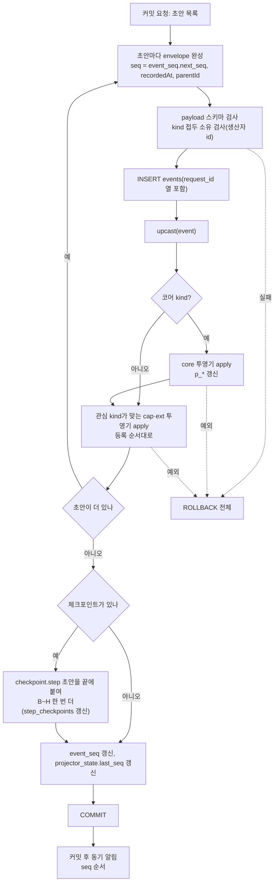
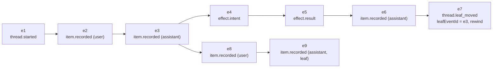

# 이벤트 설계

세션 기록의 단위인 이벤트를 다룬다. envelope 필드, 이벤트 kind 이름 규칙, 코어 카탈로그, `BlobRef`, 효과 3단과 복구 결정표의 정본은 `F.records.spec`이다(같은 문서 §3.1.2 정본 표). 이 문서는 그 계약 위에서 필드를 채우는 쪽, `seq` 순서와 구독, 내구 이벤트와 휘발 이벤트의 운용, 투영, 재생, 스키마 버전 운용을 정한다. 쓰기 트랜잭션의 단계, 커밋 키(`requestId`) 멱등, 결과 불명, outbox는 `eng.transactions.design`이 정본이다. 어느 컨텍스트가 어느 kind 접두와 테이블을 소유하는지는 `eng.context-map.design`이 정본이다.

이 문서는 구속 문서다. 마지막 절 "구현 작업자 규칙"(EV-NN)은 `xeon/packages/contracts/src/records/**`, `platform-store`, `core-persistence`, `ext-host`의 모든 구현에 적용된다. 이름(kind, 필드, ID, 테이블)은 F 문서와 `L1.persistence.spec` §2.1 이름 대응표를 따른다.

기존 Helm 설계 `docs/design/09-event-store.md`와 `12-runtime-engine.md`는 커널·홈서버 데몬 전제다. 이 문서는 그 규칙을 Xeon(대화형 런타임, 단일 DB, 프로세스 여럿)에 맞게 줄여 쓴다. 해시 체인, HMAC 체크포인트, 관찰 에이전트, 데몬 단일 쓰기 잠금은 범위에서 뺐다(12절 미결 참조).

## 1. 문제

Xeon 세션 저장소는 세 가지 일을 한다(`_research/session-storage.md` 서두).

1. 모델에 보낼 대화 이력을 다시 조립하는 원천이다.
2. 크래시나 재시작 뒤 이어서 실행하는 근거다.
3. 학습 그룹, 세션 검색, UI가 과거 대화를 읽는 자료다.

이 세 가지를 한 저장 형식으로 처리하려면 다음 질문에 답해야 한다.

- 무엇을 원본으로 저장하고 무엇을 파생물로 두는가.
- 스트리밍 토큰처럼 빈도가 높은 흐름을 저장하는가.
- 여러 구독자(UI, 학습 그룹, 세션 검색 색인)가 같은 순서로 같은 기록을 받는 방법은 무엇인가.
- 재시작 뒤 상태를 다시 만들 때 도구 실행 같은 외부 효과를 다시 일으키지 않는 방법은 무엇인가.
- 확장(L3 그룹, 사용자 플러그인)이 세션에 자기 기록을 남길 때 코어 기록과 섞이지 않게 하는 방법은 무엇인가.
- 이벤트 모양이 버전마다 바뀔 때 옛 기록을 읽는 방법은 무엇인가.

## 2. 선택지 비교

`_research/session-storage.md`의 다섯 방식 비교를 Xeon 요구에 맞춰 줄였다.

| 기준 | A. JSONL 로그 | B. JSONL 트리 | C. SQLite 이벤트 소싱 + 투영 | D. SQLite 체크포인트 | E. 외부 내구 실행 엔진 |
|---|---|---|---|---|---|
| 원본 | 줄 단위 엔트리 | 엔트리 + `parentId` | 불변 이벤트 테이블 | 실행 상태 레코드 | 엔진 저장소 |
| 여러 기록 원자 커밋 | 불가 | 불가 | 가능 | 가능 | 가능 |
| 분기·되감기 | 어려움 | 쉬움 | `parentId`로 B와 같음 | 체크포인트 선택 | 제한적 |
| 전체 이력 보존 | 예 | 예 | 예 | 중간 상태 덮어씀 | 엔진마다 다름 |
| 재생으로 상태 재구성 | 추론 필요 | 추론 필요 | 순수 함수 재생 | 불필요(덮어쓴 상태) | 핸들러 재실행 |
| 다중 구독자 순서 | 직접 구현 | 직접 구현 | `seq` 커서 | 직접 구현 | 엔진 API |
| 스키마 변경 | 읽는 쪽 전부 처리 | 같음 | 업캐스터 + 투영 재생성 | 상태 마이그레이션 | 워크플로 버전 |
| 배포 의존 | 없음 | 없음 | bun:sqlite(내장) | 같음 | Postgres·서버 |

## 3. 선택과 근거

[결정] 세션 저장은 C안이다. SQLite 이벤트 소싱과 투영, 단일 DB 파일, 확장 접두사 테이블을 쓴다(`_research/decisions-log.md` 2026-10-21 결정 2차, adr.0004).

[결정] DB 드라이버는 bun:sqlite이고 WAL을 쓴다(`_research/foundation-plan.md §2` DB 행).

근거:

- 이벤트가 원본이므로 투영 테이블(item, 파트, 효과)은 언제든 지우고 다시 만들 수 있다. 투영 규칙을 고칠 때 데이터 마이그레이션이 필요 없다.
- 효과 의도, 확장 기록, 작업 상태를 한 커밋에 넣을 수 있다. 원자 커밋 규칙은 `eng.transactions.design`이 정한다.
- `seq`가 DB 전체에서 단조 증가하고 연속이므로 구독자는 `seq` 하나로 어디까지 받았는지 표시하고 놓친 부분을 다시 읽는다(`F.records.spec` §4.1).
- D안의 장점(마지막 단계에서 바로 재개)은 C 위에 단계 체크포인트 이벤트 `checkpoint.step`과 그 투영 `step_checkpoints`를 두어 얻는다(`_research/session-storage.md` 권장안, `F.records.spec` §3.6). 체크포인트는 내구 이벤트이고 `step_checkpoints`는 그 투영이다(5.1절 7번).
- B안의 분기·되감기는 envelope의 `parentId`로 얻는다(6절).

이 문서가 정하는 것:

| 주제 | 절 | 표지 |
|---|---|---|
| envelope 필드를 채우는 쪽, envelope 밖 값 | 4.1 | [제안] |
| 내구·휘발 구분, 휘발 이벤트 운용 | 4.2, 4.3 | [결정] 구분, [제안] 운용 |
| 이벤트 분류표(소유, 생산자, 소비자) | 4.4 | [제안] |
| 이름 규칙 | 4.5 | F 규칙 인용 |
| `seq` 순서와 구독 | 4.6 | [제안] |
| 투영 규칙, 투영 버전, 불일치 검출 | 5 | [제안] |
| 분기와 되감기 | 6 | [제안] |
| 재생 규칙 | 7 | [제안] |
| 스키마 버전과 업캐스터 운용 | 8 | [제안] |

## 4. 구조와 흐름

### 4.1 envelope

[제안] envelope 모양의 정본은 `F.records.spec` §3.1이다. 스키마는 F `records` 서브패스(`@xeon/contracts/records`, 파일 `xeon/packages/contracts/src/records/envelope.ts`)에 있다. 필드 이름 `kind`, `version`, `durable`은 [결정]이다(`F.records.spec` §3.1, 사용자 지시). 기존 설계 09의 `type`, `typeVersion`, envelope 버전 `v`, `category`와 이 문서의 이전 판에 있던 `sessionId`, `producer`, `requestId`는 envelope에 두지 않는다(`F.records.spec` §3.1.1 대조표). 아래 코드는 F 정의를 옮겨 적은 것이고, 다르면 F를 따른다.

```ts
// xeon/packages/contracts/src/records/envelope.ts (F.records.spec §3.1 요약)
interface EnvelopeBase {
  id: EventId;                    // evt_<ULID>
  kind: EventKind;                // "<영역>.<이름>", 확장은 "x.<extId>." 또는 "grp.<groupId>." 접두
  version: number;                // kind별 payload 버전, 정수 ≥ 1
  threadId: ThreadId;
  turnId: TurnId | null;
  stepId: StepId | null;
  recordedAt: number;             // ms 정수
  causationId: EventId | null;
  correlationId: string | null;
  payload: unknown;               // kind·version별 스키마로 검증
}
export interface DurableEventEnvelope extends EnvelopeBase {
  durable: true;
  seq: number;                    // DB 전역 단조, 무간격
  parentId: EventId | null;       // 분기 트리 부모. thread 첫 이벤트만 null
  detached?: DetachedField[];     // blob으로 옮긴 문자열 필드
}
export interface VolatileEventEnvelope extends EnvelopeBase {
  durable: false;
  n: number;                      // (threadId, turnId) 안 조각 번호
  afterSeq: number;               // 발신 시점의 마지막 내구 seq
}
export type EventEnvelope = DurableEventEnvelope | VolatileEventEnvelope;
```

필드를 채우는 쪽:

| 필드 | 뜻 | 채우는 쪽 |
|---|---|---|
| `id` | 이벤트 전역 id. 분기와 인과 참조에 쓴다 | 생산자. 커밋 전에 주입된 `IdFactory.next("evt")`로 발급한다(`F.records.spec` §3.1 `DurableEventDraft`) |
| `kind` | 판별 필드. 4.5절 규칙 | 생산자 |
| `version` | payload 버전. 8절 | 생산자가 생략하면 저장소가 카탈로그의 현재 버전을 넣는다(`L1.persistence.spec` §3.2 `DraftInput`) |
| `durable` | 내구·휘발 판별자 | 생산자. 카탈로그의 `durable`과 같아야 한다 |
| `threadId`, `turnId`, `stepId` | 소속 thread·turn·step | 생산자 |
| `seq` | DB 전역 순번. 내구 이벤트만. 1부터, 빈칸 없음 | 저장소 |
| `recordedAt` | 기록 시각(ms 정수). DB 안에서 감소하지 않는다 | 저장소(내구), 발신자(휘발) |
| `parentId` | 같은 가지의 직전 이벤트 id. thread 첫 이벤트는 null. 6절 | 저장소(현재 leaf). 분기만 생산자가 지정한다 |
| `causationId` | 원인 이벤트 id | 생산자 |
| `correlationId` | 묶음 키. turn 범위 이벤트는 `turnId`, 효과 이벤트는 `effectId`(`F.records.spec` §4.4) | 생산자 |
| `detached` | blob으로 옮긴 문자열 필드 위치 | 저장소 커밋 0단계(`L1.persistence.spec` §4.1) |
| `n`, `afterSeq` | 휘발 조각 번호와 기준 seq | 발신자(`F.records.spec` §4.3) |
| `payload` | kind별 스키마로 검사한 본문 | 생산자 |

envelope 밖에 두는 값:

- 커밋 키(`requestId`): 그 이벤트를 쓴 커밋의 멱등 키다. 저장 열 `events.request_id`에 두고 envelope에는 넣지 않는다(`L1.persistence.spec` §3.10). 같은 커밋의 이벤트는 같은 값을 가진다. 형식과 파생 규칙은 `eng.transactions.design` 4.7·4.8절이다. 제출 멱등 키가 필요한 payload(`TurnStartedPayload.requestId`, 사용자 `ItemRecord.requestId`)는 F가 payload 필드로 둔다(`F.conversation.spec` §3.5).
- 생산자 id: 커밋을 부른 쪽의 생산자 핸들이 초안에 붙인 값(`StampedDraft.producer`, `L1.persistence.spec` §3.2)이다. 형식은 `core.<L1 도메인>`, `cap.<L2 도메인>`, `xh`, `ext.<확장 이름>`이다(`eng.context-map.design` 5.1절). F envelope에는 `producer` 필드가 없다(`F.records.spec` §3.1.1). 확장 출처는 kind 접두(`x.`/`grp.`)로 안다.

규칙:

- 저장소는 커밋 때 각 초안의 kind 접두가 그 초안의 생산자 id가 소유한 접두에 속하는지 검사한다. 소유표는 `eng.context-map.design` 5.1절이고, 코드 상수는 `xeon/packages/contracts/src/records/owners.ts`의 `TYPE_PREFIX_OWNERS`다 [제안]. 위반은 `Bug("store.prefix_not_owned")`다.
- envelope 정규화 JSON은 256 KiB(262,144바이트) 이하다(`F.records.spec` §3.4 규칙 3, `ENVELOPE_MAX_BYTES`). 그보다 큰 값은 blob으로 옮기고 payload에는 `BlobRef` 또는 자리표시만 둔다(EV-04).
- payload 안의 시각은 ms 정수다. 문자열 시각은 L4 표시 경계에서 만든다.
- [미결] 해시 체인(`prevHash`, `hash`)과 HMAC 체크포인트는 넣지 않는다. 기존 09 §3.10은 커널을 거치지 않은 편집을 찾으려고 두었지만, Xeon은 개인 데스크톱 런타임이라 같은 위협 모델을 전제하지 않는다. 넣을지는 12절 미결 E-3이고 `F.records.spec` §10 미결 1과 같은 항목이다. 넣게 되면 저장 열(`prev_hash`, `hash`)로 더하고 envelope에는 해시 필드를 두지 않는다. envelope 모양 변경은 DB 마이그레이션으로 처리한다(`F.records.spec` §3.1.1 `v` 행).

`BlobRef`의 정본은 `F.records.spec` §3.4다. 기준 크기는 EV-04다.

```ts
// xeon/packages/contracts/src/records/blob.ts (F.records.spec §3.4)
export interface BlobRef {
  type: "blob";
  sha256: string;                 // 소문자 hex 64자
  size: number;                   // 바이트, 정수 ≥ 0
  mediaType: string | null;
}
export const BlobRefSchema: Schema<BlobRef>;
```

- 내용 주소의 문자열 표기 `sha256:<hex>`는 로그와 자리표시(`blob:sha256:<hex>`, `BLOB_PLACEHOLDER_PREFIX`)에만 쓴다(`L0.store.spec` §3.1).
- blob 파일은 L0 store가 소유한다(`sys_blobs` 행 + 내용 주소 파일). blob 쓰기는 트랜잭션 전에 끝내고 fsync 후 rename한다. 순서 규칙은 `eng.transactions.design` TX-04다. `putBlob`은 `Result<BlobRef, BlobError>`를 돌려준다(`L0.store.spec` §3.1).

### 4.2 내구 이벤트와 휘발 이벤트

[결정] 내구 이벤트와 휘발 이벤트를 구분한다. 토큰 델타는 휘발로 UI에만 흘리고 완성된 파트와 item만 저장한다(`_research/session-storage.md` "방식별 장단점", 09 §3.5, 12 §3.4.4, `F.records.spec` §3.4).

| 구분 | 저장 | `seq` | 재접속 뒤 | 예 |
|---|---|---|---|---|
| 내구 | `events` 테이블에 저장 | 받는다 | `readFrom(afterSeq)`로 다시 받는다 | 완성 item·파트, 효과 의도, 효과 결과, turn 경계 |
| 휘발 | 저장하지 않음 | 없음(`n`, `afterSeq`) | 버린다. 내구 이벤트로 상태를 다시 맞춘다 | 토큰 델타, 도구 출력 진행, 단계 진행 상태 |

규칙:

- 휘발 이벤트는 발행 시점의 마지막 내구 `seq`를 `afterSeq`로 싣는다. 클라이언트는 `afterSeq`보다 작거나 같은 내구 이벤트를 아직 받지 않았다면 그 휘발 이벤트의 적용을 미룰 수 있다.
- 클라이언트가 재접속하면 쌓아 둔 휘발 상태(진행 중 텍스트)를 버리고, 자기 마지막 내구 `seq` 이후 내구 이벤트를 읽어 상태를 다시 맞춘다. 진행 중 응답은 그 응답의 완성 item(`item.recorded`)과 파트(`part.recorded`)가 커밋될 때 확정된다.
- 휘발 이벤트에는 정본 정보를 싣지 않는다. 휘발 이벤트를 하나도 받지 못한 클라이언트도 내구 이벤트만으로 같은 최종 화면을 만들 수 있어야 한다(EV-10, `F.records.spec` §4.3 2번).
- 진행 중 응답은 크래시 때 버린다. 같은 단계의 모델 요청을 다시 보낸다(12 §3.7.1 CR-7과 같다).
- [미결] 크래시 복구용 부분 출력 보존(09 §3.5 `volatile_scratch`: 도구 출력의 마지막 8 KiB를 1초에 한 번까지 운영 테이블에 덮어씀)을 둘지는 미결 E-1이다. 두게 되면 그 테이블은 이벤트도 투영도 아닌 운영 테이블이고 재생 대상이 아니다.

### 4.3 휘발 이벤트 운용

휘발 이벤트의 모양은 `F.records.spec` §3.1의 `VolatileEventEnvelope`(`durable: false`, `n`, `afterSeq`)다. 휘발 kind는 코어 카탈로그에서 `durable`이 아닌 항목이다(`turn.updated`, `step.updated`, `item.started`, `item.updated`, `F.records.spec` §3.3). 델타 전용 kind는 두지 않는다. 토큰 델타는 `item.updated`의 `update.kind: "part_delta"`, 도구 진행은 `update.kind: "tool_progress"`로 나른다(`F.conversation.spec` §3.5.3).

- 연결 값(`itemId`, `toolCallId`)은 payload 안에 둔다. 소속(`threadId`, `turnId`, `stepId`)은 envelope 공통 필드다.
- 휘발 이벤트는 저장소를 거치지 않는다. 발신자가 `SessionService.emitVolatile`(`L1.persistence.spec` §3.3)로 넣고, 피드는 `onVolatile` 리스너에 동기로 전달한다.
- 휘발 이벤트 하나의 payload는 16 KiB 이하다. 텍스트 델타는 발신자가 50 ms 단위로 묶는다(12 §3.4.4 휘발 스트림 표) [제안].

### 4.4 이벤트 분류표

[제안] 코어 kind 목록과 내구 여부, payload 스키마의 정본은 `F.records.spec` §3.3 카탈로그(`CORE_EVENT_CATALOG`)다. 이 표는 그 카탈로그에 소유 컨텍스트, 생산자 id, 소비자를 붙인 것이다. kind 접두 소유와 컨텍스트 이름은 `eng.context-map.design` 5.1절이 정본이다. payload 필드는 각 소유 spec이 정한다.

| kind | 구분 | 소유 컨텍스트(생산자 id) | 주요 payload | 소비자 |
|---|---|---|---|---|
| `thread.started` | 내구 | session-core (`core.persistence`) | 제목, 분기 원본 `forkedFrom { threadId, eventId } \| null` | 투영, UI, 세션 검색 색인 |
| `thread.updated` | 내구 | session-core | 제목·상태 변경 | 투영, UI |
| `thread.closed` | 내구 | session-core | 종료 사유 | 투영, UI |
| `thread.leaf_moved` | 내구 | session-core | `{ leafEventId, reason: "branch" \| "rewind" \| "restore" }` | 투영, 재개 |
| `thread.compacted` | 내구 | run-engine (`core.context`) | 요약, `firstKeptEventId`, `tokensBefore` | 투영, 컨텍스트 조립 |
| `thread.branch_summarized` | 내구 | session-core | 떠난 가지 요약 | 투영, 컨텍스트 조립 |
| `turn.started` | 내구 | run-engine (`core.loop`) | 입력 item id들, `requestId` | 투영, UI, 확장(on `boundary.step.before` [지점 이름은 `F.extensions.spec` §3.4 표, adr.0017]) |
| `turn.updated` | 휘발 | run-engine (`core.loop`) | 상태 | UI |
| `turn.completed` | 내구 | run-engine (`core.loop`) | 종결 상태(`completed`·`interrupted`·`failed`), step 수, 사용량, 오류 | 투영, UI, 학습 그룹 |
| `step.started` | 내구 | run-engine (`core.loop`) | `stepIndex` | 투영 |
| `step.updated` | 휘발 | run-engine (`core.loop`) | 상태 | UI |
| `step.completed` | 내구 | run-engine (`core.loop`) | 종결 상태, `stopReason`, assistant·toolResult item id | 투영, 재개 |
| `item.started` | 휘발 | run-engine (`core.loop`) | item id, 종류, 도구 호출 id | UI |
| `item.updated` | 휘발 | run-engine (`core.loop`), 도구 진행은 tool-runtime이 발신 | 파트 델타, 파트 완성, 도구 진행 | UI |
| `item.recorded` | 내구 | run-engine (`core.loop`) | `{ item: ItemRecord }` | 투영(item), 컨텍스트 조립, 세션 검색 색인 |
| `part.recorded` | 내구 | run-engine (`core.loop`) | `{ part: PartRecord }` | 투영(파트), 컨텍스트 조립 |
| `effect.intent` | 내구 | tool-runtime (`core.tools`) | `effectId`, `toolCallId`, 도구 이름, 실행 인자(모델이 낸 인자. `tool.call.before`은 인자를 바꾸지 않는다, review.decisions-2 U-06), `replay`(safe·unsafe) | 투영(효과), 재개 |
| `effect.exec` | 내구 | tool-runtime (`core.tools`) | `effectId`, `startedAt` | 투영, 재개(실행 시작 여부, 재실행 수) |
| `effect.result` | 내구 | tool-runtime (`core.tools`) | `effectId`, `status`, 구조화 출력, `blobRef`, `synthesized` | 투영, 컨텍스트 조립, 학습 그룹 |
| `checkpoint.step` | 내구 | session-core (`core.persistence`, 내용은 루프가 만든다) | `StepCheckpoint` | 투영(`step_checkpoints`), 재개 |
| `scope.changed` | 내구 | extension-host (`xh`) | `scopeId`, `status`(enabled·disabled) | 투영, ext-host |
| `lease.acquired` | 내구 | extension-host (`xh`) | `leaseId`, `scopeId`, 상한 `limits` | 투영, ext-host 재개 |
| `lease.released` | 내구 | extension-host (`xh`) | `leaseId`, `scopeId`, 사유 | 투영, ext-host |
| `settings.changed` | 내구 | session-core (`core.persistence`) | `key`, `scope`, 값(비밀은 참조만) | 투영, loop |

- `effect.result.status` 값은 `ok`, `error`, `interrupted`, `abandoned` 네 개이고 복구 규칙이 만든 결과는 `synthesized: true`다(`F.records.spec` §3.5). 이 문서의 이전 판에 있던 6값(`completed`, `failed`, `denied`, `not_executed`, `interrupted`, `outcome_uncertain`)은 쓰지 않는다. 대응은 `L1.persistence.spec` §2.1 표다. `effect.intent`가 있는 호출마다 `effect.result`는 0 또는 1건이다. `effect.intent` 전에 거부된 호출(`tool.call.before` 핸들러 거부, 정책·승인 거부)은 효과 이벤트 없이 `isError: true`인 toolResult item만 남는다(`L1.tools.spec`). 기록 규칙은 `eng.transactions.design` 5절이다.
- `turn.completed.status`는 `completed`, `interrupted`, `failed` 세 값이다(`F.conversation.spec` §3.5.3 `TurnCompletedPayload`). 승인 대기는 turn을 닫지 않는다. turn은 열린 상태(`TurnStatus` `waiting`)로 남고 `checkpoint.step`의 `pendingToolCalls[].waiting: "approval"`로 표시한다(`L1.persistence.spec` §4.2 A1). 그래서 복구 표식이 남고 재개 대상이 된다.
- `effect.intent.replay` 값은 `safe`, `unsafe`다. F `AgentTool.replay?: "never" | "safe"`(pi-agent-core `pi-src/packages/agent/src/types.ts:489-490`에서 온 필드)는 `toReplayPolicy`가 `never → unsafe`로 바꾼다(`F.conversation.spec` §3.6).
- toolResult `item.recorded`는 `effect.result`와 한 커밋(E3)에 들어간다. 커밋은 tool-runtime이 내고, item 초안은 루프의 생산자 핸들로 만든다(`L1.tools.spec` `ToolRunContext.drafts`).
- `drive` 임대 차수(`leaseEpoch`)는 `LeaseAcquiredPayload`에 필드가 없다. X는 thread 이벤트에서 scope별 `lease.acquired` 개수로 다시 계산한다(`X.primitives.spec` §4.4.1 7번). payload에 더할지는 그 문서의 [미결]이다.
- L1이 쓰는 다음 kind는 F 코어 카탈로그에 있다(`F.records.spec` §3.3): `input.queued`·`input.placed`·`input.withdrawn`(`core.tasks`, `L1.tasks.spec`), `turn.abort_requested`(`core.loop`), `approval.requested`·`approval.resolved`(`core.tools`, `L1.tools.spec` §8.3. 승인 방식은 [결정: review.decisions-2 U-02] A안), `agent.spawned`·`agent.settled`·`agent.judged`(`core.agents`, `L1.agents.spec` §8.3), `thread.resumed`(`core.persistence`, `L1.persistence.spec`). `post.accepted`는 retire했다([결정: review.decisions-2 U-05]). 확장 post도 `input.queued`(`source.type: "extension"`)로 남는다. payload 정본은 F다.
- L2 능력의 이벤트(`work.*`, `artifact.*`, `schedule.*`, `dialog.*`)와 확장 이벤트(`x.<extId>.*`, `grp.<groupId>.*`)는 각 소유 spec과 확장 매니페스트가 카탈로그를 둔다. 확장 kind는 `EventKindRegistry`로 등록한다(`F.records.spec` §3.2). 접두 소유는 `eng.context-map.design` 5.1절이다.
- thread 메타(제목)는 session-core만 쓴다. L2 artifacts가 자동 제목을 만들면 session-core 서비스 API(`threads.setTitle`)로 요청하고, 이벤트는 session-core가 쓴다.

카탈로그 항목의 코드 모양은 `F.records.spec` §3.3 `CatalogEntry { kind, version, durable, payload, retired? }`와 §3.2 `EventKindRegistration`이다. 이 문서의 이전 판에 있던 `EventTypeDef`(생산자 필드 포함)는 쓰지 않는다. 생산자 소유는 카탈로그 항목에 두지 않고 `TYPE_PREFIX_OWNERS`(`eng.context-map.design` 5.4절)로 판정한다.

### 4.5 이름 규칙

kind 이름 규칙의 정본은 `F.records.spec` §3.2다. 요약:

1. 코어 kind는 `<영역>.<이름>`이다. 점은 하나, 소문자 `snake_case`다. 영역은 `CoreArea`(`thread`, `turn`, `step`, `item`, `part`, `effect`, `checkpoint`, `scope`, `lease`, `post`, `settings`)다. 예: `effect.result`, `thread.leaf_moved`.
2. 확장 kind는 `x.<extId>.<영역>.<이름>`, 의도 그룹 kind는 `grp.<groupId>.<영역>.<이름>`이다. `extId`·`groupId`는 `ExtensionName`(`^[a-z][a-z0-9-]{1,31}$`, 하이픈 허용, 밑줄 금지. [결정: review.decisions-2 U-18])이다. 예: `grp.helm.phase.changed`, `grp.learning.counter.advanced`. 열린 유니온의 일반 규칙은 `eng.domain-types.guide` DT-08이다.
3. 내구·휘발은 이름이 아닌 카탈로그 항목의 `durable`로 정한다. 같은 kind가 내구와 휘발을 함께 갖지 않는다.
4. 금지 접두사: `ui.`, `notification.`, `projection.`. 화면 갱신과 알림은 이벤트가 아니다 [제안].
5. 벤더 이름(`pi`, `anthropic`, `openai`)을 코어 kind에 넣지 않는다.
6. kind 이름은 바꾸지 않는다. 의미가 바뀌면 `version`을 올리고 업캐스터를 둔다. 없앨 kind는 카탈로그에 `retired: true`로 남긴다.

### 4.6 순서와 구독

[제안] 순서 규칙(`F.records.spec` §4.1, `L1.persistence.spec` §3.10):

- `seq`는 DB 전체에서 1부터 단조 증가하고 빈칸이 없다. 한 커밋의 이벤트는 연속된 seq를 받는다. 저장소는 전역 수열 테이블 `event_seq`의 `next_seq`에서 seq를 받아 같은 쓰기 트랜잭션 안에서 갱신한다.
- 지운 thread의 seq는 다시 쓰지 않는다. 그래서 head를 `MAX(seq)`로 계산하지 않고 `event_seq`로 관리한다.
- 별도 전역 커서 열(`pos`)은 두지 않는다. thread 하나를 읽는 소비자와 여러 thread를 읽는 소비자가 같은 `seq`를 커서로 쓴다. thread 하나의 이벤트만 필요하면 `readFrom(afterSeq, { threadId })`로 거른다.
- 크래시 뒤에도 `seq`는 이어진다. 새 이벤트의 seq는 직전 커밋의 마지막 seq + 1이다.
- seq는 저장소가 매기므로 일반 커밋은 같은 seq를 두 번 쓰지 않는다. seq가 정해진 이벤트를 넣는 경로(2차 `SessionStore` 어댑터의 가져오기)에서만 같은 seq의 기존 행과 정규화 envelope 바이트를 비교해, 같으면 멱등 재전송으로 보고 다르면 `Bug("store.replay_diverged")`로 보고한다(opencode v2 bus.ts의 "Replay diverged" 검사, `_research/refs/opencode.md`, `L1.persistence.spec` §4.5.3).

구독 인터페이스의 정본은 `L1.persistence.spec` §3.3·§3.5(`SessionService`, `CommitBatch`, `CommitListener`, `FeedFilter`, `EventFeed`)다. 요약:

```ts
// xeon/packages/contracts/src/records/session-service.ts (L1.persistence.spec §3.3, §3.5 요약)
export interface CommitBatch {
  readonly firstSeq: number;
  readonly lastSeq: number;
  readonly events: readonly DurableEventEnvelope[];
}
export type CommitListener = (batch: CommitBatch) => void;

export interface SessionService {
  /** afterSeq보다 큰 seq를 오름차순으로. threadId를 주면 그 thread만 */
  readFrom(afterSeq: number, options?: { readonly threadId?: ThreadId; readonly limit?: number }): AsyncIterable<DurableEventEnvelope>;
  /** afterSeq 이후 내구 이벤트를 커밋 순서로. 따라잡기와 실시간을 같은 동기 구간에서 잇는다 */
  subscribe(afterSeq: number, listener: CommitListener, filter?: FeedFilter): Unsubscribe;
  /** 휘발 이벤트 전달. 저장하지 않는다 */
  emitVolatile(event: VolatileEventEnvelope): void;
  readonly feed: EventFeed;   // headSeq(), read(...), onCommit(...), onVolatile(...)
  // 그 밖의 메서드는 L1.persistence.spec §3.3
}
```

- 커밋 후 알림은 커밋한 그 JS 턴 안에서 동기로 부른다. 다른 쓰기가 사이에 끼지 않으므로 구독자는 `seq` 순서대로 받는다(09 §3.8.4 8단계). 알림 단계의 자세한 규칙은 `eng.transactions.design` 4.5절과 7절이다.
- `subscribe`의 따라잡기 구간과 실시간 구간 사이에 빈칸이나 중복이 생기지 않게, 피드는 따라잡기 읽기와 리스너 등록을 같은 동기 구간에서 한다. 그래도 구독자는 `seq`로 중복을 거른다(EV-05).
- 다른 프로세스가 쓴 이벤트(공유 서비스 모드가 아닌 상태에서 CLI와 데스크톱이 같은 DB를 열 때)는 실시간 알림이 없다. 관찰 쪽은 `feed.headSeq()`를 주기적으로 읽어 `feed.read`로 따라잡는다 [제안](`L1.persistence.spec` §4.6, `L4.host-service.spec` HS-16). 다중 프로세스 규칙은 `eng.transactions.design` 3.3절이다.

## 5. 투영

### 5.1 규칙

[제안]

1. 투영은 이벤트의 순수 함수다. `apply(tx, event)`는 쓰기 트랜잭션 핸들과 이벤트만 입력으로 받는다. 시계, 난수, 네트워크, 파일, 환경 변수를 쓰지 않는다(EV-06).
2. 투영은 같은 커밋 트랜잭션 안에서 갱신한다. 투영 예외는 커밋 전체를 롤백한다. 투영 실패는 버그로 보고 이벤트를 저장하지 않는다.
3. 투영 테이블은 모두 지우고 `events` 전체를 재생해 다시 만들 수 있어야 한다. 투영에만 있고 이벤트에서 나오지 않는 값은 두지 않는다.
4. 투영 스키마 버전(`Projector.version`)은 이벤트 payload 버전과 독립이다. 투영 규칙이나 테이블 모양이 바뀌면 투영 버전만 올리고, 다음 열기 때 그 투영기의 테이블만 다시 만든다(09 §3.13.2, `F.records.spec` §3.7 규칙 5).
5. 투영기는 자기 소유 테이블만 쓴다. 코어 투영기 `core`는 `p_*`와 `step_checkpoints`, L2 능력 투영기 `cap.<도메인>`은 `cap_<도메인>_*`, 확장 투영기 `ext.<확장 이름>`은 `x_<확장 이름의 '-'를 '_'로>_*`다. 지역 테이블 이름에는 밑줄을 쓰지 않는다(`eng.context-map.design` 5.2절, `L1.persistence.spec` §4.5.2).
6. 투영기는 어떤 kind의 이벤트든 읽을 수 있다. 예를 들어 학습 그룹 투영기는 `effect.result`를 세어 `x_learning_*`에 쓴다. 다른 컨텍스트의 테이블은 읽지도 쓰지도 않는다.
7. 단계 체크포인트는 내구 이벤트 `checkpoint.step`이다(`F.records.spec` §3.6). 커밋 계획에 체크포인트가 있으면 저장소가 `checkpoint.step` 초안을 그 커밋 끝에 붙이고, 코어 투영기가 `step_checkpoints` 행을 갱신한다(`L1.persistence.spec` §4.1 8단계). `step_checkpoints`는 다른 투영 테이블과 같이 재생으로 다시 만들 수 있다. 체크포인트 레코드의 `schemaVersion`(`STEP_CHECKPOINT_SCHEMA_VERSION`)이 현재와 다르면 그 체크포인트를 쓰지 않고 이전 이벤트를 재생해 루프 상태를 만든다.

투영기와 투영 트랜잭션 핸들의 정본은 `L1.persistence.spec` §3.4다(F 이동 요청 FR-P1). 요약:

```ts
// xeon/packages/contracts/src/records/projector.ts (L1.persistence.spec §3.4 요약)
export type SqlValue = string | number | bigint | Uint8Array | null;
export type SqlRow = Readonly<Record<string, SqlValue>>;

/** 투영기가 쓰는 SQL 핸들. 소유 테이블 밖을 건드리는 문장은 테스트·디버그 빌드에서 거부한다 */
export interface ProjectionTx {
  run(sql: string, params?: readonly SqlValue[]): void;
  get(sql: string, params?: readonly SqlValue[]): SqlRow | undefined;
  all(sql: string, params?: readonly SqlValue[]): readonly SqlRow[];
}

export interface Projector {
  /** "core" | "cap.<도메인>" | "ext.<확장 이름>" */
  readonly name: string;
  /** 투영 규칙 버전. payload version과 독립 */
  readonly version: number;
  /** 소유 테이블 이름. 접두사 검사 대상 */
  readonly tables: readonly string[];
  /** 소유 테이블 DDL. 재생성 때 이 순서로 실행한다 */
  readonly ddl: readonly string[];
  /** 관심 kind. "all"이면 모든 내구 이벤트 */
  readonly kinds: readonly EventKind[] | "all";
  /** 업캐스트된 이벤트를 받는다. 순수 함수 */
  apply(tx: ProjectionTx, event: DurableEventEnvelope): void;
}
```

- `ProjectionTx`의 소유 테이블 검사 방법(SQL 문장의 테이블 이름 추출 규칙)은 `L1.persistence.spec` §4.5.2와 `L0.store.spec`이 정한다(테스트·디버그 빌드에서 식별자 추출 + 소유 접두사 대조, 운영 빌드에서는 끔).

### 5.2 코어 투영 테이블

[제안] 코어 투영기 `core`(L1 persistence 소유)가 갱신하는 테이블이다. 테이블 이름, 열, DDL의 정본은 `L1.persistence.spec` §3.10이다.

| 테이블 | 내용 | 갱신하는 kind |
|---|---|---|
| `p_threads` | thread 행: 제목, 상태, 생성 시각, head `seq`, 현재 leaf 이벤트 id, 포크 출처, 열린 turn과 복구 표식 | `thread.*`, `turn.started`, `turn.completed`, 모든 내구 이벤트(head·leaf) |
| `p_items` | item 행: `itemId`, 이벤트 id, 부모 이벤트 id, `turnId`, 종류, 상태, `seq` | `item.recorded` |
| `p_parts` | item 파트: 순번, 종류, 텍스트 또는 blob 해시 | `part.recorded` |
| `p_effects` | 효과: `toolCallId`, `replay`, 의도 `seq`, exec 수, 결과 `seq`, 결과 상태, `synthesized` | `effect.*` |
| `p_turns` | turn: 상태, 시작·종료 `seq`, 취소 의도 `seq`, step 수 | `turn.*`, `step.completed` |
| `p_inputs` | 내구 입력 큐: 상태(queued·placed·withdrawn), 모드 | `input.*` |
| `p_approvals` | 승인 대기 | `approval.*` |
| `p_agents` | 자식 thread 연결과 소유자 | `agent.*` |
| `p_scopes` | 확장 scope 켜짐 상태와 drive 임대 | `scope.changed`, `lease.*` |
| `p_settings` | thread 범위 설정 값 | `settings.changed` |
| `p_blob_refs` | thread가 참조하는 blob 해시 | `detached`가 있는 이벤트, `BlobRef` 필드가 있는 `effect.*` |
| `step_checkpoints` | thread별 마지막 단계 체크포인트 | `checkpoint.step` |

### 5.3 투영 갱신 순서



- 한 이벤트에 대해 코어 투영기를 먼저 적용하고 cap·ext 투영기를 그 뒤에 적용한다. cap·ext 투영기 사이 순서는 등록 순서이고, 서로의 테이블을 읽지 않으므로 순서가 결과에 영향을 주지 않는다.
- 비동기 소비자(세션 검색 FTS 색인 등)는 이 순서도 밖이다. 커밋 뒤 `consumer_cursors`의 `seq`부터 읽어 자기 테이블을 채운다(`eng.transactions.design` 7절).

### 5.4 재생성과 불일치 검출

재생성 알고리즘:

```text
rebuild(projector P):                         // thread 열기 전, 또는 관리 명령. 쓰기를 받기 전에만
  BEGIN IMMEDIATE
  for t in P.tables: DROP TABLE IF EXISTS t
  for s in P.ddl:    exec s
  for batch in SELECT envelope FROM events WHERE seq > k ORDER BY seq LIMIT 5000:
    for row in batch:
      ev = upcastEvent(parse(row), registry)
      if P.kinds == "all" or ev.kind in P.kinds: P.apply(tx, ev)
  UPSERT projector_state(P.name, P.version, last_seq = head seq)
  COMMIT
```

- 열기 때 `projector_state.version ≠ P.version`이거나 `last_seq ≠ head seq`이면 그 투영기만 재생성한다(`L1.persistence.spec` §4.5.3). 이벤트가 많을 때의 청크 재생성도 그 절이 정한다.
- 이벤트가 많아 재생성이 길어지면 진행률은 운영 로그로 낸다. thread가 열리기 전이라 휘발 이벤트 구독자가 없다.

[제안] 불일치 검출(opencode v2 방식의 Xeon 판):

1. 재전송 검사: 4.6절의 같은 `seq` 바이트 비교(가져오기 경로만). 다르면 `replay_diverged`.
2. 투영 대조: `verifyProjections(projector)`가 메모리 DB에 같은 DDL로 빈 테이블을 만들고 `events`를 재생한 뒤, 운영 DB의 소유 테이블과 행을 기본 키 순으로 정렬해 해시를 비교한다. 다르면 투영기 버그다.
3. 투영 대조는 `core-persistence`와 각 투영기 패키지의 단위 테스트 도우미(`@xeon/core-persistence/testing`의 `expectProjectionsRebuildable`)로 모든 투영 테스트 끝에 실행한다. 운영 명령(`xeon debug verify-projections`)은 2차다.

## 6. 분기와 되감기

[제안] `parentId`로 한 thread 안 가지를 표현한다(pi·oh-my-pi의 JSONL 트리와 같은 모양, `_research/session-storage.md` B안). 규칙의 정본은 `F.records.spec` §4.6이다.

- 보통 이벤트의 `parentId`는 저장소가 채우는 현재 leaf 이벤트 id다. 한 커밋 안에서는 앞 이벤트가 뒤 이벤트의 부모다. 새 이벤트가 커밋되면 그 이벤트가 새 leaf가 된다.
- 되감기와 가지 이동은 `thread.leaf_moved { leafEventId, reason }` 이벤트 하나로 한다. 이 이벤트의 `parentId`는 그때의 현재 leaf이고, 커밋 뒤 leaf는 payload의 `leafEventId`다(`L1.persistence.spec` §4.1). 다음 쓰기는 `leafEventId`를 부모로 삼아 새 가지가 된다. 되감은 지점 뒤의 이벤트는 지우지 않는다. 다른 가지로 남는다.
- 활성 가지 = leaf에서 `parentId`를 따라 올라간 사슬이다. 컨텍스트 조립(L1 context)과 item 투영의 "현재 대화" 조회(`query.branchItems`)는 이 사슬만 쓴다. 투영은 모든 가지의 행을 갖고, 조회가 사슬로 거른다.
- `seq`는 가지와 무관하게 DB 전체에서 계속 단조 증가한다. 구독자는 가지를 몰라도 `seq`로 모든 이벤트를 받는다.
- 다른 thread로 분기(fork)는 새 thread를 만들고 첫 이벤트 `thread.started`에 포크 출처 `forkedFrom { threadId, eventId }`를 둔다. 새 thread는 출처 이벤트를 복사하지 않는다. 컨텍스트 조립은 출처 thread의 `eventId`까지 활성 사슬을 앞에 잇는다. 포크가 참조하는 thread는 지울 수 없다(삭제 요청은 `has_forks`로 거부한다, `L1.persistence.spec` §3.8) [제안].
- 파일 되돌리기(L1-f "되감기" 2차의 파일 스냅샷 복원)는 이벤트 가지와 별개의 외부 효과다. 파일 복원은 도구처럼 의도 → 실행 → 결과로 기록한다.



그림의 화살표는 `parentId` 관계(부모 → 자식)다. 이벤트 번호는 커밋 순서이고, seq는 다른 thread의 이벤트와 섞여 연속하지 않을 수 있다. e7 커밋 뒤 leaf는 e3이고, e8은 e3을 부모로 받는다. 활성 가지는 e9 → e8 → e3 → e2 → e1이다. e4~e7은 다른 가지로 남는다.

## 7. 재생

### 7.1 재생 규칙

[제안] 재생은 저장된 이벤트로 상태를 다시 만드는 일이다. 효과를 다시 일으키지 않는다.

1. 재생은 도구를 다시 실행하지 않는다. 종결된 효과는 기록된 `effect.result`로 상태만 재구성한다.
2. 재개(새 쓰기 소유자가 thread를 열어 실행을 잇는 일) 때에만 열린 효과(`effect.intent`가 있고 `effect.result`가 없는 효과)에 재생 정책을 적용한다. 결정표의 정본은 `F.records.spec` §3.5 `decideEffectRecovery`이고, 재실행 상한을 더한 판정은 `L1.persistence.spec` §3.7 `decideOpenEffect`다. 기록 규칙은 `eng.transactions.design` 5절이다.
3. `on` 핸들러(fold `tap`, `first`, `chain`)는 재실행해도 되는 질의여야 한다. 이 절과 EV-08의 지점 이름(`tool.call.before`, `boundary.step.after`)은 `F.extensions.spec` §3.4 표의 이름이다(adr.0017). 재생 때 과거 이벤트에 대해 핸들러를 다시 부르지 않는다. 특히 재개 때 열린 효과를 다시 실행해도 `tool.call.before`류(`first` 지점)를 다시 부르지 않고 `effect.intent`에 저장된 최종 인자를 쓴다(durable `spec.md` 2636-2660 훅 표의 "a crash before the consuming commit may rerun them", 3136-3170의 "Recovery does not rerun `beforeTool`"). 크래시가 소비 커밋 전에 났다면 그 지점은 아직 커밋되지 않았으므로 정상 경로로 핸들러가 다시 불린다. 의도 없는 toolCall이 재개 때 정상 파이프라인을 다시 지나는 경우가 이것이다(`L1.persistence.spec` §4.7.4). 그래서 핸들러는 재실행 가능한 질의여야 한다.
4. `drive` 함수는 마지막으로 커밋된 scope 상태로 다시 호출할 수 있어야 한다(`_research/ext-points.md §5` 안 1, 재생·토글 보장). 재개 때 ext-host는 열린 임대(`lease.acquired` 뒤 `lease.released`가 없음)가 있는 scope의 drive 함수를 다음 경계에서 그 상태로 다시 부른다(`X.primitives.spec` §4.4.3). 클로저 지역 변수에 둔 상태는 잃는다(EV-09).
5. `post`는 (scopeId, requestId)로 멱등이다(`X.primitives.spec` `InputQueuePort`). 재개 뒤 같은 `post`가 다시 와도 입력이 두 번 들어가지 않는다.
6. 확장 투영기가 없는(제거된) 확장의 이벤트는 재생 때 코어 투영기가 건너뛴다. 그 확장의 `x_*` 테이블은 갱신되지 않는다. 확장을 다시 설치하면 그 투영기만 재생성한다.

### 7.2 재개 알고리즘

단계별 책임(누가 무엇을 쓰는가)의 정본은 `L1.persistence.spec` §4.8.1이다. 이 절은 이벤트 쪽 순서만 적는다.

```text
resume(threadId):                                       // 쓰기 소유를 얻은 뒤. eng.transactions.design 3.3절
  1. 버전 검사 (8.3절). 실패하면 읽기 전용으로 연다
  2. 투영 버전 검사. 맞지 않는 투영기만 rebuild (5.4절)
  3. cp = loadCheckpoint(threadId)                       // 마지막 checkpoint.step(투영 step_checkpoints)
     state = cp ? fromCheckpoint(cp) : initialLoopState(threadId)
  4. for ev in 활성 가지에서 cp.leafEventId 뒤 내구 이벤트:   // 체크포인트가 없으면 thread 처음부터
       state = reduceLoopState(state, upcastEvent(ev))   // 순수 함수. 효과 없음
  5. aborting = 열린 turn에 turn.abort_requested가 있음(또는 소유 사슬 취소)
  6. for e in state.openEffects:                          // effect.intent 있음, effect.result 없음
       d = decideOpenEffect(e)                            // F decideEffectRecovery + 재실행 상한
       aborting이면 d가 rerun이어도 재실행하지 않는다:
         effect.exec 없음 → not_started, 있음 → outcome_unknown
       synthesize → effect.result{synthesized:true} + toolResult item.recorded 한 커밋(키 tool:<toolCallId>:result)
       rerun      → 재개 계획에 싣는다. 실행 때 effect.exec(키 tool:<toolCallId>:exec:<attempt>) 커밋,
                    저장된 인자로 실행, effect.result(키 tool:<toolCallId>:result)
  7. 의도 없는 toolCall과 승인 대기 → 재개 계획의 pendingToolCalls, pendingApprovals(L1.persistence.spec §4.7.4)
  8. aborting이면 → 재개하지 않는다. 소유 작업 정착 확인 뒤 turn.completed{status:"interrupted"}
  9. 열린 drive 임대가 있고 scope가 켜져 있으면 → 다음 경계에서 drive(loop, lastCommittedScopeState) 재호출
 10. 입력 큐(p_inputs)에 queued 항목이 있으면 → 자동 재개 설정에 따라 다음 turn을 시작하거나 대기
```

- 취소 판정(5단계)은 열린 효과 처리(6단계)보다 앞이다. 사용자가 취소한 turn의 `safe` 효과가 크래시 뒤 다시 실행되면 안 되기 때문이다(`eng.transactions.design` 6.2절 7번, `L1.persistence.spec` §4.8.1).
- `reduceLoopState`는 `core-loop`이 소유하는 순수 함수다. 체크포인트는 이 함수의 결과를 빨리 얻기 위한 이벤트이며, `step_checkpoints`를 지우고 재생해도 같은 결과가 나와야 한다.
- 이 문서의 이전 판에 있던 `tool.replay_started` 이벤트는 두지 않는다. 재실행 수는 `effect.exec` 건수로 센다(재실행 수 = `max(0, execCount - 1)`, `L1.persistence.spec` §4.7.3).
- 자동 재개는 기본으로 꺼 둔다(층 구성 계획 v2 L0-e "복구 표식", adr.0006 §6 [미결]). 설정 키는 `l1.persistence.autoResume`, `l1.persistence.maxResumeAttempts`뿐이다([결정: review.decisions-2 S-03], `L1.persistence.spec` §6). 꺼져 있으면 7단계까지만 하고, 다음 turn은 사용자 입력이 들어올 때 시작한다.

## 8. 스키마 버전

### 8.1 버전 규칙

[제안] 09 §3.13.3의 여섯 규칙을 줄여 쓴다(`F.records.spec` §3.7).

1. payload 버전(`version`)은 kind마다 따로 둔다. envelope 형식 버전 필드는 두지 않는다. envelope 모양 변경은 DB 마이그레이션으로 처리한다(`F.records.spec` §3.1.1 `v` 행). DB 스키마 버전(`user_version`, `sys_migrations`)과 payload `version`은 따로 간다.
2. 저장된 이벤트를 제자리에서 고쳐 쓰지 않는다. `events` 테이블에는 UPDATE·DELETE를 막는 트리거를 둔다. 예외는 thread 삭제(사용자 명령) 한 경로이고, 그때는 `thread_delete_guard` 표지 아래에서 thread 단위로 이벤트와 투영 행을 함께 지운다(`L1.persistence.spec` §3.10, §4.10.5).
3. 형식 변환은 업캐스터, 데이터 정정은 새 이벤트로 한다. 둘을 섞지 않는다.
4. 투영 스키마는 이벤트 스키마와 독립 버전을 가진다(5.1절 4).
5. 업캐스터는 순수 함수다. `vN → vN+1` 한 단계씩 연결한다.

### 8.2 업캐스터

업캐스터 타입, 등록 표(`KindVersioning`, `UpcasterRegistry`), 적용 함수의 정본은 `F.records.spec` §3.7이다.

```ts
// xeon/packages/contracts/src/records/versioning.ts (F.records.spec §3.7 요약)
/** version을 current까지 올린 사본을 돌려준다. 저장된 행은 바꾸지 않는다. */
export function upcastEvent(event: DurableEventEnvelope, registry: UpcasterRegistry): UpcastResult;
// UpcastError: unknown_kind | future_version | missing_upcaster
```

- `upcastEvent`는 투영기와 `reduceLoopState`에 넘기기 전에 한 번 부른다. 투영기와 리듀서는 현재 버전 payload만 처리한다.
- "옛 스키마로 `parse` → 새 객체 → 현재 스키마로 `parse`" 절차는 `eng.domain-types.guide` DT-11이 정본이다.
- 커밋 경로와 재생 경로에서 `upcastEvent`가 `err`를 돌려주면 저장된 데이터와 코드가 맞지 않는 것이다. 커밋 경로에서는 `Bug`로 던져 롤백하고, 열기 경로에서는 그 thread를 읽기 전용으로 연다.
- 등록이 해제된 확장 kind(`unknown_kind`)를 투영에서 건너뛸지는 `F.records.spec` §10 미결 5다. 이 문서는 8.3절 표의 처리를 [제안]한다(`L1.persistence.spec` §4.12와 같다).
- 업캐스터 단위 테스트는 버전마다 고정 입력과 기대 출력 쌍을 둔다(`eng.testing.guide`).

### 8.3 모르는 kind와 더 높은 버전

[제안] thread를 쓰기 모드로 열기 전에 검사한다.

| 경우 | 동작 |
|---|---|
| 코어 영역(접두 없음)의 모르는 kind | thread를 쓰기 모드로 열지 않는다. 읽기 전용으로 열고 "더 새 Xeon이 쓴 세션"을 알린다(`StoreError` `{ kind: "read_only", reason: "unknown_event_kind" }`, `L1.persistence.spec` §3.2) |
| 카탈로그보다 높은 `version` | 같다(`{ kind: "read_only", reason: "newer_event_version" }`) |
| 설치되지 않은 확장의 `x.<extId>.*`, `grp.<groupId>.*` kind | thread를 쓰기 모드로 연다. 코어는 그 이벤트를 건너뛴다. 확장 상태는 확장이 다시 설치될 때 재생성한다 |
| 설치된 확장보다 높은 확장 `version` | 그 확장만 이 thread에서 끈다(`scope.changed` 없이 메모리에서). thread는 쓰기 모드로 연다 |

- 건너뛰고 쓰기를 받으면 투영이 틀린 상태에서 새 이벤트가 쌓인다. 그래서 코어 kind는 거부한다(09 §3.13.3 규칙 6).
- 읽기 전용 열기와 JSONL 내보내기는 이 검사 없이 할 수 있다.

## 9. 결과로 생기는 제약

- 모든 세션 상태 변경은 내구 이벤트로 남는다. 투영 테이블에 직접 쓰는 코드는 투영기뿐이다.
- 투영기와 `reduceLoopState`는 I/O를 하지 않으므로, 투영에 필요한 값(파일 해시, 현재 시각)은 생산자가 이벤트 payload에 넣는다.
- 큰 도구 출력은 blob으로 가므로 컨텍스트 조립은 blob 읽기를 거친다. blob 읽기는 L0 store 서비스가 한다.
- 확장 상태는 확장 이벤트(`x.<name>.state.committed`, `grp.<name>.state.committed`, `X.primitives.spec` §4.6.1)와 확장 투영으로만 남는다. 그래서 확장 상태도 분기·되감기·재개를 따라간다(층 구성 계획 v2 L3-a "그룹 상태 레코드: 재개와 분기를 따라갑니다").
- 사람이 바로 읽는 형식이 없다. JSONL 내보내기로 보완한다(형식은 미결 E-2).
- 해시 체인이 없으므로 DB 파일을 직접 고친 변조는 찾지 못한다. `seq` 연속성 검사와 UPDATE·DELETE 금지 트리거만 둔다.

마일스톤 배치:

| 항목 | M0 | M1 | M2 이후 |
|---|---|---|---|
| envelope, 카탈로그, 업캐스터 틀(F records) | 예(contracts) | | |
| `events`·`event_seq` 테이블, `seq` 발급, 소유 접두 검사, 트리거 | 예(platform-store, core-persistence) | | |
| 코어 투영기 `core`, 재생성, 투영 대조 테스트 도우미 | 예 | | |
| 피드(`subscribe`, `readFrom`, 휘발 전달) | | 예 | |
| 재개 알고리즘, `reduceLoopState`, `checkpoint.step` | | 예 | |
| 분기(fork), 되감기 | | 되감기(`thread.leaf_moved`)만 | fork, 파일 스냅샷 |
| JSONL 내보내기, `verify-projections` 명령 | | | 예 |

## 10. 구현 작업자 규칙

각 규칙은 `xeon/packages/contracts/src/records/**`, `platform-store`, `core-persistence`, `ext-host`, 그리고 이벤트를 쓰거나 투영하는 모든 패키지에 적용된다. 위반은 리뷰에서 반려한다. 강제 수단은 각 규칙에 적었다. 예제의 `session`은 `SessionService`(`xeon.session`), `CommitRequest`의 모양은 `L1.persistence.spec` §3.2다. 예제는 envelope 필드 일부를 `/* … */`로 줄였다.

### EV-01 이벤트는 불변이다

이유: 이벤트가 원본이다. 저장된 행을 고치면 투영 재생성 결과가 과거 화면과 달라지고, 구독자가 받은 내용과 DB가 어긋난다. 고칠 일이 생기면 새 이벤트로 정정한다.

강제: `events` 테이블 UPDATE·DELETE 금지 트리거(thread 삭제 경로만 `thread_delete_guard`로 통과), 리뷰.

좋은 예:

```ts
// 제목 정정은 새 이벤트로 (persistence는 session-core의 ProducerHandle)
session.commit({
  threadId,
  requestId: `title:${threadId}:${requestKey}`,
  fingerprintSource: { title },
  build: () => ({
    kind: "append",
    drafts: [persistence.draft({ id: ids.next("evt"), kind: "thread.updated", threadId, payload: { title } /* … */ })],
    checkpoint: null,
  }),
});
```

나쁜 예:

```ts
// 저장된 이벤트 payload를 제자리 수정
tx.run("UPDATE events SET envelope = json_set(envelope, '$.payload.title', ?) WHERE id = ?", [title, id]);
```

### EV-02 토큰마다 이벤트를 쌓지 않는다

이유: 토큰 델타를 저장하면 한 응답에 수천 행이 생기고 커밋마다 fsync가 일어난다(`synchronous=FULL`). 재생도 느려진다. 델타는 휘발로 보내고 완성된 item과 파트만 저장한다.

강제: `emitVolatile`은 카탈로그에서 `durable: false`인 kind만 받고, 커밋은 `durable: true`인 kind만 받는다(어기면 `Bug`). 카탈로그 검사 테스트는 내구 kind의 payload 스키마에 델타 필드가 없는지 확인한다.

좋은 예:

```ts
// 스트림 중: 휘발
session.emitVolatile({ durable: false, kind: "item.updated", threadId, turnId, n, afterSeq: head,
  payload: { itemId, update: { kind: "part_delta", delta } } /* … */ });
// 완성 뒤: 내구(assistant item.recorded + part.recorded, 한 커밋 C3)
session.commit({ threadId, requestId: `resp:${turnId}:${stepIndex}`, fingerprintSource: msg, build: () => appendAssistant(msg) });
```

나쁜 예:

```ts
for await (const ev of stream) {
  if (ev.type === "text_delta") {
    session.commit({ threadId, requestId: `tok:${itemId}:${n++}`, fingerprintSource: ev, build: () => appendDelta(ev) });
  }
}
```

### EV-03 kind 이름은 규칙을 따르고 소유 접두 안에서만 만든다

이유: 이름 규칙이 하나여야 소유 검사를 정규식과 표 조회로 할 수 있다. 다른 컨텍스트의 접두로 이벤트를 만들면 그 컨텍스트의 투영과 재생이 모르는 이벤트를 받는다.

강제: `ProducerHandle.draft`와 저장소 커밋의 kind 접두 소유 검사(`TYPE_PREFIX_OWNERS`, `eng.transactions.design` 4.2절), `parseEventKind`(`F.records.spec` §3.2), 카탈로그 검사 테스트.

좋은 예:

```ts
// L3 Helm 그룹: 자기 접두 (helm은 ext-host가 만든 생산자 "ext.helm" 핸들)
helm.draft({ id: ids.next("evt"), kind: "grp.helm.phase.changed", threadId, causationId: turnCompletedId,
  payload: { from: "diverge", to: "converge" } /* … */ });
```

나쁜 예:

```ts
helm.draft({ kind: "helmPhaseChanged", /* … */ });       // 이름 규칙 위반 → malformed
helm.draft({ kind: "turn.phase_changed", /* … */ });     // L3가 run-engine 접두 사용 → store.prefix_not_owned
helm.draft({ kind: "effect.result", /* … */ });          // 확장이 코어 결과를 위조 → store.prefix_not_owned
```

### EV-04 큰 값은 blob 해시로 참조한다

이유: envelope은 256 KiB 이하다. 큰 도구 출력과 첨부를 인라인으로 두면 `events` 테이블이 커지고 재생과 구독 전송이 느려진다. 내용 주소 blob은 같은 내용을 한 번만 저장한다.

[제안] 기준: payload 안 문자열·바이트 값 하나가 16 KiB를 넘으면 blob으로 옮긴다. envelope 전체 256 KiB 초과는 커밋 거부(`store.event_too_large`).

강제: 저장소의 envelope 크기 검사(`checkEnvelopeSize`), payload 스키마의 `maxLength`.

좋은 예:

```ts
const put = store.putBlob(outputBytes, "text/plain");      // 트랜잭션 전에 파일 fsync + rename
if (!put.ok) return put;
const draft = tools.draft({ kind: "effect.result", causationId: intentEventId,
  payload: { effectId, status: "ok", resultItemId, output, blobRef: put.value, durationMs, synthesized: false } /* … */ });
```

나쁜 예:

```ts
const draft = tools.draft({ kind: "effect.result",
  payload: { effectId, status: "ok", output: { structuredContent: hugeStdout, terminate: false } } /* … */ });
```

### EV-05 소비자는 `seq`로 중복을 거른다

이유: 구독은 at-least-once다. 따라잡기와 실시간 구간 경계, 재시작 뒤 커서 재읽기에서 같은 이벤트가 두 번 올 수 있다. 소비자가 `seq`로 거르면 중복이 상태에 들어가지 않는다. `seq`는 DB 전역이므로 thread 하나를 읽든 여럿을 읽든 커서는 `seq` 하나다.

강제: 소비자 단위 테스트에 "같은 배치 두 번 전달" 사례를 둔다(`eng.testing.guide`).

좋은 예:

```ts
const listener: CommitListener = (batch) => {
  for (const ev of batch.events) {
    if (ev.seq <= this.lastSeq) continue;
    this.apply(ev);
    this.lastSeq = ev.seq;
  }
};
```

나쁜 예:

```ts
const listener: CommitListener = (batch) => {
  for (const ev of batch.events) this.count += ev.kind === "effect.result" ? 1 : 0;   // 중복 전달 때 두 번 센다
};
```

### EV-06 투영 코드는 I/O를 하지 않는다

이유: 투영은 재생으로 다시 만들 수 있어야 한다. 시계, 난수, 파일, 네트워크를 쓰면 재생 결과가 처음과 달라진다. 투영 안 I/O는 쓰기 트랜잭션도 늘린다.

강제: 투영기 파일에 `no-restricted-globals`(`Date`, `Math.random`, `fetch`)와 `no-restricted-imports`(`node:fs`, `bun`) lint 규칙을 건다 [제안: 경로 패턴 `**/projectors/**`]. 5.4절 투영 대조 테스트.

좋은 예:

```ts
apply(tx: ProjectionTx, ev: DurableEventEnvelope): void {
  if (ev.kind !== "turn.completed") return;
  const r = parse(TurnCompletedPayloadSchema, ev.payload);    // upcast 뒤 현재 버전 스키마 (DT-05)
  if (!r.ok) throw new Bug("turn.completed payload does not match current schema", { cause: r.error });
  tx.run("UPDATE p_turns SET status = ?, completed_seq = ? WHERE turn_id = ?",
    [r.value.status, ev.seq, ev.turnId]);
}
```

나쁜 예:

```ts
apply(tx: ProjectionTx, ev: DurableEventEnvelope): void {
  tx.run("UPDATE p_turns SET completed_at = ? WHERE turn_id = ?", [Date.now(), ev.turnId]);   // 재생마다 값이 바뀜
}
```

### EV-07 payload 모양을 바꾸면 `version`을 올리고 업캐스터를 더한다

이유: 옛 thread의 이벤트는 옛 모양 그대로 남는다. 업캐스터 없이 스키마만 바꾸면 옛 thread를 열 때 검사 실패나 잘못된 투영이 생긴다.

강제: 카탈로그 테스트가 `KindVersioning`의 `current - 1 === upcasters.length`를 검사한다(`F.records.spec` §3.7). 스키마 변경 PR은 업캐스터 고정 입력 테스트를 함께 둔다.

좋은 예:

```ts
// 가상의 v2: TurnCompletedPayload에 필드 이름 변경이 있었다고 할 때
export const TurnCompletedVersioning: KindVersioning = {
  current: 2,
  upcasters: [(p) => {
    const v1 = parse(TurnCompletedPayloadV1Schema, p);
    if (!v1.ok) throw new Bug("turn.completed v1 payload invalid", { cause: v1.error });
    return { ...v1.value, stepCount: v1.value.steps };
  }],
};
```

나쁜 예:

```ts
// payload 필드를 바꾸면서 version도 업캐스터도 그대로
export const TurnCompletedVersioning: KindVersioning = { current: 1, upcasters: [] };
```

- F의 `Upcaster` 타입(`(payload: unknown) => unknown`, `F.records.spec` §3.7)과 `eng.domain-types.guide` DT-11의 `Result` 반환 모양 중 어느 쪽을 쓸지는 그 두 문서가 맞춘다. 위 예는 F 모양이다.

### EV-08 `on` 핸들러는 재실행해도 되는 질의다

이유: 핸들러는 소비 커밋 전에 크래시가 나면 다시 불린다. 핸들러 안에서 외부 효과를 내면 재실행 때 두 번 일어난다. 효과는 `post`((scopeId, requestId) 멱등)나 확장 이벤트 커밋으로만 낸다.

강제: `X.primitives.spec`의 지점 선언이 `first`·`chain` 결과를 데이터로 받는다. 리뷰. 2차에 L3-a "drive 재생 규율 검사" lint로 확장한다.

좋은 예:

```ts
g.on("tool.call.before", (call, st) =>
  st.phase === "diverge" && isWrite(call) ? { deny: "탐구 단계는 읽기 전용" } : undefined);
g.on("boundary.step.after", (t) => g.post({ text: nudge(t) }, { when: "followUp", requestId: `nudge:${t.turnId}` }));
```

나쁜 예:

```ts
g.on("tool.call.before", async (call) => {
  await fetch("https://hooks.example/notify", { method: "POST", body: JSON.stringify(call) });   // 재실행 때 두 번 전송
  return undefined;
});
```

### EV-09 `drive` 함수는 상태를 scope 상태에만 둔다

이유: 재개 때 drive 함수는 마지막으로 커밋된 scope 상태로 다시 불린다. 클로저 지역 변수에 둔 진행 정보는 재시작 때 사라지고 같은 단계를 처음부터 반복한다.

강제: 리뷰. `L3.group-kit.spec`의 drive 재생 테스트 도우미(커밋 지점마다 프로세스를 끊고 재호출해 같은 이벤트 열이 나오는지)를 그룹 테스트에서 쓴다.

좋은 예:

```ts
g.drive(async (loop, st) => {
  while (st.phase !== "done" && loop.budget.turns > 0) {
    const r = await loop.turn({ input: stepPrompt(st) });
    st = await g.commit(reduce(st, r));          // 상태는 커밋된 scope 상태로만 넘어간다
  }
});
```

나쁜 예:

```ts
let visited = 0;                                  // 재시작하면 0으로 돌아간다
g.drive(async (loop, st) => {
  while (visited < 3) { await loop.turn({ input: stepPrompt(st) }); visited++; }
});
```

### EV-10 휘발 이벤트에 정본 정보를 싣지 않는다

이유: 휘발 이벤트는 유실될 수 있고 재접속 때 버린다. 휘발에만 있는 정보는 다시 볼 방법이 없다.

강제: 리뷰. UI 통합 테스트는 휘발 이벤트를 모두 버린 뒤 내구 이벤트만으로 같은 최종 화면 상태가 나오는지 확인한다.

좋은 예:

```ts
// 도구 결과 상태는 effect.result payload에 있다. 휘발 진행에는 진행 조각만
session.emitVolatile({ durable: false, kind: "item.updated", threadId, turnId, n, afterSeq,
  payload: { itemId, update: { kind: "tool_progress", partialResult } } /* … */ });
```

나쁜 예:

```ts
// 종료 코드를 휘발에만 싣는다
session.emitVolatile({ durable: false, kind: "item.updated", threadId, turnId, n, afterSeq,
  payload: { itemId, update: { kind: "tool_progress", partialResult: { exitCode: 1 } } } /* … */ });
```

## 11. 수용 기준

1. 투영 테이블(`p_*`, `step_checkpoints`, `cap_*`·`x_*` 중 투영기 소유 테이블)을 모두 지우고 `rebuild`를 실행하면, 지우기 전과 기본 키 정렬 행 해시가 같다(`expectProjectionsRebuildable`). 단계 체크포인트는 `checkpoint.step` 이벤트로 커밋되고 `step_checkpoints`는 그 투영이다.
2. 커밋 사이 아무 지점에서 프로세스를 강제 종료한 뒤 다시 열어 쓰면, 새 이벤트의 `seq`는 종료 전 DB 전체의 마지막 커밋 `seq` + 1이다. 빈칸과 중복이 없고, 지운 thread의 seq도 다시 쓰지 않는다.
3. 한 응답을 스트리밍하는 동안 휘발 이벤트를 1,000건 내보내도 `events` 행 수는 그 응답의 assistant `item.recorded`와 `part.recorded`만큼만 늘어난다.
4. 휘발 이벤트를 모두 버린 클라이언트와 모두 받은 클라이언트의 최종 화면 상태(item·효과 결과)가 같다.
5. `thread.leaf_moved{reason:"rewind"}` 뒤 활성 가지 조회는 되감은 지점 뒤의 item을 포함하지 않고, 이전 가지의 이벤트는 `readFrom`으로 계속 읽힌다.
6. 카탈로그에 없는 코어 kind 행이 있는 DB를 열면 쓰기 모드로 열리지 않는다. 설치되지 않은 확장의 kind만 있으면 쓰기 모드로 열린다.
7. 재개 시 종결된 효과는 다시 실행되지 않는다(도구 가짜의 호출 횟수 0). `turn.abort_requested`가 커밋된 turn의 열린 효과는 `safe`여도 다시 실행되지 않는다(도구 가짜의 호출 횟수 0).
8. seq가 정해진 이벤트를 넣는 가져오기 경로에서 같은 `seq`에 다른 바이트를 쓰려 하면 `replay_diverged`로 실패한다.
9. 생산자 `ext.helm`이 `effect.result`를 쓰려 하면 커밋이 실패하고 아무 행도 남지 않는다.

## 12. 미결 사항

- [미결 E-1] 휘발 이벤트 부분 출력의 크래시 복구용 scratch 보존(09 §3.5 `volatile_scratch`)을 둘지. 두면 `outcome_unknown` 합성 결과에 마지막 출력 조각을 붙일 수 있으나, 운영 테이블 하나와 1초 주기 쓰기가 늘어난다.
- [미결 E-2] JSONL 내보내기 형식. pi 세션 JSONL과 호환할지(packages.md §4.3 L1-f "JSONL 내보내기: pi 세션 JSONL 형식(호환 목표)"), envelope을 그대로 줄마다 쓸지.
- [미결 E-3] 해시 체인·HMAC 도입 여부. 기존 09 §3.10은 데몬 단일 쓰기와 감사 요구를 전제한다. Xeon 범위에서 필요한지, 필요하면 저장 열로 더할지 정한다(`F.records.spec` §10 미결 1).
- 이전 판의 미결 E-5(F 카탈로그 추가 요청 kind의 수용)는 닫았다. `F.records.spec` §3.3에 들어갔다(4.4절).
- 이전 판의 미결 E-4(세션 사이 커서 `pos`)는 닫았다. `seq`가 DB 전역 단조이므로 `pos`를 따로 두지 않는다(`F.records.spec` §4.1, `L1.persistence.spec` §2.1).
