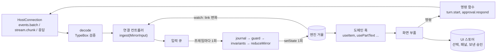

# 프런트엔드 전역 상태 규칙

React 19와 Zustand 5(adr.0010)로 UI 전역 상태를 만들 때 따르는 구속 문서다. 스토어 구성, 모듈 경계, 쓰기 경로의 미들웨어, 스트리밍, 순서와 재동기화, 선택자, React 19 규칙, 시험을 정한다. 데스크톱의 구체적인 상태 모양과 reducer 표는 `L4.desktop.design`이 정한다. 이 문서는 그 설계가 따르는 규칙이다.

## 1. 적용 범위

- 대상 코드: `xeon/apps/desktop/src/**`의 상태 모듈(`src/state/**`), 화면(`src/views/**`, `src/settings/**`), 연결 컨트롤러. 앞으로 생기는 UI 패키지와 모든 `.tsx` 파일에도 적용한다.
- 대상 작업: 전역 상태를 새로 만들거나 바꾸는 작업, 엔진 이벤트를 화면에 옮기는 작업, 화면 부품이 상태를 읽는 방식을 바꾸는 작업, 그 리뷰.
- 다른 구속 문서와의 관계: 타입 규칙(`as`, `!`, `any`, `Result`, `Bug`, `catch`)은 `eng.typescript.guide`가, 시험 계층과 태그는 `eng.testing.guide`가, 앱 안 모듈 경계 W1~W7은 `L4.desktop.spec` §4.9가 정한다. 이 문서는 그 규칙을 바꾸지 않는다.

### 1.1 용어

| 용어 | 뜻 |
|---|---|
| 엔진 거울(engine mirror) | 엔진이 알려 준 사실(이벤트, 요청 결과, 셸 상태)을 화면용으로 옮겨 둔 스토어. 데스크톱에 하나 있다 |
| UI 스토어 | 선택한 thread, 열린 패널, 보낸 뒤 결과를 기다리는 승인처럼 화면만 아는 상태를 담는 스토어 |
| 입력(`MirrorInput`) | 엔진 거울을 바꾸는 유일한 값. 판별 유니온이다 |
| reducer | `(state, input) → { state, note }` 순수 함수. 거울의 모든 변경이 여기서 일어난다 |
| 단계(Stage) | reducer를 받아 같은 모양의 reducer를 돌려주는 함수. 이 문서의 "미들웨어"는 이것을 뜻한다 |
| 연결 컨트롤러 | `HostConnection` 알림을 입력으로 바꿔 넣고, 재구독·다시 읽기 같은 부수효과를 실행하는 모듈 |
| 스트리밍 슬롯 | 확정 전 item의 휘발 조각을 모아 두는 거울 안 영역. 확정 기록이 오면 비운다 |
| 커밋 | 쌓인 입력을 reducer로 접은 결과를 `setState`로 한 번 반영하는 일 |
| journal | 입력 이름, seq, 결과(`note`)만 담는 고정 크기 링 버퍼 |

### 1.2 근거

- [결정] React 19 + Zustand 5(adr.0010).
- Zustand 5.0.16 소스·타입·문서와 실제 제품 저장소 조사: `L4/desktop/_research/state-management.md`, 그리고 같은 날 조사한 Zustand 내부 구조, 제품 사례, 관측성 요약(이 문서 1.3절 표의 출처 열). 표의 사실은 그 조사가 읽은 소스 경로와 URL을 그대로 적는다.
- 스파이크(2026-10-24, 저장소 밖): `L4.desktop.design` §12 골격을 tsgo 7.0.2, 저장소 `.oxlintrc.json`(oxlint 1.89 type-aware), `bun test`로 검사했다. 오류 0건이고 시험 62건이 통과했다. 검토에서 고친 결함 일곱 건은 `L4.desktop.design` §12 머리말에 있다.

### 1.3 제품 코드의 관행과 Xeon의 선택

Zustand를 제품 수준으로 쓰는 저장소와 공식 문서가 반복하는 선택을 모았다. "Xeon" 열이 이 문서의 결론이고, 규칙 번호가 그 이유를 단다.

| 주제 | 관행 | 출처 | Xeon |
|---|---|---|---|
| 스토어 경계 | 공식 Flux 가이드는 전역 상태를 단일 스토어에 둔다. TkDodo는 작은 스토어 여러 개와 커스텀 훅을 권한다. lobehub는 액션 슬라이스 13개 안팎을 한 스토어에 합친다 | zustand `docs/learn/guides/flux-inspired-practice.md`, TkDodo "Working with Zustand"(2022-11-20), lobehub `src/store/chat/store.ts` | 엔진 사실은 단일 거울, 화면 상태는 UI 스토어(FS-01) |
| 인스턴스 | Context에는 스토어 인스턴스만 넣고 `useState(() => createStore(...))`로 한 번 만든다 | xyflow `ReactFlowProvider`, dify `createWorkflowStore`, TkDodo "Zustand and React Context"(2024-04-14) | 부트스트랩에서 만들고 Context로 넘긴다(FS-05) |
| 공개 면 | 원시 훅 대신 커스텀 훅만 내보내고 액션은 `actions` 객체로 묶는다 | TkDodo "Only export custom hooks", "Separate Actions from State" | 읽기 면 + 도메인 훅 + 액션 객체(FS-07) |
| 선택자 | v5는 기본 equalityFn을 없앴다. 새 객체를 돌려주는 선택자는 무한 루프가 되므로 원자 선택자나 `useShallow`를 쓴다 | `docs/reference/migrations/migrating-to-v5.md`, PR #2395 | FS-18 |
| 미들웨어 순서 | 공식 권고는 `devtools(immer(...))`, devtools가 가장 바깥. 바깥 레이어가 최종 `api.setState`를 가진다 | `middleware.mjs` 72~93행, `advanced-typescript.md` | Zustand 미들웨어를 쓰지 않는다(FS-11) |
| 미들웨어가 놓치는 경로 | "middlewares that modify set or get are not applied to getState and setState". 래퍼를 거치지 않는 쓰기 경로가 생긴다 | zustand README | 쓰기 경로를 `ingest` 하나로 모은다(FS-02, FS-09) |
| 자작 미들웨어 타입 | 공식 logger 예제는 `as unknown as Logger`와 `as Parameters<typeof set>`에 기댄다. bounded `useStore` 예제는 `selector!`를 쓴다 | `docs/guides/typescript.md`(v5.0.16 태그) | `set`을 감싸는 미들웨어를 쓰지 않는다. 관찰은 `watch`(FS-22) |
| devtools 기본값 | `enabled ?? import.meta.env?.MODE !== 'production'`. Vite 밖에서는 조건이 참이 되어 확장이 있으면 운영에서도 붙는다. 매 set마다 상태 전체 스냅샷을 보내고 sanitizer가 없다 | `src/middleware/devtools.ts` L203, L215~240 | 쓰지 않는다(FS-11). journal과 진단 내보내기(FS-13) |
| devtools 운영 옵트인 | lobehub는 기본으로 끄고 `?debug=<스토어>`일 때만 켠다. big-AGI는 devtools 래퍼를 주석으로 빼 두었다 | lobehub `createDevtools.ts`, big-AGI `store-chats.ts` L64 | 같은 방향. 아예 넣지 않는다 |
| persist | 기본 `partialize`는 항등이고, 같은 값으로 set해도 `setItem`(JSON 직렬화 + 동기 쓰기)을 부른다. 버전이 다르고 `migrate`가 없으면 저장본을 버린다 | `middleware.mjs` 371~374행, `src/middleware/persist.ts` L274~330 | 거울은 저장하지 않는다. 남겨야 할 화면 값은 `l4.desktop.*` 설정이다(FS-11) |
| 직렬화할 수 없는 값 | jan은 콜백을 담는 승인 대기열을 persist 스토어에서 뺀다. big-AGI는 `partialize`로 AbortController를 뺀다 | jan `useToolApprovalRequests.ts`, big-AGI `store-chats.ts` L424~500 | 상태에는 직렬화 가능한 데이터만(FS-08) |
| 스트리밍 | lobehub는 청크마다 메시지 배열 reducer와 깊은 비교를 돌리고 저장은 턴이 끝난 뒤에만 한다. jan은 확정 메시지와 분리된 `streamingContents[threadId]` 슬롯을 둔다 | lobehub `internals.ts`, `StreamingHandler.ts`; jan `useAppState.ts` | jan 방식의 분리 슬롯 + 프레임 커밋(FS-14, FS-15) |
| 배칭 | Zustand에는 배칭이 없다. 리스너는 set마다 동기 `forEach`로 불린다 | `esm/vanilla.mjs` 9행 | 스토어 입력 쪽에서 프레임 단위로 모은다(FS-15) |
| 리스너 예외 | updater가 던지면 상태와 리스너가 바뀌지 않는다. 리스너가 던지면 뒤 리스너를 건너뛰고 상태는 이미 커밋된 채로 남는다 | zustand `src/vanilla.ts`(main) | reducer 실패는 guard 단계에서, 리스너 실패는 `watch`에서 받는다(FS-10, FS-22) |
| subscribeWithSelector | 구독마다 모든 상태 변경에서 선택자를 한 번씩 실행한다 | `middleware.mjs` 254~276행 | 쓰지 않는다. 같은 일을 `watch`가 한다(FS-22) |
| 엔진 진입점 | `zustand/vanilla`는 React 없이 getState·setState·subscribe를 준다 | `esm/vanilla.mjs`, `esm/index.mjs` | 상태 모듈은 `zustand/vanilla`의 `createStore`만 쓴다(FS-06) |

### 1.4 구조



- 화살표는 한 방향이다. 화면은 거울에 쓰지 않는다. 명령은 엔진에 요청을 보내고, 결과는 엔진 이벤트로 돌아와 거울에 들어간다.

## 2. 규칙

각 규칙은 내용, 이유, 좋은 예, 나쁜 예를 가진다. 예제는 `L4.desktop.design` §12의 이름을 쓴다. 나쁜 예 옆 주석은 걸리는 검사 이름이고, 검사가 없으면 "리뷰"다.

### 스토어 구성

#### FS-01 전역 스토어는 엔진 거울 하나와 UI 스토어로 한정한다

- 엔진 거울(`createEngineStore`)은 앱에 하나다. UI 스토어(`createUiStore`)는 화면 상태가 커지면 영역별로 나눌 수 있지만, 나누려면 이 문서 4절 절차를 거친다.
- 설정 화면은 `L4.settings-ui.spec`이 정한 저장소(`DesktopSettingsStore`)를 쓴다. 이것은 이 규칙의 전역 스토어로 세지 않는다.

이유: 엔진 사실이 두 스토어에 나뉘면 같은 이벤트를 두 번 적용하는 경로가 생기고, 재동기화 때 두 스토어를 같은 위치로 되돌리는 순서 문제가 생긴다. 화면 상태를 거울과 분리하면 거울을 버리고 다시 읽어도(reset) 사용자가 고른 thread와 패널이 남는다.

좋은 예:

```ts
const engine = createEngineStore(deps);   // 엔진 사실
const ui = createUiStore();               // 화면 상태
```

나쁜 예:

```ts
const approvalsStore = createStore<ApprovalQueue>()(() => ({ ids: [] })); // 리뷰: 엔진 사실을 담는 둘째 스토어
```

#### FS-02 엔진 거울은 엔진 사실만 담고, 입력은 연결 컨트롤러의 `ingest` 하나로 들어간다

- 입력은 엔진 알림(`events.batch`, `stream.chunk`, `events.ended`), 요청 결과(`events.subscribe`, `thread.list`, 스냅샷), 셸 상태(`EngineState`), 컨트롤러의 요청 표시(`connecting`, `transcript_opening`)뿐이다.
- 명령(`turn.start`, `approval.respond`, `turn.interrupt`)은 거울을 바꾸지 않는다. 보낸 직후의 표시(보내는 중, 실패)는 UI 스토어에 둔다.

이유: 거울의 내용이 엔진 이벤트 열의 함수가 되어야 재생, 재동기화, 시험이 성립한다. 낙관적 갱신을 거울에 섞으면 엔진 이벤트가 그 값을 덮어쓸 때 어느 쪽이 맞는지 정할 규칙이 따로 필요하다.

좋은 예:

```ts
async function respond(id: EventId, decision: "allow" | "deny"): Promise<void> {
  ui.actions.approvalSending(id);
  const r = await attemptAsync(() => connection.request("approval.respond", { approvalId: id, decision }));
  if (!r.ok || !r.value.applied) ui.actions.approvalFailed(id);
  // 대기열에서 빠지는 일은 approval.resolved 이벤트가 한다
}
```

나쁜 예:

```ts
engine.ingest({ type: "approval_removed", id }); // 리뷰: 엔진이 알리지 않은 사실을 거울에 넣는다
```

#### FS-03 서버 캐시 계층을 따로 두지 않는다

- TanStack Query 같은 요청 캐시를 들이지 않는다. 엔진 상태를 담는 요청 결과(`thread.list`, 스냅샷)는 거울 입력이 된다. 일회성 결과(설정 값 미리보기, `host.status`)는 부르는 부품의 로컬 상태에 둔다.

이유: 이벤트 구독이 이미 엔진 상태의 변경을 알려 준다. 요청 캐시를 더하면 같은 사실이 캐시와 거울에 따로 있고, 무효화 시점을 이벤트와 맞추는 일이 생긴다.

좋은 예:

```ts
const threads = await connection.request("thread.list", { limit: 200 });
engine.ingest({ type: "threads", threads: threads.threads });
```

나쁜 예:

```ts
const { data } = useQuery({ queryKey: ["threads"], queryFn: listThreads }); // 리뷰: 거울과 겹치는 캐시
```

#### FS-04 한 부품만 쓰는 상태는 React 로컬 상태로 둔다

- 전역 스토어에는 서로 떨어진 두 부품 이상이 읽는 값만 둔다. 입력창의 글자, 펼친 도구 결과, hover 상태는 `useState`나 `useReducer`다.

이유: 전역 스토어의 값은 모든 구독자의 선택자를 한 번씩 돌린다(Zustand `useStore`는 알림마다 선택자를 실행한다). 키 입력마다 전역 스토어를 바꾸면 화면 전체 선택자가 키 입력 빈도로 돈다.

좋은 예:

```tsx
const [draft, setDraft] = useState("");
```

나쁜 예:

```ts
ui.actions.setDraft(event.currentTarget.value); // 리뷰: 입력창 하나만 쓰는 값
```

#### FS-05 스토어 인스턴스는 부트스트랩에서 만들어 Context로 넘긴다

- `createEngineStore`, `createUiStore`는 앱 진입점(`src/main.tsx`) 한 곳에서 부른다. 모듈 최상위에서 스토어를 만들지 않는다.
- Context에는 스토어(읽기 면)만 넣는다. 상태 값을 Context에 넣지 않는다.

이유: 모듈 싱글턴은 시험마다 상태를 지우는 코드가 필요하고, 시험 사이에 상태가 샌다. Context에 값을 넣으면 값이 바뀔 때 Provider 아래 전체가 재렌더한다. 스토어 참조는 바뀌지 않으므로 Context가 재렌더를 일으키지 않는다.

좋은 예:

```tsx
const engine = createEngineStore(deps);
root.render(<EngineProvider store={engine.read}><App /></EngineProvider>);
```

나쁜 예:

```ts
export const useEngine = create<EngineMirror>()(() => INITIAL_MIRROR); // FS-06 lint: zustand 루트 진입점의 create
```

### 모듈 경계

#### FS-06 `zustand` import 위치와 생성 API를 제한한다

| import | 허용 파일 | 쓰는 이름 |
|---|---|---|
| `zustand/vanilla` | `src/state/*/store.ts`, `src/state/shared/readonly-store.ts` | `createStore`, `type StoreApi` |
| `zustand` | `src/state/*/hooks.ts` | `useStore` |
| `zustand/react/shallow` | `src/state/*/hooks.ts` | `useShallow` |
| `zustand/middleware`, `zustand/traditional`, `zustand/shallow` | 없음 | 4절 절차로만 연다 |

- `create`(바운드 훅)는 쓰지 않는다. `createStore` + `useStore(store, selector)`를 쓴다.

이유: `create`가 돌려주는 바운드 훅은 `setState`를 함께 노출하므로 어느 부품이든 쓸 수 있다. 바닐라 스토어는 React 없이 시험할 수 있고, 같은 스토어를 Context로 넘길 수 있다. import 위치가 정해져 있으면 쓰기 경로가 몇 파일로 줄어 리뷰 범위가 정해진다.

좋은 예:

```ts
// src/state/engine/store.ts
import { createStore } from "zustand/vanilla";
```

나쁜 예:

```ts
// src/views/thread-list.tsx
import { useStore } from "zustand"; // FS-06 lint(no-restricted-imports): 화면은 도메인 훅만
```

#### FS-07 상태 모듈 밖에는 읽기 면, 도메인 훅, 액션 객체만 연다

- 스토어 모듈은 `ReadonlyStore<T>`(`getState`, `getInitialState`, `subscribe`)를 돌려준다. `setState`는 모듈 안 지역 변수로만 있다.
- 화면은 `src/state/<스토어>/index.ts`가 내보내는 도메인 훅(`useItem`, `usePartText` 등)만 쓴다. 범용 `useEngine(selector)`는 모듈 안에서만 쓴다.
- UI 스토어의 쓰기는 `actions` 객체의 이름 있는 함수다.

이유: 타입에 `setState`가 없으면 모듈 밖 쓰기가 컴파일 오류가 된다. 단언이 금지되어 있으므로(TY-06) 우회할 수 없다. 선택자가 상태 모듈에 모여 있으면 참조 안정성(FS-18)을 한 곳에서 리뷰하고 시험한다.

좋은 예:

```ts
export function readonlyView<T>(api: StoreApi<T>): ReadonlyStore<T> {
  return { getState: api.getState, getInitialState: api.getInitialState, subscribe: api.subscribe };
}
```

나쁜 예:

```ts
export const engineApi: StoreApi<EngineMirror> = createStore<EngineMirror>()(() => INITIAL_MIRROR); // 리뷰: setState가 모듈 밖으로 나간다
```

#### FS-08 상태 값은 직렬화 가능한 불변 데이터다

- 상태에는 문자열, 숫자, 불리언, null, 배열, 평범한 객체만 둔다. 함수, 클래스 인스턴스, `Map`, `Set`, `Promise`, `AbortController`, DOM 노드를 두지 않는다.
- 모든 필드는 `readonly`다(TY-15). 레코드 키는 `string`으로 두고 브랜드 id로 조회한다. 순서는 별도 id 배열(`ids`, `itemIds`)이 가진다.

이유: 진단 내보내기와 시험 비교가 `JSON.stringify`와 `toEqual`로 성립한다. 콜백과 핸들은 재동기화 때 버릴 수 없고 다시 만들 수도 없다(jan이 승인 콜백을 persist 스토어에서 뺀 이유와 같다). 브랜드 문자열 키의 매핑 타입은 인덱스 시그니처가 되지 않아 `Record<string, T>`로 두고, 키를 만드는 쪽은 언제나 브랜드 id다.

좋은 예:

```ts
readonly items: Readonly<Record<string, ItemRecord>>;
readonly itemIds: readonly ItemId[];
```

나쁜 예:

```ts
readonly pending: Map<EventId, () => void>; // 리뷰: 직렬화할 수 없고 재설정 때 복원할 수 없다
```

### 쓰기 경로와 미들웨어

#### FS-09 엔진 거울의 변경은 순수 reducer 하나에서만 일어난다

- `reduceMirror(state, input)`은 같은 입력에 같은 결과를 돌려준다. 시각, id, 난수가 필요하면 입력에 싣는다(TY-21).
- 입력 유니온 `switch`는 `default`에서 `assertNever`를 부른다(TY-13, TY-14). 바뀌지 않은 하위 객체는 같은 참조로 둔다.
- reducer 안 `throw`는 불변 조건 위반(`Bug`)뿐이다. 예상 가능한 어긋남(구멍, 중복, 다른 구독의 batch)은 상태와 `note`로 돌려준다.

이유: 이벤트 열을 넣어 상태를 검사하는 시험이 DOM과 스토어 없이 성립한다. 같은 참조 유지가 선택자 비교(`Object.is`)의 전제다.

좋은 예:

```ts
if (input.to <= cursor.seq) return keep(state, "duplicate");
if (input.from > cursor.seq) return keep(enterResync(state, "gap"), "gap");
```

나쁜 예:

```ts
case "batch":
  void connection.request("events.subscribe", { from: state.cursor }); // 리뷰: reducer 안 부수효과
  return keep(state, "gap");
```

#### FS-10 쓰기 미들웨어는 reducer 단계 세 개로 고정한다

`pipeline(reduceMirror, [journal, guard, invariants])`. 바깥부터 다음 순서다.

| 순서 | 단계 | 하는 일 | 켜는 빌드 | 넣는 이유 |
|---|---|---|---|---|
| 1 | `journalStage` | 입력마다 이름, seq, `note`, 시각을 링 버퍼에 남긴다. 정상 적용된 델타는 남기지 않는다(FS-13) | 전부 | 사용자 환경에서 재현할 수 없는 순서 문제를 진단 내보내기로 본다. 가장 바깥이라 guard가 바꾼 결과(`failed`)도 남는다 |
| 2 | `guardStage` | reducer가 던지면 이전 상태를 `reset`(`reducer_failed`)으로 바꿔 돌려주고 Logger에 남긴다 | 전부 | Zustand는 updater 예외 때 상태를 바꾸지 않지만 그 입력은 사라지고 화면은 틀린 채 남는다. reset으로 엔진에서 다시 읽어 스스로 고친다. reducer 실패가 60초 안에 4번째이면 `failed`로 멈춘다. 재구독이 성공하면 `link`의 시도 횟수가 지워져 `link`만으로는 반복 실패를 셀 수 없기 때문에 스토어가 시각을 따로 센다 |
| 3 | `invariantStage` | 결과 상태의 불변식(id 중복, 목록과 레코드 불일치, 확정 item이 슬롯에 남음)을 검사하고 어기면 `Bug`를 던진다 | 개발·시험 | O(N) 검사라 운영에서 끈다. guard 안쪽이라 위반이 화면을 멈추지 않고 reset으로 이어진다. 시험은 `onReducerFailure: rethrow`로 위반을 실패로 드러낸다 |

- 커밋 함수는 접은 결과가 이전 상태와 다른 참조일 때만 `setState(next, true)`를 부른다.
- 단계를 더하거나 순서를 바꾸려면 4절 절차를 거친다. 단계 후보였다가 뺀 것: 성능 측정(델타 외 입력이 있거나 8 ms를 넘긴 커밋을 journal이 `flush` 항목으로 남긴다), 내용 가림(journal이 내용을 받지 않으므로 필요 없다), devtools 전달(FS-11).

이유: 모든 쓰기가 `ingest` → 커밋 하나로 모이므로 Zustand의 `set` 래핑 없이 reducer 함수 합성만으로 미들웨어가 된다. 단계 타입 `Stage<S, I, N> = (next: Reducer<S, I, N>) => Reducer<S, I, N>`은 제네릭 함수 합성이라 단언이 필요 없고, 단계 하나를 가짜 `next`로 따로 시험한다.

좋은 예:

```ts
const stages: Stage<EngineMirror, MirrorInput, ApplyNote>[] = [journal, guard];
if (deps.checks) stages.push(invariantStage(checkMirror));
const reduce = pipeline(reduceMirror, stages);
```

나쁜 예:

```ts
const reduce = pipeline(reduceMirror, [guard, journal]); // 리뷰: guard가 바깥이면 실패한 입력이 journal에 남지 않는다
```

#### FS-11 Zustand 미들웨어를 쓰지 않는다

- `devtools`, `persist`, `immer`, `subscribeWithSelector`, `combine`, `redux`와 `set`을 감싸는 자작 미들웨어를 쓰지 않는다.

| 미들웨어 | 쓰지 않는 이유 | 대신 |
|---|---|---|
| `devtools` | 시스템 WebView에서 Redux DevTools 확장을 쓸 수 없다 [가정]. 켜지면 set마다 상태 전체를 보내고 sanitizer가 없어 대화 내용이 확장으로 나간다. Vite 밖에서 `enabled` 기본값이 참이 된다 | journal, 진단 내보내기, 개발 빌드의 WebView 개발자 도구(`L4.desktop.spec` V8) |
| `persist` | 거울은 엔진이 원천이라 저장할 이유가 없다. 같은 값의 set에도 동기 `setItem`이 돈다. 출처(origin)가 플랫폼마다 달라 `localStorage` 키가 어긋날 수 있다(`L4.desktop.spec` V4) | 남겨야 할 화면 값은 `l4.desktop.*` 설정(`DesktopSettingsStore`) |
| `immer` | reducer 갱신이 펼침 몇 줄이고, 프록시 초안이 하나 더 있는 개념이다. 번들과 의존이 는다 | 펼침 연산자와 `Array.prototype.with`, `toSorted` |
| `subscribeWithSelector` | 구독마다 상태 변경 때 선택자를 돌리는 비용은 같고, 콜백 예외 격리가 없다 | `watch`(FS-22) |
| 자작 `set` 래퍼 | `set`의 오버로드(`replace?: false`와 `replace: true`)를 한 구현으로 감싸면 인자 유니온이 어느 오버로드에도 맞지 않는다. 스파이크에서 tsgo가 TS2769로 거부했다. 단언 없이 쓸 수 없다 | reducer 단계(FS-10) |

이유: 쓰기 경로가 하나라 미들웨어가 할 일을 reducer 단계가 한다. Zustand 미들웨어를 겹치면 순서에 따라 타입과 동작이 바뀌고(바깥 레이어가 최종 `setState`를 가진다), README가 밝히듯 `api.setState` 직접 호출은 미들웨어를 거치지 않는다.

좋은 예:

```ts
const api = createStore<UiState>()(() => INITIAL_UI);
```

나쁜 예:

```ts
const api = createStore<UiState>()(devtools(persist(() => INITIAL_UI, { name: "ui" }))); // FS-06 lint: zustand/middleware
```

#### FS-12 엔진 값은 경계에서 검증한 뒤 입력이 된다

- `EventWire.payload`와 `VolatileEventWire.payload`는 `unknown`이다. 연결 컨트롤러가 `decodeDurable`, `decodeVolatile`로 kind별 TypeBox 스키마(`@xeon/contracts`)를 `parse`한 뒤 입력을 만든다(TY-10).
- 거울이 읽는 kind는 decode 표에 있는 것뿐이다. 표에 없는 kind는 `other`, 검증 실패는 `unreadable` 사실이 되고 위치(seq)는 넘어간다.

이유: reducer가 `unknown`을 다루면 좁히기 코드가 상태 논리와 섞인다. 한 이벤트의 payload가 깨져도 위치가 넘어가야 구독이 멈추지 않는다. 엔진 kind 집합은 확장 kind(`x.<id>.*`)까지 열려 있어 `switch`보다 표 조회가 맞다.

좋은 예:

```ts
const decode = DURABLE[event.kind];
return decode === undefined ? { ...base, type: "other" } : decode(base, event.payload);
```

나쁜 예:

```ts
const item = event.payload.item; // TY-02·TY-10: unknown 멤버 접근(typescript/no-unsafe-member-access)
```

#### FS-13 journal은 메타데이터만 링 버퍼에 남긴다

- 항목은 입력 이름(고정 문자열), seq, `note`, 시각, 커밋 단위의 입력 수와 경과 ms뿐이다. 이름과 seq는 `describeInput` 허용 목록 함수가 고른다.
- 대화 내용, 경로, 설정 값, 도구 인자, 승인 제목, 오류 메시지를 넣지 않는다. 오류는 `Error.name`만 남긴다.
- 입력 이름은 리터럴 유니온 `InputName`이다. `describeInput`의 반환 타입이 이를 요구하므로 내용 문자열을 이름에 넣으면 컴파일 오류가 된다. 템플릿 리터럴은 `subscribed:${"cursor" | "head"}`처럼 리터럴 유니온만 받는다.
- 정상 적용된 휘발 조각(`chunk`, `note: applied`)은 기록하지 않고, 델타만 있는 빠른 커밋(8 ms 이하)은 `flush` 항목도 남기지 않는다. `stale`·`duplicate` 조각과 느린 커밋은 남긴다.
- 크기는 [제안] 1,000항목이다. 내보내기는 사용자가 진단 화면에서 고를 때만 한다(`L4.desktop.design` §11). 진단 묶음(`buildDiagnostics`)은 고정 필드만 고르는 반환 타입을 쓰고 상태를 펼치지 않는다.

이유: 기록 대상을 고정 필드로 정하면 가림(redaction) 단계가 필요 없고, 비밀이 섞일 경로가 없다(`L4.desktop.spec` E11, `eng.best-practices.guide` BP-07). 델타는 초당 수십 건이라 모두 남기면 1,000칸이 17~20초 안에 차서 구멍·재설정 항목이 밀려나고, 충돌 보고의 마지막 50항목이 델타로만 채워진다. 고정 크기라 오래 켜 둔 앱에서도 메모리가 늘지 않는다. Redux DevTools 확장의 기본 `maxAge`는 50인데 이는 상태 스냅샷 기준이고, 메타데이터 항목은 수십 바이트라 더 길게 둔다.

좋은 예:

```ts
case "batch":
  return { input: "batch", seq: input.to };
```

나쁜 예:

```ts
journal.record({ kind: "input", at, input: JSON.stringify(input), seq: null, note }); // 리뷰: 내용이 기록에 들어간다
```

### 스트리밍과 순서

#### FS-14 토큰 델타는 스트리밍 슬롯에만 쓴다

- `item.updated`(`part_delta`)는 `streaming.items[itemId].parts[i].text`만 바꾼다. 확정 item 레코드(`transcript.items`)는 델타 때 복사하지 않는다.
- 확정은 batch 단위로 반영한다. 한 batch의 `item.recorded`는 `items`와 `itemIds`를 한 번만 복사한다. 하나씩 복사하면 따라잡기 K건이 O(K·N)이다(N=8,000, K=500에서 JavaScriptCore 320 ms, 한 번 복사하면 3.8 ms [참고 측정]).
- 슬롯을 비우는 때: 그 item의 `item.recorded`, 그 turn의 `turn.completed`, 엔진이 `running`이 아니게 됨, reset.
- 이미 확정된 item의 늦은 조각은 `stale`로 버린다. 확정 여부는 열린 thread의 레코드와 최근 확정 표식(`settledItems`, `settledTurns`)으로 판단한다. 표식이 없으면 열기 전에 확정된 item이나 다른 thread의 item에 늦은 조각이 와서 슬롯을 되살리고, 확정 레코드와 겹쳐 그려진다. 같은 (thread, turn)에서 `n`이 이전 이하인 조각은 `duplicate`로 버린다.

이유: 레코드 펼침 복사는 항목 수 N에 비례한다(V8 N=10,000에서 3.5 ms, `L4/desktop/_research/state-management.md §7.2`). 슬롯 방식은 델타 1건이 그 item의 파트 수에만 비례한다. 스파이크의 JavaScriptCore 측정에서 N=1,000~50,000 모두 델타당 0.5~1.3 µs였고, 같은 환경의 레코드 복사는 N=10,000에서 585 µs였다 [참고 측정]. 휘발 조각은 재전송되지 않고 완성 내용은 내구 이벤트로 다시 오므로(`F.wire-settings.spec` §3.4.4) 슬롯은 버려도 되는 값이다.

좋은 예:

```ts
return keep({ ...state, streaming: putStreaming(counted, applyDelta(current, update.delta)) }, "applied");
```

나쁜 예:

```ts
items: { ...t.items, [id]: { ...item, text: item.text + delta } }, // 리뷰: 델타마다 O(N) 복사
```

#### FS-15 커밋은 프레임마다 한 번이다

- `ingest`는 입력을 큐에 넣고 다음 프레임 예약 하나를 건다. 예약 시점에 큐 전체를 접어 `setState`를 한 번 부른다.
- 프레임 예약은 `requestAnimationFrame`과 타이머 중 먼저 오는 쪽이다. 타이머 상한은 [제안] 100 ms다. 시각과 타이머는 주입한다(`FrameClock`, `Scheduler`, TY-21).
- 시험과 thread 전환 직전에는 `flush()`로 즉시 커밋한다.
- 타이머 상한은 숨겨진 창에서 지켜지지 않을 수 있다 [가정]. WebView가 숨긴 창의 타이머를 늦춘다(WebKit 약 1초, Chromium은 오래 숨기면 분 단위). 큐는 그동안 쌓이고 복귀 때 한 번에 접힌다. 입력당 비용이 수 µs라 허용하고, 측정에서 문제가 되면 큐 길이 상한에서 동기 커밋을 건다(`L4.desktop.design` §14 11번).

이유: Zustand는 set마다 리스너를 동기로 부르고 배칭이 없다. 델타 빈도가 60 Hz를 넘으면 화면이 그릴 수 없는 중간 상태마다 선택자와 렌더가 돈다. 숨긴 창에서는 rAF가 멈추므로 타이머가 없으면 큐가 쌓인다(MDN `requestAnimationFrame`). 외부 스토어 갱신은 Transition이 될 수 없어 빈도를 낮추는 일은 입력 쪽 책임이다.

좋은 예:

```ts
ingest(input) {
  queue.push(input);
  cancel ??= deps.frames.request(commit);
},
```

나쁜 예:

```ts
connection.onNotification("stream.chunk", (p) => api.setState((s) => applyChunk(s, p))); // 리뷰: 델타마다 커밋
```

#### FS-16 내구 이벤트는 seq로 멱등 적용하고, 구멍은 재동기화로 고친다

- 거울은 마지막으로 적용한 위치 `cursor = { storeId, seq }`를 가진다. `events.batch`의 적용 규칙:
  1. `sub`가 현재 구독과 다르면 `foreign`으로 버린다.
  2. `to ≤ cursor.seq`면 `duplicate`로 버린다.
  3. `from > cursor.seq`면 구멍이다. `resync(gap)`으로 간다.
  4. 그 밖에는 `seq > cursor.seq`인 이벤트만 적용하고 `cursor.seq = to`로 둔다.
- 스냅샷(목록, 열린 thread)은 반영한 위치(`asOfSeq`)를 가진다. 스냅샷을 기다리는 동안 그 조각의 이벤트를 모았다가 `asOfSeq`보다 뒤의 것만 적용한다(스냅샷 + 재생).
- `storeId`가 바뀌거나 `replay.outOfRange`를 받으면 `reset`이다. 캐시를 버리고 head부터 구독한 뒤 스냅샷을 다시 읽는다.

이유: 같은 batch가 재전송이나 재구독으로 두 번 와도 결과가 같아야 한다(`F.wire-settings.spec` §3.4.2). 구간 계약 `(from, to]`이 구멍을 드러내므로 seq 빈칸 여부에 기대지 않는다. 스냅샷과 구독이 서로 다른 시점이어도 `asOfSeq` 비교 하나로 중복과 누락이 함께 막힌다.

좋은 예:

```ts
for (const fact of input.facts) {
  if (fact.seq > cursor.seq) next = applyFact(next, fact);
}
```

나쁜 예:

```ts
for (const fact of input.facts) next = applyFact(next, fact); // 리뷰: 재전송된 이벤트를 두 번 적용
```

#### FS-17 재동기화는 상태 기계로 표현하고 부수효과는 컨트롤러가 실행한다

- 연결 상태는 거울의 `link` 필드(`offline → connecting → syncing → live`, 어긋나면 `resync`나 `reset`, 같은 원인 3회 초과면 `failed`)다. 전이는 reducer가 정한다. `failed`는 흡수 상태이고 `connecting` 입력만 벗어난다.
- 연결 컨트롤러는 `watch`로 `link`를 구독해, `resync`면 cursor부터, `reset`이면 head부터 다시 구독하고 스냅샷을 다시 읽는다.
- 구독 요청이 진행 중일 때 도착한 batch는 컨트롤러가 모았다가 `subscribed` 입력 뒤에 넣는다.
- 스냅샷이 `stale`로 거절돼 같은 thread가 loading으로 남으면 컨트롤러가 다시 읽는다(최대 3번).
- 재구독이 서면 컨트롤러가 이전 구독에 `events.unsubscribe`를 보내고, 겹친 요청은 가장 나중 응답만 쓴다. 엔진이 연결당 구독 수를 제한하므로(기본 16) 닫지 않으면 재동기화가 쌓일 때 재구독이 실패한다.

이유: reducer가 순수해야 FS-09가 성립한다. 상태 기계가 거울에 있으면 화면 배너, 시험, journal이 같은 값을 읽는다. 마지막 항목은 순서 문제다. 응답이 알림보다 먼저 오더라도(`F.wire-settings.spec` §3.4.2 규칙 4) `await` 뒤의 코드는 마이크로태스크라, 같은 읽기 묶음에서 처리된 알림 처리기보다 늦게 돌 수 있다.

좋은 예:

```ts
watch(engine.read, (s) => s.link, (link) => {
  if (link.phase === "resync") detach(subscribe("cursor"), report);
  else if (link.phase === "reset") detach(subscribe("head"), report);
}, report);
```

나쁜 예:

```ts
case "gap": setTimeout(() => resubscribe(), 0); // 리뷰: reducer 밖 상태 없이 재시도. 횟수 상한과 화면 표시가 없다
```

### 선택자와 렌더

#### FS-18 선택자는 O(1)이고 기존 참조나 원시값을 돌려준다

- 선택자는 상태 안에 이미 있는 값(문자열, 숫자, 기존 배열과 객체 참조)을 돌려준다. 렌더마다 `map`, `filter`, 객체 리터럴로 새 값을 만들지 않는다.
- 빈 값은 모듈 상수(`NO_ITEMS = Object.freeze([])`)다.
- 여러 필드를 묶어 돌려줘야 하면 `useShallow`로 감싼다. 파생 목록이 필요하면 reducer가 유지하는 필드로 만든다.
- 원시값을 돌려주는 집계(`selectRunningCount`)는 대상 수가 작고 구독자가 적을 때만 둔다.

이유: Zustand 5 `useStore`는 선택자 결과를 `Object.is`로 비교하고 기본 동등 비교 함수가 없다. 새 참조를 돌려주면 알림마다 재렌더하고, `useSyncExternalStore`의 스냅샷 규칙상 렌더마다 새 값이면 무한 루프 오류가 난다. 선택자는 알림마다 모든 구독자에서 돌므로 비용이 구독자 수 × 커밋 수다.

좋은 예:

```ts
export const selectTranscriptItemIds = (s: EngineMirror): readonly ItemId[] =>
  s.transcript?.status === "ready" ? s.transcript.itemIds : NO_ITEMS;
export const useLinkBanner = () => useEngine(useShallow(sel.selectLinkBanner));
```

나쁜 예:

```ts
useEngine((s) => s.transcript?.itemIds ?? []);                       // 리뷰: 빈 배열이 매번 새 참조
useEngine((s) => s.approvals.ids.filter((id) => byThread(s, id, t)));  // 리뷰: 알림마다 새 배열
```

#### FS-19 목록 부품은 id 배열만, 항목 부품은 자기 id만 구독한다

- 트랜스크립트는 `useTranscriptItemIds()`와 `useStreamingIds()`만 구독하고, 행 부품(`RecordedItem`, `StreamingPartText`)이 자기 id로 값을 읽는다. 행 부품은 `memo`로 감싼다.
- 스트리밍 파트 텍스트는 `usePartText(itemId, contentIndex)`처럼 문자열 하나를 구독한다.
- 가상 스크롤(`L4.desktop.spec` §4.10 수단 3)로 화면 밖 행을 마운트하지 않는다. 마운트된 행만 선택자를 돌린다.

이유: 델타는 id 배열 참조를 바꾸지 않으므로 목록이 재렌더하지 않는다. 바뀐 파트의 부품 하나만 재렌더한다. React Compiler가 없는 동안 `memo`가 새 행 추가 때 기존 행의 재렌더를 막는다.

좋은 예:

```tsx
const StreamingPartText = memo(function StreamingPartText(props: { readonly id: ItemId; readonly index: number }) {
  return <span>{usePartText(props.id, props.index)}</span>;
});
```

나쁜 예:

```tsx
const transcript = useEngine((s) => s.transcript); // 리뷰: item 하나가 바뀌어도 목록 전체 재렌더
```

#### FS-20 렌더 중에 스토어를 읽거나 쓰지 않는다

- 렌더 함수에서 `getState()`를 부르지 않는다. 값은 훅으로 구독한다.
- 스토어 쓰기(`ingest`, `actions.*`)는 이벤트 처리기, effect, 컨트롤러에서만 한다.
- 훅 규칙(조건부 훅 금지)을 지킨다. Provider가 없으면 `useEngineStore`가 `Bug`를 던진다.
- React Compiler는 넣지 않았지만(adr.0010 §3.1 5) 위 규칙을 지켜 나중에 켤 수 있게 한다.

이유: `getState()`는 구독하지 않으므로 값이 바뀌어도 다시 그리지 않는다. Compiler가 켜지면 그 결과가 메모되어 더 오래 낡는다. 렌더 중 쓰기는 Rules of React의 "렌더 중 비로컬 값 변경 금지"를 어긴다.

좋은 예:

```tsx
const count = useRunningCount();
```

나쁜 예:

```tsx
const count = engine.read.getState().threads.ids.length; // 리뷰: 구독하지 않는 읽기
```

#### FS-21 외부 스토어 갱신은 Transition이 되지 않으므로 무거운 렌더를 따로 다룬다

- 스트리밍 중인 파트는 가벼운 렌더(평문, 줄 단위)로 그린다. 마크다운 해석과 코드 하이라이트는 `item.recorded` 뒤 확정 item에서 한다 [제안].
- 무거운 파생 렌더가 스토어 값에 묶이면 `useDeferredValue`로 늦추거나 부품을 나눈다. `startTransition` 안에서 스토어를 바꿔도 낮은 우선순위가 되지 않는다.

이유: `useSyncExternalStore` 갱신은 항상 블로킹이다(React 문서). 프레임마다 긴 텍스트 전체를 다시 해석하면 길이에 비례한 비용이 프레임마다 든다.

좋은 예:

```tsx
const text = usePartText(id, index);
const deferred = useDeferredValue(text);
return <pre>{deferred}</pre>;
```

나쁜 예:

```tsx
startTransition(() => engine.ingest(input)); // 리뷰: 외부 스토어 갱신은 Transition이 되지 않는다
```

#### FS-22 React 밖 구독은 `watch` 하나로 한다

- 컨트롤러, 알림, 진단 같은 React 밖 코드는 `watch(store, select, onChange, report)`로 구독한다. 고른 값이 `Object.is`로 바뀔 때만 `onChange`를 부르고, 콜백 예외는 `attempt`로 받아 `report`에 넘긴다.
- `store.subscribe`를 직접 부르는 곳은 `watch`와 Zustand 훅 내부뿐이다.

이유: Zustand는 리스너 하나가 던지면 뒤 리스너를 건너뛴다. 컨트롤러 리스너가 던지면 화면 구독 갱신이 빠진다. 선택과 비교를 한 함수에 두면 `subscribeWithSelector` 없이 같은 일을 한다.

좋은 예:

```ts
const result = attempt(() => onChange(next, old));
if (!result.ok) report(result.error.cause);
```

나쁜 예:

```ts
engine.read.subscribe((s) => { if (s.link.phase === "reset") void reload(); }); // 리뷰: 예외가 뒤 리스너를 막고, Promise 거부를 버린다
```

### 시험

#### FS-23 상태 시험은 DOM 없이 reducer, 단계, 스토어 단위로 한다

| 대상 | 방법 | 태그(TS-01) |
|---|---|---|
| reducer | 입력 열 → 기대 상태 표. 스토어를 만들지 않는다 | `unit` |
| 단계 | 가짜 `next` reducer로 단계 하나를 시험한다(journal 기록, guard 복구, invariant 위반) | `unit` |
| 스토어 | 시험마다 `createEngineStore`를 새로 만들고 `manualFrameClock`, 고정 시계, `onReducerFailure: rethrow`, `checks: true`를 준다. 커밋 횟수와 알림 횟수를 센다 | `unit` |
| 멱등·재생 | 같은 batch를 중복·재전송·순서 섞기로 넣어도 깨끗한 열과 최종 상태가 같다. 시드를 고정한다(TS-09) | `prop` |
| 선택자 | 델타 뒤에도 `selectTranscriptItemIds` 참조가 같다. 빈 값이 같은 상수다 | `unit` |
| 테이프 | CLI 테이프 시나리오의 wire 메시지 열을 decode → reducer로 돌려 최종 transcript가 CLI 결과와 같다(`L4.desktop.spec` D-03과 같은 테이프) | `contract` |

- 훅과 부품은 선택자를 부르는 얇은 층이라 따로 시험하지 않는다. 부품 시험(`ui` 태그)은 계속 보류한다(`eng.testing.guide` TS-01).
- 시험 데이터의 브랜드 id는 `fixedIdFactory`나 `parse`로 만든다(TY-06 A2). 시험 본문에 단언을 쓰지 않는다.

이유: 상태 논리가 순수 함수와 바닐라 스토어에 있으므로 DOM이 필요 없다. 모듈 싱글턴이 없어서(FS-05) 시험 사이 초기화 코드가 필요 없다.

좋은 예:

```ts
const frames = manualFrameClock();
const store = createEngineStore({ ...deps, frames, checks: true, onReducerFailure: rethrow });
store.ingest(subscribed); store.ingest(delta0); store.ingest(delta1);
frames.flush();
expect(notified).toBe(1);
```

나쁜 예:

```ts
beforeEach(() => useEngineStore.setState(INITIAL_MIRROR)); // 리뷰: 모듈 싱글턴 초기화(FS-05)
```

## 3. 강제 수단

### 3.1 린트

[제안] 구현 작업(`L4.desktop.plan` D6)에서 `xeon/.oxlintrc.json`에 다음을 더한다. 기존 `no-restricted-imports`의 `overrides` 방식(`packages/cap-web/src/fetch/convert/**`)과 같다.

| 규칙 | 범위 | 내용 | 대응 규칙 |
|---|---|---|---|
| `no-restricted-imports` | 전체 | `zustand`, `zustand/*` 금지. 메시지 "FS-06: only src/state/*/store.ts and hooks.ts import zustand" | FS-06, FS-11 |
| `no-restricted-imports` override | `apps/desktop/src/state/*/store.ts`, `apps/desktop/src/state/shared/readonly-store.ts` | `zustand/vanilla`만 허용 | FS-06 |
| `no-restricted-imports` override | `apps/desktop/src/state/*/hooks.ts` | `zustand`, `zustand/react/shallow`만 허용 | FS-06 |
| `no-restricted-imports` | 전체 | `@tanstack/react-query`, `immer`, `use-immer` 금지 | FS-03, FS-11 |
| `react/rules-of-hooks` [가정: oxlint 1.89 react 플러그인] | `apps/desktop/src/**` | 훅 규칙 | FS-20 |

- override는 그 파일의 `no-restricted-imports` 설정 전체를 바꾸므로 기존 패턴 목록을 함께 적는다.

### 3.2 타입

- `ReadonlyStore<T>`에 `setState`가 없다. 모듈 밖 쓰기는 컴파일 오류다(FS-07).
- `MirrorInput`, `DurableFact`, `VolatileFact`, `ItemUpdate` 판별 유니온의 `switch`는 `typescript/switch-exhaustiveness-check`와 `assertNever`가 새 변형을 빠짐없이 다루게 한다(FS-09).
- 거울 필드는 모두 `readonly`라 reducer 밖 변경은 컴파일 오류다(FS-08).

### 3.3 시험

- FS-23 표의 시험을 `L4.desktop.plan` §5 단위 테스트 목록에 더한다(`L4.desktop.design` §13 표).
- 개발 빌드와 시험은 `checks: true`라 invariant 위반이 바로 드러난다.

### 3.4 리뷰 체크리스트

리뷰어는 상태 코드를 바꾸는 변경마다 확인한다.

1. 새 전역 상태가 있다면 두 부품 이상이 읽는가? 아니면 로컬 상태로 돌린다(FS-04).
2. 엔진 사실이 거울 밖(UI 스토어, 부품 상태, 요청 캐시)에 복사되지 않았는가(FS-01, FS-03)?
3. 명령 결과를 거울에 직접 넣지 않았는가? 낙관적 표시는 UI 스토어에 있는가(FS-02)?
4. `zustand` import가 FS-06 표의 파일에만 있는가? `create`, `zustand/middleware`가 없는가(FS-06, FS-11)?
5. 모듈 밖으로 `setState`나 `StoreApi`가 나가지 않는가(FS-07)?
6. 상태에 함수, `Map`, 클래스 인스턴스, 핸들이 없는가(FS-08)?
7. reducer에 부수효과, 시각 읽기, 난수가 없는가? `switch`가 `assertNever`로 끝나는가(FS-09)?
8. 새 입력 종류가 `describeInput`에 `InputName` 리터럴로 들어갔고 내용 필드가 기록되지 않는가? 초당 수십 건 오는 입력을 journal에 모두 남기지 않는가(FS-13)?
9. 새 엔진 kind의 payload를 decode 표에서 검증하는가(FS-12)?
10. 델타 경로가 확정 레코드를 복사하지 않는가? batch 경로가 확정 item을 하나씩 복사하지 않는가(FS-14)?
11. `setState`가 커밋 함수 밖에서 불리지 않는가? 알림 처리기가 `ingest`만 부르는가(FS-15)?
12. 내구 이벤트 적용이 `seq > cursor.seq`와 스냅샷 `asOfSeq`를 지키는가(FS-16)?
13. 재시도와 재구독이 `link` 상태 기계를 거치는가? 새 구독이 이전 구독을 닫는가(FS-17)?
14. 새 선택자가 기존 참조나 원시값을 돌려주는가? 객체를 만들면 `useShallow`인가? 빈 값이 상수인가(FS-18)?
15. 목록 부품이 id 배열만 구독하는가(FS-19)?
16. 렌더 중 `getState()`나 쓰기가 없는가(FS-20)?
17. 스트리밍 중 렌더가 가벼운가(FS-21)?
18. React 밖 구독이 `watch`를 쓰는가(FS-22)?
19. FS-23 표의 시험이 함께 바뀌었는가?

## 4. 예외와 승인 절차

- 이 문서의 규칙과 다른 구조(스토어 추가, 단계 추가·순서 변경, Zustand 미들웨어 사용)가 필요하면 구현 중에 우회하지 않고 `[미결] FS-NN <위치> <이유>`로 보고한다. 이 문서를 먼저 고치고 리뷰어 승인을 받은 뒤 구현한다.
- Zustand 미들웨어를 꼭 써야 하는 경우의 순서:
  1. 공식 미들웨어(`persist` 등)를 그대로 쓰는 경우는 호출 쪽에 단언이 필요 없다. FS-06 표와 3.1 린트를 고쳐 import를 연다.
  2. 자작 미들웨어는 `api.subscribe`로 관찰하는 모양(아래)만 쓴다. 스파이크에서 고정 변이 목록 `StateCreator<T>`와 제네릭 변이 목록 `StateCreator<T, Mps, Mcs>` 두 모양 모두 단언 없이 tsgo를 통과했다.
  3. `set`을 감싸야 하면 단언이 하나 필요하다. 이때도 단언을 흩지 않는다. `src/state/shared/middleware.ts` 한 파일의 함수 하나에 단언 한 줄을 두는 TY-06 허용 행(가칭 A7)을 `eng.typescript.guide` 표에 먼저 더하고 승인을 받는다. 지금은 그런 미들웨어가 없으므로 행을 더하지 않는다. TY-06 목록은 줄어드는 방향으로 관리한다.

```ts
// 관찰 미들웨어 모양. set을 감싸지 않으므로 단언이 없다
import type { StateCreator, StoreMutatorIdentifier } from "zustand/vanilla";

export function observed<
  T,
  Mps extends [StoreMutatorIdentifier, unknown][],
  Mcs extends [StoreMutatorIdentifier, unknown][],
>(creator: StateCreator<T, Mps, Mcs>, onCommit: (next: T, previous: T) => void): StateCreator<T, Mps, Mcs> {
  return (set, get, api) => {
    api.subscribe(onCommit);
    return creator(set, get, api);
  };
}
```

- 이 모양도 콜백 예외 격리가 필요하면 `onCommit` 안에서 `attempt`를 쓴다(FS-22와 같은 이유).
- 변이 키를 새로 선언하는 미들웨어(`declare module "zustand/vanilla" { interface StoreMutators<S, A> { ... } }`)는 쓰지 않는다. 선언 병합은 프로젝트 규칙상 허용이지만, 변이 타입을 누적하는 미들웨어는 `set` 래핑과 함께 쓰이므로 위 3번 절차를 따른다.

## 5. 안티패턴 요약

| 모양 | 왜 나쁜가 | 규칙 |
|---|---|---|
| 스토어마다 바운드 훅 `create()`를 export | `setState`가 어디서나 열린다. 시험마다 싱글턴 초기화가 필요하다 | FS-05, FS-06, FS-07 |
| 승인 대기열을 별도 스토어나 부품 상태에 복사 | 재동기화 때 두 곳의 위치가 어긋난다 | FS-01 |
| 명령 성공 직후 거울을 고침 | 엔진 이벤트가 같은 값을 다시 적용하거나 덮는다 | FS-02 |
| 델타마다 `items` 레코드를 펼쳐 복사 | 항목 수에 비례해 느려지고 GC가 는다 | FS-14 |
| 알림마다 `setState` | 화면이 그리지 않을 중간 상태마다 선택자와 렌더가 돈다 | FS-15 |
| 선택자에서 `?? []`, `filter`, 객체 리터럴 | 새 참조라 재렌더가 끝나지 않는다 | FS-18 |
| `devtools(persist(immer(...)))` 기본 조합 | 운영에서 상태 전체가 확장으로 나가고, set마다 동기 저장이 돈다 | FS-11 |
| `set`을 감싸는 로깅 미들웨어 | 단언이 필요하고, `api.setState` 직접 호출을 놓친다 | FS-10, FS-11 |
| 리스너 안에서 `await`와 예외 방치 | 뒤 리스너가 건너뛰어지고 Promise 거부가 버려진다 | FS-22 |
| journal에 입력 전체를 직렬화 | 대화 내용과 비밀 참조가 진단 파일로 나간다 | FS-13 |
| reducer 안에서 재구독 | 순수성이 깨지고 시험이 네트워크를 요구한다 | FS-09, FS-17 |

## 6. 미결 사항

- [가정] 시스템 WebView(WKWebView, WebKitGTK, WebView2)에서 Redux DevTools 확장을 쓸 수 없다. 확인하지 않았다. 쓸 수 있더라도 FS-11의 다른 이유(전체 스냅샷, sanitizer 없음)로 채택하지 않는다.
- [가정] oxlint 1.89의 react 플러그인 `rules-of-hooks` 규칙 이름과 동작(3.1 표 마지막 행). 구현 때 확인한다.
- [미결] 프레임 커밋 상한(100 ms 타이머)과 journal 크기(1,000)는 측정 근거 없는 초기값이다. S5 측정 뒤 정한다.
- [미결] UI 스토어를 영역별로 나누는 기준. 지금은 하나다.
- [미결] React Compiler를 켤 때 FS-19의 `memo` 규칙을 지울지(adr.0010 §6).
