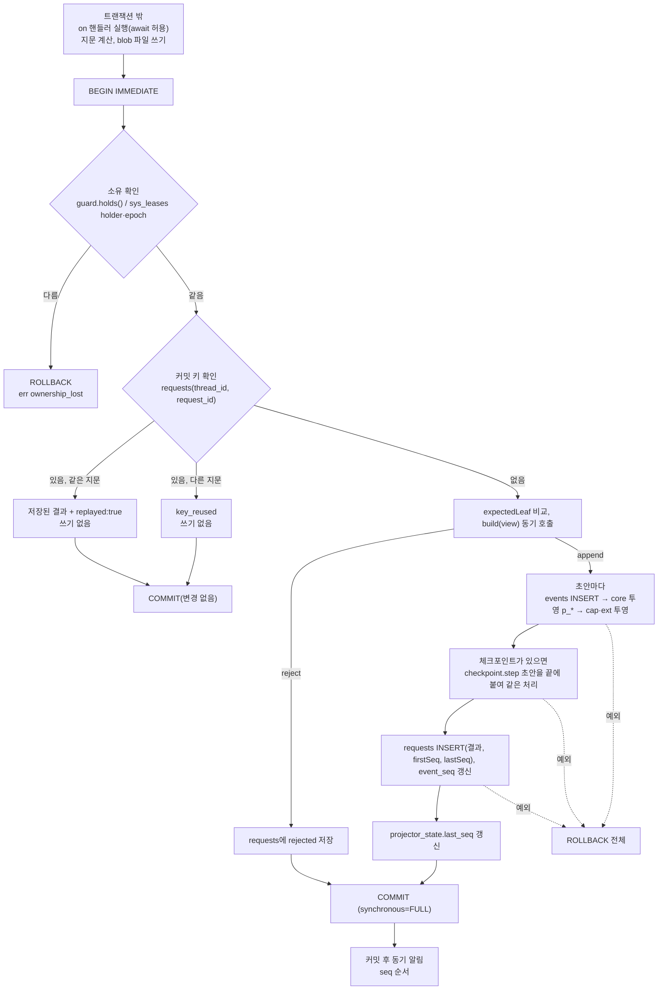
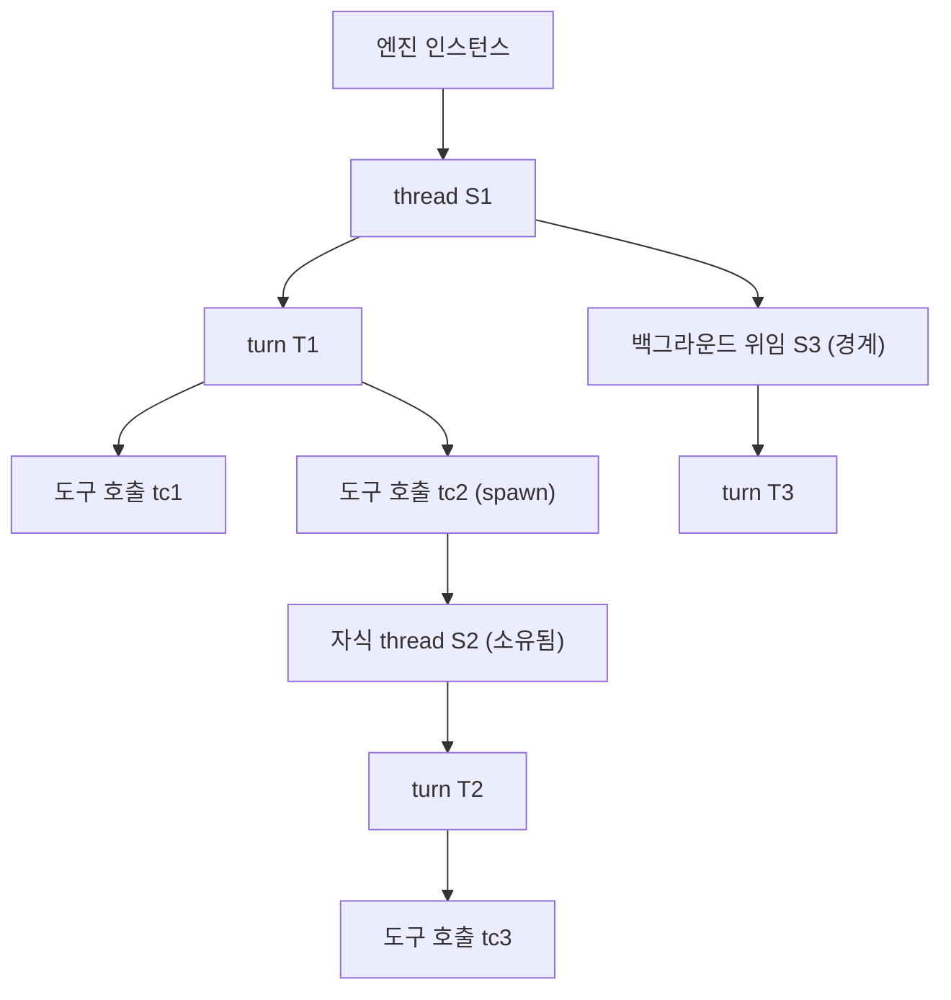

# 트랜잭션 설계

세션 기록의 원자성, 내구성, 쓰기 소유, 멱등, 결과 불명 처리, 취소 전파, outbox를 정한다. 이 문서는 커밋 키(`requestId`) 형식과 파생 규칙, outbox, 결과 불명 처리의 커밋 규칙, 단계 경계 `synchronous=FULL`의 정본이다. envelope 필드, kind 카탈로그, 효과 3단 레코드와 복구 결정표(`decideEffectRecovery`)는 `F.records.spec`이 정본이다. `seq`, 내구·휘발, 투영, 재생, 스키마 버전 운용은 `eng.events.design`이 정본이다. 테이블과 이벤트 kind 접두의 소유는 `eng.context-map.design`이 정본이다. 커밋 지점 표와 커밋 API 타입의 상세는 `L1.persistence.spec` §3.2~§3.7, §4.2가 정하고, 이 문서는 그 표를 일반 규칙과 함께 인용한다. 이름은 F 이름을 쓴다(`L1.persistence.spec` §2.1 대응표).

이 문서는 구속 문서다. 마지막 절 "구현 작업자 규칙"(TX-NN)은 `platform-store`, `core-persistence`, `cap-schedule`과 세션에 쓰는 모든 코드에 적용된다.

기존 Helm 설계 `docs/design/09-event-store.md §3.8~3.9`, `12-runtime-engine.md §3.7~3.8`은 데몬 하나가 DB의 유일한 쓰기 주체라는 전제다. Xeon은 CLI(같은 프로세스 엔진), 데스크톱(자식 엔진), 공유 서비스 모드(1차. OS 서비스 등록만 2차)가 같은 DB 파일을 열 수 있다(`_research/foundation-plan.md §1` 결정 2·3, [결정(잠정): review.decisions-2 S-01]). 그래서 데몬 단일 쓰기 잠금과 부팅 epoch 펜싱 대신 세션 단위 소유(OS 잠금 + 임대 행 epoch)를 쓴다. 해시 체인과 HMAC은 범위에서 뺐다(`eng.events.design` 미결 E-3).

## 1. 문제

- 한 루프 단계는 여러 기록을 남긴다. 모델 응답, 효과 의도와 결과, 확장(L3 그룹)의 기록, 입력 큐 상태가 함께 바뀐다. 일부만 저장되면 재개 때 상태가 어긋난다.
- 크래시는 아무 지점에서나 난다. 커밋된 것은 정전 뒤에도 남아야 하고, 커밋되지 않은 것은 흔적이 없어야 한다.
- CLI와 데스크톱이 같은 세션을 동시에 열 수 있다. 두 프로세스가 한 세션에 번갈아 쓰면 `seq`와 루프 상태가 깨진다.
- 네트워크 재시도, 재개, 확장의 `post` 재호출로 같은 쓰기가 두 번 올 수 있다.
- 도구 실행 중 크래시가 나면 그 도구가 효과를 냈는지 알 수 없다. 무조건 다시 실행하면 같은 외부 효과가 두 번 난다. 무조건 실패로 두면 모델이 성공한 작업을 반복할 수 있다.
- turn을 취소하면 그 아래 도구와 서브에이전트가 모두 멈추고 정리된 뒤에 turn이 끝나야 한다.

## 2. 선택지 비교

### 2.1 원자성 범위

| 안 | 내용 | 원자성 | 확장 제거 | 비용 |
|---|---|---|---|---|
| A. 단일 DB 파일 | 세션 테이블, 투영, 확장 접두사 테이블을 한 파일에 둔다 | 한 트랜잭션으로 전부 | 접두사 테이블 DROP | 낮음 |
| B. 파일 분리 + ATTACH | 확장마다 파일, 커밋 때 ATTACH | WAL에서는 파일별 원자성만 보장(여러 파일에 걸친 원자성 없음) | 파일 삭제 | 중간, 원자성 손실 |
| C. 파일 분리 + outbox | 세션 DB에 "확장 기록 예정"을 함께 커밋하고 확장 DB에 나중에 멱등 반영 | 세션 쪽은 원자, 확장 쪽은 최종 일관 | 파일 삭제 | 높음(반영기, 커서) |

근거: `_research/session-storage.md` "놓치기 쉬운 제약: 확장별 DB 파일과 원자성".

### 2.2 쓰기 소유

| 안 | 내용 | 장점 | 단점 |
|---|---|---|---|
| A. 데몬 단일 쓰기 잠금(09 §3.8.1) | 프로세스 하나만 쓰기 연결을 연다 | 단순 | Xeon은 CLI·데스크톱이 각자 엔진을 띄운다. 공유 서비스 모드(1차)가 켜져 있어도 CLI가 같은 프로세스 엔진으로 같은 DB를 열 수 있다 |
| B. OS 파일 잠금(세션 id별) | `flock`류 | DB 밖에서 빠르게 판정 | OS·WSL마다 동작이 다르다. 쓰기 트랜잭션 안에서 확인할 수 없다 |
| C. DB 임대 행 + 하트비트 | `sys_leases` 행에 소유자와 epoch를 두고 쓰기마다 확인 | 쓰기와 같은 트랜잭션에서 확인(펜싱). OS 무관 | 크래시 뒤 만료까지 대기(하트비트 주기) |
| D. 잠금 없음 | `BEGIN IMMEDIATE` 직렬화만 | 가장 단순 | 두 프로세스가 같은 세션 루프를 번갈아 진행할 수 있다 |

근거: `_research/packages.md §2.5`(단일 소유와 잠금: "DB 안 임대 행 + 하트비트면 충분 [추측]"), §4.2 L0-e 행, `_research/notes/L0-2.md §4.2`(B와 C 병용).

### 2.3 결과 불명

| 안 | 동작 | 문제 |
|---|---|---|
| A. 항상 재실행 | 결과 없는 의도를 다시 실행 | 외부 효과 중복(전송, 결제, `git push`) |
| B. 항상 실패 처리(opencode v2) | `aborted`로 닫고 재실행하지 않음 | 안전하지만 읽기 도구까지 모델이 다시 불러야 한다 |
| C. replay 정책 | 도구가 `safe`면 재실행, `unsafe`면 합성 결과(실행 전이면 `not_started`, 실행 뒤면 `outcome_unknown`) | 도구 선언 정확성에 의존 |

근거: durable `spec.md` 1917-1927(효과 샌드위치), 2082-2108(orphaned, replay-unsafe), 12 §3.7.2, `_research/refs/opencode.md`("never directly replays ambiguous side effects").

## 3. 선택과 근거

### 3.1 단일 DB 파일의 원자 커밋

[결정] 세션 이벤트, 투영, 확장 접두사 테이블 기록, 작업 상태를 한 DB 파일의 한 트랜잭션으로 묶는다(`_research/decisions-log.md` 2026-10-21 결정 2차, adr.0004).

- 확장(L3 그룹, 사용자 플러그인)은 기본으로 같은 프로세스에서 돈다(층 구성 계획 v2 "확장 프로세스 격리는 기본값이 아니어도 된다"). 같은 프로세스 확장의 기록은 코어 커밋과 같은 트랜잭션에 들어간다.
- [결정] 파일을 나누는 안(2.1의 C)은 신뢰 등급 2·3 확장이 별도 프로세스로 돌 때만 쓴다(`_research/session-storage.md` 권장안). 그 경우의 반영 규칙은 7절이다.
- "작업 상태"는 입력 큐, turn 상태, 효과 상태, drive 임대 상태다. 모두 내구 이벤트와 그 투영으로 남는다(`eng.events.design` 4.4절).

### 3.2 연결과 내구성

[결정] bun:sqlite, WAL, 단계 경계 커밋은 `synchronous=FULL`이다(`_research/foundation-plan.md §2` DB 행, `_research/session-storage.md` 권장안, adr.0004 §3.2 5번).

[제안] 쓰기 연결 설정(09 §3.6.3을 Bun 실측에 맞춰 고침, `_research/notes/eng-3.md §2.3`). 정본은 `L0.store.spec` §4.3이다.

```sql
PRAGMA journal_mode = WAL;
PRAGMA synchronous = FULL;           -- 쓰기 연결은 항상 FULL. 커밋마다 WAL fsync
PRAGMA busy_timeout = 5000;          -- Bun 기본값 0. 명시하지 않으면 잠금 충돌이 즉시 SQLITE_BUSY
PRAGMA foreign_keys = ON;
PRAGMA temp_store = MEMORY;
PRAGMA wal_autocheckpoint = 1000;
PRAGMA journal_size_limit = 67108864;
PRAGMA trusted_schema = OFF;
PRAGMA application_id = 1480937294;  -- 0x58454F4E 'XEON'. 새 파일에서만 설정, 이후 대조
```

- [제안] 쓰기 연결은 `synchronous`를 바꾸지 않고 FULL로 둔다. adr.0004는 단계 경계 FULL의 구현 방식(연결 단위 전환 대 단계 경계 직후 체크포인트)을 `L0.store.spec`에 넘겼고, `L0.store.spec` §4.3이 이 "항상 FULL" 권고를 채택했다. 단계 경계가 아닌 커밋(효과 커밋, 임대 하트비트, 입력 수락)도 FULL이다. 커밋마다 모드를 바꾸면 바꾸는 코드에 오류가 생길 자리가 늘고, 효과 의도가 디스크에 없으면 외부 효과를 낸 뒤 흔적이 없을 수 있다.
- [제안] 커밋 단위: 경계 하나(4.1절 표의 행 하나)의 쓰기는 커밋 하나에 모두 들어가고, 여러 커밋으로 나누지 않는다(TX-08). 효과는 도구 호출마다 의도(E1), 실행 시작(E2), 결과(E3)를 각각 커밋한다(`L1.persistence.spec` §4.2, `architecture.runtime-flow.design` §3). 그래서 모든 커밋이 FULL이면 커밋 수가 fsync 수이고, 한 모델 단계의 커밋 수는 `1(S1) + 1(C3) + 3 × 도구 수 + 1(C5)` = `3 + 3 × 도구 수`다. turn마다 C2와 C6이 하나씩 더해지고, C2b는 `before_agent_start`가 메시지를 더할 때만, C1은 유휴 thread의 입력일 때 하나 더 있다. 취소 의도(X1)와 승인 요청(A1)은 일어날 때만 더한다. fsync 비용은 모델 호출 시간보다 작다고 본다 [가정]. 측정은 `L1.persistence.plan` §6, `L0.store.plan` ST-17이다.
- [결정(잠정): review.decisions-2 U-10] 도구별 효과 커밋(E1 의도, E2 실행 시작, E3 결과)은 adr.0004 §3.2 3번의 보충으로 올린다. 단계당 커밋 수는 `3 + 3n`(n은 도구 수)이다. adr.0004 §3.2 아래 "한 단계에 커밋 한 번" 문장은 이 결정에 맞게 고친다(decisions 문서 담당).
- 읽기 연결은 `readonly: true`로 열고 `PRAGMA query_only = ON`, `busy_timeout = 5000`을 건다. bun:sqlite는 `fileMustExist`를 지원하지 않으므로 열기 전에 파일 존재를 검사한다(`_research/notes/eng-3.md §2.2`).
- 종료 때 `PRAGMA wal_checkpoint(TRUNCATE)` 뒤 닫는다.
- DB 파일 위치(OS별 데이터 디렉터리), 네트워크·가상 파일시스템 거부 검사, FTS5 프로브는 `L0.store.spec`이 정한다.

### 3.3 쓰기 단일 소유

[결정(잠정): review.decisions-2 U-09] 한 세션에 쓰기 소유자는 하나다. 판정은 OS 잠금(생존 판정)과 DB 임대 행의 epoch(펜싱)를 함께 쓴다. 정본은 `L0.store.spec` §3.1(`LeaseService`, `LeaseToken`), §3.3(`sys_leases` DDL), §4.7이다. 읽기는 소유 없이 여럿이 한다.

- 층 구성 계획 v2의 L0-e 행과 adr.0004(`decisions/ADR-0004-session-storage.md`) §3.4는 "세션 id 키 OS 잠금"(omp 방식, `_research/process.md §6.3` 1번)을 적었다. OS 잠금은 SQLite 트랜잭션 안에서 확인할 수 없어서, 잠금을 잃은 뒤 늦게 깨어난 이전 소유자의 쓰기를 막지 못한다. 그래서 `L0.store.spec` §4.7.1은 OS 잠금과 `sys_leases.epoch` 펜싱 병용을 권고안으로 둔다(이전 판 미결 T-4의 (b)안).
- [결정(잠정): review.decisions-2 U-09] 쓰기 소유 판정은 OS 잠금(생존 판정) + `sys_leases.epoch` 펜싱이다. 별도 `session_owner` 테이블은 두지 않고 `sys_leases` 행이 소유자 표시를 겸한다. adr.0004 §3.4와 adr.0006은 이 결정에 맞게 개정한다(decisions 문서 담당). 이 절에 기대는 규칙(4.3절 소유 확인 단계, 4.6절 `after_lease_check`, TX-10, 10절 수용 기준 4)도 같은 결정을 따른다.
- L1은 이 판정을 `OwnershipGuard.holds()`(`L1.persistence.spec` §3.6)로 받는다. 예상 실패 이름은 `ownership_lost`다.

임대 테이블(L0 store 소유, `L0.store.spec` §3.3 sys v2):

```sql
CREATE TABLE sys_leases (
  resource     TEXT PRIMARY KEY,        -- 'session:<threadId>' | 'scheduler' | 'service'
  holder_id    TEXT NOT NULL,
  epoch        INTEGER NOT NULL CHECK (epoch >= 1),
  kind         TEXT NOT NULL CHECK (kind IN ('cli', 'app', 'service')),
  pid          INTEGER NOT NULL,
  started_at   INTEGER NOT NULL,        -- 프로세스 시작 시각 지문 (pid 재사용 구분)
  host         TEXT NOT NULL,
  heartbeat_at INTEGER NOT NULL,
  expires_at   INTEGER NOT NULL,
  released_at  INTEGER                  -- NULL이면 보유 중
) STRICT;
```

규칙(`L0.store.spec` §4.7.3의 요약):

1. 획득: 먼저 OS 잠금을 시도한다. 잠금을 얻지 못하면 `LockBusy{ reason: "os_lock_held" }`다. 잠금을 얻은 뒤 `BEGIN IMMEDIATE` 안에서 행을 읽는다. 행이 없으면 `epoch = 1`로 넣는다. `released_at`이 있거나 `expires_at < now`면 `epoch + 1`로 쓴다. 행의 `host`가 자기와 같으면 OS 잠금을 이미 얻었으므로 이전 소유자는 살아 있지 않다. `epoch + 1`로 즉시 인수한다. `host`가 다르고 만료 전이면 OS 잠금을 풀고 `LockBusy{ reason: "lease_active" }`다. 같은 `holder_id`의 보유 중 행이면 epoch를 유지하고 만료만 늘린다.
2. 하트비트: `l0.store.heartbeatMs`(기본 5초)마다 `expires_at = now + leaseTtlMs`(기본 30초)로 갱신한다. 갱신 때 `holder_id`·`epoch`가 자기 것이 아니면 임대를 잃은 것이다. 그 세션의 메모리 작업을 모두 취소하고 쓰기를 멈춘다.
3. 펜싱: 모든 세션 쓰기 트랜잭션은 `BEGIN IMMEDIATE` 직후 `sys_leases`를 새로 읽어 `holder_id`와 `epoch`가 자기 토큰과 같고 `released_at`이 비었는지 확인한다(`LeaseService.holds(tx, token)`). 다르면 롤백하고 `ownership_lost` 오류를 돌려준다. 확인은 시각을 쓰지 않는다. 인수는 epoch를 바꾸므로 epoch 비교만으로 늦은 쓰기를 막는다.
4. 반납: 정상 종료 때 행을 지우지 않고 `released_at`을 채운다. epoch는 유지한다. 행을 지우면 다음 획득의 epoch가 1로 돌아가 펜싱 토큰의 단조성이 깨지기 때문이다(`L0.store.spec` §3.3).
5. OS 잠금이 없을 때(`lockProvider.kind === "none"`)는 DB 임대만으로 판정한다. 1번의 "같은 host 즉시 인수"를 "같은 host이고 `pid`·`started_at` 프로세스가 살아 있지 않으면 인수"로 바꾸고, 그 밖에는 만료를 기다린다(`L0.store.spec` §4.7.4).
6. 쓰기 소유자가 아닌 프로세스가 같은 세션을 열려 하면 위임·관찰·분기 중 하나를 고른다. 선택 정책은 `L0.process.spec` §4.5의 `LockFallbackPolicy`이고, 관찰 열기의 따라잡기는 `eng.events.design` 4.6절이다.
7. 주기 값은 설정 키 `l0.store.heartbeatMs`, `l0.store.leaseTtlMs`로 노출한다(`L0.store.spec` §6).

`BEGIN IMMEDIATE`는 BEGIN 시점에 DB 전체 쓰기 잠금을 잡는다(`_research/notes/eng-3.md §2.2` 실측). 그래서 3번 확인과 그 뒤 쓰기 사이에 다른 프로세스의 쓰기가 끼지 않는다.

### 3.4 멱등과 결과 불명

- [제안] 같은 커밋 키(`requestId`) 재제출은 저장된 결과를 돌려준다. 같은 키에 다른 지문이면 `key_reused`다(09 §3.9.1·3.9.2, durable `spec.md` 2288-2301 "`requestId` deduplicates within one conversation before any write"). 4.6~4.8절.
- [결정] 도구 실행은 의도 → 실행 → 결과 3단으로 기록한다(adr.0004 §3.2 3번). 결과 없는 의도는 저장된 정책과 현재 선언이 모두 `safe`면 재실행하고, 그 밖에는 합성 결과로 모델에 알린다. 합성 결과는 실행 시작 전 중단(`effect.exec` 없음)과 실행 중 중단(`effect.exec` 있음)을 구분한다(`F.records.spec` §3.5, durable `spec.md` 1917-1927, 2082-2108, 12 §3.7.2). 5절.

## 4. 구조와 흐름: 쓰기 트랜잭션

### 4.1 커밋 지점

[제안] 루프가 커밋하는 지점이다. 행 하나가 커밋 하나다. 표의 정본은 `L1.persistence.spec` §4.2이고, 커밋 내용의 정본은 각 소유 spec이다. kind는 `F.records.spec` §3.3 카탈로그와 `eng.events.design` 4.4절이다.

| 지점 | 커밋 내용(F kind) | 커밋 키 | 단계 체크포인트 |
|---|---|---|---|
| C1 입력 수락 | `input.queued` | `in:<sourceKey>:<requestId>` | 아니오 |
| C2 turn 시작 | `turn.started`, `input.placed`, user `item.recorded`, 확장 기여 | `turn:<turnId>:start` | 아니오 |
| C2b turn 시작 보충 | `before_agent_start`가 추가한 custom `item.recorded`(있을 때만) | `turn:<turnId>:prestart` | 아니오 |
| S1 단계 시작 | `step.started` | `step:<turnId>:<stepIndex>:start` | 아니오 |
| C3 모델 응답 확정 | assistant `item.recorded` + `part.recorded`들, 확장 기여 | `resp:<turnId>:<stepIndex>` | 아니오 |
| E1 효과 의도 | `effect.intent`(도구 호출마다) | `tool:<toolCallId>:intent` | 아니오 |
| E2 실행 시작 | `effect.exec` | `tool:<toolCallId>:exec`, 재실행은 `tool:<toolCallId>:exec:<attempt>` | 아니오 |
| E3 효과 결과 | `effect.result` + toolResult `item.recorded` | `tool:<toolCallId>:result` | 아니오 |
| A1 승인 요청 | `approval.requested` + `checkpoint.step`(`waiting: "approval"`) | `L1.tools.spec` §3.9 | 예 |
| C5 단계 끝 | `step.completed`, `input.placed`(steer), `thread.compacted`, 확장 기여(`scope.changed`, `lease.*` 포함), `checkpoint.step` | `step:<turnId>:<stepIndex>:end` | 예 |
| C6 turn 끝 | `turn.completed`, 확장 기여 | `turn:<turnId>:end` | 아니오 |
| X1 취소 의도 | `turn.abort_requested` | `abort:<turnId>` | 아니오 |

- 체크포인트는 단계 경계(C5)와 승인 대기(A1)에만 쓴다(`L1.persistence.spec` §4.2). A1은 `step.completed` 없는 체크포인트라 `F.records.spec` §3.6에 예외를 적도록 요청 중이다(`L1.persistence.spec` FR-P4). `L1.loop.spec` T3은 도구 호출이 있으면 C3에 `next: "tools"` 체크포인트를 요청한다. 이 요청은 F의 결정 뒤 이 표에 반영한다 [미결](`L1.readme` §13 (j)).
- 확장 기여: 그 지점의 `on` 핸들러(`chain`, `first`)가 돌려준 확장 이벤트 초안과 X의 경계 기여(`scope.changed`, `lease.acquired`, `lease.released`, `X.primitives.spec` 용어표)다. 핸들러는 커밋 전에 트랜잭션 밖에서 실행하고(await 허용), 결과 초안만 커밋에 넣는다. `tap` 핸들러는 커밋 뒤에 실행하고, 기록이 필요하면 자기 커밋 키로 따로 커밋한다.
- 확장 지점 이름(`tool_call`, `turn_end`, `before_agent_start`)은 adr.0007 §3.3의 pi 이벤트명을 따른 [가정]이다. 목록은 `F.extensions.spec`이 확정한다.
- `tool_call`(`first`)은 C3 뒤, E1 전에 실행한다. `tool_call`은 허용·거부·결과 대체만 하고 인자를 바꾸지 않는다([결정(잠정): review.decisions-2 U-06]). 통과한 호출은 모델이 낸 인자 그대로 `effect.intent`를 남긴다. 거부된 호출은 `effect.intent`도 `effect.result`도 없이 `isError: true`인 toolResult item만 남는다(`L1.tools.spec`). 재개 때는 `effect.intent`의 인자를 쓰고 핸들러를 다시 부르지 않는다(`eng.events.design` 7.1절).
- 진행 중 스트리밍 응답은 C3 전까지 저장하지 않는다. C3 전에 크래시가 나면 같은 단계의 모델 요청을 다시 보낸다.
- 이전 판의 C4(도구 정착 한 커밋)는 E1~E3으로 나눴으므로 쓰지 않는다.

### 4.2 인터페이스

[제안] 커밋 API 타입의 정본은 `L1.persistence.spec` §3.2~§3.6이고, F `records`로 옮기는 요청(FR-P1) 중이다. L0 저수준 API의 정본은 `L0.store.spec` §3.1이다(F 이동 요청 FR-S1, FR-S2). 구현은 `core-persistence`(L1)가 `platform-store`(L0) 위에 만든다. 다른 컨텍스트는 이 타입과 Cordis 서비스로만 쓴다(`eng.context-map.design` 3절, `eng.dependency-rules.guide` DR-14). ID 이름은 `F.conversation.spec` §3.2를 따른다.

| 이 문서의 이전 판 이름 | 정본 이름 | 위치 |
|---|---|---|
| `SessionWriter.commit`(공개) | `SessionService.commit`(서비스 `xeon.session`). `SessionWriter`는 내부 구현 클래스 | `L1.persistence.spec` §3.1, §3.3 |
| `SessionId`, `RequestId`(브랜드) | `ThreadId`, `CommitKey`(브랜드 없는 문자열) | `L1.persistence.spec` §3.2 |
| `StepCheckpointDraft { state }` | `StepCheckpointInput`(이벤트 `checkpoint.step`으로 기록) | `L1.persistence.spec` §3.2 |
| `StampedDraft extends EventDraft` | `StampedDraft { draft: DurableEventDraft, producer }` | `L1.persistence.spec` §3.2 |
| `TxView`(도구 호출·입력 조회) | `TxView`(turn, effect, input, approval, agent, scope 상태 판 조회) | `L1.persistence.spec` §3.2 |
| `StoreError.lease_lost` | `StoreError.ownership_lost` | `L1.persistence.spec` §3.2 |
| `LeaseToken { sessionId }` | `LeaseToken { resource }` | `L0.store.spec` §3.1 |
| `StoreDb.write` 오류 `busy`, `disk_full` | `StoreWriteError`: `busy`, `disk_full`, `io` | `L0.store.spec` §3.1 |
| `StoreService.scoped(tablePrefix)` | `StoreService.scoped(owner)` | `L0.store.spec` §3.1 |
| `putBlob(bytes, mime): BlobRef` | `putBlob(bytes, mediaType): Result<BlobRef, BlobError>` | `L0.store.spec` §3.1 |

요약(정본과 다르면 정본을 따른다):

```ts
// xeon/packages/contracts/src/records/commit.ts (L1.persistence.spec §3.2 요약)
export type CommitKey = string;                                 // COMMIT_KEY_PATTERN, 4.7절
export interface CommitRequest {
  readonly threadId: ThreadId;
  readonly requestId: CommitKey;
  /** 지문 원천. 생성 id, 시각, 시도 번호, 연결 id를 넣지 않는다 (4.7절) */
  readonly fingerprintSource: JsonValue;
  /** 동기, 순수. 트랜잭션 안에서 한 번 부른다 */
  readonly build: (view: TxView) => CommitPlan;
  readonly expectedLeaf?: EventId | null;
}
export type CommitPlan =
  | { readonly kind: "append"; readonly drafts: readonly StampedDraft[]; readonly checkpoint: StepCheckpointInput | null }
  | { readonly kind: "reject"; readonly code: string; readonly detail: string | null };
// CommitResult: committed{firstSeq, lastSeq, leaf, eventIds, replayed} | rejected{code, detail, replayed} | key_reused
// StoreError: busy | disk_full | ownership_lost | read_only | thread_not_found
// SessionService.commit(request: CommitRequest): Result<CommitResult, StoreError>
```

장애 주입 타입은 이 절이 정본이다. `eng.testing.guide` TS-07·TS-08과 `L1.persistence.spec` §3.2가 이 타입을 그대로 쓴다.

```ts
// xeon/packages/contracts/src/records/session-store.ts
/** 테스트용 장애 주입. 운영 구현은 아무것도 하지 않는다 */
export type FaultPoint =
  | "after_begin"
  | "after_lease_check"
  | "after_request_check"
  | `after_event_insert:${number}`
  | `after_projection:${number}`
  | `after_ext_projection:${number}`
  | "before_checkpoint"
  | "before_request_insert"
  | "before_commit"
  | "after_commit";

export interface FaultInjector {
  hit(point: FaultPoint): void;
}
```

- L0 store는 서비스 `xeon.store`로 등록한다. 세션 테이블에 쓸 수 있는 전체 핸들은 조립 루트(L4 host)가 `core-persistence`에만 넘긴다. 다른 컨텍스트는 `scoped(owner)`로 자기 접두사 테이블용 핸들만 받는다 [제안].
- [제안] `write`는 bun:sqlite의 `db.transaction(fn).immediate()`로 구현한다. 안쪽 트랜잭션 호출은 저장점이 되므로(`_research/notes/eng-3.md §2.1`), 의도하지 않은 저장점을 막으려고 중첩 `write`를 금지한다. 세부(저장점 의미 확인, 직접 `BEGIN IMMEDIATE` 문장 사용 여부)는 미결 T-2다.
- `SQLITE_BUSY`(busy_timeout 5000 초과)는 `err({ kind: "busy" })`, `SQLITE_FULL`은 `err({ kind: "disk_full" })`, I/O 계열은 `err({ kind: "io" })`로 바꾼다(`L0.store.spec` §3.1). 쓰기 결과는 저장되지 않았으므로 호출자는 같은 커밋 키로 다시 시도한다(TX-05).
- bun:sqlite는 콜백이 던질 때 롤백한다. 그래서 트랜잭션 안의 예상 실패(`ownership_lost`)는 `core-persistence` 내부 표지 값으로 던져 롤백하고, `commit` 밖에서 `err(...)`로 바꾼다. 이 throw는 `eng.typescript.guide` TY-11의 허용 경우 3(외부 API 계약)이고, 그 줄에 예외 주석을 단다. 표지 값은 `commit` 밖으로 나가지 않는다.

### 4.3 단계 순서

단계 표의 정본은 `L1.persistence.spec` §4.1이다.



### 4.4 의사코드

```ts
// xeon/packages/core-persistence/src/writer.ts (설명용 골격)
commit(req: CommitRequest): Result<CommitResult, StoreError> {
  const fingerprint = this.hash.sha256Hex(canonicalJson(req.fingerprintSource)); // 0. 트랜잭션 밖
  let appended: readonly DurableEventEnvelope[] = [];
  let written: Result<CommitResult, StoreWriteError>;
  try {
  written = this.db.write((tx): CommitResult => {                                // 1. BEGIN IMMEDIATE
    this.fault.hit("after_begin");
    // OWNERSHIP_LOST: 이 모듈 안의 Error 상수. 롤백용 표지이고 commit 밖으로 나가지 않는다 (TY-11 허용 3)
    if (!this.ownership.holds(tx, req.threadId)) throw OWNERSHIP_LOST;           // 2. 소유 확인 (새로 읽기)
    this.fault.hit("after_lease_check");
    const prior = this.requests.find(tx, req.threadId, req.requestId);           // 3. 커밋 키
    if (prior !== undefined) {
      return prior.fingerprint === fingerprint
        ? { ...prior.result, replayed: true }
        : { status: "key_reused", requestId: req.requestId };
    }
    this.fault.hit("after_request_check");
    const view = this.views.open(tx, req.threadId);
    const plan = req.build(view);                                                // 4. 동기·순수
    if (plan.kind === "reject") {
      const rejected: CommitResult = { status: "rejected", code: plan.code, detail: plan.detail, replayed: false };
      this.requests.insert(tx, req.threadId, req.requestId, fingerprint, rejected);
      return rejected;
    }
    const drafts = plan.checkpoint === null
      ? plan.drafts
      : [...plan.drafts, this.checkpointDraft(view, plan.checkpoint)];          // 8. checkpoint.step을 끝에
    const out: DurableEventEnvelope[] = [];
    let seq = this.seqs.next(tx);                                                // event_seq.next_seq
    const firstSeq = seq;
    let recordedAt = Math.max(this.clock.now(), this.lastRecordedAt(tx));
    drafts.forEach((stamped, i) => {                                             // 5~7. append + 투영 + 확장
      if (i === drafts.length - 1 && plan.checkpoint !== null) this.fault.hit("before_checkpoint");
      const ev = this.envelopes.complete(stamped, {                              // 스키마·kind 소유·크기 검사 포함
        seq: seq++, recordedAt, parentId: this.parentOf(tx, stamped),
      });
      this.events.insert(tx, ev, req.requestId);                                 // request_id 열
      this.fault.hit(`after_event_insert:${i}`);
      const upcasted = upcastEvent(ev, this.registry);
      if (!upcasted.ok) throw new Bug("store.schema_invalid: upcast failed", { cause: upcasted.error });
      const up = upcasted.value;
      this.core.apply(this.projectionTx(tx, this.core), up);
      this.fault.hit(`after_projection:${i}`);
      for (const p of this.projectorsFor(up.kind)) p.apply(this.projectionTx(tx, p), up);
      this.fault.hit(`after_ext_projection:${i}`);
      out.push(ev);
    });
    const committed: CommitResult = {
      status: "committed", firstSeq, lastSeq: seq - 1,
      leaf: this.leafOf(tx, req.threadId), eventIds: out.map((e) => e.id), replayed: false,
    };
    this.fault.hit("before_request_insert");
    this.requests.insert(tx, req.threadId, req.requestId, fingerprint, committed);
    this.seqs.advance(tx, seq);
    this.projectorState.advance(tx);
    this.fault.hit("before_commit");
    appended = out;
    return committed;
  });                                                                            // 11. COMMIT (FULL)
  } catch (caught) {
    if (caught === OWNERSHIP_LOST) return err({ kind: "ownership_lost", threadId: req.threadId });
    throw caught;                                                                // Bug는 그대로
  }
  if (!written.ok) return written;                                               // busy, disk_full, io
  this.fault.hit("after_commit");
  if (appended.length > 0) this.feed.notifyCommitted(appended);                  // 12. 커밋 후 동기 알림
  return ok(written.value);
}
```

- `recordedAt`은 DB 안에서 감소하지 않는다. 시계가 뒤로 가면 직전 값을 쓴다.
- 이벤트 `id`는 생산자가 초안에서 미리 발급한다(`F.records.spec` §3.1 `DurableEventDraft`). 저장소는 `seq`, `recordedAt`, `parentId`를 채운다.
- `build`는 같은 트랜잭션 안에서 읽은 `view`로 결정한다. 예: 이미 `effect.result`가 있는 효과에 결과를 다시 쓰려 하면 `reject("already_settled")`, 취소 요청된 turn에 새 의도를 쓰려 하면 `reject("turn_aborting")`.
- `requests`의 `rejected`는 저장한다. 같은 키로 다시 와도 같은 거부를 돌려준다.

### 4.5 커밋 후 알림

- 알림은 커밋한 그 JS 턴 안에서 동기로 부른다(09 §3.8.4 8단계). 다른 쓰기가 끼지 않으므로 구독자는 `seq` 순서대로 받는다.
- 구독자 예외는 피드가 잡아 운영 로그에 남긴다. 쓰기 결과에 영향을 주지 않는다.
- 구독자는 알림 안에서 동기로 `commit`을 부르지 않는다(TX-09). 쓰기가 필요하면 `queueMicrotask`로 미룬다. 커밋 안에서 다시 커밋하면 `Bug(store.nested_write)`이고, 알림 중 커밋은 순서 보장을 깨뜨린다.
- 놓친 구독자는 `readFrom(afterSeq)`로 따라잡는다. 그래서 알림 전용 outbox가 없다(7절).

### 4.6 장애 주입 지점과 불변식

[제안] `FaultInjector.hit(point)`가 예외를 던지게 해서 각 지점을 시험한다(09 §3.8.4 고장 주입 지점, helm-kernel-v02 `faultInjector`를 Xeon 단계에 맞춤).

| 지점 | 그 지점에서 예외가 났을 때 성립해야 하는 것 |
|---|---|
| `after_begin` | `events`, `event_seq`, `p_*`, `cap_*`, `x_*`, `requests`, `step_checkpoints` 변화 없음. 임대 행 변화 없음 |
| `after_lease_check` | 같음 |
| `after_request_check` | 같음. 이 커밋 키의 `requests` 행 없음(같은 키 재시도가 처음처럼 처리됨) |
| `after_event_insert:<n>` | 0..n번째 이벤트 행 모두 없음. `event_seq.next_seq` 그대로 |
| `after_projection:<n>` | 같음. `p_*` 행 변화 없음 |
| `after_ext_projection:<n>` | 같음. `x_*`, `cap_*` 행 변화 없음 |
| `before_checkpoint` | 같음. `checkpoint.step` 행과 `step_checkpoints` 그대로 |
| `before_request_insert` | 같음 |
| `before_commit` | 같음 |
| `after_commit` | 모든 행이 남는다. 알림은 가지 않았다. 같은 커밋 키 재시도는 `replayed: true`이고 이벤트 수가 늘지 않는다. 구독자는 `readFrom`으로 따라잡는다 |

모든 행에 공통: 커밋 전 지점이면 `events`·`p_*`·`x_*` 변화가 남지 않는다. 같은 커밋 키로 다시 시도하면 처음 시도와 같은 결과가 나온다.

### 4.7 커밋 키와 지문

[제안] 09 §3.9.1을 Xeon에 맞게 줄였다.

- 범위: 커밋 키는 thread 하나 안에서 유일하다. `requests` 테이블의 기본 키는 `(thread_id, request_id)`다(`L1.persistence.spec` §3.10).
- 형식: 정규식 `COMMIT_KEY_PATTERN` = `^[A-Za-z0-9][A-Za-z0-9_.:-]{0,199}$`(1~200자)를 이 문서의 정본으로 둔다. 코드 상수는 F `records/commit.ts`(`F.records.spec` §3.9)에 두고 `L1.persistence.spec` §3.2는 인용한다 [결정(잠정): review.decisions-2 U-13]. L1과 X는 이 상수 하나로 키를 검사한다. 이전 판의 `REQUEST_ID_PATTERN`(`<종류>:<부분>`)은 X의 키(`${leaseId}:…`, `st:<해시>:…`, `X.primitives.spec` §4.4.4·§4.6.1)를 받지 못해 쓰지 않는다. 키는 대부분 `<종류>:<부분>[:<부분>…]` 꼴이지만, 형식 검사는 위 정규식 하나다. 저장소가 커밋 처리 전에 검사한다(`L1.persistence.spec` §4.4).
- 커밋 키는 브랜드 없는 문자열(`CommitKey`)이다. F에는 `RequestId` 브랜드가 없다(`F.readme` §4, `F.records.spec` §3.1.2). 키는 먼저 커밋된 값에서 결정적으로 만들므로 무작위 ULID 하나로 정할 수 없다. 사용자 입력처럼 원인 이벤트가 없는 요청만 클라이언트가 만든 값을 부분으로 쓴다(`in:user:<requestId>`).
- payload의 `requestId`(사용자 입력, `post`, `turn.start`)는 F 규칙(브랜드 없는 1~64자, `F.conversation.spec` §3.5)이다. 커밋 키는 그 값을 감싸 만든다(예: `in:<sourceKey>:<requestId>`). 감싸기 규칙은 각 생산 spec이 정한다.
- `/` 치환 [결정(잠정): review.decisions-2 U-13]: 커밋 키의 부분에 scope id가 들어갈 때 하위 scope 구분자 `/`는 `COMMIT_KEY_PATTERN`에 없으므로 `:`로 바꾼다(예: scope `helm/review` → `in:helm:review:<requestId>`). `L1.tasks.spec` §4.7의 출처 키와 `L1.persistence.spec`이 같은 규칙을 쓴다.
- 이 문서의 코드 예에 쓴 템플릿 문자열(`` `resp:${turnId}:${stepIndex}` ``)은 키 모양을 그대로 보인다.
- 지문: `sha256Hex(canonicalJson(fingerprintSource))`. 정규화 JSON은 RFC 8785 규칙(09 §3.2.1, `eng.domain-types.guide` DT-14)이다.
- 지문에서 뺄 것: 커밋 때 새로 만드는 id(`effectId`, `itemId`, 이벤트 id), 시각, 시도 번호, 연결 id, 프로세스 id. 이 값이 들어가면 같은 요청의 재시도가 `key_reused`가 된다.
- 결과는 thread가 지워질 때까지 보관한다.

```sql
-- 정본: L1.persistence.spec §3.10
CREATE TABLE requests (
  thread_id    TEXT NOT NULL,
  request_id   TEXT NOT NULL,
  fingerprint  TEXT NOT NULL,          -- 64 hex
  status       TEXT NOT NULL CHECK (status IN ('committed', 'rejected')),
  result       TEXT NOT NULL,          -- CommitResult JSON (replayed 제외)
  first_seq    INTEGER,
  last_seq     INTEGER,
  PRIMARY KEY (thread_id, request_id)
) STRICT;
```

결과 저장 규칙(09 §3.9.2를 줄임):

| 처리 결과 | `requests` 저장 | 이벤트 | 같은 커밋 키로 다시 오면 |
|---|---|---|---|
| committed | 예 | 커밋된 이벤트들 | 저장된 결과 + `replayed: true`. 이벤트 수 변화 없음 |
| rejected(`build`가 거부) | 예 | 없음 | 저장된 거부 + `replayed: true` |
| key_reused(같은 키, 다른 지문) | 아니오 | 없음 | `key_reused`. 호출자 버그로 보고 운영 로그에 남긴다 |
| 예상 실패(`err`: `busy`, `disk_full`, `io`, `ownership_lost`, `read_only`) | 아니오 | 없음(롤백) | 처음부터 다시 처리 |
| 버그(`Bug`: `store.schema_invalid`, `store.projection_failed`, `store.prefix_not_owned` 등) | 아니오 | 없음(롤백) | 고친 뒤 같은 키로 통과할 수 있다 |

### 4.8 내부 쓰기의 커밋 키 파생 규칙

[제안] 키에 들어가는 id(`turnId`, `toolCallId`, `stepIndex`)는 먼저 커밋된 이벤트에 기록된 값이다. 아직 커밋되지 않은 id로 키를 만들지 않는다. 값의 정본은 각 행의 출처 문서다.

| 쓰는 쪽(소유 컨텍스트) | 이벤트 | 커밋 키 | 보장 | 출처 |
|---|---|---|---|---|
| 입력 큐(run-engine tasks): 사용자, 확장 post, 위임 보고, 예약 실행 공통 | `input.queued`(확장 post면 `post.accepted` 함께) | `in:<sourceKey>:<requestId>`. 출처 키는 사용자 `user`, 확장 `scopeId`(`/`는 `:`, 4.7절 `/` 치환 [결정(잠정): review.decisions-2 U-13]), 위임 `deleg`, 예약 `timer` | 같은 출처·같은 `requestId`의 입력 한 번 | `L1.tasks.spec` §4.7, `X.primitives.spec` `InputQueuePort` |
| 확장 `post`(ext-host) | 위 행 | payload `requestId`는 확장이 정한다. 멱등 범위는 (scopeId, requestId) | 같은 주입 한 번 | `X.primitives.spec` `EnqueueRequest` |
| 백그라운드 위임 완료 보고(run-engine agents) | 부모의 `input.queued`(post) | post `requestId` = `<자식 requestId>:report` | 완료 보고 한 번 | `L1.agents.spec` §4.7 |
| 예약 실행(cap-schedule) | 대상 thread의 `input.queued`(post) | post `requestId` = `timer:<timerId>:<dueAt>` | 재시작 뒤 같은 기한 한 번 | `L2.schedule.spec` |
| turn 시작(run-engine loop) | `turn.started` | `turn:<turnId>:start`, 보충은 `turn:<turnId>:prestart` | turn 한 번 | `L1.loop.spec` |
| 단계 시작 | `step.started` | `step:<turnId>:<stepIndex>:start` | 단계마다 한 번 | `L1.loop.spec` T2 |
| 모델 응답 확정 | assistant `item.recorded`, `part.recorded` | `resp:<turnId>:<stepIndex>` | 단계마다 응답 한 번 | `L1.loop.spec` T3 |
| 효과 의도(tool-runtime) | `effect.intent` | `tool:<toolCallId>:intent` | 호출마다 의도 한 번 | `L1.tools.spec` §3.9 |
| 효과 실행 시작 | `effect.exec` | `tool:<toolCallId>:exec`, 재실행은 `tool:<toolCallId>:exec:<attempt>`(attempt는 1부터) | 첫 실행 한 번, 재실행 시도마다 한 번 | `L1.persistence.spec` §4.7.3 |
| 효과 결과(정상 결과와 복구 합성 모두) | `effect.result` + toolResult `item.recorded` | `tool:<toolCallId>:result` | 의도마다 결과 0 또는 1 | `L1.tools.spec` §3.9, `L1.persistence.spec` §3.9 |
| 단계 끝 | `step.completed`, `input.placed`(steer), `thread.compacted`, 확장 기여, `checkpoint.step` | `step:<turnId>:<stepIndex>:end` | 단계 경계 한 번(TX-08) | `L1.loop.spec` T4 |
| scope 켜기·끄기 적용, drive 임대·반납(ext-host) | `scope.changed`, `lease.acquired`, `lease.released` | 경계 기여는 그 경계 커밋의 키를 따른다(대개 C5). 토글 요청 자체는 이벤트가 아니다 | 경계마다 한 번 | `X.primitives.spec` §4.4.1, §4.4.5, §4.5 |
| drive 턴·spawn(ext-host) | 해당 turn의 `turn.started`, 자식 생성 | `TurnInput.requestId` 기본값 `${leaseId}:${baseRev}.${i}`. 멱등 범위는 (scopeId, requestId) | drive 재호출 때 같은 판의 같은 호출 한 번 | `X.primitives.spec` §4.4.4 |
| 확장 상태 커밋(scope 상태) | `x.<name>.state.committed`, `grp.<name>.state.committed` | on 핸들러 안 `st:<scope 해시>:<dispatchKey>:<n>`, drive 함수 안 `${leaseId}:${baseRev}.c<n>` | 같은 디스패치·같은 판의 커밋 한 번 | `X.primitives.spec` §4.6.1 |
| 취소 의도 | `turn.abort_requested` | `abort:<turnId>` | 취소 의도 한 번 | `L1.tasks.spec` §4.2 |
| turn 끝 | `turn.completed` | `turn:<turnId>:end` | turn 종결 하나 | `L1.loop.spec` T6 |
| 서브에이전트 생성(run-engine agents) | 자식 `thread.started` + 부모 `agent.spawned` | `spawn:<부모 threadId 해시>:<자식 requestId>`. 자식 requestId는 `<ownerRequestId>:spawn:<n>` 또는 drive·그룹이 준 값 | 생성 한 번 | `L1.agents.spec` §3.5, §4.5 |
| 서브에이전트 정착 | `agent.settled` | `agent:<childThreadId>:settled` | 정착 한 번 | `L1.agents.spec` §3.5 |
| 승인 요청·해결(tool-runtime) | `approval.requested`/`approval.resolved` | `approval:<threadId>:<requestKey>:request`(64자를 넘으면 해시로 줄인다) / `approval:<approvalId>:resolve` | 각 한 번 | `L1.tools.spec` §3.9 |
| thread 생성(session-core) | `thread.started` | `thread:<threadId>:start` | 한 번 | `L1.persistence.spec` §3.9 |
| 되감기·가지 이동, 제목 변경, 닫기 | `thread.leaf_moved`, `thread.updated`, `thread.closed` | `leaf:<threadId>:<requestKey>`, `title:<threadId>:<requestKey>`, `thread:<threadId>:close` | 요청 한 번 | `L1.persistence.spec` §3.9 |
| 재개 시작 | `thread.resumed` | `resume:<turnId>:<attempt>` | 시도마다 한 번 | `L1.persistence.spec` §3.9 |

- `input.*`, `turn.abort_requested`, `approval.*`, `agent.*`, `thread.resumed`는 F 코어 카탈로그(`F.records.spec` §3.3)에 있다(`eng.events.design` 4.4절).
- 이전 판의 `post:<extId>:<key>`, `deleg:<childSessionId>:done`, `scope:<scopeId>:<clientUlid>`, `drive:<scopeId>:<leaseEpoch>:…`, `ext:<extId>:<scopeId>:<stateRev>`, `session:`, `rewind:`, `retitle:` 키와 `tool.replay_started`(`tool:<id>:replay:<attempt>`)는 쓰지 않는다.

## 5. 결과 불명

### 5.1 3단 기록

[결정] durable `spec.md` 1917-1927의 효과 샌드위치("commit intent phase → perform external effect → commit outcome")를 따른다(adr.0004 §3.2 3번). 레코드 모양과 기록 순서의 정본은 `F.records.spec` §3.5다.

```mermaid
sequenceDiagram
  participant Loop as run-engine(loop)
  participant Ext as ext-host(on 지점)
  participant Tools as tool-runtime
  participant Store as session-core(commit)
  participant Env as L0 exec·sandbox
  Loop->>Store: C3 commit: assistant item.recorded + part.recorded
  Store-->>Loop: committed
  Loop->>Ext: tool_call (first), 트랜잭션 밖
  Ext-->>Loop: 통과 또는 거부
  Tools->>Store: E1 commit: effect.intent(최종 인자, replay)
  Store-->>Tools: committed
  Tools->>Store: E2 commit: effect.exec
  Tools->>Env: 외부 효과(트랜잭션 밖)
  Env-->>Tools: 결과
  Tools->>Store: E3 commit: effect.result + toolResult item.recorded
  Store-->>Tools: committed (같은 키 재시도면 replayed)
```

불변식:

- 도구는 커밋된 `effect.intent` 없이 실행되지 않는다(12 CR-3, TX-02). 예외는 두지 않는다. 읽기 도구도 의도를 먼저 커밋한다. 커밋이 늘지만 규칙이 하나가 된다 [제안].
- `effect.intent`가 있는 호출마다 `effect.result`는 0 또는 1건이다. 같은 커밋 키(`tool:<toolCallId>:result`)와 `build`의 `already_settled` 거부가 이를 지킨다. `effect.intent` 전에 거부된 호출(`tool_call` 핸들러 거부, 정책·승인 거부)은 효과 이벤트 없이 `isError: true`인 toolResult item만 남는다(`L1.tools.spec`).
- 결과 없는 의도의 판정은 실행 시작 여부를 구분한다. `effect.exec`가 없으면 실행 시작 전 중단이므로 효과가 없었다(`not_started`, status `abandoned`). `effect.exec`가 있으면 효과가 났을 수 있다(`outcome_unknown`, status `interrupted`)(`F.records.spec` §3.5 결정표).
- assistant item에 toolCall이 있고 그 `effect.intent`가 없으면 효과는 일어나지 않았다. 재개는 그 호출을 정상 파이프라인으로 다시 돌린다(`L1.persistence.spec` §4.7.4).

### 5.2 재개 때 판정

판정 함수의 정본은 F `decideEffectRecovery`(`F.records.spec` §3.5)와, 거기에 재실행 상한을 더한 `decideOpenEffect`(`L1.persistence.spec` §3.7)다.

```ts
// F.records.spec §3.5 (요약)
export function decideEffectRecovery(input: {
  intent: EffectIntent;
  exec: EffectExec | null;
  result: EffectResult | null;
  currentReplay: ReplayPolicy | null;   // 현재 등록된 도구의 선언. 도구가 사라졌으면 null
}): EffectRecovery;                     // none | rerun | synthesize{ code: "not_started" | "outcome_unknown" }

// xeon/packages/core-persistence/src/recovery.ts (L1.persistence.spec §3.7 요약)
export const MAX_REPLAY_ATTEMPTS: 2 = 2;
/** base = decideEffectRecovery(...). base가 rerun이고 max(0, execCount - 1) >= MAX_REPLAY_ATTEMPTS면 outcome_unknown 합성 */
export function decideOpenEffect(input: OpenEffectInput): EffectRecovery;
```

결정표(`F.records.spec` §3.5):

| result | exec | intent.replay | currentReplay | 결정 |
|---|---|---|---|---|
| 있음 | — | — | — | `none` |
| 없음 | 없음 | safe | safe | `rerun` |
| 없음 | 없음 | 그 밖 | 그 밖 | `synthesize`, `not_started`, status `abandoned` |
| 없음 | 있음 | safe | safe | `rerun`(상한 안) |
| 없음 | 있음 | 그 밖 | 그 밖 | `synthesize`, `outcome_unknown`, status `interrupted` |

- 의도 시점 선언과 현재 선언이 모두 `safe`여야 재실행한다. 나중에 `safe`로 바꾼 선언으로 과거 호출의 재실행을 허가하지 않는다(12 §3.7.2, durable `spec.md` 3136-3170 "Recovery does not let a changed registry declaration alter the stored replay policy"). 도구가 사라졌으면(`currentReplay: null`) `unsafe`와 같게 처리한다.
- 재실행: `effect.exec`를 `tool:<toolCallId>:exec:<attempt>` 키로 커밋하고, 트랜잭션 밖에서 `effect.intent`에 저장된 최종 인자로 실행한 뒤 `effect.result`를 처음과 같은 `tool:<toolCallId>:result` 키로 커밋한다. `tool_call` 핸들러는 다시 부르지 않는다. 실행 주체는 core-loop(`ToolService.rerun`)이고 판정은 core-persistence `recover`다(`L1.persistence.spec` §4.7.1).
- 재실행 수는 `effect.exec` 건수로 센다. 재실행 수 = `max(0, execCount - 1)`이다. `MAX_REPLAY_ATTEMPTS`(2)에 이르면 다음 판정은 `outcome_unknown` 합성이다(`L1.persistence.spec` §4.7.3). 이전 판의 `tool.replay_started` 이벤트와 `OpenIntent.replayAttempts`는 두지 않는다.
- 이전 판의 도구 주 버전 비교(`majorOf(toolVersion)`)는 F 결정표에 없어 두지 않는다.
- 합성 결과: `effect.result{status, synthesized: true, output: null}`과 `isError: true`인 toolResult `item.recorded`를 한 커밋으로 쓴다. 커밋 키는 `tool:<toolCallId>:result`다(`F.records.spec` §4.5 3번). 본문은 5.3절이다.
- 취소 의도가 커밋된 turn의 열린 효과는 `rerun` 판정이 나와도 재실행하지 않고 합성으로 닫는다(6.2절 7번, `L1.persistence.spec` §4.8.1).
- 파일 해시 guard(쓰기 도구의 `before`/`after` 해시로 "적용됨", "재실행 가능", "불명"을 구분하는 12 §3.7.2 `file_hash`)는 2차다. 도입하면 `EffectRecovery`에 변형을 더하도록 F에 요청한다 [제안].
- 컨텍스트 조립(L1 context)은 안전망으로, 결과 없는 호출에 오류 결과를 합성해 provider에 보낸다(durable `spec.md` 280-281 컨텍스트 도출 규칙 8). 이 합성은 저장하지 않는다(`L1.persistence.spec` §4.7.2).

### 5.3 모델에 보내는 합성 결과

[제안] 도구 결과 본문은 영어로 둔다(도구 설명과 같은 언어, 12 §3.7.4를 줄임). 화면 문구는 L4가 정한다. 복구 합성의 본문은 F 상수다(`F.records.spec` §3.5).

| 합성 코드 | `effect.result.status` | 모델용 결과 본문 | `isError` |
|---|---|---|---|
| `not_started` | `abandoned` | `NOT_STARTED_TEXT`: "The tool call was interrupted before it started. It had no effect." | true |
| `outcome_unknown` | `interrupted` | `OUTCOME_UNKNOWN_TEXT`: "The tool call was interrupted before its result was recorded. It may have taken effect. Check the current state before retrying." | true |

- 사용자 취소로 실행 중인 도구가 멈춘 결과, 재실행 결과의 표시 같은 정상 경로의 본문은 `L1.tools.spec`이 정한다.

### 5.4 프로세스 종료 지점과 재시작 불변식

정본은 `L1.persistence.spec` §4.14다.

| 종료 지점 | 재시작 뒤 상태 | 처리 |
|---|---|---|
| K1 스트리밍 응답 중(C3 전) | 이 단계의 assistant item 없음 | 같은 단계 모델 요청 재전송(12 CR-7) |
| K2 E1 뒤, E2 전 | intent만 | safe·safe면 재실행, 아니면 `not_started` 합성(`abandoned`) |
| K3 실행 중(E2 뒤) | intent + exec | safe·safe이고 상한 안이면 재실행, 아니면 `outcome_unknown` 합성(`interrupted`) |
| K4 실행 끝, E3 전 | intent + exec(효과는 났음) | K3과 같다. `unsafe`면 모델이 상태를 확인 |
| K5 E3 뒤, 알림 전 | 종결됨 | 구독자가 `readFrom`으로 따라잡음 |
| K6 C6 전, 모든 효과 종결 뒤 | turn 열림 | 체크포인트에서 다음 단계 계속(자동 재개 설정이 켜졌을 때) 또는 입력 대기 |

## 6. 소유 트리와 취소 전파

### 6.1 소유 트리

[제안] durable `spec.md` 1972-2200(§5.4 소유 순회, §5.5 구조적 동시성)을 Xeon 단위로 옮긴다. 층 구성 계획 v2 L1-a "범위 트리: app > conversation > turn > tool·subagent".



- 소유 간선은 생성 때 정하고 바꾸지 않는다. turn은 `turn.started`의 thread, 도구 호출은 `effect.intent`가 속한 `turnId`, 자식 thread는 `agent.spawned`의 소유자(`turnId`, `toolCallId`)에 기록한다.
- 메모리에서는 L1 tasks가 노드마다 `AbortController`를 두고, 자식 신호를 `AbortSignal.any([부모, 자기])`로 만든다(`_research/packages.md §4.3` L1-a 취소 전파).
- 백그라운드 위임(L1-g, 학습 그룹의 검토 포크)은 경계다. 보통 취소는 경계를 넘지 않는다. 그 작업을 직접 취소하거나 세션 취소에 `{ background: true }`를 줄 때만 넘는다(durable `spec.md` 1972-2030 "a background task is a boundary").

### 6.2 취소 규칙

1. 취소는 아래로 흐른다. turn 취소는 그 turn이 소유한, 백그라운드가 아닌 작업 전부에 전파된다.
2. 취소 의도는 먼저 내구로 남긴다. `turn.abort_requested`를 커밋한 뒤 메모리 신호를 보낸다(durable `spec.md` 1980-1987 "commit abortRequested → signal and join").
3. 취소 의도가 커밋된 turn 아래에서는 새 작업을 시작하지 않는다. `effect.intent`, `agent.spawned`의 `build`가 `view.turnAbortRequested(turnId)`면 `reject("turn_aborting")`한다.
4. 소유자는 소유 작업이 모두 정착한 뒤에 종결한다. `turn.completed`는 그 turn의 모든 효과가 `effect.result`(또는 의도 없이 닫힘)에, 모든 소유 자식 thread가 `agent.settled`에 이른 뒤에만 커밋한다(durable §5.5 "Owned work does not outlive its owner's finish").
5. 정착 순서는 아래에서 위다. 자식 thread의 turn이 먼저 끝나고, 그 다음 `agent.settled`, 그 다음 부모 turn의 `turn.completed{status:"interrupted"}`다.
6. 한 호출자의 대기 취소(UI가 결과 기다림을 그만둠)는 내구 취소가 아니다. 공유 작업을 멈추려면 취소 API가 취소 의도를 커밋해야 한다(durable §5.4 "Cancelling one caller's Context only cancels that call or wait").
7. 크래시 뒤 `turn.abort_requested`가 있는 turn은 재개하지 않는다. 열린 효과를 5.2절로 닫고(재실행하지 않고 `not_started` 또는 `outcome_unknown` 합성), 소유 자식을 정착시킨 뒤 `turn.completed{status:"interrupted"}`를 커밋한다.
8. 종결된 소유자 아래에서 나중에 시작한 작업(끝난 서브에이전트에게 사용자가 다시 묻기)은 그 자식 thread의 정상 작업이다. 끝난 부모의 취소 의도를 물려받지 않는다(durable §5.4 "A terminal owner never cascades").

```text
abortTurn(turnId, reason):
  1. commit turn.abort_requested { turnId, reason }        커밋 키 abort:<turnId>
  2. controllers.get(turnId).abort(reason)                 // 메모리 신호, 아래로 전파
  3. await settled(ownedWork(turnId, background=false))    // 효과: effect.result
                                                           // 자식: 자식 turn 종결 → agent.settled
  4. commit turn.completed { status: "interrupted" }       커밋 키 turn:<turnId>:end
```

3단계의 대기는 트랜잭션 밖이다. 각 정착은 자기 커밋이다.

## 7. outbox와 커밋 후 알림

[제안] 기본 구성에는 별도 outbox 테이블이 없다. 같은 DB의 `events`가 이미 내구·순서 기록이므로, 커밋 후 동기 알림과 소비자 커서로 충분하다(09 §3.8.4 "그래서 outbox 테이블이 없다").

```sql
-- 정본: L1.persistence.spec §3.10
CREATE TABLE consumer_cursors (
  consumer    TEXT PRIMARY KEY,   -- 'cap.knowledge.fts' 등. 소유 컨텍스트 접두사
  seq         INTEGER NOT NULL,   -- 처리한 마지막 events.seq
  updated_at  INTEGER NOT NULL
) STRICT;
```

- 같은 DB 안 비동기 소비자(세션 검색 FTS 색인, 학습 통계)는 자기 테이블 쓰기와 자기 커서 갱신을 한 트랜잭션에 넣는다. 그러면 재시작 뒤 중복 반영이 생기지 않는다. 그래도 소비자는 `seq`로 중복을 거른다(`eng.events.design` EV-05). `seq`는 DB 전역 단조이므로 커서 하나로 모든 thread를 따라간다.
- 소비자 커서는 at-least-once 전달을 준다. 커서 행은 소비자 컨텍스트가 쓴다. 다른 소비자의 커서를 쓰지 않는다.

| 경우 | outbox 필요 | 방법 |
|---|---|---|
| UI·클라이언트 갱신 | 아니오 | 커밋 후 동기 알림. 놓치면 `readFrom(afterSeq)` |
| 같은 DB의 비동기 소비자(FTS 색인 등) | 아니오 | `consumer_cursors` + 자기 테이블을 같은 트랜잭션에서 갱신 |
| 같은 프로세스 확장의 기록 | 아니오 | 코어 커밋에 확장 초안을 넣는다(4.1절 확장 기여) |
| 외부 효과(전송, webhook, `git push`) | 아니오 | outbox 대신 효과 3단 기록(5절). 효과는 의도 커밋 뒤 트랜잭션 밖에서 |
| 신뢰 등급 2·3 확장이 별도 프로세스일 때 | 예(세션 이벤트 로그를 outbox로) | 아래 격리 규칙 |
| 공유 서비스 모드(1차)에서 다른 프로세스 클라이언트 | 아니오 | 전송 계층의 구독이 `readFrom(afterSeq)`와 같은 의미를 준다(F5 wire) |

격리 확장 규칙 [제안]:

1. 격리 프로세스는 세션 DB를 열지 않는다. 자식 환경 변수에 DB 경로와 비밀을 넣지 않는다(`X.loading-trust.spec` §4.9.6). 호스트 쪽 대리인이 그 확장의 매니페스트 `readsRecordKinds`로 허용된 kind만 RPC 알림으로 `seq` 순서대로 전달한다. 전달은 at-least-once이고 확장은 `seq`로 중복을 거른다.
2. 확장이 마지막으로 처리한 `seq`는 `XEON_EXT_DATA` 안 확장의 개인 보관소에 자기 반영과 같은 트랜잭션으로 저장한다. 재시작 뒤 그 `seq` 다음부터 다시 받는다.
3. 격리 확장의 `commit`·`record`·`post`는 항상 호스트 `OutboxAgent`를 거쳐 세션 커밋 경로로 들어가 세션 이벤트(`x.<name>.state.committed` 등)로 남는다(`X.loading-trust.spec`). 확장 상태의 정본은 세션 DB의 이벤트이고, 개인 보관소는 확장이 자기 용도로 두는 사본과 커서다. 격리 프로세스가 세션 테이블에 직접 쓰지 않는다.
4. `X.operations.spec` §4.7.7 표의 격리 확장 "상태: 자기 DB 파일, outbox로 반영" 문구는 이 규칙에 맞추어 "개인 보관소(`XEON_EXT_DATA`)"로 고치도록 요청한다.

## 8. 결과로 생기는 제약

- 세션 테이블에 쓰는 코드는 `core-persistence`의 `SessionWriter` 하나이고, 다른 컨텍스트는 `SessionService.commit`으로만 쓴다. L0 `StoreDb.write`를 다른 컨텍스트가 직접 쓰지 않는다(`eng.context-map.design` CM-02).
- 트랜잭션 함수는 동기이므로 커밋 안에서 모델 호출, 네트워크, 파일 읽기를 하지 않는다. 필요한 값은 커밋 전에 구해 `build`의 클로저나 `fingerprintSource`로 넘긴다.
- 확장 핸들러 결과를 커밋에 넣으려면 핸들러를 커밋 전에 끝내야 한다. 느린 핸들러는 커밋을 늦춘다. 핸들러 시간 예산은 `X.operations.spec`이 정한다.
- 쓰기 연결은 프로세스마다 하나다. 한 프로세스 안 쓰기는 JS 스레드에서 차례로 실행된다. 여러 프로세스의 쓰기는 `BEGIN IMMEDIATE`와 `busy_timeout`으로 직렬화된다.
- 쓰기 소유를 잃은 프로세스는 그 세션의 메모리 작업을 모두 취소한다. 이미 시작한 외부 효과의 결과는 새 소유자가 결과 불명 규칙으로 정리한다.
- 예약 실행(cap-schedule)의 타이머 테이블(`cap_schedule_*`)은 세션 밖 상태다. 타이머 처리 자체는 `sys_leases`의 `scheduler` 자원을 쥔 프로세스 하나만 한다 [제안]. 타이머가 세션에 입력을 넣을 때는 `timer:<timerId>:<dueAt>` requestId로 `post`한다.

마일스톤 배치:

| 항목 | M0 | M1 | M2 이후 |
|---|---|---|---|
| 연결 설정, `StoreDb.write/read`, `sys_leases`, 펜싱 | 예(platform-store) | | |
| `SessionService.commit`, `requests`, 장애 주입 테스트 | 예(core-persistence) | | |
| 커밋 지점 C1~X1, 효과 3단 기록, `decideOpenEffect` | | 예(core-loop, core-tools) | 파일 해시 guard |
| 취소 전파, 소유 트리 | | turn·도구 | 서브에이전트, 백그라운드 경계 |
| `consumer_cursors` 소비자 | | | 예(cap-knowledge FTS) |
| scheduler 임대, `timer:` 키 | | | 예(cap-schedule) |
| 격리 확장 outbox 반영 | | | 예(X-a 2차) |

## 9. 구현 작업자 규칙

예제의 `session`은 `SessionService`(`xeon.session`), `CommitRequest`의 모양은 `L1.persistence.spec` §3.2다. 예제는 envelope 필드 일부를 `/* … */`로 줄였다.

### TX-01 트랜잭션 안에서 await, 네트워크, 모델 호출을 하지 않는다

이유: bun:sqlite의 트랜잭션 함수는 동기여야 한다. async 함수는 첫 `await`에서 반환하고 나머지는 트랜잭션 밖에서 실행된다(`_research/notes/eng-3.md §2.1`). 트랜잭션 안의 긴 호출은 DB 전체 쓰기 잠금을 오래 쥐어 다른 프로세스가 `busy` 오류를 받는다.

강제: `CommitRequest.build`와 `StoreDb.write`의 콜백 타입이 동기 반환이다. oxlint `no-floating-promises`(type-aware)와 리뷰.

좋은 예:

```ts
const reply = await models.complete(request);                    // 트랜잭션 밖
session.commit({
  threadId,
  requestId: `resp:${turnId}:${stepIndex}`,
  fingerprintSource: { turnId, stepIndex, reply: reply.content },
  build: (view) => appendAssistant(loopProducer, view, reply),
});
```

나쁜 예:

```ts
store.write(async (tx) => {
  const reply = await models.complete(request);                  // 첫 await 뒤는 트랜잭션 밖
  tx.run("INSERT INTO events …", [/* … */]);
});
```

### TX-02 외부 효과는 의도를 커밋한 뒤 트랜잭션 밖에서 낸다

이유: 효과를 낸 뒤 기록하면 그 사이 크래시 때 효과의 흔적이 없다. 의도를 먼저 남겨야 재개 때 결과 불명을 판정할 수 있다(durable 효과 샌드위치).

강제: tool-runtime의 실행 함수는 `effect.intent` 커밋 결과(`committed`)를 인자로 받는다. 리뷰.

좋은 예:

```ts
const intent = session.commit(intentRequest(call));              // E1: effect.intent
if (!intent.ok || intent.value.status !== "committed") return;
session.commit(execRequest(call));                               // E2: effect.exec
const out = await tool.execute(call.args, signal);               // 트랜잭션 밖
session.commit(resultRequest(call.toolCallId, out));             // E3: effect.result + toolResult item
```

나쁜 예:

```ts
const out = await tool.execute(call.args, signal);               // 의도 기록 없이 실행
session.commit(resultRequest(call.toolCallId, out));
```

### TX-03 확장은 자기 접두만 쓰고 세션 테이블에 직접 쓰지 않는다

이유: 확장이 세션 테이블이나 투영을 직접 고치면 재생으로 다시 만들 수 없고, 확장을 지울 때 남는 흔적을 찾을 수 없다. 확장 기록은 `x.<extId>.*`·`grp.<groupId>.*` 이벤트와 그 이벤트의 투영(`x_<확장 이름의 '-'를 '_'로>_*`, `eng.context-map.design` 5.2절)으로만 남긴다.

강제: `ProducerHandle.draft`의 kind 접두 소유 검사, `ProjectionTx`의 소유 테이블 검사(테스트·디버그 빌드), 확장은 `@xeon/platform-store`를 import할 수 없다(`eng.dependency-rules.guide` DR-14).

좋은 예:

```ts
// group-helm: on 지점 결과로 확장 이벤트 초안을 돌려준다 (C5·C6 경계 커밋에 함께 들어간다)
g.on("turn_end", (t, st) => ({
  drafts: [helm.draft({ kind: "grp.helm.phase.changed", causationId: t.eventId,
    payload: { from: st.phase, to: next(st) } /* … */ })],
}));
// 투영기는 x_helm_* 만 쓴다
export const helmProjector: Projector = {
  name: "ext.helm", version: 1, tables: ["x_helm_phase"], ddl: [HELM_PHASE_DDL], kinds: ["grp.helm.phase.changed"],
  apply: (tx, ev) => tx.run("INSERT OR REPLACE INTO x_helm_phase (thread_id, phase) VALUES (?, ?)", [ev.threadId, phaseOf(ev)]),
};
```

나쁜 예:

```ts
tx.run("UPDATE p_turns SET status = 'helm_review' WHERE turn_id = ?", [turnId]);   // 코어 투영 직접 수정
tx.run("INSERT INTO events (…) VALUES (…)", [/* … */]);                            // 저장소 우회
```

### TX-04 롤백할 수 있는 일만 한 트랜잭션에 넣는다

이유: 파일 쓰기, 프로세스 실행, 알림 전송은 SQLite 롤백으로 되돌릴 수 없다. 트랜잭션 안에 넣으면 롤백 뒤 DB와 바깥 상태가 어긋난다. blob 파일은 트랜잭션 전에 쓰고(임시 파일, fsync, rename) 행은 트랜잭션에서 쓴다. 커밋되지 않은 blob 파일은 GC가 지운다(09 §3.12, `L0.store.spec` §4.9).

강제: `build`는 순수 함수라는 타입 주석과 리뷰. blob 저장 API는 트랜잭션 콜백 안에서 부르면 `Bug(store.nested_write)`를 던진다.

좋은 예:

```ts
const put = store.putBlob(bytes, "text/plain");                  // 트랜잭션 전: 파일 fsync + rename
if (!put.ok) return put;
session.commit({ threadId, requestId, fingerprintSource: { toolCallId, sha256: put.value.sha256 }, build: () => settle(put.value) });
```

나쁜 예:

```ts
session.commit({ threadId, requestId, fingerprintSource, build: (view) => {
  writeFileSync(tmpPath, bytes);                                 // 롤백되지 않는 파일 쓰기
  return settlePlan(view, tmpPath);
} });
```

### TX-05 재시도는 같은 커밋 키로 한다

이유: `busy` 오류, 프로세스 재시작, 네트워크 재전송 뒤 같은 키로 다시 보내야 이미 반영된 쓰기가 두 번 반영되지 않는다. 새 키로 재시도하면 이벤트가 두 번 쌓인다.

강제: 재시도 도우미 `withStoreRetry(request)`는 같은 `CommitRequest` 객체를 다시 쓴다. 리뷰.

좋은 예:

```ts
const req = inputRequest(threadId, `in:user:${requestId}`, text);
let res = session.commit(req);
for (let i = 1; i < 3 && !res.ok && res.error.kind === "busy"; i++) res = session.commit(req);   // 같은 req, 같은 키
return res;
```

나쁜 예:

```ts
let res = session.commit(inputRequest(threadId, newClientKey(), text));
while (!res.ok) res = session.commit(inputRequest(threadId, newClientKey(), text));      // 시도마다 새 키
return res;
```

### TX-06 시간과 ID는 주입한다

이유: 커밋 결과가 시계와 난수에 직접 기대면 테스트에서 재현할 수 없고, 지문에 섞이면 재시도가 `key_reused`가 된다. 저장소와 생산자는 `Clock`, `IdFactory`를 주입받는다(`IdFactory` 인터페이스는 `F.conversation.spec` §3.2, `Clock`은 F 루트 base. 구현은 `platform-os`다. [결정(잠정): review.decisions-2 U-03]).

강제: `core-persistence`, `platform-store`, 투영기 경로에 `no-restricted-globals`(`Date.now`, `Math.random`, `crypto.randomUUID`). 테스트는 수동 시계와 고정 ID 발급기를 쓴다(`eng.testing.guide`).

좋은 예:

```ts
export function createSessionWriter(deps: { db: StoreDb; clock: Clock; guard: OwnershipGuard }): SessionWriter {
  /* recordedAt = max(deps.clock.now(), 직전 값). 이벤트 id는 생산자가 ids.next("evt")로 발급 */
}
```

나쁜 예:

```ts
const ev = { ...draft, id: crypto.randomUUID(), recordedAt: Date.now() };
const fingerprintSource = { text, at: Date.now() };              // 재시도마다 지문이 달라짐
```

### TX-07 세션 쓰기는 `SessionService.commit` 한 경로로만 한다

이유: 소유 확인, 커밋 키, kind 접두 검사, 투영, 체크포인트, 알림이 모두 이 경로에 있다. 다른 경로로 쓰면 그중 하나가 빠진다.

강제: `events`, `event_seq`, `requests`, `step_checkpoints`, `p_*` 테이블 이름 문자열은 `core-persistence` 밖에서 나오면 안 된다는 검사를 `check-layers.ts`에 더한다 [제안]. 리뷰.

좋은 예:

```ts
const res = session.commit(request);
```

나쁜 예:

```ts
storeDb.write((tx) => tx.run("INSERT INTO p_inputs …", [/* … */]));   // 소유·멱등·투영 규칙 우회
```

### TX-08 한 경계(C2, C3, C5, C6)의 쓰기는 커밋 하나에 넣는다

이유: 같은 경계의 기록(단계 끝과 체크포인트와 확장 기여, turn 끝과 확장 기여)을 나누어 커밋하면 그 사이 크래시 때 "단계는 끝났는데 체크포인트나 확장 기여가 없는" 상태가 생긴다. 재개 규칙은 경계 커밋을 하나의 단위로 읽는다.

효과는 경계가 아니다. 도구 호출마다 E1(의도), E2(실행 시작), E3(결과)를 각각 커밋한다. 의도는 실행 전에 디스크에 있어야 하고(TX-02), 실행 시작을 따로 남겨야 `not_started`와 `outcome_unknown`을 구분한다(`F.records.spec` §3.5 기록 순서 2). C3과 E1 사이 크래시로 생기는 "의도 없는 toolCall"은 효과가 일어나지 않은 상태이고, `L1.persistence.spec` §4.7.4가 그 호출을 정상 파이프라인으로 다시 돌린다.

강제: 4.1절 커밋 지점 표를 `core-loop`의 단위 테스트가 커밋 횟수로 확인한다(한 단계 도구 n개에 `3 + 3n`, `L1.persistence.spec` 수용 기준 23).

좋은 예:

```ts
session.commit({ threadId, requestId: `step:${turnId}:${stepIndex}:end`, fingerprintSource, build: (v) => ({
  kind: "append",
  drafts: [stepCompletedDraft, ...steerPlacedDrafts, ...compactedDrafts, ...extDrafts],
  checkpoint: cp,
}) });
```

나쁜 예:

```ts
session.commit(stepCompletedOnly);                                // 1커밋
session.commit(extContributionsOnly);                             // 2커밋. 사이 크래시 때 확장 기여 누락
```

### TX-09 커밋 후 알림 안에서 동기로 다시 커밋하지 않는다

이유: 알림은 커밋한 JS 턴 안에서 동기로 실행된다. 알림 안에서 커밋하면 다른 구독자가 아직 앞 배치를 받기 전에 새 배치가 생겨 `seq` 순서 전달이 깨진다.

강제: 피드가 알림 중 `commit` 호출을 감지하면 `Bug(store.nested_write)`를 던진다.

좋은 예:

```ts
const listener: CommitListener = (batch) => {
  const completed = batch.events.find((e) => e.kind === "turn.completed");
  if (completed) queueMicrotask(() => learning.recordTurn(completed));   // 알림이 끝난 뒤
};
```

나쁜 예:

```ts
const listener: CommitListener = (batch) => {
  for (const e of batch.events) if (e.kind === "turn.completed") session.commit(counterRequest(e));
};
```

### TX-10 소유 확인은 트랜잭션 안에서 새로 읽는다

이 규칙은 3.3절의 임대 행 epoch 펜싱을 전제한다([결정(잠정): review.decisions-2 U-09]).

이유: 트랜잭션 시작 전에 읽은 임대 정보는 그 사이 다른 프로세스가 인수했을 수 있다. 쓰기와 같은 트랜잭션에서 읽어야 펜싱이 성립한다(12 §3.8.2 "펜싱 검사는 트랜잭션 안에서 행을 새로 읽는다").

강제: `LeaseService.holds(tx, token)`는 `SqlTx`를 인자로 받는다. 캐시 인자를 받지 않는다(`L0.store.spec` §3.1).

좋은 예:

```ts
this.db.write((tx) => { if (!this.leases.holds(tx, this.token)) throw OWNERSHIP_LOST; /* … */ });
```

나쁜 예:

```ts
if (this.cachedLease.epoch === this.token.epoch) this.db.write((tx) => { /* 확인 없이 쓰기 */ });
```

## 10. 수용 기준

1. 4.6절의 모든 장애 주입 지점에서 예외를 던져도, 커밋 전 지점이면 `events`·`event_seq`·`p_*`·`x_*`·`cap_*`·`requests`·`step_checkpoints`의 행 수와 행 해시가 시도 전과 같다.
2. 같은 커밋 키와 같은 지문으로 두 번 커밋하면 두 번째 결과는 `replayed: true`이고 `events` 행 수가 늘지 않는다.
3. 같은 커밋 키에 다른 지문으로 커밋하면 `key_reused`이고 아무 행도 늘지 않는다.
4. [결정(잠정): review.decisions-2 U-09] 임대를 인수당한 쓰기 핸들로 커밋하면 `err({ kind: "ownership_lost" })`이고 아무 행도 늘지 않는다(3.3절, `L0.store.spec` S-1).
5. `unsafe` 도구가 `effect.intent` 커밋 뒤 `effect.exec` 전에 끊기면, 다시 열 때 `effect.result{status:"abandoned", synthesized:true}` 한 건과 `NOT_STARTED_TEXT` toolResult item으로 닫히고 다시 실행되지 않는다. `effect.exec` 뒤 실행 중에 끊기면 `effect.result{status:"interrupted", synthesized:true}` 한 건과 `OUTCOME_UNKNOWN_TEXT`로 닫히고 다시 실행되지 않는다. 저장 정책과 현재 선언이 모두 `safe`인 도구는 한 번 다시 실행되어 `effect.exec`(`tool:<id>:exec:1`) 한 건이 더 붙고 `effect.result` 한 건으로 닫힌다.
6. 이미 `effect.result`가 있는 효과에 늦은 결과를 커밋하면 거부되고 결과 기록은 하나로 남는다.
7. turn 취소 뒤 `turn.completed{status:"interrupted"}`의 `seq`는 그 turn 모든 `effect.result`와 `agent.settled`의 `seq`보다 크다. 크래시 뒤 `turn.abort_requested`가 있는 turn의 열린 `safe` 효과는 다시 실행되지 않는다.
8. 커밋 후 알림 구독자가 예외를 던져도 커밋 결과는 `committed`이고, 다른 구독자는 같은 배치를 받는다.
9. 쓰기 연결의 `PRAGMA synchronous` 조회값은 2(FULL), `busy_timeout`은 5000이다.
10. 한 단계(도구 n개)의 커밋 수는 `3 + 3n`이다(3.2절).
11. 임대를 정상 반납한 뒤 다시 획득하면 `sys_leases` 행이 남아 있고 epoch는 반납 전 값 + 1이다.

## 11. 미결 사항

- [미결 T-2] bun:sqlite 트랜잭션 API 세부. `db.transaction(fn).immediate()`의 중첩 저장점 동작을 SQL 추적으로 확인하지 않았다(`_research/notes/eng-3.md §2.4`). 직접 `BEGIN IMMEDIATE`·`COMMIT` 문장으로 갈지 정한다.
- [미결 T-3] 해시 체인 도입 여부. `eng.events.design` 미결 E-3과 같은 항목이다.
- [미결 T-5] 읽기 도구도 의도를 먼저 커밋하는 규칙(5.1절)의 비용. 12 CR-3은 읽기 빠른 경로(실행 뒤 의도와 결과를 한 커밋에)를 예외로 두었다. 성능 측정 뒤 예외를 둘지 정한다.
- [결정(잠정): review.decisions-2 U-13] T-7 커밋 키 형식의 정본은 `COMMIT_KEY_PATTERN`(4.7절)이다. scope id의 `/`는 `:`로 바꾼다.
- [결정(잠정): review.decisions-2 U-10] T-8 도구별 효과 커밋(E1~E3)을 adr.0004 §3.2 3번의 보충으로 올린다. 단계당 커밋 수는 `3 + 3n`이다(3.2절).
- 닫은 항목: 이전 판의 T-1(동시 오픈 때 두 번째 프로세스 동작)은 `L0.process.spec` §4.5 `LockFallbackPolicy`(위임·관찰·분기)로, T-4(쓰기 소유 판정 수단)는 OS 잠금 + `sys_leases.epoch` 펜싱 병용([결정(잠정): review.decisions-2 U-09], `L0.store.spec` §4.7.1)으로, T-6(임대 주기 설정 키)은 `L0.store.spec` §6(`l0.store.heartbeatMs`, `l0.store.leaseTtlMs`)으로 닫는다. adr.0004 §3.4와 adr.0006의 개정은 U-09에 따라 decisions 문서 담당이 한다.
