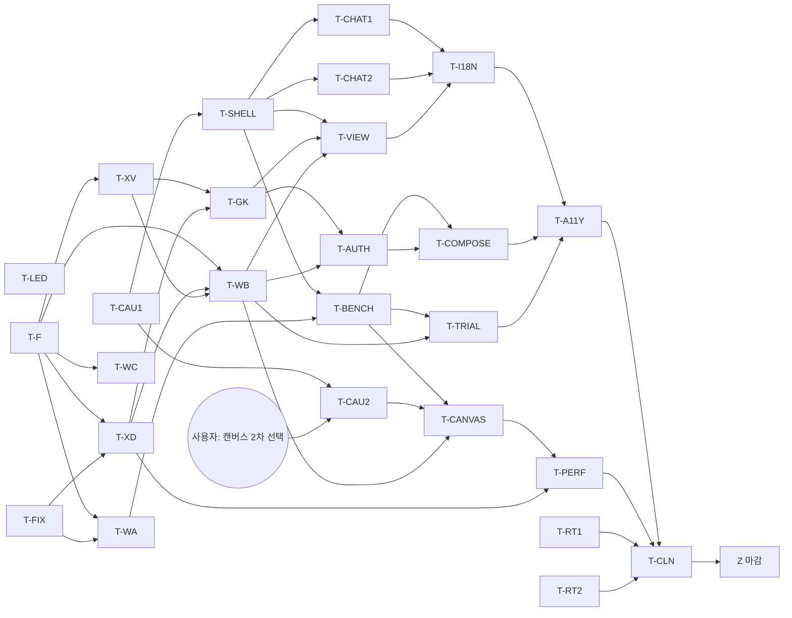

# M4 구현 계획 (데스크톱 UI, 런타임 선행 계약, 플러그인 제작 확장)

- 기준: `xeon/foundation`(M3b 마감, `review.m3-plan` §9)과 M4 설계 브랜치 `m4/design-integration`. 설계 브랜치는 M3b 마감 커밋(`461054b5` 이후 5커밋)보다 앞에서 갈라졌으므로, 이 문서 병합 전에 `xeon/foundation` 위로 rebase합니다.
- 원천: `L4.desktop-ux.spec`(§5 우선순위, §9 caustic 간극 C-01~C-39, §10 wire·view-model·F/X/L3 간극, §12.3·§12.4 사용자 결정 24건), ADR-0021(두 모드), `L3.authoring.spec`, `review.m3-plan` §9.3(M4 이월 표), 시안(`xeon/apps/desktop/mockups/*`).
- 에이전트: 메인 Opus가 마지막 diff 검토와 병합을 맡습니다. 계획은 Opus medium입니다. 트랙마다 Sonnet medium 리드가 일을 나누고 누락·보완을 검증합니다. 실구현은 주로 Haiku 5.5 xhigh(`claude-haiku-5-5`)가 합니다. 동시 트랙은 4개 이하이고, 선행 트랙만 기다리는 대기열로 돌립니다(`review.m3b-plan` §3.4와 같은 방식).
- 공통 규칙: 한 커밋 한 층, 문서 같은 커밋, contracts는 T-F만, `as`·`!`·`any`·`Reflect.get` 금지, 값 비교 시험, 명시적 `git add`, 워크트리 `~/xeon-wt/<트랙>`. 화면 코드는 caustic 부품과 토큰만 쓰고 직접 색 값을 쓰지 않습니다(DP-08, §13).
- 검증: 트랙마다 `just check <pkg>`, 병합과 push 전에는 캐시를 쓰는 빠른 `just verify`, `just verify-full`은 마감(§2 Z)에서 한 번만 돌립니다. 시험은 cgroup 메모리 상한 아래에서 패키지별로 돌립니다.

## 1. 범위 요약

### 1.1 범위

| 묶음 | 내용 | 근거 |
|---|---|---|
| 데스크톱 UI | caustic 위의 셸, 대화 영역 P-01~P-12·P-14, 작업대 P-13·P-15~P-21, 대화 상자 O-01~O-12. 시안(`mockups/p02-opus`, `_shell`, `wb-*`, `p0*`)에서 옮김 | spec §5 |
| 런타임 선행 | 확장·그룹 wire(W-15, W-20~W-50), F/X 계약(매니페스트 `views` 두 모드, `ext.<id>.<verb>`, 계측 링 버퍼 X-15, `composition` X-16, drive 사람 확인 X-17, 프로필 저장 X-18, 버전 기록 X-8, 시험 표지 X-14, 시험 단계 경계 멈춤 X-19) | spec §10 |
| 설계 중 찾은 코드 결함 | `/group on`이 `AutoDisabler.reenable`을 부르지 않음(X-4), managed 설치 위치의 tier가 `guard`(X-13), 핸들러 시간이 기록되지 않음(X-6), `shouldSuggestSafeMode` 호출처 없음(X-21) | spec §10.3 |
| 플러그인 제작 확장 | L3 그룹 `authoring`과 서비스 `fresnel.devkit` | `L3.authoring.spec` |
| caustic | C-01~C-39 중 caustic 몫과 브랜치 `xeon/m4-design`을 caustic 저장소에 PR로 올리기 | spec §9 |
| i18n과 M4 이월 | `review.m3-plan` §9.3 i18n 행, 새 화면 문자열, §9.3 전체 표의 처리 | `review.m3-plan` §9.3 |

### 1.2 M4 밖

- 웹 클라이언트(N15)와 모바일. 패키지 경계만 지킵니다.
- 그룹 단위 승인 기억(spec §12.3 U-7).
- 배포 앱에서 replay·bench·코어 변경 검사 실행(U-4).
- 캔버스의 구조 편집(§12.4 C-2).
- 제작 확장의 묶음 서명, 로컬 카탈로그 공유, `x.hook` 종류(외부 훅 확정 전).

### 1.3 종료 조건 번호 (Y1~Y17)

M3가 X1~X11을 썼으므로 M4는 Y를 씁니다. T-LED가 `product.scope.spec` §4.4 M4 행과 `scripts/exit-tests.txt`에 적습니다 [결정: 오케스트레이터 기본값]. 각 줄은 시험 파일 하나 이상에 묶습니다.

| 번호 | 조건 | 확인 방법 | 담당 |
|---|---|---|---|
| Y1 | 대화 영역 P0 화면(S-01~S-04, P-01, P-02, P-03, P-09, P-10, O-01~O-07)이 caustic으로 그려지고 화면마다 여섯 상태를 보임. 승인 카드 네 종류가 트랜스크립트, 끝 영역, P-03에서 같은 부품이고 `approval.resolved`로 함께 사라짐 | `pages.six-states-render`, `approval-card.same-in-three-places`, 화면 점검 스크린숏 | T-CHAT1, T-CHAT2 |
| Y2 | 작업대 P-13, P-15, P-16, P-17, P-18, P-19, P-20, P-21이 가짜 엔진 위에서 여섯 상태를 보이고, 대화 ↔ 작업대를 오가면 같은 대화·스크롤·오른쪽 탭으로 돌아옴 | `pages.six-states-render`(작업대), `area.switch-restores-place` | T-BENCH, T-CANVAS, T-COMPOSE, T-TRIAL, T-VIEW |
| Y3 | 맥락 칸 값 하나가 모든 작업대 화면의 맥락을 바꾸고, 따라가기·고정이 spec §4.9.3대로 동작 | `workbench.context-drives-all-pages`, `workbench.context-follows-unless-pinned` | T-SHELL, T-BENCH |
| Y4 | 개요 나눔 보기: 목록과 캔버스 고름 동기화, 캔버스에 구조 편집 동작 없음, 층 안 순서 기억과 초기화, 턴 재생 시간이 `trace.turn`과 같음, 계측 끄면 턴 재생 잠김 | `canvas.selection-sync`, `canvas.no-edit-actions`, `canvas.order-persists-and-resets`, `replay-bar.matches-trace`, host int `trace-turn.int.test.ts` | T-CANVAS, T-XD |
| Y5 | 플러그인 화면 두 모드: Helm `helm/inquiry`가 위젯 카탈로그 v1만으로 그려짐. 시험 프레임 플러그인이 격리 iframe에서 그려지고 Linux e2e에서 `__TAURI__` 없음, 네트워크 요청 실패, 프레임 안 승인 버튼 무효, 다리 메시지에 비밀 없음. 화면 실패 5번이면 그 화면만 `view_disabled` | `view-host.*`, desktop e2e `frame-isolation.e2e.test.ts`(Linux). macOS는 사용자 묶음 | T-VIEW |
| Y6 | spec §10.1의 M4 wire(W-15, W-20~W-26, W-31, W-33~W-35, W-37~W-50)가 `WIRE_METHODS`와 wire 문서 표에 있고 메서드마다 host int 시험이 있음 | `wire-methods.doc.test.ts`, host int 시험 | T-F, T-WA, T-WB |
| Y7 | drive 사람 확인: `loop.ask`가 승인을 만들고 임대를 `waiting`으로 반납, 답 뒤 같은 그룹이 임대를 다시 받고 같은 `requestId` 재호출이 기록된 답을 돌려줌. `replayDrive`가 ask를 포함한 그룹에서 통과 | ext-host `drive-ask.test.ts`, group-sdk replay 시험 | T-XD, T-GK |
| Y8 | 제작 확장 `L3.authoring.spec` §9 A-1~A-7 | `authoring.*` 시험 | T-AUTH |
| Y9 | 시험 대화 "멈춤" 뒤 다음 단계 경계 이후 새 turn·drive 호출이 없고 임대가 유지됨. "이어서"로 계속. 배포 형태에서 replay·bench·diff가 잠김 | ext-host `trial-pause.test.ts`, host int `trial.int.test.ts`, desktop `trial.dev-only-locked` | T-XD, T-WB, T-TRIAL |
| Y10 | 프로필이 호스트에 저장되어 데스크톱이 저장한 프로필이 CLI `xeon profile list`에 보이고, `profile.apply`가 하나라도 실패하면 모든 키를 되돌림 | host int `profile.int.test.ts`, cli 테이프 | T-WB |
| Y11 | 버전 탭: 전체 단계(기록 보관 + 되돌리기)이면 되돌리기 왕복 시험, 대체 단계이면 기본 플러그인 번들 버전 되돌리기 시험. 어느 단계로 냈는지 spec §6.24.1에 적음 | ext-host `version-history.test.ts` 또는 `bundled-revert.test.ts` | T-XV, T-BENCH |
| Y12 | 코드 결함 넷: `/group on`과 설정 토글이 장부를 비움, managed 설치는 상한 `user` tier, 핸들러 시간이 지점별로 기록됨, 시작 실패 뒤 `host.status.suggestSafeMode`가 참. 안전 모드에서 X 훅이 실리지 않음 | ext-host·group-sdk·host 시험 각 1개 이상 | T-FIX, T-XD |
| Y13 | caustic `xeon/m4-design`이 caustic `main`에 PR로 들어가고 submodule이 `main` 커밋을 가리킴. spec §9의 C 항목마다 상태(caustic 반영, 앱 조합, M5)가 있음. `grep -E '#[0-9a-fA-F]{3,6}\|rgb\('`가 `apps/desktop/src`에서 비어 있음 | `scripts/caustic-gaps.test.ts`(표 상태 검사), grep 검사 | T-CAU1, T-CAU2 |
| Y14 | 모든 화면에서 axe 위반 0, 키보드만으로 spec §4.8 동작에 감, 라이트·다크 모두 | `a11y.axe-all-pages`, 키보드 경로 시험, 원격 점검 Phase 2 | T-A11Y |
| Y15 | 하드코딩 한국어 검사가 `apps/desktop/src`와 하위 층에서 0이고, `ui.locale=en` 데스크톱 스모크 통과. `review.m3-plan` §9.3 i18n 행 닫음 | `fresnel/hardcoded-korean` 규칙, desktop en 스모크 | T-I18N |
| Y16 | `review.m3-plan` §9.3 이월 표의 모든 항목이 요구 장부에 상태(M4 완료, M5 이월과 사유, 삭제와 사유)를 가지고 `just req-ledger` 문제 0 | `req-ledger.test.ts` | T-LED, T-RT1, T-RT2 |
| Y17 | 데스크톱 속도와 크기: 릴리즈 앱 크기 500MB 이하, 첫 화면까지 시간과 유휴 메모리를 재서 `eng.performance.guide` 표에 기록. 계측(X-15) 켜짐과 꺼짐의 턴 비용 차이를 기록 | `scripts/desktop-bench.ts` 결과, 크기 검사 | T-PERF |

- 수치 기준(첫 화면 시간, 계측 비용 상한)은 사용자 결정 대기입니다(§4 3번). 그 전에는 기록만 하고 판정은 "기록됨"입니다.

## 2. 트랙

크기: S(1~3커밋), M(4~8커밋), L(9커밋 이상). "끝 시험"은 트랙 완료를 증명하는 시험입니다.

### 2.1 준비와 계약

**T-LED 요구 장부와 종료 조건** · Haiku xhigh · 문서·`scripts` · S
- Y1~Y17을 `product.scope.spec` §4.4와 `exit-tests.txt`에 적습니다. `review.m3-lower-requirements`의 M4 행 16개와 `review.m3-plan` §9.3 표 항목을 장부 끝 표에 옮겨 트랙 id를 적습니다.
- `req-ledger`가 M4 트랙 id를 받게 합니다.
- 끝 시험: `req-ledger.test.ts`, 미배정 행 0.

**T-F F 계약 M4 묶음** · Sonnet medium · `contracts`만 · L
- 매니페스트: `views`(화면마다 `mode`, `FrameDecl`, `fallback`, `methods`)와 `ViewNode`, 다리 메시지 스키마(X-1, ADR-0021 §3.3·§3.4.2). `composition`·`phases`와 `validateComposition`(X-16).
- 확장 메서드: `ext.<id>.<verb>` 확정(F wire §4.2), `ExtMethodDecl` 검사, 오류 코드 구간.
- drive: `LoopHandle.ask`와 `lease.released.reason` `"waiting"`(X-17).
- wire 레지스트리: W-15, W-20~W-26, W-31~W-35, W-37~W-50과 대화 영역 W-01·W-02·W-05~W-07·W-16 스키마. `ThreadSummary.trial`(X-14), `Profile`과 `profile.*`(X-18), `trial.*`, `trace.turn` 결과 타입.
- 서비스 계약 `fresnel.devkit`(X-22).
- 커밋 순서: 매니페스트(`views`, `composition`) → drive(`ask`) → wire 확장 읽기 → 프로필·시험·계측 → devkit. 앞 둘이 X 트랙을 엽니다.
- 끝 시험: 새 스키마 왕복 값 비교, `hooks.doc.test.ts`·wire 문서 시험이 spec 표와 일치.

**T-FIX 설계 중 찾은 코드 결함** · Sonnet medium · `ext-host`(X) → `group-sdk`(L3) → `apps/host`(L4) · S
- X-4: `/group on`과 `ext.<이름>.enabled` 토글이 `AutoDisabler.reenable`을 부르게 합니다.
- X-13: `assignTier`의 `case "managed"`가 상한 `user` tier를 돌려주게 하고, 문서(`X.operations.spec` §3.1)와 맞춥니다. guard 목록 확장은 그대로입니다.
- X-21: 시작 경로에서 `StartupHealthStore`와 `shouldSuggestSafeMode`를 부르고 `host.status`에 싣습니다(W-39).
- 끝 시험: Y12 중 셋(장부 비움, managed tier, 안전 모드 제안).

**T-CAU1 caustic 통합** · Sonnet medium · caustic 저장소, `xeon/external/caustic`, CI 설정 · M
- caustic 브랜치 `xeon/m4-design`(Solar 아이콘, 툴콜 상태, 구성기의 `node-graph`)을 caustic 저장소에 push하고 `main`으로 PR을 엽니다. 병합은 사용자가 합니다(§4 5번). 병합 뒤 submodule을 `main` 커밋으로 옮깁니다(`just caustic-update`).
- spec §9에서 "caustic 제안"인 항목 중 화면 P0가 쓰는 것(C-01 팔레트, C-03 상태 표시줄 슬롯, C-05 `Meter`, C-08 hunk diff, C-19 ghost 변형, C-21 표 선택, C-22~C-33)을 caustic에 더합니다. 앱 조합 항목은 표에 "앱 조합"으로 둡니다.
- 이월(인프라 행): `CAUSTIC_READ_TOKEN` CI·Dependabot 비밀 안내, `bun.lock` 갱신 경로, lefthook·oxlint의 mockups 제외 정리.
- 끝 시험: `scripts/caustic-gaps.test.ts`(spec §9 표의 상태 칸이 비지 않음), caustic catalog 스냅숏.

**T-CAU2 캔버스 부품** · Sonnet medium · caustic 저장소 · M
- C-34~C-39: `CanvasViewport`, 운영 캔버스 블록 변형, 엣지 kind, `CanvasMinimap`, `EventScrubber`, `InspectorBindingsRow` 두 단 칸.
- 선행: 캔버스 2차 시안(`m4/canvas-v2-a`, `m4/canvas-v2-b`)의 사용자 선택(§4 1번). 시각 값은 그 선택을 따르고 spec §13.7에 값을 더합니다.
- 끝 시험: caustic catalog 스냅숏, 접근성(`role="slider"`, 키보드 이동) 단위 시험.

### 2.2 X와 L3

**T-XV 확장 메서드, 화면 로딩, 버전 기록** · Sonnet medium · `ext-host`(X) → `apps/host`(L4) · L
- X-3 메서드 등록 API(`hostOf(g).registerMethod`), X-5 예산 등급 `view`와 장부 반영, X-7 화면·프레임 선언 검사와 진단, 프레임 파일 제공 경로(전용 스킴용 파일 해석, 경로 거부 규칙), X-8 버전 기록 보관(되는 만큼, 안 되면 대체 경로를 spec §6.24.1에 적음).
- 선행: T-F(매니페스트 커밋).
- 끝 시험: 등록 메서드가 wire로 불리고 스키마 위반 결과가 `result_invalid`로 장부에 셈, `view_mode_not_allowed` 진단, 프레임 경로 밖 파일 거부, Y11.

**T-XD drive·계측·시험 멈춤** · Sonnet medium · `ext-host`(X) → `core-loop`(L1, 필요하면 1커밋) · L
- X-15 핸들러 계측 링 버퍼와 설정 키, X-6 지점별 시간 분포(같은 원천), X-17 `loop.ask`, X-19 시험 대화 단계 경계 멈춤, X-20 안전 모드에서 X 훅 제외.
- 리드가 직접 쓰는 부분: `loop.ask`의 임대 반납과 재부여, 재생 규칙. 이 부분은 `X.primitives.spec` §4.4 개정과 같은 커밋입니다.
- 선행: T-F(drive 커밋), T-FIX(같은 `operations/` 폴더라 T-FIX 병합 뒤 rebase).
- 끝 시험: Y7의 ext-host 부분, Y9의 ext-host 부분, Y12의 시간 기록·X 훅 부분, 계측 켜짐·꺼짐 디스패치 비용 bench 한 줄.

**T-GK group-sdk과 Helm** · Sonnet medium · `group-sdk` → `group-helm`(L3) · M
- `defineGroup({ composition })`가 매니페스트를 채움(X-16), `g.registerMethod`(X-3), Helm `ext.helm.status`·`inquiries`·`findings`와 선언형 화면 기여 여섯(ADR-0021 §3.10, X-9), Helm `composition`과 `phases` 선언(`TRANSITIONS` 옮김), `replayDrive` 런타임 하니스(X-10, 개발 모드).
- 이월(L1·그룹 행 중 그룹 몫): 재생 하네스 thread id 오류 종류, `delegateStatus` 소유자 범위, 내장 그룹 이름 복사.
- 선행: T-XV(등록 API), T-XD(`loop.ask`가 있으면 Helm은 쓰지 않아도 replay 시험에 넣음).
- 끝 시험: Helm 메서드 값 비교, Helm 화면 트리가 위젯 카탈로그 v1 검사 통과(트리 검사기는 T-VIEW와 공유하는 `packages/client/src/views`의 순수 함수), Y7 replay 부분.

**T-AUTH 플러그인 제작 확장** · Sonnet medium · `contracts` 사용만 → `plugin-builder`(L3) → `apps/host`(L4) → `apps/cli`(L4) · L
- `L3.authoring.plan` AU-T1~AU-T9. 서비스 `fresnel.devkit` 구현과 W-27·W-28·W-47·W-49, 그룹, 카탈로그 첫 판, AU 규칙, `xeon group new`의 서비스 호출 전환.
- 선행: T-GK(템플릿과 `composition`), T-WB(시험 대화 W-34), T-XD(`loop.ask`). 화면 기여(AU-T7)는 T-VIEW 선언형 렌더러 병합 뒤 마지막 커밋으로 둡니다.
- 끝 시험: Y8.

### 2.3 host wire

**T-WA 확장 읽기 wire** · Sonnet medium · `apps/host`(L4) · L
- W-15(`ext.list { threadId? }`, W-41 포함), W-20 `ext.get`, W-21 `ext.reenable`, W-22 `ext.health`, W-23 `ext.timings`(X-15 병합 뒤 채움, 그 전에는 빈 분포), W-24 `group.list`, W-25 `group.metrics`, W-26 `group.promotion`, W-35 안전 모드 원인과 셸 `engine_restart { safeMode }`, W-37 kind 접두 구독, W-38 `ext.reload`와 진단 위치, W-39, W-40 `ext.bindings`, W-42 `group.lease`, W-45 `settings.explain`.
- 선행: T-F(wire 확장 읽기 커밋), T-FIX(W-21).
- 끝 시험: 메서드마다 host int 시험, Y6의 이 묶음.

**T-WB 프로필·시험·재생·화면 wire** · Sonnet medium · `apps/host`(L4) → `apps/cli`(L4) · L
- W-46과 X-18 프로필 저장소(`profiles.json`, `baseRev`), CLI `xeon profile list|apply`, W-44 `profile.preview`, W-34 시험 대화, W-48 `trial.*`, W-50 `trial.phase`, W-43 `trace.turn`, W-29·W-30 개발 모드 시험 실행, W-31 버전(T-XV 결과에 따라), W-32 설치·지우기, W-33 `ext.view.list`·`ext.view.post`·`ext.view.requestApproval`, W-36 `hooks.list`.
- 리드가 직접 쓰는 부분: `profile.apply`의 원자적 쓰기와 되돌리기, 개발 모드 판정.
- 선행: T-F(프로필·시험·계측 커밋), T-XD(X-15, X-19), T-XV(W-31, W-33).
- 끝 시험: Y9의 host 부분, Y10, Y6의 이 묶음.

**T-WC 대화 영역 wire** · Sonnet medium · `apps/host`(L4) · M
- W-01 전 대화 대기 승인, W-02 `review.get`, W-05 `goal.status`, W-06 `work.tasks.list`, W-07 `schedule.update`·`schedule.runs`, W-16 `thread.read { around }`·`ThreadSummary.origin`. W-08(대상 바꾸기)은 셸 명령이라 T-SHELL입니다.
- 이월(산출물 wire, 사용량 게이지 창·한도·계정 W-11)의 host 부분.
- 선행: T-F(대화 영역 커밋).
- 끝 시험: 메서드마다 host int 시험.

### 2.4 데스크톱 화면

**T-SHELL 셸** · Sonnet medium · `apps/desktop`(L4, Rust 포함), `packages/client` · M
- `desktop-ux.plan` UX-1·UX-2·UX-12: 고른 셸 시안(`mockups/_shell`, `p02-opus`)을 `views/shell/`로 옮김, S-01~S-04, 영역 바꾸기, 맥락 모델(V-25), 바로 가기 키 표(V-15), 데스크톱 로컬 설정 저장소(V-14), 토스트 자리(U-14).
- 셸 명령: W-08 `engine_retarget`, W-19 폴더 고르기 capability.
- 이월(데스크톱 행): `desktop_settings_read/write`, 트레이 아이콘·메뉴, Tauri 번들 자원 매핑. Mac 확인 항목은 사용자 묶음.
- 선행: T-CAU1(PR이 열린 브랜치를 submodule로 써도 됨).
- 끝 시험: `shell.layout-steps-at-breakpoints`, `keybindings.default-map-covers-actions`, `area.switch-restores-place`, `workbench.context-follows-unless-pinned`.

**T-CHAT1 대화와 받은 요청** · Sonnet medium · `apps/desktop`, `packages/client` · L
- UX-3·UX-4·UX-8·UX-14: P-02(승인 카드 네 종류, O-01·O-02·O-04·O-07), P-03, S-02 팔레트(V-01~V-03), P-04(V-06), P-05 대신 Helm `well`(T-VIEW가 렌더러를 내면 연결), 대화 영역 런타임 줄·행·탭(V-24), 승인 출처 표시(U-7).
- 선행: T-SHELL. W-01·W-02는 T-WC가 오면 바꾸고, 그 전에는 열린 대화만과 파일 요약만으로 둡니다.
- 끝 시험: Y1 중 대화·승인 부분.

**T-CHAT2 첫 실행, 설정, 예약, 연결** · Sonnet medium · `apps/desktop`, `packages/client` · L
- UX-5·UX-6·UX-7·UX-9: P-01(기본 그룹 단계 U-15), P-09(V-09 `SettingsController`), P-10(V-10, O-05, O-06), P-11, P-12, P-06, P-07(V-04, O-08), P-08(대화 주 내비 5번, U-3), P-14, O-03, O-09.
- 이월(설정 행): 설정 쓰기 reducer·초안, `settings.invalidated` thread 필터 소비, 탭 수 정합.
- 선행: T-SHELL.
- 끝 시험: Y1 중 설정·비밀 부분, `settings.fields-equal-schema-keys`, `secrets.value-never-in-state`, `web-order.keyboard-move-saves`.

**T-BENCH 작업대 기본** · Sonnet medium · `apps/desktop`, `packages/client/src/workbench` · L
- UX-15: P-13, P-16 목록 옆 패널(캔버스 자리는 빈 칸), P-17(버전 탭 §6.24.1 포함), P-15 엔진, O-10, 확장 행 모델(V-16~V-18), 표시 이름(U-13), 런타임 탭 데이터 연결.
- 이월: `handler_failed` 데스크톱 표시.
- 선행: T-SHELL, T-WA.
- 끝 시험: `ext-list.exempt-tier-switch-locked`, `runtime-tab.drive-queue-matches-group-status`, `workbench.context-drives-all-pages`, Y11 화면 부분.

**T-CANVAS 런타임 캔버스와 턴 재생** · Sonnet medium · `apps/desktop`, `packages/client/src/workbench/canvas` · L
- spec §6.22: 층 띠, 블록, 포트, 엣지, 맥락별 보기와 비교, 검사기, 자동 배치와 층 안 순서, 의미 줌, 턴 재생(V-26, V-27).
- 리드가 직접 쓰는 부분: 자동 배치와 엣지 경로 계산(새 의존 없이).
- 선행: T-BENCH, T-CAU2, T-WA(W-40·W-42), T-WB(W-43·W-44).
- 끝 시험: Y4. 확장 77개 고정 데이터에서 프레임 시간 기록(T-PERF에 넘김).

**T-COMPOSE 구성기** · Sonnet medium · `apps/desktop`, `packages/client/src/workbench/compose` · L
- spec §6.28·§6.29: 그룹·흐름·프로필·코드 보기, 검사 붙이기(W-47), 프로필 편집과 적용(W-46, W-44), 흐름 보기의 시험 실행(W-48, W-50), "새 그룹"과 "제작 확장으로 만들기"(V-22, V-28), compact 개요 편집기(`LayerTree`).
- 선행: T-BENCH, T-WB, T-AUTH(W-47·W-27). T-CAU2는 구성기가 이미 caustic `node-graph`를 쓰므로 선행이 아닙니다.
- 끝 시험: 구성 선언 없는 그룹이 블록 하나로 보임, 프로필 저장 뒤 CLI에 보임(Y10의 화면 부분), 사람 확인 노드가 X-17 병합 뒤 "런타임에 없음" 배지를 잃음.

**T-TRIAL 시험 실행과 측정** · Sonnet medium · `apps/desktop`, `packages/client/src/workbench` · M
- spec §6.26·§6.27: P-19(시험 대화 멈춤, 지난 결과, 개발 모드 잠금, `ReplayDriveReport` 그대로 + JSON 복사), P-20, O-11, O-12(V-20, V-21).
- 선행: T-BENCH, T-WB.
- 끝 시험: Y9 화면 부분, `trial.dev-only-locked`.

**T-VIEW 플러그인 화면 두 모드** · Sonnet medium · `packages/client/src/views`, `apps/desktop`(Rust 포함), `apps/cli` · L
- 선언형: 트리 검사, 바인딩 해석, 표현식, 위젯 카탈로그 v1, 화면 장부, CLI 글 렌더(V-19). 슬롯 여섯 연결(P-18, well, card, status, command, settings).
- 프레임: 전용 URI 스킴(`xeon-view://`) 등록과 파일 제공, iframe sandbox, CSP 헤더, 다리(MessageChannel, 허용 목록, 상한, 생존 확인), 테마 push, 프레임 `call` 확인 줄, 프레임 호스트(V-29), 설정 `x.views.frames`·`x.views.allowProjectFrames`.
- 리드가 직접 쓰는 부분: 다리 판정과 IPC 비노출 e2e. 보안 검토는 메인 Opus가 별도로 봅니다.
- 선행: T-SHELL, T-GK(Helm 기여), T-WB(W-33), T-XV(진단, 파일 경로).
- 끝 시험: Y5(Linux). macOS e2e는 사용자 묶음이고 통과 전 빌드는 `x.views.frames = false`입니다(ADR-0021 §6 미결 1).

### 2.5 이월, 품질, 마감

**T-RT1 런타임 이월 1** · Sonnet medium · 해당 패키지 · L
- `review.m3-plan` §9.3의 서비스·원격, 예약·알림, 작업 공간·산출물, 보안·샌드박스 행. 리드는 먼저 항목마다 "M4 완료 / M5 이월(사유)"를 장부에 적고 사용자 묶음 항목을 뗍니다. M4 완료로 고른 항목만 구현합니다.
- 선행: 없음(대기열에서 화면 트랙 뒤에 띄움).
- 끝 시험: Y16 중 이 행들, 고른 항목마다 시험.

**T-RT2 런타임 이월 2** · Sonnet medium · 해당 패키지 · L
- §9.3의 모델·웹, 데이터, L1·그룹(T-GK 몫 제외), 성능·릴리즈(T-PERF 몫 제외) 행. 방식은 T-RT1과 같습니다.
- 끝 시험: Y16 중 이 행들.

**T-I18N i18n 후속** · Sonnet medium(검사) + Haiku xhigh(문자열) · 하위 층 → `apps/desktop` · M
- §9.3 i18n 행(하위 층 문장 통과 198줄, 데스크톱 `errorOf`, `db.ts:58`), 새 화면 문자열의 카탈로그 키, 확장 화면 메시지 카탈로그 폴백(ADR-0021 §3.8), 데스크톱 en 스모크.
- 선행: 화면 트랙 넷 이상 병합 뒤(T-CHAT1, T-CHAT2, T-BENCH, T-VIEW).
- 끝 시험: Y15.

**T-PERF 측정** · Sonnet medium · `bench`, `scripts` · S
- 계측(X-15) 비용, 캔버스 프레임 시간(77개), 데스크톱 첫 화면 시간·유휴 메모리, 릴리즈 앱 크기. 이월의 서버 예산 수치 표를 같은 표에 둡니다.
- 선행: T-XD, T-CANVAS.
- 끝 시험: Y17.

**T-A11Y 접근성과 원격 점검** · Sonnet medium · `apps/desktop` · M
- UX-10, M3-40 원격 점검 Phase 2(Victauri PoC, `review.m3b-plan` §1.2에서 옮김), 다크 테마 점검.
- 선행: 모든 화면 트랙.
- 끝 시험: Y14.

**T-CLN 정리와 문서** · Haiku xhigh · 문서, 시험 파일 · M
- §9.3 정리·문서 행(`Reflect.get` src 잔여는 도우미 설계 결정 뒤), F/X/L3 문서의 [제안] 이름을 구현과 맞춤, `docs-route` 경고 정리, 런북 갱신.
- 선행: 나머지 전부.
- 끝 시험: `docs-route --check` 0, `check-ts-rules`.

**Z 마감(순차)**
1. 검증 담당(Sonnet high)이 Y1~Y17을 줄마다 시험 파일로 확인하고 `req-ledger` 미배정 0을 봅니다.
2. `just verify-full` 한 번, `just exit-tests`(Y 줄 켬, 건너뜀 0), GitHub macOS job 한 번.
3. `review.m3-plan`과 같은 형식의 M4 판정표를 이 문서 끝(§6)에 적고, §4 사용자 묶음을 한 번에 요청합니다.

## 3. 의존 그래프와 대기열

### 3.1 선행 표

| 트랙 | 선행 | 리드가 직접 쓰는 부분 | Haiku 몫 |
|---|---|---|---|
| T-LED | 없음 | 없음 | 전부 |
| T-F | 없음 | `views`·`composition` 스키마, `ask` 타입 | 레지스트리 표, 문서 시험 |
| T-FIX | 없음 | managed tier 판단 | 호출 배선, 시험 |
| T-CAU1 | 없음 | PR 정리, 부품 API | 부품 구현, 스냅숏 |
| T-XV | T-F | 메서드 등록, 버전 보관 | 진단, 시험 |
| T-XD | T-F, T-FIX | `loop.ask`, 시험 멈춤 | 링 버퍼, 설정 키, 시험 |
| T-WA | T-F, T-FIX | `group.lease` 계수 | 처리기 대부분 |
| T-SHELL | T-CAU1 | 영역·맥락 상태 | 셸 부품 이전 |
| T-GK | T-XV, T-XD | 런타임 replay 하니스 | Helm 메서드·기여, 시험 |
| T-WB | T-F, T-XD, T-XV | `profile.apply`, 개발 모드 판정 | 나머지 처리기, CLI |
| T-WC | T-F | 없음(검토만) | 전부 |
| T-CHAT1 | T-SHELL | 승인 카드 흐름 | 화면 |
| T-CHAT2 | T-SHELL | `SettingsController` | 화면 |
| T-BENCH | T-SHELL, T-WA | 확장 상태 모델 | 화면 |
| T-AUTH | T-GK, T-WB, T-XD | 단계 머신, 가드 | 도구, 카탈로그, 시험 |
| T-VIEW | T-SHELL, T-GK, T-WB, T-XV | 다리 판정, IPC e2e | 위젯 카탈로그, CLI 렌더 |
| T-TRIAL | T-BENCH, T-WB | 없음(검토만) | 전부 |
| T-CAU2 | T-CAU1, 사용자 묶음 1 | 엣지 경로 API | 부품 구현 |
| T-CANVAS | T-BENCH, T-CAU2, T-WA, T-WB | 자동 배치, 엣지 경로 | 검사기, 재생 막대, 시험 |
| T-COMPOSE | T-BENCH, T-WB, T-AUTH | 블록 ↔ `composition` 매핑 | 보기 넷, 시험 |
| T-RT1, T-RT2 | 없음 | 항목 분류 | 고른 항목 구현 |
| T-I18N | T-CHAT1, T-CHAT2, T-BENCH, T-VIEW | 검사 | 문자열 이전 |
| T-PERF | T-XD, T-CANVAS | 측정 방법 | 기록 |
| T-A11Y | 모든 화면 트랙 | 키보드 경로 판단 | 수정 |
| T-CLN | 나머지 전부 | 없음 | 전부 |

### 3.2 그래프

- 임계 경로: T-F → T-XD → T-WB → T-AUTH → T-COMPOSE → T-A11Y → Z. T-F와 T-XD를 가장 먼저 띄우고, T-F는 앞 두 커밋(매니페스트, drive)을 먼저 병합해 X 트랙을 엽니다.
- 둘째 경로: T-CAU1 → T-CAU2(사용자 선택 대기) → T-CANVAS. 사용자 선택이 늦으면 T-CANVAS는 T-CAU2 없이 시안 `parts/`의 앱 조합으로 시작하고, 부품이 오면 바꿉니다.

### 3.3 시작 순서(동시 4개)

1. T-F, T-FIX, T-CAU1, T-LED(Haiku, S라 곧 끝남)
2. T-LED가 끝나면 T-XD(T-FIX 병합 뒤), T-F 앞 커밋 병합 뒤 T-XV
3. T-CAU1 PR이 열리면 T-SHELL. T-F 병합 뒤 T-WA
4. 이후 대기열 순서: T-WB, T-GK, T-BENCH, T-CHAT1, T-CHAT2, T-VIEW, T-AUTH, T-WC, T-TRIAL, T-CAU2, T-CANVAS, T-COMPOSE, T-RT1, T-RT2, T-I18N, T-PERF, T-A11Y, T-CLN

- 트랙 안에서는 Haiku 구현자를 한 번에 1명만 돌리고, 리드는 그동안 시험을 돌리지 않습니다. 시험을 돌리는 에이전트가 4명을 넘지 않습니다.
- 트랙 리드의 일은 `review.m3b-plan` §3.4와 같습니다: 작업 분해, 어려운 핵심 직접 작성, Haiku 결과 대조와 보완, 끝 시험·`req-ledger`·문서 동기화 확인, 보고.
- 오케스트레이터(메인 Opus)는 마지막 diff 검토, rebase와 `--ff-only` 병합, 병합마다 빠른 `just verify`를 맡습니다.

### 3.4 같은 파일을 만지는 트랙

- `contracts`: T-F만. 다른 트랙이 계약 변경을 찾으면 T-F에 요청하고, T-F가 끝난 뒤면 오케스트레이터가 작은 F 커밋을 따로 엽니다.
- `ext-host/src/operations`: T-FIX → T-XD 순서. `ext-host/src/primitives`: T-XD. `ext-host/src/loading-trust`: T-XV.
- `apps/host` 조립: T-FIX, T-WA, T-WB, T-WC, T-AUTH. host 커밋을 각 트랙 마지막에 두고 먼저 끝난 트랙이 먼저 병합합니다. 설정 스키마 JSON은 병합 때 오케스트레이터가 다시 만듭니다.
- `apps/desktop/src/views`: 화면 트랙 여럿. 폴더를 `views/shell/`, `views/pages/<id>-<이름>/`로 나눕니다. 셸 공용 부품은 T-SHELL만 고치고, 다른 트랙은 요청합니다.
- `packages/client`: 하위 폴더(`workbench`, `workbench/canvas`, `workbench/compose`, `views`, `settings`, `inbox`)로 나눕니다.
- caustic 저장소: T-CAU1 → T-CAU2 순서. 화면 트랙은 caustic을 고치지 않고 간극을 T-CAU에 올립니다.

## 4. 사용자 확인 묶음

M4 착수 전이나 도중에 필요한 것과 마감 뒤 한 번에 묻는 것을 나눕니다.

착수 전·도중:

1. 캔버스 2차 시안(`m4/canvas-v2-a`, `m4/canvas-v2-b`) 선택. T-CAU2와 T-CANVAS의 시각 언어를 엽니다.
2. 새 외부 의존 승인: Markdown 렌더러와 코드 강조(C-06). 그 전에는 `MessageCode`와 일반 글로 둡니다.
3. 수치 기준: 계측 비용 상한과 턴 재생 버퍼 기본값(spec §12.1 29번), 데스크톱 첫 화면 시간. 그 전에는 기록만 합니다.
4. spec §12.1 27·28·30·31번(프레임 설정 키 소유, 프로필 파일 위치·프로젝트 프로필, 제작 확장 기본 켬, 버전 보관 개수), `L3.authoring.spec` §10.
5. caustic PR(`xeon/m4-design` → `main`) 검토와 병합. 비공개 저장소라 병합 권한은 사용자에게 있습니다.
6. 제품 이름(spec §12.1 13번). 화면 문구와 `xeon` 명령 안내가 바뀝니다. M4 화면 문자열이 굳기 전에 정하는 것이 좋습니다.

마감 뒤:

7. Mac 실기: 프레임 격리 e2e(WKWebView에서 `__TAURI__` 없음, 전용 스킴), 데스크톱 화면 점검, IME, 트레이, `review.m3-plan` §9.4 1번의 남은 항목.
8. README 수정(수정 금지라 사용자 몫): `L3/README.md` 도메인 표에 `authoring`, `L4/README.md`에 desktop-ux와 작업대, `decisions/README.md` 색인에 ADR-0021 개정.
9. `review.m3-plan` §9.4의 남은 결정(서명 비밀, 서버 예산 수치, 의존 승인 FormatJS·`@parcel/watcher`·Stagehand, 원격 실기 등)과 T-RT1·T-RT2가 사용자 결정으로 뗀 항목.
10. `[결정: 오케스트레이터 기본값]` 검토: Y1~Y17 번호, 작업대 우선순위 P0·P1 나눔, 제작 확장 형태(내장 L3 그룹, 기본 꺼짐), 프레임 slot 제한(`page`·`well`), 프로필 저장 형식.

## 5. 위험

- 프레임 격리 확인: Tauri가 iframe에 IPC를 노출하는지, 전용 스킴이 macOS·Linux에서 같게 동작하는지는 실기로만 알 수 있습니다. 확인이 안 되면 프레임 모드를 끈 채로 내고(`x.views.frames = false`), 선언형과 `fallback`만으로 Y5의 선언형 부분을 충족합니다. 이 경우 Y5 판정은 "부분"입니다.
- 같은 WebView 프로세스: 프레임 스크립트의 CPU·메모리 폭주가 셸을 늦출 수 있습니다(ADR-0021 T-18). 생존 확인과 숨은 프레임 내리기로 줄이고, 판정 기준은 T-PERF가 잽니다.
- T-F 병목: 계약 변경이 많아 T-F가 늦으면 X·wire 트랙 전부가 밀립니다. 커밋 순서를 고정하고 앞 두 커밋을 먼저 병합합니다. 스키마 이름은 spec의 [제안] 그대로 시작하고 바꾸면 F 문서와 같은 커밋에 둡니다.
- `loop.ask`와 재생: 임대 반납·재부여가 재생 규칙(같은 `requestId`, 판 rev)과 얽힙니다. T-XD 리드가 직접 쓰고, Helm이 아닌 시험 그룹으로 `replayDrive`를 먼저 통과시킵니다.
- 계측 비용: 링 버퍼가 디스패치 경로에 들어가 모든 턴에 비용이 붙습니다. 기본 켬이므로 T-XD 끝 시험에서 비용을 재고, 기준을 넘으면 사용자에게 기본값 재결정을 묻습니다.
- caustic 비공개 submodule: CI와 Dependabot이 caustic을 받지 못하면 화면 트랙 CI가 깨집니다. T-CAU1에서 토큰 안내와 실패 메시지를 먼저 고칩니다.
- 캔버스 2차 시안 지연: T-CANVAS가 시각 값을 기다리면 임계 경로가 길어집니다. 동작과 데이터(spec §6.22)는 시각과 무관하게 먼저 만들고, 시각 값은 토큰 교체로 나중에 바꿉니다.
- 이월 범위 확대: §9.3 표는 13행 100개 넘는 항목입니다. T-RT1·T-RT2는 먼저 분류만 하고, M4 완료로 고른 항목만 합니다. 분류 결과는 오케스트레이터가 확인합니다.
- Haiku의 화면 코드 품질: caustic 규칙(§13, DP-08)과 TS 규칙을 어길 수 있습니다. 리드가 화면마다 `grep` 색 검사와 `check-ts-rules`를 끝 시험에 넣고, 시안 파일을 그대로 옮기는 단위로 작업을 나눕니다.
- 템플릿 원천 둘: `group-sdk/templates`와 제작 확장 카탈로그가 어긋날 수 있습니다. 카탈로그 항목은 템플릿 폴더를 가리키기만 하고, 적합성 시험(A-1, A-2)이 둘을 함께 검사합니다.
- 테스트 메모리: host int와 데스크톱 e2e가 자식 프로세스와 WebView를 띄웁니다. cgroup 상한 아래 패키지별 실행을 지킵니다.
- 설계 브랜치 rebase: 이 문서와 desktop-ux 변경은 M3b 마감 전 지점에서 갈라졌습니다. `review.m3-plan` §9와 충돌하지 않지만, 병합 전 rebase에서 `docs-route`를 다시 돌립니다.

## 6. M4 마감 판정

(마감 Z 단계에서 채웁니다.)
