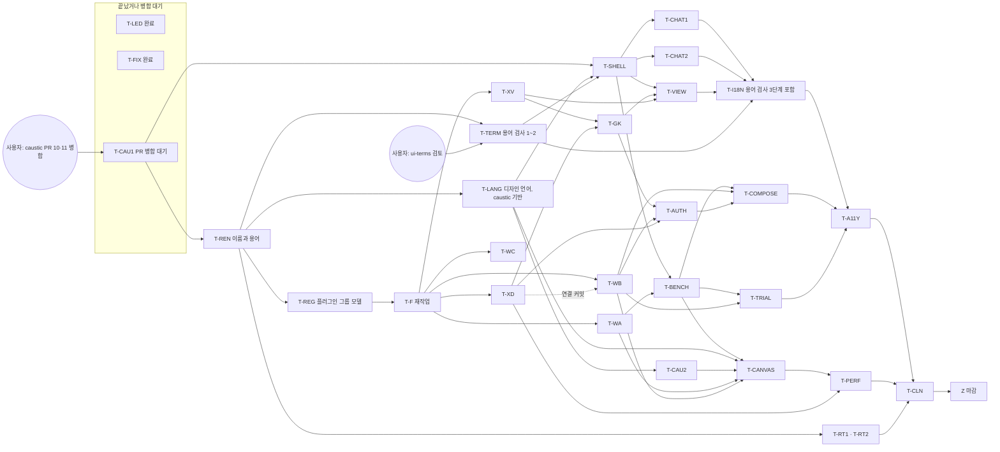

# M4 구현 계획 (이름·모델 정리, 데스크톱 UI, 런타임 선행 계약, 플러그인 빌더)

- 기준: `xeon/foundation`(2026-11-01 `afbf809a`, M3b 마감과 M4 시안 병합까지)과 ADR-0022(`m4/adr22`, accepted). `m4/design-integration`은 `xeon/foundation`에 병합되어 이 문서의 rebase 항목은 닫혔습니다.
- 원천: `L4.desktop-ux.spec`(§5 우선순위, §9 caustic 간극 C-01~C-39, §10 wire·view-model·F/X/L3 간극, §12.3·§12.4 사용자 결정 24건), ADR-0021(Plugin UI 두 모드), ADR-0022(플러그인 그룹 모델과 용어), `L3.authoring.spec`, `review.m3-plan` §9.3(M4 이월 표), 시안(`xeon/apps/desktop/mockups/*`), 사용자 결정 기록(저장소 밖 `_notes/m4-decisions.md`, 2026-10-31과 2026-11-01 (1)~(11)).
- 에이전트: 메인 Opus가 마지막 diff 검토와 병합을 맡습니다. 트랙마다 Sonnet 리드가 일을 나누고 누락·보완을 검증합니다. 실구현은 주로 Haiku 5.5 xhigh(`claude-haiku-5-5`)가 하고 어려운 부분은 max로 돌립니다. 동시에 시험을 돌리는 에이전트는 4개 이하이고, 선행 트랙만 기다리는 대기열로 돌립니다(`review.m3b-plan` §3.4와 같은 방식).
- 공통 규칙: 한 커밋 한 층, 문서 같은 커밋, contracts는 T-F(와 T-REG)만, `as`·`!`·`any`·`Reflect.get` 금지, 값 비교 시험, 명시적 `git add`, 워크트리 `~/xeon-wt/<트랙>`. 화면 코드는 caustic 부품과 토큰을 쓰고 직접 색 값을 쓰지 않습니다(DP-08, §13). caustic이 어색한 기능은 디자인 언어 토큰을 따르는 커스텀 부품을 만듭니다(사용자 결정 2026-11-01 (5)).
- 검증: 트랙마다 `just check <pkg>`, 병합과 push 전에는 캐시를 쓰는 빠른 `just verify`, `just verify-full`은 마감(§2 Z)에서 한 번만 돌립니다. 시험은 cgroup 메모리 상한 아래에서 패키지별로 돌립니다.
- 종료코드: 1은 고칩니다. 2는 환경 문제라 코드를 고치지 않고 보고합니다. 3은 사람 확인 뒤 `--yes`입니다.

## 0. 2026-11-01 결정과 이 문서의 변경

### 0.1 결정이 계획에 미치는 영향

| 결정 (출처: `_notes/m4-decisions.md`) | 계획에 미치는 영향 |
|---|---|
| CLI 표면 없음 (2026-11-01 (1), (6)) | 제품 표면은 데스크톱, 웹, 나중에 모바일 앱입니다. CLI UX(문구, 프로필 명령, 카탈로그 문구)를 설계·구현하지 않습니다. 기존 CLI 코드(`apps/cli`)는 내부 개발 도구로 남고 `cli.*` 키도 남으며 이름은 T-REN 스크립트가 바꿉니다. "CLI에서도 쓴다"던 결정은 "호스트를 거쳐 데스크톱·웹·앱이 함께 쓴다"로 읽습니다. 그래서 Y10의 CLI 확인, T-WB의 `profile list\|apply` 명령, T-AUTH의 `apps/cli` 작업, T-VIEW의 CLI 글 렌더(V-19)를 M4 범위에서 뺍니다 |
| 제품 이름 Fresnel (2026-11-01 (4), (11)) | 상표 확인 결과를 보고도 확정했습니다. 통상 이름은 "Fresnel Agent" 같은 수식어를 붙입니다. 패키지 범위 `@fresnel/*`, 서비스 이름 `fresnel.*`, 환경 변수 `FRESNEL_*`, 폴더 `.fresnel/`·`.fresnel-plugin/`, Tauri `identifier` `dev.fresnel.desktop`이 T-REN에서 바뀝니다. 디렉터리 이동(`xeon/` → `fresnel/`, `docs/xeon/` → `docs/fresnel/`, 서브모듈 경로)은 M4 마감 뒤입니다(2026-11-01 (9)). 이 문서의 경로는 그때까지 `xeon/`을 씁니다 |
| 작업대 이름 LightCraft (2026-11-01 (11)) | 문서 용어와 화면 en은 LightCraft, 화면 ko는 크래프트입니다. 코드 id는 `workbench`로 둡니다. 이 문서는 "크래프트"로 적습니다. 트랙 id `T-BENCH`는 다른 문서와 `exit-tests.txt`가 참조하므로 바꾸지 않습니다. 측정 `bench`는 `benchmark`로 바뀝니다(`just benchmark`, `scripts/desktop-benchmark.ts`) |
| Turn 유지, 저장 문자열 유지, Item 유지 (2026-11-01 (8)) | 대화 모델은 Thread / Turn / Step / Item입니다. `turn.*`, `scope.changed`, `lease.*`, `trn_`, `sys_leases`는 저장 문자열이라 바꾸지 않고, 코드 타입 이름만 바꿉니다. 대응은 F 문서에 적습니다 |
| 옛 이름 읽기 없음 (2026-11-01 (8)) | 옛 환경 변수, 옛 폴더, 옛 DB 표식을 읽지 않습니다. DB 표식은 새 값 `1179799116`(FRNL)만 받습니다. 개발 기기는 일회성 스크립트 `scripts/migrate-dev-machine.ts`로 한 번 옮깁니다(T-REN 0번 커밋). 이 원칙은 매니페스트에도 적용합니다. 새 매니페스트 형식이 옛 `kind`·`views`를 읽는 길을 두지 않습니다(T-REG) |
| ADR-0022 accepted (2026-11-01 (10), (11)) | §3.2(매니페스트 `plugins[]` + 선택적 `group`, Registration, drive 넓히기, 정책 기본값 "그룹만")는 이름 변경과 별도 트랙 T-REG입니다. T-F 재작업이 T-REG 위에 서므로 T-F가 뒤로 밀립니다. §3.3 5번(덮어쓰기 결과를 Registration의 thread별 켜짐 상태로 옮기는 규칙)은 [결정: 2026-11-04 사용자]로 (b)(c)가 닫혔고, 프로젝트 층의 정의는 "여러 대화를 묶는 개념"으로 바뀌어 저장 방식만 [미결]입니다(`X.primitives.spec` §4.5.7) |
| 이름 변경 계획 승인 (2026-11-01 (8)) | T-REN이 커밋 0~12를 합니다. 커밋 13(디렉터리 이동)은 뺍니다. 층별 커밋과 패키지 범위 한 번에 치환(BP-11 예외, 승인됨)을 따릅니다 |
| 용어 검사 (2026-11-01 (2)) | 용어 원본 `packages/client/src/i18n/terms.ts`와 검사를 4단계로 들입니다. 0단계는 T-REN 1번 커밋입니다. 1·2단계는 T-TERM, 3단계는 T-I18N과 함께입니다(§2.0). 화면 라벨이 `decided`가 되려면 사용자가 `ui-terms-guide.md` 검토를 마쳐야 합니다 |
| 디자인 언어와 caustic 기반 변경 (2026-11-01 (4), (5), (7)) | **되돌림: 2026-11-02 (15)로 서지 않습니다(위 행).** 옛 내용: caustic 기반 토큰과 구조(선 셀 격자, 그림자, 타이포, 중립 팔레트, 헤어라인, 간격)를 `design-language.md` §9 값으로 바꿉니다. 작업은 caustic 브랜치 `xeon/m4-language`와 쌓은 PR이고 병합은 사용자가 합니다. 시안 재작성(`m4/redesign*`)은 이어서 하고, 끝난 뒤 그 위에 시안을 더 만듭니다. 간격은 SaaS 값입니다(페이지 여백 24, 섹션 사이 32, 머리와 내용 12, 항목 8, 단추 반지름 8, 카드 반지름 12). 지도 보기는 쓰지 않고 층 × 단계 선 격자 표 하나로 그립니다(2026-11-03 (4)로 지도가 돌아와 이 문장도 대체됨) → T-LANG(§2.0, 취소)과 T-CAU2·T-CANVAS 범위 변경 |
| 프로필·덮어쓰기 위치 (2026-10-31 UX 5번, ADR-0022 §3.3) | 프로필은 호스트 설정에 저장하고 데스크톱·웹·앱이 호스트를 거쳐 함께 씁니다. 전역 → 프로젝트 → 대화 순서의 덮어쓰기와 출처 배지는 T-REG(규칙 제안)와 T-WB·T-BENCH(저장과 화면)가 나눠 맡습니다 |
| 디자인 언어 되돌림 (2026-11-02 (15)) | 크래프트 밖 화면은 이전 디자인과 변형으로 돌아가고, 크래프트는 선 격자만 유지합니다. T-LANG, Y13의 `xeon/m4-language` 부분, caustic PR #13은 서지 않고 `m4/redesign`은 참고로 남습니다. 타이포는 대화형으로 다시 정합니다. 아래 선행 표와 그래프의 T-LANG은 "해당 없음(취소)"으로 읽고, 그 몫이던 토큰·구조는 T-SHELL과 시안(`m4/mock*`)이 맡습니다. T-LANG 줄과 §2.3의 caustic 기반 설명은 기록으로 남깁니다 |
| 크래프트 8차 시안 승인 (2026-11-03 (4)) | 시안 `apps/desktop/mockups/wb-v5`(`SPEC.md`)를 승인했습니다. 개요는 지도(Orbit)·순서(Strata)·링크(Link) 세 보기이고 **지도 보기가 돌아왔습니다**: 2026-11-01 (4) 10번과 "층 × 단계 선 격자 표 하나" 방향을 대체합니다. 크래프트는 전역만 보입니다(범위, 맥락 칸 없음). T-CANVAS 범위와 Y4가 바뀝니다. 스펙 반영은 `L4.desktop-ux` §6.22.0이고 시안에만 있는 것의 목록도 거기 있습니다. 세부 디자인은 구현 뒤 다듬습니다 |
| 훅 순서와 그룹 끄기 (2026-11-03 15-1, 15-2, 15-3, (3)) | 그룹 단위 끄기를 유지하고 "하나씩 끄고 테스트"는 뺍니다. 훅 줄의 핸들러 순서는 가드까지 자유이고 기본값은 가드 맨 앞이며, 안전 검사가 건너뛰어질 수 있으면 경고 모달을 거칩니다(엔진은 `m4/order`). `추가`는 그 훅을 고른 채 빌더를 엽니다 |
| 테스트·측정 기획서 (2026-11-03) | 켬/끔 비교는 배포 앱에도 열고(Test run의 묶음 실행, 시작 전 비용 확인), replay·benchmark는 개발 모드입니다. 측정 원본은 기본 30일 보관(설정에서 변경, 일별 집계 유지), 요청 본문 저장은 기본 끔(설정에서 누구나 켬, 마스킹 후 저장). 단계 0~2는 M4 후반, 화면은 T-VIEW와 함께, 단계 4 이후는 단계 0 결과를 보고 정합니다. 켬/끔 비교는 적극 제안해도 되고 실행 전 확인을 한 번 받습니다. 트랙은 §2.0.1입니다. 단계 0 실험 진행 여부는 사용자 대기입니다 |
| 이름 확인 (2026-11-03) | 사용자가 Fresnel 이름을 쓸 수 있다고 확인했습니다. 이름 확인 항목은 닫힙니다 |

### 0.2 이 문서의 이름 쓰기

이 문서는 바뀐 이름으로 씁니다. 옛 이름은 아래 표로 읽습니다. 코드 id와 저장 문자열은 ADR-0022 §3.6 이름 대응표를 따릅니다.

| 옛 말 | 지금 말 | 비고 |
|---|---|---|
| 작업대 | 크래프트(LightCraft) | 코드 id `workbench` 그대로 |
| 시험 대화, 시험 실행(trial) | Test run | 코드 `testRun`, wire `testRun.*` [제안, ADR-0022 §3.6] |
| 턴 재생 | Trace(트레이스) | wire `trace.turn`은 그대로 |
| 지점(point), 지점 종류 | Hook(훅), 훅 종류 | `PointName` → `HookName` 등 |
| 임대(drive 뜻) | drive lock, 주도하는 쪽은 Driver | 저장 이벤트 `lease.*`는 그대로 |
| 그룹, 의도 그룹 | 플러그인 그룹 | 매니페스트 `group` 선언 |
| scope(확장이 등록한 묶음) | Registration | 설정 범위 `session`은 `launch` |
| 제작 확장 | Plugin Builder(플러그인 빌더) | 패키지 `plugin-builder` |
| group-kit, 슬롯 | Group SDK(`group-sdk`), Stages | |
| 화면 기여(`views`), slot, 선언형, 프레임 | Plugin UI(`ui`), Placement, Native UI, Plugin App | |
| 호스트(wire 계약) | Runtime Server(Runtime API) | 경로 `apps/host`는 그대로 |
| 세션 | 대화(Thread) | |
| 능력, 비밀 | Capability, Secret | |

### 0.3 트랙 선언과 `req-ledger`

- `just req-ledger`는 이 문서 §2에서 줄 첫머리가 `**T-<ID>`인 제목을 트랙으로 읽고, `scripts/req-ledger.test.ts`가 그 수 26을 확인합니다. 트랙 id 26개(T-LED ~ T-CLN)는 모두 그대로 두고 제목 형식도 지킵니다. `M4:T-CLN`, `M4:T-F`, `M4:T-I18N`, `M4:T-PERF`, `M4:T-RT1`, `M4:T-RT2`, `M4:T-SHELL`, `M4:T-WC`, `M4:T-XV`가 요구 장부에서 이미 쓰입니다.
- 새 트랙 T-REN, T-REG, T-TERM, T-LANG은 §2.0 표로 선언합니다. 표 행은 장부 검사의 트랙 목록에 들어가지 않으므로 장부 상태에서 이 id를 가리킬 수 없습니다. 가리킬 일이 생기면 `scripts/req-ledger.test.ts`의 26을 함께 고치는 별도 커밋이 필요합니다 [미결: 오케스트레이터 확인].
- 종료 조건 Y1~Y17은 번호를 바꾸지 않습니다. 조건 내용을 바꾼 Y 줄(§1.3)은 `product.scope.spec` §4.4 M4 행과 `xeon/scripts/exit-tests.txt`(Y10의 `apps/cli` 줄, Y7·Y15의 새 시험 줄)도 같은 정리에서 고칩니다. 둘은 이 문서 변경과 다른 파일이라 이번 커밋에서 고치지 않았습니다. 정리는 T-CLN이 합니다.

## 0a. 진행 상태 (2026-11-04 문서 감사)

기준은 `origin/xeon/foundation` = `origin/m4/land9` `9f5ea860`입니다. 근거는 git 기록과 코드 grep이고, 확인하지 못한 항목은 "확인 필요"로 둡니다. 전체 표와 근거는 `doc-audit-2026-11-04.md` §5입니다.

| 트랙 | 상태 | 근거 |
|---|---|---|
| T-REN, T-REG, T-TERM(1~3단계), T-I18N | 완료 (용어 경고 51건 남음) | `a152f8b2`, `6870bd5a`, `74d1ea5d`, `6f6c44b7` |
| T-CAU1 | 병합됨. 서브모듈 위치가 caustic main보다 뒤 | `854c3c43` |
| T-LANG | 취소 [취소: 2026-11-02 (15)]. 아래 본문의 T-LANG 선행·위험 참조는 옛 모양 | caustic main에 PR #13 없음 |
| T-F, T-XV, T-XD, T-WA, T-WB, T-WC, T-AUTH, T-SHELL, T-CHAT1, T-CHAT2, T-BENCH | 병합됨 | `f37bdec7`, `c4881421`, `bf9d89a4`, `5044467d`, `f465c9a1`, `bb92c95c`, `93fea3d8`, `19091351` |
| T-CANVAS, T-TRIAL, T-VIEW, T-GK | 부분 | 개요·Test run 화면 병합. selection-sync, order-persists, view-host 시험, Helm 메서드 3개는 확인 필요 |
| T-COMPOSE, T-A11Y, T-CLN, T-QUAL, T-JUDGE, T-SENSOR, T-CONV, T-EXPORT | 미착수 | 코드 없음. T-QUAL은 단계 0 결과 뒤 |
| T-MEAS-*, T-VIEW-TURN/PERF, T-TEST-* | 대부분 부분 | 저장·호출·훅·읽기는 병합. `ext.test.run`·`ext.test.list`는 아직 `notImplemented`. 단계 0 실험은 dry run만 했고 현재 계정 API 실행 대기 |
| T-RT1, T-RT2, T-CAU2 | 분류 완료, 구현은 확인 필요. T-CAU2는 C-34·C-37·C-38이 caustic main에 없음 | `5d37ce32`, `48a50681` |

종료 조건: Y10, Y11, Y16은 완료. Y8, Y9, Y12, Y15, Y17은 대체로 완료(시험 줄 활성화 남음). Y1, Y2, Y4, Y5, Y6, Y7, Y13은 부분. Y14는 미착수. Y3는 아래 메모를 봅니다.

- Y3의 "모든 크래프트 화면" 맥락 칸과 프로젝트 출처 배지는 2026-11-03 크래프트 8차 시안(전역만)과 프로젝트 층 M5 이월(2026-11-04)과 어긋납니다. 둘 중 무엇이 현행인지 사용자 확인이 필요합니다(감사 보고서 §3).
- Y4의 재생 막대는 2026-11-04 시안 Q3 A로 두지 않습니다(아직 안 만듦). 층 패널 순서의 뜻은 시안 Q2가 답 없이 열려 있습니다. 훅 순서 입력(`hooks.order.*`)은 병합되어 있습니다.
- 본문 15행 "어려운 부분은 max로"와 17행 "병합과 push 전에는 `just verify`"는 현행 규칙(Haiku xhigh, `just verify`는 병합 직전에 메인 세션만)과 다릅니다. 현행은 `agent-routing`과 Fresnel `CLAUDE.md`입니다.
- 196행의 `.github/workflows/xeon-ci.yml`은 지금 `fresnel-ci.yml`입니다.

## 1. 범위 요약

### 1.1 범위

| 묶음 | 내용 | 근거 |
|---|---|---|
| 이름·모델 정리 | Fresnel 이름 변경, 용어 변경(Hook, 저장 문자열 유지, LightCraft), 용어 검사, 플러그인 그룹 모델(`plugins[]` + `group`, Registration, drive 넓히기) | ADR-0022, 이름 변경 계획 |
| 데스크톱 UI | caustic 위의 셸, 대화 영역 P-01~P-12·P-14, 크래프트 P-13·P-15~P-21, 대화 상자 O-01~O-12. 시안에서 옮김 | spec §5 |
| 런타임 선행 | 확장·플러그인 그룹 wire(M4 메서드 43개와 알림 `profile.changed`), F/X 계약(매니페스트 `ui` 두 모드, `ext.<id>.<verb>`, 계측 링 버퍼 X-15, `group.composition` X-16, drive 사람 확인 X-17, 프로필 저장 X-18, 버전 기록 X-8, Test run 표지 X-14, Test run 단계 경계 멈춤 X-19) | spec §10 |
| 설계 중 찾은 코드 결함 | 병합 완료(T-FIX). 남은 것은 Y12의 시간 기록과 안전 모드 X 훅(T-XD) | spec §10.3 |
| 플러그인 빌더 | L3 플러그인 그룹 `plugin-builder`와 서비스 `fresnel.devkit` | `L3.authoring.spec` |
| caustic | C-01~C-39 중 caustic 몫, 기반 토큰·구조 변경(`xeon/m4-language`), 브랜치 `xeon/m4-design` PR | spec §9, design-language |
| i18n과 M4 이월 | `review.m3-plan` §9.3 i18n 행, 새 화면 문자열, 용어 검사 3단계, §9.3 전체 표의 처리 | `review.m3-plan` §9.3 |

### 1.2 M4 밖

- 웹 클라이언트(N15)와 모바일. 패키지 경계만 지킵니다. 웹·모바일 화면 설계는 `_notes/spec-deltas/surfaces.md`의 결정 대기 항목입니다.
- CLI UX 전체(2026-11-01 결정). 기존 CLI 코드는 내부 도구로 남깁니다.
- 플러그인 그룹 단위 승인 기억(spec §12.3 U-7).
- 배포 앱에서 replay·benchmark·코어 변경 검사 실행(U-4).
- 캔버스의 구조 편집(§12.4 C-2).
- Plugin Builder의 묶음 서명, 로컬 카탈로그 공유, `x.hook` 종류(외부 훅 확정 전).
- 디렉터리 이동과 서브모듈 경로 변경(M4 마감 뒤).

### 1.3 종료 조건 번호 (Y1~Y17)

M3가 X1~X11을 썼으므로 M4는 Y를 씁니다. T-LED가 `product.scope.spec` §4.4 M4 행과 `scripts/exit-tests.txt`에 적었습니다 [결정: 오케스트레이터 기본값]. 각 줄은 시험 파일 하나 이상에 묶습니다. 이번 개정에서 내용이 바뀐 줄은 Y2, Y4, Y6, Y7, Y9, Y10, Y13, Y15, Y17입니다.

| 번호 | 조건 | 확인 방법 | 담당 |
|---|---|---|---|
| Y1 | 대화 영역 P0 화면(S-01~S-04, P-01, P-02, P-03, P-09, P-10, O-01~O-07)이 caustic으로 그려지고 화면마다 여섯 상태를 보임. 승인 카드 네 종류가 트랜스크립트, 끝 영역, P-03에서 같은 부품이고 `approval.resolved`로 함께 사라짐 | `pages.six-states-render`, `approval-card.same-in-three-places`, 화면 점검 스크린숏 | T-CHAT1, T-CHAT2 |
| Y2 | 크래프트 P-13, P-15, P-16, P-17, P-18, P-19, P-20, P-21이 가짜 엔진 위에서 여섯 상태를 보이고, 대화 ↔ 크래프트를 오가면 같은 대화·스크롤·오른쪽 탭으로 돌아옴 | `pages.six-states-render`(크래프트), `area.switch-restores-place` | T-BENCH, T-CANVAS, T-COMPOSE, T-TRIAL, T-VIEW |
| Y3 | 맥락 칸 값 하나가 모든 크래프트 화면의 맥락을 바꾸고, 따라가기·고정이 spec §4.9.3대로 동작. 전역 → 프로젝트 → 대화 덮어쓰기의 출처 배지가 보임 | `workbench.context-drives-all-pages`, `workbench.context-follows-unless-pinned` | T-SHELL, T-BENCH |
| Y4 | 개요(크래프트 8차 시안): 지도·순서·링크 세 보기가 고른 것을 함께 읽음, 전역 상태만 보임(범위와 맥락 칸 없음), 지도에 구조 편집 동작 없음, 그룹은 스위치 하나로 켜고 끔(15-1), 훅 줄 핸들러 순서 변경은 건너뛰기 경고 모달을 거침(15-2), `추가`는 그 훅을 고른 채 빌더를 엶(15-3), 자세히 보기 최근 실행의 시간이 `trace.turn`과 같고 계측을 끄면 잠김. 층 패널 순서의 뜻(표시용인지 불러오는 순서인지)과 재생 막대는 [미결]. 시험 이름은 시안 구조에 맞춰 바뀔 수 있음 [미결] | `canvas.selection-sync`, `canvas.no-edit-actions`, `canvas.order-persists-and-resets`, `replay-bar.matches-trace`, host int `trace-turn.int.test.ts` | T-CANVAS, T-XD |
| Y5 | Plugin UI 두 모드: Helm `helm/inquiry`가 Native UI 위젯 카탈로그 v1만으로 그려짐. 시험용 Plugin App이 격리 iframe에서 그려지고 Linux e2e에서 `__TAURI__` 없음, 네트워크 요청 실패, 프레임 안 승인 버튼 무효, 다리 메시지에 비밀 없음. 화면 실패 5번이면 그 화면만 `view_disabled` | `view-host.*`, desktop e2e `frame-isolation.e2e.test.ts`(Linux). macOS는 사용자 묶음 | T-VIEW |
| Y6 | spec §10.1의 M4 wire(메서드 43개, 알림 `profile.changed`)가 `WIRE_METHODS`와 wire 문서 표에 있고 메서드마다 host int 시험이 있음. T-F 재작업 직후에는 모두 `notImplemented`이고 `host.hello`의 `features`에 없음. 소유 트랙이 처리기를 채우며 `features`에 올림. 배정은 `spec-deltas/t-f.md` §4 | `wire-methods.doc.test.ts`, host int 시험, `host.hello` features 시험 | T-F, T-WA, T-WB, T-WC, T-XV, T-AUTH |
| Y7 | 플러그인 그룹 모델: 매니페스트 `plugins[]` + 선택적 `group`이 검증되고 Helm이 새 형식으로 로드됨, drive 정책 기본값은 "그룹만"이며 설정으로 풀면 그룹이 아닌 플러그인도 drive를 등록함. drive 사람 확인: `loop.ask`가 승인을 만들고 drive lock을 `waiting`으로 반납, 답 뒤 같은 플러그인이 drive lock을 다시 받고 같은 `requestId` 재호출이 기록된 답을 돌려줌. `replayDrive`가 ask를 포함한 그룹에서 통과 | contracts `manifest-plugins.test.ts`, ext-host `drive-policy.test.ts`·`drive-ask.test.ts`, group-sdk replay 시험 | T-REG, T-XD, T-GK |
| Y8 | Plugin Builder `L3.authoring.spec` §9 A-1~A-7 | `plugin-builder.*` 시험 | T-AUTH |
| Y9 | Test run "멈춤" 뒤 다음 단계 경계 이후 새 Turn·drive 호출이 없고 drive lock이 유지됨. "이어서"로 계속. 배포 형태에서 replay·benchmark·diff가 잠김 | ext-host `test-run-pause.test.ts`, host int `test-run.int.test.ts`, desktop `test-run.dev-only-locked` | T-XD, T-WB, T-TRIAL |
| Y10 | 프로필이 호스트에 저장되어, 한 클라이언트(창, 웹)가 저장한 프로필이 다른 클라이언트의 `profile.list`에 보이고 `profile.changed`로 갱신됨. `profile.apply`가 하나라도 실패하면 모든 키를 되돌림 | host int `profile.int.test.ts`(두 연결) | T-WB |
| Y11 | 버전 탭: 전체 단계(기록 보관 + 되돌리기)이면 되돌리기 왕복 시험, 대체 단계이면 기본 플러그인 번들 버전 되돌리기 시험. 어느 단계로 냈는지 spec §6.24.1에 적음 | ext-host `version-history.test.ts` 또는 `bundled-revert.test.ts` | T-XV, T-BENCH |
| Y12 | 코드 결함 넷: `/group on`과 설정 토글이 장부를 비움, managed 설치는 상한 `user` tier, 핸들러 시간이 훅별로 기록됨, 시작 실패 뒤 `host.status.suggestSafeMode`가 참. 안전 모드에서 X 훅이 실리지 않음. 앞의 셋은 병합됨(T-FIX) | ext-host·group-sdk·host 시험 각 1개 이상 | T-FIX(완료), T-XD |
| Y13 | caustic `xeon/m4-design`과 기반 변경 `xeon/m4-language`가 caustic `main`에 PR로 들어가고 submodule이 `main` 커밋을 가리킴. spec §9의 C 항목마다 상태(caustic 반영, 앱 조합, M5)가 있음. `grep -E '#[0-9a-fA-F]{3,6}\|rgb\('`가 `apps/desktop/src`에서 비어 있음 | `scripts/caustic-gaps.test.ts`(표 상태 검사), grep 검사 | T-CAU1, T-CAU2. `xeon/m4-language` 부분은 취소(2026-11-02 (15)) |
| Y14 | 모든 화면에서 axe 위반 0, 키보드만으로 spec §4.8 동작에 감, 라이트·다크 모두 | `a11y.axe-all-pages`, 키보드 경로 시험, 원격 점검 Phase 2 | T-A11Y |
| Y15 | 하드코딩 한국어 검사가 `apps/desktop/src`와 하위 층에서 0이고, `ui.locale=en` 데스크톱 스모크 통과. `just terms check`가 3단계까지 오류 0(`decided` 항목). `cli.*` 키는 검사 대상 밖. `review.m3-plan` §9.3 i18n 행 닫음 | `fresnel/hardcoded-korean` 규칙, `terms check`, desktop en 스모크 | T-I18N, T-TERM |
| Y16 | `review.m3-plan` §9.3 이월 표의 모든 항목이 요구 장부에 상태(M4 완료, M5 이월과 사유, 삭제와 사유)를 가지고 `just req-ledger` 문제 0 | `req-ledger.test.ts` | T-LED, T-RT1, T-RT2 |
| Y17 | 데스크톱 속도와 크기: 릴리즈 앱 크기 500MB 이하, 첫 화면까지 시간과 유휴 메모리를 재서 `eng.performance.guide` 표에 기록. 계측(X-15) 켜짐과 꺼짐의 Turn 비용 차이를 기록 | `scripts/desktop-benchmark.ts` 결과, 크기 검사 | T-PERF |

- 수치 기준(첫 화면 시간, 계측 비용 상한)은 사용자 결정 대기입니다(§4 3번). 그 전에는 기록만 하고 판정은 "기록됨"입니다.
- 규칙 id `xeon/hardcoded-korean`은 T-REN 10번 커밋에서 `fresnel/hardcoded-korean`이 됩니다.

## 2. 트랙

크기: S(1~3커밋), M(4~8커밋), L(9커밋 이상). "끝 시험"은 트랙 완료를 증명하는 시험입니다.

### 2.0 이름·모델 선행 트랙 (표로 선언)

T-F 재작업과 X·wire 트랙이 모두 이 네 트랙 뒤에 놓입니다. 표 행은 §0.3 때문에 `**T-`로 시작하지 않습니다. 이름 변경은 층을 가로질러 거의 모든 파일을 바꾸므로 T-REN이 도는 동안 같은 저장소의 다른 코드 트랙을 세우지 않습니다.

| 트랙 | 크기·담당 | 범위 | 선행 | 끝 시험 |
|---|---|---|---|---|
| **T-REN** 이름과 용어 변경 | L · Sonnet 리드 + Haiku xhigh(스크립트 적용과 대조). 브랜치 `m4/rename` | 이름 변경 계획 커밋 0~12. 0 `scripts/rename.ts`·`scripts/migrate-dev-machine.ts`와 시험, 1 용어 검사 0단계(`terms.ts` 원본, T-01~T-05, C-01·02·03·06, M-01, `just terms gen\|check`), 2 제품 정체성(`product.ts`, DB `fresnel.db`, 표식 `1179799116`, `FRESNEL_HOME`), 3 F(`Hook*`, 훅 이름 `session.*` → `thread.*`, 설정 범위 `launch`), 4 X, 5 L0(프로세스 락 키 `thread:<threadId>`, `FRESNEL_*`), 6 L1(주석과 용어 문구만, 없으면 건너뜀), 7 L2(Schedule `repeat`, Injection mode), 8 L3(`group-sdk`, `plugin-builder`, Stages), 9 L4(host·desktop·client, i18n 키, `.fresnel/`·`.fresnel-plugin/`), 10 패키지 범위·서비스 이름·규칙 id·예외 주석 한 번에(BP-11 예외, 승인됨), 11 배포물(실행 파일, 사이드카, Tauri `productName`·`identifier`, `bench` → `benchmark`), 12 문서 용어. `Turn*`, wire `turn.*`, `scope.changed`, `lease.*`, `trn_`, `sys_leases`는 바꾸지 않습니다. 옛 이름 읽기 없음. **ADR-0022 §3.2의 이름(`host.scope` → `host.register`, `Scope*` → `Registration*`, `DriveLock*`, `x.primitives.activeDriveGroup` → `activeDriver`, `kind` → `plugins[]`·`group`)은 T-REG 몫이라 건드리지 않습니다** | T-CAU1 병합(사용자가 caustic PR #10·#11을 병합한 뒤) | 마지막 커밋 뒤 `just verify`, 용어 검사 0단계 통과, 이전 스크립트 임시 디렉터리 시험, 이름 변경 계획 §4.5 직접 할 일을 사용자 묶음에 올림 |
| **T-REG** 플러그인 그룹 모델 | L · Sonnet 리드. 매니페스트 스키마, drive 정책, Registration 이름은 리드가 직접 씀 | ADR-0022 §3.2: 매니페스트 `plugins[]` + 선택적 `group`(F), Registration 이름 변경(`host.scope` → `host.register` 등, F·X·group-sdk·group-helm·host 조립), drive 넓히기와 정책 `drive_requires_group`(기본 "그룹만", 설정으로 엶), 로더·검증 오류 이전, Helm·group-sdk 템플릿·Plugin Builder 템플릿 이전, §3.3 5번 규칙 제안. spec 변경은 `spec-deltas/t-reg.md`를 그대로 적용합니다 | T-REN | 새 매니페스트 시험(`plugins[]`, `group`, 옛 `kind` 거부), drive 정책 시험(기본 거부, 설정 열면 허용, 한 thread에 drive lock 하나), Registration 이름 시험, Helm 로드·재생 시험, `just check`(contracts, ext-host, group-sdk, group-helm, apps/host) |
| **T-TERM** 용어 검사 1~3단계 | M · Sonnet 리드 + Haiku xhigh. `scripts`, `packages/client/src/i18n`, 문서 | 1단계(C-04·05·08, S-02·03, D-01·02를 경고로), 2단계(오류로 올림, `[[표식]]`과 조사 처리, S-01을 `.tsx` 전체로), 3단계(C-09·10, D-03·04, 영어 화면 길이)는 T-I18N과 함께 켭니다. 0단계는 T-REN 1번 커밋입니다. 옛 이름 금지(`forbid`)를 문서·카탈로그에 대조합니다. CLI 코드와 `cli.*` 키는 검사 대상에서 뺍니다 | T-REN. 1단계 이상은 사용자 `ui-terms-guide.md` 검토 끝(항목 `decided`) | 1단계 경고 0(이 트랙의 끝 시험). 2단계는 T-SHELL이 시작되기 전에 켭니다 |
| **T-LANG** 디자인 언어와 caustic 기반 **[취소: 2026-11-02 (15), 아래는 기록]** | L · Sonnet 리드 + Haiku xhigh. caustic 저장소(브랜치 `xeon/m4-language`, 쌓은 PR), `apps/desktop/mockups/**` | 1 `design-language.md`를 `docs/xeon/L4/desktop-ux/` 아래 문서로 옮길지 [미결], 2 caustic 기반 토큰·구조(§9 값: 중립 팔레트, 그림자와 링, 헤어라인, 선 셀 격자 부품, 타이포, 변형 규칙) + caustic catalog 스냅숏, 3 시안 재작성(`m4/redesign*` 열네 브랜치를 새 값으로: 시안 토큰 `_shell/page.tsx`의 섹션 간격 32, 페이지 여백 24 등을 고치고 강제로 caustic List·Field를 쓴 곳 재검토), 4 T-REN 뒤 시안 용어를 `terms.ts` 원본으로 바꿈(이름 변경 계획 §4.4 절차), 5 그 위에서 추가 시안. caustic 저장소는 xeon 이름이 0회라 T-REN과 겹치지 않아 병렬이고, 시안 쪽은 T-REN 뒤입니다 | 2는 없음(T-REN과 병렬). 3·4·5는 T-REN, T-CAU1 | caustic catalog 스냅숏, `caustic-gaps.test.ts`, 시안 격자·간격 값 grep 검사(하드코딩 간격 0). PR 병합은 사용자 |

### 2.0.1 테스트·측정 트랙 (표로 선언)

근거: `reports/Fresnel 테스트와 측정 기획서.md`(2026-11-03)와 같은 날 사용자 결정(§0.1 "테스트·측정 기획서"). 표 행은 §0.3 때문에 `**T-`로 시작하지 않고 장부 검사의 트랙 목록(26)에 들어가지 않습니다. 장부 상태에서 이 id를 가리킬 수 없습니다.

- 마일스톤 [결정: 2026-11-03 사용자]: 단계 0~2(실험, 숫자 고치기, 기록)는 M4 후반입니다. 단계 3의 화면은 T-VIEW와 함께 갑니다. 단계 4 이후(켬/끔 비교, 케이스, 판단, 확장)는 단계 0의 결과를 보고 정합니다. 그래서 단계 4·5 행은 선언만 하고 시작 조건은 단계 0 결과입니다.
- 원칙: 비교 대상 없는 판정 없음, 합성 점수 없음, 모든 숫자는 Turn으로 내려감, 규칙 채점 먼저, 기본은 로컬, 비용 드는 실행은 시작 전에 묻기, 코어가 재는 값을 플러그인이 신고하게 하지 않음, 요청 본문은 기본 저장하지 않음. 각 트랙은 스펙을 먼저 고치고 시험을 함께 넣습니다. 전체 검사는 병합 직전에만 돕니다. `eval` 모델 품질은 `just verify`에 넣지 않습니다.
- 결정으로 정해진 값: 켬/끔 비교는 배포 앱에도 열림(비용 확인 뒤), replay·benchmark는 개발 모드, 원본 보관 기본 30일(설정에서 변경, 일별 집계 유지), 요청 본문 저장 기본 끔(설정에서 누구나 켬, 마스킹 후 저장, 켤 때 안내), 켬/끔 비교는 적극 제안 가능(실행 전 확인 한 번, 거절해도 다시 요청 가능).
- 새 외부 의존(시계열 uPlot, 긴 목록 TanStack Virtual 후보)은 승인 뒤에만 더합니다. 승인 전에는 caustic 부품과 SVG로 둡니다. DuckDB-WASM과 전체 ECharts는 쓰지 않습니다.
- 대기(사용자): 단계 0 실험 진행 여부(`L4.desktop-ux` §12.1 33번). 설정 키 이름(보관 기간, 본문 저장)은 [제안]이라 T-MEAS-STORE가 정하고 F 설정 문서에 적습니다(34번).

| 트랙 | 크기·담당 | 범위 | 선행 | 끝 시험 |
|---|---|---|---|---|
| **T-MEAS-0** 단계 0 실험 | S · 메인 세션(사용자 확인 뒤) | 제품 코드 변경 없음. 있는 Test run과 프로필을 스크립트로 묶어 Helm 그룹의 플러그인 하나로 켬/끔 비교를 돌림: 케이스 20개, 반복 3회, A/A 포함. 먼저 모델 호출 없이 케이스와 스크립트를 준비하고, 작업 2~3개로 1회 비용을 잰 뒤 전체 예상 비용을 보이고 확인을 받음. 임시 작업 폴더는 스크립트가 직접 만듦. 그만둘 조건: 비용이 너무 크거나 거의 전부 "구분 안 됨"이면 단계 4 범위를 단건 시험과 회귀로 줄임 | 사용자 확인(진행 여부) | 결과 보고: 변동폭 대비 차이, 1회 비용과 시간, 사용자가 결과로 무언가 바꾸는지 |
| **T-MEAS-FIX** 믿을 수 있는 숫자 (단계 1) | M · Sonnet medium. `apps/host/src/assembly`, `group-sdk/src/metrics` | `group.metrics` 출처를 하나로 통합(비용은 카운터 + 이벤트, 토큰은 카운터뿐이라 주도 Turn이 비용에만 들어가던 것), `usage.get`을 재시작해도 유지되고 캐시 칸이 있게 내구 기록에서 다시 만들기, Helm 렌즈 자식 사용량 귀속, 부분의 합 = 전체 불변식 시험 | 안전 트랙 병합 | 재시작 뒤 사용량 유지, 주도 Turn과 자식 사용량이 합계에 맞음, 합계 시험 통과 |
| **T-MEAS-EV** 내구 기록 | S · Sonnet medium. `core-loop`, `contracts/records` | 컨텍스트 경고를 내구 기록으로, `thread.compacted`에 압축 후 토큰과 이유 추가, 휘발되는 `scope.handler_failed`를 측정 저장소에도 남기기 | 없음 | 압축 기록에 후 토큰과 이유가 보임, 실패 기록이 재시작 뒤에도 남음 |
| **T-MEAS-TERM** 스펙 정리 | S · Haiku xhigh. 문서 | P-19와 wire 불일치, 트레이스 버퍼 8턴과 20턴 값의 불일치, `ext.test.*` 이름 정리. `L4.desktop-ux` §12.1 29번과 함께 닫음 | 없음 | `docs-route --check`, `terms check` |
| **T-MEAS-STORE** 측정 저장소 (단계 2) | M · Sonnet medium. `apps/host`, `platform-store` | 대화 DB와 분리한 측정 전용 SQLite, Turn 경계에서 묶어 쓰기(모델 호출 경로를 느리게 하지 않음), 보존(원본 기본 30일, 설정에서 변경, 일별 집계 유지, 백분위는 정렬 쿼리나 집계), 켜기·끄기를 `x.operations.trace.enabled`로 묶기, 요청 본문 저장 설정(기본 끔, 마스킹 후 저장). 켬/끔 비용은 T-PERF가 잼 | T-MEAS-FIX | 보존 기간이 지나면 원본이 지워지고 집계가 남음, 켬·끔 시험 |
| **T-MEAS-CALL** 모델 호출 기록 | S · Sonnet medium. `core-models/src/pipeline.ts` | 호출 시작, 첫 토큰, 종료 시각과 역할, 소유자, 토큰 칸 | T-MEAS-STORE | 한 Turn의 첫 토큰 시간이 조회됨 |
| **T-MEAS-HOOK** 핸들러 결과 기록 | M · Sonnet medium. `ext-host`의 `dispatch`, `fold`, `trace-types` | 핸들러 결과 다섯 가지(고침·지나감·막음·실패·건너뜀), Turn 시작 후 시점, 바뀐 크기. 지금은 `{id, ms, result}`만 있고 고침과 지나감을 구분하지 못함 | T-MEAS-STORE, `m4/order`(순서 규칙) | 결과 다섯이 구분되어 기록됨, 앞 핸들러 때문에 건너뛴 횟수가 셈 |
| **T-MEAS-CTX** 요청 구성 | M · Sonnet medium. `core-context/assemble`, `core-loop/prepare-request` | 소유자별 요청 구성 토큰(시스템, 도구, 스킬, 기억, 플러그인 주입, 기록)과 해시. 지금은 `sections: {}`. 합치기 훅이 한 덩어리로 합쳐져 누가 넣었는지 모르는 것을 분리 | T-MEAS-STORE | 소유자별 토큰의 합이 요청 전체와 맞음 |
| **T-MEAS-CACHE** 캐시 사건 | S · Sonnet medium. `core-context`, `core-models` | 요청 접두가 바뀐 위치, 바뀐 부분, 원인 소유자(지금은 `cache_prefix_reset` 디버그 로그뿐). 제공자가 원인을 알려 주면 교차 확인 | T-MEAS-CTX | 캐시를 깬 Turn에서 원인 소유자가 보임 |
| **T-MEAS-READ** 읽기 wire와 일별 집계 (단계 3) | M · Sonnet medium. `contracts/wire-settings`, `apps/host` | 측정 읽기 메서드, 일별 집계. 새 메서드 이름은 [제안]이고 F wire 문서에 먼저 적음 | 단계 2 | 한 Turn의 소유자별 토큰, 핸들러 결과, 첫 토큰 시간을 wire로 조회 |
| **T-VIEW-TURN** Turn 다시 보기 | L · Sonnet medium. `apps/desktop`, caustic | 훅 발화 시간줄, 핸들러 결과, 요청 구성 막대, 캐시 사건(`L4.desktop-ux` §6.27). T-VIEW와 함께 | T-MEAS-READ, T-VIEW | 비싼 Turn에서 어느 플러그인 때문인지 화면만으로 찾아감 |
| **T-VIEW-PERF** 성능 측정 화면 | L · Sonnet medium. `apps/desktop` | P-20 첫 화면("최근 달라진 것, 이상 신호, 읽어 볼 Turn"), 플러그인 부담 표(토큰·비용·시간·캐시), 대화 Turn 번호 곡선. 숫자 판과 합성 점수 없음 | T-MEAS-READ | 위와 같음(단계 3 완료 기준) |
| **T-TEST-ISO** 작업 폴더 격리 (단계 4) | M · Sonnet medium. `platform-sandbox`, Test run | 임시 작업 폴더와 외부 부작용 차단. Test run 코드에서 격리를 찾지 못함. 켬/끔 비교는 파일을 고치므로 이것이 먼저입니다. 포크 비교의 첫 버전은 현재 파일을 복사한 폴더에서 돌림 | 단계 0 결과 | 비교 실행이 원래 작업 폴더를 바꾸지 않음 |
| **T-TEST-CASE** 케이스와 규칙 채점 | L · Sonnet medium. `L3.authoring`, `apps/host/handlers/m4/devkit.ts` | 케이스 형식(`evals/`, 유형 `capability`·`regression`·`quiet`), 최종 상태 채점(파일, 명령 종료 코드, 정규식)과 경로·상한, 결과 저장(케이스, 프로필, 판정, 근거 Turn, 비용, 모델, 기준 버전), 진짜 `ext.test.run`(지금은 임시 처리기) | T-TEST-ISO, T-MEAS-STORE | 케이스 하나가 규칙 채점으로 통과·실패하고 근거 Turn이 남음 |
| **T-TEST-AB** 켬/끔 비교 | M · Sonnet medium | 켬/끔 실행, 변동폭(A/A), 정확 부호 검정 판정(좋아짐·나빠짐·구분 안 됨), 시작 전 비용 확인(예상 실행 수와 비용 범위). 배포 앱에서 열림 | T-TEST-CASE | 확인 뒤에 비교가 돌고 세 판정과 근거 Turn이 보이며 작업 폴더가 오염되지 않음 |
| **T-VIEW-TEST** 테스트 화면 | L · Sonnet medium. `apps/desktop` | P-19 케이스 묶음, 실행, 플러그인 × 케이스 표, 칸을 누르면 양쪽 Turn 나란히. T-TRIAL이 만든 P-19 위에 얹음 | T-TEST-AB, T-TRIAL | 위 단계 4 완료 기준의 화면 부분 |
| **T-QUAL** 정성 평가 (단계 5) | M · Sonnet medium. wire, `apps/desktop` | Turn에 통과·실패와 메모(별점 없음), 실패 유형 묶기(AI가 후보를 내고 사람이 확정), "이 Turn을 케이스로" 승격(복사 없이 참조) | T-MEAS-READ, T-TEST-CASE | 실패 Turn 하나에 메모를 달아 회귀 케이스로 만들고 다시 돌림 |
| **T-JUDGE** AI 채점 | M · Sonnet medium. `core-agents`의 `judge` 역할 재사용 | 항목별 통과·실패, 근거 문장, 실패를 잡은 비율과 통과를 맞힌 비율을 따로 보임, 사람 라벨이 부류별 30~50개가 될 때까지 "미검증"(Wilson 구간), 기준을 고치면 버전이 오르고 다른 버전 결과는 합치지 않음 | T-QUAL | 미검증 표시와 버전 분리 시험 |
| **T-SENSOR** 선언 센서 | M · Sonnet medium. `contracts`, `ext-host`, `group-sdk` | 매니페스트 선택 항목 `sensors`와 `sensor.emit`. 값은 숫자만, 플러그인당 개수와 초당 호출 상한(넘으면 "버림"으로 셈), 항상 "플러그인 보고" 표시. 자동 센서가 얼마나 답하는지 보고 시작 | 단계 3 | 상한 초과가 버려지고 셈, 문자열 값 거부 |
| **T-CONV** 포크 비교와 압축 탐침 | L · Sonnet medium. `core-persistence`, Test run | 실제 대화의 한 시점을 포크해 다음 입력을 두 프로필로 돌림. 압축 탐침 질문(회상, 산출물, 이어갈 일, 결정) | T-TEST-AB | 포크 비교가 같은 시점에서 두 프로필을 돌림 |
| **T-EXPORT** 내보내기 | S · Sonnet medium. `apps/host` | OpenTelemetry GenAI와 Perfetto 내보내기. 내부 이름을 맞추지 않고 내보낼 때 변환, Perfetto는 개발 모드 기능으로 시작 | T-MEAS-STORE | 내보낸 파일이 열림 |

- 이 표의 화면 트랙(T-VIEW-TURN, T-VIEW-PERF, T-VIEW-TEST)은 `L4.desktop-ux` P-19·P-20 변경(§6.26, §6.27)을 구현합니다. 측정 켬·끔 비용은 T-PERF가 잽니다(Y17).
- 위험과 가정은 기획서 §13에 있고 첫째 가정("사용자가 비용을 내고 비교를 돌린다")이 가장 약해 T-MEAS-0이 먼저입니다. 단계 1~3은 그 결과와 상관없이 가치가 있습니다.

### 2.1 준비와 계약

**T-LED 요구 장부와 종료 조건** · Haiku xhigh · 문서·`scripts` · S · **완료(병합됨)**
- Y1~Y17을 `product.scope.spec` §4.4와 `exit-tests.txt`에 적었습니다. `review.m3-lower-requirements`의 M4 행 16개와 `review.m3-plan` §9.3 표 항목을 장부 끝 표에 옮겨 트랙 id를 적었습니다. `req-ledger`가 M4 트랙 id를 받습니다.
- 남은 일: 이 문서 §0.3의 Y 줄 동기화는 T-CLN이 합니다.
- 끝 시험: `req-ledger.test.ts`, 미배정 행 0.

**T-F F 계약 M4 묶음 (재작업)** · Sonnet medium · `contracts`가 중심, 끝에 호환 수정 커밋 셋(ext-host, group-sdk, apps/host, desktop 시험) · L
- 이 트랙은 `m4/f`의 7커밋을 그대로 rebase하지 않고 T-REN·T-REG가 만든 이름과 모델 위에서 다시 씁니다(이름 변경 계획 §4.4). 옛 커밋은 참고용입니다. 어느 커밋이 얼마나 살아남는지, 새 이름, 43개 메서드 배정은 `spec-deltas/t-f.md`가 정합니다.
- 매니페스트: `ui`(화면마다 `mode: "native" | "app"`, `AppDecl`, `fallback`, `methods`)와 `UiNode`, 다리 메시지 스키마(X-1, ADR-0021 §3.3·§3.4.2). `group.composition`·`group.phases`와 `validateComposition`(X-16). CLI 전용 필드(`cli.command`)는 넣지 않습니다.
- 확장 메서드: `ext.<id>.<verb>` 확정(F wire §4.2), `ExtMethodDecl` 검사, 오류 코드 구간.
- drive: `LoopHandle.ask`와 `lease.released.reason` `"waiting"`(X-17).
- wire 레지스트리: M4 메서드 43개와 알림 `profile.changed`, 대화 영역 스키마(W-01·W-02·W-05~W-07·W-16), `ThreadSummary.testRun`(X-14), `Profile`과 `profile.*`(X-18), `testRun.*`, `trace.turn` 결과 타입. 모두 이 커밋들에서는 스키마만 있고 처리기는 소유 트랙이 넣습니다.
- 서비스 계약 `fresnel.devkit`(X-22).
- host 기본 처리기: 43개 메서드마다 `notImplemented`를 소유 트랙별 파일(`apps/host/src/handlers/m4/<묶음>.ts`)에 두고, 묶음마다 포트 구현 파일(`apps/host/src/assembly/m4/<묶음>-port.ts`)을 둡니다. `host.hello`의 `features`에는 오르지 않아 클라이언트가 "아직 없음"을 알 수 있습니다. 계측 읽기와 Test run 제어는 계약의 포트 타입(`TraceReadPort`, `TestRunControlPort`)이라 T-XD를 기다리지 않고 T-WA·T-WB가 시작합니다.
- 병합 시점의 호환 수정: 저장해 둔 패치(`ext-host`의 `loop.ask` 거부 stub, group-sdk `wrapLoop`의 `ask` 전달, 데스크톱 `fake-connection`의 `profile.changed` 구독 집합)를 새 이름으로 다시 적용합니다. 호환 수정은 깨지는 층마다 한 커밋이고, 중간 커밋은 호환 수정 전까지 다른 패키지 typecheck가 깨집니다. 병합 시점의 꼭대기 커밋에서 `just verify`가 통과해야 합니다.
- 병합은 두 번입니다. **병합 A**(F 매니페스트 `ui`, F `group.composition`, F drive `ask`, 호환 수정 X·L3)가 T-XD와 T-XV를 엽니다. **병합 B**(F wire 확장 읽기, 대화 영역, 프로필·Test run·Trace, devkit, 호환 수정 L4)가 T-WA, T-WB, T-WC를 엽니다. 커밋 목록은 `spec-deltas/t-f.md` §3입니다.
- 선행: T-REG. 매니페스트는 T-REG가 이미 `plugins[]`·`group`으로 바꿨으므로 `ui`·`group.composition`은 그 위에 더합니다.
- 끝 시험: 새 스키마 왕복 값 비교, `points.doc.test.ts`(이름 변경 뒤 `hooks.doc.test.ts`일 수 있음 [미결: T-REN이 정함])·wire 문서 시험이 spec 표와 일치, `host.hello` features에 M4 메서드 43개가 없음, 꼭대기에서 `just verify`.

**T-FIX 설계 중 찾은 코드 결함** · Sonnet medium · `ext-host`(X) → `group-kit`(L3) → `apps/host`(L4) · S · **완료(병합됨)**
- X-4(`/group on`과 설정 토글이 `AutoDisabler.reenable`을 부름), X-13(managed 설치 tier 상한 `user`), X-21(시작 실패 수와 `suggestSafeMode`를 `host.status`에 실음)이 `xeon/foundation`에 있습니다.
- 끝 시험: Y12 중 셋(장부 비움, managed tier, 안전 모드 제안). 남은 둘(핸들러 시간, 안전 모드 X 훅)은 T-XD입니다.

**T-CAU1 caustic 통합** · Sonnet medium · caustic 저장소, `xeon/external/caustic`, CI 설정 · M · **브랜치 `m4/cau1` 병합 대기**
- caustic 브랜치 `xeon/m4-design`(Solar 아이콘, 툴콜 상태, 구성기의 `node-graph`)을 caustic 저장소에 push하고 `main`으로 PR을 엽니다. caustic PR #10·#11 병합은 사용자가 합니다(§4 5번). 병합 뒤 `m4/cau1`(2커밋: 서브모듈을 `e062f5d`로, `caustic-gaps` 표 상태 검사와 CI 토큰 안내)을 `xeon/foundation`에 병합하고, 이후 submodule을 `main` 커밋으로 옮깁니다(`just caustic-update`). 이 병합이 T-REN의 선행 조건입니다(`cau1`이 `justfile`, `.github/workflows/xeon-ci.yml`, `xeon/scripts/caustic-*`를 만져서 이름 변경과 겹칩니다).
- spec §9에서 "caustic 제안"인 항목 중 화면 P0가 쓰는 것(C-01 팔레트, C-03 상태 표시줄 슬롯, C-05 `Meter`, C-08 hunk diff, C-19 ghost 변형, C-21 표 선택, C-22~C-33)을 caustic에 더합니다. 앱 조합 항목은 표에 "앱 조합"으로 둡니다.
- 이월(인프라 행): `CAUSTIC_READ_TOKEN` CI·Dependabot 비밀 안내, `bun.lock` 갱신 경로, lefthook·oxlint의 mockups 제외 정리.
- 끝 시험: `scripts/caustic-gaps.test.ts`(spec §9 표의 상태 칸이 비지 않음), caustic catalog 스냅숏.

**T-CAU2 캔버스 부품** · Sonnet medium · caustic 저장소 · M
- C-34~C-39: `CanvasViewport`, 운영 캔버스 블록 변형, 엣지 kind, `CanvasMinimap`, `EventScrubber`, `InspectorBindingsRow` 두 단 칸. **범위 변경(2026-11-03 (4))**: 크래프트 8차 시안이 개요를 지도·순서·링크 세 보기로 그립니다. 지도는 코어와 고리와 점이고 미니맵은 시안에 없으며, 엣지 대신 링크 보기의 관계 실 묶음(다섯 종류)이 같은 일을 합니다. 그래서 `CanvasMinimap`은 개요에서 필요 없고 구성기(`node-graph`)가 쓰는지에 따라 남기거나 뺍니다. 엣지 kind는 링크 보기의 관계 종류와 맞춥니다. 시안의 지도·구체·배경은 caustic 부품이 아니라 시안 자체 구현(`core.tsx`, 배경 셰이더)이라 `[gap:C-34~36]` 중 caustic에 올릴 것은 구현 때 고릅니다 [미결].
- 선행: T-CAU1. (T-LANG은 취소, 위 §0.1.) 캔버스 시안은 8차(`wb-v5`)가 승인되어 고르는 단계가 끝났고 시각 값은 시안 `SPEC.md`가 정본입니다.
- 끝 시험: caustic catalog 스냅숏, 접근성(`role="slider"`, 키보드 이동) 단위 시험.

### 2.2 X와 L3

T-F 재작업 뒤 T-XD, T-WA, T-WB, T-XV는 서로 다른 파일만 만지도록 쪼개서 병렬로 돕니다(§3.3, 파일 범위는 각 delta).

**T-XV 확장 메서드, Plugin UI 로딩, 버전 기록** · Sonnet medium · `ext-host`(X) → `apps/host`(L4) · L
- X-3 메서드 등록 API(`hostOf(g).registerMethod`), X-5 예산 등급 `ui`와 장부 반영, X-7 Plugin UI·Plugin App 선언 검사와 진단, Plugin App 파일 제공 경로(전용 스킴용 파일 해석, 경로 거부 규칙), X-8 버전 기록 보관(되는 만큼, 안 되면 대체 경로를 spec §6.24.1에 적음). 이 트랙이 `ext.versions`, `ext.rollback`, `ext.ui.list`, `ext.ui.post`, `ext.ui.requestApproval` 처리기를 `apps/host`에 채웁니다(`spec-deltas/t-f.md` §4).
- 선행: T-F 병합 A. X-5는 `operations/budget.ts`를 만지므로 T-XD가 그 폴더를 끝낸 뒤 마지막 커밋으로 둡니다.
- 끝 시험: 등록 메서드가 wire로 불리고 스키마 위반 결과가 `result_invalid`로 장부에 셈, `view_mode_not_allowed` 진단(코드 이름은 T-REN 결정에 따름 [미결]), 프레임 경로 밖 파일 거부, Y11.

**T-XD drive·계측·Test run 멈춤** · Sonnet medium · `ext-host`(X) → `core-loop`(L1, 필요하면 1커밋) · L
- X-15 핸들러 계측 링 버퍼와 설정 키, X-6 훅별 시간 분포(같은 원천), X-17 `loop.ask`, X-19 Test run 단계 경계 멈춤, X-20 안전 모드에서 X 훅 제외. 계측 읽기와 Test run 제어는 포트(`traceReadOf`, `testRunControlOf`)로 내보내고 마지막 L4 한 줄(`assembly/m4/index.ts`)로 호스트에 연결합니다. 규칙과 파일 범위는 `spec-deltas/t-xd.md`입니다.
- 리드가 직접 쓰는 부분: `loop.ask`의 drive lock 반납과 재부여, 재생 규칙. 이 부분은 `X.primitives.spec` §4.4 개정과 같은 커밋입니다.
- 선행: T-F 병합 A(drive 커밋). T-FIX는 병합되어 선행이 아닙니다. T-REG가 `primitives/` 파일(`host-api.ts`, `lease.ts`)의 이름과 정책을 먼저 바꿉니다.
- 끝 시험: Y7의 ext-host 부분, Y9의 ext-host 부분, Y12의 시간 기록·X 훅 부분, 계측 켜짐·꺼짐 디스패치 비용 benchmark 한 줄.

**T-GK Group SDK와 Helm** · Sonnet medium · `group-sdk` → `group-helm`(L3) · M
- `defineGroup({ composition })`가 매니페스트 `group.composition`을 채움(X-16), `g.registerMethod`(X-3), Helm `ext.helm.status`·`inquiries`·`findings`와 Native UI 기여 여섯(ADR-0021 §3.10, X-9), Helm `composition`과 `phases` 선언(`TRANSITIONS` 옮김), `replayDrive` 런타임 하니스(X-10, 개발 모드). T-REG가 이미 `plugins[]` 형식 이전과 템플릿 이전을 끝내므로 이 트랙은 기능 추가만 합니다.
- 이월(L1·플러그인 그룹 행 중 그룹 몫): 재생 하네스 thread id 오류 종류, `delegateStatus` 소유자 범위, 내장 그룹 이름 복사.
- 선행: T-XV(등록 API), T-XD(`loop.ask`가 있으면 Helm은 쓰지 않아도 replay 시험에 넣음).
- 끝 시험: Helm 메서드 값 비교, Helm 화면 트리가 위젯 카탈로그 v1 검사 통과(트리 검사기는 T-VIEW와 공유하는 `packages/client/src/views`의 순수 함수), Y7 replay 부분.

**T-AUTH Plugin Builder** · Sonnet medium · `contracts` 사용만 → `plugin-builder`(L3) → `apps/host`(L4) · L
- `L3.authoring.plan` AU-T1~AU-T9. 서비스 `fresnel.devkit` 구현과 W-27·W-28·W-47·W-49(처리기 9개, `spec-deltas/t-f.md` §4), 플러그인 그룹, 카탈로그 첫 판, AU 규칙. 템플릿은 새 매니페스트(`plugins[]`, `group`)를 만듭니다. "플러그인을 만드는 플러그인"이 정적 템플릿보다 우선입니다(사용자 결정 2026-10-31 UX 8번). **CLI 작업(`apps/cli`, `group new`의 서비스 호출 전환)은 M4에서 하지 않습니다.**
- 선행: T-GK(템플릿과 `composition`), T-WB(Test run W-34), T-XD(`loop.ask`). Plugin UI 기여(AU-T7)는 T-VIEW Native UI 렌더러 병합 뒤 마지막 커밋으로 둡니다.
- 끝 시험: Y8. A-2 비교 기준은 템플릿 산출물입니다(CLI 기준 제외).

### 2.3 host wire

각 트랙은 자기 처리기 파일만 채웁니다(`apps/host/src/handlers/m4/<묶음>.ts`). 처리기 표 조립(`handlers/index.ts`)은 T-F가 한 번 고치고 이후 트랙은 건드리지 않습니다.

**T-WA 확장 읽기 wire** · Sonnet medium · `apps/host`(L4) · L
- 처리기 13개: `ext.list`(W-15, W-41 포함), `ext.get`(W-20), `ext.reenable`(W-21), `ext.health`(W-22), `ext.timings`(W-23, X-15 병합 뒤 채움, 그 전에는 빈 분포), `ext.reload`(W-38과 진단 위치), `ext.bindings`(W-40), `group.list`(W-24), `group.metrics`(W-25), `group.promotion`(W-26), `group.lease`(W-42, 이름은 T-F 재작업이 `group.driveLock`으로 바꿀지 정함 [미결]), `hooks.list`(W-36), `settings.explain`(W-45). 그리고 W-35 안전 모드 원인과 셸 `engine_restart { safeMode }`, W-37(기존 `events.subscribe` kind 접두 필터로 충분), W-39(`host.status` 필드는 T-FIX가 채움).
- 선행: T-F 병합 B. 규칙과 파일 범위는 `spec-deltas/t-wa.md`입니다.
- 끝 시험: 메서드마다 host int 시험, Y6의 이 묶음.

**T-WB 프로필·Test run·Trace wire** · Sonnet medium · `apps/host`(L4) · L
- 처리기 11개: `profile.list|get|put|delete|apply|preview`(W-46, W-44, X-18 프로필 저장소 `profiles.json`, `baseRev`, `profile.changed` 알림), `trace.turn`(W-43), `testRun.pause|resume|step|phase`(W-48, W-50), 그리고 기존 `thread.create`의 `testRun`·`profileId` 처리(W-34). 개발 모드 판정과 W-29·W-30(개발 모드 Test run 실행, replay·benchmark·diff)은 셸 전용이라 wire가 없습니다. **프로필 CLI(`profile list\|apply`)는 두지 않습니다.**
- 리드가 직접 쓰는 부분: `profile.apply`의 원자적 쓰기와 되돌리기, 개발 모드 판정.
- 선행: T-F 병합 B. X-15(계측 읽기)와 X-19(단계 경계 멈춤)는 T-F가 계약에 둔 포트 타입(`TraceReadPort`, `TestRunControlPort`)에 대해 처리기를 쓰고, 실제 ext-host 구현은 T-XD의 L4 한 줄이 연결하므로 T-WB는 T-XD와 병렬로 시작합니다. 규칙과 파일 범위는 `spec-deltas/t-wb.md`입니다.
- 끝 시험: Y9의 host 부분, Y10(두 연결 시험), Y6의 이 묶음.

**T-WC 대화 영역 wire** · Sonnet medium · `apps/host`(L4) · M
- 처리기 5개: `review.get`(W-02), `goal.status`(W-05), `work.tasks.list`(W-06), `schedule.update`·`schedule.runs`(W-07). 기존 처리기 수정: `approval.list` 전 대화(W-01), `thread.read { around }`·`ThreadSummary.origin`(W-16). W-08(대상 바꾸기)은 셸 명령이라 T-SHELL입니다.
- 이월(산출물 wire, 사용량 게이지 창·한도·계정 W-11)의 host 부분.
- 선행: T-F 병합 B.
- 끝 시험: 메서드마다 host int 시험.

### 2.4 데스크톱 화면

**T-SHELL 셸** · Sonnet medium · `apps/desktop`(L4, Rust 포함), `packages/client` · M
- `desktop-ux.plan` UX-1·UX-2·UX-12: 고른 셸 시안(`mockups/_shell`, `p02-opus`)을 `views/shell/`로 옮김, S-01~S-04, 영역 바꾸기, 맥락 모델(V-25), 바로 가기 키 표(V-15), 데스크톱 로컬 설정 저장소(V-14), 토스트 자리(U-14, 열린 오른쪽 well 왼쪽).
- 셸 명령: W-08 `engine_retarget`, W-19 폴더 고르기 capability.
- 이월(데스크톱 행): `desktop_settings_read/write`, 트레이 아이콘·메뉴, Tauri 번들 자원 매핑. Mac 확인 항목은 사용자 묶음.
- 선행: T-CAU1(PR이 열린 브랜치를 submodule로 써도 됨), T-LANG(기반 토큰·구조), T-TERM 2단계(화면 문자열이 오류 규칙 아래서 시작) [제안].
- 끝 시험: `shell.layout-steps-at-breakpoints`, `keybindings.default-map-covers-actions`, `area.switch-restores-place`, `workbench.context-follows-unless-pinned`.

**T-CHAT1 대화와 받은 요청** · Sonnet medium · `apps/desktop`, `packages/client` · L
- UX-3·UX-4·UX-8·UX-14: P-02(승인 카드 네 종류, O-01·O-02·O-04·O-07), P-03, S-02 팔레트(V-01~V-03), P-04(V-06), P-05 대신 Helm 옆 패널(Placement `panel`, T-VIEW가 렌더러를 내면 연결), 대화 영역 런타임 줄·행·탭(V-24), 승인 출처 표시(U-7, "렌즈 · grp:helm" 같은 자식 에이전트 출처).
- 선행: T-SHELL. W-01·W-02는 T-WC가 오면 바꾸고, 그 전에는 열린 대화만과 파일 요약만으로 둡니다.
- 끝 시험: Y1 중 대화·승인 부분.

**T-CHAT2 첫 실행, 설정, 예약, 연결** · Sonnet medium · `apps/desktop`, `packages/client` · L
- UX-5·UX-6·UX-7·UX-9: P-01(기본 플러그인 그룹 단계 U-15: 건너뛸 수 있음, Helm과 학습 켬, 리뷰 끔, 안전 모드 한 줄), P-09(V-09 `SettingsController`), P-10(V-10, O-05, O-06), P-11, P-12, P-06, P-07(V-04, O-08), P-08(대화 주 내비 5번, U-3), P-14, O-03, O-09.
- 이월(설정 행): 설정 쓰기 reducer·초안, `settings.invalidated` thread 필터 소비, 탭 수 정합.
- 선행: T-SHELL.
- 끝 시험: Y1 중 설정·비밀 부분, `settings.fields-equal-schema-keys`, `secrets.value-never-in-state`, `web-order.keyboard-move-saves`.

**T-BENCH 크래프트 기본** · Sonnet medium · `apps/desktop`, `packages/client/src/workbench` · L
- UX-15: P-13, P-16의 선택 패널과 층 패널 데이터(켜기·끄기는 그룹 하나의 스위치, 전역만. 지도 그리기는 T-CANVAS), P-17(버전 탭 §6.24.1 포함), P-15 엔진, O-10, 확장 행 모델(V-16~V-18), 표시 이름(U-13, 이름 + 회색 mono id), 런타임 탭 데이터 연결, 전역·프로젝트·대화 출처 배지(ADR-0022 §3.3). 크래프트 안 개발 모드 표시는 `benchmark` mono 라벨입니다.
- 이월: `handler_failed` 데스크톱 표시.
- 선행: T-SHELL, T-WA.
- 끝 시험: `ext-list.exempt-tier-switch-locked`, `runtime-tab.drive-queue-matches-group-status`, `workbench.context-drives-all-pages`, Y11 화면 부분.

**T-CANVAS 크래프트 개요(지도·순서·링크)와 Trace** · Sonnet medium · `apps/desktop`, `packages/client/src/workbench/canvas` · L
- 범위 변경(2026-11-03 (4), 크래프트 8차 시안 `mockups/wb-v5` 승인): 표 설계(층 × 단계 선 격자)를 시안이 대체합니다. spec `L4.desktop-ux` §6.22.0 기준으로 구현합니다.
  - 지도(Orbit): 코어 구체(`core.tsx` 셰이더, 말소리 모션), 층 고리(L1, L2, L3, 외부), 점(층별 모양, 상태 규칙), 그룹 호, 휠·모으기·끌기 줌과 이동, 확대 막대, 찾기. 배경 셰이더와 CSS 대체(WebGL 없음, 움직임 줄이기).
  - 순서(Strata): 시작·생각·행동·마무리 네 묶음, 코어 단계 줄, 규칙 이름표(tap·chain·first·collect), 줄 안 핸들러 끌어 순서 바꾸기와 **건너뛰기 경고 모달**(15-2, 가드까지 자유), 훅 줄 `추가` → 빌더(15-3).
  - 링크(Link): 관계 다섯 종류(hook, cap, group, drive, record), 실 묶음과 사실 카드.
  - 선택 패널, 층 패널, 자세히 보기(한 턴 흐름, 최근 실행). 그룹은 스위치 하나(15-1). 전역만 보이고 맥락 칸·범위·비교는 크래프트에서 뺍니다.
  - 미니맵과 의미 줌(이름 숨김)은 하지 않습니다. 이름표는 확대에 따라 1~1.3배입니다.
- 시안에서 아직 모형인 것(`SPEC.md` "아직 모형인 것")은 실제 wire로 바꿀 때 목록을 보고 하나씩 닫습니다: 층 패널 순서 값, 최근 실행 숫자, 설정 편집, 코드 저장, 가져오기, 지우기, 그룹 해제, 대화에서 만들기 요약, 확장 정보 파일 고치기, 명령 훅 실행, 나머지 훅 33개 이름, 프로필 적용.
- [미결: 사용자 확인] 층 패널 순서가 표시용인지 불러오는 순서인지, 트레이스 재생 막대를 둘지, 시안 내비(크래프트·테스트·성능 측정)와 엔진·구성기 보기 자리.
- 리드가 직접 쓰는 부분: 지도 좌표·확대 계산과 순서 변경 판정(건너뛰기 계산은 엔진 `m4/order`의 결과를 읽음). 새 의존 없이.
- 선행: T-BENCH, T-WA(W-40·W-42), T-WB(W-43·W-44), `m4/order`(훅 순서 읽기·쓰기). T-LANG은 취소, T-CAU2는 필요한 것만 선행입니다.
- 끝 시험: Y4. 확장 77개 고정 데이터에서 프레임 시간 기록(T-PERF에 넘김).

**T-COMPOSE 구성기** · Sonnet medium · `apps/desktop`, `packages/client/src/workbench/compose` · L
- spec §6.28·§6.29: 플러그인 그룹·흐름·프로필·코드 보기, 검사 붙이기(W-47), 프로필 편집과 적용(W-46, W-44), 흐름 보기의 Test run 실행(W-48, W-50), "새 플러그인 그룹"과 "플러그인 빌더로 만들기"(V-22, V-28), compact 개요 편집기(`LayerTree`). 구성은 매니페스트 `group.composition`을 읽습니다. 선언 없으면 "구성 정보 없음" 한 블록.
- 선행: T-BENCH, T-WB, T-AUTH(W-47·W-27). T-CAU2는 구성기가 이미 caustic `node-graph`를 쓰므로 선행이 아닙니다.
- 끝 시험: 구성 선언 없는 플러그인 그룹이 블록 하나로 보임, 프로필 저장 뒤 다른 연결의 `profile.list`에 보임(Y10의 화면 부분), 사람 확인 노드가 X-17 병합 뒤 "런타임에 없음" 배지를 잃음.

**T-TRIAL Test run 실행과 측정** · Sonnet medium · `apps/desktop`, `packages/client/src/workbench` · M
- spec §6.26·§6.27: P-19(Test run 멈춤, 지난 결과, 개발 모드 잠금, `ReplayDriveReport` 그대로 + JSON 복사), P-20, O-11, O-12(V-20, V-21). 화면 라벨은 "테스트", 측정은 `benchmark` mono 라벨입니다.
- 선행: T-BENCH, T-WB.
- 끝 시험: Y9 화면 부분, `test-run.dev-only-locked`.

**T-VIEW Plugin UI 두 모드** · Sonnet medium · `packages/client/src/views`, `apps/desktop`(Rust 포함) · L
- Native UI: 트리 검사, 바인딩 해석, 표현식, 위젯 카탈로그 v1, 화면 장부. Placement 여섯 연결(P-18 `page`, `panel`, `card`, `status`, `command`, `settings`). **CLI 글 렌더(V-19)는 하지 않고** `fallback` 트리는 웹과 Plugin App 금지 때 씁니다.
- Plugin App: 전용 URI 스킴 등록과 파일 제공, iframe sandbox, CSP 헤더, 다리(MessageChannel, 허용 목록, 상한, 생존 확인), 테마 push, 프레임 `call` 확인 줄, 프레임 호스트(V-29), 설정 `x.ui.apps`·`x.ui.allowProjectApps`.
- 리드가 직접 쓰는 부분: 다리 판정과 IPC 비노출 e2e. 보안 검토는 메인 Opus가 별도로 봅니다.
- 선행: T-SHELL, T-GK(Helm 기여), T-XV(진단, 파일 경로, `ext.ui.*` 처리기).
- 끝 시험: Y5(Linux). macOS e2e는 사용자 묶음이고 통과 전 빌드는 `x.ui.apps = false`입니다(ADR-0021 §6 미결 1).

### 2.5 이월, 품질, 마감

**T-RT1 런타임 이월 1** · Sonnet medium · 해당 패키지 · L
- `review.m3-plan` §9.3의 서비스·원격, 예약·알림, 작업 공간·산출물, 보안·샌드박스 행. 리드는 먼저 항목마다 "M4 완료 / M5 이월(사유)"를 장부에 적고 사용자 묶음 항목을 뗍니다. M4 완료로 고른 항목만 구현합니다. CLI 항목은 내부 도구 정리로 처리하고 새 기능을 얻지 않습니다.
- 선행: T-REN(이름이 바뀐 위에서 시작). 대기열에서 화면 트랙 뒤에 띄웁니다.
- 끝 시험: Y16 중 이 행들, 고른 항목마다 시험.

**T-RT2 런타임 이월 2** · Sonnet medium · 해당 패키지 · L
- §9.3의 모델·웹, 데이터, L1·플러그인 그룹(T-GK 몫 제외), 성능·릴리즈(T-PERF 몫 제외) 행. 방식은 T-RT1과 같습니다.
- 선행: T-REN.
- 끝 시험: Y16 중 이 행들.

**T-I18N i18n 후속** · Sonnet medium(검사) + Haiku xhigh(문자열) · 하위 층 → `apps/desktop` · M
- §9.3 i18n 행(하위 층 문장 통과 198줄, 데스크톱 `errorOf`, `db.ts:58`), 새 화면 문자열의 카탈로그 키, 확장 화면 메시지 카탈로그 폴백(ADR-0021 §3.8), 데스크톱 en 스모크, **용어 검사 3단계(C-09·10, D-03·04, 영어 화면 길이)**. CLI 키 정리는 이 트랙에서 뺍니다.
- 선행: 화면 트랙 넷 이상 병합 뒤(T-CHAT1, T-CHAT2, T-BENCH, T-VIEW), T-TERM 2단계.
- 끝 시험: Y15.

**T-PERF 측정** · Sonnet medium · `bench`→`benchmark`, `scripts` · S
- 계측(X-15) 비용, 캔버스 프레임 시간(77개), 데스크톱 첫 화면 시간·유휴 메모리, 릴리즈 앱 크기. 이월의 서버 예산 수치 표를 같은 표에 둡니다. 스크립트 이름은 `desktop-benchmark.ts`입니다.
- 선행: T-XD, T-CANVAS.
- 끝 시험: Y17.

**T-A11Y 접근성과 원격 점검** · Sonnet medium · `apps/desktop` · M
- UX-10, M3-40 원격 점검 Phase 2(Victauri PoC, `review.m3b-plan` §1.2에서 옮김), 다크 테마 점검.
- 선행: 모든 화면 트랙.
- 끝 시험: Y14.

**T-CLN 정리와 문서** · Haiku xhigh · 문서, 시험 파일 · M
- §9.3 정리·문서 행(`Reflect.get` src 잔여는 도우미 설계 결정 뒤), F/X/L3 문서의 [제안] 이름을 구현과 맞춤, `docs-route` 경고 정리, 런북 갱신, §0.3의 Y 줄 동기화(`product.scope.spec` §4.4, `exit-tests.txt`), 디렉터리 이동 준비(M4 마감 뒤 별도 작업).
- 선행: 나머지 전부.
- 끝 시험: `docs-route --check` 0, `check-ts-rules`.

**Z 마감(순차)**
1. 검증 담당(Sonnet high)이 Y1~Y17을 줄마다 시험 파일로 확인하고 `req-ledger` 미배정 0을 봅니다.
2. `just verify-full` 한 번, `just exit-tests`(Y 줄 켬, 건너뜀 0), GitHub macOS job 한 번.
3. `review.m3-plan`과 같은 형식의 M4 판정표를 이 문서 끝(§6)에 적고, §4 사용자 묶음을 한 번에 요청합니다.
4. 마감 뒤: 디렉터리 이동(`xeon/` → `fresnel/`, `docs/xeon/` → `docs/fresnel/`)과 워크트리 재설정(`git submodule sync`, `just setup`).

## 3. 의존 그래프와 대기열

### 3.1 선행 표

| 트랙 | 선행 | 리드가 직접 쓰는 부분 | Haiku 몫 |
|---|---|---|---|
| T-LED | 없음(완료) | 없음 | 전부 |
| T-FIX | 없음(완료) | managed tier 판단 | 호출 배선, 시험 |
| T-CAU1 | 사용자 caustic PR #10·#11 병합 | PR 정리, 부품 API | 부품 구현, 스냅숏 |
| **T-REN** | T-CAU1 병합 | 치환 표, 손 편집 목록 | 스크립트 적용, dry-run 대조 |
| **T-REG** | T-REN | 매니페스트 스키마, drive 정책, Registration 이름 | 호출처 이전, 템플릿 이전, 시험 |
| **T-TERM** | T-REN, 사용자 용어 검토 | 규칙 판단 | 규칙 구현, 시험 |
| **T-LANG** | caustic 쪽은 없음, 시안 쪽은 T-REN | 토큰·격자 부품 | 시안 재작성 |
| T-F | T-REG | `ui`·`group`·`ask` 스키마, 처리기 배정 | 레지스트리 표, 문서 시험, 기본 처리기 |
| T-XV | T-F | 메서드 등록, 버전 보관 | 진단, 시험 |
| T-XD | T-F | `loop.ask`, Test run 멈춤 | 링 버퍼, 설정 키, 시험 |
| T-WA | T-F | `group.lease` 계수 | 처리기 대부분 |
| T-WB | T-F(처리기 연결 커밋은 T-XD 뒤) | `profile.apply`, 개발 모드 판정 | 나머지 처리기 |
| T-WC | T-F | 없음(검토만) | 전부 |
| T-GK | T-XV, T-XD | 런타임 replay 하니스 | Helm 메서드·기여, 시험 |
| T-AUTH | T-GK, T-WB, T-XD | 단계 머신, 가드 | 도구, 카탈로그, 시험 |
| T-SHELL | T-CAU1, T-LANG, T-TERM(2단계) | 영역·맥락 상태 | 셸 부품 이전 |
| T-CHAT1 | T-SHELL | 승인 카드 흐름 | 화면 |
| T-CHAT2 | T-SHELL | `SettingsController` | 화면 |
| T-BENCH | T-SHELL, T-WA | 확장 상태 모델 | 화면 |
| T-VIEW | T-SHELL, T-GK, T-XV | 다리 판정, IPC e2e | 위젯 카탈로그 |
| T-TRIAL | T-BENCH, T-WB | 없음(검토만) | 전부 |
| T-CAU2 | T-CAU1(T-LANG은 취소, 범위 확인은 닫힘) | 격자 연동 API | 부품 구현 |
| T-CANVAS | T-BENCH, T-LANG, T-WA, T-WB | 격자 배치, 선 위계 | 검사기, 재생 막대, 시험 |
| T-COMPOSE | T-BENCH, T-WB, T-AUTH | 블록 ↔ `group.composition` 매핑 | 보기 넷, 시험 |
| T-RT1, T-RT2 | T-REN | 항목 분류 | 고른 항목 구현 |
| T-I18N | T-CHAT1, T-CHAT2, T-BENCH, T-VIEW, T-TERM | 검사 | 문자열 이전 |
| T-PERF | T-XD, T-CANVAS | 측정 방법 | 기록 |
| T-A11Y | 모든 화면 트랙 | 키보드 경로 판단 | 수정 |
| T-CLN | 나머지 전부 | 없음 | 전부 |

### 3.2 그래프

실선은 선행, 같은 줄 표시 `‖`는 이름 변경 뒤 병렬로 돌 수 있는 묶음(§3.3)입니다.

- 임계 경로: T-CAU1 병합 → T-REN → T-REG → T-F → T-XD → T-GK → T-AUTH → T-COMPOSE → T-A11Y → Z. T-REN과 T-REG는 단독 구간이라 가장 먼저 시작합니다. T-F는 병합 A(매니페스트, drive, 호환 수정)를 먼저 병합해 X 트랙을 엽니다.
- 둘째 경로: T-SHELL → T-BENCH → T-CANVAS. (T-LANG은 2026-11-02 (15)로 취소되어 경로에서 빠집니다.)
- 사용자 대기 게이트: caustic PR #10·#11 병합(T-REN 시작), `ui-terms-guide.md` 검토 끝(T-TERM 1단계, T-SHELL), 지도 보기 범위는 닫힘(2026-11-03 (4)), §3.3 5번 규칙은 (b)(c)가 닫혔고 프로젝트 층의 저장 방식만 사용자 확인 대기입니다(T-REG 마지막 커밋과 T-WB의 덮어쓰기 부분에서 프로젝트 층은 그 뒤).

### 3.3 이름 변경 뒤 병렬 구간

한 구간 안의 트랙은 서로 다른 파일만 만지므로 같은 때에 돌립니다. 시험을 돌리는 에이전트는 4개 이하입니다.

| 구간 | 트랙 | 병렬 | 이유 |
|---|---|---|---|
| R | T-REN | 단독(T-LANG의 caustic 쪽만 병렬) | 모든 층의 파일을 바꿈. 브랜치 rebase는 이름 변경 계획 §4.4 절차 |
| A | T-REG ‖ T-TERM ‖ T-LANG | 병렬 3 | REG는 `contracts`, `ext-host`, `group-sdk`, `group-helm`, `apps/host/src/assembly`와 해당 spec. TERM은 `scripts`, `packages/client/src/i18n`, 문서 검사. LANG은 caustic 저장소와 `apps/desktop/mockups` |
| B | T-F ‖ T-LANG ‖ T-TERM(남은 것) | 병렬 | T-F는 `contracts`가 중심이고 마지막에 ext-host·group-sdk·host·desktop 시험의 호환 수정. T-REG 병합 뒤 시작 |
| C | T-XD ‖ T-WA ‖ T-WB ‖ T-XV | 병렬 4(+ T-WC는 빈 자리가 생기면) | 파일이 겹치지 않음: XD는 `ext-host/src/primitives`·`operations`, WA·WB·WC는 각자의 `handlers/m4/*.ts`와 `assembly` 새 파일, XV는 `ext-host/src/loading-trust`와 자기 처리기 파일. X-5(`operations/budget.ts`)는 T-XD 뒤 T-XV 마지막 커밋. 세부 파일 표는 `spec-deltas/t-xd.md`·`t-wa.md`·`t-wb.md` |
| D | T-GK ‖ T-SHELL(+ 이어서 T-CHAT1·T-CHAT2) ‖ T-WC ‖ T-RT1 | 병렬 4 | GK는 L3 패키지, SHELL 이후는 화면. RT1은 해당 패키지(층이 낮은 쪽) |
| E | T-AUTH ‖ T-VIEW ‖ T-BENCH ‖ T-TRIAL ‖ T-CAU2 | 화면은 폴더를 나눠 병렬 | `views/shell/`, `views/pages/<id>-<이름>/`, `packages/client` 하위 폴더 |
| F | T-CANVAS ‖ T-COMPOSE | 병렬 2 | `workbench/canvas`, `workbench/compose` |
| G | T-I18N → T-PERF ‖ T-RT2 → T-A11Y → T-CLN → Z | 순차 | 전부 읽는 트랙 |

### 3.4 시작 순서(동시 4개)

1. 사용자가 caustic PR #10·#11을 병합하면 `m4/cau1`을 병합하고 T-REN을 시작합니다. 그 사이 T-LANG의 caustic 쪽(저장소가 따로)을 먼저 돌립니다.
2. T-REN 병합 뒤 T-REG, T-TERM, T-LANG(시안 쪽)을 병렬로 시작합니다.
3. T-REG 병합 뒤 T-F 재작업. 병합 A가 끝나면 T-XD와 T-XV를 열고, 병합 B가 끝나면 T-WA, T-WB, T-WC를 엽니다.
4. 이후 대기열 순서: T-GK, T-SHELL, T-CHAT1, T-CHAT2, T-BENCH, T-VIEW, T-AUTH, T-TRIAL, T-CAU2, T-CANVAS, T-COMPOSE, T-RT1, T-RT2, T-I18N, T-PERF, T-A11Y, T-CLN

- 트랙 안에서는 Haiku 구현자를 한 번에 1명만 돌리고, 리드는 그동안 시험을 돌리지 않습니다.
- 트랙 리드의 일은 `review.m3b-plan` §3.4와 같습니다: 작업 분해, 어려운 핵심 직접 작성, Haiku 결과 대조와 보완, 끝 시험·`req-ledger`·문서 동기화 확인, 보고.
- 오케스트레이터(메인 Opus)는 마지막 diff 검토, rebase와 `--ff-only` 병합, 병합마다 빠른 `just verify`를 맡습니다. T-REN은 마지막 커밋 뒤 한 번 `just verify`로 병합합니다(이름 변경 계획 §6 5번 기본값).

### 3.5 같은 파일을 만지는 트랙

- `contracts`: T-REN(이름 치환) → T-REG(매니페스트) → T-F(그 외 전부). 다른 트랙이 계약 변경을 찾으면 T-F에 요청하고, T-F가 끝난 뒤면 오케스트레이터가 작은 F 커밋을 따로 엽니다.
- `ext-host/src/primitives`: T-REG(이름과 drive 정책) → T-XD. `ext-host/src/operations`: T-XD(→ T-XV의 `budget.ts` 마지막). `ext-host/src/loading-trust`: T-REG(로더 오류 이전) → T-XV.
- `apps/host` 조립: 새 처리기는 `handlers/m4/<묶음>.ts`와 포트 구현 `assembly/m4/<묶음>-port.ts`로 트랙마다 파일 둘씩 나눕니다(WA `ext-read`, WB `profile-test-run`, WC `dialog-area`, XV `ext-ui-version`, AUTH `devkit`). `handlers/index.ts`, `types.ts`, `assemble.ts`, `assembly/m4/index.ts`는 T-F가 한 번 고치고, 그 뒤에는 T-XD가 `assembly/m4/index.ts`의 한 줄만 바꿉니다. 기존 처리기 파일 `handlers/thread.ts`는 T-WB(`thread.create`)와 T-WC(`thread.read`, `ThreadSummary`)가 서로 다른 함수를 고치므로 먼저 끝난 트랙이 먼저 병합합니다. 설정 스키마 JSON은 병합 때 오케스트레이터가 다시 만듭니다.
- `apps/desktop/src/views`: 화면 트랙 여럿. 폴더를 `views/shell/`, `views/pages/<id>-<이름>/`로 나눕니다. 셸 공용 부품은 T-SHELL만 고치고, 다른 트랙은 요청합니다.
- `packages/client`: 하위 폴더(`workbench`, `workbench/canvas`, `workbench/compose`, `views`, `settings`, `inbox`, `i18n`)로 나눕니다. `i18n/terms.ts`는 T-REN 1번 커밋이 만들고 T-TERM이 고칩니다.
- caustic 저장소: T-CAU1 → T-LANG(기반 토큰·구조) → T-CAU2 순서. 화면 트랙은 caustic을 고치지 않고 간극을 T-LANG·T-CAU2에 올립니다.
- 문서: T-REN 12번 커밋이 각 spec의 용어와 §2를 바꿉니다. 그 뒤 spec 변경은 `_notes/spec-deltas/<트랙>.md`를 그 트랙의 첫 커밋 앞에서 적용합니다.

## 4. 사용자 확인 묶음

M4 착수 전이나 도중에 필요한 것과 마감 뒤 한 번에 묻는 것을 나눕니다.

착수 전·도중:

1. caustic PR #10·#11 병합과 이후 caustic PR(`xeon/m4-design`, 기반 변경 `xeon/m4-language`) 검토와 병합. 비공개 저장소라 병합 권한은 사용자에게 있습니다. #10·#11 병합이 T-REN을 엽니다.
2. `ui-terms-guide.md`와 `domain-terms-review.md` 검토 끝 선언. 화면 라벨이 `decided`가 되고 T-TERM 1단계, T-SHELL이 열립니다.
3. 이름 변경 직전에 직접 할 일(이름 변경 계획 §4.5): 개발 기기 이전 스크립트 실행, 셸 설정의 `XEON_*` → `FRESNEL_*`, CI 비밀 이름(`just secret-add <키> [env]`로 새 키), GitHub 브랜치 보호와 dependabot의 새 워크플로 이름, 다른 저장소 `.xeon/`·`.xeon-plugin/` 폴더 이름, 서비스 재등록, Mac WebView 저장소·키체인 재설정.
4. ADR-0022 §3.3 5번(덮어쓰기 결과를 Registration의 thread별 켜짐 상태로 옮기는 규칙)의 프로젝트 층 저장 방식과 T-REG가 낸 매니페스트 세부(`spec-deltas/t-reg.md`의 [미결]) 확인.
5. 닫음 [결정: 2026-11-03 사용자]: 지도 보기가 크래프트 8차 시안으로 돌아왔습니다(미니맵과 엣지·포트는 개요에 없음). 남은 질문은 시안 내비·층 패널 순서·재생 막대(`L4.desktop-ux` §12.1 32번).
6. 새 외부 의존 승인: Markdown 렌더러와 코드 강조(C-06). 가볍고 빠른 Rust 기반 우선으로 다른 에이전트 데스크톱 앱의 사례 조사가 먼저입니다. 그 전에는 `MessageCode`와 일반 글로 둡니다.
7. 수치 기준: 계측 비용 상한(Trace 버퍼 기본값은 켬으로 정해졌고 비용을 재서 보고), 데스크톱 첫 화면 시간. 그 전에는 기록만 합니다.
8. spec §12.1 27·28·30·31번 가운데 남은 것(Plugin App 설정 키 소유 `x.ui.*`, 프로젝트 프로필)과 `L3.authoring.spec` §10. 제작 확장 기본 끔과 버전 보관 5개(코드 전용 되돌리기 대체)는 이미 정해졌습니다.
9. 닫음 [결정: 2026-11-04 사용자, 결정 목록 R18]: `_notes/spec-deltas/surfaces.md`의 "계획에 없음" 13개 화면은 권고대로 자동 승인했습니다(M4 6개, 일부 1개, M5 5개, 안 함 1개. URL 설치는 "안 함").
10. CLI 코드를 내부 도구로 둔 뒤의 후속(지울지는 후속 결정). 이 계획은 남기는 것을 기본으로 합니다.
10a. 닫음 [결정: 2026-11-04 사용자]: 프로젝트는 대화를 묶는 이름 있는 묶음(공통 지침, 파일, 플러그인 설정, 작업 폴더는 선택)이고 구현은 M5입니다. 지금 폴더 기준 설정은 "작업 폴더 설정"으로 이름을 바꿉니다. Y3·UX-15의 "전역 → 프로젝트 → 대화" 배지 가운데 프로젝트 층은 M5로 넘어갑니다(`X.primitives.spec` §4.5.7).

마감 뒤:

11. Mac 실기: Plugin App 격리 e2e(WKWebView에서 `__TAURI__` 없음, 전용 스킴), 데스크톱 화면 점검, IME, 트레이, `review.m3-plan` §9.4 1번의 남은 항목.
12. README 수정(수정 금지라 사용자 몫): `L3/README.md` 도메인 표에 Plugin Builder, `L4/README.md`에 desktop-ux와 크래프트, `decisions/README.md` 색인에 ADR-0021 개정과 ADR-0022.
13. `review.m3-plan` §9.4의 남은 결정(서명 비밀, 서버 예산 수치, 의존 승인 FormatJS·`@parcel/watcher`·Stagehand, 원격 실기 등)과 T-RT1·T-RT2가 사용자 결정으로 뗀 항목.
14. `[결정: 오케스트레이터 기본값]` 검토: Y1~Y17 번호, 크래프트 우선순위 P0·P1 나눔, Plugin Builder 형태(내장 L3 플러그인 그룹, 기본 꺼짐), Plugin App placement 제한(`page`·`panel`), 프로필 저장 형식.
15. 디렉터리 이동(`xeon/` → `fresnel/`, `docs/xeon/` → `docs/fresnel/`)의 시점과 열린 브랜치 정리.

## 5. 위험

- 이름 변경 폭: 코드 13,000여 곳과 문서 4,000여 곳이 바뀝니다. 스크립트가 dry-run으로 개수를 먼저 보이고, 표와 크게 다르면 멈춥니다. 일반 단어(`point`, `scope`)는 식별자·리터럴 목록으로만 치환합니다.
- 이름 변경 중 다른 트랙: T-REN 동안 코드 트랙을 세우면 rebase가 한꺼번에 깨집니다. 시안 브랜치는 이름 변경 계획 §4.4의 절차(기준 태그 → 스크립트 재적용 → rebase)로 따라옵니다.
- T-REG 병목: T-F와 모든 X·wire 트랙이 T-REG 뒤라 지연이 전체에 번집니다. 매니페스트 스키마와 drive 정책은 리드가 직접 쓰고, `spec-deltas/t-reg.md`로 구현 범위를 고정합니다. 이름이 두 번 바뀌지 않게 T-F 재작업은 새 이름으로 바로 씁니다.
- 매니페스트 형식 변경: 옛 `kind`·`views`를 읽는 길이 없으므로 내장 확장(Helm, 학습, 계정 회전, provider)과 템플릿을 한 번에 옮겨야 합니다. 같은 커밋 묶음 안에서 `just check`가 모든 L3 패키지에 통과해야 합니다.
- T-F 병합 호환: 계약이 먼저 들어가면 `ext-host`(`LoopHandle.ask`), `apps/host`(처리기 표가 모든 wire 메서드를 키로 요구), 데스크톱 시험(`profile.changed` 구독 집합)이 깨집니다. 호환 수정 3커밋을 같은 브랜치 끝에 두고 꼭대기에서 `just verify`를 통과시킵니다. 중간 커밋 단위의 typecheck 통과는 BP-11(한 커밋 한 층) 아래에서 보장하지 못합니다.
- 프레임 격리 확인: Tauri가 iframe에 IPC를 노출하는지, 전용 스킴이 macOS·Linux에서 같게 동작하는지는 실기로만 알 수 있습니다. 확인이 안 되면 Plugin App을 끈 채로 내고(`x.ui.apps = false`), Native UI와 `fallback`만으로 Y5의 Native UI 부분을 충족합니다. 이 경우 Y5 판정은 "부분"입니다.
- 같은 WebView 프로세스: Plugin App 스크립트의 CPU·메모리 폭주가 셸을 늦출 수 있습니다(ADR-0021 T-18). 생존 확인과 숨은 프레임 내리기로 줄이고, 판정 기준은 T-PERF가 잽니다.
- `loop.ask`와 재생: drive lock 반납·재부여가 재생 규칙(같은 `requestId`, 판 rev)과 얽힙니다. T-XD 리드가 직접 쓰고, Helm이 아닌 시험 그룹으로 `replayDrive`를 먼저 통과시킵니다.
- 계측 비용: 링 버퍼가 디스패치 경로에 들어가 모든 Turn에 비용이 붙습니다. 기본 켬이므로 T-XD 끝 시험에서 비용을 재고, 기준을 넘으면 사용자에게 기본값 재결정을 묻습니다.
- caustic 기반 변경 파급: 토큰과 구조 변경이 이미 만든 부품과 시안에 번집니다. T-LANG이 caustic catalog 스냅숏을 새 값으로 다시 만들고, 시안의 하드코딩 간격(gap-10·12 같은 곳)을 grep으로 찾아 고칩니다. caustic PR은 사용자가 병합하므로 T-SHELL이 PR이 열린 브랜치를 submodule로 쓰는 길을 둡니다.
- 시안 용어: 시안은 T-LANG 3단계에서 옛 용어로 다시 그려지고 T-REN 뒤 4단계에서 `terms.ts` 원본으로 한 번 더 바뀝니다. 같은 파일을 두 번 만지므로 시안 용어 키(`_shell/terms.ts`)만 거치게 하고 문장에 직접 쓰지 않습니다.
- caustic 비공개 submodule: CI와 Dependabot이 caustic을 받지 못하면 화면 트랙 CI가 깨집니다. T-CAU1이 토큰 안내와 실패 메시지를 먼저 고쳤습니다.
- 이월 범위 확대: §9.3 표는 13행 100개 넘는 항목입니다. T-RT1·T-RT2는 먼저 분류만 하고, M4 완료로 고른 항목만 합니다. 분류 결과는 오케스트레이터가 확인합니다.
- Haiku의 화면 코드 품질: caustic 규칙(§13, DP-08)과 TS 규칙을 어길 수 있습니다. 리드가 화면마다 `grep` 색 검사와 `check-ts-rules`를 끝 시험에 넣고, 시안 파일을 그대로 옮기는 단위로 작업을 나눕니다.
- 템플릿 원천 둘: `group-sdk/templates`와 Plugin Builder 카탈로그가 어긋날 수 있습니다. 카탈로그 항목은 템플릿 폴더를 가리키기만 하고, 적합성 시험(A-1, A-2)이 둘을 함께 검사합니다.
- 용어 `Test run`과 `ext.test.*`: wire 이름 `ext.test.run`·`ext.test.list`(플러그인 시험 묶음 실행)가 `Test run`(격리 대화)과 헷갈릴 수 있습니다. 이름은 그대로 둡니다 [결정: 2026-11-03 제안 기본값 자동 승인, `F.wire-settings.spec`].
- 테스트 메모리: host int와 데스크톱 e2e가 자식 프로세스와 WebView를 띄웁니다. cgroup 상한 아래 패키지별 실행을 지킵니다.

## 6. M4 마감 판정

(마감 Z 단계에서 채웁니다.)
